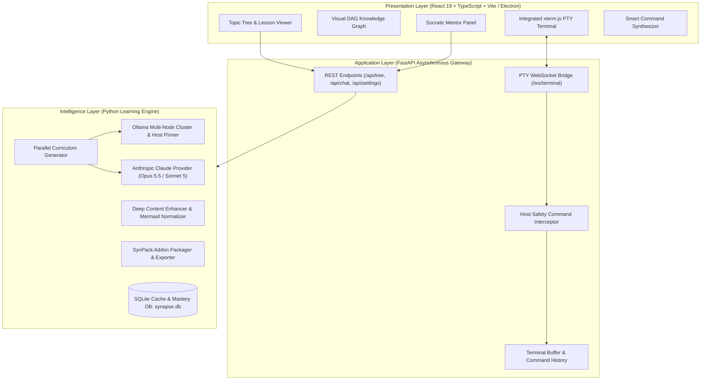

<div align="center">
  
  <h1>Synapse</h1>
  <p><strong>AI Learning Workspace & Socratic Curriculum Engine</strong></p>

  <a href="CHANGELOG.md">
    
  </a>
  <a href="https://gitea.2464.cz/ai/synapse">
    
  </a>
  <a href="LICENSE">
    
  </a>
  <a href="#-quick-start--installation">
    
  </a>
  <a href="https://fastapi.tiangolo.com/">
    
  </a>
  <a href="https://vitejs.dev/">
    
  </a>
  <a href="https://anthropic.com">
    
  </a>
</div>

<br />

**Synapse** is an advanced, self-hosted AI Learning Workspace and automated Curriculum Engine. It autonomously researches, scopes, drafts, peer-reviews, and enhances textbook-grade masterclasses and hands-on operational labs across a canonical taxonomy of **12 engineering, scientific, and polymath domains** and **80 disciplines**.

Once the curriculum is assembled, Synapse provides a native **Socratic Workbench** (available as a web app or standalone Electron desktop application) featuring a dual-pane reader, an integrated PTY terminal with smart command synthesis, and an interactive, multilingual AI Mentor.

---

## 🎯 Key Features & Capabilities

### 1. Autonomous Masterclass Curriculum Engine
- **Textbook-Grade Depth:** Automatically authors sequential, multi-module masterclasses following the rigorous O'Reilly / MIT Press standard:
  - *Foundations & Invariants:* First-principles mathematical and theoretical groundwork.
  - *Architecture & Mechanics:* Internal data structures, execution pipelines, and clean ASCII/Mermaid diagrams.
  - *Deep Dive & Concurrency:* Memory models, locking mechanisms, failure modes, and mitigation patterns.
  - *Operational Verification Labs:* Hands-on terminal diagnostics, benchmarks, and chaos testing scenarios.
- **Parallel Multi-Node Generation (`generate_all.py`):** Orchestrates generation across local multi-node Ollama clusters or cloud providers (**Anthropic Claude Opus 5.5 / Sonnet 5**) using work-stealing queues and multi-threaded parallel drafting.
- **Deep Content Enhancer (`--enhance`):** Rigorously audits existing lessons and labs, purging hallucinations, standardizing Mermaid.js diagrams, expanding real-world code (C, Rust, Go, Python, SQL), and enriching architectural explanations.
- **Live Terminal Monitor (`monitor.py`):** Dedicated terminal dashboard with auto-updating progress counters, active worker status, file insertion statistics, and live log tailing (`--watch`, `--tail`).

### 2. Native Socratic Workbench UI
- **Canonical Topic Tree:** Fast navigation across 12 domains and 80 disciplines with completion badges, multi-lesson expansion, and a redesigned **`icon-btn-sm`** sort toggle (`ArrowDownAZ` / `TrendingUp`).
- **Dynamic Math & Diagram Reader:** Real-time rendering of KaTeX display and inline math (`$$...$$`), syntax-highlighted code blocks, and self-healing **Mermaid.js** architecture graphs.
- **Smart Terminal Command Synthesizer:** Intelligently wraps code blocks (SQL, Kubernetes manifests, Python, C, Rust) into safe, executable shell wraps ready to run directly in your terminal with one click.
- **Visual DAG Knowledge Graph:** Toggle between an interactive DAG pipeline view and a detailed timeline to visualize prerequisites, domain pathways, and learning trajectories.
- **Bilingual & Polyglot Reader:** Side-by-side bilingual reading mode supporting on-the-fly language comparisons.

### 3. Socratic AI Mentor
- **Active Lesson Grounding:** Chat prompts are continuously grounded in the active lesson or lab open on your screen.
- **Live Terminal Context Interception:** Automatically tracks your active shell session, executed commands (`LAST_TERMINAL_COMMAND`), and console outputs, directly diagnosing exit codes, errors, and syntax without confusion.
- **Full Multilingual Fluency:** Seamlessly converses in **English, Czech (Čeština), German (Deutsch), Spanish (Español), or Russian (Русский)** while keeping code identifiers exact.
- **Resilient Model Fallback:** Auto-discovers local models, handles single-model nodes automatically, and cascades to Cloud Claude Opus/Sonnet if local Ollama is offline.

### 4. Deep Theme & Appearance Engine
- **7 Curated Base Themes:** Studio Obsidian, GitHub Dimmed, Nordic Frost, Monokai Pro, Dracula Noir, Solarized Dark, and Titanium Daybreak.
- **5 Accent Highlight Colors:** Amber Gold, Electric Cyan, Matrix Emerald, Royal Amethyst, and Crimson Rose.
- **Reading Typography:** Modern Sans (Inter), Academic Serif (Charter/Merriweather), or Technical Mono (JetBrains Mono).
- **Line Spacing & Density:** Configurable reader line height (Compact 1.45, Balanced 1.68, Relaxed 1.92).

### 5. Dedicated System & Maintenance Hub
- Dedicated settings tab for transient session cleanup (`.workspace_sessions`), cluster model pin resets (`.synapse_node_pins.json`), database health (`data/synapse.db`), and generation log viewing.

---

## 🏗 Architecture



---

## 🚀 Quick Start & Installation

### Option 1: 1-Click Desktop App (Zero Build Required)
Download the standalone, zero-dependency desktop application from the **[Releases](https://gitea.2464.cz/ai/synapse/releases)** page:

| Platform | Download | Instructions |
| :--- | :--- | :--- |
| **macOS (Apple Silicon)** | **[`Synapse-Workbench-1.0.0-arm64.dmg`](https://gitea.2464.cz/ai/synapse/releases)** | Open the `.dmg`, drag **Synapse Workbench** to `Applications`, and launch! |
| **macOS (Portable)** | **[`Synapse-Workbench-1.0.0-arm64-mac.zip`](https://gitea.2464.cz/ai/synapse/releases)** | Unzip and launch **Synapse Workbench.app** directly. |
| **Linux / Windows (WSL2)** | **[`synapse-1.0.0-py3-none-any.whl`](https://gitea.2464.cz/ai/synapse/releases)** | See Python Wheel Installation below. |
| **Any Platform** | **Docker Compose** | See Docker Deployment below. |

---

### Option 2: Python Wheel (`.whl`) Installation (Linux, macOS, Windows WSL2)

Install and run Synapse via standard Python packaging across Linux, macOS, or Windows (WSL2):

```bash
# 1. Create and activate a virtual environment
python3 -m venv synapse-env
source synapse-env/bin/activate

# 2. Install the official wheel from Gitea
pip install https://gitea.2464.cz/ai/synapse/releases/download/v1.0.0/synapse-1.0.0-py3-none-any.whl

# 3. Launch the Socratic Workbench
synapse serve --port 8000
# Open http://localhost:8000 in your browser
```

* **Linux:** 100% native support out of the box with embedded POSIX PTY terminal drivers.
* **Windows:** Run inside **WSL2** (`wsl --install`) for full terminal PTY and Docker sandbox capabilities.
* **CLI Utilities:** Once installed, use `synapse doctor` for system diagnostics or `synapse audit` for curriculum verification.

---

### Option 3: 1-Click Docker Compose
Run the full Socratic Workbench in an isolated, multi-stage production container:

```bash
git clone https://gitea.2464.cz/ai/synapse.git && cd synapse
docker compose up -d
```

- **Open:** Visit **`http://localhost:8000`** in your browser.
- **Persistence:** Local curriculum (`./topics`), SQLite mastery database (`./data`), and exported packages (`./exports`) are volume-mounted.
- **Ollama Host Bridge:** Pre-configured with `host.docker.internal:host-gateway` to connect seamlessly to local Ollama on your host machine.

To shut down:
```bash
docker compose down
```

---

### Option 4: Developer & Source Setup

```bash
# 1. Clone repository
git clone https://gitea.2464.cz/ai/synapse.git && cd synapse

# 2. Set up Python virtual environment
python3 -m venv .venv
source .venv/bin/activate
pip install -r requirements.txt

# 3. Build frontend SPA
cd app/frontend
npm install
npm run build
cd ../..

# 4. Launch Synapse Web Workbench
.venv/bin/uvicorn app.backend.main:app --host 127.0.0.1 --port 8000
# Open http://localhost:8000 in your browser
```

For hot-reloading frontend development:
```bash
npm --prefix app/frontend run dev
# Open http://localhost:5173
```

---

## 🧠 Curriculum Generation & Enhancement

Synapse can autonomously research, author, or deeply enhance curriculum units using Claude Opus 5.5 or local Ollama clusters.

### Running the Parallel Generator
```bash
# Enhance all existing topics in the computing domain with Claude Opus 5.5
python3 scripts/generate_all.py --domain computing --enhance

# Draft all unwritten topics across the entire taxonomy
python3 scripts/generate_all.py --provider anthropic

# Target a specific domain with local Ollama
python3 scripts/generate_all.py --domain formal_sciences --provider ollama
```

### Live Generation Monitoring
```bash
# Follow the live token stream and elapsed times in real time
tail -f generator.log

# Open the auto-updating visual terminal dashboard
python3 scripts/monitor.py --watch

# Print a one-time status snapshot
python3 scripts/monitor.py
```

---

## 🛡️ Security, Host Safety & Credential Isolation

- **Isolated Credentials:** Cloud API keys (Anthropic, Gemini) are stored strictly outside the repository tree in `~/.config/synapse/env` with restricted `600` file permissions. They are never committed to git.
- **Host Safety Guard:** The integrated PTY terminal actively intercepts destructive command patterns (`rm -rf /`, `mkfs`, raw block writes, fork bombs) and pauses execution until you explicitly type `CONFIRM`.
- **Root-Anchored Runtime DB:** Runtime caches and SQLite databases (`/data/`, `/exports/`) are anchored to root in `.gitignore`, guaranteeing authored topics in `topics/computing/data/` are never accidentally ignored.

---

## 📚 Documentation Index

For detailed guides, see the `docs/` directory:

- [Curriculum Generation & Models Guide](docs/CURRICULUM_GENERATION_AND_MODELS.md)
- [Socratic Workbench & UI Architecture](docs/SOCRATIC_WORKBENCH_AND_UI.md)
- [Configuration, Node Pinning & Security](docs/CONFIG_AND_SECURITY.md)
- [Terminal Sandboxes: Docker, k3s & Host Safety](docs/CONTAINERS_AND_SANDBOX.md)
- [Installation & Multi-Platform Guide](docs/INSTALLATION.md)
- [SynPack Distributions & Addon Store](docs/PACKAGES_AND_STORE.md)
- [Clean Packaging & Workspace Data Management](docs/CLEANUP_AND_DATA_MANAGEMENT.md)

---

## 📄 License

Synapse is open-source software licensed under the **MIT License**. See [LICENSE](LICENSE) for details.
