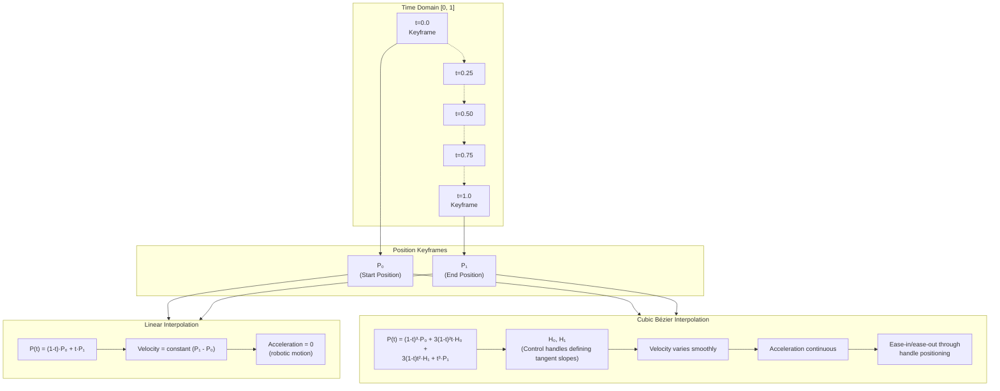

# Lesson 3: Motion Mechanics through Physical Principles

## 1. First-Principles Intuition & Invariants

The illusion of life in three-dimensional animation emerges not from photorealistic rendering or intricate geometry, but from the authenticity of motion itself. A perfectly modeled character remains lifeless until governed by timing curves that encode weight, intention, and physical consequence. Traditional animators discovered empirically what physicists formalize mathematically: motion communicates mass, personality, and causality through precise manipulation of position over time. The twelve principles codified by Disney animators Frank Thomas and Ollie Johnston translate directly into computational models—differential equations, interpolation kernels, and constraint solvers—that govern every keyframe transition, particle trajectory, and cloth fold in modern production pipelines.

At the foundation lies a deceptively simple relationship: displacement as a function of time. Yet the derivative structure embedded within this relationship encodes profound complexity. Velocity describes the rate of positional change; acceleration modulates velocity itself. When an animator sets two keyframes separated by forty frames, the software must interpolate not merely the spatial coordinates but the entire velocity profile that connects them. Linear interpolation produces robotic, unnatural motion because real-world forces—gravity, friction, inertia—impose continuous acceleration gradients that demand nonlinear easing curves. The fundamental invariant governing believable animation states that motion must exhibit continuous second-order differentiability except at deliberate impact events. Discontinuous acceleration signals physically impossible teleportation of energy; discontinuous velocity indicates collision or constraint satisfaction. Every credible motion system must preserve or deliberately violate these differential continuity conditions to communicate physical truth or intentional stylization.

The classical animation principles emerged from biological observation and theatrical staging, yet each principle maps onto precise mathematical constructs. Timing—the number of frames allocated to an action—directly controls velocity magnitude. Spacing—the distribution of inbetween positions—defines the acceleration profile through implicit differentiation. Arcs constrain motion paths to natural geodesics dictated by joint rotations and momentum conservation. Squash and stretch encode energy conservation during elastic deformation, where volume preservation requires reciprocal scaling along orthogonal axes. Anticipation and follow-through express Newton's third law: preparatory countermotion precedes primary action, and momentum dissipates gradually rather than instantaneously. These principles do not merely mimic reality; they formalize the perceptual signatures by which human vision infers physical causality.

Physics simulation extends these principles into domains of computational complexity that defy manual keyframing. Particle systems model granular phenomena—dust clouds, sparks, rain, flocking birds—by simulating thousands of independent agents governed by force accumulators and constraint relationships. Rigid body dynamics solve simultaneous systems of collision constraints and torque equations to produce mechanically accurate interactions between solid objects. Soft body deformation simulates elasticity through spring-mass networks or finite element discretizations, where local strain propagates through neighboring vertices according to material stiffness matrices. Each simulation paradigm sacrifices direct artistic control for emergent complexity: the animator specifies initial conditions and force parameters, then observes the deterministic cascade of physical consequences. The tension between keyframe authorship and simulation autonomy defines the modern animator's craft—knowing when to hand-craft motion curves for narrative emphasis and when to delegate complexity to solvers that guarantee physical coherence.

Procedural motion generation occupies the spectrum between manual keyframing and full physics simulation. Noise functions—Perlin, simplex, fractional Brownian motion—inject organic irregularity into cyclic animations, preventing the mechanical repetition that signals artificiality. Inverse kinematics solvers compute joint rotations backward from desired end-effector positions, enabling characters to plant feet on uneven terrain or reach toward dynamic targets without manual rotation keyframing. Constraint systems encode geometric relationships—aim-at, look-at, path-following—that persist across animation edits, maintaining spatial coherence automatically. Motion graphs and state machines blend pre-captured animation clips based on runtime conditions, enabling responsive character control in interactive contexts. Each procedural technique encodes domain-specific knowledge—anatomical constraints, behavioral patterns, environmental interactions—as reusable algorithms that amplify animator productivity.

Motion capture technology bridges physical performance and digital character control by recording real-world movement through optical marker tracking or inertial measurement units. The raw data stream—marker positions sampled at 120 Hz or higher—encodes not only skeletal kinematics but also the subtle secondary motions, timing variations, and weight shifts that distinguish expert performers. Yet raw mocap data rarely transfers directly to animated characters due to skeletal proportion mismatches, marker noise, and missing frames. The post-processing pipeline involves marker labeling, gap filling, filtering, retargeting to disparate skeletal rigs, and constraint enforcement to prevent foot sliding or hand penetration. Motion capture does not eliminate animation craft; it transforms the animator's role from motion author to motion editor, sculpting captured performances into narratively coherent sequences that respect both physical truth and directorial intent.

The unifying invariant across all motion methodologies remains temporal coherence under constraint. Whether hand-keyed, simulated, or captured, motion must satisfy physical plausibility unless deliberately stylized. Gravity must pull downward at consistent acceleration unless magical forces intervene. Momentum must persist unless dissipated through friction or collision. Joints must respect anatomical rotation limits unless the character design specifies otherwise. The animator's fundamental responsibility involves encoding intention through motion—communicating weight through timing, personality through spacing, and causality through arc trajectories—while honoring the physical principles that ground fictional worlds in perceptual reality.

## 2. Core Architecture & Mechanics

The computational substrate of motion in three-dimensional space begins with the transformation matrix, a four-by-four homogeneous coordinate structure encoding translation, rotation, and scale operations. Every object in a scene maintains a local transformation matrix describing its position and orientation relative to a parent coordinate frame, with hierarchical chains propagating transformations through skeletal armatures or scene graphs. Animation modifies these matrices over time by interpolating their constituent components—Euler angles, quaternions, or axis-angle representations for rotation; three-dimensional vectors for translation—according to parameterized curves evaluated at discrete frame intervals. The animation system's responsibility involves converting sparse keyframe data into dense per-frame transformation streams while preserving differential continuity and respecting mechanical constraints.

Keyframe interpolation relies on parameterized curve representations that map the normalized time interval [0, 1] onto value ranges with controllable velocity profiles. Linear interpolation computes the weighted average between adjacent keyframes, producing constant velocity but discontinuous acceleration at keyframe boundaries. Cubic Bézier curves introduce two control handles per keyframe, defining tangent directions that ensure C1 continuity—matching first derivatives—at segment junctions. The curve parameter does not correspond directly to arc length, however; uniform time steps produce nonuniform spatial displacements, enabling the ease-in and ease-out profiles fundamental to natural motion. Hermite splines parameterize segments through endpoint positions and tangent vectors, while Catmull-Rom splines compute tangents automatically from adjacent keyframe positions, providing continuity without manual handle adjustment. The choice of interpolation kernel directly determines motion quality: Bézier curves grant fine-grained timing control, while Catmull-Rom automation suits rapid blocking workflows.



Traditional animation's timing and spacing principles map directly onto this interpolation machinery. Timing corresponds to keyframe interval duration measured in frames: a ball dropping through 120 pixels over 8 frames exhibits faster velocity than one traversing the same distance over 16 frames. Spacing controls the distribution of inbetween positions, which directly determines the acceleration profile. Uniform spacing produces constant velocity; closer spacing near the starting keyframe concentrates positional change at the action's beginning, creating ease-out deceleration. The animator manipulates spacing by adjusting Bézier handles or inserting intermediate keyframes, sculpting the motion's rhythmic cadence. The graph editor visualizes these curves as time-versus-value plots, transforming abstract numerical interpolation into tangible visual editing targets.

Arc trajectories emerge from coordinating multiple interpolation curves across orthogonal axes. A hand waving follows neither a straight line nor independent X-Y-Z linear paths but rather a smooth arc dictated by shoulder rotation and momentum conservation. The animator achieves arcs by offsetting keyframe timing across spatial dimensions or by manipulating Bézier handle directions to enforce curved rather than rectilinear paths. Broken arcs—motion paths containing corners or straight segments—immediately signal mechanical or weightless motion. The motion path visualization tool renders the interpolated trajectory as a spline curve in three-dimensional space, with tick marks indicating per-frame positions. Dense tick clusters reveal deceleration zones; sparse spacing indicates high velocity. The arc's curvature radius correlates inversely with implied centripetal acceleration, encoding the physical forces driving the motion.

Physics simulation replaces keyframe interpolation with numerical integration of differential equations governing force accumulation and constraint satisfaction. The simulation loop executes each frame through discrete time steps, typically subdivided into multiple solver iterations for stability. Each particle or rigid body maintains state vectors encoding position, velocity, and acceleration in three-dimensional space, plus orientation quaternions and angular velocity for rotational dynamics. The force accumulator sums gravitational attraction, spring tension, drag resistance, and user-applied forces, then divides by mass to compute acceleration according to Newton's second law. The integrator—commonly a semi-implicit Euler or fourth-order Runge-Kutta method—updates velocity by the acceleration increment scaled by the timestep duration, then updates position by the velocity increment. Collision detection algorithms identify interpenetrating geometry, generating constraint forces that redirect velocity vectors to resolve overlaps while conserving momentum.

```text
Physics Simulation Loop (per frame, subdivided timesteps):

FOR each substep dt:
  FOR each particle i:
    1. Accumulate forces: F_total = F_gravity + F_springs + F_drag + F_external
    2. Compute acceleration: a = F_total / mass
    3. Update velocity: v_new = v_old + a·dt
    4. Update position: p_new = p_old + v_new·dt
    
  FOR each constraint (collision, joint, etc.):
    5. Detect violations (penetration depth, angle limits)
    6. Compute corrective impulses preserving momentum
    7. Apply impulses to modify velocities
    
  8. Damp velocities (energy dissipation modeling friction)
  
EMIT final positions/orientations for rendering
```

Particle systems model granular phenomena by managing arrays of independent agents, each governed by the core simulation loop but potentially augmented with lifespan timers, size variation, color gradients, and texture animation. Emitters spawn particles at specified rates, assigning initial positions sampled from geometric volumes—points, spheres, meshes—and velocities following directional cones or surface normals. Force fields apply spatially varying accelerations: directional wind forces, radial vortex forces, turbulence noise functions. The challenge lies in balancing particle count against computational budget; ten thousand particles simulated per frame strain real-time preview systems, demanding adaptive level-of-detail strategies or cached simulation baking for final renders.

Rigid body dynamics simulates objects maintaining fixed shape under collision and gravitational forces. Each body's transformation matrix evolves according to linear and angular momentum equations, with torque computed from force application points relative to the center of mass. Collision detection employs hierarchical bounding volume tests—axis-aligned boxes, oriented boxes, spheres—to prune non-interacting pairs before expensive mesh-level polygon intersection tests. Contact resolution applies impulses perpendicular to collision surfaces, scaled by restitution coefficients encoding elastic versus inelastic bouncing behavior. Friction forces resist tangential sliding, computed from normal forces and surface friction parameters. Constraint solvers enforce mechanical joints—hinges, sliders, ball-and-socket—by iteratively projecting velocities and positions to satisfy geometric restrictions, maintaining connected bodies through multiple collisions.

Soft body simulation extends particle systems by connecting vertices through spring networks or volumetric finite elements. The mass-spring model treats mesh vertices as particles linked by springs with rest lengths and stiffness constants. Stretching a spring beyond its rest length generates tension forces pulling vertices together; compression produces repulsive forces. Shear and bend springs augment structural springs to resist shape distortion and creasing. The finite element method discretizes volumetric objects into tetrahedral meshes, solving partial differential equations governing stress-strain relationships through material stiffness matrices. Both approaches demand careful parameter tuning: excessive stiffness causes instability requiring prohibitively small timesteps, while insufficient stiffness produces overly elastic, gelatinous motion. Damping coefficients dissipate energy, preventing perpetual oscillation.

Inverse kinematics (IK) solves the inverse problem of forward kinematic chains: given a desired end-effector position, compute the joint rotations that achieve it. Analytical solutions exist for simple two-bone chains—human arms, legs—through trigonometric relationships, but complex multi-joint chains require iterative numerical methods. The Cyclic Coordinate Descent algorithm adjusts one joint at a time to minimize the distance between the current end-effector position and the target, cycling through joints until convergence. The Jacobian transpose method computes velocity directions by inverting the kinematic Jacobian matrix relating joint velocities to end-effector velocities, stepping incrementally toward the target. Pole vector constraints disambiguate elbow and knee orientations, specifying the plane containing the two-bone chain. IK solvers frequently underconstrain solutions—infinite joint configurations may satisfy the end-effector target—requiring additional constraints or heuristics favoring natural poses.

Procedural noise functions inject organic irregularity into animated properties by sampling continuous multidimensional fields. Perlin noise combines octaves of gradient noise at multiple frequencies, producing smooth turbulence patterns free of directional bias or visible repetition. The animator maps animation time or spatial coordinates into the noise function's input domain, scaling and biasing the output to modulate positions, rotations, or material properties. Fractal Brownian motion layers multiple noise octaves with increasing frequency and decreasing amplitude, generating detail at multiple scales. Noise-driven motion prevents mechanical cycling in looped animations: a hovering spacecraft subtly wobbles, grass blades sway irregularly, hand-held cameras exhibit micro-jitter. The noise function's parameters—frequency, amplitude, octave count—control the character of randomness from gentle drift to chaotic vibration.

Motion capture data arrives as sequences of three-dimensional marker positions sampled at high temporal resolution, typically 120 or 240 frames per second. The retargeting pipeline maps these marker clouds onto target character skeletons through multi-stage processing. Marker labeling assigns each tracked point to a specific anatomical location—left wrist, right knee—either through template matching or manual identification. Gap filling interpolates missing data when markers become occluded or tracking fails, using cubic spline interpolation or skeletal model predictions. Filtering removes high-frequency noise through low-pass Butterworth filters or Savitzky-Golay smoothing, balancing noise reduction against motion latency. Retargeting solves for joint rotations that position the character skeleton's bones to match marker locations despite skeletal proportion differences, typically through inverse kinematics with constraints favoring natural poses. Foot contact detection identifies planted feet through velocity thresholding, enabling constraint application that eliminates skating artifacts where feet slide despite appearing grounded.

The motion graph structure organizes captured animation clips into a searchable state machine, enabling runtime blending between disparate movements. Each clip occupies a node; edges represent transition opportunities identified through pose similarity metrics. The system searches the graph for paths connecting current state to desired target state, blending smoothly through transition zones where poses align. Motion matching algorithms select optimal clips frame-by-frame based on predicted future trajectory and current velocity, creating responsive character control from databases of pre-recorded performances. The animator's role shifts to curating clip libraries, annotating semantic tags—walk, run, turn—and tuning blend parameters rather than keyframing individual motions.

## 3. High-Performance Optimization & Failure Modes

The animation production pipeline confronts fundamental tensions between artistic iteration speed, simulation accuracy, and computational feasibility. Real-time viewport feedback demands aggressive level-of-detail reductions and cached approximations, while final rendering leverages offline computation budgets for simulation convergence and subframe temporal sampling. The practitioner must navigate these tradeoffs strategically, recognizing when simplified preview suffices for decision-making versus when full-resolution simulation validation becomes necessary. Premature optimization toward real-time performance sacrifices simulation fidelity; conversely, iterating on expensive high-resolution simulations stalls creative momentum. The optimal workflow stages simulation complexity progressively: rough blocking with proxy geometry and coarse timesteps, intermediate refinement with partial caching, final production resolution for approved sequences only.

Keyframe animation workflows benefit from hierarchical refinement strategies that defer detail until foundational timing solidifies. Blocking phase establishes key poses on primary storytelling beats, often on four-frame intervals or broader, using stepped interpolation that holds each keyframe until the next without inbetweening. This freezes spacing decisions, isolating timing evaluation—the animator judges action duration without distraction from interpolation artifacts. Blocking approval gates progression to the breakdowns phase, where intermediate extreme poses define arc trajectories and anticipation mechanics. Only after breakdown approval does the animator polish interpolation curves, adjusting Bézier handles to sculpt ease-in and ease-out profiles. This staged approach prevents wasted effort refining curves that subsequently require retiming.

Graph editor efficiency demands keyboard-driven workflows that minimize mouse manipulation overhead. Practitioners memorize hotkey sequences for common operations: set keyframe (I), clear keyframe (Alt-I), toggle interpolation mode (T), frame selected keys (Period). Box selecting multiple keys across channels enables simultaneous scaling or translation, proportionally adjusting timing or value ranges. The dope sheet provides alternate visualization grouping channels by object rather than by property, facilitating hierarchical retiming of entire action sequences. Normalized view modes scale disparate value ranges—rotations in degrees, positions in centimeters—into common vertical space, clarifying relative timing relationships despite dimensional heterogeneity.

Physics simulation performance scales nonlinearly with element count and timestep subdivision requirements. Particle systems encounter quadratic complexity when forces require inter-particle interaction evaluation—flocking behaviors, electrostatic repulsion—transforming thousand-particle simplicity into million-interaction computational explosion. Spatial partitioning structures mitigate this through octrees or uniform grids that restrict interaction queries to local neighborhoods, reducing effective complexity toward linear scaling. The animator must recognize when per-particle uniqueness matters versus when instancing identical motions with stochastic variation suffices. Crowd simulations often layer hero agents receiving full simulation against background agents following simplified navigation meshes or pre-baked animation cycles, concentrating computational budget on foreground visibility.

Rigid body simulation stability hinges on timestep duration relative to collision velocities and constraint stiffness. Explicit integration schemes—forward Euler—accumulate energy when timesteps exceed stability thresholds dictated by spring frequencies or collision impulse magnitudes, causing exponential velocity divergence and explosive disintegration. Implicit integrators—backward Euler—remain stable at larger timesteps but introduce artificial damping that dissipates energy excessively, producing sluggish motion. The practitioner balances timestep subdivision against computational budget: ten substeps per frame cost ten times the computation but permit stiffer springs and higher-velocity impacts. Adaptive timestep strategies dynamically subdivide time during high-energy events—collisions, rapid rotations—while using coarser steps during quiescent intervals.

Simulation failure modes manifest distinctly across paradigms. Particle systems explode when forces exceed damping capacity, sending particles to infinite coordinates; conservative bounding volume constraints prevent render-time surprises by culling escaped particles. Rigid bodies interpenetrate when collision detection misses fast-moving objects tunneling through thin geometry; continuous collision detection sweeps volumes along motion paths rather than testing discrete positions, catching high-velocity intersections at computational cost. Soft bodies collapse or invert when compression forces exceed structural integrity, flipping triangle normals inside-out; volume preservation constraints enforce minimum tetrahedron volume, preventing catastrophic inversion.

Motion capture retargeting introduces artifacts when skeletal proportion mismatches create unreachable target poses. A short-limbed character cannot replicate a tall performer's stride without foot sliding or pelvis displacement errors. The retargeting solver must prioritize constraints: maintaining foot contact positions sacrifices precise hand placement, while enforcing arm reach abandons hip translation fidelity. Advanced solvers accept multiple priority tiers, satisfying critical constraints—planted feet, hand grasps—exactly while permitting best-effort approximations for lower-priority targets. The animator inspects retargeted results systematically, checking foot contacts frame-by-frame and verifying natural joint angle ranges rather than assuming automated retargeting succeeds universally.

Filtering motion capture data trades noise reduction against motion latency and responsiveness. Low-pass filters removing high-frequency jitter introduce phase delay, lagging filtered output behind input by several frames. Acausal filters—Butterworth with forward-backward passes—eliminate phase distortion by filtering temporally in both directions, acceptable for offline processing but incompatible with real-time applications. The cutoff frequency setting demands domain knowledge: aggressive filtering at 6 Hz removes genuine motion detail like finger vibration during rapid gestures, while conservative 15 Hz cutoffs retain marker noise. The practitioner validates filtering choices by overlaying raw and filtered trajectories, confirming that smoothing preserves motion character rather than homogenizing performances into generic blandness.

Procedural noise injection requires careful frequency and amplitude tuning to avoid overwhelming authored animation. High-frequency noise at excessive amplitude produces jittery, nervous motion inappropriate for calm or graceful characters. Low-frequency, high-amplitude noise causes large-scale drift that violates spatial constraints or narrative geography. Layering noise octaves at decreasing amplitude ratios—each doubling in frequency reduces amplitude by half—yields fractal complexity resembling natural phenomena. Time-domain noise applied to rotation channels must account for quaternion or Euler angle representations; naive noise addition to Euler angles produces gimbal lock or rotation flipping, demanding quaternion spherical interpolation or axis-angle perturbations.

Inverse kinematics fails when target positions lie beyond the kinematic chain's reachable workspace or when joint limits prevent geometric solutions. The solver either stretches the chain impossibly or converges to local minima producing unnatural bent-backward joints. Pole vector constraints prevent solution ambiguity but require careful positioning; incorrectly placed pole targets force elbows or knees into anatomically impossible orientations. The animator monitors iteration counts and convergence error metrics, recognizing that persistent high error or maximum iteration exhaustion signals infeasible targets requiring keyframe adjustment rather than parameter tweaking.

Caching strategies decouple simulation computation from playback and downstream editing. Simulation baking writes per-frame transformation matrices or vertex positions to disk, enabling real-time scrubbing through complex dynamics. The cache invalidation problem arises when upstream animation edits—altered keyframes, modified force parameters—invalidate cached simulation ranges. Manual cache management demands discipline: invalidating affected frame ranges immediately prevents stale data from polluting renders. Automatic dependency tracking systems monitor parameter changes and selectively invalidate dependent caches, though conservative invalidation strategies often discard more frames than strictly necessary, wasting recomputation effort.

The boundary between keyframe authorship and simulation autonomy defines the modern animator's craft. Keyframing offers direct control and guaranteed results but scales poorly to complex multi-element interactions. Simulation generates emergent complexity and physical coherence automatically but sacrifices predictability and narrative control. Hybrid approaches layer keyframed primary motion with simulated secondary dynamics: a hand-animated character runs across manually placed stepping stones while cloth simulation handles cape flutter and hair follows procedural strand dynamics. Recognizing which motion aspects demand authorship versus which benefit from automation separates efficient production from exhaustive manual labor. The animator's expertise involves not merely executing either paradigm but strategically composing them into workflows that maximize creative control within feasible computational budgets, delivering motion that communicates weight, intention, and consequence through physically grounded timing and spacing.
