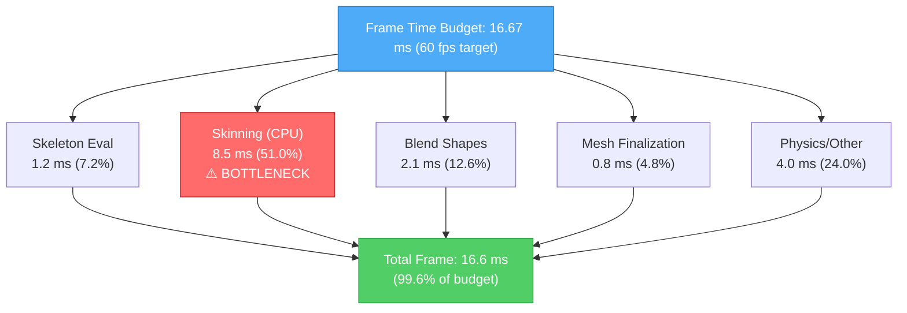
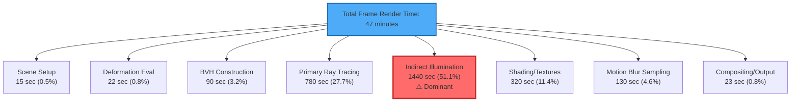

# Lesson 4: Production Pipeline Optimization

## 1. First-Principles Intuition & Invariants

The production pipeline in 3D animation exists at the intersection of artistic intent and computational constraint. Every vertex transformation, every deformation calculation, and every pixel rendered represents a tradeoff between visual fidelity and resource expenditure. Understanding this balance requires recognizing that animation pipelines are fundamentally **dataflow architectures**—hierarchical systems where modifications propagate through layers of dependency, each transformation accumulating computational cost and potential for error introduction.

At the foundation of pipeline optimization lies a critical distinction between **destructive and non-destructive workflows**. Destructive operations bake calculations permanently into geometry or keyframe data, collapsing the dependency stack and eliminating the ability to iterate upstream without reconstruction. Non-destructive workflows preserve the entire transformation chain through modifier stacks, procedural systems, and layer-based architectures, trading increased memory overhead and evaluation time for artistic flexibility. The skilled technical artist recognizes that optimization is not about choosing one paradigm exclusively, but rather about strategic placement of destructive operations at points where creative iteration has concluded and performance gains justify the loss of reversibility.

The animation production pipeline operates on three fundamental resource axes: **computation time, memory footprint, and storage capacity**. Computation time divides into two distinct regimes—real-time evaluation for viewport interaction and offline rendering for final output. Real-time constraints demand frame-rate-locked performance, typically targeting 24 to 60 frames per second, which establishes a hard temporal budget of 16 to 41 milliseconds per frame. Every deformation calculation, physics simulation step, and shader evaluation must complete within this window. Offline rendering relaxes temporal constraints but introduces different concerns: render farm efficiency, distributed processing overhead, and the economic cost of cloud compute hours.

Memory architecture in modern 3D pipelines follows a hierarchical caching model. High-resolution geometry exists in permanent storage as static mesh data, loaded into system RAM during scene initialization, then transferred to GPU VRAM for rasterization. Deformation data—blend shape deltas, bone transformations, cloth simulation states—occupies intermediate cache layers, with different refresh strategies depending on whether the animation uses keyframed data (requiring sequential frame evaluation) or procedural systems (allowing random access but demanding per-frame recalculation). The pipeline optimizer must understand memory locality principles: sequential data access patterns enable cache prefetching and minimize main memory round-trips, while scattered random access triggers cache thrashing and pipeline stalls.

**The Dependency Graph Invariant** governs all pipeline architecture decisions. Every operation in a 3D scene exists as a node in a directed acyclic graph (DAG), where edges represent data dependencies and topological sorting determines evaluation order. When an animator adjusts a bone rotation, the dependency graph identifies all downstream vertices affected by that bone's influence, triggering skinning recalculation only for the affected mesh region. When a rigger modifies a blend shape target, the graph propagates changes through shape key interpolation systems to final mesh output. Pipeline optimization fundamentally concerns graph structure: minimizing edge count through strategic data consolidation, identifying independent subgraphs that parallelize cleanly across CPU cores or GPU compute units, and recognizing cyclic dependencies that force iterative solvers or manual graph refactoring.

Asset interchange represents the pipeline's external boundary condition. Different software packages—modeling tools, animation systems, rendering engines, game engines—employ incompatible internal representations for geometry, materials, and animation data. The technical artist must navigate a landscape of interchange formats, each designed for specific use cases with inherent tradeoffs. Alembic (.abc) files store baked geometry caches with per-frame vertex positions, ideal for transferring complex simulations or heavy deformations between packages but sacrificing all procedural editability. FBX format attempts comprehensive scene representation, embedding geometry, skeletal hierarchies, blend shapes, materials, and animation curves in a single container, but notorious for subtle transform space conversions and material translation errors that introduce hours of debugging. USD (Universal Scene Description) provides layered composition and procedural overrides, enabling non-destructive asset referencing at the cost of steeper learning curves and less mature tool support.

## 2. Core Architecture & Mechanics

### Animation Layer Composition Systems

Animation layer composition emerged from the recognition that complex character performances require independent control over multiple behavioral systems simultaneously. A walking character must coordinate locomotion cycles, breathing rhythm, eye dart micro-movements, and emotional facial expressions—each system operating on different timescales and requiring independent adjustment without polluting other layers. The layer compositor implements this through **additive transformation accumulation** or **weighted blending**, depending on the animation property being modified.

Rotational animation layers require quaternion interpolation mathematics to avoid gimbal lock artifacts and ensure shortest-path rotations. When an animator creates a base walk cycle on layer zero, then adds a breathing chest expansion on layer one, the compositor must resolve these rotations through quaternion multiplication rather than naive Euler angle addition. The base layer's shoulder rotation quaternion $q_{\text{base}}$ combines with the breathing layer's additive quaternion $q_{\text{breathe}}$ through the operation $q_{\text{final}} = q_{\text{base}} \cdot q_{\text{breathe}}$, producing a single rotation that preserves both movements without the 180-degree flips that plague Euler-based systems.

Translational layers compose more intuitively through vector addition. A character's root translation from the locomotion system (layer 0) adds linearly to procedural foot-plant adjustments from an IK system (layer 1) and terrain-following offsets (layer 2). The final position vector emerges as $\mathbf{p}_{\text{final}} = \mathbf{p}_{\text{base}} + \mathbf{p}_{\text{IK}} + \mathbf{p}_{\text{terrain}}$. However, the compositor must respect evaluation order: ground-snapping adjustments must compute after the base locomotion establishes the character's intended trajectory, otherwise the foot-plant solver operates on stale position data and produces sliding artifacts.

Blend shape layers introduce multiplicative weighting rather than pure addition. Facial animation systems often layer phoneme visemes (mouth shapes for speech sounds) atop emotional expression shapes. The compositor applies weights sequentially: the base neutral face receives a 0.7 weight toward an "anger" shape, then that intermediate result receives a 0.5 weight toward an "M" phoneme shape. Mathematically, vertex positions flow through a chain of linear interpolations: $\mathbf{v}_{\text{anger}} = \text{lerp}(\mathbf{v}_{\text{neutral}}, \mathbf{v}_{\text{anger target}}, 0.7)$, followed by $\mathbf{v}_{\text{final}} = \text{lerp}(\mathbf{v}_{\text{anger}}, \mathbf{v}_{\text{M target}}, 0.5)$. Layer order profoundly impacts the final result—reversing the evaluation sequence produces a different facial configuration even with identical weights.

Modern animation systems implement layer compositing through a **command buffer architecture**. Rather than immediately modifying the character rig's transform matrices when an animator adjusts a keyframe, the system appends a command to a per-layer buffer: "At frame 47, rotate right_shoulder by [quaternion]." Evaluation occurs in a separate phase where the compositor traverses all active layers in priority order, accumulating commands and resolving conflicts through override policies or blending rules. This deferred execution pattern enables critical optimizations: layers that contribute no animation on the current frame skip evaluation entirely, and unchanged layers cache their previous computation results, bypassing redundant calculations.

### Non-Destructive Workflow Architecture Through Modifier Stacks

The modifier stack paradigm treats every operation—deformation, generation, or constraint—as a reversible, reorderable transformation layer. A character model might flow through a modifier stack consisting of: base mesh → Mirror modifier → Subdivision Surface → Lattice deformation → Armature skinning → Corrective Shape Keys. Each modifier operates on the output of its predecessor without altering the original base geometry, preserving the ability to adjust any stack layer and instantly propagate changes downstream.

Subdivision Surface modifiers exemplify non-destructive geometric refinement. Rather than manually quad-subdividing and sculpting high-resolution details directly onto the base mesh, the artist maintains a low-polygon control cage and applies a Catmull-Clark subdivision modifier that generates smooth limit surfaces algorithmically. The control cage remains fully editable—moving a single vertex instantly recalculates all subdivision surface vertices influenced by that control point's neighborhood. This workflow enables resolution-independent modeling: the same control cage exports as a low-poly game model with subdivision disabled, or as a high-detail film render with three subdivision iterations applied.

Lattice deformation modifiers embed geometry inside a volumetric control cage of bezier control points. Moving lattice points applies trilinear or bicubic interpolation to all enclosed vertices, producing organic squash-and-stretch deformations without touching the underlying topology. Lattice deformers preserve UV coordinates and maintain animation compatibility because the base mesh remains unmodified—the deformation exists purely as a transformation operator in the evaluation pipeline. This enables powerful workflows: a facial rigger applies a lattice deformer to the jaw region, exports the base mesh to the animation team with the lattice deformer frozen at neutral position, then later adjusts lattice control points to refine jaw deformation behavior without invalidating any animation work.

The modifier stack's dataflow becomes explicit through this execution diagram:

```text
Base Mesh (Immutable)
    ↓
Mirror Modifier (Reflect geometry across symmetry plane)
    ↓
Subdivision Surface (Generate smooth limit surface)
    ↓  
Lattice Deformer (Volumetric cage deformation)
    ↓
Armature Modifier (Bone-driven skinning)
    ↓
Corrective Shape Keys (Pose-space deformation)
    ↓
Final Mesh (Evaluated, not stored)
```

Critical to this architecture is recognizing that the final mesh exists only during evaluation—it is never written to disk in the project file. The base mesh and modifier parameters constitute the project's canonical state. This distinction enables powerful version control workflows: modifiers and their parameters serialize as lightweight parameter blocks (typically kilobytes), while the evaluated mesh might contain millions of vertices (megabytes to gigabytes). Artists commit only the parametric representation, drastically reducing repository size and merge conflict complexity.

### Blend Shapes vs Bone-Driven Deformation: The Fundamental Tradeoff

Blend shapes (morph targets, shape keys) and skeletal deformation (skinning, rigging) represent opposing philosophies for introducing motion into static geometry. Blend shapes store explicit per-vertex displacement vectors as precomputed sculpted targets, offering absolute artistic control at the cost of memory overhead and limited interpolation behavior. Skeletal deformation encodes deformation as a mathematical transformation matrix propagating through a bone hierarchy, trading direct vertex-level control for parametric efficiency and procedural flexibility.

A blend shape target consists of a displacement vector $\Delta \mathbf{v}_i$ for every vertex in the base mesh. When the blend shape weight activates, each vertex moves from its rest position $\mathbf{v}_i$ to a displaced position through linear interpolation: $\mathbf{v}_i' = \mathbf{v}_i + w \cdot \Delta \mathbf{v}_i$, where $w \in [0,1]$ represents the shape's activation weight. Multiple blend shapes combine additively: $\mathbf{v}_i' = \mathbf{v}_i + \sum_{j} w_j \Delta \mathbf{v}_{i,j}$. This simplicity enables sculptors to define exact deformation results directly in 3D space, guaranteeing the mesh achieves precisely the intended configuration when the shape activates fully. Facial animation systems exploit this: a character requires dozens of phoneme visemes and emotional expression shapes, each sculpted by hand to achieve specific artistic nuances that mathematical skinning cannot easily reproduce.

Skeletal deformation represents vertices as weighted averages of bone transformations. Each vertex stores a list of bone influences: $\{(\text{bone}_j, w_j)\}$, where bone indices identify skeleton joints and weights satisfy the normalization constraint $\sum_j w_j = 1$. During animation, each bone computes a transformation matrix $\mathbf{M}_j$ encoding rotation, translation, and scale relative to the rest pose. The vertex's final position emerges as a weighted blend of all influencing bone transformations: $\mathbf{v}_i' = \sum_j w_j (\mathbf{M}_j \mathbf{v}_i)$. This formulation, known as **linear blend skinning** (LBS), requires only storing one transformation matrix per bone (typically 16 floats) plus sparse per-vertex weight lists. A character skeleton with 100 bones demands only 6.4 KB for bone matrices, whereas equivalent blend shape targets storing per-vertex displacements for 10,000 vertices require 120 KB per shape—eighteen times more memory for a single blend shape than the entire skeleton's transformation state.

The memory efficiency advantage of skeletal deformation scales dramatically with mesh resolution. Subdivision surfaces and sculpting workflows routinely produce models with 500,000 to 2 million vertices. Storing blend shape deltas for such meshes consumes 6 to 24 MB per shape. A facial rig with 50 expression shapes demands 300 MB to 1.2 GB of blend shape data. The skeleton's bone matrices remain fixed at 6.4 KB regardless of mesh resolution, though per-vertex bone weight lists grow linearly with vertex count—roughly 24 bytes per vertex for four bone influences, totaling 12 MB for a 500k vertex mesh. The skeletal approach stores deformation data once in the bone hierarchy; blend shapes replicate storage costs for every target shape.

However, linear blend skinning introduces the notorious **candy-wrapper artifact** at extreme joint rotations. When a bone rotates 180 degrees, vertices influenced equally by that bone and its parent collapse toward the rotation axis, producing pinching and volume loss. The mathematical root cause lies in linear interpolation through matrix space. Consider a vertex influenced equally by shoulder and elbow bones ($w_{\text{shoulder}} = w_{\text{elbow}} = 0.5$). The shoulder contributes transformation $\mathbf{M}_{\text{shoulder}}\mathbf{v}$, the elbow contributes $\mathbf{M}_{\text{elbow}}\mathbf{v}$, and the final position averages these: $\mathbf{v}' = 0.5(\mathbf{M}_{\text{shoulder}}\mathbf{v} + \mathbf{M}_{\text{elbow}}\mathbf{v})$. At extreme elbow flexion, these two transformed positions lie on opposite sides of the joint, and their average collapses toward the center rather than maintaining the arm's surface volume.

Advanced rigging systems mitigate candy-wrapper artifacts through **dual quaternion skinning** (DQS), which interpolates rotations through quaternion space rather than matrix space, preserving rigid-body properties and volume. Alternatively, riggers deploy **corrective blend shapes** triggered by specific bone pose configurations. The technical artist sculpts a blend shape that adds volume back to the pinched elbow region, then links that shape's weight to the elbow joint's rotation angle through a driver curve: at 0° rotation, weight = 0; at 90° rotation, weight = 0.7; at 135° rotation, weight = 1.0. This hybrid approach leverages skeletal deformation for general motion and memory efficiency, while deploying blend shapes surgically to correct specific problematic poses.

Production pipelines often stratify deformation systems by anatomical region and performance requirements. Body deformation employs skeletal rigging for locomotion, reaching, and gross motor control—bone-driven systems provide the procedural flexibility needed for retargeting animation between characters, dynamically blending walk and run cycles, and responding to physics-driven ragdoll impacts. Facial animation relies predominantly on blend shapes, capturing the subtle asymmetries, wrinkle formations, and emotional nuances that resist mathematical parameterization. Hands occupy a middle ground: base finger flexion uses skeletal joints, while thumb opposition and extreme finger curls receive corrective blend shapes to maintain knuckle volume and prevent interpenetration artifacts.

### Baking Strategies: Collapsing the Procedural Stack

Baking transforms non-destructive procedural systems into static data, sacrificing upstream editability to achieve performance gains or compatibility with downstream tools that cannot evaluate procedural systems. The decision to bake represents a **one-way door**—once committed, returning to the procedural state requires manual reconstruction or restoration from version control. Effective baking strategy requires identifying the precise point in the production timeline where creative iteration has genuinely concluded and performance bottlenecks justify the tradeoff.

**Modifier stack baking** collapses all procedural deformations into the base mesh geometry. Applying a subdivision surface modifier permanently multiplies vertex count by a factor of four per subdivision level, converting a 5,000 polygon control cage into a 320,000 polygon mesh after three iterations. The baked mesh loses all parametric control—adjusting the underlying form now requires direct vertex-level editing on the dense subdivided mesh rather than manipulating the sparse control cage. However, baking eliminates Catmull-Clark subdivision evaluation at runtime, critical for real-time applications where per-frame CPU budget cannot accommodate recursive subdivision algorithms.

Rigging systems bake through **animation export pipelines** that sample skeletal transformations at each frame and write per-frame vertex positions to geometry cache files. A 10-second animation at 24 fps contains 240 frames. If the deformed character mesh contains 50,000 vertices, each vertex position requires 12 bytes (three 32-bit floats for x, y, z coordinates). The baked animation cache consumes $240 \times 50{,}000 \times 12 = 144$ MB. The original rig stores only bone transformations—100 bones with 10 keyframes each at 64 bytes per transform—requiring merely 64 KB. The 2,250× storage inflation trades file size for evaluation performance: playing back the cache requires only reading sequential vertex arrays from disk, bypassing skinning calculations entirely.

Blend shape animation bakes similarly: rather than storing shape weights and evaluating blend shape interpolation at runtime, the exporter samples final vertex positions after all shapes have applied and writes per-frame geometry. This proves essential when transferring assets to game engines or rendering farms that lack the originating software's shape key evaluation system. The receiving environment simply loads pre-deformed geometry sequences, treating complex facial performances as vertex animation textures (VAT) or point cache streams.

Texture baking transfers detail from high-resolution sculpted meshes to normal maps applied onto low-polygon base geometry. A character modeler sculpts fine skin pores, wrinkles, and costume fabric weaves on a 2 million polygon mesh, achieving organic realism through pure geometric density. For real-time rendering, that model must reduce to 20,000 polygons—a 100× reduction. The baking process casts rays from each low-poly surface point toward the high-poly mesh, measuring the distance and surface normal direction at the intersection point. These measurements encode into normal map textures—typically 4K resolution (4096×4096 pixels) RGB images where red and green channels store surface normal X and Y deviations, and the blue channel encodes Z-axis surface orientation. At runtime, the shader reads the normal map per-pixel, perturbing the low-poly surface's lighting calculations to simulate the high-poly mesh's geometric relief. A 4K normal map occupies 48 MB (assuming 24-bit RGB, no compression), versus the 96 MB required for the 2 million polygon mesh's vertex positions—a modest savings, but critically, normal maps evaluate in parallel across GPU shader cores, while geometric detail demands sequential vertex transformation and rasterization.

Baking introduces **synchronization risk** when multiple artists collaborate on interdependent assets. If a character modeler bakes a high-poly mesh to textures, then the rigger discovers the base mesh requires topology adjustments to improve deformation, all baked textures become invalid—the UV layout has changed, and texture coordinates no longer align with surface details. Production pipelines mitigate this through **milestone-based baking schedules**: teams agree that asset topology locks at the "model approval" milestone, after which baking may proceed safely. Any post-milestone adjustments require formal change requests and trigger re-baking all dependent assets.

### Performance Profiling for Real-Time vs Pre-Rendered Contexts

Real-time animation contexts—game engines, interactive simulations, virtual production camera feeds—enforce strict frame-rate targets, typically 60 fps (16.67 ms frame budget) for fluid interaction or 30 fps (33.33 ms) for cinematic experiences. The animation system must evaluate all character deformations, update procedural animations, resolve physics simulations, and submit draw calls to the GPU within this hard deadline. Missing the deadline produces visible stutter: frames display late, the refresh rate drops below target, and motion loses temporal smoothness.

Profiling begins with **instrumentation**—inserting timer queries around critical code paths to measure elapsed time. The character deformation pipeline breaks into measurable stages: skeleton evaluation (compute bone transformations from animation curves), skinning execution (transform vertices by bone matrices), blend shape application (accumulate shape deltas), and mesh finalization (compute normals, tangents, upload to GPU). A typical profile might reveal:



Skinning consumes half the frame budget, immediately identifying the optimization target. The technical artist investigates: the character mesh contains 80,000 vertices, each influenced by an average of 4.5 bones. Skinning requires $80{,}000 \times 4.5 = 360{,}000$ matrix-vector multiplications per frame. On a CPU with eight cores, naive single-threaded execution processes 42,000 vertices per millisecond, requiring 1.9 ms under ideal conditions—far below the measured 8.5 ms. Profiler inspection reveals the skinning code streams bone matrices from main memory on every vertex, thrashing CPU cache lines. Optimization restructures data layout: group vertices by primary influencing bone, enabling the CPU to load each bone matrix once and amortize cache misses across multiple vertices. Post-optimization, skinning drops to 2.8 ms—a 3× improvement.

GPU-accelerated skinning offloads vertex transformation to compute shaders, exploiting parallel execution across thousands of shader cores. The CPU uploads bone matrices as a uniform buffer (6.4 KB for 100 bones), then dispatches a compute shader processing vertices in parallel batches of 64 threads. Modern GPUs execute skinning for 80,000 vertices in under 0.5 ms, freeing 8 ms of CPU budget for game logic, AI, and physics. However, GPU skinning introduces latency: the CPU must synchronize bone matrix uploads before dispatching the shader, and the final mesh must transfer from VRAM back to system RAM if the CPU requires collision detection or physics raycasting against the deformed character. Hybrid pipelines deploy GPU skinning for on-screen characters (where the mesh remains in VRAM for rendering) and reserve CPU skinning for characters requiring gameplay collision queries.

Pre-rendered animation contexts—film, television, high-fidelity cinematics—abandon frame-rate constraints in favor of visual quality ceilings. Render farms evaluate frames independently, distributing 24 fps shot requirements across hundreds of compute nodes. A single frame may consume 30 minutes to 4 hours of render time, incorporating path-traced global illumination, volumetric atmospherics, motion blur, and depth of field. Optimization here targets **render farm efficiency**: maximizing frames rendered per dollar of compute cost.

The dominant cost in pre-rendered pipelines shifts from deformation evaluation to **render engine raytracing and shading**. Character deformation remains relatively cheap: even complex rigs with thousands of blend shapes and dozens of bones evaluate in seconds. Profiling reveals render time distribution:



Indirect illumination—secondary light bounces, caustics, subsurface scattering—dominates the render budget. Character deformation optimizations yield negligible improvements. Instead, technical directors optimize render settings: reduce global illumination bounce depth from 8 to 5 bounces (halving render time with minimal perceptual quality loss), decrease subsurface scattering sample counts in non-closeup shots, and apply aggressive camera-based level-of-detail—characters distant from camera render at reduced subdivision levels, cutting BVH construction time and ray intersection tests.

Render farm profiling extends beyond per-frame timings to **resource utilization metrics**. Inefficient scenes underutilize compute nodes: CPU cores idle while waiting for disk I/O to load heavy texture sets, or memory exhaustion triggers swap thrashing that extends render times by 10×. Production pipelines implement **texture streaming systems**: rather than loading entire 8K texture atlases into RAM, the renderer pages in mipmap levels on-demand as rays intersect surfaces. Memory footprint drops from 2 GB to 400 MB, enabling render nodes with 32 GB RAM to process four frames concurrently instead of one, quadrupling throughput without additional hardware.

### Asset Interchange Formats: The Serialization Boundary

Asset interchange formats define the contract between software ecosystems—modeling tools, animation packages, rendering engines, game engines. Each format reflects design priorities: some prioritize lossless round-trip fidelity, others emphasize compact storage, and still others optimize for streaming performance. The technical artist must select formats based on pipeline stage requirements, accepting that no format satisfies all constraints simultaneously.

**Alembic (.abc)** stores baked geometry caches with per-frame vertex positions, normals, UVs, and arbitrary user properties. The format employs hierarchical data organization: each animated object exists as a node in a scene graph, and per-frame samples store under time-indexed arrays. Alembic excels at transferring simulation results—cloth dynamics, fluid meshes, destruction sequences—from specialized simulation software into rendering engines. The cloth simulator exports a 500-frame animation as an Alembic file: frame 0 stores vertex positions for all mesh points, frame 1 stores updated positions, continuing through frame 499. The receiving renderer simply indexes into the appropriate frame's vertex array, bypassing all simulation reevaluation.

Alembic files scale linearly with mesh resolution and frame count. A 100,000 vertex mesh animated over 240 frames stores $100{,}000 \times 240 = 24$ million vertex positions. At 12 bytes per position (three 32-bit floats), the file size reaches 288 MB. Alembic applies lossless compression (typically zlib), reducing storage by 40-60% depending on motion coherence—static regions compress efficiently, high-frequency motion compresses poorly. The format sacrifices all procedural information: the original simulation parameters, constraint forces, and collision geometry remain inaccessible. Alembic files represent endpoint data, frozen in time.

**FBX** attempts comprehensive scene representation, embedding geometry, skeleton hierarchies, blend shapes, materials, cameras, lights, and animation curves in a single binary container. Autodesk designed FBX as a universal exchange format, enabling artists to transfer entire scenes between Maya, 3ds Max, Blender, Unity, Unreal Engine, and other tools. This ambition introduces complexity: different software packages interpret scene hierarchies differently, particularly transform spaces (global vs local coordinates), bone roll angles, and material shader networks.

FBX transform space conversions cause frequent pipeline friction. Blender employs Z-up world coordinates; Maya defaults to Y-up. Exporting a rigged character from Blender to Unity requires FBX to apply a 90-degree coordinate system rotation, which can inadvertently rotate the entire skeleton hierarchy if the exporter miscalculates bind pose transformations. Artists spend hours debugging characters that import lying horizontally or facing backwards, tracing the error to FBX's axis conversion logic. Production pipelines establish **FBX export presets** with validated axis conversion settings, frozen scale values (prevents non-uniform scaling bugs), and explicit bone orientation modes.

Material translation represents FBX's most notorious failure mode. Modern rendering engines employ node-based shader networks: albedo textures feed into Principled BSDF inputs, normal maps connect to bump converters, roughness maps modulate specular response. FBX predates this paradigm, storing materials as named property lists: diffuse color, specular intensity, glossiness, opacity. Exporting a physically-based material from Blender to Unreal Engine via FBX loses all node connections—the receiving engine sees only flat color values. Artists must manually reconstruct shader networks post-import, reconnecting texture files and reconfiguring blend modes. Modern pipelines bypass FBX for material data, preferring **GLTF** (which stores PBR materials explicitly) or **USD** (which preserves full shader networks).

**USD (Universal Scene Description)** emerged from Pixar's production pipeline, designed to handle massive film-scale asset assemblies with millions of objects. USD's foundational concept is **layered composition**: rather than storing monolithic scene files, USD separates data into modular layers that compose at runtime. A character asset layer defines geometry and rig. A shot layout layer references that character, positioning it in the scene and overriding animation curves. A lighting layer adds lights and shader assignments without touching character or layout data. The renderer composes all layers dynamically, resolving overrides and inheritance to produce the final scene state.

USD's layering enables powerful non-destructive workflows. A lighting artist adjusts shader roughness values in the lighting layer, immediately visible across all shots referencing that asset—no need to propagate edits through dozens of scene files. An animator adds corrective blend shapes to the character rig layer; all existing shots inherit the updated deformation behavior automatically. This architecture scales to feature film complexity: a single production might compose thousands of asset layers, shot layers, and override layers, with automated dependency tracking ensuring consistency.

USD stores animation as **time-sampled attributes** rather than keyframe curves. A bone's rotation exists as a per-frame quaternion sample: frame 0 stores $q_0$, frame 1 stores $q_1$, continuing for the animation's duration. USD applies interpolation between samples at fractional frame times: querying rotation at frame 12.5 spherically interpolates between $q_{12}$ and $q_{13}$. This representation proves robust for complex procedural systems whose output defies simple curve fitting, but increases file size compared to keyframe-based formats—storing 240 samples consumes more space than storing 15 keyframes with cubic interpolation. Productions balance fidelity against storage cost by adjusting sampling rates: background characters export at 6 fps (every 4th frame), hero characters at 24 fps, and facial animation at 48 fps for motion-captured performances requiring temporal precision.

USD's greatest strength—and adoption barrier—is complexity. Mastering layer composition, variant sets, relationship forwarding, and schema definition requires significant investment. Studios building USD pipelines dedicate engineering teams to developing custom plugins, validation tools, and artist training materials. Smaller productions often reject USD's overhead, preferring simpler workflows built on Alembic for animation caches and GLTF for real-time asset interchange.

**GLTF (GL Transmission Format)** targets real-time rendering pipelines, optimized for efficient GPU upload and minimal parsing overhead. The format stores geometry as typed binary arrays matching GPU buffer layouts: vertex positions as packed float3 arrays, indices as uint16/uint32 arrays, blend shape deltas as float3 offsets. Skeletal animation stores as quaternion rotation samples and float3 translation samples, ready for GPU skinning shaders without CPU preprocessing.

GLTF explicitly encodes physically-based materials with standardized parameters: base color texture, metallic-roughness texture, normal map, emissive color, alpha mode. This eliminates FBX's material translation guesswork—importing GLTF into Unity, Unreal, Godot, or Babylon.js yields identical material appearance across all engines (within the limits of each engine's lighting model). The format mandates specific texture encoding: base color must be sRGB, roughness/metallic must be linear, normals must use OpenGL conventions (Y-up). These constraints prevent common import errors like inverted normal maps or incorrect gamma correction.

GLTF file size benefits from aggressive quantization. Vertex positions typically quantize to 16-bit fixed-point values within the mesh's bounding box: a 10-meter character quantizes position coordinates to 10 / 65535 ≈ 0.15 mm precision—sufficient for real-time rendering where sub-millimeter detail is invisible. Normal vectors quantize to 8-bit or 10-bit per component, exploiting the constraint that normals are unit-length (three components determine the vector uniquely). Animation samples apply similar quantization: bone rotations stored as 16-bit quaternions rather than 32-bit floats. These optimizations reduce file sizes by 50-70% compared to uncompressed formats, critical for web-based applications where assets stream over limited bandwidth.

## 3. High-Performance Optimization & Failure Modes

### Workflow Optimization Through Dependency Graph Refactoring

Inefficient dependency graphs manifest as sluggish viewport responsiveness, where adjusting a single parameter triggers seconds of reevaluation delay. The root cause usually traces to excessive dependency edges: changing one modifier forces downstream recalculation of unrelated systems, or circular dependencies force iterative solvers that thrash between conflicting constraints. Profiling tools like Blender's dependency graph visualizer or Maya's DG Profiler expose these pathologies through highlighted node clusters and excessive evaluation counts per frame.

A common anti-pattern occurs when blend shapes depend on bone transformations, which in turn depend on IK solvers reading the mesh's deformed state. This creates a circular dependency: bone positions affect mesh deformation, which affects IK targets, which affect bone positions. The dependency graph breaks the cycle by caching mesh state from the previous evaluation frame, introducing one frame of latency. At 60 fps, one-frame latency is imperceptible, but at slower frame rates (24 fps), the delay becomes noticeable—IK hands appear to lag behind their targets during fast motion. Resolution requires **dependency graph surgery**: reorder evaluation so IK targets derive from the skeleton's rest pose or explicitly animated targets rather than the deformed mesh, eliminating feedback loops at the cost of slight IK accuracy loss.

Parallel evaluation acceleration exploits independent subgraphs by dispatching them to separate CPU threads. A scene containing four characters, each with independent rigs and animations, possesses no cross-character dependencies—all four characters evaluate simultaneously across four cores, reducing frame time by 75% in ideal cases. Real-world speedups prove more modest (50-60%) due to load imbalance: one character's heavy cloth simulation occupies a thread for 10 ms while other characters complete evaluation in 3 ms, leaving cores idle. Optimization rebalances work by splitting heavy simulations into multi-threaded sub-tasks or deferring low-priority evaluations (background character facial animation) to subsequent frames.

Memory locality optimization restructures data access patterns to exploit CPU cache hierarchies. Modern CPUs load data in 64-byte cache lines: accessing a single vertex position (12 bytes) pulls the entire 64-byte chunk into L1 cache, which should ideally contain the next four vertices processed. Array-of-structures (AoS) layouts store vertex data as contiguous blocks: [position0, normal0, uv0, position1, normal1, uv1, ...]. Operations requiring only positions (skinning) nonetheless load normals and UVs into cache, wasting bandwidth. Structure-of-arrays (SoA) layouts separate attributes: [position0, position1, position2, ...], [normal0, normal1, normal2, ...]. Skinning streams pure position arrays, maximizing cache utilization. Conversion between layouts incurs preprocessing cost, justified when the performance gain exceeds conversion overhead—typically requiring mesh sizes above 50,000 vertices.

### Resource Scaling Strategies for High-Resolution Assets

High-resolution character models—2 million to 10 million vertices—challenge both memory capacity and evaluation throughput. A 10 million vertex mesh at 12 bytes per position consumes 120 MB for geometry alone. Adding normals (12 bytes), UVs (8 bytes), and vertex colors (4 bytes) escalates storage to 36 bytes per vertex, totaling 360 MB. Skeletal skinning appends bone indices (4 bytes for four influences) and weights (16 bytes), pushing per-vertex data to 56 bytes and total mesh size to 560 MB. A scene with three such characters demands 1.68 GB before animation curves, textures, or render engine overhead.

**Level-of-detail (LOD) systems** mitigate this through distance-based mesh swapping. Close-up characters render at full resolution; mid-range characters drop to 25% vertex count (2.5 million vertices); distant characters further reduce to 100,000 vertices. LOD generation employs edge collapse algorithms: iteratively merge vertex pairs that minimize visual error, measured as distance from the simplified mesh to the original surface. Tools like meshoptimizer or Simplygon automate this, producing LOD chains in minutes. The pipeline stores multiple mesh resolutions per asset, and the renderer selects appropriate LOD based on camera distance and screen-space coverage metrics—characters occupying fewer than 100 screen pixels render at the lowest LOD, saving 97% of vertex processing cost.

GPU memory management for dense meshes leverages **vertex buffer streaming**. Rather than uploading entire 640 MB meshes to VRAM, the renderer partitions geometry into chunks (e.g., head, torso, left arm, right arm, legs). Only visible chunks upload to GPU memory; culled chunks remain in system RAM. At 60 fps, chunk upload bandwidth limits streaming resolution: a PCIe 4.0 ×16 bus provides 32 GB/s peak bandwidth, enabling 512 MB per frame—sufficient for dynamic chunk streaming if careful culling keeps per-frame upload under budget. Exceeded budgets introduce stuttering: frames wait for chunk uploads, breaking the 16.67 ms deadline.

Cloth simulation on high-resolution meshes demands special handling. Simulating 500,000 cloth vertices at 240 fps substep rates (typical for stable draping) requires solving 500,000 constraint equations 240 times per output frame—a computational burden exceeding available CPU resources. Practical cloth pipelines simulate on low-resolution proxy meshes (5,000 vertices), then interpolate results to the high-resolution render mesh. Proxy mesh design requires artistic care: the proxy must capture all major cloth folds and collision zones, but simplified topology often introduces artifacts—fold lines appear unnaturally straight, or pockets lose their concave curvature. Iterative refinement balances proxy resolution against simulation stability and performance.

### Boundary Edge Cases and Failure Mitigation

**Non-manifold geometry** violations—edges shared by more than two faces, or vertices with discontinuous neighborhood topology—corrupt subdivision surface algorithms and skinning calculations. Exporting such meshes to game engines produces unpredictable results: rendering artifacts, invisible faces, or engine crashes. Detection requires topological analysis passes: iterate all edges, count adjacent faces, flag any edge with count != 2. Automated repair attempts to heal non-manifold edges by duplicating shared vertices, but this often fails for complex cases requiring manual artist intervention.

**Degenerate UV coordinates**—multiple vertices mapped to identical texture space positions—cause texture filtering artifacts and baking errors. Normal map baking fails catastrophically on degenerate UVs: rays cast from overlapping UV positions produce ambiguous surface correspondences, resulting in normal vectors averaged across distant mesh regions. The baked normal map displays as noise or incorrect shading. Prevention requires enforcing minimum UV shell area thresholds during unwrapping: shells smaller than 4×4 pixels (16 texels) receive warning flags, prompting artists to repack the UV layout.

**Blend shape target mismatches** occur when target meshes contain different vertex counts or ordering than the base mesh. Activating such shapes produces catastrophic deformation: vertices interpolate toward positions belonging to unrelated faces, generating inside-out geometry or explosive vertex scattering. Validation pipelines enforce vertex count equality and hash-based topology verification: compute a hash of each vertex's edge connectivity, compare hashes between base and target, flag any mismatches. Production discipline requires that blend shapes originate as duplicates of the base mesh, modified only through sculpting without topology edits.

**Gimbal lock** in skeletal rigs emerges when Euler angle rotations align two rotation axes, collapsing three degrees of rotational freedom to two. An animator rotates a shoulder bone's Y-axis to 90°, aligning it with the Z-axis rotation; subsequent attempts to rotate around Z behave identically to rotating around X, producing unexpected animation behavior and making certain poses unreachable. Mitigation transitions bone rotation representations to quaternions, which lack gimbal lock pathologies. Legacy rigs employing Euler angles require careful axis ordering (YXZ vs. XYZ sequences) and avoidance of 90° alignment configurations.

**Bone weight normalization failures** violate the constraint $\sum_j w_j = 1$, causing vertices to scale incorrectly or produce NaN (not-a-number) positions during skinning. If a vertex's weights sum to 0.8, the skinned position scales 20% smaller than intended, appearing to "sink" into the character. If weights sum to zero (a bug, not physically meaningful), matrix multiplication by zero produces degenerate positions that propagate NaN through downstream calculations, corrupting entire meshes. Weight painting tools automatically renormalize on every edit, but imported meshes or scripted weight assignments bypass these safeguards. Validation passes enforce explicit normalization: $w_j' = w_j / \sum_k w_k$, ensuring unit sum.

**Texture seam bleeding** at UV island boundaries produces visible artifacts when mipmapping or texture filtering samples across seams. A character's face unwraps into separate UV islands for forehead and cheeks. The texture stores red pixels at the forehead island's edge and blue pixels at the cheek island's edge. During mipmap generation, pixels at the seam average across colors, producing purple halos visible at medium camera distances. Mitigation dilates texture content beyond UV island boundaries (typically 4-8 pixel margin), ensuring filtered samples remain within the intended color region. Baking tools provide "edge dilation" parameters; artists should set dilation to 2× the expected mipmap level count (8 pixels for four mipmap levels).

**Keyframe overshoot and interpolation artifacts** arise from default animation curve tangent calculations. Auto-tangent algorithms fit smooth curves through keyframes, often producing overshoots where interpolated values exceed the keyframe range. An animator sets a bone rotation to 0° at frame 10 and 90° at frame 30. Auto-tangent calculation generates a cubic curve that peaks at 97° around frame 20, overshooting the intended 90° limit. This produces unnatural motion—joints rotating beyond anatomical limits or objects accelerating beyond physical plausibility. Prevention requires manual tangent editing: set outgoing tangent at frame 10 and incoming tangent at frame 30 to linear slopes, eliminating overshoot at the cost of slightly less smooth motion.

Effective pipeline optimization requires recognizing that no single workflow maximizes all constraints simultaneously. Non-destructive flexibility trades against evaluation performance; memory-efficient skeletal rigs sacrifice direct artistic control; compressed interchange formats lose procedural editability. The skilled technical artist constructs pipelines as layered systems, preserving procedural flexibility during active iteration phases, then baking strategically at creative milestones where iteration has genuinely concluded. Profiling identifies true bottlenecks rather than optimizing premature hypotheses. Automated validation catches topology and data integrity failures before they propagate downstream. Interchange format selection balances round-trip fidelity, storage efficiency, and target platform compatibility. Mastery emerges not from memorizing tool button sequences, but from understanding the mathematical invariants, memory architectures, and dependency graph semantics that underpin all 3D animation production pipelines.
