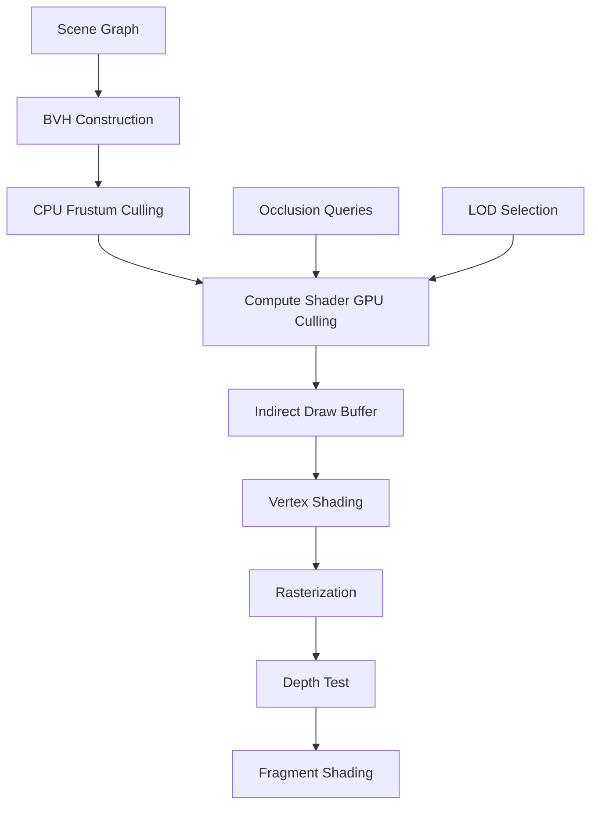

# Lesson 4: Spatial Acceleration Structures, Culling, Performance Optimization

## 1. First-Principles Intuition & Invariants

Real-time rendering confronts a fundamental computational barrier: modern scenes contain millions of triangles, yet typical display resolutions require processing only a small fraction of visible geometry per frame. A naïve renderer testing every primitive against every pixel wastes catastrophic amounts of GPU cycles on invisible work. This lesson addresses the architectural strategies that transform brute-force geometry submission into intelligent, spatially-aware culling pipelines capable of sustaining interactive frame rates.

The core invariant governing all spatial acceleration is the **hierarchical rejection principle**: eliminating large groups of primitives through cheap containment tests before expensive per-triangle rasterization. Consider a camera viewing a cityscape from street level. Entire city blocks behind the viewer contribute zero pixels to the final image, yet without spatial reasoning, the GPU would transform, clip, and attempt to rasterize every building polygon regardless of visibility. Spatial acceleration structures encode volumetric relationships that allow the renderer to discard entire branches of scene geometry through simple sphere-plane or box-plane intersection tests, reducing millions of triangles to thousands of visible candidates before invoking the rasterizer.

Three fundamental visibility mechanisms operate in concert across the rendering pipeline. **Frustum culling** exploits the bounded viewing volume defined by the camera's field of view, near plane, and far plane to reject objects entirely outside the view pyramid. **Occlusion culling** identifies geometry hidden behind opaque occluders closer to the camera, preventing unnecessary draw calls for content that would fail the depth test. **Level-of-detail (LOD) selection** adapts geometric complexity to screen-space coverage, rendering distant objects with simplified meshes that preserve silhouette appearance while reducing vertex throughput. Each technique operates at different stages of the pipeline, from CPU-side scene traversal through GPU command buffer submission to hardware rasterization, forming a multi-layered defense against wasted computation.

The performance contract between CPU and GPU imposes strict constraints on optimization strategies. Modern graphics APIs batch geometry submissions into **draw calls**—discrete command buffer entries that specify shader programs, vertex buffers, index ranges, and uniform state. Each draw call incurs fixed overhead for state validation, descriptor binding, and hardware scheduling, independent of triangle count. A scene rendering ten thousand objects with individual draw calls suffocates under API overhead, while the same geometry submitted in one hundred batched calls with GPU instancing saturates vertex throughput. Spatial acceleration structures must therefore optimize not only for triangle rejection but also for draw call coherence, grouping spatially proximate objects to maximize batch sizes and minimize state transitions.

Memory bandwidth emerges as the dominant bottleneck in modern rendering. GPUs process geometry through hierarchical cache systems where L1 cache operates at terabyte-per-second speeds while VRAM access drops to hundreds of gigabytes per second. Spatial data structures that scatter memory reads across megabytes of non-contiguous address space destroy cache efficiency, forcing the GPU to stall while waiting for distant memory fetches. Acceleration structure design must balance spatial query efficiency against cache-line-friendly memory layouts, favoring contiguous array storage and depth-first traversal patterns that exploit temporal and spatial locality.

The mathematical foundation of spatial culling rests on **conservative bounding volume tests**. A bounding volume fully contains complex geometry within a simple geometric primitive—typically an axis-aligned bounding box (AABB), oriented bounding box (OBB), or bounding sphere. The containment guarantee allows rejection tests to operate on the bounding volume alone: if the simple primitive lies entirely outside the view frustum or behind an occluder, the contained geometry cannot possibly contribute visible pixels. This introduces a **false positive tolerance**—objects whose bounds intersect the frustum but whose actual geometry remains invisible still pass culling tests and proceed to rasterization—but eliminates false negatives entirely. The trade-off favors computational efficiency: testing a single sphere-plane distance proves vastly cheaper than clipping thousands of triangles.

Spatial hierarchies encode nested containment relationships. A **bounding volume hierarchy (BVH)** organizes scene geometry into a binary tree where each interior node stores a bounding volume encompassing all descendant geometry, and leaf nodes contain actual mesh primitives. Culling traverses this tree from root to leaves, testing node bounds against the view frustum. When a parent node fails the test, the entire subtree is rejected in a single operation, skipping potentially thousands of leaf-level tests. This logarithmic rejection complexity transforms linear scene traversal into sub-linear queries, reducing worst-case costs from O(n) primitive tests to O(log n) node tests plus O(k) visible primitives.

The spatial partitioning strategy profoundly affects query performance. **Top-down construction** recursively subdivides space, splitting geometry collections along spatial median planes or surface area heuristics that minimize expected traversal cost. **Bottom-up agglomerative clustering** merges nearby objects based on proximity metrics, building the tree from leaves toward the root. Surface area heuristic (SAH) cost functions estimate expected ray intersection costs by weighting child node surface areas against primitive counts, producing trees optimized for ray tracing workloads. For rasterization frustum culling, simpler median splits or equal-count partitions often suffice, as the goal shifts from minimizing ray-primitive tests to maximizing batch coherence and draw call reduction.

Dynamic scenes introduce temporal invalidation challenges. When objects move, their bounding volumes change, potentially violating parent node containment invariants throughout the hierarchy. **Incremental update strategies** defer full tree reconstruction, instead marking invalidated nodes and performing lazy refit operations that propagate bounding box expansions up the tree. This amortizes update costs across frames but accumulates slack—parent bounds grow progressively looser as children move, degrading culling efficiency. Periodic full rebuilds restore optimal tree quality, typically triggered when accumulated slack exceeds measured thresholds or frame budgets permit the reconstruction cost.

## 2. Core Architecture & Mechanics

The axis-aligned bounding box establishes the fundamental spatial primitive underlying most acceleration structures. An AABB stores six scalar values defining minimum and maximum extents along world-space X, Y, and Z axes. This representation enables trivially efficient intersection tests: checking whether a point lies inside reduces to six scalar comparisons, while AABB-plane tests decompose into evaluating which side of the plane the box's positive and negative vertex lie on relative to the plane normal. The axis-aligned constraint sacrifices tightness for computational simplicity—elongated objects oriented at oblique angles waste significant empty volume—but the performance gain from avoiding rotation matrix multiplications justifies the looser fit for most real-time applications.

Frustum culling executes a sequence of plane-AABB tests against the six planes defining the view frustum: near, far, left, right, top, and bottom. Each plane is represented by a normal vector and distance from the origin, typically extracted from the view-projection matrix through row or column operations. For each plane, the algorithm computes the AABB's "positive vertex"—the corner farthest along the plane's normal direction—by selecting minimum or maximum extents based on normal sign:

```
positive_vertex.x = (plane.normal.x >= 0) ? aabb.max.x : aabb.min.x
positive_vertex.y = (plane.normal.y >= 0) ? aabb.max.y : aabb.min.y
positive_vertex.z = (plane.normal.z >= 0) ? aabb.max.z : aabb.min.z
```

If the signed distance from the positive vertex to the plane is negative, the entire box lies on the negative half-space, and the object is culled. If the negative vertex distance is positive, the box lies entirely on the positive side and passes. Intermediate cases indicate intersection, requiring recursive descent or conservative visibility acceptance. This six-plane cascade rejects off-screen geometry with minimal arithmetic, consuming roughly 30-50 CPU cycles per AABB test on modern processors.

Bounding volume hierarchy construction follows a recursive partitioning pattern that balances tree depth against primitive distribution. Consider a scene containing 10,000 mesh instances. The builder begins by computing a single AABB encompassing all geometry centroids, establishing the root node. It then selects a split axis—often the longest AABB dimension to minimize surface area—and partitions objects into left and right subsets based on a split plane positioned at the spatial median or through SAH optimization. Each subset recursively spawns child nodes until reaching a stopping criterion: typically a maximum leaf primitive count (8-16 meshes) or minimum node volume threshold.

```
struct BVHNode {
    AABB bounds;
    uint32_t left_child;   // Index of left child, or LEAF_SENTINEL
    uint32_t right_child;  // Index of right child, or first primitive index
    uint32_t prim_count;   // Zero for interior, nonzero for leaf
};
```

This structure occupies 32-48 bytes depending on alignment, allowing tens of thousands of nodes to fit within L2 cache. Traversal proceeds depth-first: test the root AABB against the frustum, then recursively descend into children whose bounds intersect. Upon reaching leaves, iterate the primitive index range, submitting visible meshes to the rendering queue. The tree layout significantly impacts cache performance—storing nodes in breadth-first order improves parent-child locality, while depth-first preorder minimizes recursive call overhead at the cost of scattered child accesses.

Occlusion culling introduces GPU-side visibility queries that determine whether geometry survives rasterization and depth testing. The fundamental primitive is the **occlusion query object**, a GPU resource that records the number of fragments passing depth comparison during rendering. The workflow unfolds across two frames: in frame N, render proxy geometry (often simplified bounding boxes) with occlusion queries enabled, writing depth but not color. In frame N+1, retrieve query results on the CPU and conditionally submit full-detail geometry only for objects whose proxies passed depth testing. This introduces one-frame latency but prevents expensive geometry submission for content definitively hidden behind nearer surfaces.

Modern graphics APIs provide **conditional rendering** extensions that bypass CPU readback latency. Instead of retrieving query results to the CPU, the GPU directly evaluates query predicates before executing subsequent draw calls. This eliminates the round-trip synchronization hazard but requires careful query scope management: predicates apply to entire command buffer regions, not individual draw calls, necessitating command buffer segmentation or dynamic buffer generation to achieve per-object granularity.

Hierarchical occlusion queries extend binary visibility testing to spatial hierarchies. Rather than testing individual objects, render BVH node bounding volumes from front-to-back depth order. When a parent node's query reports zero visible fragments, cull the entire subtree without testing children. This amortizes query overhead across multiple objects and exploits spatial coherence: occluded objects cluster in space, allowing single queries to reject entire regions. The front-to-back traversal order is critical—testing distant nodes before nearby geometry would fail to establish depth buffer occlusion, generating false positives that undermine culling effectiveness.

Level-of-detail systems manage geometric complexity through discrete resolution tiers. A typical LOD chain for an architectural asset might include four meshes: the full-detail hero model at 50,000 triangles, a medium-detail version at 12,000 triangles, a low-detail distant representation at 3,000 triangles, and a billboard imposter at two triangles textured with a pre-rendered orthographic view. The renderer selects the appropriate tier based on **screen-space error metrics**—the projected pixel coverage of the object's bounding sphere or the maximum edge length after perspective division.

```
float screen_space_diameter = (object_radius * viewport_height) 
                               / (distance_to_camera * tan(fov_y / 2))
                               
if (screen_space_diameter > 400) use_lod_0;
else if (screen_space_diameter > 150) use_lod_1;
else if (screen_space_diameter > 50) use_lod_2;
else use_billboard;
```

Hysteresis prevents oscillation artifacts when objects hover near transition thresholds. Implementing separate upgrade and downgrade thresholds (e.g., upgrade at 400 pixels, downgrade at 380 pixels) creates a stability band that prevents LOD popping as the camera moves. Some systems blend between LOD tiers by cross-fading geometry over several frames, though this doubles vertex throughput during transitions and introduces shader complexity.

GPU instancing multiplies the submission efficiency of repeated geometry. Rather than issuing separate draw calls for a forest containing 10,000 identical trees, instancing submits a single draw call with an instance count parameter, uploading per-instance transform matrices and material parameters to a structured buffer. The vertex shader indexes into this buffer using the built-in instance ID, reconstructing world-space positions and normals for each instance. This reduces draw call overhead from 10,000 API invocations to one, transforming a CPU-bound submission bottleneck into a GPU-bound vertex processing workload.

Indirect drawing extends instancing to support GPU-driven culling. In the **GPU culling pipeline**, a compute shader evaluates frustum and occlusion tests in parallel across all instances, writing passing instance IDs into a compacted output buffer. It also writes an atomic counter tracking visible instance counts directly into the argument buffer for an indirect draw call. The subsequent rendering pass consumes this buffer without CPU involvement, submitting only visible geometry. This eliminates CPU-GPU synchronization barriers and exploits the GPU's massively parallel architecture for spatial queries, though it requires careful barrier and memory synchronization to ensure compute writes complete before rendering reads begin.



This pipeline diagram illustrates the staged culling architecture: CPU-side BVH traversal performs coarse rejection, GPU compute shaders refine visibility with per-instance precision, and indirect draw mechanisms submit only surviving geometry to the rasterizer. Each stage operates at different granularities—spatial clusters at the CPU level, individual instances in compute, and draw calls at the API boundary—composing into a multi-resolution rejection cascade that minimizes wasted work at every processing stage.

## 3. High-Performance Optimization & Failure Modes

Draw call minimization dominates CPU-side optimization. Modern GPUs can process billions of triangles per second, yet desktop graphics APIs impose practical limits of 5,000-10,000 draw calls per frame before CPU overhead saturates a single core. Batching strategies must therefore consolidate geometry aggressively. **Static batching** merges meshes sharing materials into unified vertex buffers at load time, trading memory footprint for reduced API calls. **Dynamic batching** groups small meshes on the fly, rebuilding transient vertex buffers each frame for objects within proximity and material thresholds. Instancing supersedes both for repeated geometry, but requires upfront asset authoring to identify instanceable content and structure per-instance data layouts.

Material state transitions amplify draw call costs. Switching shader programs, texture bindings, uniform buffers, or blend modes forces GPU pipeline flushes, stalling execution while state validation and cache invalidation complete. **Material sorting** orders draw calls to group identical material configurations, minimizing state changes. A typical sort key packs shader ID, texture handles, and blend mode into a 64-bit integer, allowing radix sort to reorder thousands of draw calls in microseconds. The trade-off emerges when sorting conflicts with front-to-back depth ordering—front-to-back rendering enables early depth rejection, discarding occluded fragments before expensive shading, but interleaving materials disperses state. Hybrid strategies sort primarily by material, then by coarse depth buckets (near, mid, far) to preserve partial depth coherence.

Texture atlas packing consolidates disparate texture maps into unified atlas images, allowing multiple objects to share a single texture binding. A scene containing hundreds of unique diffuse maps might pack them into a 4096×4096 atlas, updating mesh UVs to reference sub-rectangles within the atlas space. This reduces texture binding overhead from hundreds of bind operations to one, though it introduces packing fragility—adding new textures requires re-packing and invalidates cached atlas layouts. Sparse textures and bindless descriptor arrays provide alternative solutions on modern hardware, allowing shaders to index arbitrary textures from descriptor heaps without explicit binding calls, at the cost of increased shader complexity and reduced portability to older APIs.

BVH update strategies balance reconstruction cost against query efficiency. Full rebuilds from scratch consume 1-2 milliseconds for 10,000 objects but guarantee optimal spatial partitioning. Incremental refitting updates node bounds in 100-200 microseconds but accumulates slack, degrading culling performance over time. A practical hybrid approach rebuilds subtrees when accumulated slack exceeds thresholds: track the ratio of child bounds volume to parent bounds volume, triggering local reconstruction when the ratio drops below 0.7. This amortizes expensive rebuilds across frames while maintaining acceptable query performance, though it requires careful bookkeeping to identify invalidated subtrees without traversing the entire hierarchy.

Temporal coherence exploitation predicts visibility across frames. Objects visible in frame N likely remain visible in frame N+1 absent abrupt camera cuts or rapid motion. Leveraging this coherence, renderers maintain **persistent visibility sets**—bit arrays tracking per-object visibility history. On frame N+1, test only objects visible in frame N or newly entered into the frustum, deferring comprehensive culling for stable objects. This reduces culling overhead by 60-80% for typical camera motion but fails catastrophically during teleportation or fast rotation, requiring fallback to full culling when frame-to-frame camera transforms exceed angular or positional thresholds.

Occlusion query latency introduces synchronization hazards. Retrieving query results stalls the CPU until the GPU completes rendering, destroying parallelism. Double-buffered query pools mitigate this: allocate two sets of query objects, rendering frame N with pool A while retrieving results from frame N-1's pool B. This maintains one-frame latency but eliminates synchronization stalls, allowing CPU and GPU to overlap culling decisions with rendering execution. Predicated rendering eliminates latency entirely but sacrifices CPU-side culling optimizations—objects unconditionally submitted to the GPU cannot contribute to draw call batching or LOD selection decisions made on the CPU.

Memory bandwidth optimization requires cache-friendly data structure layouts. Storing BVH nodes in depth-first preorder ensures parent-child pairs reside in adjacent cache lines, exploiting prefetching mechanisms. Aligning node structures to cache line boundaries (64 bytes on x86) prevents false sharing and eliminates partial cache line loads. Compressing node data reduces memory footprint: quantizing AABB extents to 16-bit fixed-point coordinates relative to parent bounds cuts node size from 48 bytes to 24 bytes, doubling effective cache capacity at the cost of reduced spatial precision. The precision loss rarely impacts culling correctness due to conservative bounding volume tolerance, but extreme quantization can introduce false positives for grazing frustum intersections.

GPU culling compute shaders exploit parallel execution but introduce complexity. Each thread processes one object, evaluating frustum tests and writing results to a compacted instance buffer. Race conditions emerge when multiple threads attempt to increment the shared instance counter—atomic operations serialize access, creating contention bottlenecks. **Wave-level optimizations** reduce atomics through intra-waveform reductions: threads compute local visibility, use wave intrinsics to count visible instances within the SIMD group, elect one thread to perform a single atomic add, then scatter writes to the output buffer using per-thread offsets derived from the wave-scanned prefix sum. This reduces atomic operations from one per thread to one per waveform (typically 32-64 threads), cutting synchronization overhead by 30-50×.

Indirect draw argument buffer layout impacts CPU-GPU synchronization. The buffer must remain persistently mapped and coherent, with explicit memory barriers ensuring compute shader writes flush to device memory before the rendering pass reads them. **Fine-grained barriers** inserted between compute dispatch and indirect draw provide precise synchronization but introduce API overhead. Coarse barriers encompassing multiple draw calls amortize overhead but risk over-synchronization, stalling rendering when only a subset of compute work has completed. Profiling tools exposing GPU timeline traces identify optimal barrier placement, revealing whether compute execution genuinely overlaps draw submission or whether premature synchronization forces serialization.

LOD popping artifacts degrade visual quality when discrete tier transitions occur. Geometric discontinuities—sudden changes in silhouette or surface detail—draw the eye even when transitions respect distance metrics. **Dithered LOD blending** renders both tiers simultaneously with complementary stipple patterns, hardware alpha-blending the results. This distributes the transition across several frames, smoothing the discontinuity at the cost of doubling vertex throughput during blends. Screen-space temporal anti-aliasing (TAA) further softens dithered transitions by accumulating sub-pixel coverage over multiple frames, though it introduces ghosting artifacts on fast-moving objects.

Failure modes concentrate around conservative culling false positives. Overly loose bounding volumes pass frustum tests despite contained geometry lying entirely off-screen, submitting wasted draw calls. This occurs frequently with animated skinned meshes whose bounding boxes must encompass the union of all possible skeletal poses, producing AABBs significantly larger than any single frame's actual geometry extent. **Per-bone bounding hierarchies** refine this: each bone stores a local AABB, transforming and merging them per-frame to construct a tighter dynamic bound. The CPU overhead of 100+ bone transform-and-merge operations must be weighed against GPU savings from culling the avoided triangles—profiling determines the break-even point, typically around 5,000 triangles per character.

Pathological camera configurations break culling assumptions. An orthographic projection with infinite far plane renders the far frustum plane useless for rejection, while extremely wide field-of-view lenses (>170 degrees) cause numerical instability in plane extraction from projection matrices. Depth precision degradation near the far plane also undermines occlusion culling—floating-point depth buffers concentrate precision near the near plane, causing distant occluders to collapse into equivalent depth values, generating depth test failures for geometry that should be occluded. Logarithmic depth buffers redistribute precision uniformly across the depth range, eliminating far-plane instability at the cost of fragment shader complexity and reduced depth test performance on some hardware.

The rendering pipeline's multi-stage nature demands holistic optimization strategies. Optimizing frustum culling without addressing draw call batching yields minimal gains—rejecting 90% of geometry still leaves thousands of individual draw calls saturating the CPU. Conversely, aggressive batching without spatial culling forces the GPU to transform and clip millions of off-screen triangles. Effective optimization requires profiling-driven iteration: GPU traces identify whether rendering is vertex-bound, fragment-bound, or API-bound; CPU profilers expose whether scene traversal, material sorting, or command buffer construction dominates frame time. Targeting the measured bottleneck produces compounding gains as each optimization exposes the next limiting factor, progressively scaling the system toward the fundamental hardware limits of triangle throughput and pixel fill rate.
