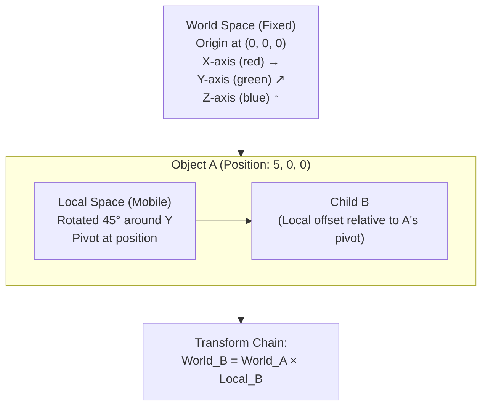

# Lesson 1: Scene Architecture, Coordinate Systems, Hierarchical Transforms

## 1. First-Principles Intuition & Invariants

The three-dimensional scene in 3ds Max exists as a mathematical abstraction before it becomes visible pixels on your monitor. Understanding this abstraction—how objects relate to one another, how their positions and rotations are encoded, and how transformations cascade through hierarchies—is foundational to everything you will build, animate, and render. This becomes crucial when positioning and transforming objects: an object's position and orientation in 3D space shift meaning based on whether we measure them relative to the world origin, their parent object, or the camera view, much as a design element reads differently depending on whether you consider it within the full composition or as part of a nested group.

The scene graph is the living organizational structure of your project. It is not merely a filing system; it is an executable hierarchy that determines how transformations propagate, how rendering occurs, and ultimately how your final frame appears. When you move a parent object, every child object moves with it—not because of magical linkage, but because their positions are mathematically expressed relative to their parent's local coordinate system. This relationship is encoded in transformation matrices: compact 4×4 mathematical structures that store position, rotation, and scale in a single, composable object. Understanding matrices is not optional; it is the vocabulary you must speak to control your scene with precision and efficiency.

Three coordinate systems coexist in 3ds Max and demand your constant awareness. The world coordinate system is absolute and unchanging—it is the reference frame in which your entire scene lives, with a fixed origin point (0, 0, 0) and three cardinal axes (X, Y, Z). Every object also possesses a local coordinate system centered on its pivot point, with axes that rotate and scale according to the object's own transformations. Finally, the screen coordinate system (or view coordinate system) exists relative to the active viewport camera, where Z typically represents depth away from the viewer. These three frames of reference are not competing; they are complementary, and switching between them fluidly is the mark of a competent 3D artist.

Hierarchical parenting—the act of designating one object as the parent and another as the child—is the primary tool for building complex, maintainable scenes. When you link a child to a parent, the child's transformation is no longer expressed in world coordinates alone; instead, it is expressed relative to the parent's local coordinate system. Move the parent, and the child follows. Rotate the parent, and the child rotates around the parent's pivot point. This cascading behavior is powerful because it allows you to build articulated rigs, camera systems, and complex mechanical assemblies that move as unified wholes while maintaining local deformations. For a designer working with component systems, think of the parent as the master layout frame: individual elements (children) maintain their own properties and local adjustments, but their position and rotation are understood relative to the parent's coordinate space.

The pivot point deserves special emphasis because it is simultaneously the simplest and most misunderstood concept in 3D software. The pivot point is the origin of an object's local coordinate system and the fulcrum around which that object rotates and scales. If your pivot is centered on a character's hip, rotation happens around the hip. If the pivot is at the toe, rotation happens at the toe. If the pivot is ten meters away from the geometry, rotation still happens at that remote pivot point. Beginners often struggle because they assume the pivot is automatically "sensible"—usually centered on the bounding box—when in reality it is placed exactly where the software was instructed to place it, often in an arbitrary location. Understanding and controlling pivot placement is the difference between fluid, intuitive rigging and hours of debugging mysterious rotation offsets.

## 2. Core Architecture & Mechanics

### The Transformation Matrix: Encoding Position, Rotation, and Scale

At the heart of every transform in 3ds Max lies the transformation matrix, a 4×4 array of numbers that encodes position, rotation (orientation), and scale into a single mathematical object. This matrix is not an optional abstraction; it is the actual data structure that 3ds Max uses internally to store and compute transforms. When you move, rotate, or scale an object in the viewport, you are editing the values inside this matrix.

A typical transformation matrix looks like this:

```text
| Xx  Xy  Xz  Tx |
| Yx  Yy  Yz  Ty |
| Zx  Zy  Zz  Tz |
| 0   0   0   1  |
```

The upper-left 3×3 block encodes rotation and scale. The three columns represent the local X, Y, and Z axes of the object, expressed in world coordinates. Each axis is a three-component vector; the length of that vector is the scale factor along that axis. The right column (Tx, Ty, Tz) encodes the object's world position. The bottom row is always [0, 0, 0, 1] for affine transformations in computer graphics; it serves a mathematical purpose in homogeneous coordinates but rarely demands your direct attention.

To illustrate concretely: imagine you have created a cube at world origin (0, 0, 0) with no rotation and 1× scale on all axes. Its transformation matrix is the identity matrix:

```text
| 1  0  0  0 |
| 0  1  0  0 |
| 0  0  1  0 |
| 0  0  0  1 |
```

Now move that cube 5 units along the X axis and 3 units along the Z axis. The matrix becomes:

```text
| 1  0  0  5 |
| 0  1  0  0 |
| 0  0  1  3 |
| 0  0  0  1 |
```

The right column now encodes [5, 0, 3], the object's world position. If you scale the object 2× uniformly, the upper-left 3×3 block scales proportionally:

```text
| 2  0  0  5 |
| 0  2  0  0 |
| 0  0  2  3 |
| 0  0  0  1 |
```

If you rotate the object 90 degrees around the Z axis, the upper-left 3×3 block encodes the new orientation (the columns become the rotated local axes):

```text
| 0  -1  0  5 |
| 1   0  0  0 |
| 0   0  1  3 |
| 0   0  0  1 |
```

This matrix is the complete description of where that object lives in world space, how it is oriented, and how large it is. Every viewport update, every animation frame, every intersection test in your scene ultimately references this matrix or a local variant of it.

### World, Local, and Screen Coordinate Systems

The world coordinate system in 3ds Max is the absolute reference frame. It has a fixed origin at (0, 0, 0) and three fixed cardinal axes. By default, X points right, Y points into the scene, and Z points up (3ds Max uses a right-handed, Z-up world coordinate system). Every object's world position is a point [Wx, Wy, Wz] in this fixed frame.

The local coordinate system of an object is relative and mobile. It is centered at the object's pivot point and rotates with the object. If an object has no rotation, its local axes are aligned with world axes. If the object rotates 45 degrees around the Y axis, its local X and Z axes are now skewed relative to world space. When you work in the Modify panel or use the Move tool set to "Local" mode, you are manipulating the object's position or orientation relative to its own local axes, not relative to the world.

The relationship between local and world coordinates is exactly what the transformation matrix encodes. To convert a point from local coordinates (Lx, Ly, Lz) to world coordinates, you multiply it by the object's transformation matrix. To convert a point from world coordinates back to local coordinates, you multiply by the inverse of the transformation matrix. 3ds Max performs these conversions constantly and transparently, but understanding that they are happening illuminates why moving to local mode or changing pivot points produces the expected results.

The screen coordinate system (or view-space coordinate system) is relative to the active viewport camera. In this frame, the camera is at the origin, the negative Z axis points away from the camera (into the scene), X points right across the screen, and Y points up. When 3ds Max renders a frame, it transforms every world-space vertex into screen space, applies perspective division, and rasterizes the result to pixels. For most modeling and rigging work, you think in world or local coordinates, but when dealing with cameras, billboarded sprites, or screen-aligned effects, you must consider screen-space transformations.

### Hierarchical Transforms and Matrix Composition

When object B is parented to object A, the relationship is expressed through matrix multiplication. If object A has transformation matrix M_A (relative to world space) and object B has a local transformation relative to A of M_B_local, then object B's world transformation is computed as:

```text
M_B_world = M_A * M_B_local
```

This multiplication is not commutative; order matters. The parent's matrix is applied first, then the child's local matrix. When you move the parent, M_A changes, and consequently M_B_world changes automatically—the child is dragged along. When you move the child in local mode, M_B_local changes, but M_B_world still follows the formula, so the child moves relative to the parent but maintains its attachment.

Consider a practical example: you are building a mechanical arm. The shoulder joint is at world origin. The upper arm is 1 meter long and rotates around the shoulder. The elbow is parented to the upper arm and sits 1 meter down the arm's local Z axis. The forearm is parented to the elbow. When you rotate the shoulder by 45 degrees, the upper arm rotates, and both the elbow and forearm follow because their world transforms are computed through the chain: (shoulder rotation) × (upper arm to elbow transform) × (forearm to elbow transform). This cascading evaluation is automatic; you never manually recompute matrices.

The hierarchy graph in 3ds Max reflects this structure. Objects at the root level have no parent; their local coordinate system is identical to world space. Objects with parents are children, and a single object can have many children but only one parent. Cycles (A is parent of B, B is parent of A) are forbidden by the software. The hierarchy is a directed acyclic graph, and the scene graph display in the Scene Explorer window shows this tree structure visually. Understanding and manipulating this hierarchy is essential to scene organization.

### Pivot Point Mechanics and Frozen Transforms

The pivot point is the origin of an object's local coordinate system. When you rotate an object, it rotates around its pivot. When you scale an object, it scales away from its pivot. When you read an object's position property, you are reading the world position of its pivot point.

In 3ds Max, you access pivot control through the Hierarchy panel. When you enter "Affect Pivot Only" mode, the Move, Rotate, and Scale tools operate on the pivot without affecting the geometry. If you move the pivot 5 units to the right, the geometry does not move, but the object's position property shifts (because position measures the pivot). If you then reset the position to origin, the geometry moves to compensate, and the pivot returns to origin. This behavior seems counterintuitive until you realize that pivot is simply the origin of local space—moving it is mathematically equivalent to relocating where local space originates.

Frozen transforms are a separate concept that deserves attention. When you freeze an object's transforms, you are resetting its rotation and scale to identity (no rotation, 1× uniform scale) while keeping its geometry in place. Internally, 3ds Max stores a separate "offset" transformation that accounts for the geometry's current world orientation and scale. This frozen state is useful when you want local coordinates to match world coordinates (for simpler math during rigging or animation) but your geometry is currently rotated or scaled in world space. Freezing does not move or deform your geometry; it merely resets the transform matrix and stores the delta.

Here is a simple decision tree for pivot placement:

**For static props and set dressing:** Center the pivot on the geometry's bounding box. Place it at the base if the object sits on a floor, or at the center if it is freely positioned.

**For articulated rigs (characters, mechanical assemblies):** Place the pivot at the joint center. For a shoulder joint, place the pivot exactly where the shoulder rotates. For a wheel, place the pivot on the axis of rotation.

**For effects and greeblies:** Place the pivot wherever the motion logic demands. A spinning light might have its pivot at the mount point, not the bulb.

**For grouped assemblies:** Parent the geometry under a controller null with the pivot at the desired motion center. This separation of motion control from geometry is powerful for animation.

### Viewport Interaction and Transform Modes

The three transform tools in 3ds Max are Move, Rotate, and Scale. Each tool operates differently depending on the active transform mode: Absolute (world), Offset (world), Local (object-relative), or Parent (parent-relative). Understanding these modes is crucial for precise scene manipulation.

In **Absolute World mode**, the transform tool displays world coordinates in the transform fields. Moving an object 5 units along X shifts it 5 units along the world X axis, regardless of the object's rotation. This mode is useful when you need to place objects at specific world coordinates.

In **Offset World mode** (the default for most operations), entering a value moves the object that distance along the world axis from its current position. It is identical to Absolute for single movements but becomes distinct when you make sequential adjustments.

In **Local mode**, the transform tool references the object's local axes. If an object is rotated 45 degrees, moving it 1 unit along local X moves it along the object's rotated X axis, not the world X axis. This mode is indispensable for rigging and animation because you often want to move a bone or limb relative to its own orientation.

In **Parent mode**, the transform references the parent object's local coordinate system (or world, if the object has no parent). This mode is less frequently used but becomes relevant when you are tweaking a child object's position relative to its parent without caring about world space.

The **Center** of the gizmo (the red, green, and blue arrows) always indicates the pivot point. If the gizmo is not centered where you expect, the pivot is misaligned—a common source of frustration for beginners.

### Coordinate System Reference Diagram



## 3. High-Performance Optimization & Failure Modes

### Scene Graph Hierarchy Best Practices

A well-organized hierarchy is not merely aesthetically pleasing; it directly impacts workflow speed, animation complexity, and render performance. The fundamental principle is to mirror logical organization: group related geometry under parent nulls, separate control rigs from rendered geometry, and use meaningful naming conventions so that navigating the hierarchy is self-documenting.

**Depth of hierarchy** should be balanced. A chain five levels deep (World → Character → Spine → Chest → Arm → Hand) is reasonable for skeletal rigging. A hierarchy forty levels deep, where every single object is nested under a previous one, becomes unwieldy and computationally expensive, especially if you apply modifiers or constraints that must evaluate the entire chain every frame. The rule of thumb is to keep hierarchies to five to seven levels for complex rigs and three to four levels for static set pieces.

**Null objects (dummies)** are invisible transformation nodes that serve as control centers. They have no geometry, so they render invisibly, but they can have children and participate in hierarchies. Use nulls to create control rigs separate from deformable geometry. For instance, a character's skeleton might be a hierarchy of bones (geometry-less), and rigged mesh geometry is parented beneath. A separate null hierarchy might serve as animator controls, and the skeleton is constrained to follow those controls. This separation allows animators to work with intuitive controls while the underlying skeleton maintains proper joint topology.

**Naming conventions** matter for rapid scene navigation. Use prefixes to denote hierarchy role: `CTRL_` for animator controls, `RIG_` for skeletal structures, `GEO_` for rendered geometry, `LOD_` for level-of-detail variants. Within a character, use consistent naming: `CTRL_Spine_01`, `CTRL_Arm_L`, `RIG_Bone_Arm_L`. This convention allows you to instantly identify an object's purpose and find related objects through search.

**Collapsing hierarchies** for static assets saves evaluation time. If a set piece is a forest of geometries that do not animate, convert them to a single mesh (using Attach or ProBoolean) and collapse the hierarchy. The renderer processes fewer objects, and transformation evaluation is faster.

### Coordinate System Mismatches and Gimbal Lock

A frequent source of subtle bugs is coordinate system mismatch. You move an object in Local mode assuming its local X axis points in one direction, but the pivot was rotated unexpectedly, so Local X actually points perpendicular to what you intended. The object ends up in the wrong place, and debugging becomes a frustrating hunt. The remedy is to always verify pivot orientation before assuming local coordinate alignment. Use the Hierarchy panel to view and adjust pivot orientation explicitly.

**Gimbal lock** is a rotational singularity that occurs when using Euler angles (X, Y, Z rotation values sequenced independently). If you rotate an object 90 degrees around one axis, the other two axes can become aligned, losing one degree of rotational freedom. Imagine rotating 90 degrees around Y: the local X and Z axes become coplanar, and further rotations around X and Z produce identical visual results. The rotation matrix representation is unaffected by gimbal lock, but the Euler angle representation becomes ambiguous. In animation, gimbal lock causes objects to flip or jitter unpredictably when you pass through certain rotation angles.

The practical solution is to use quaternion-based rotation representation for animation, which avoids gimbal lock entirely. 3ds Max uses quaternions internally for smooth rotation interpolation, but when you inspect rotation properties in the Modify panel, you see Euler angles for human readability. For critical animation, work with quaternion-based constraint systems (e.g., LookAt constraints, Position/Rotation constraints) rather than manually keying Euler rotations.

### Transform Precision and Numerical Stability

Transformations are computed using floating-point arithmetic, which has finite precision. If you apply a very large number of transformations in sequence (nested hierarchies, stacked modifiers, constraint chains), rounding errors accumulate. A character rig nested ten levels deep, each with slight rotation offsets, may exhibit subtle creep or distortion by the time the final geometry is evaluated.

The solution is periodically to collapse or consolidate hierarchies where appropriate. For animation playback, ensure that constraint and modifier stacks evaluate efficiently; do not build rigs with unnecessary constraint layers. For production assets, freeze transforms periodically to reset accumulated rounding errors.

### Common Failure Modes and Debugging

**Unexpected object movement when parenting:** You have parented object B to object A, and B suddenly jumps to an unexpected location. This occurs because the local transform of B was not updated when the parent relationship was established. 3ds Max automatically calculates a new local offset that preserves B's world position, but if your pivot points are misaligned or your expectations were wrong, the result looks like an unexpected jump. Debug by checking pivot locations and verifying local offsets in the Hierarchy panel.

**Pivot location not updating after moving geometry:** You have moved geometry without entering "Affect Pivot Only" mode, and the pivot was not repositioned accordingly. The geometry is now offset from its pivot. Remedy: select the object, enter Hierarchy → Affect Pivot Only, use Move with Offset World mode to relocate the pivot to the desired location, and exit Affect Pivot Only mode.

**Rotation around wrong axis:** You have rotated an object expecting rotation around the local Z axis, but it rotated around world Z instead. Verify transform mode in the toolbar (ensure "Local" is selected), and verify that the pivot orientation is correct. If the pivot is rotated, local axes are rotated with it.

**Constraint or deformer instability in deep hierarchies:** A constraint applied to an object deep in a hierarchy (e.g., a hand constrained to a locator, where the hand is six levels below the root) may jitter or produce unexpected results due to transformation matrix composition order or evaluation cycles. Simplify the hierarchy, or use a dedicated control rig separate from the deformation skeleton.

**Screen-space coordinates in viewport gizmo appearing misaligned:** If the Move gizmo appears rotated or distorted in the viewport, you may be in a viewport display mode that is not standard orthographic or perspective view. Check the Active Viewport Layout and ensure you are not in an isometric or custom-angled viewport. Switch to standard Front, Top, or Camera view to regain standard gizmo orientation.

### Performance Optimization Workflow

As your scene grows, transformation evaluation becomes a bottleneck. A character with hundreds of bones, multiple layers of constraints, and rigged geometry can take significant time to update if not organized efficiently. Here is a practical optimization workflow:

**Step 1: Profile transform evaluation.** Enable the Frame Statistics display (toggle via Viewport Canvas properties). Observe the "Transform Eval Time" metric. If it exceeds a few milliseconds for a single object's hierarchy, optimization is warranted.

**Step 2: Collapse modifier stacks where possible.** Modifiers are evaluated for every frame. If a turbosmooth or skin modifier is applied but never changes, collapse it into the base geometry.

**Step 3: Use transform caching for animated assets.** Point constraints or linked XForm controllers can be optimized by pre-baking transforms to keys rather than evaluating constraints every frame during animation playback.

**Step 4: Reduce constraint depth.** If an object is constrained to an object that is constrained to another object (three levels of constraint chains), the evaluation order becomes complex.

Simplify by converting constraints to keyframes using the Animation > Constraints > Bake Constraint or Animation > Convert To > Convert to Keyable menu commands, removing the constraint overhead entirely from runtime evaluation. This is particularly effective for one-shot animations or sequences that do not require runtime retargeting.

**Step 5: Freeze transforms on static objects.** For geometry that never moves (environment pieces, static props), right-click the object, select Object Properties, and enable the "Freeze" option. This removes the object from the transformation update pipeline. Alternatively, use the Layer Manager to freeze entire layers of static content. Frozen objects are excluded from per-frame transform evaluation, significantly reducing overhead in complex scenes.

**Step 6: Optimize viewport display.** Disable the display of gizmos, grid, and viewport overlays during playback. Use the Viewport Configuration > Display Performance settings to enable "Adaptive Degradation," which automatically simplifies geometry display when the frame rate drops below a threshold. This does not affect rendering but keeps interactive performance smooth during animation scrubbing. For final verification, always return to full display quality and re-test transform behavior, as adaptive degradation can mask subtle motion artifacts introduced by hierarchy or constraint issues.

By following this workflow systematically, you can maintain real-time playback even in scenes with thousands of objects and deeply nested hierarchies. The key is to treat transformation evaluation as a computational resource with a finite budget, and to allocate that budget intentionally by collapsing, caching, and constraining only where necessary. Every unnecessary constraint, every un-collapsed modifier, every unfrozen static object is a tax on your scene's interactive performance. Measure, optimize, verify—this cycle is the discipline that separates production-grade rigs from prototypes that collapse under load.

---

## Summary & Verification Matrix

| **Invariant / Mechanism** | **Governing Rule** | **Diagnostic Criterion** | **Corrective Action** |
|---------------------------|--------------------|--------------------------|-----------------------|
| **World vs. Local Coordinate Systems** | World coordinates are absolute and scene-global; local coordinates are relative to parent transform and change under hierarchy operations. | If object position appears correct in viewport but fails alignment in script or export, inspect coordinate system mode in status bar and verify whether query used `$.pos` (world) or `$.transform.position` (local). | Standardize all queries to world space for inter-object operations; use local space only for hierarchical offsets or child-relative positioning. Convert via `in coordsys world $objectname.pos`. |
| **Hierarchical Transform Propagation** | Child transforms are evaluated after parent transforms; parent rotation/scale/position directly affects child world-space state via matrix multiplication. | If child object motion is amplified, damped, or skewed unexpectedly, examine parent's non-uniform scale or non-zero pivot offset. Use Transform Toolbox to inspect effective parent matrix. | Reset parent pivot to object center, or apply Reset XForm to collapse inherited scale/rotation into geometry vertices before re-establishing hierarchy. Use Link Constraint instead of direct linking if parent has animated non-uniform scale. |
| **Pivot Point Independence** | Object pivot position is stored separately from vertex positions; moving pivot does not alter geometry in object space but changes rotation/scale behavior and world-space interpretation. | If rotation or scale behaves erratically, inspect pivot location via Hierarchy panel > Affect Pivot Only. If pivot is offset from logical center, rotations will orbit around that offset. | Center pivot using Hierarchy > Affect Pivot Only > Center to Object, or manually position pivot to desired rotation origin. Verify in Perspective viewport before applying rotational keyframes. |
| **Transform Constraint Evaluation Order** | Constraints (Position, Orientation, LookAt) are evaluated after base transform but before children; constraint stack depth increases evaluation cost and can introduce order-dependent behavior. | If constraint target changes do not propagate immediately or produce unexpected interpolation, measure constraint chain depth. If depth exceeds 3 levels, suspect evaluation cycle or over-constrained system. | Bake constraints to keyframes using Animation > Bake Constraint for static or one-shot sequences; use scripted controllers only where runtime retargeting is essential. Test constraint removal to isolate whether behavior is constraint-induced. |
| **Viewport Gizmo Coordinate Reflection** | Viewport transform gizmo axes reflect active coordinate system (View, Screen, World, Local, Parent, Pick); incorrect system produces valid transforms in unintended space. | If user moves object "up" in viewport but object translates diagonally in world space, active coordinate system is not World. Check Gizmo Coordinate dropdown in main toolbar. | Set coordinate system to World for scene-level positioning, Local for parent-relative offsets, or View for camera-aligned motion. Choose the coordinate system from the Reference Coordinate System drop-down on the main toolbar. |
| **Performance: Transform Evaluation Budget** | Every constraint, modifier, and unfrozen object consumes per-frame transform evaluation cycles; deeply nested hierarchies multiply cost via recursive parent updates. | If viewport playback frame rate drops below 24 FPS during scrubbing, enable Frame Statistics (Viewport Canvas properties) and inspect "Transform Eval Time." Values above 5ms per object indicate optimization opportunity. | Freeze static objects via Object Properties; collapse modifier stacks via Edit > Collapse To; bake constraints to keyframes; reduce hierarchy depth by flattening parent chains or using World-space alignment constraints instead of nested links. |
