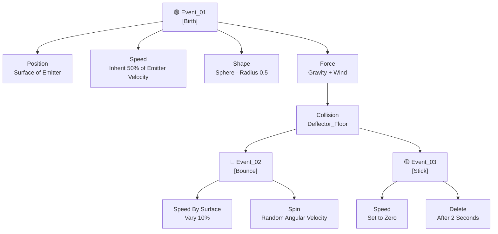

# Lesson 6: Physics Simulation, Particles, Production Pipeline Integration

## 1. First-Principles Intuition & Invariants

Physics simulation in 3ds Max represents the convergence of Newtonian mechanics, computational geometry, and real-time numerical integration. Unlike keyframe animation, where every transformation is explicitly authored, physics simulation surrenders control to mathematical solvers that compute motion, collision, and deformation based on forces, masses, and material constraints. This paradigm shift mirrors the difference between manually positioning each frame of geometry versus setting initial conditions and letting the solver generate natural, emergent motion—the artist defines the starting state and behavioral rules, then observes how the system evolves.

The fundamental invariant governing all physics systems is the principle of energy conservation within numerical tolerances. When a rigid body falls under gravity, potential energy converts to kinetic energy at a rate determined by the gravitational constant (9.8 m/s² in standard Earth gravity). The simulation engine computes this transformation through discrete timesteps, typically sixty or more per second, using numerical integration methods—most commonly semi-implicit Euler or fourth-order Runge-Kutta—to approximate continuous motion. Each timestep calculates velocity from acceleration, then position from velocity, accumulating small rounding errors that can cause drift over extended simulations. Understanding this discretization is critical: smaller timesteps yield higher accuracy but demand exponentially more computation, creating the central tension in production physics work.

Collision detection operates on a two-phase hierarchy designed to minimize computational expense. The broad phase employs bounding volume hierarchies—typically axis-aligned bounding boxes (AABBs) or oriented bounding boxes (OBBs)—to quickly eliminate object pairs that cannot possibly intersect. Only pairs whose bounding volumes overlap proceed to the narrow phase, where precise geometric intersection tests occur. For convex meshes, Gilbert-Johnson-Keerthi (GJK) distance algorithms compute the minimum separating distance between polytopes in linear time relative to vertex count. Concave meshes require decomposition into convex hulls or slower triangle-by-triangle intersection tests. This architectural reality explains why production physics artists obsessively reduce polygon counts and replace complex geometry with convex proxy meshes: collision complexity scales with geometric detail, and frame budgets are merciless.

Material properties—friction coefficients, restitution (bounciness), and damping—govern contact behavior at collision boundaries. Friction follows Coulomb's law: the maximum static friction force equals the coefficient of friction multiplied by the normal force pressing surfaces together. Once this threshold breaks, kinetic friction takes over with a typically lower coefficient, creating the stick-slip behavior observed when heavy objects scrape across floors. Restitution coefficients range from zero (perfectly inelastic collisions where objects stick together, dissipating all kinetic energy) to one (perfectly elastic collisions where objects bounce with no energy loss). Real-world materials fall between these extremes: a rubber ball might have a restitution of 0.9, while clay approximates 0.1. These coefficients are not merely aesthetic sliders—they directly parameterize the constraint solver's impulse calculations during contact resolution.

Particle systems transcend the rigid-body paradigm by modeling phenomena as clouds of independent points subject to force fields, birth-death lifecycles, and operator chains. Unlike mesh-based objects, particles carry minimal geometric data—typically just position, velocity, age, and optional metadata like size or rotation—enabling artists to simulate smoke plumes with tens of thousands of elements at interactive frame rates. The event-driven architecture of 3ds Max's Particle Flow system structures this complexity through directed acyclic graphs where particles flow between operator nodes, with conditional branching based on age, speed, collision events, or script logic. This graph-based design lets each operator transform the particle stream sequentially, while parallel branches route particles through simultaneous operations—for example, spawning secondary effects like sparks that emit trailing smoke.

Soft body dynamics introduce elastic deformation by treating meshes as networks of spring constraints connecting vertices. Each edge becomes a virtual spring obeying Hooke's law: restoring force equals the spring constant multiplied by displacement from rest length. The solver iteratively adjusts vertex positions to minimize total spring energy while respecting collision constraints, producing the rippling, squashing behavior characteristic of flesh, cloth, or rubber. Computational cost scales with vertex count squared in naive implementations, making aggressive mesh decimation and careful constraint tuning essential for production viability. The fundamental tradeoff is resolution versus stability: denser meshes capture finer wrinkles but increase solver iteration counts required for convergence, risking simulation instability when stretched beyond the solver's Courant-Friedrichs-Lewy (CFL) condition limits.

Pipeline integration demands understanding file format semantics and data preservation guarantees. FBX (Filmbox) and Alembic serve complementary roles: FBX excels at authoring interchange with rich material, animation curve, and scene hierarchy data but carries Autodesk-specific legacy cruft and version fragmentation risks. Alembic, developed by Sony Pictures Imageworks and Industrial Light & Magic, provides a streamlined geometric cache format prioritizing point positions, topology, and subdivision surface schemes without material or shader complexity. Alembic's strength lies in baked simulation caching—recording every frame's vertex positions to disk, decoupling simulation cost from playback. This architectural separation mirrors the distinction between recording a live instrument performance (Alembic cache playback) versus storing MIDI note data and re-synthesizing audio each time (procedural simulation).

MAXScript automation transforms 3ds Max from an interactive tool into a programmable production platform. Unlike graphical interfaces constrained to mouse and menu interactions, scripting exposes the underlying object model—scene nodes, modifiers, controllers, and properties—as manipulable data structures. Batch processing becomes feasible: iterating through shot directories, loading scenes, baking physics simulations, exporting caches, and updating render farm manifests—all without human intervention. The critical insight is treating the viewport as merely one interface to an underlying data graph. MAXScript provides direct graph manipulation, bypassing viewport update overhead and enabling optimizations impossible through manual workflows. Production pipelines at scale are fundamentally scripting pipelines; the UI becomes a prototyping environment for workflows later codified in automation layers.

Scene state management addresses the version control problem inherent in iterative physics work. Unlike static models, physics simulations depend on non-linear solver convergence and pseudo-random number generator seeds, making deterministic reproduction fragile. Small parameter tweaks—adjusting a single spring constant or collision threshold—can cascade through chaotic dynamics, producing wildly divergent results. Scene states capture parameter snapshots, enabling artists to checkpoint working configurations before experimentation. This discipline mirrors version control in software engineering: commits preserve known-good states, branches enable speculative exploration, and merges reconcile divergent approaches. Without rigorous state management, production physics work devolves into unreproducible "magic" sessions where artists lose hours searching for parameter combinations they stumbled upon days earlier.

## 2. Core Architecture & Mechanics

The rigid body dynamics engine in 3ds Max implements a constraint-based solver operating on oriented bounding boxes and convex hull approximations of mesh geometry. Each rigid body object maintains six degrees of freedom—three translational and three rotational—represented as a position vector and orientation quaternion. The solver's core loop executes four phases per timestep: force accumulation, velocity integration, collision detection, and constraint resolution.

Force accumulation begins by summing external forces acting on each body—gravity, user-applied forces, drag, and spring attachments. Gravity applies a constant acceleration vector (typically [0, 0, -9.8] in 3ds Max's Z-up coordinate system), scaled by the object's mass to yield force via Newton's second law: F = ma. Drag forces oppose velocity with magnitude proportional to velocity squared, modeling air resistance. These accumulated forces yield linear and angular accelerations by dividing force by mass and torque by the inertia tensor—a 3×3 matrix encoding rotational resistance around principal axes. For a uniform density box, the inertia tensor diagonal contains terms proportional to width, height, and depth squared, explaining why long thin objects spin more readily around their short axes.

Velocity integration advances the simulation forward one timestep by adding acceleration-derived velocity changes to current velocities, then adding velocity-derived position changes to current positions. The semi-implicit Euler method updates velocity first, then uses the new velocity (rather than old velocity) to update position. This asymmetry provides crucial numerical stability—explicit Euler methods suffer from energy gain artifacts that cause simulations to explode, particularly with stiff springs. The integration timestep (commonly 1/60 second) establishes a fundamental frequency limit: phenomena occurring faster than twice the timestep frequency (the Nyquist limit) become aliased, causing missed collisions or tunneling where fast-moving objects pass through thin barriers without registering contact.

Collision detection proceeds through the two-phase hierarchy. The broad phase maintains a dynamic bounding volume hierarchy (BVH)—a binary tree where each node stores an axis-aligned bounding box enclosing its child nodes' geometry. Tree traversal quickly identifies potentially colliding pairs by testing AABB overlaps, a cheap operation requiring only six scalar comparisons per box pair. Only pairs passing this filter proceed to narrow-phase testing. For convex hulls, the GJK algorithm iteratively constructs a simplex (point, line, triangle, or tetrahedron) in Minkowski difference space—the set of all difference vectors between points on hull A and points on hull B. If this difference set contains the origin, the hulls overlap; otherwise, GJK computes the minimum separating distance. Concave meshes require pre-decomposition into convex pieces or exhaustive triangle-pair testing, making collision cost super-linear in triangle count.

```text
BVH Traversal Pseudocode:

function detectCollisions(nodeA, nodeB):
    if not overlaps(nodeA.bbox, nodeB.bbox):
        return  // Early rejection
    
    if nodeA.isLeaf and nodeB.isLeaf:
        narrowPhaseTest(nodeA.geometry, nodeB.geometry)
        return
    
    if nodeA.depth < nodeB.depth:
        detectCollisions(nodeA.left, nodeB)
        detectCollisions(nodeA.right, nodeB)
    else:
        detectCollisions(nodeA, nodeB.left)
        detectCollisions(nodeA, nodeB.right)
```

Constraint resolution converts detected collisions into corrective impulses that separate interpenetrating bodies and apply friction. The solver formulates contact constraints as inequality conditions: the relative velocity along the contact normal must be non-negative (objects cannot inter-penetrate). For each contact point, the solver computes an impulse magnitude that would exactly cancel the normal velocity component, scaled by the coefficient of restitution to allow bouncing. This impulse gets applied equally and oppositely to both bodies (Newton's third law), modifying their linear and angular velocities. Friction constraints act tangentially to the contact normal, clamping the maximum friction impulse to the normal impulse multiplied by the friction coefficient. The solver iterates this constraint satisfaction process multiple times per timestep—typically five to twenty iterations—gradually converging toward a consistent solution where all constraints are satisfied within tolerance.

Particle Flow's event-driven architecture structures particle behavior as a directed graph of operators connected through event nodes. Each operator executes one transformation on the particle stream: Birth creates particles, Speed sets initial velocities, Force applies acceleration fields, Collision tests against deflector geometry, and Display sets rendering appearance. Event nodes branch the flow based on conditional tests—age thresholds, collision occurrence, spatial volumes, or script predicates. This modular composition enables complex emergent behaviors from simple operators: a rocket exhaust system might emit particles upward (Birth, Speed), apply turbulent noise forces (Force with noise controller), split particles into sparks and smoke on collision (Collision test branching to two events), and fade sparks quickly while smoke persists (Age test with different display lifetimes).



Particle operators execute in dependency order determined by graph topology. Birth operators run first, injecting new particles with default properties. Transformation operators (Position, Rotation, Speed, Spin) modify existing particle attributes. Force operators accumulate acceleration vectors that integrate into velocity during the physics substep. Test operators evaluate boolean conditions and direct particles into downstream events based on results. Display operators control viewport and render visibility without affecting physics state. This separation of concerns—physics computation versus rendering representation—allows artists to preview low-resolution proxy geometry at interactive speeds while rendering high-fidelity instanced meshes at final quality.

Soft body constraints in 3ds Max's Cloth and Skin modifiers implement position-based dynamics (PBD), an alternative to force-based physics that directly manipulates vertex positions to satisfy constraints. Each simulation step projects vertices to satisfy distance constraints (preserving edge lengths), collision constraints (preventing interpenetration), and attachment constraints (pinning vertices to animated objects). The solver iterates these projection steps, gradually converging toward a configuration where all constraints are satisfied within tolerance. Convergence speed depends on constraint stiffness parameters: low stiffness allows large constraint violations (stretchy rubber), while high stiffness demands more iterations for tight convergence (stiff leather).

The fundamental cloth constraint is the distance preservation constraint between connected vertices. For each edge connecting vertices i and j, the constraint computes the current distance, compares it to the rest length, and moves both vertices along the connecting vector to restore the rest length. The position adjustment magnitude depends on the stiffness parameter k (0 to 1): zero stiffness makes no adjustment (infinitely stretchy), while unity stiffness fully corrects the distance in one iteration (infinitely stiff). This direct position manipulation avoids the numerical instability issues plaguing force-based spring systems, enabling larger timesteps and more robust simulations at the cost of less physically accurate energy conservation.

```text
Distance Constraint Projection:

function satisfyDistanceConstraint(v_i, v_j, restLength, stiffness):
    delta = v_j.position - v_i.position
    currentLength = length(delta)
    error = currentLength - restLength
    
    correction = (error / currentLength) * delta * stiffness
    
    // Split correction based on inverse mass ratio
    w_i = 1.0 / v_i.mass
    w_j = 1.0 / v_j.mass
    w_sum = w_i + w_j
    
    v_i.position += correction * (w_i / w_sum)
    v_j.position -= correction * (w_j / w_sum)
```

Collision constraints project vertices outside of penetrating geometry along the contact normal. When a vertex penetrates a deflector surface, the solver casts a ray from the vertex's previous position to its current position, computes the intersection point and normal with the deflector mesh, then moves the vertex to the surface plus a small offset epsilon to prevent floating-point precision issues from causing re-penetration on the next frame. Friction applies by clamping the tangential velocity component (parallel to the surface) based on the normal impulse magnitude and friction coefficient, exactly mirroring the rigid body friction model.

MAXScript provides programmatic access to all simulation parameters and execution controls through the `modPanel` and direct property access interfaces. A typical automation workflow begins by loading a scene file, querying all objects for physics modifiers, adjusting simulation parameters via property assignments, executing the simulation by calling the `simulate()` method on the modifier, then exporting the resulting deformed mesh as an Alembic cache. Error handling becomes critical: physics simulations can fail to converge or produce degenerate geometry (inverted triangles, non-manifold edges), requiring validation checks before export.

```maxscript
-- Batch physics simulation and cache export
fn batchSimulateAndExport sceneFiles outputDir =
(
    for sceneFile in sceneFiles do
    (
        -- Load scene
        loadMaxFile sceneFile quiet:true
        
        -- Find all cloth objects
        clothObjects = for obj in objects where \
            (classof obj.modifiers[#Cloth] == Cloth) collect obj
        
        -- Configure simulation parameters
        for obj in clothObjects do
        (
            clothMod = obj.modifiers[#Cloth]
            clothMod.iterations = 10  -- Increase solver precision
            clothMod.subSteps = 3     -- Finer timestep division
            clothMod.gravity = [0, 0, -980]  -- cm/s^2 units
        )
        
        -- Execute simulation
        animRange = interval 0f 120f
        sliderTime = 0f
        
        for t = animRange.start to animRange.end do
        (
            sliderTime = t
            for obj in clothObjects do
            (
                clothMod = obj.modifiers[#Cloth]
                clothMod.simulate()
            )
        )
        
        -- Export Alembic cache
        baseName = getFilenameFile sceneFile
        cachePath = outputDir + baseName + ".abc"
        
        exportFile cachePath #noPrompt selectedOnly:false \
            using:AlembicExport
    )
)
```

Alembic file structure organizes geometric data hierarchically as a scene graph of transform nodes (Xform) and polymesh nodes (PolyMesh). Each polymesh stores point positions as a time-varying array—one position vector per vertex per frame—along with topology data (face vertex indices) that typically remains static across frames. This separation allows efficient storage: topology encodes once, while positions write per-frame. Subdivision surface schemes can be tagged on meshes to indicate the geometry represents a control cage for Catmull-Clark subdivision, deferring high-resolution tessellation to the rendering engine. This strategy drastically reduces cache file sizes: a subdivided mesh with 100,000 final triangles might cache only 6,000 control vertices.

```text
Alembic Scene Graph Structure:

/root
  /character_rig (Xform - animation transform)
    /body_geo (PolyMesh)
      - .P (point positions array, per-frame)
      - .faceIndices (topology, static)
      - .faceCounts (faces per polygon, static)
    /cloth_sim (PolyMesh)
      - .P (cached simulation positions)
      - .N (per-vertex normals)
      - .uv (texture coordinates)
  /environment
    /building_geo (PolyMesh)
```

FBX file format embeds a superset of Alembic's geometric data plus material definitions, animation curves, and application-specific extensions. The core structure uses a nested node hierarchy where each node carries typed properties: geometric meshes store vertex positions, normals, UVs, and material indices; material nodes store shader parameters, texture file paths, and rendering hints; animation nodes store keyframe times and tangent handles for curve interpolation. FBX's complexity creates version compatibility hazards—files written by 3ds Max 2024 may fail to import correctly in Maya 2020 due to schema evolution—driving production pipelines toward Alembic for pure geometric interchange and reserving FBX for full-fidelity authoring transfers within the same application ecosystem.

Scene state management in 3ds Max leverages the State Sets system, which captures snapshots of object properties, modifier parameters, and render settings. Each state stores only deltas relative to the base scene, minimizing memory overhead. Artists create states for alternative physics configurations (high-detail hero simulation versus low-detail background), material variations (wet versus dry cloth), or camera setups (previsualization versus final render). State transitions happen instantly in the viewport without requiring scene reload, enabling rapid A/B comparisons. Production workflows integrate state sets with render farm submission scripts: batch jobs iterate through states, rendering each configuration and compositing the results in post-production.

The MAXScript interface to state sets provides both interactive creation through the State Sets dialog and programmatic manipulation through the `StateSets` interface. Scripts can enumerate existing states, activate specific states by name, create new states capturing current parameters, and query which properties each state modifies. This enables metadata-driven rendering where shot manifests specify required state names, and render scripts automatically activate states before rendering each frame range.

```maxscript
-- Automated state set rendering
fn renderAllStates outputPath =
(
    stateManager = StateSets
    
    for i = 1 to stateManager.count do
    (
        state = stateManager[i]
        stateName = state.name
        
        -- Activate state
        state.active = true
        
        -- Configure output path with state name
        rendOutputFilename = outputPath + stateName + "_"
        
        -- Render frame range
        render camera:$Camera01 outputFile:rendOutputFilename \
            frameRange:#active
    )
)
```

## 3. High-Performance Optimization & Failure Modes

Physics simulation performance scales with geometric complexity and constraint count, making mesh optimization the primary performance lever. Production-grade assets maintain two geometric representations: a high-resolution display mesh with dense topology for smooth shading and detailed deformation, and a low-resolution collision proxy with aggressively decimated geometry (often sub-100 triangles) for physics calculations. The collision proxy encloses the display mesh with minimal clearance, ensuring visual fidelity while eliminating the solver's burden of processing thousands of unnecessary triangles. This dual-representation strategy mirrors level-of-detail (LOD) systems in real-time rendering but applies specifically to physics rather than rasterization.

Convex decomposition transforms concave collision meshes into unions of convex hulls, enabling fast GJK-based collision detection. Automatic decomposition algorithms (V-HACD, HACD) recursively split meshes at concavity boundaries, balancing hull count against approximation error. Fewer hulls yield faster collision checks but coarser approximations that miss fine geometric detail. Artists manually tune decomposition parameters—voxel resolution, concavity tolerance, maximum hull count—by iteratively testing simulations and measuring collision accuracy versus frame time. Critical production insight: spending hours optimizing decomposition parameters on hero assets saves days of render farm time across hundreds of shots.

Solver iteration count directly trades accuracy for speed. Each constraint iteration refines the solution closer to the true configuration where all physical laws are satisfied, but with diminishing returns: the first iteration corrects gross violations, while subsequent iterations chase progressively smaller errors. Production defaults typically settle at five to ten iterations, providing visually plausible results without exhausting frame budgets. High-stakes shots—detailed cloth draping on a hero character's face—warrant twenty or more iterations to eliminate jitter and interpenetration artifacts. Low-stakes background simulations run with three iterations or fewer, accepting slight artifacts invisible at distance.

Substep subdivision partitions each frame into multiple physics timesteps, stabilizing simulations of stiff constraints and fast-moving objects. A single 1/30 second frame subdivided into five substeps executes the solver at effectively 150 Hz, capturing collision events that would tunnel at 30 Hz. Substeps multiply computational cost linearly—five substeps quintuples simulation time—but prevent catastrophic failures where objects pass through geometry or springs explode. The critical tuning parameter is finding the minimum substep count that prevents tunneling for the fastest-moving objects in the scene, typically determined by ballistic projectiles or rapidly rotating rigid bodies.

Bounding box inflation provides collision detection padding that prevents tunneling without increasing substeps. By expanding collision proxy AABBs by a velocity-scaled margin, the broad phase catches fast-moving objects before they tunnel through thin geometry. The inflation distance equals maximum velocity magnitude multiplied by timestep duration, ensuring the expanded box along the object's trajectory intersects geometry it will reach within one timestep. This technique trades collision detection false positives (more narrow-phase tests) for guaranteed tunneling prevention, usually a favorable tradeoff.

Particle system performance scales linearly with particle count and force field complexity. Birth rate directly controls particle count: emitting 10,000 particles per second for a ten-second simulation yields 100,000 active particles by simulation end. Each particle evaluates every active force field per timestep—gravity, wind, vortex, drag—making force fields the dominant cost factor after particle count. Production workflows aggressively cull force fields by spatial bounds: wind fields activate only within axis-aligned regions, turbulence noise evaluates only for nearby particles. This spatial culling often reduces force evaluation cost by an order of magnitude compared to naive global application.

Instancing amortizes rendering cost across thousands of identical particles. Rather than converting each particle to a unique mesh object (which explodes scene graph traversal and memory overhead), the rendering engine references a single shared mesh, applying per-particle transforms during rasterization. 3ds Max implements this through the Particle Instances modifier, which accepts a source mesh and clones it onto each particle's position and orientation. Advanced usage randomizes instance selection from a mesh library—emitting rocks as particles but rendering randomized rock instances for visual variety—while preserving instance rendering's performance benefits.

Cache file size scales with vertex count multiplied by frame count multiplied by data precision. A 10,000-vertex mesh cached at 24 fps for five seconds with 32-bit float precision requires approximately 10,000 vertices × 3 coordinates × 120 frames × 4 bytes = 14.4 MB for position data alone. Normals, UVs, and velocity vectors multiply this baseline. Production pipelines employ several compression strategies: temporal frame skipping (caching every other frame and interpolating), spatial decimation (reducing vertex count via mesh simplification), and 16-bit half-float precision (halving storage at the cost of sub-millimeter position quantization). Alembic's built-in compression applies dictionary encoding to exploit temporal coherence, typically achieving 2:1 to 4:1 reduction ratios.

Determinism failures plague physics simulations due to floating-point non-associativity and parallel execution non-determinism. The same scene simulated twice can yield divergent results because the constraint solver processes collisions in non-deterministic order depending on thread scheduling, and floating-point addition is non-associative (a + (b + c) ≠ (a + b) + c due to rounding). Production mitigation strategies include disabling multi-threaded simulation for critical shots requiring frame-exact reproducibility, seeding random number generators with fixed values, and caching simulations immediately after approval to freeze results. The harsh reality: absolute determinism is unachievable in complex physics systems; production workflows accept this and design around it through aggressive caching and version control discipline.

Constraint stiffness instability emerges when spring constants or distance constraint stiffness values approach unity, demanding excessive iteration counts for convergence. High stiffness creates a stiff differential equation requiring tiny timesteps for numerical stability—the same phenomenon that causes explicit Euler integration to explode. Position-based dynamics mitigates this through iterative constraint satisfaction rather than explicit integration, but even PBD requires more iterations as stiffness approaches one. Artists develop intuition for stiffness-stability tradeoffs: cloth requiring minimal stretch (denim, leather) demands high stiffness (0.9+) and ten-plus iterations, while loose elastic materials (rubber, silk) achieve stable simulations with moderate stiffness (0.3-0.6) and five iterations.

Collision mesh degeneracies cause solver failures: non-manifold edges, inverted face normals, zero-area triangles, and self-intersecting geometry break collision detection assumptions. Non-manifold edges (shared by more than two triangles) create ambiguous inside/outside classification during ray-mesh intersection tests. Inverted normals flip contact normal direction, causing constraint solvers to push objects deeper into penetration rather than separating them. Zero-area triangles result from degenerate vertex positions (three collinear points) and trigger division-by-zero errors in barycentric coordinate calculations. Production mesh validation pipelines run automated topology checks—manifold verification, normal consistency tests, degenerate triangle detection—before physics simulation, failing early with actionable error messages rather than producing mysterious simulation explosions hours into render farm jobs.

Memory thrashing during large particle simulations stems from poor cache locality: particles scattered across memory force CPU cache misses on every access. Modern CPUs achieve peak throughput only when data access patterns exhibit spatial locality—sequential memory reads that fit within L1/L2 cache lines. Particle systems naturally exhibit poor locality because particles move independently, scattering their memory addresses. Performance-conscious implementations employ structure-of-arrays (SoA) layout rather than array-of-structures (AoS): instead of storing each particle as a struct containing position, velocity, age, and color (AoS), store separate arrays for all positions, all velocities, all ages, and all colors (SoA). Force evaluation then processes the position array sequentially, maximizing cache hit rates.

Render farm scalability depends on minimizing inter-node dependencies. Physics simulations create dependency graphs where each frame depends on the previous frame's final state, preventing naïve parallelization across frames. Production pipelines break this serialization through spatial domain decomposition: partitioning the simulation volume into spatial regions (octree cells, grid tiles) and distributing cells across nodes. Boundary conditions require inter-node communication for cells sharing edges, but localized interactions (gravity, localized collisions) compute independently. This strategy scales to hundreds of nodes for large-scale destruction simulations (building collapses, fluid floods) but requires sophisticated infrastructure beyond 3ds Max's built-in capabilities, typically handled by dedicated simulation frameworks (Houdini, Bifrost, Naiad) with explicit distributed execution support.

Pipeline integration failures arise from coordinate system mismatches, unit scale inconsistencies, and axis orientation differences between applications. 3ds Max uses a Z-up right-handed coordinate system with centimeters as default units. Maya defaults to Y-up right-handed with centimeters. Blender uses Z-up right-handed with meters. Unreal Engine uses Z-up left-handed with centimeters. Exporting physics caches without explicit coordinate system transforms causes imported geometry to appear sideways, scaled incorrectly, or mirrored. FBX and Alembic exporters embed coordinate system metadata, but importers do not always honor it correctly, particularly across application vendor boundaries. Production discipline demands explicit validation: export a test scene with known-dimension objects (a 1m × 1m × 1m cube), import it into the target application, and measure dimensions to verify the coordinate transform chain preserves scale and orientation.

Version control for binary cache files (Alembic, FBX) presents unique challenges: Git and Subversion store full copies per commit because binary diffs provide negligible compression. A 500 MB Alembic cache modified across ten iterations consumes 5 GB of repository storage. Production studios employ Git LFS (Large File Storage) or Perforce, which store binary files as content-addressed blobs with pointers in the main repository, deduplicating identical files across branches. Artists commit cache files only after approval milestones, treating them as build artifacts rather than source files. Source control tracks scene files (.max), scripts (.ms), and render settings (.rps); caches regenerate on demand from these sources.

Workflow automation through MAXScript batching transforms one-off manual workflows into repeatable production pipelines. The paradigm shift is treating 3ds Max as a headless computation engine rather than an interactive GUI tool. Render farm nodes run 3ds Max in command-line mode with -silent flag, executing scripts that load scenes, simulate physics, and export results without ever instantiating a UI. Error logging becomes critical: scripts trap exceptions, write detailed error messages to log files, and return non-zero exit codes to signal failures to upstream orchestration layers (Jenkins, Deadline, ShotGrid). Production pipelines at major studios execute thousands of 3ds Max instances daily, all driven through scripting layers with zero human interaction post-setup.

The final invariant governing production physics integration is the primacy of iteration velocity over individual shot perfection. A pipeline that allows artists to simulate, review, iterate, and re-cache within one hour enables ten exploratory cycles per day. A pipeline requiring four-hour turnarounds allows two cycles, drastically constraining creative exploration. Performance optimization, aggressive caching, and streamlined review workflows directly translate to increased artistic iteration, the true currency of production quality. Physics simulation's value lies not in achieving perfect Newtonian accuracy but in enabling artists to rapidly explore dynamic possibilities, discard failures cheaply, and converge on compelling motion through iteration. The technical infrastructure exists to serve this creative velocity; optimization that does not accelerate iteration is premature.
