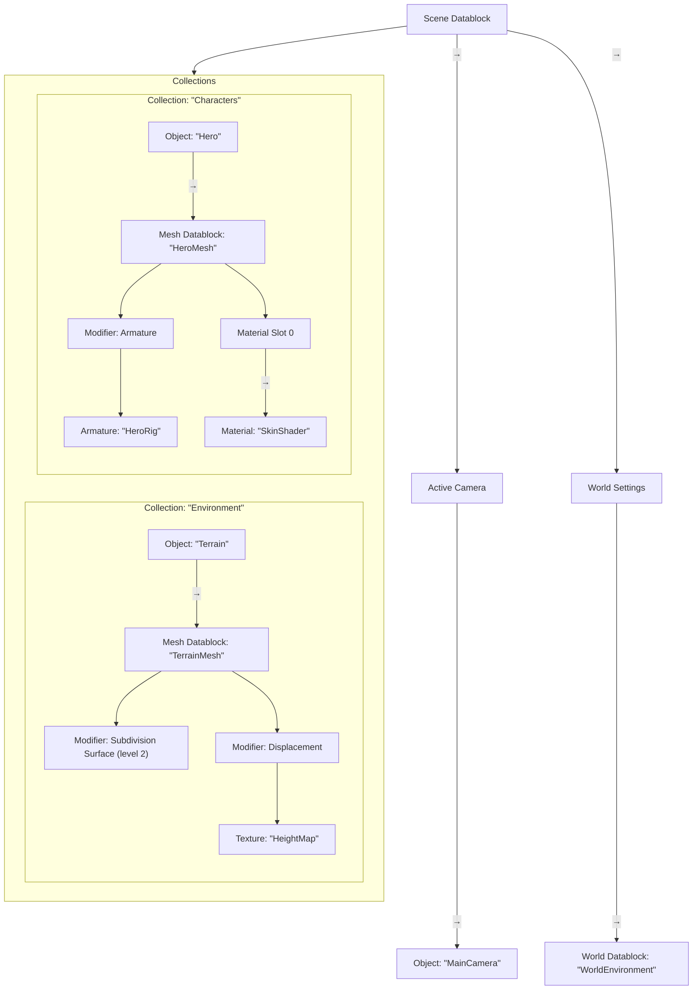

# Lesson 1: Interface Architecture, Data Model, Scene Graph Fundamentals

## 1. First-Principles Intuition & Invariants

Blender's interface architecture represents a radical departure from the document-centric paradigm that dominates most creative software. Where applications like Photoshop or Premiere Pro treat files as monolithic containers that you open, manipulate, and save, Blender operates on a live, object-oriented database that exists entirely in memory during your session. Every mesh, material, texture, and animation curve is not merely data waiting to be processed—it is an active object with identity, ownership relationships, and mutation history. This architectural decision has profound implications for how you interact with the software, how scenes scale, and how procedural workflows chain together.

The foundational abstraction in Blender is the **datablock**, a self-contained unit of data with a unique name, reference count, and type signature. Datablocks are not files on disk; they are runtime objects managed by Blender's internal database system. A mesh datablock contains vertex positions, edge topology, and face definitions. A material datablock contains shader node trees and surface properties. A camera datablock stores lens parameters and projection matrices. Critically, datablocks can reference other datablocks: a material references image texture datablocks; an object datablock references mesh, armature, or curve datablocks; a scene datablock references collections, which in turn reference objects. This forms a directed acyclic graph of dependencies—the **dependency graph**—that Blender's evaluation engine traverses to compute the final state of your scene at any given frame.

Understanding this graph structure is essential because Blender does not evaluate your scene linearly like a timeline-based compositor. When you move a bone in an armature, Blender traces all downstream dependencies: the armature modifier on the character mesh, the mesh's shape keys, the object's constraints, the child objects parented to bones, and any drivers or expression-based animations that reference those transforms. The dependency graph solver determines the minimal set of datablocks that must be recalculated and schedules their evaluation in topological order. This lazy evaluation model enables Blender to remain interactive even with complex procedural rigs and node-based material systems, but it also means that circular dependencies—such as two drivers referencing each other—will halt evaluation with a cyclic dependency error.

The second invariant is Blender's **context-sensitive operator system**. Unlike applications with fixed tool palettes, Blender's operators are dynamic functions that adapt their behavior based on the current editor type, active object, selection state, and edit mode. The extrude operator behaves differently in Edit Mode versus sculpting. The grab operator transforms mesh vertices in Edit Mode but repositions entire objects in Object Mode. This context sensitivity extends to the interface itself: the Properties panel displays different property sets depending on whether you have a mesh, lamp, or camera selected. Keybindings are scoped to editor contexts, so pressing **G** in the 3D Viewport initiates a move operation, but **G** in the Graph Editor grabs animation keyframes. This design reduces interface clutter and makes Blender's massive feature set navigable, but it demands that you always remain aware of your current mode and selection state.

The third core invariant is the **workspace paradigm**, introduced in Blender 2.80 to provide structured starting configurations for different tasks. A workspace is a saved arrangement of editor types, panels, and tool settings optimized for a specific workflow phase—modeling, shading, animation, rendering. When you switch from the Modeling workspace to the Shading workspace, Blender reconfigures the interface layout, hiding the modeling tools and exposing the Shader Editor with its node graph. Critically, workspaces do not isolate data; they merely change your view into the same underlying scene database. Edits made in the Shading workspace affect the same material datablocks that the Modeling workspace references. This shared-state model means that you can fluidly transition between phases without exporting intermediate files, but it also means that destructive edits propagate immediately across all views.

The **undo/redo stack** in Blender operates at the datablock mutation level, not the file save level. When you undo an extrude operation, Blender does not reload the entire scene from a previous snapshot; it reverses the specific mesh topology mutations that the extrude operator introduced. The undo system maintains a compressed diff log of datablock changes, storing only the deltas between states. This allows Blender to support deep undo histories—often hundreds of steps—without ballooning memory usage. However, this also means that undo does not revert external state changes like rendered image files or baked physics simulations stored outside the .blend file. Those artifacts persist on disk even after you undo the operations that generated them.

## 2. Core Architecture & Mechanics

Blender's data model is implemented as a hybrid structure combining **ID datablocks** (the high-level objects users interact with), **DNA** (Blender's schema definition system), and the **dependency graph** (the evaluation scheduler). Every datablock inherits from the base `ID` struct, which provides common properties: a name field limited to 63 characters (with the first two bytes reserved for type prefixes like `OB` for objects or `ME` for meshes), a reference count tracking how many other datablocks link to it, a library pointer (for linked assets from external .blend files), and a set of flags controlling visibility, selectability, and fake user status.

The DNA system is Blender's reflection and serialization framework. At compile time, Blender generates a schema catalog that maps every C struct to a type signature containing field names, offsets, and sizes. When you save a .blend file, Blender serializes the entire datablock database by walking the dependency graph and writing each datablock's memory representation directly to disk, prefixed with its DNA type signature. This binary format is what allows .blend files to be forward and backward compatible across Blender versions: if a newer version introduces additional fields in a struct, older versions simply ignore the unrecognized data rather than rejecting the file. The DNA system also powers Blender's Python API, which generates property wrappers dynamically by introspecting the DNA schema at runtime.

The scene graph hierarchy begins with the **Scene** datablock, the top-level container that holds render settings, the active camera, timeline range, and references to **Collections**. Collections are organizational groups that contain object datablocks. Unlike layers in Photoshop or object grouping in traditional design software, collections serve multiple purposes simultaneously: they control viewport and render visibility, define instancing groups (a collection can be instantiated as a single unit multiple times), and structure the Outliner's tree view. Collections can nest recursively, allowing you to build hierarchies like `Environment > Vegetation > TreeGroup > LeafCluster`. Objects can belong to multiple collections simultaneously, which means that moving an object into a different collection does not remove it from its original collection—you must explicitly unlink it from the prior collection first.

Objects themselves are **container datablocks** that reference the actual geometry or data. An object with type `MESH` holds a pointer to a separate mesh datablock. This indirection enables data reuse: you can instance the same mesh datablock across multiple object datablocks, each with different transforms, materials (via material slots), or modifiers. When you duplicate an object with **Shift+D**, Blender creates a new object datablock but links it to the same mesh datablock. When you use **Alt+D** (linked duplicate), you create a new object referencing the same mesh, but further edits to the mesh affect all linked instances. When you duplicate with **U** (make single-user), Blender deep-copies the mesh datablock, creating an independent copy.

The modifier stack operates as a sequential evaluation pipeline attached to the object. Each modifier reads the output of the previous stage and produces a transformed mesh that feeds into the next modifier or the final display/render output. A Mirror modifier clones geometry across a plane. A Subdivision Surface modifier applies Catmull-Clark subdivision. An Armature modifier deforms vertices according to bone transforms. Critically, modifiers are non-destructive until you apply them—the underlying mesh datablock remains unchanged until you explicitly collapse the stack. This enables iterative experimentation: you can toggle modifier visibility, adjust parameters, and reorder the stack without irreversibly altering the base geometry.

The dependency graph engine rebuilds its evaluation tree whenever you modify a datablock relationship—adding a modifier, creating a driver, or parenting an object. The graph tracks both **data dependencies** (an object depends on its mesh) and **operation dependencies** (a material's shader nodes depend on texture coordinates generated by the mesh UV map). When you scrub the timeline or change a transform, Blender traverses only the dirty subgraph—the set of nodes that depend on the mutated datablock—and evaluates them in topological order. This explains why animating a single bone on a character updates instantly, while changing the base mesh topology forces a full reevaluation of the modifier stack and all downstream dependencies.

Blender's interface system is built on **Areas**, **Regions**, and **Spaces**. An Area is a rectangular partition of the window that contains an editor. Regions are subpanels within an Area: the header bar, toolbar, sidepanel, and main content region. A Space is the editor type displayed in the main region—3D Viewport, Shader Editor, Outliner, Timeline. You can split an Area by dragging from a corner, merge Areas by dragging one's edge into another, and swap an Area's Space type via the dropdown in its header. Workspaces store these layout configurations as presets, but the underlying data—the scene graph, materials, and animation curves—remains identical across all workspaces.

The context system provides a filtered view into the current selection state. When you click an object in the 3D Viewport, Blender updates the global `context.active_object` pointer. The Properties panel queries this context and displays the object's transform properties, modifiers, and constraints. If you switch to Edit Mode and select vertices, `context.active_object.data` becomes the mesh datablock, and `context.selected_vertices` populates with the vertex selection. Operators read this context to determine their input: the Extrude operator reads `context.selected_vertices` in Edit Mode but reads `context.selected_objects` in Object Mode. This dynamic context system enables Blender to expose thousands of operators without requiring each one to be manually wired to specific UI elements.

## 3. High-Performance Optimization & Failure Modes

Blender's memory model trades off simplicity for performance: the entire scene database resides in RAM during your session, which enables instant undo, real-time viewport updates, and zero-latency switching between workspaces. However, this means that scenes with millions of polygons, high-resolution textures, and complex node trees can exhaust system memory, causing thrashing or crashes. The first optimization is **viewport draw optimization**: Blender maintains separate mesh representations for display (simplified via adaptive decimation) and render (full resolution). In the 3D Viewport, you can set the Subdivision Surface modifier's Viewport level lower than the Render level, reducing the polygon count by a factor of four or sixteen while preserving render quality. Similarly, the Simplify panel in Render Properties allows you to globally clamp subdivision levels and texture resolutions for faster viewport interaction during animation playback.

The dependency graph's lazy evaluation model introduces a critical failure mode: **evaluation order ambiguity**. If you construct a driver that reads an object's location to control a material's displacement strength, but that material's displacement affects the object's evaluated mesh, you have created a circular dependency. Blender will halt evaluation and flag the cycle in the console output with messages like `Dependency cycle detected: Object 'Cube' depends on itself`. The solution is to ensure that data flows unidirectionally: drivers should read final evaluated properties from upstream objects, never writing back to their own evaluation inputs.

Large scenes with thousands of objects benefit from **collection instancing** via Geometry Nodes or legacy particle systems. Rather than duplicating object datablocks repeatedly, you place all variants into a collection and instance that collection as a single unit. The render engine evaluates the collection once and reuses the geometry across all instances, dramatically reducing memory overhead and dependency graph complexity. However, instancing introduces a new constraint: instances share the same material assignments. If you need per-instance material variation, you must use geometry attributes or shader-based randomization rather than assigning different material datablocks to each instance.

Modifier stack performance degrades nonlinearly with geometry complexity. A Subdivision Surface modifier on a 10,000-polygon mesh generates approximately 160,000 polygons at level 2, and 2.5 million polygons at level 3. Each additional modifier—Boolean, Bevel, Solidify—operates on this expanded geometry, compounding the evaluation cost. The optimization strategy is to delay subdivision as late as possible in the stack: apply Boolean operations and hard-surface modeling tools to the base mesh, then add the Subdivision Surface modifier as the final stage. For extremely dense geometry (scanned meshes with millions of vertices), consider using the Decimate modifier with Planar mode to remove coplanar faces, or the Remesh modifier to generate a clean retopology before applying deformation modifiers.

Material node trees introduce their own performance profile. Blender's Cycles and Eevee render engines compile shader node graphs into GPU kernels (Metal/CUDA) or OptiX shading programs. Deeply nested Mix Shader nodes and procedural texture chains with excessive Noise, Voronoi, or Wave Texture nodes increase compilation time and GPU register pressure. The optimization is to **bake procedural textures to image maps** for static assets: generate the procedural texture once, bake it to a 4K texture, and replace the node tree with a simple Image Texture node. This reduces shader complexity by orders of magnitude and eliminates per-frame recalculation. However, baked textures lose the parametric editability of procedural shaders, so reserve baking for finalized assets entering the render phase.

The undo stack's diff compression algorithm assumes that most edits are localized. If you perform an operation that mutates every vertex in a mesh—such as applying a Smooth modifier or scaling in Edit Mode—the undo entry stores a full copy of the vertex array rather than a sparse delta. A sequence of global edits can bloat the undo memory by hundreds of megabytes per step. The mitigation is to apply destructive operations only when you are committed to the change: use non-destructive modifiers for iterative exploration, and apply them only when you need to edit the resulting geometry directly. You can also reduce undo memory by lowering the undo step count in Preferences > System > Undo Steps, though this sacrifices the ability to revert deep into your edit history.

Linked library assets—meshes, materials, or entire collections imported from external .blend files—introduce a split between **local overrides** and **library data**. When you link an asset, it remains read-only by default; you cannot edit the underlying mesh or material. However, you can create a **library override** that allows you to selectively modify properties while inheriting upstream changes from the source file. If the source file's mesh is updated, Blender propagates those changes to all linked instances, but your local overrides (such as custom material assignments or modifier adjustments) are preserved. This workflow enables team collaboration and asset reuse, but it also introduces a failure mode: if you accidentally break the library link by making the asset local, you lose the ability to receive upstream updates. The safeguard is to use library overrides rather than making assets fully local unless you explicitly intend to fork the asset into an independent variant.

Blender's .blend file format is a memory dump, not a compact archive. Every datablock, including unused meshes and orphaned materials, is serialized to disk. Over time, scenes accumulate dead datablocks—materials with zero users, meshes left over from deleted objects, image textures no longer referenced by any shader. These orphaned datablocks bloat file size and clutter the Outliner. The cleanup workflow involves opening the Outliner in Orphan Data mode, selecting unused datablocks, and purging them with the Purge command (accessible via the Outliner's context menu or by saving the file with **File > Clean Up > Purge All**). This operation removes all datablocks with zero users, shrinking file size and simplifying the scene database. However, purging is irreversible—if you accidentally purge a datablock you intended to keep, the only recovery method is to revert to a previous file save.

The viewport's real-time shading modes—Solid, Material Preview, and Rendered—each use different rendering backends with distinct performance characteristics. Solid mode uses a simple forward renderer with Blender's built-in lighting model, achieving hundreds of frames per second on complex scenes. Material Preview mode uses Eevee, Blender's real-time rasterization engine, which supports screen-space reflections, ambient occlusion, and bloom, but at the cost of 30–60 FPS on dense geometry. Rendered mode activates the full path-traced Cycles or hardware-accelerated Eevee Next engine, which can drop below 10 FPS on scenes with complex lighting and volumetrics. The workflow optimization is to perform modeling and animation blocking in Solid mode, switch to Material Preview for shader iteration, and use Rendered mode only for final lighting verification. Toggling between modes with **Z** (viewport shading pie menu) becomes muscle memory, allowing you to balance visual fidelity against interactive responsiveness.
