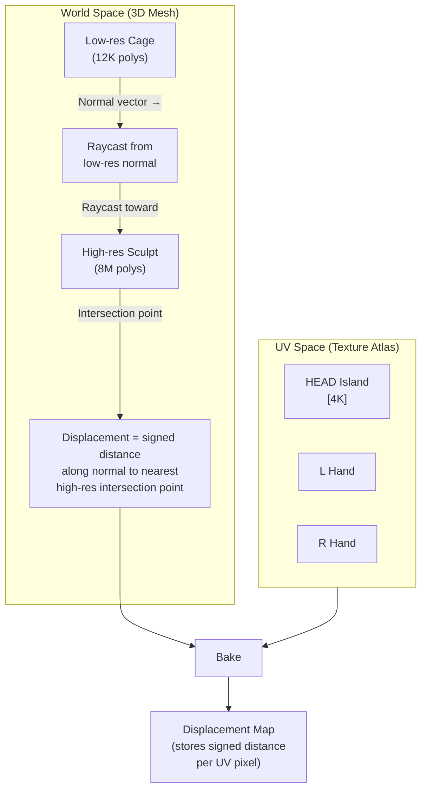

# Lesson 4: Detail Transfer, Displacement Theory, Map Extraction Systems

## 1. First-Principles Intuition & Invariants

The fundamental challenge in production 3D modeling lies in reconciling two opposing demands: the artist's need for unbounded sculpting freedom during the creative phase and the rendering engine's requirement for geometrically efficient, topology-optimized meshes at runtime. A production character model might contain eight million polygons in ZBrush, capturing every pore and wrinkle through iterative sculptural refinement, yet that same character must ultimately render in a game engine or film pipeline at perhaps twelve thousand polygons to meet performance budgets and deformation requirements. The mathematical bridge between these two representations—the high-resolution sculpt and the low-resolution delivery mesh—is the displacement map extraction system, a cornerstone technology that encodes geometric deviation as image data.

Understanding displacement theory begins with recognizing that digital sculpture operates fundamentally differently from polygon modeling. When you sculpt in ZBrush on a multi-resolution mesh, brushstrokes reposition existing vertices in three-dimensional space across global subdivision levels. Each brushstroke triggers an adaptive algorithm that evaluates curvature, subdivides affected faces into progressively smaller triangles or quads, and displaces the newly generated vertices along their surface normals according to brush intensity and alpha mask falloff curves. This process—termed dynamic tessellation or dynamic subdivision—allows ZBrush to maintain interactive frame rates even when manipulating meshes with tens of millions of polygons, because the subdivision occurs spatially and temporally: only the region under the brush receives additional geometry, and only during the stroke event itself.

The result of this sculptural workflow is a model that exists at multiple simultaneous resolution levels, organized hierarchically as subdivision levels. ZBrush internally maintains a complete history of the mesh at every subdivision tier, from the coarse base topology (often called the "cage" or "subdiv level 1") through successive doublings of polygon density up to the final high-resolution sculpt (which might exist at subdiv level 6 or 7, representing millions of faces). This multi-resolution representation is not merely a convenience for viewport performance; it is the essential prerequisite for map extraction. The low-resolution subdivision level serves as the target mesh—the geometry that will actually be rendered in the production pipeline—while the high-resolution level serves as the source of geometric truth from which detail must be extracted and encoded.

The encoding mechanism itself relies on a deceptively simple geometric insight: if two meshes share identical topology and UV parameterization but differ in vertex positions, the positional delta between corresponding points can be stored as a scalar height value measured along the low-resolution surface normal. This scalar field, when sampled across the UV domain and stored as grayscale image intensities, becomes a displacement map. The displacement value at any given UV coordinate represents the signed distance between the low-resolution surface and the high-resolution surface along the normal vector at that point. Positive displacement values (bright pixels) indicate that the high-resolution surface protrudes outward from the base; negative values (dark pixels) indicate concavity; and middle gray (exactly 50% intensity in an 8-bit image, or 0.5 in normalized floating-point) represents zero displacement—perfect alignment between the two surfaces.

This encoding strategy carries profound implications for data efficiency. A displacement map reduces three-dimensional volumetric detail—which would otherwise require millions of vertex positions stored as floating-point triplets—into a two-dimensional image that can be compressed, streamed, and evaluated on-demand by the rendering engine's tessellation shader. A 4K displacement map (4096 × 4096 pixels) can encode approximately sixteen million unique displacement samples, sufficient to reconstruct nearly all the sculpted detail from a multi-million polygon ZBrush model, yet the map itself consumes only 16 MB as a 16-bit grayscale PNG or 64 MB as an uncompressed 32-bit float EXR. The rendering engine then applies this displacement map at runtime by subdividing the low-resolution mesh and offsetting the generated vertices according to the sampled displacement values, effectively reconstructing the high-resolution geometry on-the-fly.

However, displacement maps encode only the component of geometric deviation that lies along the surface normal. This limitation becomes problematic when the high-resolution sculpt contains undercuts, overhangs, or fine details that project laterally rather than radially from the base surface. Consider a sculpted piece of torn fabric or a cracked stone surface: the jagged edges and protruding fragments extend in directions nearly perpendicular to the underlying surface normal, meaning their geometric information cannot be captured as a simple scalar height offset. For such cases, the industry employs two additional map types: normal maps and vector displacement maps.

A normal map stores the high-resolution surface orientation at each UV coordinate as an RGB-encoded three-component vector. Instead of recording how far the surface displaces, a normal map records which direction the surface faces at that point. During rendering, the engine uses these per-pixel normal vectors to recalculate lighting contributions, creating the illusion of geometric complexity without actually tessellating additional vertices. Normal maps are computationally inexpensive and universally supported across all real-time rendering engines, but they are fundamentally an optical illusion: they affect only shading and specularity, not the true silhouette or geometric profile of the mesh. A sphere with a normal map depicting surface craters will still render as a perfectly smooth sphere when viewed in profile; the craters appear only as lighting variations across the surface.

Vector displacement maps extend the displacement paradigm into three dimensions by storing a full XYZ offset vector at each UV coordinate rather than a single scalar height. Encoded as RGB channels (red = X-axis displacement, green = Y-axis displacement, blue = Z-axis displacement), vector displacement maps can reconstruct overhangs, undercuts, and complex topology changes that would be impossible with scalar height displacement alone. The cost of this flexibility is increased memory footprint—three channels instead of one—and more complex shader evaluation, as the renderer must apply a full three-dimensional vector offset to each tessellated vertex rather than a simple normal-aligned scalar multiplication. Vector displacement is the preferred format for film and high-end VFX work where geometric fidelity is paramount, while game production typically favors scalar displacement for primary forms and normal maps for fine surface detail.

The extraction of these maps from ZBrush's multi-resolution mesh hierarchy is governed by projection algorithms that solve a non-trivial spatial correspondence problem: given a point on the low-resolution surface, identify the nearest corresponding point on the high-resolution surface and measure the geometric difference. The naïve approach—simply pairing vertices by index—fails immediately because the high-resolution mesh contains orders of magnitude more vertices than the low-resolution mesh; there is no one-to-one correspondence. Instead, ZBrush employs raycasting projection, firing rays from the low-resolution surface and testing for intersection with the high-resolution geometry. For scalar displacement, rays are cast along the low-resolution surface normal in both the positive and negative directions; the algorithm searches for the nearest intersection point and records the signed distance. For normal map extraction, the algorithm samples the high-resolution surface normal at the intersection point and transforms it into tangent space relative to the low-resolution surface. For vector displacement, the full three-dimensional offset between the low-resolution and high-resolution intersection points is recorded in object space or tangent space coordinates.

The quality and accuracy of the extracted maps depend critically on several geometric invariants that must be maintained throughout the sculpting and retopology workflow. First, the low-resolution and high-resolution meshes must exhibit reasonable spatial proximity; if the low-resolution cage sits too far from the high-resolution sculpt, raycasting may miss features entirely or generate artifacts where rays intersect the wrong surface regions. Second, the low-resolution mesh must have clean, well-distributed UV coordinates with minimal distortion; severe UV stretching or overlapping islands will cause sampling artifacts and detail loss in the extracted maps. Third, the low-resolution mesh should follow the primary forms and flow lines of the high-resolution sculpt; attempting to project a cylindrical high-resolution form onto a flat low-resolution plane will produce nonsensical displacement values because the surface normals point in fundamentally incompatible directions. These requirements underscore that map extraction is not a post-hoc salvage operation but rather a deliberate phase of the modeling workflow that must be anticipated and planned from the beginning.

## 2. Core Architecture & Mechanics

ZBrush's internal subdivision system operates as a hierarchical mesh stack, where each subdivision level is stored as a complete, independent mesh representation rather than as a delta or difference from the previous level. When you press the Divide button in the Geometry subpalette, ZBrush applies Catmull-Clark subdivision (for quad-dominant meshes) or a modified Loop subdivision scheme (for triangle meshes), generating four child faces for each parent face and inserting edge midpoint vertices weighted according to the surrounding vertex neighborhood. This process is deterministic and reversible: stepping down to a lower subdivision level via the Lower Res button does not discard the higher-resolution data but merely hides it from the viewport and sculpting tools, allowing you to return to any subdivision tier without loss.

The subdivision level dropdown menu in the Geometry subpalette displays the current active level and the total number of stored levels. A typical production sculpt might show "SDiv: 6" with levels ranging from 1 (the base cage, perhaps 2,000 polygons) through 6 (the final sculpt, perhaps 8 million polygons). Each intermediate level represents a doubling of edge resolution: level 2 might be 8,000 polygons, level 3 might be 32,000, level 4 might be 128,000, and so forth. This exponential growth is why sculptors must be strategic about when to subdivide; adding an unnecessary subdivision level quadruples the memory footprint and can push the model beyond the limits of available RAM.

The subdivision level management workflow follows a disciplined protocol. Begin sculpting at the lowest subdivision level, establishing primary forms with large-radius Clay Buildup or Move brushes. Subdivide only when the current polygon density becomes insufficient to capture the detail you are attempting to sculpt—typically evident when you see faceting or angular artifacts that cannot be smoothed away. After each subdivision, spend time refining the forms at that resolution tier before moving higher. This "bottom-up" approach ensures that the underlying structure remains coherent and prevents the common beginner mistake of immediately subdividing to maximum density and attempting to sculpt fine pores on a form that lacks proper anatomical landmarks and volume distribution.

Map extraction in ZBrush is accessed through the ZPlugin menu under Multi Map Exporter or via the Tool → Displacement Map, Normal Map or Vector Displacement Map subpalettes for more granular control. The Multi Map Exporter provides a streamlined interface for batch-generating displacement, normal, ambient occlusion, and cavity maps in a single operation. The core extraction workflow proceeds as follows:

First, ensure that your low-resolution target mesh is loaded as a separate SubTool. This mesh must have clean quad topology (ideally all quads, though tris are acceptable in non-deforming regions), complete UV unwrap with no overlapping islands, and sufficient edge loop density to capture the primary silhouette and deformation requirements. The low-resolution mesh should sit spatially coincident with the high-resolution sculpt; if you generated the low-res via ZRemesher or by exporting a lower subdivision level, this alignment is automatic, but if you retopologized externally in Maya or Blender, you may need to adjust positioning to ensure the retopo cage closely hugs the sculpt.

Second, select the high-resolution sculpt SubTool as your source. Verify that you are viewing the highest subdivision level by checking the SDiv value in the Geometry subpalette. If you have sculpted multiple detail passes across several subdivision levels, ensure that all detail is visible by stepping to the top level; subdivision level visibility is not cumulative—only the currently active level's displacement is visible to the extraction algorithm.

Third, configure the projection distance and ray search parameters. In the Zprojection subpalette (accessed via Tool → SubTool → Project), the Dist slider controls the maximum distance that rays will search for intersection with the high-resolution mesh. Setting this value too low causes the algorithm to miss detail in regions where the high-res sculpt protrudes significantly from the low-res cage; setting it too high allows rays to intersect unintended surface regions, particularly in areas with complex self-occlusion or thin geometry. A reasonable starting value is approximately 105% to 110% of the maximum expected displacement distance, which you can estimate by toggling between the high-res and low-res meshes and visually assessing the largest protrusions. The Blur slider applies a post-extraction smoothing filter to the displacement map, reducing high-frequency noise but potentially softening fine detail; for most production work, a blur value of 0 to 2 preserves sculpted detail while eliminating sampling artifacts.

Fourth, initiate the displacement map extraction. In the Multi Map Exporter, enable the Displacement toggle, set the map resolution (typically 2K or 4K for production assets), choose the bit depth (16-bit for game assets to minimize banding, 32-bit float for VFX work requiring maximum fidelity), and specify the export file path. The Mid value defines the neutral gray level—the displacement value that represents zero offset. For a 16-bit map with a Mid value of 0.5, any pixel with intensity 32768 (half of the 16-bit range) indicates no displacement. Positive displacement values map to brighter pixels (above 32768) and negative values map to darker pixels (below 32768). The Intensity slider scales the displacement range; higher intensity values compress the full displacement range into the available bit depth, which increases precision for shallow details but risks clipping deep concavities or tall protrusions if the intensity is too aggressive.

The extraction algorithm proceeds by rasterizing the low-resolution mesh's UV layout into a 2D grid at the target resolution. For each pixel in this grid, the algorithm performs a reverse lookup to determine the corresponding 3D position on the low-resolution mesh, then casts rays along the surface normal at that point. The raycasting typically employs a bidirectional search: one ray extends outward (positive normal direction) and another inward (negative normal direction), each testing for intersection with the high-resolution mesh geometry. The algorithm selects the nearest valid intersection and computes the signed distance along the normal. This distance value is then normalized to the 0–1 range based on the configured intensity and mid-point settings and written to the displacement map image at the current pixel location.

Normal map extraction follows a similar raycasting process but samples the high-resolution surface normal at the intersection point rather than the distance. The high-resolution normal vector must be transformed from object space (where it exists as an absolute XYZ direction) into tangent space (where it is expressed relative to the local surface orientation of the low-resolution mesh). Tangent space encoding is essential because it allows the normal map to be reused across mirrored or instanced geometry; the same normal map applied to a left hand and a right hand will produce correct lighting on both, because the tangent-space vectors are interpreted relative to each mesh's local surface frame. ZBrush handles this transformation internally, encoding the tangent-space normal as an RGB triplet where red represents the X-axis (horizontal) component, green represents the Y-axis (vertical) component, and blue represents the Z-axis (outward/normal-aligned) component. The resulting normal map typically appears predominantly blue (since most surface normals point roughly outward) with red and green variations indicating the angular deviation of the high-resolution surface from the low-resolution base.

Vector displacement extraction abandons normal-aligned projection entirely, instead computing the full three-dimensional offset vector between the low-resolution and high-resolution surfaces. This offset can be encoded in object space (where XYZ components are absolute world-space directions), tangent space (where the offset is expressed relative to the local surface frame), or a custom coordinate system defined by the artist. Object-space vector displacement is simpler to implement but less flexible; the map is valid only for the specific mesh pose and cannot be reused if the mesh is deformed or animated. Tangent-space vector displacement is more complex but allows the map to follow mesh deformations, making it suitable for animated characters. ZBrush exports vector displacement maps as 32-bit floating-point EXR files with three channels, preserving the full precision required for accurate reconstruction.

The mathematical relationship between subdivision levels and displacement map resolution follows a sampling theorem similar to Nyquist's principle in audio DSP: to accurately reconstruct a signal, you must sample at twice the highest frequency present in the source. In geometric terms, the displacement map resolution must be sufficient to capture the finest detail present in the high-resolution sculpt without aliasing or detail loss. A practical heuristic is to match the displacement map's linear resolution to approximately one-quarter to one-half of the high-resolution mesh's edge count per UV island. For example, if your high-resolution head sculpt contains 4 million polygons and the head occupies a 2K × 2K UV island, you have approximately 2 million edges distributed across 4 million pixels, yielding roughly 0.5 edges per pixel—adequate for capturing most sculpted detail without oversampling. If the high-resolution mesh were instead 16 million polygons, a 4K displacement map (16 million pixels) would provide a more appropriate sampling density.

Edge bleeding and padding represent a critical technical concern in displacement map extraction. Because UV islands occupy discrete regions of the texture atlas with empty space between them, and because rendering engines apply texture filtering (bilinear or trilinear interpolation) that samples across pixel boundaries, the edges of UV islands can exhibit color bleeding where the renderer samples from the black background or from adjacent unrelated islands. To prevent this, ZBrush and other map-baking tools apply edge padding (also called dilation or margin expansion), which extends the displacement values outward from the UV island boundaries by a specified number of pixels. A padding width of 8 to 16 pixels is typical for production assets; insufficient padding causes visible seams along UV boundaries, while excessive padding increases processing time without benefit.

ZBrush's projection system also offers masking and group-based projection controls for handling complex multi-material assets. If your sculpt includes separate material regions—for instance, skin, teeth, and eyes on a character head—you can assign these regions to different PolyGroups and configure the projection to respect group boundaries, preventing rays cast from skin regions from intersecting with teeth geometry. This group-aware projection is essential for avoiding cross-contamination artifacts in maps where geometrically overlapping but logically separate elements occupy the same spatial volume.

## 3. High-Performance Optimization & Failure Modes

The production deployment of displacement and normal map workflows demands careful attention to memory management, subdivision strategy, and projection tuning to avoid catastrophic failure modes that can halt production or require expensive rework. The most common failure occurs when artists subdivide too aggressively during the sculpting phase, generating meshes with tens of millions of polygons that exceed available system RAM. ZBrush will continue to operate as long as the active subdivision level fits in memory, but attempting to perform map extraction with an excessively high-resolution source mesh can trigger out-of-memory crashes or force the operating system into swap-thrashing behavior that renders the machine unusable. The solution is not necessarily to abandon high-polygon sculpting but rather to employ targeted subdivision: use the Masks and PolyGroup Isolate tools to subdivide only the regions requiring fine detail (facial features, hands, wrinkles) while leaving large, smooth regions (torso, limbs) at lower subdivision levels. To achieve variable polygon density, artists must use dynamic topology tools like Sculptris Pro or split the mesh into separate SubTools.

Projection distance misconfiguration represents the second most frequent failure mode. If the Dist parameter in Zprojection is set too conservatively, rays will fail to reach the high-resolution surface in regions where the sculpt deviates significantly from the low-resolution cage, resulting in black voids or zeroed-out regions in the displacement map. Conversely, excessive distance values allow rays to intersect unintended surface regions, particularly in areas with thin geometry or complex folds. A character's fingers, for instance, can produce cross-intersection artifacts where a ray cast from one finger's low-resolution surface intersects the high-resolution geometry of an adjacent finger rather than its own corresponding surface. The diagnostic workflow for tuning projection distance involves isolating problematic regions via PolyGroup masking, exporting test maps at multiple distance settings, and inspecting the results in an external image viewer or by reapplying the maps in your target rendering engine.

UV distortion and stretching directly degrade displacement map quality by introducing non-uniform sampling density across the mesh surface. Consider a UV layout where the head occupies 50% of the texture atlas while the hands occupy only 5% each: the head receives ten times the texel density of the hands, meaning fine sculpted detail will be preserved on the face but lost or aliased on the fingers. Professional UV unwrapping aims for equalized texel density across all regions, achieved by scaling UV islands proportionally to their 3D surface area. ZBrush's UV Master plugin can assist with this by analyzing and reporting texel density per island, allowing you to rescale islands manually in ZBrush or export to an external UV editor for layout optimization. For hero assets where maximum detail fidelity is required, consider using multiple UV sets with separate displacement maps: a primary 4K map for the head and a secondary 4K map for the body, each optimized for its respective region.

Normal map artifacts manifest in several characteristic patterns, each indicating a specific underlying failure. Purple or cyan fringes along UV island boundaries signal insufficient edge padding; the renderer is sampling beyond the island edge and blending with black or incorrect neighboring data. Faceted or blocky shading on curved surfaces despite a high-quality bake indicates that the low-resolution mesh lacks sufficient edge loops to support smooth normal interpolation; normal maps cannot add geometric curvature, only surface detail on existing curvature, so the low-resolution cage must already approximate the sculpt's primary forms. Inverted or flipped normals—areas that appear to protrude inward rather than outward—typically result from tangent space calculation errors, often caused by non-uniform scaling, mirrored geometry without properly flipped normals, or inconsistent tangent basis across the sculpting and rendering pipelines. Most modern renderers support MikkTSpace tangent basis, which has become the de facto standard; ensure that both ZBrush's normal map export and your target renderer are configured for MikkTSpace consistency.

Displacement map reconstruction in external renderers introduces its own optimization considerations. Real-time engines like Unreal and Unity support displacement via tessellation shaders that subdivide the low-resolution mesh on the GPU at render time, but these systems impose strict performance budgets: tessellation factors (the number of subdivisions applied per triangle) must be carefully tuned to balance visual fidelity against frame rate. Excessive tessellation can overwhelm the GPU's vertex processing capacity, causing frame rate collapse, while insufficient tessellation produces visible faceting where the displacement is undersampled. Adaptive tessellation—where the engine dynamically adjusts subdivision density based on camera distance—offers a middle ground, applying high tessellation to nearby objects and reducing it for distant geometry. Film and offline rendering engines like Arnold, RenderMan, and V-Ray support micro-polygon displacement, which subdivides geometry to subpixel resolution at render time, but this comes at the cost of greatly increased memory consumption and render time; a single frame of a fully displaced character can consume tens of gigabytes of RAM and require minutes to hours to render.

The workflow integration between ZBrush and production pipelines typically involves exporting the low-resolution mesh and displacement maps separately, then reassembling them in the target environment. Export the low-resolution mesh as OBJ or FBX with embedded UVs, ensuring that the export settings preserve vertex order and UV indexing (mismatched indices between the mesh and the UVs used during map extraction will cause spatial misalignment). Export displacement maps as 16-bit PNG for game pipelines or 32-bit EXR for VFX work, using a consistent naming convention that includes the SubTool name, map type, and resolution (e.g., `CharacterHead_Displacement_4K.exr`). Import these assets into your target renderer, assign the displacement map to the material's displacement channel, and configure the displacement intensity and mid-point parameters to match the values used during extraction in ZBrush. Most renderers default to a displacement intensity of 1.0 and a mid-point of 0.5; if these do not match your ZBrush export settings, the reconstructed geometry will appear squashed or stretched.

For iterative workflows where you anticipate making changes to both the high-resolution sculpt and the low-resolution retopology, consider adopting a non-destructive projection setup using ZBrush's projection layers. Rather than permanently projecting displacement onto the low-resolution mesh, store the high-resolution detail as a projected layer that can be toggled, edited, or re-projected as the base mesh evolves. This approach preserves flexibility but requires disciplined layer management to avoid confusion about which detail exists at which subdivision level versus which detail is stored as projected data.

Vector displacement workflows introduce additional failure modes related to coordinate space consistency. Object-space vector displacement is sensitive to mesh pivot point location and scale; if the mesh is repositioned or scaled after map extraction, the displacement vectors will point in incorrect directions, producing catastrophic distortion. Tangent-space vector displacement avoids this by encoding offsets relative to the local surface frame, but it requires that the tangent and bitangent vectors (the local XY axes of the surface) are computed identically during extraction and rendering. Mismatches between tangent space conventions—particularly the handedness (left-handed versus right-handed coordinate systems) and the binormal calculation method—will cause the displacement to twist or shear. Always validate vector displacement maps in the target renderer immediately after export, rather than assuming correctness; a simple test scene with known displacement values (a sphere with outward radial displacement) can quickly reveal coordinate space errors.

Finally, archival and version control considerations become critical in production environments where assets may be revisited months or years after initial creation. Store not only the final exported maps but also the source ZBrush file with all subdivision levels intact, the low-resolution retopology mesh, and a README documenting the extraction settings (projection distance, map resolution, intensity, mid-point, coordinate space). This archival discipline ensures that if the asset requires updates—a client requests a costume change, or a character's facial proportions need adjustment—the artist can reload the original sculpt, make modifications, and re-extract maps with consistent settings, rather than attempting to reverse-engineer the original workflow from the final exported files alone.
