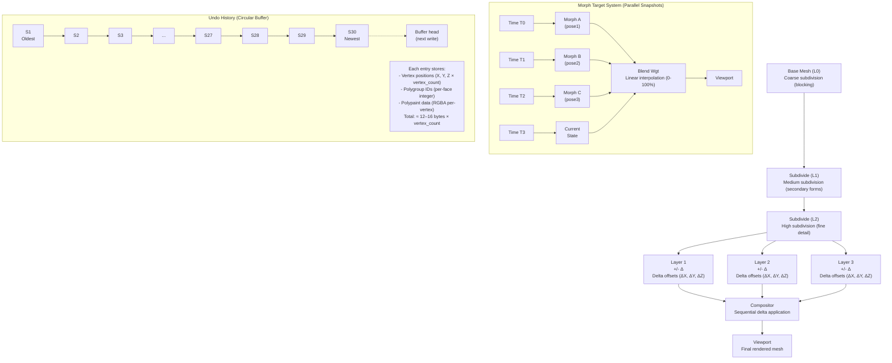

# Lesson 5: Non-Destructive Workflows, Layer Systems, History Management

## 1. First-Principles Intuition & Invariants

The destructive nature of traditional digital sculpting presents a paradox that every sculptor must confront: the medium demands bold, gestural strokes to establish form and visual continuity, yet the creative process itself is iterative, exploratory, and necessarily provisional. When you compress a million polygons into a twisted anatomical gesture, when you carve deep cavities into a character's facial expression, or when you apply aggressive surface noise to simulate organic skin texture, you are making decisions that fundamentally alter the underlying geometry. Unlike a painter who can scrape away layers of oil pigment to reveal pristine canvas beneath, or a designer who can reference previous iterations of a digital file, the sculptor working directly on mesh data faces an irreversible transformation with each operation. Every stroke replaces vertex positions; every subdivision multiplies topology; every boolean operation rewrites edge connectivity. The mesh does not remember what it was before you touched it.

This destructive linearity stands in philosophical opposition to the creative workflow itself. Composition—whether visual or sculptural—is not a straight line from concept to completion but a recursive spiral of iteration, comparison, and refinement. A visual artist sketches formal studies, tests compositional variations, returns to earlier design decisions, and builds up elements through multiple passes. A sculptor must enjoy the same freedom to explore divergent formal solutions, to preserve critical decision points as reference states, and to recombine elements non-linearly without collapsing the entire procedural history into a single, irreversible mesh state. The challenge, then, is constructing a workflow architecture that introduces temporal elasticity and state multiplicity into an otherwise destructive medium.

ZBrush addresses this challenge through three interlocking non-destructive systems, each operating at a different granularity of creative control. The **layer system** allows sculptors to decompose a single sculpting pass into multiple additive or subtractive deformation layers, each independently togglable and blendable, preserving intermediate refinements as separate, recombineable stages without committing to a single outcome. The **morph target system** captures discrete snapshots of mesh topology at specific creative decision points, establishing temporal waypoints that can be recalled, compared, or blended as procedural anchors throughout the sculpting process. The **subtool hierarchy** organizes complex assemblies of separate mesh objects into parent-child relationships, enabling instance-based duplication, isolated transformation scopes, and component-level version control without flattening everything into a single polygroup-segmented monolith. Together, these three systems form a non-destructive scaffolding that preserves creative optionality while still permitting the gestural immediacy and high-frequency detail manipulation that defines digital sculpting as a medium.

Understanding these systems requires grasping a fundamental invariant: **non-destructive workflows trade memory overhead for temporal flexibility**. Every layer you create stores a delta deformation relative to a base mesh state. Every morph target captures a complete snapshot of vertex positions for the entire active subdivision level. Every duplicated subtool instance maintains a reference pointer to shared geometry until you explicitly break the instance link. The ZBrush undo history itself maintains a circular buffer of mesh states, each consuming memory proportional to vertex count and sculpting complexity. When you work at eight million polygons across six layers with twelve stored morph targets, you are not simply storing eight million vertex positions—you are storing multiple redundant copies of positional data, each representing a parallel timeline or compositional variation. The memory cost scales multiplicatively, not additively, which imposes hard practical limits on how deeply you can nest non-destructive operations before the system exhausts available RAM and begins swapping to disk, collapsing interactive sculpting performance into glacial, multi-second brush lag.

The second invariant is that **non-destructive systems introduce dependency graphs that constrain editing order**. A layer stack is not merely a visual organizational metaphor; it represents a strict linear dependency chain where each layer's deformation is computed relative to the cumulative result of all layers beneath it. If you adjust the base mesh topology—by merging subtools, remeshing, or applying a ZRemesher pass—you invalidate every layer above it because the vertex correspondence between the base state and each layer's delta deformation has been broken. Similarly, morph targets are intrinsically tied to the subdivision level at which they were created. A morph captured at subdivision level 6 cannot be applied to level 5 or level 7 because the vertex count differs; the stored positional deltas have no valid correspondence in a mesh with a different topological resolution. This dependency structure means that non-destructive workflows are not infinitely malleable—they establish a procedural contract that limits future topology changes and demands strategic planning about when to commit irreversible operations like decimation, remeshing, or subdivision level collapse.

The third invariant governs the mathematical representation of deformations in layer and morph systems: **all deltas are stored as Cartesian offset vectors, not as parametric transformations**. When you sculpt on a layer, ZBrush does not record "move this vertex 2 units along its surface normal" or "apply a 15% radial displacement relative to the mesh centroid." Instead, it captures the raw world-space difference between the vertex's position before and after your sculpting stroke, storing three floating-point values (ΔX, ΔY, ΔZ) per vertex. This Cartesian representation is computationally efficient for real-time playback—applying a layer simply means adding or subtracting its stored deltas from the base mesh—but it lacks the semantic richness of parametric deformation graphs found in procedural modeling systems. If you rotate the entire subtool after creating a layer, the layer's deltas remain in their original world-space orientation, producing shearing artifacts because the stored offsets no longer align with the mesh's local surface tangent frame. This coordinate-space brittleness demands that you establish your subtool's final pose and orientation before beginning serious layer-based sculpting, lest you introduce unrecoverable geometric distortions that can only be fixed by collapsing the layer stack and re-sculpting from scratch.

These invariants collectively define the boundaries of non-destructive sculpting in ZBrush. The system grants you extraordinary creative freedom to explore variations, preserve decision points, and defer commitment, but it exacts a cost in memory consumption, imposes structural dependencies that constrain editing order, and relies on a mathematically brittle deformation representation that demands careful workflow sequencing. Mastering non-destructive techniques means learning to navigate these constraints strategically, knowing when to commit operations to free memory, when to bake layers into the base mesh to simplify the dependency graph, and when to accept that certain topological changes will require abandoning accumulated layer history in favor of a fresh sculpting pass on a new base state.

## 2. Core Architecture & Mechanics

The layer system in ZBrush operates as a vertical stack of additive or subtractive deformation states, each layer storing per-vertex offset deltas that modify the cumulative result of all layers below it. When you create a new layer, ZBrush internally allocates a memory buffer sized to hold three 32-bit floating-point values for every vertex in the current subdivision level, initializing all deltas to zero. As you sculpt, each brush stroke writes new offset values into the active layer's buffer, accumulating changes without touching the underlying base mesh geometry. At display time, the renderer traverses the layer stack from bottom to top, sequentially applying each layer's deltas to produce the final visible mesh. This layered-offset approach lets you build complexity incrementally: the base mesh provides the foundation, each layer stores a discrete sculpting pass, and the viewport displays the combined result of all layers stacked together.

Layers exist only at the highest subdivision level of a subtool. If you subdivide from level 5 to level 6, any existing layers created at level 5 become dormant and inaccessible until you return to level 5. This subdivision-locked behavior arises from the vertex correspondence requirement: a layer's delta buffer is dimensioned to match the exact vertex count of the subdivision level at which it was created, and applying those deltas to a mesh with a different vertex count would produce garbage deformation because there is no well-defined mapping between the two topologies. In practice, this means you must decide which subdivision level will host your layer-based workflow before you begin sculpting across layers. Most sculptors choose the highest practical subdivision level—typically level 6 through 8, balancing detail resolution against memory overhead—and perform all fine-detail work within that layer stack, reserving lower subdivision levels for broad form blocking that does not require layer-based iteration.

The layer control panel exposes several critical parameters for each layer. The **opacity slider** linearly scales the magnitude of the layer's stored deltas before applying them to the base mesh, functioning identically to an audio fader: at 100%, the layer applies its full recorded deformation; at 50%, it applies half-strength offsets; at 0%, the layer contributes nothing. The **Record/Edit toggle** determines whether sculpting strokes write new deltas into the layer or modify the base mesh directly; leaving Record mode active on a layer ensures all sculpting is captured non-destructively, while disabling it allows you to work directly on the cumulative result beneath. The **Solo/Mute/Visibility toggles** control whether a layer is included in the final render: Solo isolates a single layer against the base mesh, Mute temporarily disables a layer without deleting it, and Visibility hides the layer from the viewport while keeping it active in the stack computation. These controls allow rapid A/B comparison workflows—soloing successive layers to evaluate each deformation's contribution in isolation, or muting layers to assess how a sculpt reads without specific detail passes.

Layers support both **additive and subtractive modes**, though ZBrush does not expose this as an explicit layer property. Instead, the mode is implicit in the stored delta signs: positive deltas pull vertices outward (additive), while negative deltas push them inward (subtractive). When you sculpt with standard brushes on a layer, you naturally produce a mix of both. However, you can enforce strictly additive or subtractive behavior by using the **Layer Intensity slider** in conjunction with brush settings: setting Zadd mode ensures all strokes push outward, while Zsub mode forces inward carving. This signed-delta architecture allows a single layer to contain complex mixed deformations—raised scar tissue alongside carved wrinkles, for instance—but it also means you cannot trivially invert a layer's effect by negating its opacity, because doing so would flip both the additive and subtractive components, producing visually nonsensical results.

The layer system's memory footprint scales linearly with vertex count and layer count. At subdivision level 7, a typical character head contains approximately four million vertices. Each layer requires 12 bytes per vertex (three 32-bit floats for ΔX, ΔY, ΔZ), yielding 48 megabytes per layer. A stack of ten layers consumes 480 megabytes, and if you have six subtools each with ten-layer stacks, your project's layer data alone occupies 2.8 gigabytes before accounting for the base mesh geometry, texture maps, or undo history. This multiplicative scaling explains why layer-heavy projects quickly exhaust system RAM on machines with 16 GB or less. The practical limit is typically five to eight layers per subtool at high subdivision levels, beyond which memory pressure forces aggressive undo history truncation and introduces viewport lag as ZBrush begins paging data to disk.

Morph targets operate at a different abstraction level, capturing complete snapshots of mesh vertex positions rather than relative deltas. When you store a morph target, ZBrush copies the current X, Y, Z coordinates of every vertex at the active subdivision level into a named buffer, preserving the entire mesh state as a temporal anchor. This snapshot is absolute, not relative: it encodes world-space positions, not offsets, meaning you can instantly recall a morph target to restore the mesh to that exact historical state regardless of how many subsequent edits you have made. The morph target system functions as a temporal version control mechanism, allowing you to mark critical decision points—the approved client pose, the director's preferred expression, the anatomically correct neutral state—and return to them non-linearly without traversing the undo history.

The mathematical distinction between layers and morph targets is subtle but consequential. A **layer stores a function** (a set of offset vectors that transform one mesh state into another), while a **morph target stores a value** (a complete mesh state itself). This difference manifests in how they compose: layers combine additively through sequential delta application, while morph targets do not combine at all—each morph is an independent snapshot that replaces the current mesh state when activated. However, ZBrush provides a **Morph Blend slider** that interpolates between the current mesh state and a selected morph target, computing a weighted average of corresponding vertex positions across the two states. At 0% blend, you see the current mesh; at 100%, you see the stored morph; at 50%, you see a linear interpolation halfway between. This interpolation capability enables smooth transitions between approved milestone states and supports blend-shape facial animation workflows where animators drive morph target weights to produce phoneme shapes and emotional expressions.

Morph targets, like layers, are subdivision-level-locked. A morph stored at level 6 cannot be applied to level 5 because the vertex count differs and there is no well-defined correspondence between the two topologies. This constraint forces you to store separate morphs for each subdivision level if you want temporal waypoints across multiple detail resolutions. In practice, most sculptors store morphs only at the highest subdivision level, using lower levels purely for broad form blocking without snapshot preservation. The memory cost of morph targets is identical to the base mesh at the target's subdivision level: approximately 12 bytes per vertex. A four-million-polygon mesh requires 48 megabytes per stored morph, so maintaining ten morphs consumes 480 megabytes per subtool, equivalent to a ten-layer stack but with fundamentally different compositional semantics.

The **Store Morph Target** workflow follows a simple ritual: adjust the mesh to a desired reference state, navigate to the Morph Target subpalette, and click Store MT. ZBrush captures the current state and assigns it to the single active morph slot. Critically, ZBrush maintains only one morph target at a time per subtool—storing a new morph overwrites the previous one unless you first use the **Switch** or **Rename** mechanism to preserve multiple named morphs. The Switch operation swaps the current mesh state with the stored morph, effectively creating a two-state toggle. To preserve more than two states, you must manually duplicate the subtool before storing each morph, creating parallel copies that each hold a single snapshot. This single-morph-slot limitation is a deliberate workflow constraint that encourages sculptors to commit to decisions rather than hoarding dozens of speculative variations, though power users often work around it by scripting automated subtool duplication routines.

The subtool hierarchy extends non-destructive workflows to the assembly level, allowing you to organize complex multi-part sculptures into parent-child relationships where transformations and visibility states propagate hierarchically. A subtool is ZBrush's term for an independent mesh object within a single project file. Unlike polygroups, which are merely integer tags on faces within a single mesh, subtools are topologically separate meshes that can have different subdivision levels, different layer stacks, and different material assignments. The subtool list displays all subtools in a flat vertical stack, but you can establish logical grouping by naming conventions and by using the **Folder** subtool type to create collapsible organizational containers.

The **instance system** within the subtool hierarchy enables memory-efficient duplication where multiple subtools share a single underlying mesh buffer, displaying identical geometry at different positions, rotations, or scales. When you duplicate a subtool by clicking the **Duplicate** button with the Instance option enabled, ZBrush does not copy the mesh data; instead, it creates a lightweight reference object that points to the original subtool's geometry and maintains its own local transformation matrix. Sculpting on one instance immediately updates all other instances because they reference the same vertex buffer. This behavior is invaluable for symmetrical elements—armor plates, mechanical greeblies, teeth, feathers—where you need identical copies distributed across a surface. However, the instant you sculpt on an instance, ZBrush automatically breaks the instance link by copying the shared geometry into a unique buffer, converting the instance into a fully independent subtool. This copy-on-write behavior ensures that instances remain memory-efficient until you actually need to differentiate them, at which point the memory cost reverts to that of a standard duplicate.

The subtool hierarchy also supports **polygroup-based splitting** and **merging workflows** that allow you to decompose a single mesh into multiple subtools or consolidate separate subtools into a unified mesh. Splitting by polygroups creates one subtool per polygroup, each inheriting the original mesh's subdivision history and UV layout but containing only the faces tagged with that polygroup ID. This decomposition is topologically destructive—you cannot later undo the split without losing any sculpting work done on the separated subtools—but it enables focused detailing on isolated components without affecting surrounding geometry. Merging subtools combines their geometry into a single subtool while preserving their distinct polygroups and topology, allowing them to be split back apart later. Merging is irreversible; once subtools are consolidated, you cannot later extract individual components without manual retopology.

The undo history system in ZBrush operates as a circular buffer that stores sequential snapshots of the active subtool's mesh state. Each undo entry captures the complete vertex positions, polygroup tags, and paint data for the current subdivision level, consuming memory proportional to vertex count. The undo depth is configurable in the Preferences menu, with a default of 20 to 30 steps depending on available RAM. When the buffer fills, ZBrush discards the oldest entry and appends the newest, maintaining a rolling window of recent history. This circular structure means that once you exceed the undo depth, earlier states are permanently inaccessible unless you stored them as morph targets or duplicate subtools.

Critically, the undo history is **subtool-local**, not project-global. Switching between subtools resets the undo pointer to that subtool's independent history, which can be disorienting if you expect a global undo stack like in Photoshop or Blender. If you make ten edits on Subtool A, switch to Subtool B, make five edits there, then return to Subtool A, pressing Undo will revert the last change made on Subtool A (the tenth edit), not the last change made anywhere in the project (the fifth edit on Subtool B). This localized history model reduces memory overhead—each subtool only tracks its own edits—but it demands careful subtool navigation discipline to avoid losing track of which edits belong to which history stack.

The undo system interacts subtly with layers. When a layer is in Record mode, sculpting strokes write deltas into the layer's buffer, and each stroke generates an undo entry that captures the layer's delta state, not the base mesh. Pressing Undo reverts the layer's deltas, effectively rolling back the sculptural edits on that layer. However, if you disable Record mode and sculpt directly on the base mesh, undo entries capture the base mesh state, and layer data remains unchanged. This bifurcated undo behavior means you can selectively revert layer-based edits without affecting the base mesh, or vice versa, providing fine-grained temporal control over different compositional strata. However, mixing layer-based and base-mesh edits in rapid succession can produce confusing undo behavior where some strokes revert layer data while others revert base geometry, making it difficult to predict exactly what state each undo step will restore.

The memory budget consumed by the undo history is **multiplicative across subdivision levels**. If you sculpt at level 7 (four million vertices), each undo entry stores 48 megabytes. A 30-step undo buffer consumes 1.4 gigabytes per subtool. If you then subdivide to level 8 (eight million vertices), the per-entry cost doubles to 96 megabytes, and a 30-step buffer requires 2.8 gigabytes. ZBrush automatically adjusts the undo depth based on available memory, truncating the buffer when subdivision increases push memory consumption beyond safe thresholds. On systems with limited RAM, aggressive subdivision reduces undo depth to as few as five or ten steps, dramatically narrowing your temporal safety net. This tradeoff forces sculptors to choose between fine detail resolution and undo history depth, often necessitating manual morph target storage before subdividing to preserve fallback states when undo depth collapses.

## 3. High-Performance Optimization & Failure Modes

Optimizing non-destructive workflows in ZBrush demands ruthless memory management and strategic commitment of provisional edits into permanent mesh states. The primary failure mode sculptors encounter is **memory exhaustion leading to disk thrashing**, where the combined overhead of layer stacks, morph targets, and undo history exceeds available RAM and forces the operating system to swap data to disk. When this occurs, sculpting performance collapses from fluid real-time response to multi-second lag per brush stroke as the system pages mesh buffers between RAM and disk. This thrashing manifests as stuttering viewport updates, delayed stroke preview, and eventual application crashes when virtual memory limits are reached. The solution is preemptive memory budget discipline: monitor the **Quick Info** panel's memory usage indicator and aggressively collapse layers, delete unused morph targets, and truncate undo history before the system enters swap territory.

Layer stack optimization begins with **strategic layer consolidation**. Once a layer's deformation has been approved and no longer requires independent adjustment, bake it into the base mesh by selecting the layer and clicking **Bake All** or **Bake Selected**. Baking applies the layer's deltas to the base mesh and deletes the layer buffer, freeing memory and simplifying the dependency graph. This operation is irreversible—you cannot later extract the baked layer's deformation into a separate adjustable state—so it represents a commitment to the sculpted result. Best practice is to bake layers at natural workflow milestones: after client approval of a detail pass, after completing a specific anatomical region, or when memory pressure demands immediate relief. Some sculptors adopt a "rolling bake" discipline where they maintain only the three or four most recent layers in an editable state, baking older layers as new ones are created to maintain a constant memory footprint.

The **layer opacity workflow** offers a compromise between full baking and complete preservation. If a layer's deformation is approved but you want to retain the ability to globally scale its intensity—for instance, softening all skin pores by 30% to match a director's feedback—leave the layer unbaked but set its opacity to the desired scale percentage. This retains memory overhead but preserves adjustment capability. For layers whose deformations are complex and multi-faceted (a layer containing both raised veins and carved wrinkles), consider duplicating the subtool before baking and preserving the unbaked copy as a reference file outside the main project, effectively creating a manual version control snapshot.

Morph target optimization revolves around **selective snapshot preservation**. Since morph targets consume memory equivalent to the base mesh at their subdivision level, maintaining ten morphs is equivalent to storing ten complete duplicate subtools. The key is identifying which morphs serve genuine creative or technical value versus which are speculative "just in case" snapshots that will never be revisited. Critical morphs include approved client poses, anatomically neutral reference states (useful for re-rigging or blend shape generation), and director-locked expressions for cinematic facial animation. Speculative morphs—experiment poses you tried but rejected, intermediate blend states you tested but never finalized—should be deleted immediately after their exploratory purpose is exhausted. If you anticipate needing a morph later but cannot justify its current memory cost, export the subtool as a separate ZTL file and delete the in-project morph, knowing you can reload the external file if the reference is later required.

The **Switch-And-Rename trick** extends morph target capacity by cycling multiple snapshots through the single active morph slot. After storing a morph, immediately switch to load it (which swaps the current mesh with the morph), then rename the current mesh state to a descriptive label (e.g., "poseA_approved"). Repeat this process for subsequent snapshots, creating a daisy-chain of swapped states. This technique does not actually increase the number of simultaneously accessible morphs—you still have only one active morph at a time—but it allows you to preserve multiple snapshots as switchable mesh states without allocating additional morph buffers. The downside is that accessing a specific snapshot requires manually switching through the chain until you reach the desired state, and each switch operation resets the undo history, eliminating your temporal safety net.

Subdivision level discipline is the most consequential optimization lever. Every subdivision level quadruples vertex count, which quadruples memory consumption for the base mesh, every layer, every morph target, and every undo entry. The performance delta between working at level 6 (one million vertices) and level 7 (four million vertices) is not 4×—it is 4× across all multiplicative factors, often resulting in an effective 16× or 32× slowdown when accounting for reduced undo depth, increased layer overhead, and viewport render cost. The optimization imperative is to **work at the lowest subdivision level that supports the detail frequency you currently need**. If you are sculpting broad anatomical forms—pectoral muscle masses, ribcage expansion, scapular rotation—level 4 or 5 is sufficient. Only subdivide to level 6 or 7 when you need to sculpt fine wrinkles, skin pores, or fabric weave. Many professional sculptors maintain a strict subdivision schedule: levels 1–3 for primary and secondary forms, level 4–5 for tertiary detail and anatomical landmarks, level 6 for skin texture and fine wrinkles, level 7 only for final hero-detail passes on extreme closeups. Subdividing prematurely wastes memory and slows iteration for no gain in visible detail.

Instance-based workflows offer dramatic memory savings for assemblies with repeated components. A knight's armor with fifty identical rivets, each duplicated as a standard subtool at subdivision level 5 (250,000 vertices), consumes 50 × 250k × 12 bytes = 150 megabytes for vertex positions alone. The same fifty rivets as instances consume 250k × 12 bytes = 3 megabytes for the single shared buffer, plus negligible overhead for fifty transformation matrices. The 50× memory reduction enables significantly more complex assemblies within the same RAM budget. The critical workflow discipline is **defer instance breaking** until you need to differentiate individual copies. If you know the rivets will eventually require unique weathering and damage, defer sculpting that variation until late in the workflow, keeping them as instances through all earlier sculpting passes. When you do break instances, do so selectively—break only the specific instances you need to customize, leaving the rest as memory-efficient references.

Undo history truncation is a last-resort memory optimization that sacrifices temporal safety for workspace headroom. ZBrush provides an **Edit → Undo History → Clear** command that immediately discards the entire undo buffer for the active subtool, freeing memory proportional to undo depth and vertex count. Clearing history is irreversible; once executed, you cannot recover earlier mesh states. Use this command only in emergency scenarios where memory pressure threatens application stability and you have already stored morph targets or duplicate subtools to preserve critical fallback states. A safer approach is reducing the **Preferences → Memory → Undo History Depth** setting, which limits the buffer size prospectively but does not discard existing entries. Setting undo depth to five or ten steps provides a minimal safety net while freeing significant memory for layer and morph target overhead.

The most insidious failure mode in non-destructive workflows is **coordinate-space desynchronization**, where layer deltas or morph target positions are stored in a world-space frame that diverges from the mesh's local surface frame after subsequent transformations. This occurs when you create a layer, sculpt on it, then rotate or scale the entire subtool. The layer's stored deltas remain in their original world-space orientation, but the mesh surface has rotated into a new frame. Applying the layer now produces shearing artifacts where deltas pull vertices in directions that no longer align with local surface normals. The symptom is visually nonsensical deformation—a layer that previously added convincing wrinkles now produces twisted, diagonal striations. The only fix is deleting the corrupted layer and re-sculpting it in the new coordinate frame, which is why professional workflows enforce a strict rule: **finalize subtool pose, rotation, and scale before beginning layer-based sculpting**. If pose changes are unavoidable, bake all layers before transforming, then recreate the layer stack in the new frame.

A related failure mode is **subdivision-level morph invalidation**, where a morph stored at level 6 is inadvertently applied after subdividing to level 7. ZBrush prevents this error by disabling the morph target controls when the active subdivision level does not match the morph's stored level, but careless workflows can still trigger confusion if sculptors forget which level a morph targets. The symptom is the inability to blend or switch to a morph despite the morph buffer being populated. The solution is disciplined morph naming that encodes subdivision level (e.g., "neutralPose_L6") and vigilant checking of the active subdivision level before storing or loading morphs. If you discover you need a morph at a different subdivision level than the one you stored, you must manually subdivide or reduce to the target level, restore the morph, then subdivide or reduce back and re-store the morph at the new level—a tedious process that underscores the importance of storing morphs at the correct level initially.

The final performance consideration is **viewport rendering overhead** when multiple subtools with dense layer stacks are visible simultaneously. ZBrush recomputes the entire layer stack every frame to generate the viewport preview, which involves sequential delta application across all layers for every visible vertex. At four million vertices with eight layers, this is 32 million delta-add operations per frame. If six subtools are simultaneously visible, the per-frame cost is 192 million operations. At 60 FPS, this is 11.5 billion operations per second, which taxes even high-end GPUs. The optimization is **aggressive subtool visibility management**: hide all subtools except the one you are actively sculpting, and enable only adjacent subtools needed for spatial reference. Use the **Solo** button in the subtool list to instantly isolate the active subtool, or script a hotkey that hides all subtools except the current one. This visibility culling reduces rendering overhead proportionally and often recovers interactive frame rates even on complex assemblies.

Non-destructive workflows in ZBrush are not a panacea; they introduce memory costs, procedural dependencies, and coordinate-space constraints that demand strategic planning and disciplined commitment. The power they grant—temporal elasticity, compositional variation, and reversible exploration—comes at the cost of constant vigilance over memory budgets, subdivision discipline, and coordinate-frame stability. Mastering these workflows means learning to navigate the tension between creative freedom and resource constraints, knowing when to preserve optionality and when to commit to decisions, and building a workflow architecture that balances non-destructive flexibility with the irreducible need to eventually collapse provisional states into final, optimized geometry. The sculptor who develops this discipline gains not just technical proficiency but a deeper creative confidence, knowing they can explore boldly without fear of irreversible mistakes, while still maintaining the rigorous craft discipline required to shepherd a project from exploratory sketch to production-ready asset.
