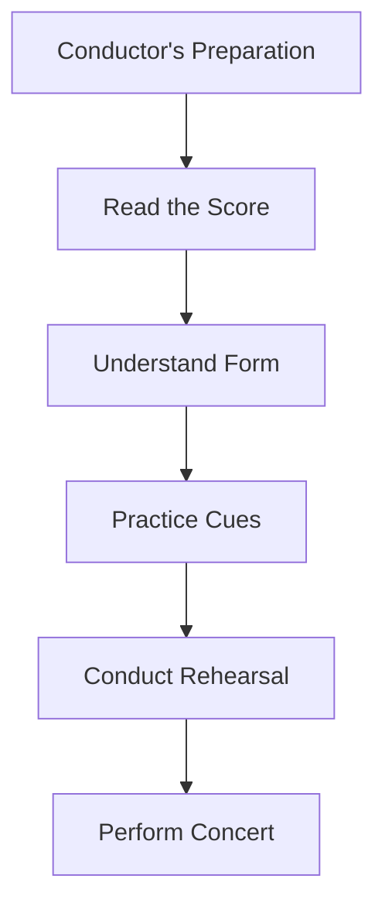

# Beginner Foundation: Conducting

## 1. Everyday Intuition & First Principles

Conducting is the art of leading an ensemble of musicians, much like a ship's captain steering a vessel through turbulent waters. Just as a captain uses a compass and a map to navigate, a conductor uses gestures and cues to guide the musicians through a musical composition. The conductor's role is to ensure that all the musicians play together in harmony, with the right dynamics, timing, and expression. This coordination is essential because music is a collaborative art form, and each musician's contribution must be synchronized to create a cohesive and impactful performance.

Imagine you are leading a group of friends in a dance. You might use your hands to show them when to step forward, backward, or turn. Similarly, a conductor uses their hands and body to show the musicians when to play louder or softer, faster or slower, and to start or stop. The conductor's movements are like the choreography of a dance, and the musicians are the dancers who follow these movements to create a beautiful musical performance.

## 2. Foundational Vocabulary & Glossary

### 1. **Beat:** The basic unit of time in music, often represented by a steady pulse. Conductors use their baton or hands to mark the beat, helping musicians maintain a consistent rhythm.

### 2. **Tempo:** The speed at which a piece of music is played, measured in beats per minute (BPM). Conductors use their gestures to indicate the tempo, ensuring all musicians play at the same speed.

### 3. **Dynamics:** The volume or intensity of the music. Conductors use their hands and body to show musicians when to play louder (forte) or softer (piano).

### 4. **Phrasing:** The way a conductor divides a musical piece into meaningful sections or phrases, similar to how sentences are divided into clauses. Phrasing helps musicians understand the structure and flow of the music.

### 5. **Cue:** A signal given by the conductor to indicate when a particular instrument or section should begin playing. Cues are crucial for ensuring that all musicians enter at the right time.

### 6. **Form:** The overall structure of a musical piece, such as sonata form, rondo form, or theme and variations. Conductors need to understand the form to guide the musicians through the different sections of the music.

### 7. **Expression:** The emotional quality or character of the music. Conductors use their gestures and facial expressions to convey the intended mood and feeling of the piece.

### 8. **Score:** The written music that the conductor and musicians use as a reference. The score includes all the parts for each instrument, and the conductor uses it to follow the music and provide cues.

## 3. Visual System Flow

### ASCII Diagram

```
+-------------------+
|   Conductor's     |
|   Preparation     |
+-------------------+
          |
          v
+-------------------+
|   Read the Score  |
+-------------------+
          |
          v
+-------------------+
|   Understand Form |
+-------------------+
          |
          v
+-------------------+
|   Practice Cues   |
+-------------------+
          |
          v
+-------------------+
|   Conduct Rehearsal|
+-------------------+
          |
          v
+-------------------+
|   Perform Concert |
+-------------------+
```

### Mermaid Flowchart



## 4. Common Beginner Misconceptions & Mental Traps

### Misconception 1: Conducting is only about waving a baton.
**Reality:** While the baton is a tool, conducting is much more than just waving it. It involves understanding the music, communicating with musicians, and leading the ensemble with clear and precise gestures.

### Misconception 2: Conductors need to be perfect musicians.
**Reality:** Conductors do not need to be perfect musicians, but they must have a deep understanding of music theory, rhythm, and dynamics. Conductors often have backgrounds in music performance, but their primary role is to lead and coordinate the ensemble.

### Misconception 3: Conducting is a solitary activity.
**Reality:** Conducting is a collaborative activity that requires strong communication skills and the ability to work with musicians. Conductors must be able to listen to the ensemble, provide feedback, and make adjustments on the fly.

### Misconception 4: Conductors must have a perfect memory.
**Reality:** While memory is helpful, conductors rely on their understanding of the music and their ability to read the score. They often use cues and visual aids to help them remember important parts of the music.

### Misconception 5: Conducting is only for large orchestras.
**Reality:** Conducting can be applied to any ensemble, from small chamber groups to large orchestras. The principles of conducting are the same, regardless of the size of the ensemble.

## 5. Socratic Discussion Starters

### 1. What is the primary role of a conductor in a musical performance?
### 2. How does a conductor use their gestures to communicate with the musicians?
### 3. Why is it important for a conductor to understand the form of a musical piece?
### 4. How do cues help musicians enter at the right time?
### 5. What are some common challenges that conductors face during rehearsals and performances?
### 6. How does a conductor's understanding of dynamics and expression influence the performance?
### 7. What are some techniques a conductor can use to improve their communication with musicians?
### 8. How does a conductor's preparation and practice of cues contribute to a successful performance?
