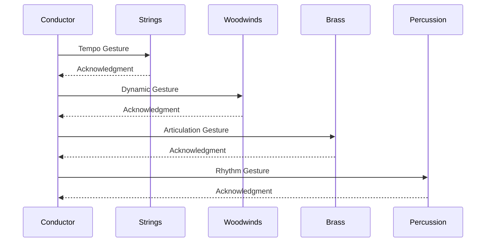

# Intermediate Foundation: Conducting

## 1. Architectural Mental Model

Conducting, in the realm of composition and orchestration, is akin to the role of an architect in software engineering. Just as an architect designs a building that must stand the test of time and serve its purpose efficiently, a conductor designs the performance of a musical composition, ensuring that it resonates with the audience and adheres to the composer's vision. The architectural mental model in conducting involves understanding the structure of the composition, the roles of each instrument, and the dynamics that bring the music to life.

### 1.1. Structural Analysis
A conductor must analyze the score to understand the overall structure of the piece. This includes identifying the form (e.g., sonata, rondo, theme and variations), the key changes, and the harmonic progression. Just as a software architect identifies the modules and their interactions, a conductor identifies the sections of the piece and how they relate to one another.

### 1.2. Instrumental Roles
Each instrument in an orchestra has a specific role, much like each component in a software system. The conductor must understand the capabilities and limitations of each instrument. For example, the strings provide a rich, full sound, while the woodwinds can add a delicate, airy texture. The brass section can project power and energy, and the percussion can add rhythm and drive. The conductor must balance these elements to create a cohesive and dynamic performance.

### 1.3. Dynamic Control
Dynamics are the variations in volume and intensity that bring music to life. A conductor must be able to control these dynamics to convey the emotional and dramatic elements of the composition. This involves understanding the nuances of the score and using gestures to guide the orchestra in achieving the desired dynamics. Just as a software architect must consider the performance characteristics of a system, a conductor must consider the dynamic range of the orchestra and how it can be used to enhance the music.

## 2. Systems Taxonomy & Component Protocols

In conducting, the orchestra can be thought of as a complex system with various components that must work together seamlessly. Each section of the orchestra (strings, woodwinds, brass, percussion) can be considered a subsystem, and each instrument within a section can be considered a component. The protocols and data models that govern the interaction between these components are the conductor's gestures and the score.

### 2.1. Standard Interfaces
The standard interface in conducting is the score. The score is the blueprint that guides the conductor and the orchestra. It contains all the necessary information about the music, including the notes, rhythms, dynamics, and articulations. The conductor uses the score to understand the composition and to communicate with the orchestra.

### 2.2. Protocols
The protocols in conducting are the gestures and signals that the conductor uses to guide the orchestra. These gestures include hand movements to indicate tempo, dynamic changes, and articulations. The conductor also uses facial expressions and body language to convey the emotional and dramatic elements of the music. These protocols must be clear and consistent to ensure that the orchestra understands the conductor's intentions.

### 2.3. Data Models
The data models in conducting are the musical elements that are represented in the score. These elements include the notes, rhythms, dynamics, and articulations. The conductor must understand these elements and how they interact to create the music. The conductor also uses the score to understand the structure of the composition and to identify the key elements that need to be emphasized.

## 3. Multi-Component Interaction Flow

The interaction flow in conducting involves the conductor's gestures and the orchestra's response. This can be visualized using ASCII and Mermaid sequence diagrams.

### 3.1. ASCII Sequence Diagram
```
Conductor -> Strings: Tempo Gesture
Strings -> Conductor: Acknowledgment
Conductor -> Woodwinds: Dynamic Gesture
Woodwinds -> Conductor: Acknowledgment
Conductor -> Brass: Articulation Gesture
Brass -> Conductor: Acknowledgment
Conductor -> Percussion: Rhythm Gesture
Percussion -> Conductor: Acknowledgment
```

### 3.2. Mermaid Sequence Diagram


## 4. Architectural Trade-offs & Production Pitfalls

Conducting involves making architectural trade-offs and avoiding production pitfalls. These trade-offs and pitfalls can affect the performance of the orchestra and the overall quality of the music.

### 4.1. Trade-offs
- **Precision vs. Flexibility:** A conductor must balance the need for precision in timing and dynamics with the need for flexibility in interpretation. Too much precision can stifle the natural expression of the musicians, while too much flexibility can lead to a lack of cohesion.
- **Clarity vs. Nuance:** A conductor must balance the need for clear gestures with the need to convey the nuances of the music. Clear gestures are essential for ensuring that the orchestra understands the conductor's intentions, but nuances are what bring the music to life.

### 4.2. Pitfalls
- **Over-orchestration:** A conductor must avoid over-orchestrating the music, which can lead to a cluttered and overwhelming sound. Over-orchestration can also make it difficult for the orchestra to play in tune and in time.
- **Lack of Communication:** A conductor must ensure that there is clear communication between the conductor and the orchestra. This includes not only the conductor's gestures but also the conductor's ability to listen to the orchestra and make adjustments as needed.

## 5. Socratic Discussion Starters

Socratic discussion starters are questions that bridge the architecture of conducting to the low-level implementation. These questions can be used to deepen the understanding of conducting and to explore the nuances of the music.

### 5.1. Questions
- **How does the conductor's interpretation of the score affect the overall performance of the orchestra?**
- **What are the trade-offs between precision and flexibility in conducting?**
- **How does the conductor's use of gestures and signals affect the orchestra's ability to play in tune and in time?**
- **What are the key elements of a successful conductor-orchestra relationship?**
- **How does the conductor's understanding of the musical elements (notes, rhythms, dynamics, articulations) affect the performance of the orchestra?**

By exploring these questions, conductors can deepen their understanding of the architectural principles of conducting and improve their ability to lead the orchestra in a cohesive and dynamic performance.
