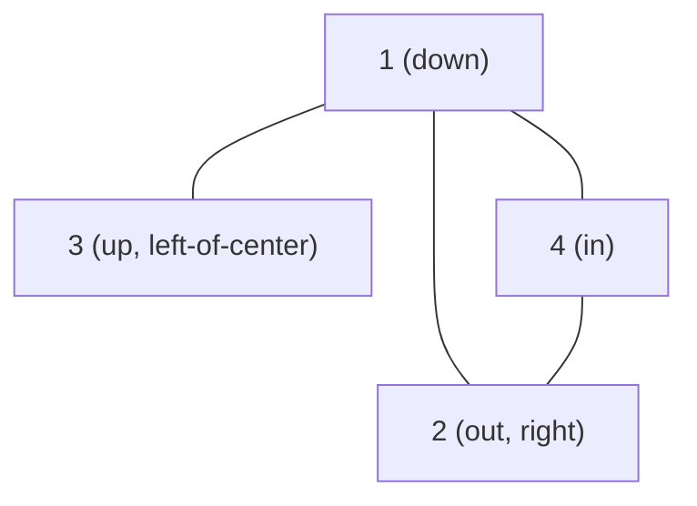
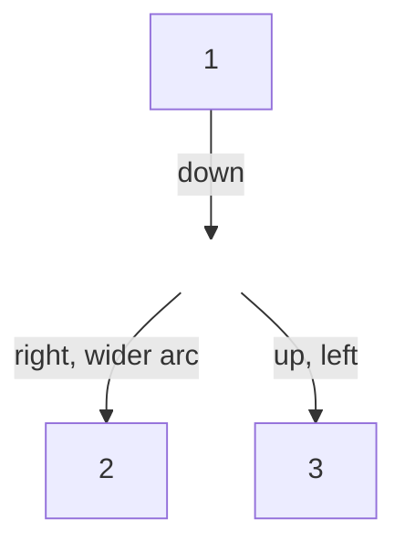
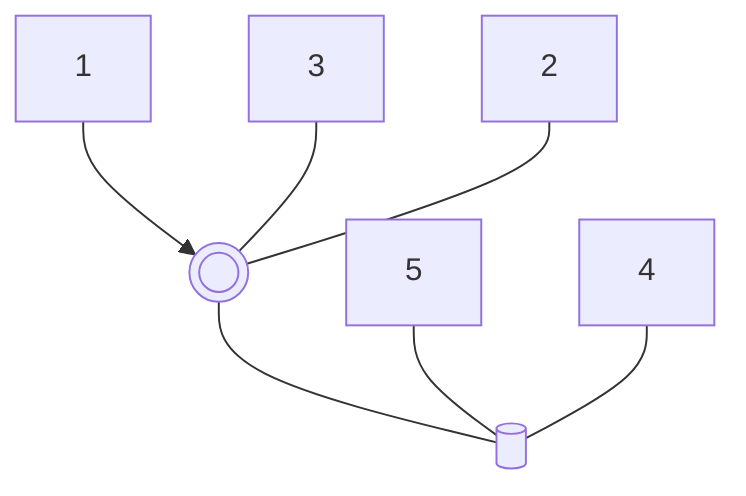
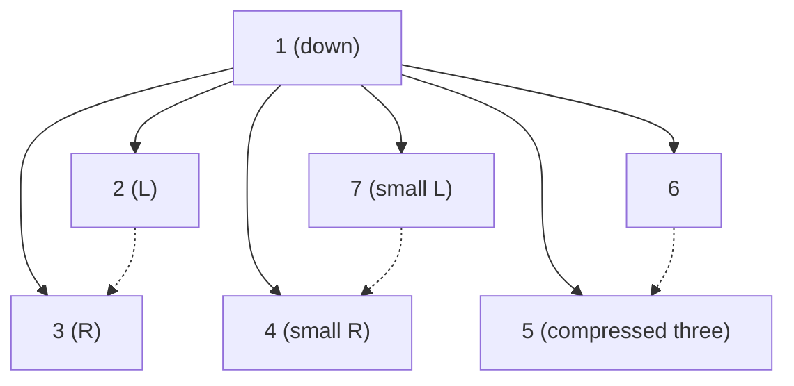
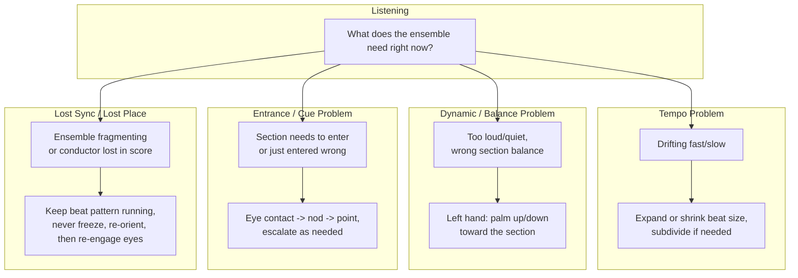

# Conducting: Baton Technique, Score Preparation & Ensemble Communication

## Objective & Lab Setup

### Objective
Build the physical vocabulary of conducting — beat patterns, left-hand independence, cueing, subdivision, and error recovery — to the point where it runs on muscle memory and leaves your conscious attention free for listening and musical judgment. Everything here is drilled with a metronome, a mirror, and a camera, the same way an instrumentalist drills scales. Conducting is a motor skill before it is an interpretive act; this lab trains the motor skill rigorously so the interpretation has something reliable to ride on.

### Why Gesture Works: The One-Paragraph Physics
An ensemble doesn't respond to your arm position, it responds to **velocity change**. The ictus (the "beat point") is the instant your baton's downward motion stops and reverses — that sudden deceleration is what a player's eye locks onto to place a note in time, the same way a drummer reads a stick's rebound off a drumhead. A vague, decelerating-gradually ictus gives the ensemble a *range* of moments to attack on, and 80 players guessing within a range is audible as mush. A sharp, sudden stop gives one unambiguous instant. This is the entire mechanical secret of a "clean" beat: **sharp stop, elastic rebound** — everything else in this lab is refinement around that one fact.

### Setup

**Physical gear:**
- **Baton:** 12–14" fiberglass or carbon fiber, cork grip, 8–12 g (Mollard, Pickboy, or GEWA). Longer (16") only for large forces (opera, massed choir) where back-row visibility matters.
- **Mirror:** minimum 3×6 ft, full-body, so you see hips to baton tip.
- **Metronome:** app with subdivision and polyrhythm click (Tempo, Soundbrenner, or a Dr. Beat DB-90).
- **Scores:** public-domain full scores from IMSLP — Beethoven Sym. No. 5, Mozart Sym. No. 40, Brahms Sym. No. 1.
- **Playback:** decent monitors or headphones, not phone speakers — you need to hear articulation and balance.
- **Camera:** phone on a tripod at chest height, framing you from the waist up, slightly below eye level (approximates a player's sightline from a stand).

**Optional:**
- DAW (Logic, Reaper, Ableton) with a click/tempo track for building custom accelerando/ritardando drills.
- MuseScore/Dorico for printing annotated scores with your own cue markings.
- Stem/multitrack recordings (many public-domain orchestral stems exist on IMSLP-adjacent sites) for the balance-adjustment drill in Exercise 5.

---

## Exercise 1: Grip, Stance & the Four Core Beat Patterns

### Grip & Posture

**Baton grip:**
1. Pinch the cork between thumb and first two fingers, baton emerging from the fist roughly in line with the forearm — **not** gripped like a pencil with the shaft pointing up at an angle.
2. Ring and pinky curl loosely around the end of the grip; don't clench them, they're passengers, not drivers.
3. Wrist stays loose with a slight supination (palm tilted ~45° up) so the baton tip can snap on the ictus without the whole forearm moving.
4. Forearm, wrist, and baton should look like one continuous line from the elbow when at rest — a broken, cocked wrist is the #1 cause of a mushy ictus, because the stopping motion has to travel through an extra joint.

**Stance:**
1. Feet shoulder-width, weight on the balls of the feet — flat-footed conducting reads as inert from the podium.
2. Knees soft, core braced, as if ready to take a light push from the front — this is where your dynamic power actually comes from, not the arm.
3. Shoulders down and open. Raised shoulders telegraph tension to the entire ensemble within seconds.
4. Left hand rests at the sternum or lightly at the side — not in a pocket, not behind the back, visible and ready.
5. Elbows at 90–110°. Full extension ("chicken wing") burns shoulder stamina fast and looks frantic; full lockout against the ribs looks timid and reads poorly from the back of a hall.

### The Four-Pattern (4/4)



**Mechanics, beat by beat:**
- **Beat 1 (down):** sharp vertical drop to waist level. This is the clearest, most decisive stroke of the pattern — everything else in the bar is calibrated relative to it.
- **Beat 2 (right):** horizontal stroke outward to the right, ictus at the bottom of a small rebound, then up and back toward center.
- **Beat 3 (up/left):** diagonal stroke that crosses toward the left side, slightly above the beat-2 height.
- **Beat 4 (left, returning):** stroke back toward the top-center, preparing beat 1's drop.
- **Ictus:** an actual **stop**, not a slow-down. Practice this by thinking "flick the water off the baton tip" at the bottom of each stroke.
- **Rebound:** immediately after the stop, the baton springs up 20–30% of the stroke's travel distance — this rebound *is* the preparatory gesture for the next beat, so it must be consistent in height or the next beat's tempo reads as unclear.

**Drill 1A — Mirror calibration (15 min)**
1. Metronome at 60 BPM, quarter note = click.
2. Conduct four-pattern, eyes on your wrist and ictus point in the mirror.
3. Check: are beats 2/3/4 rebounding to the *same* height? Uneven rebound height is the most common four-pattern fault and it's invisible to you until you watch yourself.
4. Every 8 bars, scan down: shoulders down? core braced? wrist unbroken?
5. Step tempo up: 60 → 72 → 84 → 100 BPM, 2 minutes each.
6. Record 2 minutes at 84 BPM. Scrub the video in slow motion — look specifically for beat 3 and beat 4 collapsing into the same gesture (a very common fault once tempo rises).

### The Three-Pattern (3/4)



- Beat 1: vertical drop, identical ictus to the four-pattern's beat 1 — downbeats should always look the same regardless of meter, so the ensemble never has to relearn what "beat 1" looks like.
- Beat 2: wider horizontal arc than four-pattern's beat 2 (there's no beat 4 competing for the same horizontal space).
- Beat 3: diagonal return through the center back to the apex.

### The Two-Pattern (2/4, or cut time)

```text
    1 (down)
     |
    2 (up)
```

Symmetrical vertical down-up. At faster cut-time tempos (marches, scherzos), keep the stroke *small* — the temptation is to get bigger as tempo increases, which is backwards. Small, crisp, identical strokes with a razor ictus beat a big sloppy gesture every time.

**Drill 1B — Pattern transitions (20 min)**
1. Four-pattern, 4 bars, 80 BPM, metronome on.
2. Without stopping or dropping tempo, switch to three-pattern for 4 bars.
3. Switch to two-pattern for 4 bars.
4. Cycle continuously for 10 minutes.
5. **Check on video:** does beat 1 land at the *exact same vertical point in space* every time, regardless of which pattern precedes it? If beat 1 drifts, the ensemble loses its one fixed reference point.

### Preparatory Beats & Cutoffs

**Preparatory beat:**
- Take a visible breath during the preparatory gesture — wind and vocal ensembles read your inhale as their own breathing cue.
- The *size* of the prep beat sets the dynamic: a small, tight prep = quiet entrance; a large, full-arm prep = forte entrance. Give the ensemble the dynamic information before they play a single note, not after you hear it's wrong.
- The *speed* of the prep beat **is** the tempo — give it at the actual tempo of the piece, not a generic neutral speed.

**Cutoffs — three types:**
1. **Immediate cutoff:** sharp inward motion (like closing a fist around the sound) exactly at the ictus point. Use for a hard stop.
2. **Delayed cutoff:** hold the baton still in space at the last beat's position (sustaining the sound), then close decisively — used when a chord needs to ring a specific extra duration.
3. **Tapered cutoff:** slow the baton's motion gradually while the left hand lowers in a diminuendo gesture — used for a dying-away ending, not a hard stop.

**Drill 1C — Entrance/cutoff precision (15 min)**
1. Metronome 72 BPM.
2. Give a prep beat on count 4 of a silent bar; "ensemble" (recording) enters on count 1.
3. Conduct 8 bars of four-pattern.
4. Immediate cutoff on the downbeat of bar 9.
5. Repeat the same 8 bars, this time executing a delayed cutoff landing on beat 2 of bar 9.
6. Practice against Beethoven Symphony No. 5, mvt. 1, opening tutti — conduct the famous opening motif and cut off the fermata precisely with the recording.
7. **Verify on video:** does the prep beat's size actually match the forte dynamic of the real opening chord? Most beginners under-scale the prep beat relative to the loudness they're asking for.

---

## Exercise 2: Left-Hand Independence & Expressive Shaping

The single hardest physical skill in conducting is keeping the left hand from mirroring the right. Your two arms have spent your entire life moving together (walking, throwing, clapping); conducting requires breaking that wiring deliberately.

### Left-Hand Gesture Vocabulary

| Gesture | Meaning | Execution |
|---|---|---|
| Palm up, rising from waist to shoulder | Crescendo | Smooth, continuous rise over the marked measures |
| Palm down, lowering shoulder to waist | Diminuendo | Smooth, continuous lower |
| Open palm facing ensemble, fingers spread | Sustain / fermata hold | Freeze in space, no motion |
| Index finger extended, pointed at section | Cue entrance | Sharp, direct point, 1 beat ahead of entrance |
| Flat hand, sharp downward chop | Marcato / accent | Fast strike, instant stop |
| Curved hand, slow horizontal sweep | Legato | Continuous, unbroken motion across the phrase |
| Small wrist flicks, upward | Staccato | Quick, light, bounce off an imaginary surface |
| Fist closing inward | Cutoff | Sharp contraction toward the body |

### Drill 2A — Asymmetric independence (20 min)
This drill forces the split by giving each hand an unrelated job on an unrelated clock.
1. Right hand: steady four-pattern, 60 BPM, metronome audible.
2. Left hand, independently, on a 2-bar cycle:
   - Bars 1–2: crescendo gesture (palm rises)
   - Bars 3–4: diminuendo gesture (palm lowers)
   - Bars 5–6: cue gesture, pointing stage left (imaginary violins)
   - Bars 7–8: sustain gesture (open palm, frozen)
3. Watch the *right hand* on video for the real test: does the beat pattern distort or does tempo drift while the left hand is busy? If the right hand wobbles, slow down to 50 BPM and rebuild.
4. Progress tempo 60 → 80 → 100 BPM over multiple sessions, not in one sitting — this independence is won over weeks, not one practice.

### Drill 2B — Dynamic contour from the score (25 min)
1. Study Mozart Symphony No. 40, mvt. 1, mm. 1–20. Mark the dynamic curve directly on the score: crescendo arrows, the m. 7 sforzando, the following diminuendo.
2. Conduct along with a recording. Right hand: strict tempo, unwavering four-pattern (well, actually a one-pattern/fast-tempo gesture here, but keep the metric spine steady). Left hand executes:
   - mm. 1–6: palm rises waist → shoulder (anticipatory crescendo)
   - m. 7: sharp downward chop (sforzando)
   - mm. 8–12: palm lowers shoulder → waist
3. **Critical timing rule — anticipatory conducting:** your gesture must *arrive* 1–2 beats *before* the sound you're shaping, not simultaneously with it. Conducting reactively (shaping dynamics as you hear them happen) is always late; the ensemble needs the instruction before the moment, not during it. This single habit separates functional conductors from decorative ones.

### Fermata Protocol
1. Right hand freezes at the ictus point in space — don't let it droop or drift, the frozen position itself communicates "hold."
2. Left hand opens, fingers spread, signaling "sustain."
3. Hold eye contact with the principal player who's sustaining the note (usually whoever has the most exposed line).
4. Release: both hands execute a fresh preparatory beat for the next entrance. **The size of the release gesture sets the next tempo** — give a full-size prep for a tempo (resuming original speed), a small tight prep for a slower resumption.

### Drill 2C — Fermata timing (15 min)
1. Conduct Beethoven Symphony No. 5, mvt. 1, mm. 1–5 (the fermata lands on beat 2 of m. 1 for the first motif, then again for the second).
2. Hold the fermata 3 seconds, then release into m. 2 at the original tempo.
3. Repeat with hold durations of 2, 4, and 6 seconds — practicing variable hold length so you're not locked into one default.
4. Repeat the release at two different resuming tempos: ♩=108 and ♩=92, to feel how release-gesture size must change to communicate each.
5. Verify on recording: does your release gesture clearly differ in size between the two tempo targets? If both releases look identical, the ensemble has no information to go on besides guessing.

---

## Exercise 3: Cueing, Subdivision & Asymmetric Meters

### Cueing Hierarchy
Cues stack from most subtle to most explicit — use the lightest one that will reliably work for a given player/section:
1. **Eye contact** — the default, lightest cue. Make contact 2–4 beats ahead of the entrance.
2. **Head nod** — slight nod exactly on the beat before entrance, used for players you've already made eye contact with.
3. **Left-hand point** — explicit point toward the section, reserved for entrances with real risk (long rests, exposed solos, back-of-stage sections who can't see your eyes well).
4. **Visible breath** — for wind, brass, and vocal entrances specifically; your inhale sets their inhale.

### Drill 3A — Multi-section cueing (20 min)
1. Study a score with staggered entrances — Brahms Symphony No. 1, mvt. 4 introduction works well (strings, then winds, then brass enter in sequence).
2. Build a written cue list before you pick up the baton: measure, beat, section, type of cue. This pre-planning is non-negotiable — improvised cueing under tempo pressure is where conductors drop cues.
3. Conduct along with the recording, executing each cue from your list without breaking the right hand's beat pattern.
4. **Verify on video:** cues land exactly 1 beat before the written entrance, not simultaneously with it (simultaneous cueing is functionally useless — the player needs the lead time to breathe/bow).

### Subdivision
Subdivision exists to protect ensemble unity in two specific situations: tempos slow enough that the gap between beats becomes ambiguous, and ritardandi where the tempo itself is a moving target.

**Mechanics:**
1. The subdivision beats are small secondary rebounds *inside* the main beat pattern — wrist-driven, not arm-driven.
2. Subdivisions run 25–30% the size of the main beat strokes. If they're the same size as the main beats, you've just doubled your tempo, not clarified your pulse.
3. The primary beat's ictus must remain the clearest motion in the pattern — subdivision supports it, never competes with it.

### Drill 3B — Subdivision practice (15 min)
1. Conduct a plain four-pattern at 40 BPM, no subdivision.
2. Add one subdivision beat inside each main beat (effective micro-pulse = 80 BPM), small wrist rebounds between ictus points.
3. Apply to Brahms Symphony No. 1, mvt. 2 opening (Andante sostenuto) — a genuinely slow tempo where this technique is necessary, not decorative.
4. Verify on video: can you still clearly identify beat 1 vs. the subdivision beats at a glance, or has the pattern turned into visual noise?

### Five-Pattern (5/4, grouped 3+2)



Beats 1–3 are a standard three-pattern. Beats 4–5 are a compressed two-pattern tucked into the lower-right quadrant, roughly half the size of beats 1–3 — the size compression is what visually signals "this is the short half of the bar."

### Seven-Pattern (7/8, grouped 2+2+3)



Groups 1–2 and 3–4 are mirrored two-patterns in left/right space; 5–7 collapses into a tight three-pattern underneath. The visual logic: each sub-group occupies its *own* quadrant of space so the ensemble can see the grouping without you having to announce it verbally every time.

### Drill 3C — Asymmetric meter mastery (25 min)
1. Metronome 120 BPM, accenting the 3+2 grouping of 5/4.
2. Conduct the five-pattern, emphasizing beat 1 and beat 4 as the two "downbeats" of the bar.
3. Ramp tempo: 120 → 144 → 168 BPM.
4. Switch to 7/8, grouped 2+2+3.
5. Conduct along with real repertoire that lives in these meters: Dave Brubeck's "Take Five" (5/4) and Pink Floyd's "Money" (7/4, actually — treat it as 4+3). Real music with groove exposes pattern faults that a plain metronome click never will.
6. Verify on video: are the beat *groupings* visually distinct from each other (different quadrants, different sizes), or does the pattern look like an undifferentiated blob of equal-sized beats?

---

## Exercise 4: Score Study, Rehearsal Craft & Tempo Transitions

### Score Preparation Protocol

**Step 1 — Structural pass (30 min/movement):**
1. Identify the form (sonata, rondo, variations) and mark section boundaries.
2. Mark rehearsal letters/numbers, key changes, meter changes.
3. Mark every tempo change and fermata with its target metronome marking written in.
4. Highlight exposed solo lines and full-tutti passages — these need different gesture scale.

**Step 2 — Gesture mapping (20 min):**
1. For every section, decide in advance: prep beat size/dynamic at the opening, cue list through transitions, pattern size at climaxes, cutoff type at the ending.
2. Write conducting reminders directly into the score margin: "cue oboe m. 47," "subdivide mm. 62–68," "small pattern here, this is pp."

**Step 3 — Physical run-through (40 min):**
1. Conduct the full movement against the recording, no stopping, no do-overs — treat it like a performance take.
2. Video record it.
3. Review specifically for: grip/posture consistency, ictus clarity, whether cues actually landed where planned, and whether you looked up from the score enough to simulate real eye contact.
4. Isolate and repeat any section where the gesture broke down, until it's fluent, then re-run the whole movement.

### Rehearsal Technique

**Efficient verbal protocols:**
- **Count-off:** "Measure 47, letter C, winds only, and—" [prep beat]. Always state measure + landmark + who's playing, in that order, so players can find the spot before you start conducting.
- **Error isolation:** stop the instant you hear the error, name the cause in one sentence (rhythm / intonation / balance / articulation), re-run just that passage.
- **Looping:** repeat a problem passage 3–5 times, first slow, then stepping tempo up each pass.
- **Positive framing:** "Better — now let's get the releases together" beats "that was wrong," every time, for the same information content and far better results.

### Drill 4A — Simulated rehearsal (30 min)
1. Pick a passage with a known ensemble hazard — Stravinsky's "Augurs of Spring" (irregular accents) is the classic torture test.
2. Conduct along, stopping at pre-identified trouble spots.
3. Say the correction out loud, under 10 seconds: "Measure 24, horns and trumpets, the eighth notes aren't together — half tempo, from the top of the phrase."
4. Re-conduct the isolated passage at half tempo, then step back up: half → 75% → full tempo.
5. **Discipline check:** if your verbal instruction runs past 10 seconds, you're rehearsing your own thoughts, not the ensemble's problem. Cut it down before the next pass.

### Tempo Relationships & Metric Modulation
- **Proportional tempo (simple doubling/halving):** ♩=60 → ♩=120. The new tempo's beat is simply twice the speed; give it as a clean, re-scaled prep beat.
- **Hemiola-style shift:** ♩=90 → ♩.=90 (the new dotted-quarter pulse equals the old quarter-note pulse's *number*, but the actual note value and feel shift). Common in 3/4 ↔ 6/8 transitions.
- **Metric modulation:** ♩=120 in 4/4 transitioning to ♩.=80 in 6/8, where the new dotted quarter equals the old quarter note exactly. The mechanical trick: on the last beat before the switch, conduct that beat *as if it were already the new pulse* — the ensemble's ear needs the bridge beat to feel like the new tempo before the barline changes.

### Drill 4B — Tempo transition execution (20 min)
1. Conduct 4 bars at ♩=80 (4/4).
2. On the last beat of bar 4, execute the modulation so that beat simultaneously serves as the prep beat for ♩=120 (4/4) — right hand snaps cleanly into the new tempo.
3. Left hand sustains an open, steady gesture through the transition specifically to prevent the ensemble from either rushing ahead or hesitating into the new tempo.
4. Practice on the Beethoven Symphony No. 5, mvt. 3 → mvt. 4 transition, a repertoire-standard example of this exact technique.
5. Verify on recording: is the tempo change instantaneous and exactly proportional, with zero gradual creep in either direction?

---

## Exercise 5: Error Recovery & Ensemble Crisis Management

Conductors are judged far more by how they recover from an ensemble problem than by whether a problem occurs at all — problems are inevitable in live performance, and the single rule that governs every recovery scenario below is: **the beat never stops.** The moment your hands freeze in confusion, the ensemble loses its only synchronization reference and the small problem becomes a stop.

### Scenario 1 — Tempo drift (ensemble rushing)
1. Metronome at 100 BPM, conduct four-pattern; deliberately let yourself drift to 115 BPM over 8 bars (this is the natural failure mode under adrenaline — simulate it on purpose so you recognize the feeling).
2. **Recovery:**
   - Expand the beat pattern's physical size by roughly 20% — a bigger gesture reads as "slow down" without a word being said.
   - Left hand opens, palm toward the ensemble, sustaining gesture (visual "hold back").
   - Subdivide for 4 bars to physically re-anchor the pulse.
   - Ease back to tempo over those 4 bars, don't snap back instantly (a sudden snap reads as a second disruption).
3. Verify: ensemble (recording) is back to 100 BPM within 8 bars of starting the correction.

### Scenario 2 — Early entrance (section comes in 2 beats early)
1. **Recovery:**
   - Right hand: do not hesitate, do not stop the pattern.
   - Left hand: sharp cutoff gesture aimed directly at the errant section.
   - Re-cue that section cleanly on the correct beat.
2. The ensemble must never feel the conductor stop — a visible freeze communicates panic and makes the recovery worse than the original error.

### Scenario 3 — Lost place in the score
1. **Recovery:**
   - Keep conducting the current beat pattern on autopilot — your hands can run a steady four-pattern from muscle memory while your eyes work the problem.
   - Listen for orchestration/key cues in the audio to identify where you actually are.
   - Find the page while maintaining the gesture; re-establish eye contact with the ensemble once you've relocated.
2. This is why score memorization of structural landmarks (not necessarily every note) matters — it gives you a mental map to fall back to exactly in this situation.

### Drill 5A — Stress test (25 min)
1. Conduct a full movement with self-induced chaos: random tempo changes (±15 BPM), deliberately missing every third cue, and briefly conducting a three-pattern during a 4/4 passage.
2. Execute the matching recovery protocol for each induced error, live, without pausing the recording.
3. Video record the whole thing.
4. Review for: did the gesture ever actually stop? How many bars did each recovery take? Did your face show the panic (a dead giveaway to any ensemble watching you)?
5. Repeat the stress test across multiple sessions until recovery becomes reflexive rather than deliberate.

### Real-Time Listening Gestures

| Gesture | Meaning |
|---|---|
| Hand cupping ear | "Intonation issue — listen and adjust" |
| Flat palm toward section, tilting up | "You're flat, raise the pitch" |
| Flat palm toward section, tilting down | "You're sharp, lower the pitch" |
| Palm up toward section | "More volume" |
| Palm down toward section | "Less volume" |
| Right-hand beat pattern expands/contracts | Global dynamic shift for the whole ensemble |

### Drill 5B — Real-time balance adjustment (15 min)
1. Load a multitrack/stem recording into a DAW.
2. Conduct against it while a partner (or you, pre-planned) silently rides individual section faders up and down to simulate balance problems.
3. React live with the correct left-hand gesture aimed at whichever section just got too loud or too quiet.
4. Record your conducting and cross-check: did your gesture match the actual fader move, and did it happen within 1–2 beats of the problem (not three bars later)?

---

## Quick Reference

### Beat Pattern Geometry by Meter

| Meter | Pattern | Geometry | Most common fault |
|---|---|---|---|
| 2/4, 2/2 | Two-pattern | Vertical down–up mirror | Uneven down/up stroke lengths |
| 3/4, 3/8 | Three-pattern | Down–right–up triangle | Beat 2 doesn't travel far enough right |
| 4/4, 4/8 | Four-pattern | Down–right–left–up square | Beats 3 and 4 collapse into the same shape |
| 5/4 (3+2) | Five-pattern | Three-pattern + small two | Beats 4–5 drawn too large |
| 6/8 (fast) | Two-pattern (dotted-quarter pulse) | Vertical down–up | Subdividing when tempo doesn't need it |
| 6/8 (slow) | Six-pattern | Two large beats, each inwardly subdivided into 3 | Losing the primary down/up pulse under the subdivisions |
| 7/8 (2+2+3) | Seven-pattern | Compressed asymmetric quadrants | Groupings not visually distinct from each other |

### Common Faults & Fixes

| Fault | Symptom | Likely cause | Fix |
|---|---|---|---|
| Accelerando drift | Ensemble speeds up unintentionally | Beat pattern shrinking, adrenaline | Enlarge beat size, subdivide 2–4 bars, breathe visibly and audibly |
| Mushy ictus | Entrances land late or smeared | Rebound too gradual, no true "stop" | Train a sharper stop; think "flick," not "slow down" |
| Mirrored hands | No independent dynamic control | Hands unconsciously synced from habit | Asymmetric drills (2A); freeze the right hand entirely while isolating left-hand gestures |
| Rigid wrist | Mechanical, unmusical gesture | Tension, fear of "getting it wrong" | Loosen grip; practice slow legato phrases specifically to retrain flow |
| Over-conducting | Ensemble starts ignoring gestures | Too many simultaneous signals, no clear priority | One clear gesture per musical idea; trust the ensemble to play without constant micromanagement |
| Buried in the score | Ensemble loses connection to you | Under-preparation, insecurity | Memorize structural landmarks and cue points; look up every 2–4 bars minimum |

### Left-Hand Timing Rule
Every expressive left-hand gesture must arrive **1–2 beats before** the sound it's shaping. A gesture that matches the sound as it happens is a gesture that's already too late to have caused anything.

### Pre-Rehearsal Warm-Up (10 min)
1. Shoulder rolls — 10 forward, 10 back.
2. Wrist circles — 10 each direction, each hand.
3. Arm swings — 20 large circles, full range of motion.
4. Mirror check — 2 minutes of four-pattern at 80 BPM.
5. Score review — 5 minutes rereading your cue list and flagged passages.
6. Mental rehearsal — visualize the opening 8 bars, including the prep beat, before you ever lift the baton.

### Post-Rehearsal Review
1. Watch 10 minutes of the rehearsal recording.
2. Name 3 specific things that worked.
3. Name 3 specific gesture failures — tied to exact measures, not vague impressions.
4. Write the next session's priority list from those failures.
5. Stretch arms, shoulders, back — 5 minutes.

### Gesture Decision Flow



### Baton Care
- **Length:** 12–14" general use, 16" for large forces or opera pits where back-row visibility is critical.
- **Weight:** 8–12 g — light enough to avoid wrist fatigue across a 2-hour rehearsal, heavy enough to feel the tip's inertia for ictus control.
- **Grip:** natural or rubberized cork, 1.5–2" — replace when it goes slick or compresses (roughly every 1–2 years of regular use).
- **Maintenance:** wipe the shaft after every use (hand oils degrade fiberglass finish over time), store in a rigid tube, never leave it loose in a bag where it can warp or snap.

The whole discipline compresses to three habits, drilled until automatic: a genuinely sharp ictus, a left hand that moves on its own clock, and a beat that never, under any circumstance, stops.
