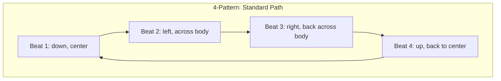
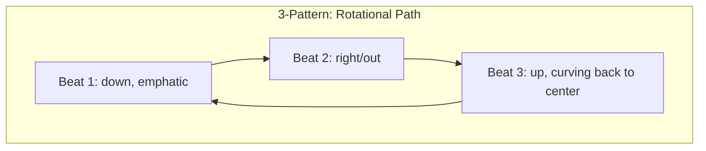
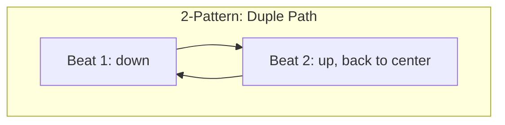
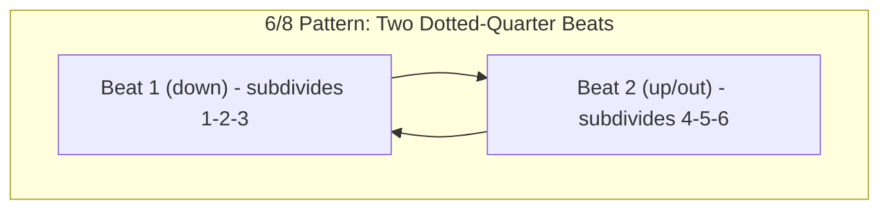
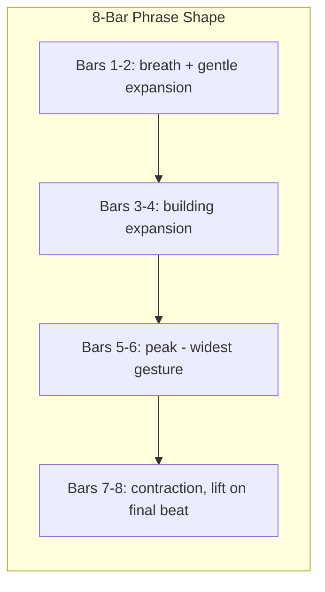
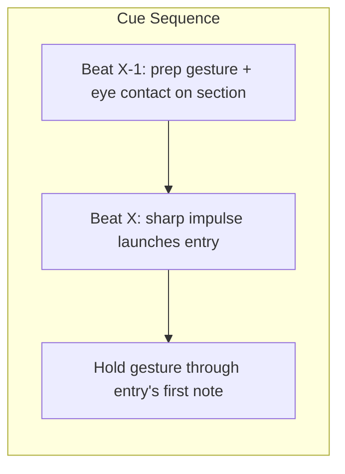
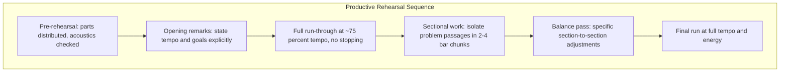

# Lesson 1: Conducting Fundamentals

## 1. Core Principles: Timekeeping, Communication & Physical Authority

Conducting is the physical art of transmitting musical intention through visible gesture. Musicians cannot read your mind or hear your internal tempo — they respond only to what they see. Everything in this lesson serves one practical goal: make your gestures so clear that an ensemble can execute without doubt, hesitation, or guesswork.

### The Three Pillars (Why Conducting Works)

**1. Temporal Authority.** Every musician needs to lock onto the same pulse without checking the people around them. A conductor who delivers a steady, visually unambiguous beat removes the need for musicians to "chase" the tempo — they can spend their attention on tone and phrasing instead of survival.

**2. Visual Clarity.** The baton tip is the single point of information for most of the ensemble, especially players seated beyond the first few rows. If the tip's path is sloppy, inconsistent, or too small to see from the back stand, you've broken the communication channel no matter how clear your inner musical idea is.

**3. Physical Authority.** Gesture originates in the body, not the wrist. Shoulders, spine, breath, and face all carry information. A conductor who moves only the hand looks uncertain; a conductor whose whole torso supports the gesture reads as decisive even from the back of a large hall.

**Acoustic grounding, briefly:** sound travels at roughly 1 foot per millisecond (343 m/s). Across a 60-foot ensemble-to-back-wall distance, that's about 60 ms of delay — enough to blur a tutti attack if everyone reacts to the sound rather than the gesture. This is why the baton leads: you are conducting for the moment of attack, not reacting to it. In large halls, or with low brass/organ positioned far from the podium, treat the beat as the synchronization reference, not the sound. For antiphonal or physically spread-out ensembles (balcony brass, offstage choir), either add a assistant conductor relay or accept a deliberate, rehearsed sound lag rather than fighting it.

---

## 2. Baton Technique & Hand Mechanics

### Grip & Positioning

**Grip Setup:**
- Thumb and index finger form a loose V-cradle under the shaft, roughly one-third of the way from the tip (the balance point of most batons).
- Middle, ring, and pinky curl loosely around the underside for support — they stabilize, they don't squeeze.
- Wrist stays neutral: a straight line from forearm to the back of the hand. No cocking up or down.
- Resting baton angle: ~45° to your body, tip at the ensemble's eye level.

**Why this works:** The V-cradle lets the baton pivot on forearm rotation (pronation/supination) instead of wrist-flicking. Grip tension transmits straight up the arm into the shoulder — within ten minutes of a tight grip you'll have a stiff, telegraphed beat and a sore forearm by the second half of rehearsal.

**Grip Check Drill:**
1. Hold the baton in conducting position. Have a colleague try to gently slide it out of your hand by pulling the tip.
2. It should slide out with light resistance — if they can't move it at all, you're gripping too hard; if it falls out, you're too loose.
3. Practice 2 minutes daily until "light resistance" becomes your default without thinking about it.

### Arm Posture

- Shoulders relaxed and slightly back — proud, not shrugged.
- Elbows held 4–6 inches off the ribcage; elbow angle 90–110°, baton at eye level.
- Forearm stays close to vertical. Avoid rotating the palm upward ("serving a tray") — it flattens your beat points and reads as weak from a distance.
- Upper arm is structural, not active. Motion comes from forearm + wrist, not shoulder-swinging, *except* in large gestural passages (see Three Functional Motion Zones below).

**Neutral/Home Position:** Baton in front of the sternum, tip at ensemble eye level, arm relaxed. Return here between phrases to reset clarity and signal "I am tracking the score, not improvising."

### Three Functional Motion Zones

| Zone | Joint origin | Used for |
|---|---|---|
| Large gesture | Shoulder, full arm | Sweeping tempo changes, big dynamic swells, phrase arcs |
| Precision & rebound | Forearm + wrist as one unit | Subdivision, articulation, dynamic nuance |
| Tip precision | Fingers/wrist, minimal | Clean geometric beat points, crisp attacks |

**Mirror Drill:** Trace each beat pattern slowly in front of a mirror. Freeze on each beat point and check: is the tip in a visually distinct, stable location you could "photograph"? If you can't pin down each beat point as a fixed spot in space, the ensemble can't either — and they'll start guessing instead of tracking.

### Baton Rebound

After the beat's downward impulse, the baton bounces back up and away. This rebound is the signal to release tension and prepare the next beat — it is not optional decoration.

**Rebound Mechanics:**
- The impulse strikes in the beat's direction; the rebound is the natural elastic recoil of a relaxed wrist/forearm, not a separate deliberate motion layered on top.
- Rebound height scales with dynamic: *pp* = small rebound (1–2 inches), *ff* = large rebound (6–12 inches, approaching ear level in extreme cases).
- Suppressing the rebound to "look controlled" reads as tension to the ensemble and physically tightens their sound — string players bow shorter and tighter, brass players tense the embouchure.

**Drill: Rebound-to-Dynamic Mapping**
1. Conduct a 4-pattern at 60 BPM with maximum rebound (baton rises to forehead level after each beat). Have the ensemble, or a practice recording with a partner playing along, respond at forte.
2. Over 8 bars, reduce rebound progressively to minimal (2 inches), saying nothing verbally. The ensemble should get noticeably softer and tighter in tone purely from gesture size.
3. Restore full rebound over 8 more bars and confirm the tone opens back up.

This single drill — gesture size directly driving dynamic without a word spoken — teaches the majority of practical dynamic control.

---

## 3. Beat Patterns: Geometry & Execution

Every pattern is a repeatable geometric path. The ensemble should be able to predict beat 1's exact location in space before you arrive there. Consistency of shape matters more than expressive flourish at the fundamental level — expressiveness is layered *on top of* a reliable geometry, never instead of it.

### The 4-Pattern (4/4, slow 2/2, Common Time)

**Execution:**
- **Beat 1 — down.** Most emphatic beat; rebounds upward.
- **Beat 2 — left** (across the body for a right-handed conductor). Rebounds right.
- **Beat 3 — right** (returning across the body). Rebounds left.
- **Beat 4 — up**, arriving back at neutral/home. Rebounds down directly into beat 1.

**Spacing rule:** All four beats should occupy roughly equal space. A compressed beat 3 or an oversized beat 1 reads as uneven timing even if your actual tempo is rock-steady — ensembles rush or drag in response to *gesture spacing*, not just the click in your head.

**Metronome Drill:**
1. 60 BPM, 8 full 4-patterns (32 beats), metronome audible only to you via earbud.
2. Record yourself on video from the ensemble's viewing angle. Check: do all four beat points land at consistent, equally spaced locations frame-to-frame? Inconsistent spacing here is the number-one cause of ensembles rushing beat 2 and dragging beat 4.
3. Progress: 60 → 76 → 92 → 108 → 126 BPM, 8 patterns each, resetting to home position between tempos.

### The 3-Pattern (Waltz, 3/4, 3/8)

**Execution:** Beat 1 down (emphatic, rebound up); beat 2 left (rebound right); beat 3 curves up and back to neutral (rebound down into beat 1).

**Character note:** The 3-pattern should feel rotational and continuous, like stirring a circle, not three separate jabs. Angular, stop-start 3-patterns kill waltz lilt. Practice conducting a literal circle in the air at ♩ = 144 (fast waltz tempo) first, then reintroduce the angular beat-point emphasis without losing the circular momentum underneath.

### The 2-Pattern (2/4, fast alla breve)

**When to use 2 vs. 4 in cut time (2/2):**
- Fast cut time (half-note pulse ≈ 120+ BPM): conduct in 2 — bright, energetic feel, one physical gesture per bar half.
- Slow/stately cut time (marches, chorale-style 2/2): conduct in 4 for deliberate weight and clarity on each quarter note.

### The 1-Pattern (Extreme Tempo)

A single down-impulse with up-rebound, one per bar. Reserve for genuinely fast tempos (roughly ♩ = 180+, or when a full pattern would visually blur into noise). Never use it at moderate tempo to look economical — if you can't show the subdivisions clearly at the tempo you're at, switching to 1 abandons the ensemble's timing reference instead of simplifying it.

### Compound Meters: 6/8, 9/8, 12/8

Conduct 6/8 as a 2-pattern (one gesture per dotted quarter) but keep the eighth-note subdivision alive internally. Your rebound timing should subtly reflect the triplet feel underneath, especially at slower tempos where the eighths are audible individually.

**Drill: 6/8 Internal Subdivision**
1. Conduct 6/8 at ♩. = 40 BPM (slow enough that eighths feel distinct, almost like 6 separate pulses).
2. Tap a foot on beats 1 and 2 only (the dotted-quarter pulse) while vocally counting "1-and-a, 2-and-a," landing the "1" and the first "2" cleanly on your two beat points.
3. Once stable, speed to ♩. = 80 (fast 6/8, "one-per-bar" feel) and let the internal counting shrink toward a near-1-pattern shape while you still gesture 2 clear external points.

For 9/8 (three groups of three) and 12/8 (four groups of three), use the standard 3-pattern or 4-pattern shapes respectively. The compound subdivision lives in your internal counting and slight rebound timing, not in extra visible beat points. Adding more beat points than the meter's primary pulse confuses the ensemble more than it clarifies anything.

---

## 4. Gesture Vocabulary: Dynamics, Articulation & Phrasing

### Dynamic Gestures

**Crescendo:**
- Start with a narrow pattern close to the body and a modest rebound.
- Expand pattern width and rebound height incrementally — beat by beat for a fast crescendo, bar by bar for a long one, matched to the written span.
- Let your torso lean forward slightly and your facial intensity rise. This is a second communication channel reinforcing the baton, not decoration.

**Diminuendo:**
- Start wide, pull inward gradually. Narrow the horizontal span and shrink rebound height.
- Lean back slightly; soften your face.
- Critical distinction: slow the *rebound velocity and gesture size*, never the *tempo*. A common beginner error is accidentally decelerating the beat during a diminuendo — the pulse must stay locked even as the gesture shrinks.

**Subito Dynamics (sudden changes):**
- *Subito forte:* On the beat *before* the change, begin expanding and take a visible, sharp breath. On the target beat, deliver a large, emphatic impulse with a sharp rebound.
- *Subito piano:* On the beat before, soften your face and begin to compress. On the target beat, the impulse itself should be small and controlled, almost restrained.
- Rule: **the ensemble must see the change coming one full beat before they play it.** If you execute the change gesture simultaneously with the downbeat, you're a beat late from the ensemble's perspective — they need lead time to adjust bow pressure, air support, or stick height before the note sounds.

### Articulation Gestures

**Legato:** Smooth, unbroken rebound; the baton traces a continuous curved line with no stopping point between beats. Breathe visibly and openly with the phrase shape.

**Staccato:** Sharp, defined beat points with minimal, abrupt rebound — each beat should look like a distinct "pop," almost as if the baton stops dead for an instant. Shrink overall pattern size; keep lines angular rather than curved.

**Marcato:** The middle ground — firm impulse, present but controlled rebound (not minimal, not buoyant). Think of striking a beat point and holding brief weight on it before releasing.

**Drill: Articulation Contrast (no tempo change)**
1. Conduct the same 8-bar passage three ways at a fixed 90 BPM: legato, then marcato, then staccato.
2. Record audio each time with the same ensemble or partner. The tonal difference in the response should be dramatic even though nothing on the page changed except your gesture quality.
3. If the three versions sound similar, your gesture isn't differentiated enough — exaggerate further and retry.

### Phrasing Gestures

**Phrase beginnings:** Use a preparatory upbeat ("the breath") that matches the phrase's character — upward and open for lifting phrases, downward and contained for introspective ones. This happens on the beat *before* the phrase starts, not on beat 1 of the phrase itself.

**Phrase arcs:** Identify the dynamic/emotional peak (often around three-quarters through the phrase). Expand gesture size progressively toward that point, deliver your fullest gesture at the peak, then contract progressively through the resolution.

**Phrase endings:** On the final beat, use a lift (upward motion rather than a downward rebound) to signal completion and permission to breathe. Never let the ensemble breathe mid-phrase — if breathing points are unclear in the score, mark them in pencil before rehearsal so your gestures can make them obvious in the moment.

**Worked Example — 8-Bar Phrase in 4/4:**

---

## 5. Score Study & Interpretive Preparation

Score study is not academic analysis for its own sake — every mark you make should answer the question "what will my body do differently here?"

### Essential Score Reading Elements

**1. Formal structure.** Pencil in section boundaries (Intro, A, B, Coda) and cadence points. Assign a tempo, dynamic range, and articulation character to each section *before* rehearsal, so you never improvise interpretive decisions on the podium.

**2. Transposition awareness.** Know which lines are written in transposed pitch: Bb clarinet sounds a major 2nd lower than written; F horn sounds a 5th lower than written; Eb alto sax sounds a major 6th lower than written. Mark register extremes — if the clarinet crosses into altissimo at the same moment the flute has a forte line, you likely need a hand cue reducing flute volume to avoid masking the clarinet.

**3. Harmonic analysis.** Mark key cadences, secondary dominants, and modal shifts with simple Roman numerals. Identify which instrument carries melody vs. accompaniment at each moment — this tells you where to direct eye contact and which section to visually "pull forward" with gesture.

**4. Rhythmic complexity.** Flag syncopation, hemiola, and polyrhythm (3:2, 5:4). For true polyrhythm passages, decide in advance which rhythmic layer your baton will track — you cannot gesturally represent two simultaneous subdivisions at once, so pick whichever layer is most prone to drifting and anchor that one.

**5. Tempo and dynamic markings.** Convert every Italian tempo term into an actual BPM before rehearsal (Andante spans roughly 76–108, but *decide* on 84 for this piece specifically). Ambiguity here wastes rehearsal time arguing interpretation on the podium instead of resolving it in your score study chair.

### Practical Score Preparation Workflow

**Step 1 — Silent Score Reading (30 min).** Read without conducting or humming. Mentally audiate the orchestration. Pencil annotations only — resist the urge to over-interpret on the first pass.

**Step 2 — Conduct at the Piano (60 min).** Play a piano reduction while conducting the gestures simultaneously, or alternate: play 4 bars, then conduct those same 4 bars silently from memory, checking your gesture against the sound you just heard. Note every spot where gesture and musical content don't line up, and adjust.

**Step 3 — Mental Rehearsal (20 min).** Eyes closed, conduct from memory with no sound. Visualize the ensemble's response. Mentally rehearse every cue and every dynamic shift in sequence.

**Step 4 — First Rehearsal Setup.** Distribute parts early. Run the full piece once at roughly 80% of performance tempo before stopping for details — the ensemble needs a complete mental map of the piece before granular fixes are useful to them.

---

## 6. Common Conducting Challenges & Practical Solutions

### Challenge 1: Ensemble Rushing

**Root cause:** An unclear or wavering beat creates uncertainty about exactly *when* beat 1 lands, so musicians anticipate it rather than wait for it.

**Fix:**
- Drop tempo 10–15 BPM temporarily. Exaggerate rebound; make beat 1 unmistakably early and large.
- Hold beat 4 very slightly longer than the others as a visual "don't rush" signal.
- Use an audible preparatory breath — musicians unconsciously sync to breath sounds as much as to the baton.

**Drill:**
1. Conduct 60 BPM, ensemble holds a single note for 4 beats.
2. On beat 4, give a clear "hold" gesture (stillness); they release only on your beat 1 gesture of the next bar.
3. Repeat, gradually raising tempo toward performance speed while keeping this hold-release discipline intact.

### Challenge 2: Ensemble Dragging

**Root cause:** Timid, shrinking gestures, or a conductor visibly unsure of the tempo.

**Fix:** Counterintuitively, *expand* your pattern and increase rebound height rather than shrinking defensively. A bigger, more confident gesture pulls a dragging ensemble forward; a smaller one reads as hesitation and makes dragging worse.

**Drill:**
1. Conduct 80 BPM with a metronome click sounding only on beat 1 of each bar, not every beat.
2. Your gesture alone must carry beats 2–4 convincingly.
3. Gradually remove the click entirely.

### Challenge 3: Missed or Uneven Entries

**Root cause:** Cue gesture too small, too late, or not visually directed at the right section.

**Fix:**
- Exaggerated preparatory breath one full beat before the entry.
- Point eye contact and baton direction at the entering section specifically.
- Deliver a sharp rebound directly into the entry beat, and hold the gesture through the entry's first note rather than snapping back to neutral.

**Cue Protocol:**

### Challenge 4: Weak Dynamic Projection

**Root cause:** Gesture size stays roughly constant regardless of written dynamic — the "neutral all the time" trap.

**Fix:** Commit fully to the extremes. Fortissimo passages should use nearly your full arm-span reach; pianissimo should shrink to a 2–3 inch pattern with a softened face and posture. Mid-dynamics are the easy part — most conductors fail at the extremes because they're afraid of looking theatrical.

**Drill:**
1. Conduct a 16-bar written crescendo from *ppp* to *fff*, expanding linearly from a 3-inch pattern to full arm-span over the 16 bars.
2. Reverse the same shape for a diminuendo.
3. Record and check: does gesture size track the dynamic curve proportionally bar by bar, or did you front-load or back-load the expansion unevenly?

### Challenge 5: Losing Control at Tempo Changes

**Root cause:** The transition wasn't rehearsed explicitly, or no subdivision strategy exists for the transition bar itself.

**Fix:**
- Mark every tempo change in the score with the exact new BPM.
- Rehearse by stopping just before the change and stating the new tempo aloud before conducting through it.
- For accelerando: the beat itself visibly speeds up — don't just conduct faster internally while keeping gesture size constant. The ensemble reads acceleration through gesture speed, not your intention.
- For ritardando: slow the beat and simultaneously *expand* rebound — a slowing beat with a shrinking gesture reads as losing energy, not controlled deceleration.

**Drill:**
1. Conduct 8 bars at ♩ = 80, then accelerate smoothly over the next 8 bars to ♩ = 120.
2. Have a practice partner tap a foot on beat 1 only, verifying their taps accelerate in lockstep with your gesture, not ahead of or behind it.

---

## 7. Rehearsal Strategy & Ensemble Communication

### Rehearsal Structure

**Opening remarks (under 5 minutes):** State the concrete goal — "Today: lock the Scherzo tempo and fix the horn/trumpet balance in the Finale." Name the actual BPM you intend, not just the Italian term.

**First run-through:** Don't stop for individual mistakes. The ensemble is rehearsing *together*, not auditioning. Take written notes during the run for later sectional work.

**Sectional work:** Isolate the exact bars (e.g., mm. 45–68). Name the specific problem — timing, balance, articulation — then work in 2–4 bar chunks at reduced tempo, increasing speed only once the chunk is clean.

**Balance rehearsal:** Give concrete, directional feedback: "Cellos, you're clear. Violas, I need your line audible underneath — cellos, hold at mezzo-forte while violas project." Avoid vague notes like "listen more" — they give musicians nothing actionable.

**Final run:** Full tempo, no stopping, full emotional commitment. Save feedback for after.

### Verbal Communication Rules

- Keep spoken instructions under 30 seconds; attention drops sharply after that.
- Always reference a landable point: "At letter B," "measure 45," never "that part in the middle."
- Replace vague notes with technical, actionable ones: not "more energy," but "faster rebound, sharper staccato — let's try it marked."
- Never conduct while talking. Gesture is the primary channel during any run-through; verbal notes happen in the stops between.

### Handling Mistakes Without Stalling Momentum

| Problem | Immediate fix |
|---|---|
| Wrong-beat entry | Stop at the previous phrase ending, own the cue clarity issue, re-cue with more exaggerated prep |
| Balance imbalance | Stop, name instruments and dynamic targets explicitly, re-run immediately to lock in the fix |
| Rushing/dragging | Drop tempo 10 BPM, exaggerate rebound and beat placement, step tempo back up gradually |

---

## 8. Conducting Practice Routines

### Daily Conducting Workout (30 minutes)

**Warm-Up — Beat Pattern Clarity (10 min)**
- Conduct a clean 4-pattern for 8 bars each at 60, 80, 100, 120, and 140 BPM, resetting to home position between tempos.
- Film yourself from the ensemble's point of view. Check beat-point consistency frame by frame — this single habit catches more technical flaws than any other self-assessment method.

**Block 2 — Pattern Switching (8 min)**
- Alternate 8 bars of 4-pattern, 8 bars of 3-pattern, 8 bars of 2-pattern at a fixed 92 BPM, with no pause or visual "reset" between pattern types.
- Goal: the transition between pattern geometries should be invisible to an observer — no hesitation, no glance down at an imaginary score.

**Block 3 — Dynamic & Articulation Integration (8 min)**
- Conduct a single 8-bar phrase six ways: pp-legato, ff-legato, pp-staccato, ff-staccato, pp-marcato, ff-marcato.
- Each version must be visually distinguishable from the others within 2 beats, even muted with no sound.

**Block 4 — Cue and Cutoff Precision (4 min)**
- Practice 10 isolated entrance cues: preparatory breath, point/eye-contact, sharp impulse, sustain through the first note.
- Practice 10 isolated cutoffs: a clean, decisive closing gesture (small circular motion or a flat hand stop) with no ambiguity about the exact release beat.

**Progression benchmark:** By week 4 of daily practice, you should be able to conduct an unfamiliar 2-minute score excerpt cold — sight-reading tempo, dynamics, and meter changes — with gesture clarity that a musician unfamiliar with the piece could follow without looking at their part.
