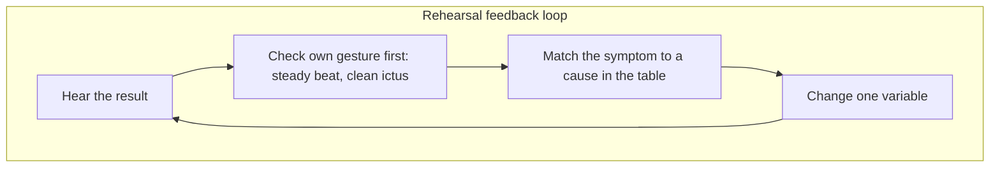
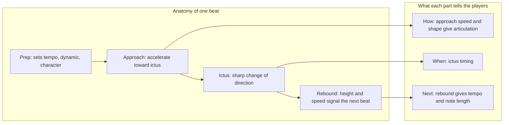

# Lesson 2: Tempo and Rhythm: Beat Patterns, Ictus, and Gestural Control

**You need:** a full-length mirror, a metronome app with tap-tempo and programmable tempo changes, a phone that records 60 fps video, a baton (or bare hand for choral work), and a printed score of whatever you are studying.

**By the end of this lesson you can:** conduct patterns in 1, 2, 3, 4 and 6 with a repeatable ictus; show articulation and subdivision without extra beats; execute ritardando, accelerando, a tempo, rubato and fermata; cue entrances; conduct 5/4 and 7/8 with visible grouping; plan a metric modulation; and map the tempos of a score before the first rehearsal.

## 1. The Problem You Are Solving

An orchestra cannot hear your intentions. It sees your hand and feels the pulse you project. Players do not react to the ictus after it happens. They watch the approach, predict when the ictus will arrive, and play to that prediction. Anything that makes the arrival hard to predict (a vague approach, a hovering hand, speed changes without warning) spreads the attacks. Sound also arrives late. It travels about 3 ms per meter of stage, and low strings, low brass and large choirs take extra time to speak. Expect sound a few tens of milliseconds after your ictus, and do not chase it (see Section 9).

Your job is to make the ictus predictable, the tempo readable from one beat to the next, and the character of the music visible in the way you approach each beat.

**Tempo arithmetic you need once, in score study:** seconds per beat = 60 ÷ BPM. At 120 BPM a beat lasts 0.5 s, at 60 it lasts 1.0 s, and at 40 it lasts 1.5 s. On the podium you work by feel, checked against a metronome.

**Practical consequence of how tempo is perceived:** listeners judge tempo changes by ratio. 60 to 80 BPM is a 33% change, while 140 to 160 is 14%. When you step a drill up in tempo, use steps of 4-5 BPM below 80 BPM and 10 BPM above 120 BPM. Spend most of your slow-tempo practice between 40 and 70 BPM, where every flaw in your gesture is visible. Above about 120 BPM the pattern gets smaller and the job is to stay out of the players' way.

## 2. Posture and Baton Grip

Fix this before learning any pattern. Tension here carries into every ictus.

**Stance:** Feet shoulder-width apart, one foot slightly ahead, weight evenly spread over the whole foot and a little forward, knees unlocked. Your legs should be able to move your torso for a sharp accent or a lean into an accelerando.

**Baton grip:**
1. The bulb (handle end) rests in the fleshy base of your palm.
2. The pad of your thumb and the side of your index finger pinch the handle about 1 inch ahead of the bulb.
3. The middle finger touches the handle. The ring and little fingers curl lightly and do not squeeze.
4. At rest, the baton continues the line of your forearm. There is no angle at the wrist.
5. The palm faces down and tilts about 45°, with the thumb side higher.

**Tension tests:**
- Shake the baton gently. It should wiggle in the pinch without falling.
- A partner tugs the tip. It should resist a light pull and release to a firm one.
- If your knuckles whiten or your forearm extensors (top of the forearm) burn after two minutes, loosen your grip.

**Baton-free conducting (choral and chamber):** Fingers loosely together, palm angled about 45° down. A flat palm-down hand looks aggressive, and a palm-up hand looks like a request. The ictus comes from the wrist and the heel of the hand, as with a baton.

**Home position between phrases:** Upper arm hangs loosely, with an elbow-to-rib gap about the width of a hand. The forearm is level or rising slightly, and the baton tip is at about sternum height. The elbow stays at or below shoulder height.

## 3. Beat Pattern Geometry

Every pattern is a fixed set of ictus points, like nails in a board. Hit each nail at the same place every time and travel smoothly between them.

**Reference frame (right hand, seen from the conductor's position):**
- Imagine a vertical centerline running down from your nose. Left means across your body, and right means toward your baton side.
- *Low* is just above belt height, *mid* is lower ribs to sternum, and *high* is chest to shoulder.

### Pattern in 2

| Beat | Motion | Ictus position |
|---|---|---|
| 1 | Straight down | Center, low, large |
| 2 | Rebound up and slightly right, with a small hook | Slightly right, mid-high |

The path is a near-vertical line. Use it for marches, cut-time, and 6/8 at about dotted-quarter = 80 or faster.

### Pattern in 3

| Beat | Motion | Ictus position |
|---|---|---|
| 1 | Down | Center, low |
| 2 | Straight out to the right | Right, mid, on a horizontal path |
| 3 | Up and back toward center | Center, mid-high, then it rebounds into the next beat 1 |

The most common beginner error is letting beat 2 drift upward. Then beats 2 and 3 look identical and the triangle collapses. Check in the mirror that beat 2 stays at the same height as it travels right.

### Pattern in 4

| Beat | Motion | Ictus position |
|---|---|---|
| 1 | Down | Center, low |
| 2 | In and across the body | Left of center, low-mid |
| 3 | Out across the centerline to the right | Right, mid |
| 4 | Up | Center-right, high (chest) |

The path from beat 2 to beat 3 crosses the centerline above your beat 1 ictus. That crossing is what lets players at the back of the hall tell beat 2 from beat 3.

### Pattern in 6 (slow 6/8: two main beats, each divided in three)

| Beat | Size | Ictus position |
|---|---|---|
| 1 | Large | Center, low |
| 2 | Small | Left, low-mid |
| 3 | Small | Farther left, mid |
| 4 | Large (same visual weight as 1, or one notch lighter) | Right, mid |
| 5 | Small | Right, mid-high |
| 6 | Small | Center-right, high |

Beats 1 and 4 must be clearly larger than the others. If all six are equal, the players hear six pulses, the tempo drags, and the lilt disappears.

### Pattern in 1

A single downward stroke with a small teardrop rebound out to the right and back to the start. Use it when bars pass at roughly 60-80 per minute or faster. For example, 3/4 at about quarter = 180 or faster, or 6/8 at about dotted-quarter = 120-160. Below that, a one-beat pattern leaves the players with too little to follow.

### Drill 3.1: Pattern Isolation (4 weeks, 10 minutes per day)

Use the mirror and the metronome.

1. Set the metronome to the target tempo for the week (table below).
2. Conduct each pattern (2, 3, 4, 6) for 2 minutes, with the click on every main beat.
3. Check in the mirror:
   - the ictus lands at the same height each time, within about a hand-width;
   - every beat has a visible change of direction, with no blurred curves;
   - rebounds after beats 2, 3 and 4 are equal;
   - beat 1's rebound is slightly larger because it starts the loop.
4. Once a week, record 60 fps video and step through frames. A clean ictus is a one- or two-frame direction change. If it smears across three or more frames, drop back one tempo level and rebuild.

| Week | Tempo | Pattern size |
|---|---|---|
| 1 | 60 BPM | Full size (about shoulder width) |
| 2 | 80 BPM | Slightly smaller |
| 3 | 100 BPM | About two-thirds size |
| 4 | 110 BPM | Compact |

## 4. Ictus and Rebound

The ictus is the point where the baton changes direction, and the approach into it gives the players their prediction. Players synchronize to the sharp change in the hand's motion, so the approach has to build toward the ictus and the turn has to be definite.

**How to produce a clear ictus:**
1. **Accelerate into the ictus point.** Think of a ball thrown at the floor: it bounces crisply because it was moving fast on arrival.
2. **Change direction quickly and elastically.** At moderate and fast tempos the change takes only a few milliseconds. There is no visible pause.
3. **Let the rebound carry information.** A low, quick rebound signals the next beat is soon, so it suits short notes and a steady or faster tempo. A high, slower rebound signals the next beat is later, so it suits sustained notes, a slower tempo, or a rest.
4. **At very slow tempos** (below about 50 BPM) the hand cannot bounce. Keep a continuous slow motion and make the arrival at each ictus unmistakable by a distinct change of direction, never by freezing.

### Articulation by approach and rebound

| Character | Approach | Ictus | Rebound |
|---|---|---|---|
| Staccato | Quick, short | Sharp, small angle | Small, fast, and the hand leaves the beat plane quickly |
| Marcato | Heavy, from a higher start | Firm, hard angle | Medium, elastic |
| Legato | Slow, smooth, continuous | Rounded corner, no angle | Flows directly into the next approach, with no separate bounce |
| Tenuto | Even speed, deliberate | Pressed arrival, slightly longer | Medium and unhurried |

Practice each in Pattern in 4 at 72 BPM, four bars each, until the four characters look different on video. Compare them frame by frame.

### Diagnosing a bad ictus

| Symptom in the ensemble | What your hand is doing | Fix |
|---|---|---|
| Attacks land late and soft | Dead rebound: the hand arrives and stays low, with no upward motion to show the next beat | Add a visible rebound after every ictus, even at slow tempo |
| Attacks split into two waves | Premature rebound: you turn before reaching the bottom | Drive farther before the turn. Exaggerate until it feels too big, then scale back by a quarter |
| Attacks smear over about 100 ms | Floating ictus: the hand slows but never changes direction decisively | Do the freeze diagnostic below, then replace the freeze with a sharp turn |
| Ictus height wanders | Pattern is drifting out of its frame | Shrink the pattern and re-center in the mirror |
| Tempo wobbles | Rebound speed varies from beat to beat | Record against a click and compare rebound heights across 8 bars |

**Freeze diagnostic (half tempo, practice only):** At about 30 BPM, hold each ictus for a full second to feel exactly where it lives. Then speed up to the real tempo and hit the same spot with a quick turn. Do not freeze on the podium.

### Drill 4.1: Ictus-to-Click Alignment

1. Set the metronome to 60 BPM with the click audible in the room.
2. Conduct Pattern in 4 with each ictus landing on a click.
3. Record 60 fps video with the click audible on the recording, using the same device that records the video.
4. In your video editor, find the frame where your hand reaches its lowest point and compare it to the frame where the click is visible on the waveform. A frame is about 16.7 ms. Your target is within 2 frames (33 ms) on beat 1.
5. Repeat at 80 and 110 BPM, shrinking the pattern as the tempo rises.

### Drill 4.2: Tempo Memory (from week 2 onward)

1. Write five tempos on cards: 54, 72, 96, 120, 144 BPM. Shuffle.
2. Draw a card without looking at your phone. Hold the tempo in your head for 5 seconds, give a prep beat, and conduct 8 bars with no click.
3. On the card's tempo, start the metronome partway through and note how many BPM you drifted.
4. Target within 3 BPM at 72 and 5 BPM at 120 by week 4.

## 5. Showing Subdivision

Do not add extra ictus points at fast tempos. A conductor who beats every eighth note in a quick 4/4 gives the orchestra twice as many events to track and hides the true pulse. Choose the tool by the tempo of the beat unit:

| Beat tempo | What to do |
|---|---|
| Faster than about 100 BPM | Show the main beat only. Use gestural texture for subdivision (below). |
| About 60-100 BPM | Main beat plus a small wrist pulse inside the rebound where the subdivision matters. |
| About 40-60 BPM | Subdivide visibly when the rhythm is complex or the ensemble drags. Use a subdivided pattern (below). |
| Slower than about 40 BPM | Subdivide. Beat each eighth (4/4 in 8, 3/4 in 6) or the ensemble loses the pulse. |

**Rule for all subdivision:** keep the approach to the main ictus clean. The ensemble predicts the ictus from your approach, so subdivision belongs in the rebound or on the path toward the next beat.

**Subdivision tools:**
1. **Wrist pulse in the rebound (works at full orchestral distance).** After the ictus, add a tiny wrist lift-and-drop inside the rebound at the subdivision. The forearm path and the approach do not change.
2. **Subdivided pattern (slow tempos).** Keep the main four-beat path at full size. Add a small ictus at half-size for each "and", placed on the path toward the next main beat. In 4/4 that gives eight points per bar, with the main beats larger.
3. **Finger impulses (chamber distance only, within about 15 feet).** Small curl-and-extend motions of the fingers on top of the hand's travel. They disappear at orchestral distance.
4. **Gestural texture (any distance).** A smooth, unbroken arc implies even, unaccented rhythm. Small hitches and accents imply syncopation or dotted figures. This tool carries most of what audiences and players read as "clear rhythm".

### Drill 5.1: Eighth-Note Texture

1. Set the click to 60 BPM (quarters). Conduct Pattern in 4 with smooth arcs for 2 minutes.
2. Set the click to 120 BPM (eighths, with the pattern still moving at the quarter-note tempo). Keep the arm path identical in size and shape. Only the wrist adds a small pulse in each rebound.
3. Mirror check: if your elbow or shoulder moves differently between steps 1 and 2, the subdivision is in the wrong joint.
4. Repeat from 72 → 90 → 108 BPM (quarters).

### Drill 5.2: Subdivided Pattern at Slow Tempo

1. Set the click to 48 BPM (quarters). Conduct 4/4 in a subdivided 8, with the main beats full size and each "and" at half size.
2. Count aloud "1 and 2 and 3 and 4 and" for 4 bars.
3. Change to Pattern in 4 plus wrist pulses at 60 BPM and compare how each looks on video.

## 6. Tempo Changes

### Ritardando

The ensemble learns about a ritardando from the rebound before the first slowed beat. Do not slow before the marking. On the beat before the first slowed beat, make the rebound slightly higher and slower. From there:

- Each beat is a little longer and a little larger than the last, so the pulse slows in an even curve.
- Keep a real, definite ictus even at the slowest point. A mushy ictus makes the ensemble drag farther than you want.

### Accelerando

- Make the pattern smaller and the rebounds lower. Low rebounds shorten the time to the next beat, and players read that as faster.
- A small lean of the torso onto the front foot adds forward motion.

### A tempo

The a tempo comes from the prep. Make the rebound before the a tempo beat at the new speed, with the new character, and the ensemble will follow it.

### Rubato

Two different situations need two different gestures.

1. **Ensemble rubato (the whole orchestra stretches the pulse).** The beat itself flexes: the time between ictus points stretches and compresses with the phrase. The left hand shapes dynamics and phrase contour.
2. **Accompanying a soloist who floats over a steady pulse** (for example, slow movements of Chopin's two piano concertos, both in 4/4, where the soloist bends the melody over the orchestra's steady accompaniment). Right hand keeps a clean, metrical pattern for the orchestra. Your eyes and left hand listen to the soloist and make small adjustments at cadences and breath points.

### Fermata

The beat before the fermata can carry a slightly broader, more deliberate rebound as notice, but the symbol itself is already a warning.

- **Hold:** Arrive at the ictus and keep the energy alive. Do not freeze. The baton stays level and the left palm stays open. Allow a very slow expansion of the gesture. A hand that stops dead reads as a stop in the sound.
- **Release:** One compact gesture, such as a small circle or a lateral cutoff, ends the sound.
- **Next entrance:** Choose one of three connections:
  - *Fermata, then break:* release, return to the prep position, take a visible breath, then give a prep beat at the tempo of the next section.
  - *Fermata, then immediate continuation:* the release flows straight into the next prep. It is one motion with a hook at the end.
  - *Fermata on a rest:* hold the beat position and keep the face and breath active. The silence is conducted as sound.

Never hesitate between the release and the next prep. Any pause reads as uncertainty.

### Drill 6.1: Controlled Ritardando

1. Set the click to 120 BPM for bars 1-4 only. Count in with one bar.
2. At bar 5, conduct alone for 2 bars of 4/4, easing from 120 to 80 BPM. Then take a prep beat at 120 BPM and begin bar 7 at 120.
3. Record 60 fps video. In your editor, find the frame number of each ictus, divide by 60 to get seconds from bar 5 beat 1, and compare against this target:

| Beat | Time to next beat (s) | Target time from bar 5 beat 1 (s) | Equivalent BPM |
|---|---|---|---|
| Bar 5 beat 1 | 0.500 | 0.000 | 120 |
| Bar 5 beat 2 | 0.542 | 0.500 | 111 |
| Bar 5 beat 3 | 0.583 | 1.042 | 103 |
| Bar 5 beat 4 | 0.625 | 1.625 | 96 |
| Bar 6 beat 1 | 0.667 | 2.250 | 90 |
| Bar 6 beat 2 | 0.708 | 2.917 | 85 |
| Bar 6 beat 3 | 0.750 | 3.625 | 80 |
| Bar 6 beat 4 | 0.500 (the a tempo prep) | 4.375 | back to 120 |
| Bar 7 beat 1 | 0.500 | 4.875 | 120 |

Aim to land within 50 ms of each target time. A jump in the interval list means you slowed in steps rather than in a curve. Repeat with a 100 → 70 BPM range.

### Drill 6.2: Beethoven 5, Fermata Practice

Take the opening of Beethoven's Symphony No. 5, first movement, with the fermata motif in bars 1-2. Conduct the prep, the entrance, the hold, the release, and the re-prep into the next entrance. Decide whether your first ictus falls on the opening rest or on the first sounding note (conductors use both), mark it in the score, and rehearse until you can start cleanly ten times in a row. Check your tempo at the first beat against the edition's metronome marking.

## 7. Starting, Preparatory Beats, and Cueing

**The prep beat is the most important gesture you make.** It comes before the sound, so it is the only gesture that can shape an entrance. The sound can only follow what the prep already told the players about tempo, dynamic, articulation and character.

- **Timing:** The prep is the motion between the ictus before the entrance and the ictus on the entrance. If a section enters on beat 3 of 4/4, your prep is the rebound from beat 2's ictus into beat 3.
- **Quality:** A weak prep produces a weak entrance. If an entrance is late, fix the prep, not the player.
- **Breath:** Inhale visibly during the prep. Winds and singers breathe with you reflexively, and the shared breath sets the entrance timing.
- **Eyes:** Look at the entering section one or two beats early, so they know you are coming, and keep eye contact through the prep.

**Left-hand cueing (right hand never stops the pattern):**
1. Turn your torso and eyes toward the section.
2. Extend the left arm toward them, palm open and facing them, timed to reach full extension on the prep beat.
3. Hold the extension through the entrance ictus, then relax back to neutral. Pulling back immediately looks anxious.

### Drill 7.1: Cueing Across Changing Meter

1. Click at 72 BPM (quarters). Conduct 2 bars of 4/4, 2 bars of 3/4, 2 bars of 5/4 (3+2).
2. Cues to plant: bar 1 beat 3, bar 3 beat 2, bar 5 beat 4 (the start of the 2-group).
3. For each cue, do this in order: eyes to the section a beat early, visible breath on the prep, left arm at full extension on the prep, entrance ictus delivered cleanly, left hand held through the ictus, then relaxed.
4. Repeat at 90 and 110 BPM.

## 8. Asymmetric Meters

The conductor's job in 5/4 and 7/8 is to make the grouping visible. If the pattern looks like equal beats, the ensemble cannot feel where the asymmetry falls.

**Rule:** The longer group gets the longer, larger, more deliberate gesture. The shorter group gets quicker, smaller beats. A beat of three eighths takes 1.5 times as long as a beat of two eighths, so the hand's travel time changes as well as its size.

**One workable convention for 5/4.** Choose one geometry, mark it in the score, and keep it for the whole piece.

| Grouping | Beat 1 | Beat 2 | Beat 3 | Beat 4 | Beat 5 |
|---|---|---|---|---|---|
| 3+2 | Down, center, low, large | Left, low-mid, small | Right, mid, small | Down again, center, mid-low, medium (start of the 2-group) | Up, high, small |
| 2+3 | Down, center, low, large | Up and right, small | Down again, center, mid-low, medium (start of the 3-group) | Right, mid, small | Up, high, small |

In both cases the second "down" marks the start of the second group. Make it visibly smaller than beat 1 and larger than the small beats.

**7/8 as three beats of unequal length:**

| Grouping | Beat 1 | Beat 2 | Beat 3 |
|---|---|---|---|
| 3+2+2 | Down, large, 3 eighths long | Out right, small, 2 eighths | Up, small, 2 eighths |
| 2+2+3 | Down, small, 2 eighths | Out right, small, 2 eighths | Up, large, 3 eighths, with a wider, slower rebound into the next bar |

### Drill 8.1: Grouping Drill

1. 5/4: click on quarters at 60 BPM. Conduct 4 bars of 3+2, then 4 bars of 2+3.
2. 7/8: click on eighths at 120 BPM. Conduct 4 bars of 3+2+2, then 4 bars of 2+2+3.
3. Count aloud while conducting ("1-2-3, 1-2" for 5/4 as 3+2) until your voice and hand agree.
4. Mute the click and film yourself. With the sound off, can a viewer tell which grouping you are in from gesture size alone? If not, exaggerate the size and timing difference.
5. Progress: 5/4 quarters 60 → 80 → 100; 7/8 eighths 120 → 150 → 180.

## 9. Listening and Real-Time Correction

A conductor who only transmits is conducting a recording. Constantly compare what you hear to what you intended, and adjust one gesture variable at a time.

**Check yourself first.** Before blaming the ensemble, ask whether your own beat is steady and your ictus is clean. If you record rehearsals, a click on your phone's second device helps you hear your own drift.

| Symptom | Likely gestural cause | Fix |
|---|---|---|
| Ensemble drags | Rebounds too high, approach too slow, or you are slowing to match the late sound | Lower the rebound, sharpen the approach, and hold your own tempo without following the lag |
| Ensemble rushes | Rebounds too low, preps too small, or tension in the shoulders | Raise the rebound, give a fuller prep, and relax your shoulders |
| Attacks land late | Ictus is soft, or the prep was too subtle | Sharpen the turn at the ictus and exaggerate the prep with a visible breath |
| Attacks come early | Players are reading the prep as the beat | Slow the visible speed of the prep slightly and make the ictus arrival more definite by contrast |
| Syncopations are ragged | Subdivision is not visible | Add wrist subdivision in the rebound, or temporarily shrink the pattern for more frequent reference points |
| One section covers another | Left hand is not managing balance | Palm down toward the loud section to ease it back, palm up toward the quiet section to bring it out |

**Do not chase the sound.** Sound reaches you late, especially from the back of the stage. If you slow down to match the late sound, the ensemble hears you slow and lags more, and the delay compounds. Conduct the tempo you want, and let the ensemble come to you.

### Drill 9.1: Conduct Along and Diagnose

1. Choose a recording with a steady tempo in the work you are learning, or load the score into notation software with playback (for example MuseScore) and set a fixed tempo.
2. Conduct along at full tempo and record yourself.
3. For each passage where your hand and the sound disagree, name the gesture cause from the table above.
4. Change one variable (rebound height, ictus sharpness, prep size, or wrist subdivision), repeat the passage, and film it again.
5. Compare the two takes frame by frame. Keep the change only if the alignment improves.

## 10. Metric Modulation and Polyrhythm

**Metric modulation:** a note value from the old tempo becomes the pulse of the new tempo. Work out the arithmetic once, in score study, and write the new BPM above the bar. On the podium you execute the change physically.

| Old unit | New unit | New tempo | Example |
|---|---|---|---|
| Triplet eighth (4/4) | Eighth (6/8), so the new dotted quarter equals the old quarter | Same number | ♩ = 90 → ♩. = 90 |
| Quarter-note triplet (3 in the time of 2 quarters) | Quarter | Old × 1.5 | ♩ = 90 → ♩ = 135 |
| Eighth | Triplet eighth (3 per beat) | Old × 2/3 | ♩ = 90 → ♩ = 60 |

**Check for the first row:** at ♩ = 90, each triplet eighth lasts 0.667 ÷ 3 = 0.222 s, which is 270 per minute. In 6/8, eighths at 270 per minute make a dotted quarter of 270 ÷ 3 = 90 per minute. The hand speed does not change. Only the pattern changes, from 4 beats to 2.

**Check for the second row:** a quarter-note triplet lasts 2/3 of a quarter, which is 0.667 × 2/3 = 0.444 s. A beat of 0.444 s is 135 BPM.

### Executing a modulation

1. In the bars before the change, conduct with a wrist triplet pulse in the rebound, so the new unit is already running in your body.
2. On the transition beat, let that triplet unit become your felt pulse.
3. Move into the new pattern without stopping. In the first row the new dotted-quarter ictus lands exactly where the old quarter ictus would have.
4. The left hand may keep the old subdivision for one bar as a visual aid, then drop to normal cueing.

### Polyrhythm

When the strings play triplets against brass quarters, the right hand keeps the shared pulse. At most, the left hand gives light taps for the section playing against the grain. Many conductors only cue and let the players tune it by ear, so use the left hand for taps only when the passage needs it.

### Drill 10.1: 3:2 Independence

Use the ratio 3:2 (three even events in the time of two).

1. **Speech:** say "Nice cup of tea." Your right hand taps on "Nice" and "of", and your left hand taps on "Nice", "cup" and "tea". Repeat until it flows.
2. **Add the click:** set two clicks, 60 BPM and 90 BPM, started together. The right hand follows the 60 click and the left hand follows the 90 click, tapping on your thighs.
3. **Add the pattern:** right hand conducts Pattern in 2 with one beat per 60 click, and the left hand taps three even taps across each two right-hand beats.
4. Hold for 32 bars without either hand borrowing the other's timing.
5. Raise the tempo in pairs, keeping the ratio: 60/90 → 72/108 → 84/126.

### Drill 10.2: Modulating Between Tempos

1. **First-row modulation:** set the click to 90 BPM and keep it running. Conduct 4 bars of 4/4 with wrist triplets, then 4 bars of 6/8 in 2. Every ictus stays on the click.
2. **Second-row modulation:** program the metronome to play 4 bars at 90 BPM and then 135 BPM. Conduct 4 bars of 4/4, then switch to the new tempo with no pause and the first new-tempo ictus on the click.
3. Record both and check the seam frame by frame.

## 11. Physical Conditioning and Injury Prevention

A rehearsal is 60-90 minutes of repetitive arm motion, so treat it as athletic activity.

**Posture rules during rehearsal:**
- Keep the shoulders down and relaxed. Raised shoulders cause most conductor fatigue and restrict the rebound.
- Keep the elbows at or below shoulder height for most of your gestures. Extended work above shoulder height loads the rotator cuff.
- Let the wrist move through a small arc around neutral. Do not snap to the end of its range or hold it bent at the ictus, because that is where repeated impact accumulates and leads to tendonitis over months.
- Stop and rest if you feel pain, numbness, or tingling. Persistent symptoms need a medical opinion.

**Warm-up (5 minutes before every session):**
1. Shoulder rolls, 10 forward and 10 back.
2. Arm circles, 10 small and 10 large in each direction.
3. Wrist flexion and extension, 10 repetitions each direction.
4. Half-tempo patterns 2, 3, 4 and 6, 30 seconds each at 60 BPM, smooth and large.

**Cooldown (3 minutes):**
1. Cross-body shoulder stretch, 30 seconds each arm.
2. Forearm extensor stretch (arm out, palm down, gently pull the hand toward you with the other hand), 30 seconds each side.
3. Forearm flexor stretch (palm up, gently pull the fingers back), 30 seconds each side.
4. Neck tilt, 15 seconds each side, to release tension from reading scores.

## 12. Score Study and Tempo Planning

Do this before you face the ensemble.

**Tempo mapping, step by step:**
1. Write a BPM number above every tempo marking. If the composer gave no metronome mark, tap the tempo of two or three reference recordings with a tap-tempo app, check historical performance practice, and commit to a number. Use the table below only as a starting range.
2. Mark every ritardando, accelerando and modulation, and work out the numbers in advance (Section 10).
3. Over syncopated, hemiola or polyrhythmic bars, write the subdivision (eighths, triplets, sixteenths) directly above the staff.
4. Conduct along with a reference recording at full tempo, flag every bar where you drift, and drill those bars slowly in isolation.

| Marking | Typical starting range (quarter-note beats per minute) |
|---|---|
| Largo | 40-60 |
| Adagio | 66-76 |
| Andante | 76-108 |
| Moderato | 108-120 |
| Allegro | 120-156 |
| Presto | 168-200 |

**Example tempo map (invented excerpt, for illustration of the format):**

| Bars | Marking | Beat unit and BPM | Pattern | Notes |
|---|---|---|---|---|
| 1-16 | Allegro | ♩ = 120 | In 4, compact | Wrist subdivision in bars 9-12 |
| 17-24 | poco rit. | 120 → 96 | In 4, widening | Rebound before bar 17 gets taller |
| 25 | a tempo | ♩ = 120 | In 4 | New tempo shown in the prep |
| 26 | Fermata | n/a | Hold, then release | Re-prep at 120 with a breath |
| 27-60 | Andante | ♩ = 72 | In 3 | Slow rebound, legato |

**Rehearsal tempo strategy:**
- Professional orchestras usually read at tempo and fix problems in place. Student and community groups often need technical passages at about 75-85% of tempo, rebuilt in 5% steps.
- Never slow so far that the beat unit changes character (a rhythm that is felt in 2 should not become six slow beats).
- Adrenaline pushes tempos faster in concert. At the dress rehearsal, set the exact planned tempo and check it against your written numbers. In the concert, make your first prep slightly broader to counter the push.

## 13. Reference Diagram

## 14. Practice Assignments

**Daily 30-minute session:** warm-up 5 min, patterns at the week's tempo 8 min, ictus-to-click or tempo-memory drill 7 min, one topic drill from this lesson 7 min, score or listening work 3 min. Add the cooldown.

**Assignment 1: Pattern mastery (weeks 1-4).** Conduct patterns 2, 3, 4 and 6 for 2 minutes each at 60, 80 and 110 BPM. Record video. Pass: ictus within a hand-width in height, the 4-pattern crossing visible, no multi-frame smears.

**Assignment 2: Ictus and articulation.** Conduct Pattern in 4 at 72 BPM in staccato, marcato, legato and tenuto, 4 bars each. Pass: an observer with sound off can identify each character from your video. Complete the ictus-to-click drill at 60, 80 and 110 BPM with beat 1 within 2 frames of the click.

**Assignment 3: Subdivision.** Conduct 4/4 at 60, 80 and 108 BPM with wrist pulses in the rebound, then 4/4 in a subdivided 8 at 48 BPM. Pass: arm path size unchanged across tempos and the wrist is the only joint doing new work.

**Assignment 4: Tempo changes.** Complete the controlled ritardando drill within 50 ms of the target times (range 120 → 80 and 100 → 70), plus the Beethoven 5 fermata drill with ten clean starts in a row.

**Assignment 5: Metric modulation.** Complete both parts of drill 10.2 with every ictus on the click at the seam. Add the 3:2 drill to 72/108.

**Assignment 6: Asymmetric meters.** Conduct 8 bars each of 5/4 (3+2), 5/4 (2+3), 7/8 (3+2+2) and 7/8 (2+2+3), counting aloud, with the grouping readable from your video with sound muted.

**Assignment 7: Full score study.** Choose a real work (for example Beethoven's Symphony No. 5, first movement). Fill in a tempo map like the example in Section 12, with BPM numbers, modulation arithmetic, subdivisions marked in the score, and a pattern choice for each section. Conduct along with a reference recording at full tempo, log every bar where you drift, and re-drill those bars slowly before re-checking at tempo.
