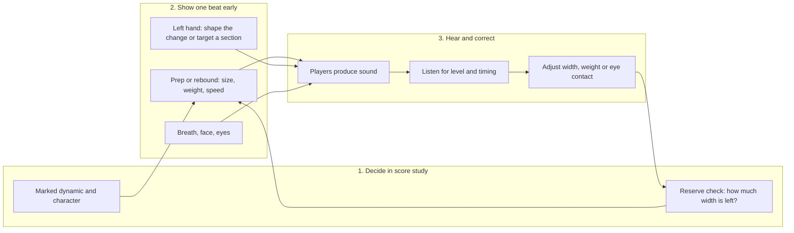
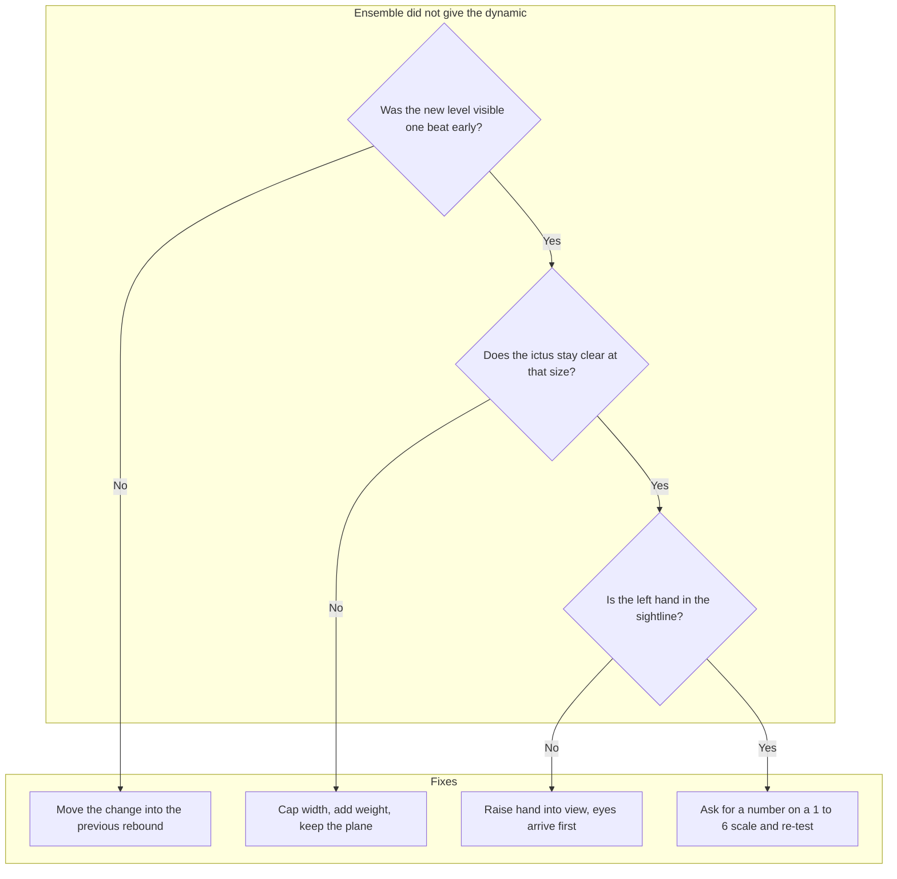

# Lesson 3: Dynamics and Expression in Conducting

**Outcomes.** After this lesson you can:
- Show six dynamic levels (pp to ff) with a repeatable, measurable beat pattern.
- Set the dynamic in the preparatory beat, before the ensemble makes a sound.
- Shape an 8-bar crescendo or diminuendo so the ensemble does not arrive early.
- Keep the right hand steady while the left hand does something different.
- Execute sudden changes (subito p, sf, fp) on the exact beat.

**Assumed skills.** Clear 2, 3 and 4 patterns, a preparatory beat, and a basic cutoff.

**Equipment.**
- Full-length mirror
- Phone and tripod
- Metronome app with a visual flash and subdivision clicks
- 35 cm baton
- Pencil
- Free Audacity install for Drill 3.2
- One to four players or singers for Drills 3.2 and 3.7
- Scores and recordings for the repertoire in Sections 4 and 7

**Health rule.** Practice in blocks of 25 minutes or less. Stop at any sharp pain in the shoulder, elbow or wrist. Keep elbows slightly bent and shoulders level at every dynamic.

---

## 1. First Principles

Players react to the gesture they just saw, not the one they are seeing now. A string player must choose bow speed and weight, and a wind player must choose air pressure, before the note sounds. So the information that sets a dynamic lives in the preparatory beat or the rebound, about one beat ahead of the sound.

In a real ensemble, one written dynamic step is roughly 5 to 8 dB, and every 10 dB or so sounds twice as loud. The distance from pp to ff is therefore very large. A conductor who uses up the gesture early has nowhere left to go, and players who see a gesture grow will reach the target level early.

### Invariants

1. **The gesture arrives before the sound.** Show every change in the rebound before the first note at the new level.
2. **The pulse stays readable at every dynamic.** The ictus must remain a clear point at pp and at ff.
3. **Size and height show level. Weight and rebound speed show articulation.** Do not use size to show articulation.
4. **Intensity comes from weight and breath, not from squeezing.** A tight grip and raised shoulders produce tight, shallow sound and cause injury.
5. **The left hand adds information.** It does not copy the right hand.
6. **Face and breath set character.** Your inhale is part of the preparatory beat. A wide, audible-looking inhale asks for ff, and a small quiet one asks for pp.

### How a dynamic reaches the sound

---

## 2. Mechanics

### 2.1 Baton and posture

- **Baton grip:** Hold the baton at the bulb between the pad of the thumb and the side of the index finger's first joint. The other fingers curl loosely around the handle, and the end of the handle rests against the heel of the palm. The tip continues the line of the forearm, angled slightly inward. If your knuckles whiten, loosen your grip.
- **Stance:** Feet hip-width, knees soft, weight slightly forward.
- **Arms:** Elbows slightly in front of the ribs and about 10 to 15 cm away from them. At mf the forearm is roughly parallel to the floor.
- **Sightline:** Keep all gestures between the belt and the chin so the back desks can see them.

### 2.2 Dynamic calibration table

Widths are measured between the leftmost and rightmost points of the 4-pattern and assume 42 cm shoulders. Scale them to your own shoulder width, so f is about 1.4 shoulder widths wide. Use the same widths for 2 and 3 patterns.

| Level | Width (cm / shoulder widths) | Ictus height | Motion leads from | Stroke feel |
|---|---|---|---|---|
| pp | 15 / 0.4 | belt | wrist and fingers | light, slow, floating rebound |
| p | 25 / 0.6 | just above belt | wrist and forearm | soft, short rebound |
| mp | 35 / 0.8 | lowest rib | forearm | relaxed, medium rebound |
| mf | 45 / 1.0 | solar plexus (bottom of breastbone) | forearm and elbow | clear and even |
| f | 60 / 1.4 | mid-chest | elbow and shoulder | weighted arrival, full rebound |
| ff | 80+ / 1.9 | upper chest | shoulder, slight torso lean | heavy arrival, wide rebound |

**Rules that keep the pulse intact:**
- Above about 120 BPM, cap the width at the f row. Hand speed is width times tempo, and a very large pattern at a fast tempo arrives late. Show ff with height, weight and face.
- Change the pattern height gradually over several beats. The only exception is a subito change.
- Never freeze the hand at any size. A stopped hand gives the players no information.

### 2.3 Weight and speed (articulation)

| Character | Stroke | Rebound |
|---|---|---|
| Legato | Continuous, round, even speed, no stop at the ictus | Flows straight into the next beat's path |
| Staccato | Short, quick stroke from wrist and fingers | Quick and light, hand stays small |
| Marcato | Fast arrival, forearm dropped with weight | Brief stop at the ictus, then lift |
| Tenuto | Slow arrival, slight press at the ictus | Delayed, hand stays "in" the beat |
| Sforzando | Weight loaded in the previous rebound | Releases immediately after the ictus |

### 2.4 Left hand vocabulary

Keep the left hand at rest near the belt when it has nothing to say. A left hand that always moves ends up mirroring the right.

| Intent | Gesture | Common mistake |
|---|---|---|
| Crescendo | Palm up, rising slowly from belt toward chin | Rising too fast and running out of room |
| Diminuendo | Palm down, lowering slowly | Dropping early so the section falls off |
| Sustained quiet | Palm down, flat, fingers relaxed, held toward the section | Letting the hand drift up |
| Hold the level | Flat palm facing the section, steady | Making it a stop sign that blocks all phrase movement |
| Accent or sf | Short stab with a flat hand, immediate release | Closing the hand into a fist |
| Legato shape | Sideways sweep, fingers together | Angular corners |
| Cutoff | Small closing circle | Using a closing hand for intensity, which players read as a cutoff |

Players read a closing hand as "stop". To show intensity, use weight, breath and face, not a fist.

### 2.5 Body, breath and face

- **Forte passages:** Torso leans forward 5 to 10 degrees at most. Shoulders stay down, never hiked. Do not rise onto your toes, because it unbalances you and compromises beat accuracy.
- **Piano passages:** Torso centered, shoulders low, elbows closer to the body. A small, quiet inhale.
- **Subito piano:** The new size and the lowered shoulders appear in the rebound before the first soft note.
- **Eyes:** Look at the section one bar before they play. Eyes arrive before the hand.
- **Face:** Show the character before the note. A neutral face produces neutral sound.

---

## 3. Hands-On Drills

### Filming protocol (all drills)

- Front camera at chest height, 3 m away, framing you from belt to head.
- A second take from the side shows ictus height.
- Pause on the ictus frames. Compare pattern width to your shoulder width in the same frame.
- Tolerance: each level within ±15% of target width and ±1 landmark of target height.

### Drill 3.1: Dynamic Ladder (Mirror and Video)

**Goal:** Reproduce the six levels in the 2.2 table.

**Setup:** Metronome at 60 BPM, 4/4, mirror in front.

**Procedure:**
1. Conduct 4 bars at each level, ascending pp, p, mp, mf, f, ff, then descending.
2. Check each level against the table, with width in shoulder widths and ictus at the landmark.
3. Film one ascending and one descending pass. Pause on the widest points.

**Progression:**

| Step | Tempo | Bars per level | Notes |
|---|---|---|---|
| 1 | 60 BPM | 4 | Mirror feedback |
| 2 | 80 BPM | 2 | Video check only |
| 3 | 108 BPM | 1 | Width cap per Section 2.2 rule |

**Pass:** 5 of 6 levels within tolerance on two consecutive takes.

### Drill 3.2: The Preparatory Beat Sets the Level

**Goal:** Communicate the dynamic before any sound.

**Setup (with players):** One to four players or singers, same pitch, on a sustained "ah" or any sustaining instrument. Metronome in your earbud at 60 BPM. Write pp, p, mf, f and ff on five cards and shuffle.

**Procedure:**
1. Draw a card without showing it. Give a one-beat prep, hold a 4-beat note, and cut off on beat 5.
2. Players write down the level they perceived. Record on a phone.
3. Do 10 trials.
4. In Audacity, select each note and use Analyze > Contrast to read its RMS level. Adjacent levels should differ by at least 4 dB.

**Setup (one friend, no players):** Film yourself silently giving the prep and cutoff. Your friend watches the muted video and guesses the card.

**Targets:**
- Exact match 6 of 10 in week 1.
- 8 of 10 within two weeks.
- Misses should never be more than one level off.

### Drill 3.3: Crescendo and Diminuendo With Rationing

**Goal:** Reach the target level on the last bar, not earlier.

**Setup:** Metronome at 72 BPM, 4/4. Use a player on a sustained note if available. A drone does not react to you, so video is the check.

**Widths per bar** (1 shoulder width = 42 cm, scale for your own):

| Bar | 1 | 2 | 3 | 4 | 5 | 6 | 7 | 8 |
|---|---|---|---|---|---|---|---|---|
| Crescendo width (cm) | 15 | 20 | 26 | 31 | 39 | 47 | 63 | 80 |
| Diminuendo width (cm) | 80 | 76 | 70 | 64 | 56 | 48 | 32 | 15 |

Both schedules are back-loaded. About 25% of the total change happens in bars 1 to 4, 25% in bars 5 and 6, and 50% in bars 7 and 8. Players follow the first visible change immediately and overshoot, so the early change must be small.

**Left hand (crescendo):** Palm up, starting at the belt.
- Bars 1 to 2: stay at belt level.
- Bars 3 to 4: rise slightly above the belt.
- Bars 5 to 6: solar plexus.
- Bar 7: chest.
- Bar 8: chin.

Reverse the path for the diminuendo with palm down.

**Checkpoints:**
- On video, the growth curve is slow early and steep late. No plateau in the middle.
- With players, they should not reach the target level before bar 7. If they do, your early gesture grew too fast.

**Progression:** 8 bars, then 4 bars, then 16 bars, then 32 bars (Barber, *Adagio for Strings*).

### Drill 3.4: Left Hand Independence

This is a deliberate dissociation drill. In performance the right hand also follows broad dynamic changes. Here you train the hands to be able to act separately.

**Setup:** Metronome at 60 BPM, 4/4.

**Part A.** Right hand holds mf (45 cm, solar plexus ictus). The left hand does:
- Bars 1 to 2: sustained p (palm down, low).
- Bars 3 to 4: crescendo to f.
- Bars 5 to 6: hold f (flat palm toward the section).
- Bars 7 to 8: diminuendo to pp.

**Part B.** Left hand holds a still "level" gesture. The right hand runs the Drill 3.1 ladder.

**Part C.** Right hand stays legato while the left hand alternates legato sweeps and staccato taps every 2 bars.

**Checkpoints:**
- Right-hand width stays within ±10% across all bars.
- Shoulders stay level on video. The right shoulder often rises when the left hand rises.
- If you cannot hold it, drop to 40 BPM.

**Progression:** 60, then 80, then 108 BPM.

### Drill 3.5: Subito, Sforzando, fp and Accents

**Goal:** Place sudden changes precisely. The new dynamic lives in the rebound before the first note at the new level.

**Setup:** Metronome at 60 BPM, 4/4.

**Subito p (f to p at the next downbeat):**
1. Bars of f at 60 cm.
2. Beat 4 ictus stays f-sized.
3. The rebound after beat 4 is p-sized (25 cm), light, with the left hand dropping palm down.
4. The next downbeat ictus is p at the belt.

**Sforzando on beat 3 inside p:**
1. Beats 1 and 2 at p (25 cm).
2. The rebound after beat 2 is slightly bigger and heavier as the prep.
3. Beat 3 ictus is weighted, width about 45 cm for that stroke only. The left hand gives a short flat stab.
4. The rebound after beat 3 returns to 25 cm. Beat 4 is p.

**fp:** Strong ictus at f, immediate p-sized rebound, left hand palm down.

**Accent (>):** Add weight and a brief stop at the ictus. Do not enlarge the pattern. The rebound stays the same size.

**Checkpoint:** On the muted-video test from Drill 3.2, your friend identifies each change at the right beat.

**Progression:** 60, then 84, then 108 BPM.

**Excerpts:** Haydn, Symphony No. 94, mvt. 2 (the sudden ff chord at the end of the first 16-bar statement, bar 16). Beethoven, Symphony No. 5, mvt. 1 for accents.

### Drill 3.6: Phrase Shaping

**Goal:** Conduct a phrase as one arc with a beginning, apex and end.

**Setup:** Mozart, *Ave verum corpus* K. 618, any choral recording at a slow 4/4 near ♩ = 60. Pencil the apex of each phrase in the score.

**Procedure:**
1. Inhale at the start of each phrase and release at its end.
2. Grow the width about 15% toward the apex, even where the marking is constant, using weight more than size.
3. At the apex, add a brief tenuto: slow arrival, slight press, left hand flat.
4. After the apex, lighten the stroke, left hand palm down. Do not cut off the end of the phrase.
5. On the cadence, shrink the final rebound by about a third.

**Checkpoint:** On playback, the phrase ending is lighter than the apex and does not snap off.

**Progression:** 4-bar phrases, then 8-bar, then the full piece.

### Drill 3.7: Sectional Balance

**Goal:** Give different dynamics to different sections without losing the pulse.

**Setup:** Stick four notes at eye height: first violins at your left, woodwinds center-left, brass center-right and behind, cellos and basses at your right. Metronome at 72 BPM, right hand on mf pulse.

**Procedure:**
1. Spend 2 bars per target. Eyes arrive at the note first, then the left hand.
2. Run the cycle: violins p (palm down), woodwinds f (palm out, raised), brass mf (flat palm), cellos pp (palm down, low).
3. Reverse the order, then shuffle it.

**Checkpoints:**
- Eyes arrive at least one beat before the hand.
- Right hand stays unaffected on video.

**With real players:** To fix a balance problem, reduce the loudest group first. It is faster than asking the quiet group to play louder.

### Drill 3.8: Rubato and Agogic Accent

**Goal:** Stretch time without losing the pulse.

**Setup:** Metronome at 60 BPM with the click muted and the visual flash on. Use the *Ave verum corpus* phrases from Drill 3.6.

**Procedure:**
1. Add an agogic accent on the apex by arriving slightly late on the ictus and holding it a little longer.
2. Limit the stretch to about 5 to 10% of a beat.
3. Take the time back before the next phrase.
4. The downbeat of each new phrase must land on a flash.

**Checkpoint:** Eight phrases in a row land the new downbeat on the flash.

---

## 4. Repertoire Case Studies

### 4.1 Beethoven, Symphony No. 5, mvt. 1 (opening)

**Score facts:**
- 2/4, ff.
- Bar 1 starts with an eighth rest, followed by three eighth-note Gs.
- Bar 2 is the Eb with a fermata.
- The second statement is a step lower (F F F D), also ff, again with a fermata.
- The string continuation after the second fermata is marked p. Check this against your edition.

**Plan:**
1. **Preparatory beat.** Give a full one-beat prep at ff size: width about 70 cm, heavy, with a visible inhale. The first G sounds on the second half of beat 1, so the ictus falls on the rest and the first G is the rebound of that ictus. A common alternative is an eighth-note-length prep that lands on the first G. Choose one, use it every time, and tell the ensemble in the first rehearsal.
2. **Remaining two Gs.** Marcato strokes at the same size and weight. No drift in width within the bar.
3. **Fermata.** Give a strong arrival on the Eb. Then keep the sound alive with a slow, small lift or sustained tenuto, left hand flat and open toward the section, eyes sweeping. Nothing relaxes. Decide the duration beforehand (for example 3 to 4 seconds) and rehearse it with a stopwatch.
4. **Cutoff and re-prep.** Cut cleanly, then re-prep immediately and in tempo. The rest is part of the music, so do not wait.
5. **Second statement.** Same size and weight as the first (ff). Only the pitch changes.
6. **String entry at p.** After the second fermata, the cutoff's follow-through ends in the p position. The re-prep is small (25 cm), low (belt to lowest rib), left hand palm down, face softened.

**What this teaches:** A full-scale contrast can happen inside one beat if the cutoff and prep themselves are already the new size.

### 4.2 Ravel, *Boléro*

**Score facts:**
- 3/4 at about ♩ = 72. Check your edition.
- About 15 minutes.
- A snare drum ostinato runs throughout.
- Most of the crescendo comes from added instruments.

**The conductor's job:** Keep the pulse constant and keep visible reserve. Do not try to create the crescendo with your arms.

| Approx. time | Dynamic | Width (cm) | Ictus height | Left hand |
|---|---|---|---|---|
| 0:00 to 3:00 | pp | 15 to 20 | belt | at rest, cues only |
| 3:00 to 7:00 | p to mp | 25 to 35 | lowest rib | cues only |
| 7:00 to 11:00 | mp to mf | 35 to 45 | solar plexus | begins slow palm-up rise |
| 11:00 to 13:30 | mf to f | 45 to 60 | mid-chest | palm up at chest |
| 13:30 to end | f to ff | 60 to 80 | upper chest | shoulder to eye level |

**Practice guideline:** At the halfway point (around 7:30) you should be no wider than mp.

**Rehearsal method:**
1. Rehearse in two 7-minute halves first to build shoulder endurance.
2. Run the full recording with a stopwatch and film it.
3. Check widths at 3:00, 7:30 and 11:00.
4. Make sure the crescendo does not rush the tempo. Use the visual metronome.

### 4.3 Tchaikovsky, Symphony No. 6, mvt. 4 (ending)

**Score fact:** The music fades to pppp.

**Plan:**
- Reduce the width to 10 to 15 cm.
- Keep the pulse visible with the wrist and fingers.
- After the last note, hold your final position for 5 to 8 seconds before lowering the hands. The quality of the silence is part of the dynamic.

---

## 5. Troubleshooting

| Symptom | Likely cause | Fix |
|---|---|---|
| ff conducted at 30 cm | Level not calibrated | Drill 3.1 with video checks |
| Ensemble hits the target level early in a crescendo | Gesture grew too fast in the first half | Drill 3.3, back-loaded widths |
| Diminuendo drops off a cliff | Early shrink was too large | Drill 3.3 diminuendo row |
| Right hand shrinks when the left hand lowers | Hands not independent | Drill 3.4, Parts A and B |
| Left hand copies the right hand | Left hand never rests | Return to the belt when idle |
| Subito p arrives late or smeared | New level shown on the downbeat, not the rebound before it | Drill 3.5 |
| Loud passages drag | Width too large for the tempo | Apply the tempo cap in Section 2.2 |
| Players ignore the left hand | Hand is out of the sightline or constantly moving | Raise it between belt and chin, use eyes first |
| Face and sound feel flat | No visible character | Practice excerpts in the mirror with deliberate expression |
| Whole ensemble sits around mf | Dynamic scale not shared | Number the scale 1 to 6 (pp to ff) and name numbers in rehearsal |
| Shoulder or neck pain | Gripping, hiked shoulders, locked elbow | Shorter blocks, check posture, loosen the grip |

---

## 6. Rehearsal Workflow

1. **Score study.** Mark in pencil:
   - A circle one beat before every dynamic change.
   - A small flag at reserve checkpoints (for example the halfway point of a long crescendo).
   - A triangle where the left hand cues a specific section.
2. **Mirror and video.** Conduct the work with a recording. Check widths, ictus heights and right-hand steadiness.
3. **First rehearsal.** Teach your vocabulary with demonstrations, not speeches:
   - Low, close left hand means soft and intimate.
   - Open hand pushed outward means brightness and energy.
   - Shoulders and face dropped means release the tension.
4. **During rehearsal.** If an ensemble ignores a diminuendo, your gesture was probably too late or too small. If it overshoots a crescendo, the early growth was too large. Adjust the gesture before adding words.
5. **After rehearsal.** Listen to a recording from the audience position. Fix balance by reducing the loudest group first.

---

## 7. Repertoire Ladder

| Order | Work | Trains | Watch for |
|---|---|---|---|
| 1 | Mozart, *Ave verum corpus* | Phrase shape, rubato | Overlarge apex, snapped endings |
| 2 | Haydn, Symphony No. 94, mvt. 2 | Subito change | Showing ff on the downbeat instead of the rebound before |
| 3 | Barber, *Adagio for Strings* | Long crescendo and diminuendo | Peaking early, stopping the hand in silences |
| 4 | Beethoven, Symphony No. 5, mvt. 1 | Accents, fermatas, contrast | Frozen hand on the fermata, tempo drift |
| 5 | Ravel, *Boléro* | Rationing, steady pulse | Spending width early, tempo push |
| 6 | Tchaikovsky, Symphony No. 6, mvt. 4 | Extreme quiet | Losing the pulse when tiny, lowering hands too soon |
| 7 | Brahms, Symphony No. 4, mvt. 1 | Overlapping dynamics, balance | Treating sections as one block |
| 8 | Stravinsky, *Rite of Spring*, "Sacrificial Dance" | Sudden contrast and changing meters | Advanced. Master the bar-by-bar meter map first. |

---

## 8. Practice Plan

**Daily (25 minutes):**
- 5 min: Drill 3.1 ladder.
- 5 min: Drill 3.3 crescendo and diminuendo.
- 5 min: Drill 3.5 sudden changes.
- 10 min: one excerpt from Section 7.

**Weekly progression:**

| Week | Focus |
|---|---|
| 1 | Drills 3.1 and 3.2 |
| 2 | Add 3.3 and 3.4 |
| 3 | Add 3.5 and 3.6 |
| 4 | Add 3.7 and 3.8, run Beethoven 5 and *Boléro* in halves |

**Ready to move on when:**
- Drill 3.1 passes on video at 108 BPM.
- Drill 3.2 reaches 8 of 10.
- Drill 3.4 holds right-hand width within ±10%.
- Muted-video tests show your subito changes land on the correct beat.
