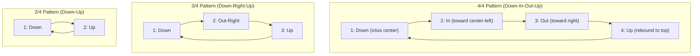
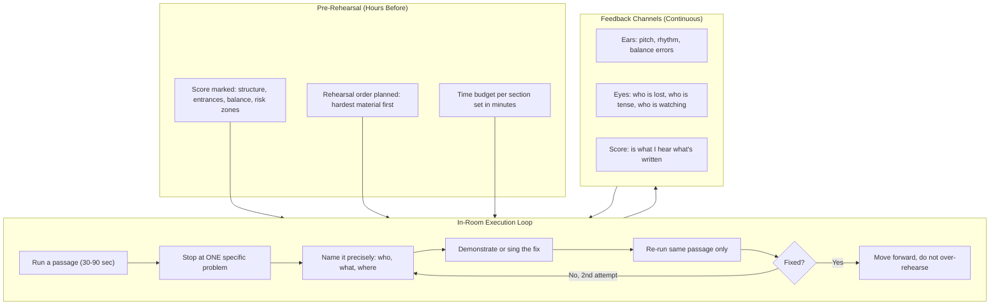

# Lesson 4: Rehearsal Techniques

## Acoustic & Physical Intuition (Read Once, Apply Every Rehearsal)

A conductor controls an ensemble through three synchronized channels: the **ictus** (the precise point of beat attack, shown by a change of direction in the baton or hand), the **left hand** (shaping, cueing, cutting off), and the **face/eyes** (the fastest-acting and most-ignored channel). Sound takes time to travel and time to speak — a tuba's attack transient is slower than a flute's, a cathedral's reverberant tail is longer than a rehearsal room's dry decay. A sound wave also needs real travel time to reach your ear: roughly 3 ms per meter, so a player 20 meters back in a large hall is already a sixteenth note "late" to your ear at a brisk tempo before they've done anything wrong. This means your beat must anticipate the ensemble's sound, not react to it: by the time you *hear* a late entrance, it's too late to fix that entrance, only the next one. This single fact — **you conduct the future, you hear the past** — is the invariant underneath every technique in this lesson. Everything below is built to shrink the gap between your gesture and the ensemble's sound.

## 1. The Baton and Hand: Precision Mechanics

### Grip and plane
- **Baton grip:** rest the shaft along the palm, crossing between thumb and index finger, with the tip as an extension of the forearm — not the wrist. Thumb and index pinch lightly near the balance point (roughly 1/3 from the grip end, where most batons are weighted to sit naturally). Grip loose enough to rotate freely between your fingers, firm enough that a small flick of the wrist moves the tip cleanly and instantly. A death-grip kills the whip-like snap that makes an ictus visible from the back of a hall.
- **Conducting plane:** an imaginary horizontal plane roughly at sternum height. All beat patterns live on or just above this plane. Dropping the baton below the plane on strong beats and lifting on weak beats is what makes a pattern readable at a glance, even peripherally, by 70 musicians who are mostly watching their own part.
- **The ictus:** the exact moment the baton (or hand) changes direction at the bottom of a gesture — a sudden stop-and-reverse, like a ball bouncing off a floor. This is the "click" the ensemble attacks on, not the preparatory rise, not the rebound afterward. Players attack on the ictus, not on wherever your hand happens to be a half-second later.

### Standard beat patterns (right hand, downbeat = full drop)

**Drill — Pattern Internalization (metronome-locked):**
1. 60 BPM, quarter note = click. Conduct the 4/4 pattern in the air, no music, eyes closed, saying "1-2-3-4" aloud on each ictus until the click and your ictus are the same instant every single time, for 2 minutes unbroken.
2. Repeat at 60 → 76 → 92 → 108 BPM, same drill, now silent — click stays in headphones only, you no longer confirm out loud.
3. Mirror drill: conduct in front of a mirror or phone camera at 72 BPM; record 30 seconds; play back against the audible click track and mark every ictus. Target: zero visible drift at normal playback speed.
4. Pattern-switch drill: alternate 2 bars of 4/4, 2 bars of 3/4, 2 bars of 2/4 at 80 BPM without stopping the pattern or losing the plane.
5. One-handed independence check: conduct the full pattern using only your fingers and wrist with your elbow pinned to your side. If the pattern collapses without arm movement, you're generating the beat from the shoulder, not the wrist — rebuild it smaller before scaling back up.

### Preparatory beat ("the ictus before the ictus")
Nothing happens on a downbeat that wasn't prepared one beat earlier. The **prep beat** is a gesture one full beat before an entrance that shows tempo, dynamic, and style before a single note sounds. Players physically cannot react instantly to a downbeat with no warning — tactile and visual reaction time alone is 150–200 ms, which at a fast tempo is most of a beat. The prep beat is what buys back that reaction time.
- For a *forte* entrance: larger, faster prep gesture, higher in the plane.
- For a *piano* entrance: smaller, slower prep gesture, closer to the body.
- For a *fermata release* or *cold start* (e.g., the opening of a piece from silence): the prep beat **is** the only information the ensemble has. Practice "breathing" the prep with your own audible inhale — conductors who breathe visibly on the prep get cleaner attacks because wind and voice players physically synchronize their own breath to it.

**Drill:** With the score on the stand, mark a "P" one beat before every entrance that follows 2+ bars of rest in the piece you're studying. Physically rehearse only the prep-to-ictus gesture, 10 reps per marked entrance, at the tempo of the piece — not slower, since the gesture's speed carries the tempo information.

## 2. The Left Hand: Independent Channel, Not a Mirror

The single most common amateur error is mirroring the right hand with the left. The left hand must carry **different information simultaneously**:
- **Cueing:** a direct point or open-palm gesture toward a specific section, timed to land on the prep beat of their entrance, with eye contact locked on *before* the gesture arrives — the eyes travel faster than the hand, so they need a head start.
- **Dynamic shaping:** palm rising = crescendo, palm lowering and flattening = diminuendo, entirely independent of the right hand's tempo pattern. The right hand never stops keeping time to shape a dynamic.
- **Cutoffs:** a closed-fist or flat-hand stop gesture, always prepared with a small circular "gathering" motion first so the ensemble sees it coming. An unprepared cutoff looks like a flinch and produces a ragged release because half the ensemble reacts a beat late.
- **Fermata holds:** the right hand freezes at the ictus point of the held note; the left hand (or a subtle head nod plus eye contact) signals the release one beat ahead, exactly like any other prep beat.

**Drill — Hand Independence:**
1. Right hand conducts a steady 4/4 at 70 BPM. Left hand independently traces a slow 8-bar crescendo-diminuendo arc (palm rising over 4 bars, falling over 4), completely unrelated to the right hand's beat points. If the left hand starts twitching in sync with the right, stop and slow down until it separates again.
2. Add cueing: set a metronome app or phone timer to play random short "entrance beeps" every 4–8 beats. On each beep, point the left hand at an imaginary section on that exact beat while the right hand never stops its pattern.
3. Cutoff precision: conduct 4 bars, then execute a prepared cutoff exactly on beat 1 of bar 5. Record on video; a mirror or ensemble should see the "gather" one beat before the stop, never be surprised by it.
4. Combined drill: conduct a steady pattern, insert one cue (step 2) and one cutoff (step 3) inside the same 16-bar phrase without the right hand ever hesitating.

## 3. Eyes, Face, and Body: The Fastest Channel

Sound feedback is slow — travel time plus the ensemble's own reaction time. Visual feedback is close to instant. Train yourself to deliver most of your expressive intent through:
- **Eye contact as cueing:** look at a section 1–2 beats before their entrance, not on the entrance itself — this is the visual equivalent of the prep beat, and it works even for players who appear to be staring at their own part, because peripheral vision picks up a conductor's gaze shifting toward them.
- **Facial dynamics:** eyebrows and mouth tension correlate directly with the dynamic you want. This isn't decorative — it's a real cue players read in peripheral vision while reading music, the same way a driver reads a passenger's tension without turning to look.
- **Posture as tempo/energy cue:** weight forward, knees soft = driving, energetic tempo; weight back, loose shoulders = relaxed, lyrical tempo. Players sense this before a single beat is given, because posture changes the speed and weight of the gesture that follows it.
- **Score memorization threshold:** you cannot give eye contact while reading. Minimum target for rehearsal-ready score knowledge: cue points, tempo changes, and all post-rest entrances memorized well enough that your eyes are on the ensemble at least 70% of rehearsal time. Full memorization is not required — **cue-point memorization** is non-negotiable.

**Drill — Score-Free Cueing:** Pick one page with 3 entrances and 1 tempo change. Study it until you can conduct the whole page from memory, eyes up the entire time. Only then put the score back on the stand as a safety net — you should rarely need to look down at it.

## 4. Score Preparation: The Real Work Happens Before the Downbeat

A rehearsal is only as efficient as the preparation behind it. This is the control-signal design phase, not optional reading.

**Score marking protocol (do this for every piece, every time):**
1. **Structural map:** mark every section/rehearsal-letter boundary, meter change, and tempo change in the score margin in red, visible at a glance while conducting.
2. **Entrance map:** circle every entrance that follows 2+ bars of rest, in every section — these are your prep-beat targets from Section 1.
3. **Balance map:** identify melody vs. accompaniment at every rehearsal letter; write "MEL" and "ACC" above the relevant staves. This is what you adjust in real time with left-hand dynamic shaping.
4. **Problem-spot triage:** sight-read or listen to a recording and mark tempo-risk zones (meter changes, fermatas, accelerandos, tricky entrances) with a star. Rehearse these first, while attention spans are freshest.
5. **Fingering/bowing awareness (strings) and breath-mark awareness (winds):** you don't need to mark these yourself, but knowing where string sections will change bow direction or wind sections need a breath lets you anticipate — and not fight — a natural micro-rubato at those points. A string section mid-bow-change cannot snap to a sudden tempo shift as fast as one at the start of a new bow stroke.

## 5. Rehearsal Architecture: Running the Room

### The stop-fix-run cycle, in practice
- **Run before you stop.** Never halt a passage before the ensemble has played at least one full phrase — stopping mid-phrase destroys their sense of the line and wastes the run entirely.
- **One fix per stop.** Naming three problems at once guarantees the ensemble fixes none of them well. Rank by impact: rhythm and ensemble-together issues before tuning, tuning before phrasing nuance.
- **Name it with location, not vibe.** "Trumpets, bar 47, you're landing on the 'and' of 2 a sixteenth late — it needs to line up with the snare" is actionable. "That felt sloppy" is not, and wastes a repair cycle while the section guesses what you meant.
- **Demonstrate, don't just describe.** Sing the rhythm, conduct the exact gesture that was missing, or tap the subdivision on the stand. Musicians correct faster from a sung or shown example than a verbal one, because it bypasses translation from words back into sound.
- **Re-isolate the smallest repairable unit.** If bar 47 is wrong, rehearse bars 45–49 — enough context to feel the approach and landing — not the whole 40-bar section.
- **Immediately re-run and confirm the fix out loud** ("Better — that's it, moving on") so the ensemble gets positive reinforcement instead of continuing to guess.

### Time budgeting (90-minute rehearsal example)
| Segment | Minutes | Purpose |
|---|---|---|
| Warm-up / tuning run | 5 | Ensemble settles, you confirm balance from downbeat 1 |
| Highest-risk passage (starred in score) | 25 | Freshest attention on hardest material |
| Second-priority passage | 20 | Still high focus, slightly lower difficulty |
| Full run of a movement/section | 20 | Context and stamina — never skip full runs entirely |
| Lower-priority polish / requests from principals | 15 | Diminishing-returns segment, lower cognitive load needed |
| Closing run + note for next time | 5 | End on a positive full statement, not a fragment |

Set these numbers on a sticky note on the stand before anyone walks in, and treat them as a budget you enforce, not a guess you abandon the moment something goes wrong.

## 6. Common Failure Modes and Concrete Fixes

| Symptom | Root Cause | Fix |
|---|---|---|
| Ensemble consistently rushes after a fermata or cutoff | Unprepared release, no visible gather gesture | Add a visible 1-beat "gathering" circle before every release; rehearse releases in isolation |
| Brass/winds late on sudden *forte* entrances | Prep beat too small or too late | Make the prep beat physically larger and earlier by a full beat; exaggerate in rehearsal, then normalize |
| Strings and winds drift apart in tempo over a long passage | Conductor's eyes buried in score, no visual cueing available | Memorize cue points for that passage; practice score-free in private study before the rehearsal |
| Ensemble ignores dynamic changes you're "giving" | Left hand mirroring right hand instead of carrying independent shape | Isolate left-hand independence drills (Section 2) outside rehearsal time |
| Section stops trusting your beat during meter changes | Pattern switch not visually distinct enough | Exaggerate the different plane/shape of each meter pattern for 2 bars around every change until trust is rebuilt |
| Rehearsal runs long, nothing gets fully fixed | No time budget, chasing every error live | Pre-set a time budget per passage (see table above) and enforce it — move on even if imperfect, revisit next rehearsal |
| Players tense and overly cautious, sound becomes stiff | Conductor's own posture rigid, face impassive, over-correcting small errors | Loosen posture, let face/eyes show warmth and energy, let minor errors pass if ensemble-together and in tempo |
| Beat looks clear to you but players keep missing entrances | Pattern drawn too small to see from the back rows, or stuck in one spot on the plane | Widen the pattern, raise it slightly for sections seated farther back, and check visibility from the last row before rehearsal starts |
| Ensemble drags in big reverberant halls, rushes in dry rooms | Not compensating for the room's own decay time | In long reverb, conduct slightly ahead of where you'd normally feel the pulse; in a dry room, trust your instinct more and resist over-driving the tempo |

## 7. Self-Practice Without an Ensemble

You can rehearse 80% of the physical craft alone:
1. **Mirror/video conducting** of a recording: conduct along to a professional recording of your score, matching every tempo change, fermata, and dynamic swell exactly. Record yourself and review specifically for ictus clarity and left-hand independence — not general impression.
2. **Silent scoring walk-through:** sit with the score, no audio, and physically conduct every entrance and cutoff while subvocalizing the rhythm. This builds the muscle memory of prep beats before you're ever in front of players.
3. **Metronome-to-rubato transition drill:** conduct a passage strictly in time at a fixed BPM, then conduct the same passage following the recording's natural rubato, noting exactly where and how much you deviate. This trains you to lead rubato rather than merely follow it — the goal is to anticipate where a ritardando begins, not react once you hear it happening.
4. **Silent-video calibration:** mute a recording entirely and conduct it from gesture memory alone, then play the audio back and check whether your ictus points actually landed where the real downbeats fall. Large mismatches usually mean you've memorized the shape of the music but not its actual beat placement.
