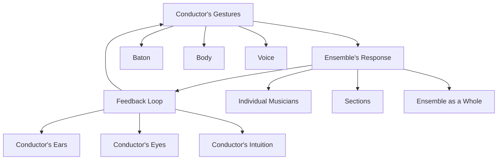

# Lesson 4: Rehearsal Techniques

## First-Principles Intuition & Invariants

Conducting is the art of communication and leadership within the context of musical performance, transforming a composer's vision into a cohesive and compelling auditory experience. The conductor's role is to guide the ensemble, ensuring that each musician understands their part and how it fits into the larger musical tapestry. This requires a deep understanding of the music, the ensemble, and the mechanics of performance.

At the heart of effective conducting lies the principle of clarity and precision. A conductor must convey their intentions with clarity, ensuring that every musician comprehends the nuances of the piece, including dynamics, articulations, and phrasing. Precision, meanwhile, pertains to the exactness of timing and execution. Both clarity and precision are invariants that must be maintained throughout the rehearsal process.

The problem space of conducting encompasses not only the technical aspects of music but also the human factors of the ensemble. Each musician brings their own interpretation and style, necessitating the conductor's ability to navigate this diversity to create a unified sound. This requires a deep understanding of the music, the ensemble, and the conductor's own vision.

Mathematically, the conductor's role can be viewed as a system of control, where the input is the conductor's gestures and the output is the ensemble's performance. The conductor's gestures serve as control signals that modulate the system, with the ensemble's performance being the response. The goal is to design a control system that produces the desired output, which is the composer's vision.

The invariants in this system are the fundamental principles of music theory, such as harmony, counterpoint, and orchestration. These principles provide a framework for understanding the music and for designing the control signals that will produce the desired output. The conductor must be deeply familiar with these principles and apply them in real-time during the rehearsal process.

## Core Architecture & Mechanics

The architecture of conducting can be broken down into several key components: the conductor's gestures, the ensemble's response, and the feedback loop. The conductor's gestures are the primary control signals, designed to convey the conductor's intentions to the ensemble. These gestures can be further divided into the baton, the body, and the voice.

The baton serves as a visual cue to the ensemble, with its movements indicating tempo, dynamics, and phrasing. Typically, baton movements are synchronized with the conductor's body movements, which provide additional cues. The conductor's body movements can indicate the direction of the music, the intensity of dynamics, and emotional expression. The conductor's voice can be used to provide verbal cues, such as articulations, phrasing, and dynamics.

The ensemble's response is the output of the system, resulting from the conductor's control signals. This response can be broken down into individual musicians, sections, and the ensemble as a whole. Individual musicians must interpret the conductor's control signals accurately, while sections must work together to create a cohesive sound. The ensemble as a whole must produce a unified and compelling performance.

The feedback loop is the mechanism by which the conductor receives information about the ensemble's response and adjusts the control signals accordingly. This loop includes the conductor's ears, eyes, and intuition. The conductor's ears provide auditory feedback, the most direct and immediate form of feedback. The conductor's eyes offer visual feedback, used to observe the ensemble's response and make adjustments to the control signals. The conductor's intuition provides a deeper, more holistic form of feedback, based on experience and understanding of the music.

The architecture of conducting can be visualized using a Mermaid diagram:

## High-Performance Optimization & Failure Modes

Effective conducting requires high-performance optimization and the ability to mitigate failure modes. High-performance optimization involves maximizing the efficiency and effectiveness of the rehearsal process. This can be achieved through thorough preparation, effective communication, and adaptability.

Thorough preparation includes studying the score, understanding the music, and developing a clear vision for the performance. The conductor must also be familiar with the ensemble and individual musicians, anticipating potential issues and challenges. Effective communication involves providing clear and precise control signals and being able to listen to the ensemble's response and provide feedback. The conductor must also communicate with individual musicians, addressing their specific needs and concerns. Adaptability means responding to changing circumstances, such as technical problems or schedule changes, and adjusting control signals based on the ensemble's response.

Failure modes in conducting can arise from poor preparation, ineffective communication, and a lack of adaptability. Poor preparation can lead to confusion and uncertainty, as the conductor may lack a clear vision or familiarity with the music or ensemble. Ineffective communication can result in misunderstandings and misinterpretations, as the conductor may not convey intentions clearly or listen effectively. A lack of adaptability can cause inflexibility and rigidity, preventing the conductor from responding to changing circumstances or the ensemble's response.

To mitigate these failure modes, the conductor must be proactive, anticipating and addressing potential issues before they arise.
