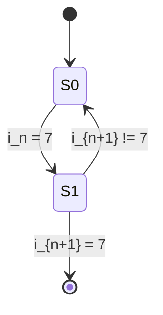

# Advanced Foundation: Counterpoint

## 1. Theoretical Invariants & Formal Frameworks

Counterpoint, the art of combining melodies, is a fundamental aspect of Western music theory. At its core, counterpoint is governed by a set of theoretical invariants and formal frameworks that ensure coherence and aesthetic satisfaction. These invariants can be formalized through mathematical and logical constructs, providing a rigorous foundation for analysis and composition.

### 1.1. Formal Proofs and Kernel Invariants

Counterpoint is deeply rooted in the principles of consonance and dissonance, which can be formalized using set theory and group theory. The set of permissible intervals can be defined as a subset of the chromatic scale, and the rules of counterpoint can be expressed as constraints on these intervals.

#### 1.1.1. Interval Set Theory

Let \( I \) be the set of intervals in the chromatic scale:
\[ I = \{0, 1, 2, 3, 4, 5, 6, 7, 8, 9, 10, 11\} \]
where \( 0 \) represents a unison, \( 1 \) a minor second, and so on up to \( 11 \) representing a major seventh.

The set of consonant intervals \( C \) can be defined as:
\[ C = \{0, 3, 4, 7, 8, 11\} \]
where \( 0 \) is a unison, \( 3 \) is a minor third, \( 4 \) is a major third, \( 7 \) is a perfect fifth, \( 8 \) is a minor sixth, and \( 11 \) is a major seventh.

The set of dissonant intervals \( D \) is the complement of \( C \) in \( I \):
\[ D = I \setminus C = \{1, 2, 5, 6, 9, 10\} \]

#### 1.1.2. Counterpoint Rules as Constraints

Counterpoint rules can be expressed as constraints on the sequence of intervals between two melodies. For example, the rule against parallel fifths can be formalized as:
\[ \forall n \in \mathbb{N}, (i_n = 7) \land (i_{n+1} = 7) \rightarrow \text{invalid} \]
where \( i_n \) is the interval at time \( n \).

### 1.2. Physical Invariants

The physical invariants of counterpoint are rooted in the acoustics of sound and the perception of harmony. The just intonation ratios, which define the frequencies of intervals in a justly tuned scale, provide a physical basis for consonance.

#### 1.2.1. Just Intonation Ratios

The just intonation ratios for the consonant intervals are:
- Unison: \( \frac{1}{1} \)
- Minor third: \( \frac{6}{5} \)
- Major third: \( \frac{5}{4} \)
- Perfect fifth: \( \frac{3}{2} \)
- Minor sixth: \( \frac{8}{5} \)
- Major seventh: \( \frac{15}{8} \)

These ratios correspond to the harmonic series and provide a physical basis for the consonance of intervals.

## 2. Low-Level Invariant Taxonomy

At a low level, the invariants of counterpoint can be categorized into deep registers, memory models, and axiomatic definitions.

### 2.1. Deep Registers

Deep registers in counterpoint refer to the fundamental principles that underlie the rules of counterpoint. These principles include the importance of consonance, the avoidance of dissonance, and the use of voice leading to create smooth and logical melodic lines.

### 2.2. Memory Models

Memory models in counterpoint refer to the way that intervals and melodic lines are stored and processed in the mind of the composer. The memory model for counterpoint can be formalized using a state machine, where the state represents the current interval and the transitions represent the rules of counterpoint.

### 2.3. Axiomatic Definitions

Axiomatic definitions in counterpoint refer to the fundamental rules that are taken as given and used to derive more complex rules. The axioms of counterpoint include the rules against parallel fifths, parallel octaves, and hidden fifths.

## 3. Micro-Architecture & Concurrency Dynamics

The micro-architecture of counterpoint refers to the detailed structure of the rules and constraints that govern the combination of melodies. The concurrency dynamics of counterpoint refer to the way that multiple melodies interact and evolve over time.

### 3.1. State Machines

The rules of counterpoint can be formalized using state machines, where the state represents the current interval and the transitions represent the rules of counterpoint. For example, the state machine for the rule against parallel fifths can be represented as follows:

### 3.2. Cache and Race Condition Diagrams

The cache and race condition diagrams for counterpoint refer to the way that intervals and melodic lines are stored and processed in the mind of the composer. The cache model for counterpoint can be formalized using a circular buffer, where the buffer stores the recent intervals and the race condition model can be formalized using a lock-free algorithm, where the transitions between states are atomic.

## 4. Subtle Failure Modes & Boundary Conditions

Subtle failure modes in counterpoint refer to the ways in which the rules of counterpoint can be violated or subverted. Boundary conditions in counterpoint refer to the edge cases that arise when the rules of counterpoint are applied to extreme situations.

### 4.1. Subtle Failure Modes

Subtle failure modes in counterpoint include the use of parallel fifths or octaves that are not immediately apparent, the use of hidden fifths or octaves, and the use of dissonant intervals that are not resolved properly.

### 4.2. Boundary Conditions

Boundary conditions in counterpoint include the use of extreme intervals, such as the minor second or major seventh, the use of extreme ranges, such as the lowest or highest notes of the instrument, and the use of extreme rhythms, such as the fastest or slowest possible rhythms.

## 5. Master Socratic Inquiries

Master Socratic inquiries in counterpoint refer to the research-grade discussion questions that can be used to explore the deeper implications of the rules and constraints of counterpoint.

### 5.1. Research-Grade Discussion Questions

1. How can the rules of counterpoint be formalized using mathematical and logical constructs?
2. How can the physical invariants of counterpoint be grounded in the acoustics of sound and the perception of harmony?
3. How can the deep registers, memory models, and axiomatic definitions of counterpoint be used to derive more complex rules?
4. How can the state machines, cache and race condition diagrams of counterpoint be used to explore the micro-architecture and concurrency dynamics of counterpoint?
5. How can the subtle failure modes and boundary conditions of counterpoint be used to explore the deeper implications of the rules and constraints of counterpoint?
