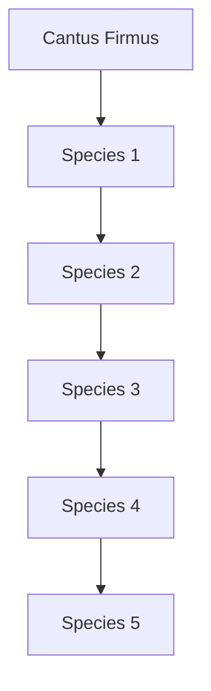

# Beginner Foundation: Counterpoint

## 1. Everyday Intuition & First Principles

Imagine you are in a bustling city street. Each person walking, talking, and moving has their own rhythm and purpose, yet they all coexist in harmony. Counterpoint is much like this city street, but in music. It is the art of combining two or more independent melodic lines that are harmonically interdependent. Just as the city street thrives on the interplay of different individuals, a counterpoint composition thrives on the interplay of different melodies. Each line has its own character and direction, yet they work together to create a rich, layered texture.

## 2. Foundational Vocabulary & Glossary

### a. **Cantus Firmus**
The **cantus firmus** is the principal melody around which other melodies are woven. It is the foundation or "firm" line that remains relatively stable and unchanging. Think of it as the main character in a story around whom other characters interact.

**Example:** The "Dies Irae" chant is a famous cantus firmus used in many counterpoint exercises.

### b. **Counterpoint**
**Counterpoint** refers to the independent melodic lines that are added to the cantus firmus. These lines are designed to complement and interact with the cantus firmus, creating a harmonious and rich texture.

**Example:** In a piece of counterpoint, if the cantus firmus moves stepwise, the counterpoint might move in leaps to create contrast and interest.

### c. **Species Counterpoint**
**Species counterpoint** is a method of teaching counterpoint through a series of exercises that gradually increase in complexity. There are five species, each with specific rules about how the counterpoint can move in relation to the cantus firmus.

**Example:** Species one is the simplest, where the counterpoint moves in long notes (whole notes or half notes) against shorter notes in the cantus firmus.

### d. **Interval**
An **interval** is the distance between two pitches. Intervals can be classified as consonant (harmonically pleasing) or dissonant (harmonically tense).

**Example:** A perfect fifth (like C to G) is a consonant interval, while a minor second (like C to C#) is a dissonant interval.

### e. **Consonance**
**Consonance** refers to harmonically pleasing intervals that are stable and restful. Common consonant intervals include the unison, perfect fifth, and perfect octave.

**Example:** The interval between C and G is a perfect fifth, which is consonant and sounds stable.

### f. **Dissonance**
**Dissonance** refers to harmonically tense intervals that create a sense of tension and need resolution. Common dissonant intervals include the minor second, tritone, and augmented fourth.

**Example:** The interval between C and C# is a minor second, which is dissonant and creates a sense of tension.

### g. **Resolution**
**Resolution** is the process of resolving dissonant intervals to consonant intervals. Dissonant intervals often create a sense of tension that is released when they move to a consonant interval.

**Example:** A minor second (C to C#) might resolve to a perfect fifth (C to G) to release the tension.

### h. **Parallel Motion**
**Parallel motion** occurs when two melodies move in the same direction by the same interval. While parallel motion can be effective, it should be used sparingly to avoid monotony.

**Example:** If the cantus firmus moves from C to D, the counterpoint might also move from G to A, creating parallel motion.

## 3. Visual System Flow

### ASCII Diagram

```
+-------------------+
| Cantus Firmus     |
+-------------------+
          |
          v
+-------------------+
| Species 1         |
+-------------------+
          |
          v
+-------------------+
| Species 2         |
+-------------------+
          |
          v
+-------------------+
| Species 3         |
+-------------------+
          |
          v
+-------------------+
| Species 4         |
+-------------------+
          |
          v
+-------------------+
| Species 5         |
+-------------------+
```

### Mermaid Flowchart



## 4. Common Beginner Misconceptions & Mental Traps

### a. **Misconception: Counterpoint is too complex for beginners.**
**Reality:** Counterpoint is a structured and methodical art form that can be learned through a series of exercises. Starting with species counterpoint provides a clear and manageable path to understanding the principles of counterpoint.

### b. **Misconception: All intervals are equally important.**
**Reality:** Certain intervals are more harmonically pleasing (consonant) than others (dissonant). Understanding the difference between consonant and dissonant intervals is crucial for writing effective counterpoint.

### c. **Misconception: Counterpoint is only about following rules.**
**Reality:** While rules are important, counterpoint is also about creativity and expression. The rules provide a framework within which you can explore and develop your own unique voice.

### d. **Misconception: Parallel motion is always bad.**
**Reality:** Parallel motion can be effective when used sparingly and in moderation. It can add texture and interest to a counterpoint composition, but it should not dominate the entire piece.

## 5. Socratic Discussion Starters

### a. **What is the purpose of the cantus firmus in a counterpoint composition?**
### b. **How do consonant and dissonant intervals contribute to the overall texture of a counterpoint piece?**
### c. **Can you identify examples of parallel motion in a piece of counterpoint?**
### d. **How does the use of different species counterpoint exercises help in understanding the principles of counterpoint?**
### e. **How can you use dissonance and resolution to create tension and release in a counterpoint composition?**

By exploring these questions, you can deepen your understanding of counterpoint and develop a more intuitive sense of how independent melodic lines can work together to create rich and harmonious music.
