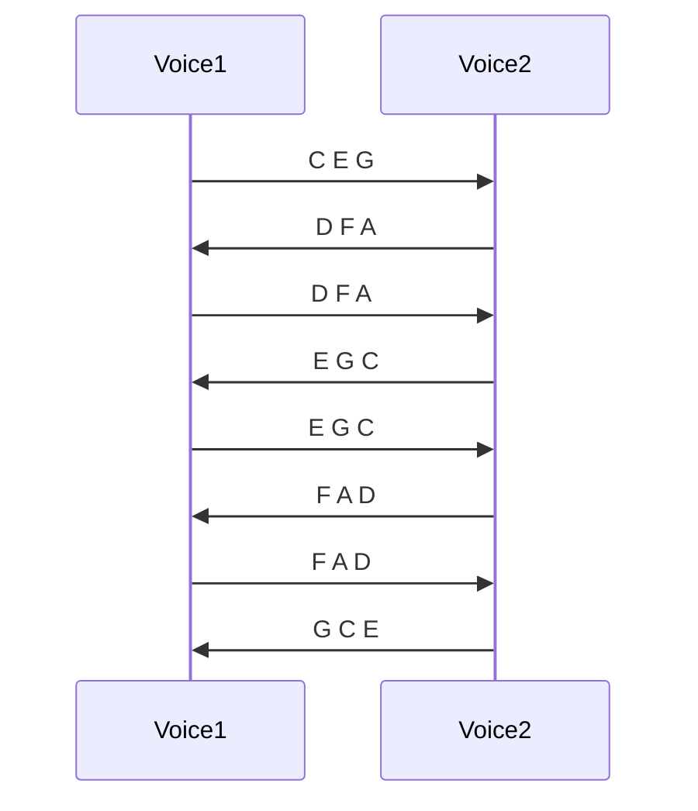

# Intermediate Foundation: Counterpoint

## 1. Architectural Mental Model

Counterpoint, at its core, is the art of combining multiple melodic lines into a coherent and harmonically rich texture. For composers and practitioners, understanding the architectural mental model of counterpoint is crucial for crafting intricate and compelling musical works. This model involves the systematic interplay of independent voices, each with its own melodic contour, rhythm, and harmonic function. The architecture of counterpoint is akin to a well-designed software system, where each component (voice) interacts with others in a structured yet flexible manner.

In the architectural mental model of counterpoint, the primary components are the individual melodic lines, or voices. These voices are governed by a set of rules and conventions that ensure their independence while maintaining a cohesive harmonic structure. The foundational principles of counterpoint include the use of consonant intervals, the avoidance of parallel fifths and octaves, and the creation of rhythmic interest through syncopation and polyrhythm. These principles serve as the protocols that dictate how voices interact and evolve over time.

The mental model also encompasses the concept of voice leading, which is the art of moving from one chord to another in a smooth and logical manner. Voice leading ensures that the individual voices maintain their independence while contributing to the overall harmonic progression. This is analogous to the data flow in a software system, where information is passed between components in a structured and efficient manner.

## 2. Systems Taxonomy & Component Protocols

In the realm of counterpoint, the systems taxonomy can be broken down into several key components, each with its own protocols and data models. These components include:

### a. Melodic Lines (Voices)
- **Protocols:** Each voice must adhere to the rules of species counterpoint, including the use of consonant intervals, the avoidance of parallel fifths and octaves, and the creation of rhythmic interest.
- **Data Models:** Melodic lines are represented as sequences of pitches and durations. These sequences must be carefully constructed to ensure independence and coherence.

### b. Harmonic Progressions
- **Protocols:** Harmonic progressions must follow the rules of tonal harmony, including the use of consonant chords and the avoidance of dissonant progressions.
- **Data Models:** Harmonic progressions are represented as sequences of chords, each with a specific function within the harmonic structure.

### c. Rhythmic Structures
- **Protocols:** Rhythmic structures must be carefully constructed to ensure independence and coherence between voices. This includes the use of syncopation, polyrhythm, and other rhythmic devices.
- **Data Models:** Rhythmic structures are represented as sequences of durations, each with a specific function within the rhythmic texture.

### d. Voice Leading
- **Protocols:** Voice leading must be carefully constructed to ensure smooth and logical movement between chords. This includes the use of consonant intervals, the avoidance of parallel fifths and octaves, and the creation of rhythmic interest.
- **Data Models:** Voice leading is represented as a sequence of voice movements, each with a specific function within the harmonic structure.

## 3. Multi-Component Interaction Flow

The interaction flow in counterpoint can be visualized using ASCII and Mermaid sequence diagrams. These diagrams illustrate the flow of information between the various components of the counterpoint system.

### ASCII Sequence Diagram

```
Voice 1: C E G
Voice 2: D F A
Voice 1: D F A
Voice 2: E G C
Voice 1: E G C
Voice 2: F A D
Voice 1: F A D
Voice 2: G C E
```

### Mermaid Sequence Diagram



## 4. Architectural Trade-offs & Production Pitfalls

The architectural trade-offs in counterpoint involve balancing the independence of individual voices with the coherence of the overall harmonic structure. Some common production pitfalls include:

### a. Overemphasis on Individual Voices
- **Pitfall:** Focusing too much on the individual voices can result in a lack of coherence in the overall harmonic structure.
- **Solution:** Ensure that each voice contributes to the overall harmonic progression while maintaining its independence.

### b. Lack of Rhythmic Interest
- **Pitfall:** A lack of rhythmic interest can result in a monotonous and unengaging texture.
- **Solution:** Use syncopation, polyrhythm, and other rhythmic devices to create interest and variety.

### c. Poor Voice Leading
- **Pitfall:** Poor voice leading can result in dissonant and illogical harmonic progressions.
- **Solution:** Ensure that each voice movement is consonant and logical, avoiding parallel fifths and octaves.

## 5. Socratic Discussion Starters

1. **How can the principles of species counterpoint be applied to more complex harmonic structures?**
2. **What are the benefits and drawbacks of using syncopation and polyrhythm in counterpoint?**
3. **How can voice leading be used to create a sense of tension and resolution in a counterpoint texture?**
4. **What are the trade-offs between the independence of individual voices and the coherence of the overall harmonic structure?**
5. **How can the principles of counterpoint be applied to non-tonal and atonal music?**

By exploring these questions, composers and practitioners can deepen their understanding of the architectural mental model of counterpoint and apply its principles to a wide range of musical styles and genres.
