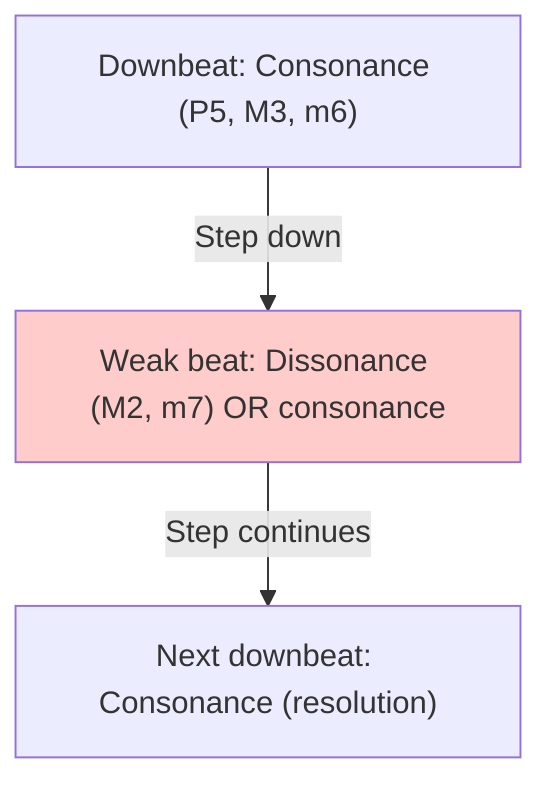
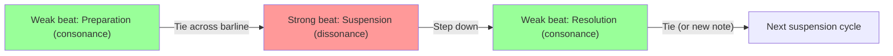

# Operational Verification Labs: Counterpoint

## Objective & Lab Setup

### Objective

This laboratory provides rigorous, hands-on training in the practical implementation of contrapuntal techniques rooted in the Fuxian species tradition. You will compose and analyze multi-voice textures governed by strict intervallic and melodic constraints, gaining fluency in the architectural principles that underpin Western polyphonic music from the Renaissance through the common practice period. The exercises move from first principles—consonance, dissonance treatment, melodic independence—to complex configurations involving suspensions, invertible counterpoint, and compound species. Emphasis is placed on empirical verification: every compositional decision is tested against historical rules, and violations are deliberately induced to develop diagnostic skill.

### Lab Setup

**Music Notation Software**: MuseScore (free, cross-platform), Finale, or Sibelius. These environments provide staff notation, playback, and MIDI export. MuseScore is recommended for its accessibility and robust plugin ecosystem.

**Digital Audio Workstation (Optional)**: Ableton Live, Logic Pro, Reaper, or FL Studio. While not required for notation, a DAW enables detailed auditory analysis through tempo manipulation, looping, and spectral visualization. Import MIDI from your notation software to examine harmonic series alignment and intervallic tension.

**Score Analysis Tools**: Use MuseScore's built-in plugin interface or the open-source **Counterpointer** plugin for automated rule-checking. Alternatively, export to MusicXML and analyze with Python libraries such as `music21` for programmatic verification.

**Reference Materials**: Acquire Fux's *Gradus ad Parnassum* (1725) in translation, and consult Knud Jeppesen's *Counterpoint* (1939) for detailed analysis of Palestrina's practice. These texts establish the theoretical foundation for all exercises.

### Environmental Configuration

Install MuseScore 4.x and configure the following:

1. Enable MIDI input for real-time note entry.
2. Install the **Counterpointer** plugin from the Plugin Manager.
3. Set default score to treble and bass clefs, 4/4 time, no key signature (to facilitate modal cantus firmi).
4. Configure playback to use a piano or organ timbre for clear interval perception.

For Python-based analysis (optional but recommended for Exercise 2):

```bash
pip install music21 matplotlib numpy
```

Verify installation:

```python
from music21 import *
s = stream.Score()
print("music21 ready")
```

## Exercise 1: Foundational Practical Implementation

### Architectural Principles of Species Counterpoint

Species counterpoint is a pedagogical abstraction designed to isolate and master individual dimensions of polyphonic writing. Each species introduces one additional layer of rhythmic or dissonance-handling complexity while maintaining strict voice-leading constraints. The system is hierarchical: mastery of first species (note-against-note) is prerequisite for second (two-against-one), which in turn supports third (four-against-one), fourth (syncopation and suspension), and fifth (florid, combining all prior techniques).

**Why this works**: By constraining rhythm and dissonance treatment independently, the composer develops sensitivity to pure intervallic relationships (first species), then layered melodic contour (second and third species), then tension-resolution cycles (fourth species), before integrating all elements (fifth species). This mirrors the historical development of polyphony from organum through Renaissance motet style.

### Step 1: Construct a Well-Formed Cantus Firmus

The cantus firmus (CF) is the structural foundation. A well-formed CF exhibits:

- **Stepwise predominance**: 70-80% stepwise motion, with leaps of a third permitted, leaps of a fourth or fifth reserved for directional changes.
- **Single climax**: One melodic peak, typically in the final two-thirds of the line.
- **Archlike contour**: Ascent to climax, then descent to cadence.
- **Penultimate approach**: The penultimate note approaches the final by step (typically scale degree 2 descending to 1, or 7 ascending to 1).
- **Modal integrity**: If Dorian, emphasize D and A; if Mixolydian, emphasize G and D. Avoid chromaticism.

**Example CF in D Dorian (8 notes)**:

```
D4 - E4 - F4 - G4 - A4 - G4 - F4 - E4 - D4
```


**Why these constraints**: Stepwise motion ensures singability and avoids tritone implications. A single climax creates directed motion. The archlike contour prevents static repetition. Modal emphasis avoids tonal ambiguity that would distract from contrapuntal relationships.

### Step 2: First Species Counterpoint (1:1)

First species establishes the consonance vocabulary and voice-leading fundamentals. Each note of the counterpoint (CP) sounds simultaneously with a CF note, forming a vertical interval.

**Rules**:

1. **Permitted intervals**: Perfect unison, major/minor third, perfect fifth, major/minor sixth, perfect octave. All other intervals (seconds, sevenths, fourths against the bass, augmented or diminished intervals) are forbidden.
2. **Opening**: Unison, fifth, or octave only.
3. **Cadence**: Stepwise approach to final unison or octave. In the penultimate measure, use a major sixth expanding to an octave (Dorian cadence) or a minor third expanding to a unison.
4. **No parallel perfect consonances**: Consecutive perfect fifths or octaves between the same voices are strictly prohibited. Parallel thirds and sixths are permitted and desirable.
5. **Contrary motion preference**: At least 50% of intervals should move in contrary motion. Oblique motion (one voice stationary) is acceptable. Direct motion to perfect consonances is forbidden unless the upper voice moves by step.
6. **Melodic constraints in CP**: Obey the same stepwise predominance as the CF. Avoid melodic tritones (e.g., F to B). Limit leaps larger than a fifth; follow any leap with stepwise motion in the opposite direction.

**Example: First Species CP above the D Dorian CF**

```
CF: D4 - E4 - F4 - G4 - A4 - G4 - F4 - E4 - D4
CP: D5 - C5 - A4 - B4 - C5 - E5 - D5 - C5 - D5
```

**Interval analysis**:

```
Interval:  P8  m6  M3  M3  m3  M6  M6  m6  P8
Motion:    -   con obl con par con con con con
```

- `con` = contrary, `obl` = oblique, `par` = parallel (parallel thirds/sixths are acceptable)
- No parallel perfect fifths or octaves
- Cadence: penultimate m6 (E4-C5) resolves outward to P8 (D4-D5)

**Verification checklist**:

```python
from music21 import *

cf = stream.Part()
cf.append([note.Note('D4', quarterLength=4), note.Note('E4', quarterLength=4),
           note.Note('F4', quarterLength=4), note.Note('G4', quarterLength=4),
           note.Note('A4', quarterLength=4), note.Note('G4', quarterLength=4),
           note.Note('F4', quarterLength=4), note.Note('E4', quarterLength=4),
           note.Note('D4', quarterLength=4)])

cp = stream.Part()
cp.append([note.Note('D5', quarterLength=4), note.Note('C5', quarterLength=4),
           note.Note('A4', quarterLength=4), note.Note('B4', quarterLength=4),
           note.Note('C5', quarterLength=4), note.Note('E5', quarterLength=4),
           note.Note('D5', quarterLength=4), note.Note('C5', quarterLength=4),
           note.Note('D5', quarterLength=4)])

score = stream.Score()
score.insert(0, cf)
score.insert(0, cp)

# Check for parallel perfect consonances
for i in range(len(cf.notes) - 1):
    int1 = interval.Interval(cf.notes[i], cp.notes[i])
    int2 = interval.Interval(cf.notes[i+1], cp.notes[i+1])
    if int1.simpleName in ['P5', 'P8'] and int2.simpleName in ['P5', 'P8']:
        if int1.simpleName == int2.simpleName:
            print(f"Parallel {int1.simpleName} at notes {i} to {i+1}")

# Check opening and closing intervals
int_open = interval.Interval(cf.notes[0], cp.notes[0])
int_close = interval.Interval(cf.notes[-1], cp.notes[-1])
print(f"Opening interval: {int_open.name}")
print(f"Closing interval: {int_close.name}")
```

### Step 3: Second Species Counterpoint (2:1)

Second species introduces rhythmic differentiation: two CP notes per CF note. This creates passing motion and demands more sophisticated melodic shaping.

**Additional rules**:

1. **Downbeat consonance**: The first CP note (downbeat) must form a consonance with the CF.
2. **Weak-beat dissonance**: The second CP note (weak beat) may be dissonant only if it is approached and left by step (passing tone) or if it is a consonant neighbor tone.
3. **No dissonant leaps**: A leap to or from a dissonant interval is forbidden.
4. **Melodic fluency**: The doubled note rate increases the risk of mechanical patterns. Vary intervals and contour.

**Example: Second Species CP above the D Dorian CF**

```
CF: D4  -   E4  -   F4  -   G4  -   A4  -   G4  -   F4  -   E4  -   D4
CP: A4 B4 | C5 B4 | A4 G4 | B4 C5 | C5 D5 | E5 D5 | D5 C5 | C5 B4 | D5 -
```

**Beat-by-beat interval analysis** (D = downbeat, W = weak beat):

```
D4-A4 (P5-D), D4-B4 (M6-W passing), E4-C5 (m6-D), E4-B4 (P5-W passing),
F4-A4 (M3-D), F4-G4 (M2-W passing), G4-B4 (M3-D), G4-C5 (P4-W passing)...
```

**Why this works**: Passing tones create the illusion of melodic independence while maintaining vertical control. Dissonance on weak beats is perceptually less salient, allowing stepwise embellishment without harmonic instability.

**Mermaid representation of dissonance resolution**:



### Step 4: Third Species Counterpoint (4:1)

Third species accelerates the CP to four notes per CF note. Dissonance treatment rules remain identical to second species, but the increased surface rhythm demands heightened melodic coherence.

**Additional considerations**:

1. **Arpeggiation**: Outlining triads (e.g., D-F-A or G-B-D) is now practical and desirable for creating harmonic clarity.
2. **Neighbor and passing groups**: Four-note cells can combine passing tones, neighbors, and consonant skips.
3. **Avoid rhythmic monotony**: Not every measure should begin with the same interval type or melodic gesture.

**Example: Third Species CP above the D Dorian CF (first three measures)**

```
CF: D4      -       |  E4      -       |  F4      -       |
CP: D5 C5 B4 A4    |  G4 A4 B4 C5    |  A4 B4 C5 D5    |
```

**Interval analysis** (1=downbeat, 2-4=weak beats):

```
Measure 1: P8(1), m7(2-pass), M6(3-pass), P5(4-pass)
Measure 2: m3(1), P4(2-pass), P5(3-pass), m6(4-pass)
Measure 3: M3(1), P4(2-pass), P5(3-pass), M6(4-pass)
```

### Step 5: Fourth Species Counterpoint (Syncopation and Suspension)

Fourth species introduces rhythmic displacement: the CP is syncopated, tied across the barline. This creates the suspension-resolution cycle, the primary expressive device of Renaissance polyphony.

**Structural principles**:

1. **Suspension chain**: Alternate consonance on the weak beat, tied into dissonance on the strong beat, resolving downward by step to consonance on the next weak beat.
2. **Preparation-suspension-resolution**: The dissonance must be prepared as a consonance in the preceding weak beat, suspended into the strong beat (now dissonant against the new CF note), and resolved by stepwise descent.
3. **Permitted dissonant suspensions**: 9-8, 7-6, 4-3, 2-3 (in upper voice); 2-3 (in lower voice). The second number is the resolution.
4. **Cadential suspension**: Penultimate measure often features 7-6 or 9-8 resolving to the final octave.

**Example: Fourth Species CP above the D Dorian CF**

```
CF: D4  -   E4  -   F4  -   G4  -   A4  -   G4  -   F4  -   E4  -   D4
CP: -  A4 | A4 G4 | G4 F4 | F4 E4 | E4 F4 | F4 E4 | E4 D5 | D5 C5 | C5 D5
```

**Suspension analysis** (S=suspension, R=resolution):

```
Measure 1-2: A4 (cons) tied to A4 (7th-S against E4), resolves to G4 (6th-R)
Measure 2-3: G4 (cons) tied to G4 (2nd-S against F4), resolves to F4 (unison-R)
Measure 3-4: F4 (cons) tied to F4 (7th-S against G4), resolves to E4 (6th-R)
```

**Why suspensions work acoustically**: The suspension creates a beating frequency between partials of the dissonant interval (e.g., the 7th). The stepwise descent to a consonance represents minimum motion to stable harmonic series alignment. This is the acoustic basis for "resolution."

**Mermaid diagram of suspension cycle**:



### Step 6: Fifth Species Counterpoint (Florid)

Fifth species is the synthesis: it combines note values from all prior species, allowing rhythmic freedom within strict dissonance treatment. The CP may use whole notes, half notes, quarter notes, and embellishments such as cambiatas (an idiomatic dissonance pattern) and escape tones.

**Governing principles**:

1. **Rhythmic variety**: No more than two consecutive measures should use the same rhythmic pattern.
2. **Dissonance treatment inheritance**: Downbeat dissonances remain forbidden (except in suspensions). Weak-beat dissonances must be approached and left by step, or function as neighbors.
3. **Cambiata**: A specific dissonance figure (leap of a third from a downbeat consonance to a weak-beat dissonance, followed by stepwise descent). Example: C5 (cons) - E5 (diss) - D5 (cons).
4. **Cadential elaboration**: The final two measures often incorporate a suspension or a series of passing tones converging on the octave.

**Example: Fifth Species CP above the D Dorian CF (first four measures)**

```
CF: D4        -         |  E4        -         |  F4        -         |  G4        -         |
CP: D5 E5 F5 E5 D5 C5 |  C5 B4   A4 G4      |  A4 B4 C5  -         |  B4 C5 D5 E5        |
    (whole + quarters) |  (half + quarters)  |  (quarters + half)   |  (four quarters)    |
```

**Interval and dissonance analysis**:

- Measure 1: D5 (P8-D), E5 (M7-W, dissonant passing), F5 (m3-W), E5 (M7-W, neighbor), D5 (P8-W), C5 (m7-W, passing)
- Measure 2: C5 (m6-D), B4 (P5-W), A4 (P4-W, passing), G4 (m3-W)

## Exercise 2: Parameter Variation & Empirical Analysis

### Objective: Quantify the Impact of Modal and Contrapuntal Variables

This exercise trains sensitivity to how mode, voice crossing, and interval distribution affect contrapuntal outcomes. You will generate multiple solutions, extract statistical features, and graph the results.

### Step 1: Construct Cantus Firmi in Multiple Modes

Generate eight-note cantus firmi in the following modes:

1. **Dorian (D)**: D-E-F-G-A-G-F-E-D
2. **Phrygian (E)**: E-F-G-A-B-A-G-F-E
3. **Mixolydian (G)**: G-A-B-C-D-C-B-A-G
4. **Aeolian (A)**: A-B-C-D-E-D-C-B-A

Ensure each CF conforms to the stepwise predominance, single climax, and cadential approach criteria from Exercise 1.

### Step 2: Compose First Species Counterpoint for Each Mode

For each CF, compose one first species counterpoint above and one below. This yields 8 total CP examples (4 modes × 2 positions).

### Step 3: Extract Interval Distribution Data

Use Python to compute the frequency of each interval type across all examples:

```python
from music21 import *
import matplotlib.pyplot as plt
import numpy as np

def analyze_intervals(cf_notes, cp_notes):
    interval_counts = {'P1': 0, 'm2': 0, 'M2': 0, 'm3': 0, 'M3': 0, 
                       'P4': 0, 'A4': 0, 'd5': 0, 'P5': 0, 
                       'm6': 0, 'M6': 0, 'm7': 0, 'M7': 0, 'P8': 0}
    
    for i in range(len(cf_notes)):
        intv = interval.Interval(cf_notes[i], cp_notes[i])
        simple =
