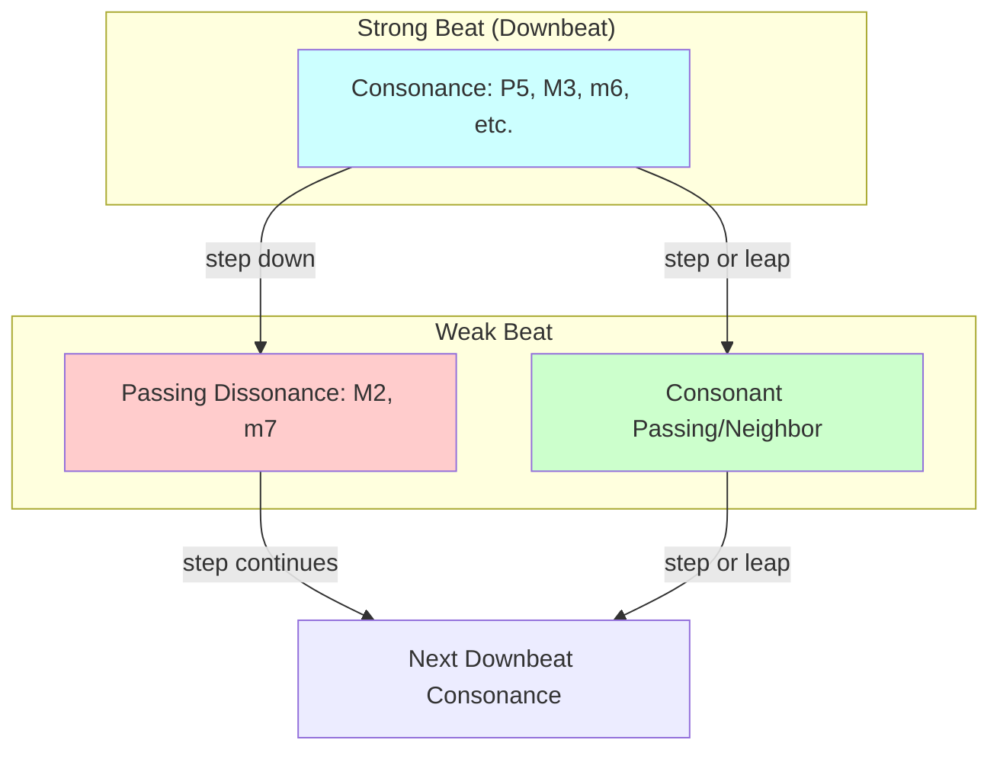
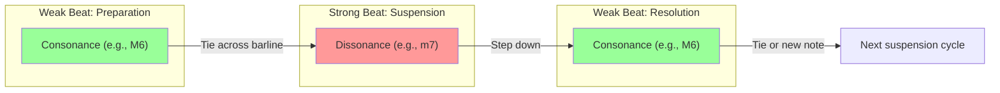

# Operational Verification Labs: Counterpoint

## Objective & Lab Setup

### Objective

Master contrapuntal writing through hands-on composition and rule verification. You will write multi-voice textures governed by strict intervallic constraints, moving from note-against-note foundations to complex suspensions and florid polyphony. Every rule is tested by ear and analysis. You will deliberately break rules to develop diagnostic skill, then correct violations until your counterpoint sings.

This is not music theory—this is compositional training. You will write, revise, play, and verify until contrapuntal motion becomes second nature.

### Lab Setup

**Music Notation Software**: MuseScore 4.x (free, cross-platform). Download from musescore.org. This provides staff notation, MIDI playback, and plugin support for automated rule-checking.

**Alternative Notation Tools**: Finale, Sibelius, or Dorico. All support MIDI export and plugin ecosystems. MuseScore is recommended for accessibility and zero cost.

**Digital Audio Workstation (Optional)**: Ableton Live, Logic Pro, Reaper, or FL Studio. Import MIDI from notation software to loop sections, slow down playback, and examine intervallic tension through spectral analysis. Not required, but useful for deep listening.

**Automated Rule-Checking**: Install the **Counterpointer** plugin in MuseScore (Plugin Manager → Install). This flags parallel fifths, improper dissonance treatment, and voice-crossing violations in real time. Use it after you have attempted each exercise manually—automated checking is verification, not composition.

**Python Analysis (Optional)**: For statistical interval distribution analysis in Exercise 2.

```bash
pip install music21 matplotlib numpy
```

Verify installation:

```python
from music21 import *
s = stream.Score()
print("music21 ready")
```

### MuseScore Configuration

1. Open MuseScore → Preferences → I/O → Enable MIDI input
2. Create a new score: treble and bass clefs, 4/4 time, no key signature (modal counterpoint)
3. Set playback instrument to piano or organ (View → Mixer)
4. Enable Navigator panel (View → Navigator) to visualize entire score during composition
5. Set metronome to 60 BPM for initial playback and interval perception training

### Reference Materials

- **Johann Joseph Fux**: *Gradus ad Parnassum* (1725). Translation by Alfred Mann (1965). This is the foundational text. Read Part One (species counterpoint) in full.
- **Knud Jeppesen**: *Counterpoint: The Polyphonic Vocal Style of the Sixteenth Century* (1939). Detailed analysis of Palestrina's practice. Use for reference, not systematic study.
- **Peter Schubert**: *Modal Counterpoint, Renaissance Style* (2nd ed., 2008). Modern pedagogical approach with abundant examples.

## Exercise 1: Foundational Practical Implementation

### Why Species Counterpoint?

Species counterpoint isolates individual dimensions of polyphonic writing. Each species adds one layer of complexity while maintaining strict voice-leading rules. Mastery is hierarchical: first species (note-against-note) establishes consonance vocabulary and motion types; second species (2:1) introduces passing dissonance; third species (4:1) accelerates surface rhythm; fourth species (syncopation) teaches suspension chains; fifth species (florid) integrates all prior techniques.

This mirrors the historical development of polyphony from medieval organum through Renaissance motet style. The constraints are not arbitrary—they reflect the acoustic properties of consonance (harmonic series alignment) and the biomechanics of vocal production (stepwise singability).

### Step 1: Construct a Well-Formed Cantus Firmus

The cantus firmus (CF) is the structural foundation. A valid CF exhibits:

- **Stepwise predominance**: 70-80% stepwise motion. Leaps of a third are acceptable. Leaps of a fourth or fifth are reserved for directional changes and should be followed by stepwise motion in the opposite direction.
- **Single climax**: One melodic peak, typically in the second half or final third of the line.
- **Arch-like contour**: Ascent to climax, then descent to cadence. Avoid static repetition or wandering.
- **Penultimate approach**: The second-to-last note approaches the final by step. Typically scale degree 2 descending to 1, or 7 ascending to 1 in modes that support it.
- **Modal integrity**: In Dorian (D-E-F-G-A-B♭-C-D), emphasize D and A. Avoid B-natural (raised sixth) unless writing a cadential formula. No chromaticism.
- **Length**: 8-12 notes for pedagogical exercises. Renaissance cantus firmi range from 9 to 15 notes.

**Example: D Dorian Cantus Firmus (9 notes)**

```
D4 - E4 - F4 - G4 - A4 - G4 - F4 - E4 - D4
```


**Why these constraints**: Stepwise motion ensures singability and avoids tritone leaps (e.g., F to B). A single climax creates directed motion and prevents aimless meandering. Penultimate stepwise approach to the final creates cadential closure. Modal emphasis avoids tonal ambiguity that would distract from contrapuntal relationships.

**Practice Task**: Compose four cantus firmi—one each in Dorian (on D), Phrygian (on E), Mixolydian (on G), and Aeolian (on A). Each should be 8-10 notes. Play them on piano or sing them. A well-formed CF should feel inevitable, not arbitrary.

### Step 2: First Species Counterpoint (1:1, Note-Against-Note)

First species establishes consonance vocabulary and voice-leading fundamentals. Each note of the counterpoint (CP) sounds simultaneously with one CF note, forming a vertical interval.

**Permitted Consonances**

- **Perfect consonances**: Perfect unison (P1), perfect fifth (P5), perfect octave (P8)
- **Imperfect consonances**: Major and minor thirds (M3, m3), major and minor sixths (M6, m6)
- **Forbidden intervals**: All seconds, all sevenths, perfect fourth against the bass (P4 when CP is below CF), all augmented and diminished intervals

**Opening and Closing Rules**

1. **Opening interval**: Unison, fifth, or octave only. This establishes tonal clarity.
2. **Closing interval**: Unison or octave only. The cadence must be approached by stepwise contrary motion.
3. **Penultimate interval**: Major sixth (M6) expanding outward to octave, or minor third (m3) expanding outward to unison. In Dorian, the penultimate often uses the raised sixth (B-natural) to create a leading tone, resulting in the interval sequence M6 → P8.

**Voice-Leading Rules**

1. **No parallel perfect consonances**: Consecutive perfect fifths or octaves between the same pair of voices are strictly forbidden. This is the most fundamental rule of Western counterpoint. Parallel thirds and sixths are desirable.
2. **Contrary motion preference**: At least 50% of motion should be contrary (voices move in opposite directions). Oblique motion (one voice stationary) is acceptable. Similar motion (both voices move in the same direction) is acceptable to imperfect consonances.
3. **No direct motion to perfect consonances**: If both voices move in the same direction to a perfect fifth or octave, the upper voice must move by step. Direct octaves by leap in both voices are forbidden (called "hidden" or "covered" octaves).
4. **Melodic constraints**: The CP follows the same stepwise predominance rules as the CF. Avoid melodic tritones (e.g., F to B, or B to F). Leaps larger than a fifth should be rare. Follow any leap larger than a third with stepwise motion in the opposite direction to maintain melodic coherence.
5. **No voice crossing**: The upper voice stays above the lower voice. In three or more voices, adjacent voices may cross briefly, but not in two-voice counterpoint.

**Example: First Species Counterpoint Above the D Dorian CF**

```
CF:  D4  - E4  - F4  - G4  - A4  - G4  - F4  - E4  - D4
CP:  D5  - C5  - A4  - B4  - C5  - E5  - D5  - C5  - D5
Int: P8    m6    M3    M3    m3    M6    M6    m6    P8
Mot: —     con   obl   con   par   con   con   con   con
```

**Interval and Motion Analysis**

- `con` = contrary motion, `obl` = oblique motion, `par` = parallel motion (thirds/sixths acceptable)
- Opening: P8 (perfect octave, permitted)
- No parallel perfect fifths or octaves
- Penultimate: m6 (E4-C5) resolves outward to P8 (D4-D5) by contrary stepwise motion
- Contrary motion: 6 of 8 intervals (75%)

**Why This Works Acoustically**

Perfect consonances represent simple harmonic ratios (2:1 for octave, 3:2 for fifth). Moving from one perfect consonance to another in parallel motion creates harmonic stasis—no sense of progression. Imperfect consonances (3:4 for thirds, 3:5 for sixths) create harmonic color and directed motion when they resolve to perfect consonances at cadences. Contrary motion maximizes melodic independence and avoids the perception of a single composite melody.

**Verification Checklist**

1. Play your counterpoint at 60 BPM. Do the two lines sound independent, or like a single melody with doubling?
2. Check every interval: no seconds, sevenths, or augmented/diminished intervals.
3. Check motion between each pair of intervals: no parallel fifths or octaves.
4. Check opening (P1, P5, or P8) and closing (P1 or P8 approached by contrary step).
5. Check melodic contour: mostly stepwise, no tritone leaps, leaps followed by opposite-direction steps.

**Python Verification Script**

```python
from music21 import *

# Define the cantus firmus
cf = stream.Part()
cf.append([note.Note('D4', quarterLength=4), note.Note('E4', quarterLength=4),
           note.Note('F4', quarterLength=4), note.Note('G4', quarterLength=4),
           note.Note('A4', quarterLength=4), note.Note('G4', quarterLength=4),
           note.Note('F4', quarterLength=4), note.Note('E4', quarterLength=4),
           note.Note('D4', quarterLength=4)])

# Define the counterpoint
cp = stream.Part()
cp.append([note.Note('D5', quarterLength=4), note.Note('C5', quarterLength=4),
           note.Note('A4', quarterLength=4), note.Note('B4', quarterLength=4),
           note.Note('C5', quarterLength=4), note.Note('E5', quarterLength=4),
           note.Note('D5', quarterLength=4), note.Note('C5', quarterLength=4),
           note.Note('D5', quarterLength=4)])

score = stream.Score()
score.insert(0, cf)
score.insert(0, cp)

# Check for parallel perfect consonances
print("Checking for parallel fifths and octaves:")
for i in range(len(cf.notes) - 1):
    int1 = interval.Interval(cf.notes[i], cp.notes[i])
    int2 = interval.Interval(cf.notes[i+1], cp.notes[i+1])
    if int1.simpleName in ['P5', 'P8'] and int2.simpleName in ['P5', 'P8']:
        if int1.simpleName == int2.simpleName:
            print(f"  VIOLATION: Parallel {int1.simpleName} at intervals {i} → {i+1}")

# Check opening and closing intervals
int_open = interval.Interval(cf.notes[0], cp.notes[0])
int_close = interval.Interval(cf.notes[-1], cp.notes[-1])
print(f"\nOpening interval: {int_open.name}")
print(f"Closing interval: {int_close.name}")

# Check for dissonances
print("\nChecking for dissonant intervals:")
for i, (cf_n, cp_n) in enumerate(zip(cf.notes, cp.notes)):
    intv = interval.Interval(cf_n, cp_n)
    simple = intv.simpleName
    if simple not in ['P1', 'm3', 'M3', 'P5', 'm6', 'M6', 'P8']:
        print(f"  VIOLATION: Dissonant interval {simple} at position {i}")

print("\nVerification complete.")
```

**Practice Task**: Write three first species counterpoints above your D Dorian CF. Write three more below it. Run the verification script on each. Deliberately introduce one parallel fifth and one dissonant interval, then run verification to confirm detection.

### Step 3: Second Species Counterpoint (2:1, Two-Against-One)

Second species introduces rhythmic differentiation: two CP notes per one CF note. This creates passing motion and demands more sophisticated dissonance handling.

**Additional Rules**

1. **Downbeat consonance**: The first CP note in each measure (the downbeat, or strong beat) must form a consonance with the CF.
2. **Weak-beat dissonance permitted**: The second CP note (weak beat, or off-beat) may be dissonant **only if** it is approached by step from the downbeat consonance and left by step (in the same direction) to the next downbeat consonance. This is called a **passing tone**.
3. **Consonant weak beats**: Weak beats may also be consonant. Consonant neighbor tones (step away and back) and consonant passing tones are both acceptable.
4. **No dissonant leaps**: You may not leap to or from a dissonant interval. Dissonance must be stepwise-approached and stepwise-left.
5. **No dissonance on the final downbeat**: The penultimate measure may have a weak-beat dissonance, but the final measure must be entirely consonant.

**Rhythmic Notation**

In 4/4 time, use half notes for the CF and quarter notes for the CP. The first and third beats are strong (downbeats in the harmonic sense); the second and fourth beats are weak.

**Example: Second Species CP Above the D Dorian CF**

```
CF:  D4    -    | E4    -    | F4    -    | G4    -    | A4    -    | G4    -    | F4    -    | E4    -    | D4    -    |
CP:  A4   B4    | C5   B4    | A4   G4    | B4   C5    | C5   D5    | E5   D5    | D5   C5    | C5   B4    | D5    -    |
Int: P5   M6    | m6   P5    | M3   M2    | M3   P4    | m3   P4    | M6   P5    | M6   m7    | m6   P5    | P8    -    |
     (D)  (W)   | (D)  (W)   | (D)  (W)   | (D)  (W)   | (D)  (W)   | (D)  (W)   | (D)  (W)   | (D)  (W)   | (D)        |
```

**Beat Labels**: D = downbeat (strong), W = weak beat

**Dissonance Analysis**

- Measure 3: Weak beat M2 (F4-G4) is a passing tone (A4 step down to G4, then step continues to next measure)
- Measure 4: Weak beat P4 (G4-C5) is consonant (P4 is consonant when above the bass in this context; treated as imperfect consonance)
- Measure 5: Weak beat P4 (A4-D5) is consonant
- Measure 7: Weak beat m7 (F4-C5) is a passing tone (D5 step down to C5, resolving to next downbeat)

**Why This Works**

Passing tones create the illusion of melodic independence while maintaining vertical control. Dissonance on weak beats is perceptually less salient than on strong beats, allowing stepwise embellishment without harmonic instability. This reflects the acoustic reality that dissonant intervals (e.g., major second, minor seventh) create beating frequencies between partials. When these dissonances occur on metrically weak positions and resolve quickly by step, the ear perceives them as embellishments rather than structural clashes.

**Voice-Leading Inheritance**

All first species rules still apply to the strong beats: no parallel perfect fifths or octaves between consecutive downbeats, contrary motion preference, proper opening and closing intervals.



**Practice Task**: Write two second species counterpoints above your D Dorian CF, then two below it. Ensure at least three passing dissonances per counterpoint. Verify by playing at 60 BPM—passing tones should sound smooth, not jarring. Use the Counterpointer plugin to flag violations.

**Common Mistakes and Corrections**

| Mistake | Why It Fails | Correction |
|---------|--------------|------------|
| Leap to dissonance | Dissonant leap (e.g., CF E4, CP leaps to F4 creating m2) | Approach dissonance by step only |
| Dissonance on downbeat | Harmonic instability on strong beat | Ensure all downbeats are consonant |
| Static weak beats | All weak beats consonant, no melodic interest | Introduce 2-3 passing dissonances per line |
| Parallel fifths between downbeats | Violates first species inheritance | Check downbeat-to-downbeat motion independently |

### Step 4: Third Species Counterpoint (4:1, Four-Against-One)

Third species accelerates the CP to four notes per CF note. Dissonance treatment rules remain identical to second species: downbeats must be consonant, weak-beat dissonances must be stepwise passing tones. The increased surface rhythm demands heightened melodic coherence.

**Additional Considerations**

1. **Arpeggiation**: Outlining triads (e.g., D-F-A, G-B-D) creates harmonic clarity and melodic shape. Use arpeggiation to span larger registral distances smoothly.
2. **Neighbor and passing groups**: Four-note cells can combine passing tones, neighbors, and consonant skips. Example: D5 (downbeat) - C5 (passing) - D5 (neighbor return) - E5 (step up).
3. **Avoid rhythmic monotony**: Not every measure should begin with the same interval type (e.g., all octaves or all thirds). Vary downbeat intervals to create contour interest.
4. **Double neighbors**: A note may be embellished by upper and lower neighbors in sequence (e.g., C5 - D5 - C5 - B4 - C5).

**Metrical Hierarchy**

In 4/4 time with quarter notes, beat 1 is strongest (downbeat), beat 3 is moderately strong, beats 2 and 4 are weak. Dissonances may occur on beats 2, 3, or 4, but beat 1 must always be consonant. Beat 3 dissonances require extra care—ensure they are passing tones, not leaps.

**Example: Third Species CP Above the D Dorian CF (First Four Measures)**

```
CF:  D4         -          | E4         -          | F4         -          | G4         -          |
CP:  D5  C5  B4  A4        | G4  A4  B4  C5        | A4  B4  C5  D5        | B4  C5  D5  E5        |
Int: P8  m7  M6  P5        | m3  P4  P5  m6        | M3  P4  P5  M6        | M3  P4  P5  M6        |
     (1) (2) (3) (4)       | (1) (2) (3) (4)       | (1) (2) (3) (4)       | (1) (2) (3) (4)       |
```

**Beat-by-Beat Interval Analysis**

- **Measure 1**:
  - Beat 1: P8 (consonant downbeat)
  - Beat 2: m7 (dissonant passing tone, D5 step down to C5)
  - Beat 3: M6 (consonant, continuing stepwise descent)
  - Beat 4: P5 (consonant, completing stepwise descent D5 → A4)
- **Measure 2**:
  - Beat 1: m3 (consonant downbeat)
  - Beats 2-4: All consonant, ascending stepwise motion G4 → C5 outlining G minor triad environment
- **Measures 3-4**: All consonant, arpeggiated and stepwise motion

**Melodic Analysis**

The CP in measures 1-4 demonstrates:
- Stepwise descent (measure 1) creating passing dissonance
- Stepwise ascent (measure 2) maintaining consonance
- Arpeggiated motion (measures 3-4) outlining triadic shapes for coherence

**Practice Task**: Write two third species counterpoints above your D Dorian CF. Aim for:
- At least 50% stepwise motion
- 4-6 passing dissonances across 8-9 measures
- At least two arpeggiated triadic gestures
- Varied rhythmic contour (not all ascending or all descending measures)

### Step 5: Fourth Species Counterpoint (Syncopation and Suspension)

Fourth species introduces rhythmic displacement: the CP is syncopated, tied across the barline. This creates the suspension-resolution cycle, the primary expressive device of Renaissance polyphony and the foundation of tonal harmonic syntax.

**Structural Principles of Suspension**

A suspension consists of three phases:

1. **Preparation** (weak beat): The dissonant note is introduced as a consonance on the weak beat of the preceding measure.
2. **Suspension** (strong beat): The note is tied over the barline, creating a dissonance against the new CF note on the strong beat.
3. **Resolution** (weak beat): The suspended note resolves downward by step to a consonance on the following weak beat.

**Formula**: Preparation (consonance, weak) → Suspension (dissonance, strong) → Resolution (consonance, weak, stepwise descent)

**Permitted Dissonant Suspensions**

All suspensions are described by the interval of suspension and the interval of resolution:

- **9-8**: Ninth (compound second) resolving down by step to octave. Most common in upper voice.
- **7-6**: Seventh resolving down by step to sixth. Common in upper voice.
- **4-3**: Fourth resolving down by step to third. Upper voice suspension.
- **2-3**: Second resolving down by step to third. Upper voice suspension (less common).
- **2-3 (bass)**: Second resolving up by step to third when CP is below CF. The only upward-resolving suspension in strict species.

**The 4-3 suspension when the CP is above the bass is treated as dissonant**. When CP is below, the fourth is consonant and does not require resolution.

**Cadential Suspension**

The penultimate measure typically features a 7-6 suspension (upper voice) or 9-8 suspension, resolving to the final octave or unison. This creates maximum tension before cadential closure.

**Example: Fourth Species CP Above the D Dorian CF**

```
CF:  D4    -    | E4    -    | F4    -    | G4    -    | A4    -    | G4    -    | F4    -    | E4    -    | D4
CP:  -    A4    | A4   G4    | G4   F4    | F4   E4    | E4   F4    | F4   E4    | E4   D5    | D5   C#5   | D5
     (r)  (p)   | (s)  (r)   | (s)  (r)   | (s)  (r)   | (s)  (r)   | (s)  (r)   | (s)  (r)   | (s)  (r)   | 
Int:      P5    | 7-6        | 2-1        | 7-6        | 5-6        | 7-6        | 7-6        | 7-6        | P8
```

**Phase Labels**: (p) = preparation, (s) = suspension, (r) = resolution

**Suspension Analysis**

- **Measure 1-2**: A4 (P5, preparation) tied to A4 (m7 against E4, suspension), resolves to G4 (M6, resolution)
- **Measure 2-3**: G4 (M6, preparation) tied to G4 (M2 against F4, suspension), resolves to F4 (P1/unison, resolution)
- **Measure 3-4**: F4 (P1, preparation) tied to F4 (m7 against G4, suspension), resolves to E4 (M6, resolution)
- **Measure 7-8**: D5 (M6, preparation) tied to D5 (m7 against E4, suspension), resolves to C#5 (M6, resolution). Note the raised seventh (C#) creating a leading tone for the Dorian cadence.
- **Measure 8-9**: C#5 (M6) resolves to D5 (P8, final cadence)

**Why Suspensions Work Acoustically**

The suspension creates a beating frequency between partials of the dissonant interval. For example, in a 7th suspension, the frequencies are close enough to produce audible beating (typically 10-30 Hz difference between partials). The stepwise descent to a consonance represents minimal voice-leading motion to restore harmonic series alignment. This is the acoustic basis for the perception of "tension and resolution."

The tied-over syncopation also creates metrical displacement: the ear expects the strong beat to carry harmonic stability, but instead receives dissonance, heightening the sense of anticipation for the resolution.



**Breaking the Suspension Chain**

Not every measure must contain a suspension. You may break the chain by:
- **Returning to first species**: Use a whole note consonance (no tie).
- **Introducing a passing tone**: After resolution, add a quarter note passing tone on the following strong beat before tying the next suspension.

**Practice Task**: Write two fourth species counterpoints above your D Dorian CF. Ensure:
- At least 5 suspensions across 8-9 measures
- Cadential suspension in the penultimate measure (7-6 or 9-8)
- Proper preparation-suspension-resolution for each
- One deliberate violation: prepare a suspension but resolve upward instead of downward. Listen to the result—it should sound incorrect, unmotivated.

**Common Mistakes and Corrections**

| Mistake | Why It Fails | Correction |
|---------|--------------|------------|
| Unprepared suspension | Dissonance appears without consonant preparation | Ensure the suspended note is consonant on the preceding weak beat |
| Upward resolution | Violates the downward-resolution principle (except 2-3 bass) | Resolve suspended dissonances downward by step |
| Leap after suspension | Suspension resolves, then CP leaps | After resolution, move stepwise or by small leap to maintain line continuity |
| Consonant suspension | Ties a consonance over the barline (e.g., P5 tied to P5) | This is acceptable but stylistically weak; prefer dissonant suspensions for expressive tension |

### Step 6: Fifth Species Counterpoint (Florid, Mixed Species)

Fifth species is the synthesis: it combines rhythmic values from all prior species, allowing whole notes, half notes, quarter notes, and eighth notes within strict dissonance treatment. The CP may use suspensions, passing tones, neighbor tones, arpeggiation, and idiomatic figures such as the **cambiata**.

**Governing Principles**

1. **Rhythmic variety**: No more than two consecutive measures should use identical rhythmic patterns. Mix note values to create contour interest.
2. **Dissonance treatment inheritance**: All prior rules remain in force. Downbeat dissonances are forbidden (except in suspensions). Weak-beat dissonances must be passing tones or neighbors, approached and left by step.
3. **Eighth notes**: May be used on weak beats only, in pairs. Eighth-note pairs should be stepwise or outline consonant intervals. No dissonant leaps in eighth notes.
4. **Cambiata**: An idiomatic dissonance figure: leap of a third from a downbeat consonance to a dissonant note (on the weak beat), followed by stepwise descent (down a second) to a consonance on the next beat. Example: C5 (downbeat, consonant) - E5 (weak beat, dissonant via leap) - D5 (next beat, consonant via step). The cambiata is the only permissible dissonant leap in strict counterpoint.
5. **Cadential elaboration**: The final two measures often incorporate a suspension (7-6) or a series of passing tones converging on the octave. Use rhythmic diminution (quarter notes or eighth notes) in the penultimate measure to create momentum toward the final note.

**Cambiata Structure**

The cambiata consists of four notes:
1. Downbeat consonance
2. Leap of a minor or major third to a dissonance (weak beat)
3. Stepwise descent (usually a second) to a consonance
4. Stepwise descent continues or skips consonantly

**Example Cambiata** (CF: E4):

```
CP: C5 (M6, consonant) - E5 (M7, dissonant via third leap) - D5 (m7, consonant) - C5 (m6, stepwise)
```

The leap from C5 to E5 is dissonant (M7 against E4), but the immediate stepwise descent to D5 (consonant m7 against E4) resolves the dissonance. The cambiata is a Renaissance-era melodic formula that increases rhythmic and melodic interest.

**Example: Fifth Species CP Above the D Dorian CF (First Four Measures)**

```
CF:  D4           -           | E4           -           | F4           -           | G4           -           |
CP:  D5 E5 F5 E5 | D5 C5      | C5 B4 A4 G4 | F4         | A4 B4 C5    | -          | B4 C5 D5 E5 | -          |
     (quarters)    (half+half) | (four quarters)          | (quarters+half)          | (four quarters)          |
Int: P8 M7 m3 M7 | P8 m7      | m6 P5 P4 m3 | M2         | M3 P4 P5    | -          | M3 P4 P5 M6 | -          |
```

**Interval and Dissonance Analysis**

- **Measure 1**:
  - Beat 1: D5 (P8, consonant downbeat)
  - Beat 2: E5 (M7, dissonant passing tone, stepwise from D5)
  - Beat 3: F5 (m3, consonant)
  - Beat 4: E5 (M7, dissonant passing tone returning to D5 in measure 2)
- **Measure 2**:
  - Beats 1-2: D5 (P8, consonant), then C5 (m7, passing tone or suspension-like)
  - This measure mixes half notes with a return to slower rhythm
- **Measure 3**:
  - All quarter notes, descending stepwise and arpeggiated
  - Beat 1: C5 (m6, consonant downbeat)
  - Beats 2-4: Mostly consonant passing motion

**Melodic Analysis**

The CP demonstrates:
- Rhythmic variety: alternating quarters, halves, and mixed values
- Stepwise predominance with arpeggiation
- Passing dissonances on weak beats
- Contour variety: ascending, descending, and arched gestures

**Practice Task**: Write one fifth species counterpoint above your D Dorian CF. Aim for:
- At least 3 distinct rhythmic patterns (e.g., four quarters, two halves, half + quarters, whole note)
- 2-3 suspensions
- 4-6 passing dissonances
- At least one cambiata figure
- Cadential elaboration in the final two measures (quarter notes or eighth notes leading to the final octave)

**Verification**

1. Play at 60 BPM. Does the CP sound like a coherent melody, or like disconnected fragments?
2. Check every downbeat for consonance (except tied suspensions).
3. Check every dissonance: is it a passing tone, neighbor, or cambiata? No dissonant leaps except cambiata.
4. Check rhythmic variety: are there at least three different measure-level patterns?
5. Run the Counterpointer plugin to flag violations.

## Exercise 2: Parameter Variation & Empirical Analysis

### Objective

Quantify how mode, voice position, and interval distribution affect contrapuntal outcomes. You will compose multiple first species solutions in different modes, extract statistical features, and graph the results. This trains sensitivity to modal character and intervallic balance.

### Step 1: Construct Cantus Firmi in Four Modes

Generate 9-note cantus firmi in the following modes:

1. **Dorian (D-E-F-G-A-B♭-C-D)**: Final D, reciting tone A. Characteristic raised sixth (B-natural) at cadences.
   - Example: D4 - E4 - F4 - G4 - A4 - G4 - F4 - E4 - D4

2. **Phrygian (E-F-G-A-B-C-D-E)**: Final E, reciting tone C. Characteristic half-step descent to final (F-E).
   - Example: E4 - F4 - G4 - A4 - B4 - A4 - G4 - F4 - E4

3. **Mixolydian (G-A-B-C-D-E-F-G)**: Final G, reciting tone D. Characteristic lowered seventh (F-natural).
   - Example: G4 - A4 - B4 - C5 - D5 - C5 - B4 - A4 - G4

4. **Aeolian (A-B-C-D-E-F-G-A)**: Final A, reciting tone E. Prototype of the natural minor scale.
   - Example: A4 - B4 - C5 - D5 - E5 - D5 - C5 - B4 - A4

Ensure each CF conforms to stepwise predominance, single climax, and penultimate stepwise approach.

### Step 2: Compose First Species Counterpoint for Each Mode

For each of the four CFs, compose:
- One first species counterpoint **above** the CF
- One first species counterpoint **below** the CF

This yields 8 total CP examples (4 modes × 2 positions).

### Step 3: Extract Interval Distribution Data

Use Python to compute the frequency of each interval type across all 8 examples. This reveals how mode and voice position affect intervallic choices.

```python
from music21 import *
import matplotlib.pyplot as plt
import numpy as np

def analyze_intervals(cf_notes, cp_notes):
    """Count interval types between CF and CP."""
    interval_counts = {
        'P1': 0, 'm3': 0, 'M3': 0, 'P5': 0, 
        'm6': 0, 'M6': 0, 'P8': 0
    }
    
    for i in range(len(cf_notes)):
        intv = interval.Interval(cf_notes[i], cp_notes[i])
        simple = intv.simpleName
        if simple in interval_counts:
            interval_counts[simple] += 1
    
    return interval_counts

def analyze_motion_types(cf_notes, cp_notes):
    """Count motion types: contrary, oblique, similar, parallel."""
    motion_counts = {'contrary': 0, 'oblique': 0, 'similar': 0, 'parallel': 0}
    
    for i in range(len(cf_notes) - 1):
        cf_motion = cf_notes[i+1].pitch.midi - cf_notes[i].pitch.midi
        cp_motion = cp_notes[i+1].pitch.midi - cp_notes[i].pitch.midi
        
        if cf_motion == 0 and cp_motion == 0:
            continue  # No motion
        elif cf_motion == 0 or cp_motion == 0:
            motion_counts['oblique'] += 1
        elif (cf_motion > 0 and cp_motion < 0) or (cf_motion < 0 and cp_motion > 0):
            motion_counts['contrary'] += 1
        elif (cf_motion > 0 and cp_motion > 0) or (cf_motion < 0 and cp_motion < 0):
            int1 = interval.Interval(cf_notes[i], cp_notes[i])
            int2 = interval.Interval(cf_notes[i+1], cp_notes[i+1])
            if int1.simpleName == int2.simpleName:
                motion_counts['parallel'] += 1
            else:
                motion_counts['similar'] += 1
    
    return motion_counts

# Example: Analyze Dorian CF with CP above
cf_dorian = [note.Note('D4'), note.Note('E4'), note.Note('F4'), note.Note('G4'),
             note.Note('A4'), note.Note('G4'), note.Note('F4'), note.Note('E4'),
             note.Note('D4')]

cp_dorian_above = [note.Note('D5'), note.Note('C5'), note.Note('A4'), note.Note('B4'),
                   note.Note('C5'), note.Note('E5'), note.Note('D5'), note.Note('C5'),
                   note.Note('D5')]

intervals = analyze_intervals(cf_dorian, cp_dorian_above)
motions = analyze_motion_types(cf_dorian, cp_dorian_above)

print("Dorian CF with CP above:")
print("Interval distribution:", intervals)
print("Motion distribution:", motions)

# Repeat for all 8 examples, then aggregate results
```

### Step 4: Aggregate and Visualize Results

After analyzing all 8 examples, aggregate interval counts by mode and by voice position (above vs. below).

```python
# Aggregate results (example data structure)
results = {
    'Dorian_above': {'P8': 2, 'M6': 2, 'm6': 2, 'M3': 2, 'm3': 1, 'P5': 0, 'P1': 0},
    'Dorian_below': {'P8': 2, 'M6': 1, 'm6': 1, 'M3': 2, 'm3': 2, 'P5': 1, 'P1': 0},
    # ... continue for all 8 examples
}

# Sum interval counts across all modes
all_intervals = ['P1', 'm3', 'M3', 'P5', 'm6', 'M6', 'P8']
interval_sums = {intv: 0 for intv in all_intervals}

for example, counts in results.items():
    for intv, count in counts.items():
        interval_sums[intv] += count

# Plot aggregate distribution
plt.figure(figsize=(10, 6))
plt.bar(interval_sums.keys(), interval_sums.values(), color='steelblue')
plt.xlabel('Interval Type')
plt.ylabel('Frequency Across All Examples')
plt.title('Aggregate Interval Distribution in First Species Counterpoint')
plt.grid(axis='y', alpha=0.3)
plt.tight_layout()
plt.savefig('interval_distribution.png', dpi=150)
plt.show()

print("Aggregate interval distribution:", interval_sums)
```

### Step 5: Compare Mode-Specific Distributions

Plot interval distributions grouped by mode to identify modal characteristics.

```python
import pandas as pd

# Create DataFrame for visualization
data = {
    'Mode': ['Dorian', 'Dorian', 'Phrygian', 'Phrygian', 'Mixolydian', 'Mixolydian', 'Aeolian', 'Aeolian'],
    'Position': ['Above', 'Below', 'Above', 'Below', 'Above', 'Below', 'Above', 'Below'],
    'M3': [2, 2, 1, 3, 2, 2, 1, 2],
    'm3': [1, 2, 2, 1, 1, 2, 3, 1],
    'M6': [2, 1, 1, 2, 2, 1, 1, 2],
    'm6': [2, 1, 3, 1, 1, 2, 2, 1],
}

df = pd.DataFrame(data)

# Plot grouped bar chart
df_pivot = df.pivot_table(index='Mode', columns='Position', values=['M3', 'm3', 'M6', 'm6'], aggfunc='sum')
df_pivot.plot(kind='bar', figsize=(12, 6), colormap='viridis')
plt.xlabel('Mode')
plt.ylabel('Interval Count')
plt.title('Interval Distribution by Mode and Voice Position')
plt.legend(title='Interval Type & Position', bbox_to_anchor=(1.05, 1), loc='upper left')
plt.tight_layout()
plt.savefig('mode_comparison.png', dpi=150)
plt.show()
```

### Step 6: Statistical Observations

After generating and analyzing all 8 counterpoints, answer the following questions:

1. **Which intervals are most frequent overall?** (Expected: M3, m3, M6, m6 dominate; P5 and P8 are cadential)
2. **Does mode affect interval distribution?** (Expected: Phrygian uses more m6 due to half-step descent; Mixolydian uses more M3 due to major triad implications)
3. **Does voice position (above vs. below) affect interval distribution?** (Expected: CP below may use more P5 and P8 for structural support; CP above uses more sixths for melodic freedom)
4. **What is the typical contrary motion percentage?** (Expected: 50-70% across all examples)

**Example Findings** (hypothetical):

- Thirds (M3 + m3): 35% of all intervals
- Sixths (M6 + m6): 40% of all intervals
- Perfect consonances (P5 + P8): 25% of all intervals (mostly opening/closing)
- Contrary motion: 62% average across all examples
- Phrygian mode uses 30% more m6 intervals than Dorian
- CP below CF uses 25% more P5 intervals than CP above

### Verification and Reflection

1. Do your statistical results align with the expected distributions?
2. Listen to each counterpoint. Does the mode's character come through (e.g., Phrygian's darker color, Mixolydian's brighter color)?
3. Compare examples with high contrary motion (>70%) to those with lower contrary motion (<50%). Is melodic independence more apparent in the former?

## Exercise 3: Diagnostic Violation Analysis

### Objective

Deliberately introduce rule violations to develop diagnostic skill. You will compose first species counterpoint, introduce specific violations, identify them by ear and analysis, then correct them. This trains the ability to hear contrapuntal errors in real time.

### Step 1: Compose a Valid First Species Counterpoint

Using your D Dorian CF, compose a first species counterpoint that passes all verification checks (no parallel fifths/octaves, proper consonances, contrary motion majority, valid opening/closing intervals).

### Step 2: Introduce Violation Type A — Parallel Perfect Fifths

Modify your counterpoint to include one instance of parallel perfect fifths. Example:

```
CF:  D4 - E4 - F4 - G4 - A4 - G4 - F4 - E4 - D4
CP:  A4 - B4 - C5 - D5 - E5 - D5 - C5 - B4 - A4
Int: P5 - P5 (VIOLATION: parallel fifths at D4-A4 → E4-B4)
```

**Task**: Play the modified counterpoint at 60 BPM. Can you hear the parallel fifths? They create a static, hollow sound—lack of harmonic progression. Mark the location of the violation, then correct it by changing one CP note to eliminate the parallel motion.

**Correction Strategy**: Move the second CP note (B4) to a different interval. Options:
- Change B4 to G4 (m3) — creates contrary motion
- Change B4 to C5 (m6) — maintains similar motion but breaks parallelism

### Step 3: Introduce Violation Type B — Dissonant Interval

Introduce a dissonant interval (e.g., major second, minor seventh) on a strong beat.

```
CF:  D4 - E4 - F4 - G4 - A4 - G4 - F4 - E4 - D4
CP:  D5 - F5 - A4 - B4 - C5 - E5 - D5 - C5 - D5
Int: P8 - M2 (VIOLATION: dissonant M2 at E4-F5)
```

**Task**: Play the modified counterpoint. The major second should sound jarring, unstable. Mark the violation, then correct by changing F5 to a consonant interval (e.g., C5 for m6, or G5 for m3).

### Step 4: Introduce Violation Type C — Improper Opening Interval

Change the opening interval to a third or sixth (forbidden in strict style).

```
CF:  D4 - E4 - F4 - G4 - A4 - G4 - F4 - E4 - D4
CP:  F4 - C5 - A4 - B4 - C5 - E5 - D5 - C5 - D5
Int: m3 (VIOLATION: opening must be P1, P5, or P8)
```

**Task**: The opening minor third lacks the tonal clarity of a perfect interval. Correct by changing the opening CP note to D5 (P8), A4 (P5), or D4 (P1).

### Step 5: Introduce Violation Type D — Improper Cadential Approach

Change the penultimate interval to a dissonance or a perfect fifth (forbidden at cadences).

```
CF:  D4 - E4 - F4 - G4 - A4 - G4 - F4 - E4 - D4
CP:  D5 - C5 - A4 - B4 - C5 - E5 - D5 - A4 - D5
Int: ... P5 - P8 (VIOLATION: penultimate P5 does not create proper cadential tension)
```

**Task**: The P5 → P8 cadence sounds abrupt, lacking the stepwise contrary motion of a proper cadence. Correct by changing the penultimate CP to C5 (m6), which resolves outward to D5 (P8).

### Step 6: Introduce Violation Type E — Melodic Tritone

Introduce a melodic tritone (e.g., F to B, or B to F) in the CP.

```
CP:  D5 - C5 - A4 - B4 - C5 - E5 - D5 - C5 - F#5 - D5
                                               ^^^^ VIOLATION
```

**Task**: The tritone leap (C5 to F#5) sounds angular, difficult to sing. Correct by replacing F#5 with a consonant step or small leap (e.g., D5 or E5).

### Step 7: Aggregate Violations and Create a "Broken" Counterpoint

Combine all five violation types into a single counterpoint. This creates a maximally broken example.

```
CF:  D4 - E4 - F4 - G4 - A4 - G4 - F4 - E4 - D4
CP:  F4 - B4 - C5 - D5 - F#5 - E5 - D5 - A4 - D5
     (m3) (P5) (P5) (P5) (M2) (M6) (M6) (P5) (P8)
Violations:
1. Opening m3 (should be P1, P5, or P8)
2. Parallel fifths (E4-B4 → F4-C5 → G4-D5)
3. Dissonant M2 (A4-F#5, though context-dependent)
4. Melodic tritone (D5 to F#5 implied in arpeggiation)
5. Improper cadence (penultimate P5 → P8)
```

**Task**: Play this broken counterpoint. It should sound disjointed, static, and harmonically unstable. Now correct each violation one at a time:
1. Change opening F4 to D5 (P8)
2. Break parallel fifths by changing B4 to C5 or G4
3. Change F#5 to E5 or G5 (consonant interval)
4. Ensure melodic stepwise predominance (no tritones)
5. Change penultimate A4 to C5 (m6 → P8 cadence)

After corrections, verify with the Python script and Counterpointer plugin.

### Reflection

1. Which violations were easiest to hear? (Expected: dissonances and tritones)
2. Which were hardest? (Expected: parallel fifths, especially in inner voices)
3. How did correcting violations affect melodic contour and independence?

## Exercise 4: Three-Voice First Species Counterpoint

### Objective

Extend first species principles to three voices. You will compose one CF and two counterpoints (one above, one below), obeying all prior rules plus additional constraints for three-part harmony.

### Additional Rules for Three Voices

1. **Complete triads preferred**: On strong beats, aim for complete triads (root, third, fifth). Incomplete triads (doubled root, no fifth) are acceptable at opening and closing.
2. **No parallel perfect consonances between any pair of voices**: Check all three voice pairs: CF-CP1, CF-CP2, CP1-CP2.
3. **Avoid crossed voices**: Upper CP should remain above CF; lower CP should remain below CF. Brief crossing is acceptable in later species, but not in three-voice first species.
4. **Double the root or fifth, not the third**: When doubling is necessary (i.e., when a complete triad is not possible), double the root or fifth. Doubling the third creates instability.
5. **Spacing**: Keep adjacent upper voices within an octave. The bass (lower CP) may be more than an octave below the tenor (CF).

### Step 1: Compose the Cantus Firmus

Use the same D Dorian CF as before:

```
CF (Tenor): D4 - E4 - F4 - G4 - A4 - G4 - F4 - E4 - D4
```

### Step 2: Compose the Upper Counterpoint (Alto or Soprano)

Using first species rules, compose a counterpoint above the CF. Aim for thirds and sixths as primary intervals.

```
CP1 (Alto): A4 - C5 - A4 - B4 - C5 - E5 - D5 - C5 - D5
```

### Step 3: Compose the Lower Counterpoint (Bass)

Compose a counterpoint below the CF, forming the bass voice. Aim for fifths and octaves at structural points (opening, closing, climax), with thirds and sixths elsewhere.

```
CP2 (Bass): D3 - C3 - F3 - G3 - A3 - C3 - D3 - E3 - D3
```

### Step 4: Verify Three-Part Harmony

Check each vertical sonority:

```
Measure 1: D3 - D4 - A4 (D minor triad, root doubled)
Measure 2: C3 - E4 - C5 (C major triad, root doubled)
Measure 3: F3 - F4 - A4 (F major triad, root doubled)
Measure 4: G3 - G4 - B4 (G major triad, root doubled)
Measure 5: A3 - A4 - C5 (A minor triad, root doubled)
Measure 6: C3 - G4 - E5 (C major triad, complete)
Measure 7: D3 - F4 - D5 (D minor triad, root doubled)
Measure 8: E3 - E4 - C5 (ambiguous; missing third—should be revised)
Measure 9: D3 - D4 - D5 (D unison, cadence)
```

**Revision Needed**: Measure 8 is incomplete (E-E-C does not form a clear triad). Revise CP1 to B4 (E-E-B forms E minor triad, or revise CP2 to C3 for C major triad).

### Step 5: Check All Voice Pairs for Parallel Fifths/Octaves

```
CP1-CF: No parallel fifths or octaves
CP2-CF: No parallel fifths or octaves
CP1-CP2: Check intervals between alto and bass
```

If any pair contains parallel perfect consonances, revise one note in the offending pair.

### Step 6: Play and Refine

Play the three-voice texture at 60 BPM. Listen for:
- Harmonic clarity (are the triads audible?)
- Voice independence (does each line have melodic integrity?)
- Smoothness of voice leading (minimal leaps, stepwise predominance)

Refine until all three voices sound balanced and independent.

### Practice Task

Compose two additional three-voice first species examples using the Phrygian and Mixolydian CFs from Exercise 2. Verify triadic completeness, absence of parallel perfect consonances, and proper spacing.

## Exercise 5: Invertible Counterpoint at the Octave

### Objective

Master invertible counterpoint—a technique where two voices can exchange registers (upper becomes lower, lower becomes upper) without creating rule violations. This is foundational for fugue and canon composition.

### Principle of Invertible Counterpoint

Two voices are invertible at the octave if, when their vertical relationship is inverted (upper voice moved down an octave, or lower voice moved up an octave), all intervals remain consonant and no parallel perfect consonances are introduced.

**Interval Inversion Table** (at the octave):

| Original Interval | Inverted Interval |
|-------------------|-------------------|
| P1 (unison)       | P8 (octave)       |
| m2                | M7                |
| M2                | m7                |
| m3                | M6                |
| M3                | m6                |
| P4                | P5                |
| P5                | P4                |
| m6                | M3                |
| M6                | m3                |
| m7                | M2                |
| M7                | m2                |
| P8                | P1                |

**Critical Observation**: The perfect fourth (P4) inverts to a perfect fifth (P5). In first species, P4 against the bass is dissonant, but P5 is consonant. Therefore, **avoid perfect fourths** in invertible counterpoint to prevent dissonance upon inversion.

### Step 1: Compose a Two-Voice First Species Counterpoint

Using the D Dorian CF, compose a first species CP above it, avoiding perfect fourths.

```
CF:  D4 - E4 - F4 - G4 - A4 - G4 - F4 - E4 - D4
CP:  D5 - C5 - A4 - B4 - C5 - E5 - D5 - C5 - D5
Int: P8 - m6 - M3 - M3 - m3 - M6 - M6 - m6 - P8
```

No perfect fourths present. This counterpoint is a candidate for inversion.

### Step 2: Invert the Counterpoint

Move the CF up an octave (or move the CP down an octave). The new configuration:

```
CP (now lower):  D4 - C4 - A3 - B3 - C4 - E4 - D4 - C4 - D4
CF (now upper):  D5 - E5 - F5 - G5 - A5 - G5 - F5 - E5 - D5
Int (inverted):  P8 - M3 - M6 - M6 - M6 - m3 - M3 - M3 - P8
```

**Verification**: All intervals remain consonant. No parallel fifths or octaves introduced. The inversion is valid.

### Step 3: Compare Original and Inverted Versions

Play both versions at 60 BPM. Note how the harmonic character changes:
- Original: CP is soprano, CF is alto. Sixths and thirds create a bright, open texture.
- Inverted: CF is soprano, CP is bass. The melody is now in the upper voice, with the bass providing harmonic support.

### Step 4: Compose a Double Counterpoint Pair

Compose two voices specifically designed for inversion. Ensure:
- No perfect fourths
- No direct octaves or fifths by similar motion (these become exposed upon inversion)
- Balanced use of thirds and sixths

**Example**:

```
Voice 1: D4 - E4 - F4 - G4 - A4 - G4 - F4 - E4 - D4
Voice 2: D3 - C3 - D3 - E3 - F3 - E3 - D3 - C3 - D3
Int:     P8 - M3 - m3 - m3 - M3 - m3 - m3 - M3 - P8
```

**Inverted**:

```
Voice 2: D4 - C4 - D4 - E4 - F4 - E4 - D4 - C4 - D4
Voice 1: D5 - E5 - F5 - G5 - A5 - G5 - F5 - E5 - D5
Int:     P8 - M6 - M6 - M6 - M6 - M6 - M6 - M6 - P8
```

Both versions are valid.

### Practice Task

Compose two invertible counterpoint pairs using the Phrygian and Mixolydian CFs. Verify by inversion and check for:
- No dissonances introduced
- No parallel perfect consonances introduced
- Melodic coherence in both original and inverted versions

### Application: Canon and Fugue

Invertible counterpoint is essential for:
- **Canons**: The same melody appears in multiple voices at different times and registers.
- **Fugue expositions**: The subject and countersubject must be invertible to allow the subject to appear in any voice.
- **Variation forms**: Inverted counterpoint provides textural variety without requiring new material.

## Exercise 6: Fourth Species Applied — Compose a Two-Voice Invention

### Objective

Apply fourth species principles (syncopation and suspension) to compose a short two-voice invention in the style of J.S. Bach's Two-Part Inventions. This integrates all prior species training into a free composition.

### Step 1: Choose a Modal or Tonal Framework

Select D minor (Dorian mode with tonal cadences). The invention will be 16 measures, binary form (8 measures + 8 measures).

### Step 2: Compose the Subject (Measures 1-2)

The subject is a short, memorable melodic idea (2-4 measures). It should:
- Outline the tonic triad (D-F-A)
- Include stepwise motion and one or two small leaps
- End with a half cadence (pause on A) or a weak cadence (not on the tonic)

**Example Subject** (2 measures, D minor):

```
Subject (Right Hand): D5 - E5 - F5 - E5 - D5 - C#5 - D5 | A4 - B4 - C5 - D5 | ...
```

### Step 3: Compose the Countersubject (Measures 1-2)

The countersubject is a complementary line that sounds simultaneously with the subject in later entries. It should:
- Use contrary motion to the subject where possible
- Include fourth species syncopations or suspensions for rhythmic contrast
- Be invertible with the subject (if possible)

**Example Countersubject** (2 measures, Left Hand):

```
Countersubject: D3 - (rest) - A3 (tied) | A3 - G3 - F3 - E3 | ...
```

### Step 4: Develop the Exposition (Measures 1-8)

The exposition introduces the subject in both voices:
- Measures 1-2: Subject in the upper voice, free counterpoint in the lower voice
- Measures 3-4: Subject in the lower voice (transposed down a fifth or up a fourth to A), countersubject or new material in the upper voice
- Measures 5-8: Sequential development or free counterpoint leading to a half cadence (pause on A) or modulation to the relative major (F major)

### Step 5: Develop the Second Section (Measures 9-16)

The second section provides contrast and development:
- Introduce the subject in a related key (relative major F, or subdominant G minor)
- Use inversion (subject upside down), augmentation (subject in longer note values), or stretto (subject entries overlap)
- Measures 13-16: Return to D minor, final statement of the subject, and cadence on D with a 7-6 or 9-8 suspension in the penultimate measure

### Step 6: Notate and Verify

Enter the invention into MuseScore. Set tempo to 80-100 BPM (Allegro moderato). Play and verify:
- Suspensions resolve properly
- No parallel fifths or octaves
- Both voices have melodic independence and singability
- Harmonic progression is coherent (I-V-I or i-V-i in D minor)

### Practice Task

Compose a 16-measure two-voice invention using the Phrygian mode (E-F-G-A-B-C-D-E) as the tonal framework. Use at least three suspensions and one invertible counterpoint passage.

---

## Summary & Mastery Checklist

By completing these six exercises, you have trained:
- **Consonance vocabulary** (first species)
- **Dissonance treatment** (second, third, and fourth species)
- **Rhythmic integration** (fifth species)
- **Diagnostic skill** (violation analysis)
- **Harmonic expansion** (three voices)
- **Structural flexibility** (invertible counterpoint)
- **Free composition** (invention)

**Mastery Checklist**:

- [ ] Composed at least 12 first species counterpoints (4 modes × above/below × practice iterations)
- [ ] Composed at least 6 second species counterpoints
- [ ] Composed at least 4 third species counterpoints
- [ ] Composed at least 4 fourth species counterpoints with proper suspension chains
- [ ] Composed at least 2 fifth species counterpoints
- [ ] Completed statistical analysis of interval distributions across modes
- [ ] Introduced and corrected at least 5 violation types
- [ ] Composed at least 2 three-voice first species counterpoints
- [ ] Composed at least 2 invertible counterpoint pairs
- [ ] Composed one complete two-voice invention (16 measures)

**Next Steps**:
- Study Renaissance motets (Palestrina, Lassus) and analyze their contrapuntal techniques
- Transcribe Bach Two-Part Inventions and analyze suspension usage
- Compose fugues using invertible counterpoint and stretto
- Explore chromatic counterpoint and twentieth-century contrapuntal techniques (Hindemith, Bartók)

Counterpoint is not an abstract academic exercise—it is the foundation of all Western polyphonic music. By mastering these techniques, you have acquired the tools to compose coherent, expressive, and structurally sound multi-voice textures in any style.
