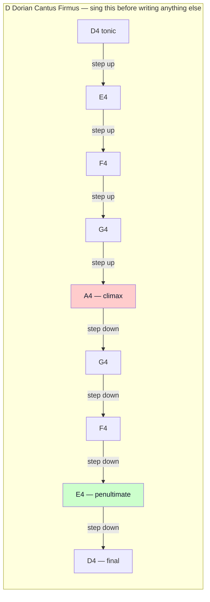
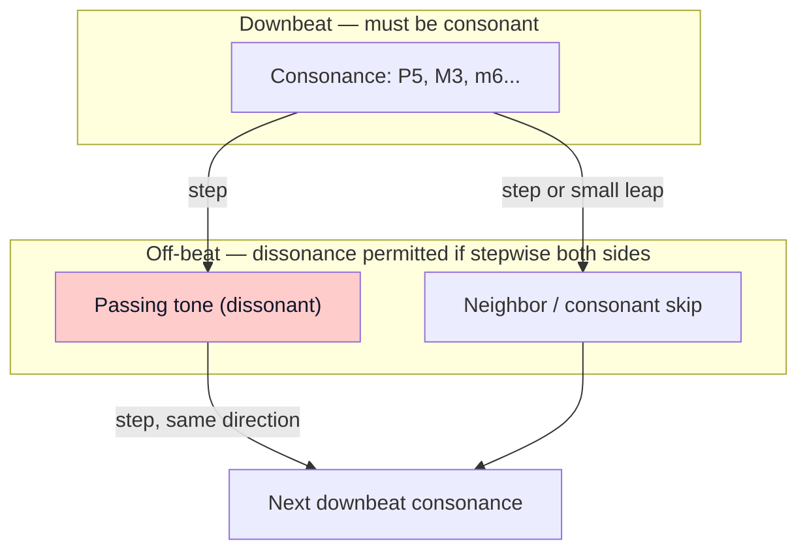
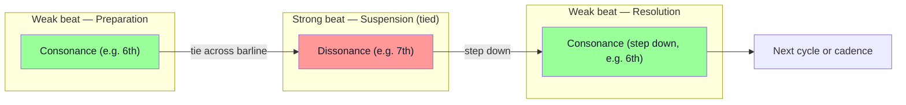

# Counterpoint: From Cantus Firmus to Florid Polyphony

## Why This Still Matters at the Keyboard

Every voicing you play in jazz, every bassline that works against a melody, every string pad that doesn't clash with a vocal — it all reduces to two questions counterpoint answers directly: **which notes can sound together, and how do independent lines move without collapsing into one blob or one argument?** This is ear training disguised as writing practice. You will write at the keyboard, play both hands, sing one line while playing the other, and correct by ear before you correct by rule.

Work at the piano. Two staves, treble and bass clef, no key signature — modal counterpoint predates functional key signatures and the absence of one forces you to hear scale degrees rather than guess at them from habit.

---

## Lab Setup

**Primary tool: your hands and a piano.** Software supports the ear, it doesn't replace it.

**Notation**: MuseScore 4 (free, musescore.org). Set up once:

1. New score → choose "Treble + Bass Clef (Grand Staff)" or two separate treble/bass single-staff parts if writing voice-pairs independently.
2. Time signature 4/4, no key signature.
3. View → Mixer → set both staves to Piano or, better, Organ (sustained tone makes intervallic beating easier to hear than piano's percussive decay).
4. Tempo 60 BPM to start. You will raise this only after the counterpoint passes every manual check — tempo increase is a reward for correctness, not a race.
5. Edit → Preferences → Note Input → enable step-time MIDI entry if you have a keyboard controller. Play each note in instead of mouse-clicking; this builds the physical connection between the written interval and its sound.

**Plugin**: MuseScore Plugin Manager → install "Counterpointer." Use it only *after* you've checked a passage by eye and ear. If you check with the plugin first, you train the plugin's judgment, not yours.

**Optional — statistical tooling** (Exercise 2 only):
```bash
pip install music21 matplotlib pandas numpy
```

**Reference texts**, in working order:
1. Fux, *Gradus ad Parnassum* (Mann translation) — read Part One cover to cover before Exercise 1.
2. Schubert, *Modal Counterpoint, Renaissance Style* — the modern pedagogical standard; use its model examples as a sanity check against your own.
3. Jeppesen, *Counterpoint* — reference only, for Palestrina-specific nuance once you're past fourth species.

---

## The Physical Basis, in One Paragraph

Perfect consonances (unison, fifth, octave) arise from simple frequency ratios (1:1, 3:2, 2:1): their partials align or nearly align, producing a fused, stable sound with little acoustic "friction." Imperfect consonances (thirds, sixths, ratios like 5:4 and 5:3) are less perfectly aligned — enough mismatch to add color and forward motion, not enough to beat audibly. Dissonances (seconds, sevenths, fourths against a bass, tritones) have close-but-unaligned partials that produce audible beating — the physical sensation you call "tension." Counterpoint's rules exist to control exactly when that beating occurs (never on a downbeat, except as a prepared suspension) and how it resolves (by step, toward the nearest stable alignment). Once you hear this, the rules stop being arbitrary law and become a map of where tension is allowed to live.

---

## Exercise 1: The Species, Built in Your Hands

### Step 1 — Build a Singable Cantus Firmus

Before you write anything, **sing the cantus firmus out loud**. If you can't sing it comfortably, it's not well-formed, no matter how it looks on paper. This is the single fastest diagnostic in all of counterpoint pedagogy.

Rules of construction:
- **Range**: a 6th to a 10th (comfortable vocal range — this is vocal music even when played on piano).
- **Motion**: 70–80% steps. Thirds are fine. Leaps of a 4th or 5th must be followed by a step in the *opposite* direction (this is called **recovery**) — a leap up needs a step back down, bleeding off the leap's energy before it accumulates into another leap.
- **One climax**, placed in the second half.
- **Arch shape**: rise to the climax, descend to the final.
- **Penultimate note approaches the final by step.**
- **No melodic tritones** (never land on both F and B natural in close proximity without a passing B♭).
- **8–12 notes.**

**D Dorian cantus firmus** (D-E-F-G-A-B♭-C-D, final D, no key signature so write B♭ explicitly when it occurs):

```
D4 - E4 - F4 - G4 - A4 - G4 - F4 - E4 - D4
```



**Keyboard drill**: play this CF with your right hand, 4th-finger-on-D as your anchor, one note per beat at 60 BPM, for 10 repetitions. Then sing it on solfège (Re-Mi-Fa-Sol-La-Sol-Fa-Mi-Re in relative Dorian) while your left hand holds a drone D3. The drone is critical — it's your tuning reference and it immediately exposes any note that sounds "modally wrong."

**Practice task**: build and sing four CFs — Dorian on D, Phrygian on E, Mixolydian on G, Aeolian on A, 8–10 notes each. Do not move to Step 2 until all four pass the sing test.

### Step 2 — First Species (1:1)

One counterpoint (CP) note per CF note. This is where you learn the consonance vocabulary cold.

**Consonances allowed**: P1, m3, M3, P5, m6, M6, P8.
**Forbidden**: all 2nds, all 7ths, the P4 (when CP is the lower voice against CF as bass — treat it as a dissonance requiring resolution, just like a 2nd), all augmented/diminished intervals.

**The Big Rule**: no two consecutive perfect consonances of the same type between the same voice pair (parallel 5ths, parallel 8ves). This is non-negotiable and it's the rule your ear will catch fastest once trained — parallel perfect intervals make two independent lines suddenly sound like one doubled line, and the "harmonic progress" stops dead.

**Opening**: P1, P5, or P8 only.
**Closing**: P1 or P8, approached by contrary stepwise motion (one voice steps up, the other steps down, landing together on the unison/octave).
**Penultimate interval**: m6 expanding out to P8, or m3 contracting in to P1. In Dorian, raise the 6th degree (B♭→B♮) at the very end to create a leading-tone pull into the cadence — this is the one chromatic alteration first species tolerates.

**Motion types, ranked by how much you should use them**:
1. **Contrary** (voices move opposite directions) — your default, target 50%+ of all motion.
2. **Oblique** (one voice holds) — fine anywhere.
3. **Similar to an imperfect consonance** (both move same direction, landing on a 3rd or 6th) — acceptable.
4. **Similar to a perfect consonance** — only if the upper voice moves by *step*. If both voices leap into a P5 or P8 by similar motion, that's a "hidden" perfect consonance and it's forbidden — it has the same stasis problem as a parallel, just with one extra step of disguise.

**Written-out example above the D Dorian CF**:

```
CF:   D4   E4   F4   G4   A4   G4   F4   E4   D4
CP:   D5   C5   A4   B4   C5   E5   D5   C5   D5
Int:  P8   m6   M3   M3   m3   M6   M6   m6   P8
Mot:   —   con  obl  con  par  con  con  con   —
```
75% contrary motion (6 of 8 transitions), clean opening P8, cadence m6→P8 by contrary step. This passes every check — use it as your template, then write your own from scratch without copying it.

**Keyboard execution drill**: play CF in left hand, CP in right hand, hands independent, 60 BPM, quarter note = one beat. Do this slowly enough that you can *listen* to each vertical interval land before moving to the next. Increase to 72, then 84 BPM only once you can play it with zero hesitation and correctly name each interval aloud as you play it ("octave... sixth... third...").

**Manual verification checklist** (do this before any plugin):
1. Name every vertical interval out loud or on paper. Flag anything outside {P1, m3, M3, P5, m6, M6, P8}.
2. Check every adjacent pair of intervals: same perfect interval twice in a row = violation.
3. Check opening and closing intervals specifically.
4. Check the CP's own melodic line: mostly steps, any leap bigger than a 3rd recovered by contrary step, no melodic tritone.
5. Play it. Ask: do these sound like two people, or one person with an echo? If it sounds like an echo, you have too much parallel/similar motion.

**music21 spot-check** (use after manual check, to catch what your eye missed):

```python
from music21 import note, interval, stream

cf_notes = [note.Note(p, quarterLength=4) for p in
            ['D4','E4','F4','G4','A4','G4','F4','E4','D4']]
cp_notes = [note.Note(p, quarterLength=4) for p in
            ['D5','C5','A4','B4','C5','E5','D5','C5','D5']]

allowed = {'P1','m3','M3','P5','m6','M6','P8'}

print("Dissonance check:")
for i, (c, p) in enumerate(zip(cf_notes, cp_notes)):
    iv = interval.Interval(c, p).simpleName
    flag = "" if iv in allowed else "  <-- VIOLATION"
    print(f"  {i}: {c.nameWithOctave}-{p.nameWithOctave} = {iv}{flag}")

print("\nParallel perfect check:")
for i in range(len(cf_notes) - 1):
    a = interval.Interval(cf_notes[i], cp_notes[i]).simpleName
    b = interval.Interval(cf_notes[i+1], cp_notes[i+1]).simpleName
    if a == b and a in ('P5', 'P8', 'P1'):
        print(f"  VIOLATION: parallel {a} at steps {i}->{i+1}")

print(f"\nOpening: {interval.Interval(cf_notes[0], cp_notes[0]).name}")
print(f"Closing: {interval.Interval(cf_notes[-1], cp_notes[-1]).name}")
```

**Practice task**: write 3 first-species CPs above, 3 below, your D Dorian CF — 6 total, all different. Then deliberately write a 7th with one parallel-fifth pair and one dissonant 2nd planted in it, run the script, confirm both get flagged. This "break it on purpose" step matters: you need to recognize the sound of the violation before you can avoid it by ear rather than by rule-checking.

### Step 3 — Second Species (2:1)

Two CP notes against each CF note (CF in half notes, CP in quarters). This is where **passing tones** enter — your first controlled dissonance.

**New rules**:
- Downbeat (beat 1 and beat 3 of each measure) must be consonant.
- The off-beat (beat 2 or 4) may be dissonant *only* as a **passing tone**: approached by step, left by step, in the same direction, connecting two consonances.
- No leaping to or from a dissonance, ever, in this species.
- Final measure: fully consonant, no dissonance even on the weak beat.

```
CF:   D4    —   | E4    —   | F4    —   | G4    —   | A4    —   | G4    —   | F4    —   | E4    —   | D4   —
CP:   A4   B4   | C5   B4   | A4   G4   | B4   C5   | C5   D5   | E5   D5   | D5   C5   | C5   B4   | D5   —
Int:  P5   M6   | m6   P5   | M3   M2*  | M3   P4   | m3   P4   | M6   P5   | M6   m7*  | m6   P5   | P8
```
`*` = passing dissonance, confirmed stepwise both sides.



**Keyboard drill**: this is where hand independence starts mattering. Practice the CP alone first, right hand only, hearing the stepwise contour of each measure-pair. Then add the CF in the left hand at half the speed — literally play the CF note, hold it, and fit two CP notes against it. Loop each measure 8 times before moving to the next; stitching measures together too early is the #1 cause of sloppy second species.

**Practice task**: write 2 second-species CPs above, 2 below, your D Dorian CF, each with at least 3 clean passing-tone dissonances. Verify at the keyboard: does each dissonant off-beat sound like an embellishment, or like a wrong note? If it sounds wrong, you probably leapt into or out of it — go back and make both approach and departure stepwise.

**Common mistakes**:

| Mistake | Diagnosis | Fix |
|---|---|---|
| Leap to dissonance | CP jumps to a 2nd/7th from a non-adjacent note | Approach every dissonance by step only |
| Dissonant downbeat | Beat 1 or 3 forms a 2nd/7th/P4 | Re-voice that beat to a consonance; move the dissonance to the weak beat instead |
| Dead weak beats | Every off-beat just repeats or thirds the downbeat | Insert 2–3 genuine passing tones for melodic motion |
| Parallel 5ths between downbeats | You checked weak beats but not downbeat-to-downbeat | Check strong-beat progressions as their own first-species skeleton |

### Step 4 — Third Species (4:1)

Four CP notes per CF note (CF half or whole notes, CP quarters). Same dissonance law as second species — downbeats consonant, weak beats stepwise-passing — but now with room for **arpeggiation** and **neighbor figures**.

```
CF:   D4              | E4              | F4              | G4
CP:   D5  C5  B4  A4  | G4  A4  B4  C5  | A4  B4  C5  D5  | B4  C5  D5  E5
Int:  P8  m7* M6  P5  | m3  P4  P5  m6  | M3  P4  P5  M6  | M3  P4  P5  M6
Beat:  1   2   3   4  |  1   2   3   4  |  1   2   3   4  |  1   2   3   4
```

Beat 1 is always consonant. Beat 3 is a secondary strong point — treat any dissonance there with extra caution, confirming it's genuinely stepwise-passing and not a disguised leap.

**Figures to build into your vocabulary**:
- **Passing tone group**: step-step-step filling a third or fourth.
- **Neighbor tone**: step away, step back (e.g., D5-C5-D5-E5).
- **Double neighbor**: upper-then-lower or lower-then-upper around a central note (C5-D5-C5-B4-C5).
- **Consonant skip**: a leap between two consonant notes, used to reach a new register for the next arpeggiation.

**Keyboard drill**: practice each 4-note cell in isolation, right hand alone, as a tiny finger pattern — most of these cells are literally scale fragments or broken triads, so they should feel like Hanon-style finger patterns, not abstract pitches. Then add the CF whole-note drone in the left hand. Metronome progression: 54 → 66 → 80 BPM, moving up only once all four cells in a measure are even and clean.

**Practice task**: two third-species CPs above your D Dorian CF. Target: 50%+ stepwise motion, 4–6 passing dissonances across the piece, at least 2 arpeggiated triadic gestures, and don't let every measure ascend or every measure descend — vary the shape measure to measure.

### Step 5 — Fourth Species: Suspensions

This is the single most important contrapuntal device in the entire tradition — it's the DNA of the authentic cadence and of 90% of harmonic tension-release in tonal music written after 1600.

**Anatomy of a suspension, three phases**:
1. **Preparation** (weak beat): the note is a plain consonance.
2. **Suspension** (strong beat, tied over the barline): the *same pitch* now clashes with the new CF note — dissonant.
3. **Resolution** (weak beat): the suspended note steps *down* to a consonance.

**The standard suspension types** (named by interval-of-suspension → interval-of-resolution):

| Type | Sounds like | Where it's used |
|---|---|---|
| 7-6 | 7th resolving down to 6th | Most common, usable almost anywhere |
| 4-3 | 4th (dissonant, CP above) resolving to 3rd | Very common, strong pull |
| 9-8 | Compound 2nd resolving to octave | Cadential, powerful |
| 2-3 | 2nd resolving *up* to 3rd, when CP is the bass | Only upward-resolving type in strict style |

```
CF:   D4   —   | E4   —   | F4   —   | G4   —   | A4   —   | G4   —   | F4   —   | E4   —   | D4
CP:    —  A4   | A4  G4   | G4  F4   | F4  E4   | E4  F4   | F4  E4   | E4  D5   | D5  C#5  | D5
Phase:  r   p  |  s   r   |  s   r   |  s   r   |  s   r   |  s   r   |  s   r   |  s   r   |
Int:       P5  | 7-6      | 2-3      | 7-6      | 5-6      | 7-6      | 7-6      | 7-6      | P8
```
Phase: p = preparation, s = suspension (held across barline, dissonant), r = resolution (steps down).

Measures 7–8 raise C to C♯ — the Dorian cadential leading tone — producing a textbook 7-6 suspension resolving into the final octave.



**The physical feel at the keyboard**: hold the suspended note with firm finger weight — don't re-strike it, it's tied — while your other hand changes the harmony underneath. You should feel the dissonance arrive as the *bass* moves, not as anything your sustaining finger does. This is the clearest possible demonstration that dissonance is a relationship between voices, not a property of a single note.

**Practice task**: two fourth-species CPs above your D Dorian CF, minimum 5 suspensions each, with a 7-6 or 9-8 in the penultimate measure. Then write one *deliberately wrong* suspension: prepare it properly, but resolve **upward** instead of down. Play it. It will sound unmotivated — like the tension evaporated instead of resolving. That wrongness is the lesson; your ear is now calibrated to expect downward resolution.

**Common mistakes**:

| Mistake | Diagnosis | Fix |
|---|---|---|
| Unprepared suspension | Dissonance appears with no consonant note tied into it | Make sure the note held across the bar was consonant on the previous weak beat |
| Upward resolution | Breaks the entire logic of suspension | Always resolve down by step (except 2-3 bass case) |
| Leap after resolution | Line jumps right after the suspension releases | Continue stepwise or small-leap to preserve melodic continuity |
| All-consonant "suspensions" | Ties a 5th to a 5th — technically legal, expressively inert | Prefer genuinely dissonant suspensions; save consonant ties for rhythmic variety only |

### Step 6 — Fifth Species: Florid Counterpoint

Mixed note values — whole, half, quarter, occasional eighth-note pairs — combining every technique above. This is the style Fux modeled directly on Palestrina.

**Rules layered on top of everything already learned**:
- No more than two consecutive measures share an identical rhythmic pattern.
- Eighth notes appear only in pairs, only on weak beats, and are either stepwise or outline a consonant interval.
- **Cambiata**: the one sanctioned dissonant *leap* in strict counterpoint. Pattern: consonant downbeat → leap of a 3rd to a dissonant note on the weak beat → step down to a consonance → continue (step or consonant skip). Example against CF note E4: `C5 (M6, consonant) → E5 (M7, dissonant, reached by leap) → D5 (m7, consonant) → C5 (m6, step)`. The ear accepts the dissonant leap because it's immediately corrected by a step in the same direction — the leap is a controlled detour, not an error.
- Final two measures: increase rhythmic density (quarters/eighths) to build momentum into the cadence, typically closing with a 7-6 suspension.

```
CF:   D4                      | E4                      | F4                     | G4
CP:   D5  E5  F5  E5          | D5  C5    (half+half)   | C5 B4 A4 G4            | F4   (whole note)
Int:  P8  M7* m3  M7*         | P8  m7                   | m6 P5 P4 m3            | M2*
```
Measure 1: D5(downbeat, P8) → E5 (passing dissonance, step up) → F5 (consonant m3) → E5 (passing dissonance, step down back toward D). Measure 4's whole-note F4 against G4 forms M2 — acceptable here only as part of a longer suspension/passing resolution context; check it against neighboring measures before finalizing, since a lone whole-note dissonance needs a suspension-grade justification, not just a passing-tone excuse.

**Keyboard drill**: fifth species is where you stop counting beats mechanically and start *phrasing*. Play it with rubato once the rhythm is secure — lean slightly into suspensions, release resolutions gently. This is vocal music; breathe with it.

**Practice task**: one fifth-species CP above your D Dorian CF: 3+ distinct rhythmic patterns, 2–3 suspensions, 4–6 passing dissonances, at least one cambiata, cadential rhythmic acceleration in the final two measures.

**Verification pass (all species)**:
1. Play at 60 BPM — coherent melody or disconnected fragments?
2. Every downbeat consonant except tied suspensions.
3. Every dissonance is a passing tone, neighbor, suspension, or cambiata — nothing else.
4. At least 3 distinct rhythmic patterns present.
5. Run Counterpointer plugin as a final catch-net.

---

## Exercise 2: Mode Changes the Sound — Hear It, Then Measure It

### The Ear-Training Core (do this before touching Python)

Play each of the four modal cantus firmi — Dorian/D, Phrygian/E, Mixolydian/G, Aeolian/A — against a sustained drone on its final. Phrygian will sound noticeably darker (half-step descent into the final, F→E, with no leading tone pull). Mixolydian will sound brighter (major-triad feel, flattened 7th gives it a modal, non-resolving brightness rather than classical dominant pull). This perceptual contrast is the entire point of the exercise — the statistics below exist to confirm what your ear already caught.

### Step 1 — Four CFs, Four Modes (9 notes each)

```
Dorian:      D4 E4 F4 G4 A4 G4 F4 E4 D4
Phrygian:    E4 F4 G4 A4 B4 A4 G4 F4 E4
Mixolydian:  G4 A4 B4 C5 D5 C5 B4 A4 G4
Aeolian:     A4 B4 C5 D5 E5 D5 C5 B4 A4
```

### Step 2 — First Species CP, Above and Below, All Four

8 total compositions. Write each one fresh, by ear and rule, not by transposing the Dorian example.

### Step 3 — Extract Interval Data

```python
from music21 import note, interval

def analyze_intervals(cf_notes, cp_notes):
    counts = {k: 0 for k in ['P1','m3','M3','P5','m6','M6','P8']}
    for c, p in zip(cf_notes, cp_notes):
        iv = interval.Interval(c, p).simpleName
        if iv in counts:
            counts[iv] += 1
    return counts

def analyze_motion(cf_notes, cp_notes):
    counts = {'contrary': 0, 'oblique': 0, 'similar': 0, 'parallel': 0}
    for i in range(len(cf_notes) - 1):
        cf_delta = cf_notes[i+1].pitch.midi - cf_notes[i].pitch.midi
        cp_delta = cp_notes[i+1].pitch.midi - cp_notes[i].pitch.midi
        if cf_delta == 0 and cp_delta == 0:
            continue
        if cf_delta == 0 or cp_delta == 0:
            counts['oblique'] += 1
        elif (cf_delta > 0) != (cp_delta > 0):
            counts['contrary'] += 1
        else:
            iv1 = interval.Interval(cf_notes[i], cp_notes[i]).simpleName
            iv2 = interval.Interval(cf_notes[i+1], cp_notes[i+1]).simpleName
            counts['parallel' if iv1 == iv2 else 'similar'] += 1
    return counts

# Repeat this call for all 8 of your written examples, swapping in your own pitches
cf = [note.Note(p) for p in ['D4','E4','F4','G4','A4','G4','F4','E4','D4']]
cp = [note.Note(p) for p in ['D5','C5','A4','B4','C5','E5','D5','C5','D5']]
print("Intervals:", analyze_intervals(cf, cp))
print("Motion:", analyze_motion(cf, cp))
```

### Step 4 — Aggregate and Plot

```python
import matplotlib.pyplot as plt

# Fill this dict in with YOUR 8 analyzed results, not placeholder numbers —
# the value of this chart is entirely in it reflecting work you actually did.
results = {
    'Dorian_above':     analyze_intervals(cf, cp),
    # 'Dorian_below':    analyze_intervals(...),
    # 'Phrygian_above':  analyze_intervals(...),
    # ... fill in remaining 6
}

totals = {k: 0 for k in ['P1','m3','M3','P5','m6','M6','P8']}
for counts in results.values():
    for k, v in counts.items():
        totals[k] += v

plt.figure(figsize=(9, 5))
plt.bar(totals.keys(), totals.values(), color='steelblue')
plt.xlabel('Interval')
plt.ylabel('Frequency across your examples')
plt.title('Interval distribution — first species counterpoint')
plt.grid(axis='y', alpha=0.3)
plt.tight_layout()
plt.savefig('interval_distribution.png', dpi=150)
plt.show()
```

### Step 5 — Questions to Answer From Your Own Data

1. Which interval dominates — is it a third, a sixth, or roughly even? (If you have almost no thirds or almost no sixths, you're probably overusing similar motion in one direction — go back and inject more contrary motion.)
2. Did Phrygian pull more m6/m3 (its characteristically darker intervals) than Mixolydian?
3. Did your "CP below" examples lean on P5/P8 more than "CP above"? (Common — bass-position counterpoint often anchors harmonically more than melody-position counterpoint.)
4. What's your actual contrary-motion percentage, averaged across all 8? Below 50% means go back and revise — that's the threshold where independence starts to erode.

---

## Exercise 3: Break It, Hear It, Fix It

The fastest way to internalize a rule is to violate it on purpose and listen to the exact flavor of wrongness it produces. Do each of these at the piano, slowly, and narrate out loud what you hear.

**A — Parallel fifths**:
```
CF:  D4 - E4 - F4 - G4 ...
CP:  A4 - B4 - C5 - D5 ...
Int: P5 - P5   (VIOLATION — same perfect interval twice in a row)
```
Play it. The sound: flat, static, like the harmony stalled. Fix: change the second CP note to G4 (creates a m3, contrary motion) or C5 (m6, similar motion but non-parallel).

**B — Dissonant interval on a strong position**:
```
CF:  D4 - E4 - ...
CP:  D5 - F5 - ...
Int: P8 - M2   (VIOLATION)
```
Sound: jarring, unresolved clash with no stepwise justification. Fix: move F5 to C5 (m6) or G5 (m3).

**C — Improper opening**:
```
CP opens on F4 against CF's D4 → m3.   (VIOLATION — must be P1/P5/P8)
```
Sound: ambiguous, lacks the grounding "this is the key" signal a perfect interval gives at the start. Fix: open on D5 (P8), A4 (P5), or D4 (P1).

**D — Improper cadential approach**:
```
... CP: ... - A4 - D5
Int:        ... - P5 - P8   (VIOLATION — penultimate should be m6 or m3, not P5)
```
Sound: abrupt, no "pull" into the final. Fix: change A4 to C5 (m6 expanding outward to P8).

**E — Melodic tritone**:
```
... C5 - F#5 ...   (VIOLATION — augmented 4th leap)
```
Sound: angular, almost impossible to sing cleanly. Fix: replace F#5 with D5 or E5.

**Combine all five into one maximally broken example**, play it, then fix one violation at a time and replay after each fix — you should hear the counterpoint get progressively more stable, not just "more correct on paper." That incremental improvement in sound, confirmed by ear at each step, is the real skill this exercise builds.

**Reflection**: parallel fifths are consistently the hardest violation to hear in real time, especially in an inner voice buried under other material — train this specifically by soloing just the two outer voices of any three-voice texture you write and checking them as a pair.

---

## Exercise 4: Three Voices

### New Constraints Beyond Two-Voice First Species

- Aim for complete triads (root-third-fifth) on strong beats; incomplete is acceptable only at the very opening and closing.
- Check **every pair** of voices independently for parallel perfect consonances: CF–CP1, CF–CP2, CP1–CP2. Three pairs, three separate checks — a passage can be clean between CF and each CP individually while still having parallel fifths between the two CPs.
- If doubling is unavoidable, double the root or fifth — **never the third**. Doubling the third makes the triad's quality (major/minor) sound unstable, almost blurred, because you've over-weighted the one note that determines mode.
- Keep upper two voices within an octave of each other; the bass can range more freely below.

### Worked Example

```
CF (Tenor):  D4 - E4 - F4 - G4 - A4 - G4 - F4 - E4 - D4
CP1 (Alto):  A4 - C5 - A4 - B4 - C5 - E5 - D5 - C5 - D5
CP2 (Bass):  D3 - C3 - F3 - G3 - A3 - C3 - D3 - E3 - D3
```

Check each vertical sonority by naming the triad:

```
M1: D3-D4-A4  → D minor, root doubled
M2: C3-E4-C5  → C major, root doubled
M3: F3-F4-A4  → F major, root doubled
M4: G3-G4-B4  → G major, root doubled
M5: A3-A4-C5  → A minor, root doubled
M6: C3-G4-E5  → C major, complete
M7: D3-F4-D5  → D minor, root doubled
M8: E3-E4-C5  → incomplete — missing 3rd (E-E-C has no G or G#)
M9: D3-D4-D5  → unison cadence
```

**Measure 8 needs revision** — it's structurally ambiguous. Two fixes: change CP1's note to B4 (giving E-E-B, an E minor triad) or change CP2 to C3 (giving C-E-C, a C major triad). Either works; pick whichever preserves better voice leading into measure 9.

Once revised, check all three voice-pairs independently for parallels — it's entirely possible for CF-CP1 and CF-CP2 to be individually clean while CP1-CP2 contains a parallel fifth that neither two-voice check would catch.

**Keyboard execution**: play tenor + alto in the right hand (or split across two hands if the stretch is uncomfortable), bass in the left. Three real voices on piano means genuine independent listening — slow to 50 BPM if needed, and isolate each pair (play just two of the three voices at a time) before attempting all three together.

**Practice task**: build two more three-voice examples on the Phrygian and Mixolydian CFs from Exercise 2, each checked for triadic completeness and all three parallel-consonance pairs.

---

## Exercise 5: Invertible Counterpoint at the Octave

This is the technique that makes fugue possible — a subject and countersubject that still work correctly no matter which one ends up on top.

**The governing fact**: when you invert two voices at the octave, every interval flips according to this table —

| Original | Inverted | Original | Inverted |
|---|---|---|---|
| P1 | P8 | P5 | **P4** |
| m3 | M6 | m6 | M3 |
| M3 | m6 | M6 | m3 |
| **P4** | **P5** | m7 | M2 |
| M7 | m2 | P8 | P1 |

**The trap**: P4 inverts to P5 and vice versa. A P4 is dissonant (as CP against bass) in first species, but a P5 is consonant. **Write your two-voice counterpoint avoiding perfect fourths entirely** if you intend it to be invertible — otherwise a perfectly legal P5 in the original becomes an illegal P4 after inversion, or a dissonant P4 "cheats" into legality as a P5.

### Worked Pair

**Original**:
```
CF:  D4 - E4 - F4 - G4 - A4 - G4 - F4 - E4 - D4
CP:  D5 - C5 - A4 - B4 - C5 - E5 - D5 - C5 - D5
Int: P8 - m6 - M3 - M3 - m3 - M6 - M6 - m6 - P8
```
No P4s anywhere — safe to invert.

**Inverted** (CP drops an octave below CF, or equivalently CF rises above CP):
```
CP (low):  D4 - C4 - A3 - B3 - C4 - E4 - D4 - C4 - D4
CF (high): D5 - E5 - F5 - G5 - A5 - G5 - F5 - E5 - D5
Int:       P8 - M3 - M6 - M6 - M6 - m3 - M3 - M3 - P8
```
All consonant, no parallels introduced — valid.

**Keyboard A/B test**: play the original (CP as melody on top), then play the inverted version (same two lines, registers swapped). Listen for the change in harmonic color — sixths-heavy voicings sound different from thirds-heavy voicings even though the counterpoint logic is identical. This register-dependent color shift is exactly what Bach exploits across fugue expositions when a subject moves from alto to bass.

**Practice task**: build two invertible pairs on the Phrygian and Mixolydian CFs. For each, verify the inversion by actually transposing and re-checking every interval — don't assume it works just because you avoided P4s; confirm it.

---

## Exercise 6: Two-Voice Invention (Applying Fourth Species in Free Composition)

Sixteen measures, binary form, D minor (Dorian-inflected), modeled on Bach's Two-Part Inventions. This is where species discipline becomes free compositional instinct.

**Subject** (mm. 1–2, right hand) — outline the tonic triad, mix steps and small leaps, land on a half cadence:
```
D5 - E5 - F5 - E5 - D5 - C#5 - D5  |  A4 - B4 - C5 - D5
```

**Countersubject** (mm. 1–2, left hand) — contrary-motion complement, with a tied suspension for rhythmic contrast:
```
D3 - (rest) - A3 (tied into bar 2)  |  A3 - G3 - F3 - E3
```

**Exposition plan (mm. 1–8)**:
- mm. 1–2: subject in right hand, free counterpoint (not yet the countersubject) in left hand.
- mm. 3–4: subject moves to left hand, transposed to the dominant (A), right hand takes the countersubject or new complementary material.
- mm. 5–8: sequential development, driving to a half cadence on A, or a modulation toward F major (the relative major).

**Second section plan (mm. 9–16)**:
- Introduce the subject in F major or G minor (subdominant-adjacent).
- Use one development technique: melodic inversion (subject upside-down), augmentation (subject in doubled note values), or stretto (subject entries overlapping before the first finishes).
- mm. 13–16: return to D minor, final subject statement, cadence with a 7-6 or 9-8 suspension in the penultimate measure.

**Execution**: notate in MuseScore, tempo 80–100 BPM (Allegro moderato). Verify: every suspension resolves correctly, no parallel 5ths/8ves anywhere between the two hands, both hands remain independently singable (sing each hand's line separately against a recording of the other), and the harmonic plan (tonic → dominant → relative major → tonic) is audible as a shape, not just a label.

**Practice task**: write a second 16-measure invention in Phrygian on E, with at least 3 suspensions and one invertible passage (check the invertibility explicitly, as in Exercise 5).

---

## Mastery Checklist

- [ ] 12+ first species counterpoints across 4 modes, above and below
- [ ] 6+ second species counterpoints with clean passing-tone dissonances
- [ ] 4+ third species counterpoints with arpeggiation and neighbor figures
- [ ] 4+ fourth species counterpoints with proper suspension chains, including one deliberate upward-resolution error heard and corrected
- [ ] 2+ fifth species counterpoints including at least one cambiata
- [ ] Interval-distribution data gathered and plotted across all 4 modes, with your own written observations
- [ ] All 5 violation types (parallel 5ths, dissonance, bad opening, bad cadence, melodic tritone) deliberately introduced, heard, and corrected
- [ ] 2+ three-voice first species examples, all three voice-pairs checked independently
- [ ] 2+ invertible counterpoint pairs, inversion explicitly verified
- [ ] One complete 16-measure two-voice invention

## Next Steps

- Transcribe one Palestrina motet by hand (staff paper, not software) and label every suspension and passing tone you find — this is still how composition students learn Renaissance style today.
- Transcribe a Bach Two-Part Invention in full and chart its suspension and sequence usage measure by measure.
- Write a short fugue exposition (subject, countersubject, two entries) using the invertible pair technique from Exercise 5.
- Once comfortable with strict modal counterpoint, study chromatic and 20th-century extensions (Hindemith's *Craft of Musical Composition*, Bartók's string quartets) to see how the same voice-leading logic survives outside the diatonic system.

Counterpoint is ear training that happens to produce written scores. The rules are not the point — the point is that after enough repetitions, you hear a parallel fifth the instant it happens, the way a carpenter feels an out-of-square joint before measuring it. Keep the metronome honest, keep singing the lines you write, and let correctness become a reflex rather than a checklist.
