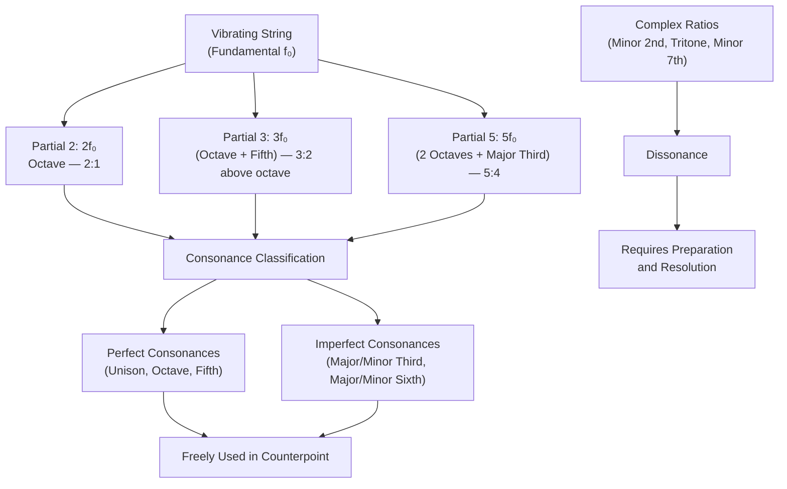
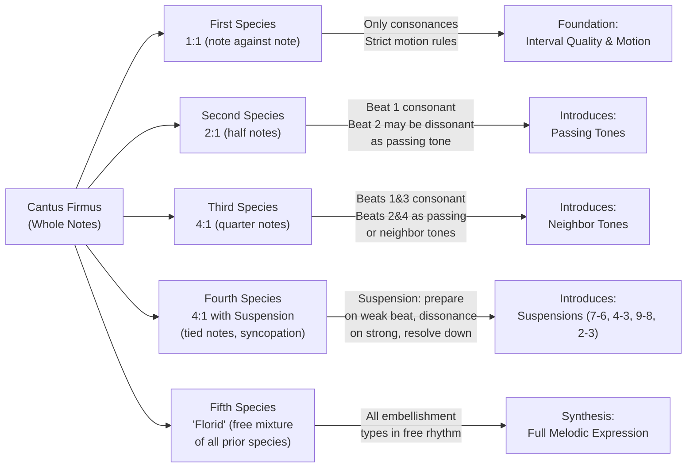
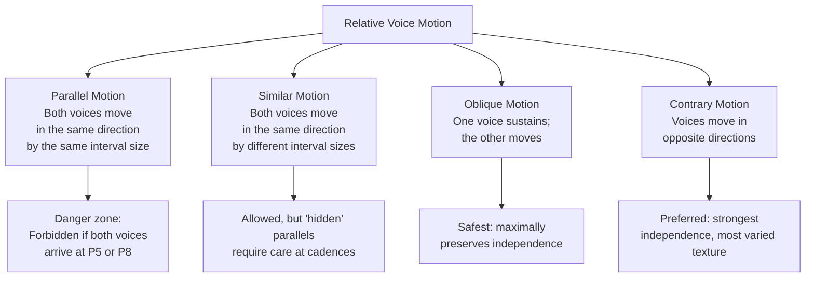
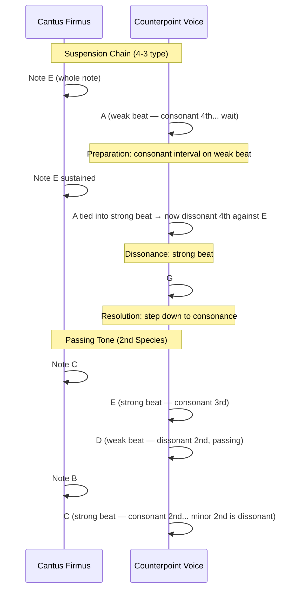

# Lesson 1: Introduction to Counterpoint

---

## Table of Contents

1. [First-Principles Intuition & The Physics of Consonance](#1-first-principles-intuition--the-physics-of-consonance)
2. [Core Architecture: The Species System](#2-core-architecture-the-species-system)
3. [Motion Types and Voice Independence](#3-motion-types-and-voice-independence)
4. [Dissonance Treatment and Voice Leading](#4-dissonance-treatment-and-voice-leading)
5. [Failure Modes and Diagnostic Heuristics](#5-failure-modes-and-diagnostic-heuristics)
6. [Analytical Application: Worked Example](#6-analytical-application-worked-example)
7. [Algorithmic Counterpoint: Computational Perspective](#7-algorithmic-counterpoint-computational-perspective)
8. [Exercises](#8-exercises)

---

## 1. First-Principles Intuition & The Physics of Consonance

### 1.1 The Overtone Series as Generative Foundation

Counterpoint is not a stylistic convention imposed arbitrarily by Renaissance theorists. Its rules are grounded in the physics of vibrating bodies and the neurological architecture of human pitch perception. To understand why a perfect fifth sounds stable and a minor second sounds tense, you must start with the overtone series.

When a string, air column, or membrane vibrates at a fundamental frequency $f_0$, it simultaneously vibrates at integer multiples of that frequency. These are the *partials* or *harmonics*:

$$f_n = n \cdot f_0, \quad n \in \{1, 2, 3, 4, 5, \ldots\}$$

For a fundamental of 110 Hz (the A below middle C), the first eight partials are:

| Partial ($n$) | Frequency (Hz) | Interval Above Fundamental |
|:---:|:---:|:---|
| 1 | 110 | Unison |
| 2 | 220 | Perfect Octave (2:1) |
| 3 | 330 | Perfect Fifth above octave (3:2) |
| 4 | 440 | Perfect Octave (4:2 = 2:1) |
| 5 | 550 | Major Third above two octaves (5:4) |
| 6 | 660 | Perfect Fifth above two octaves (6:4 = 3:2) |
| 7 | 770 | Harmonic seventh — does not map cleanly to 12-TET |
| 8 | 880 | Perfect Octave |

The intervals that appear *earliest* in the overtone series — octave (2:1), fifth (3:2), fourth (4:3), major third (5:4) — are those with the simplest integer ratios. The key acoustical insight, articulated rigorously by Hermann von Helmholtz in *On the Sensations of Tone* (1863), is that **consonance correlates with the absence of beating between nearby partials**. When two tones share many overtones in common, or when their overtones align without clashing, the result is perceived as consonant. When their overtone series produce partials separated by small frequency differences (less than roughly 15–20 Hz), those partials beat against each other, creating perceptible amplitude modulation — the physiological basis of *roughness* and dissonance.

The unison (1:1) is maximally consonant because all partials align perfectly. The perfect fifth (3:2) is the next simplest: the third partial of the lower tone coincides with the second partial of the upper tone. The minor second (16:15 in just intonation) produces dense beating across its entire overtone structure.

```
Overtone Alignment: Perfect Fifth (C → G)

C partials:  C2  C3  G3  C4  E4  G4  Bb4  C5  ...
G partials:      G2  D3  G3  B3  D4  F4   G4  ...
                     ↑       ↑           ↑
              Shared partials = consonance
```

This is not merely theoretical. It is the reason Fux could codify rules that "work" across centuries: he was encoding perceptual truths, not cultural preferences alone.

### 1.2 Just Intonation, Pythagorean Tuning, and Equal Temperament

The ratios above belong to *just intonation*, where intervals are tuned to exact small-integer frequency ratios. Medieval and Renaissance polyphony used *Pythagorean tuning*, derived entirely from stacking perfect fifths (3:2 ratios), which produces beatless fifths and fourths at the cost of slightly wider major thirds (81:64 rather than the just 5:4). This is why the major third was treated as a dissonance in strict organum and only gradually admitted as a consonance through the 14th and 15th centuries — in Pythagorean tuning, it genuinely is rougher.

Modern equal temperament (12-TET) tempers all fifths slightly flat (by approximately 1.96 cents each) so that twelve stacked fifths close back to an exact octave. The practical consequence for counterpoint study is that the *categorical* distinctions between consonance and dissonance remain intact in 12-TET, even though no intervals except the octave are acoustically pure.



### 1.3 Interval Classification in Strict Counterpoint

The classification system used in species counterpoint is derived directly from the consonance hierarchy above. It is not a matter of taste; it is a codified perceptual grammar:

**Perfect consonances:** Unison (P1), Perfect Fifth (P5), Perfect Octave (P8).
These are the most acoustically stable. They are used freely but with the critical constraint that they must not be approached in parallel motion between both voices (parallel perfect consonances), because such motion fuses the voices and destroys contrapuntal independence.

**Imperfect consonances:** Major Third (M3), Minor Third (m3), Major Sixth (M6), Minor Sixth (m6).
These provide forward motion and color. They are the preferred consonances for internal motion precisely because their slightly more complex overtone relationships give them a warmer, less static quality. Parallel motion into imperfect consonances is permitted.

**Dissonances:** Minor Second (m2), Major Second (M2), Perfect Fourth (P4, treated contextually), Augmented Fourth / Diminished Fifth (tritone, A4/d5), Minor Seventh (m7), Major Seventh (M7), and all augmented and diminished intervals.
The perfect fourth occupies a historically contested middle ground. In two-voice counterpoint it functions as a dissonance whenever it appears against the bass voice; in three and four voices, a fourth above the bass resolving to a third is a dissonance, but a fourth between upper voices not involving the bass can function consonantly. This distinction is both historical and acoustical: the roughness of a fourth (4:3) depends heavily on register and context.

---

## 2. Core Architecture: The Species System

### 2.1 The Cantus Firmus

The *cantus firmus* (CF, Latin: "fixed song") is a pre-existing melody, moving predominantly in whole notes (semibreves), against which the student composes a *counterpoint voice* (CP). In Johann Joseph Fux's *Gradus ad Parnassum* (1725) — the treatise that formalized species counterpoint pedagogy and directly influenced Haydn, Mozart, Beethoven, and Brahms — the CF functions as a structural spine. It is not harmonized in a chordal sense; rather, the CP voice is composed to be melodically independent of it while remaining harmonically consonant at structurally important points.

The choice of CF pitch material is deliberate: it uses stepwise motion predominately, avoids large leaps, and cadences with a leading-tone approach. These characteristics force the student to solve real contrapuntal problems rather than exploit easy solutions.

### 2.2 The Five Species

Fux organized counterpoint pedagogy into five progressive *species*, each introducing a new rhythmic relationship between the CP and the CF. This is a scaffolding strategy: each species isolates a specific technical challenge.



**First Species (1:1).** One whole note in the CP against each whole note of the CF. Only consonances are permitted on every beat. This species forces complete mastery of interval selection and voice motion before any rhythmic complexity is introduced. The constraint is severe: with no passing motion available, every interval must be justified on its own terms.

**Second Species (2:1).** Two half notes in the CP against each CF whole note. The first half note (strong beat) must be consonant. The second half note (weak beat) may be dissonant, but *only* if it is a passing tone — a stepwise note connecting two consonances. This species introduces the concept of *metric hierarchy*: strong beats carry harmonic weight; weak beats can carry contrapuntal motion.

**Third Species (4:1).** Four quarter notes against each CF whole note. Beats 1 and 3 (strong and relatively strong) should generally be consonant. Beats 2 and 4 may carry passing tones or neighbor tones (also called auxiliary tones — a step above or below a consonance, returning to it). The *cambiata* (changing note figure) and *double neighbor* figures appear here. The proliferation of motion creates the risk of losing harmonic clarity, so the student must exercise careful control of the metric structure.

**Fourth Species (Suspension).** Half notes tied across the barline, creating syncopation. The critical technique: a consonant interval is *prepared* on the weak beat, *held* (tied) into the strong beat where it becomes dissonant against the new CF note, and then *resolved* downward by step to a consonance on the following weak beat. The standard suspension chains are:

- 7–6 suspension (the seventh resolves to the sixth)
- 4–3 suspension (the fourth resolves to the third)
- 9–8 suspension (the ninth resolves to the octave)
- 2–3 bass suspension (inverted; resolves upward, used when the CP is below the CF)

The suspension is the single most important contrapuntal device in tonal music. Its logic — prepare, dissonance, resolve — maps directly onto the tension-resolution arc that drives harmonic syntax from the 16th through the 19th century.

**Fifth Species (Florid Counterpoint).** Free combination of all prior rhythmic values and embellishment types. This is the synthesis species, where the student demonstrates full command of the system. The defining characteristic is *rhythmic variety* — not mere complexity — in service of melodic shape and harmonic coherence.

---

## 3. Motion Types and Voice Independence

### 3.1 The Four Motion Categories

The relationship between two voices at any given moment can be classified into exactly four motion types. These are exhaustive and mutually exclusive:



**Parallel motion** produces the strongest sense of voices moving together, which is desirable for imperfect consonances (parallel thirds and sixths are the backbone of fauxbourdon and many Renaissance textures) but catastrophic for perfect consonances. Two voices arriving at a perfect fifth or octave via parallel motion (*parallel fifths*, *parallel octaves*) produce an acoustically fused result: the voices temporarily lose their individuality because their overtone series align too completely. The ear merges them into a single, thicker voice. This is not a matter of historical convention — it is perceptually verifiable. Run any two voices in parallel octaves and they collapse into one perceived line.

**Similar motion** is parallel motion where the interval size changes. It is generally permitted, with one significant exception: *hidden (direct) fifths and octaves*. If both voices move in similar motion and arrive at a perfect fifth or octave, with the upper voice taking a leap, the effect approaches that of parallel fifths perceptually. Fux and subsequent theorists prohibit this in the outer voices at cadences in strict counterpoint, though internal voices are more lenient.

**Oblique motion** is the safest and most independence-preserving. Because one voice is stationary, any sense of parallel arrival is geometrically impossible. It is frequently used to sustain a note in one voice while the other elaborates harmonically.

**Contrary motion** is the most valued: voices moving in opposite directions produce maximum independence, avoid parallel perfect consonances structurally, and create the textural balance that makes multi-voice polyphony intelligible. Good counterpoint consistently tends toward contrary motion, especially at structurally important points.

### 3.2 Why Parallel Fifths Fail: A Physical Argument

Consider two voices: Voice A at C4 (262 Hz) and Voice B at G4 (392 Hz), a perfect fifth. Voice A's partials: 262, 524, 786, 1048, 1310 Hz. Voice B's partials: 392, 784, 1176, 1568 Hz. Notice that 786 ≈ 784: the third partial of A and the second partial of B nearly coincide (they are 2 Hz apart in just intonation, exactly coincident). This sharing of partials is what makes the fifth consonant.

Now move both voices up by a perfect fifth to G4 (392 Hz) and D5 (587 Hz). The same overtone fusion occurs at the new interval. The result is not merely repetitive — it is that two separate moments of complete overtone fusion appear consecutively, with no intervening harmonic friction to maintain the perceptual distinction of the voices. The listener's auditory system, which uses spectral differentiation to track voice streams, loses the thread. The voices fuse momentarily at both points, destroying the polyphonic illusion.

Contrary and oblique motion maintain spectral differentiation continuously, sustaining voice independence across time.

---

## 4. Dissonance Treatment and Voice Leading

### 4.1 The Taxonomy of Contrapuntal Dissonances

In species counterpoint, dissonances are permitted only in specific, structurally controlled conditions. Each type of permitted dissonance has a precise definition:

**Passing Tone (PT).** A dissonant note approached and left by step in the same direction, occurring on a weak beat. It bridges two consonant intervals stepwise. The passing tone borrows its stability from its neighbors: it is dissonant harmonically but melodically logical.

**Neighbor Tone (NT) / Auxiliary.** A dissonant note a step above (upper neighbor) or below (lower neighbor) a consonant note, which immediately returns to that same consonant note. It elaborates a single pitch without changing the underlying harmonic interval.

**Suspension (SUS).** As described in Section 2.2: prepare on weak beat (consonant), hold into strong beat (dissonant), resolve downward by step to consonance on the following weak beat. The resolution *must* be downward in standard suspensions (the 2–3 bass suspension is the standard exception, resolving upward). The directionality of resolution is not arbitrary: the dissonant note is acoustically drawn toward the nearest consonance below it by the tension of the overtone clash.

**Anticipation.** A note from the following consonance is sounded early, as a weak-beat dissonance, before the other voice moves to confirm it harmonically. Used primarily at cadences.

**Cambiata (Nota Cambiata).** A four-note figure specific to 16th-century style: step down, skip down a third, step up. The second note is a dissonant passing tone left by skip rather than by step — an exception to the strict passing tone rule, historically permitted because the figure was so pervasive in the literature Fux was codifying.



### 4.2 Voice Leading Principles

Voice leading — the management of individual voice motion from chord to chord or note to note — is the procedural layer that implements the interval rules. Its core principles are:

**Stepwise motion is preferred.** Melodic leaps create registral gaps that the ear attempts to fill. Large leaps (a sixth or more) should be followed by stepwise motion in the opposite direction. Leaps to dissonances are generally forbidden. Two leaps in the same direction are permitted only if they outline a triad.

**Avoid voice crossing.** Voices should maintain their registral positions (soprano above alto above tenor above bass). Voice crossing — where a lower voice temporarily rises above an adjacent higher voice — obscures polyphonic clarity and creates confusing voice-leading trajectories for the ear.

**Avoid voice overlap.** A related concept: Voice 1 should not move to a pitch higher than the previous note of Voice 2 above it, or vice versa. This is distinct from voice crossing; overlap occurs when the motion itself creates a momentary registral ambiguity even if the voices do not actually cross.

**The leading tone resolves upward.** In any context implying a dominant-to-tonic relationship, the seventh scale degree (leading tone) is under strong obligation to resolve to the tonic by half step upward. Failing to do so creates an unresolved tendency tone, which the ear perceives as incomplete.

**Avoid the melodic tritone.** An augmented fourth or diminished fifth as a melodic interval is difficult to sing in tune and creates a sense of harmonic instability that is usually undesirable in smooth melodic writing.

---

## 5. Failure Modes and Diagnostic Heuristics

Counterpoint errors fall into distinct categories. Understanding *why* each error fails — not merely that it is prohibited — is what separates systematic command from rote rule-following.

### 5.1 Parallel Perfect Consonances

The most notorious error. Occurs when two voices move in parallel motion and both arrive at a perfect fifth or perfect octave.

```
Failure: Parallel Fifths
Voice 1:  C  D
Voice 2:  F  G
Interval: 5th → 5th  ← ILLEGAL

Failure: Parallel Octaves
Voice 1:  C  D
Voice 2:  C  D (one octave lower)
Interval: 8va → 8va  ← ILLEGAL

Correct: Contrary Motion to Fifth
Voice 1:  C  B
Voice 2:  F  G
Interval: 5th → 3rd → 5th (via different approach)
```

**Root cause:** Spectral fusion at both points destroys voice independence (Section 3.2). The voices momentarily merge twice in succession, annihilating the polyphonic illusion.

**Diagnostic:** Any time both voices move in the same direction by the same interval type, check whether the destination is a perfect consonance.

### 5.2 Unresolved Dissonance

A dissonant interval that is not a passing tone, neighbor tone, or suspension — or a suspension that does not resolve by step downward — constitutes an unresolved dissonance.

**Root cause:** The acoustic tension generated by the beating of near-coincident partials is not released. The ear anticipates resolution by gestural expectation built up from the surrounding context. When resolution fails, the phrase sounds harmonically incomplete or abortive.

**Diagnostic:** Every dissonance must be traceable to one of the permitted dissonance types. If it cannot be classified as PT, NT, SUS, anticipation, or cambiata, it is an error.

### 5.3 Direct (Hidden) Fifths and Octaves

Both voices move in similar motion to a perfect fifth or octave, with the upper voice moving by leap.

```
Failure: Hidden Fifth
Voice 1:  E  → G  (leap upward, a third)
Voice 2:  A  → C  (step upward)
Interval: 5th → (arrives at) 5th via similar motion with leap in upper voice ← Problematic at cadences
```

**Root cause:** The leap in the upper voice creates an implied parallel trajectory that the ear assimilates to genuine parallel fifths, particularly in the outer voices where the texture is most exposed.

**Diagnostic:** At cadential points in the outer voices, verify that any arrival at a perfect consonance via similar motion uses stepwise approach in the soprano.

### 5.4 Voice Overlap and Crossing

```
Voice Crossing Example:
Beat 1: Soprano C5, Alto E4   (Soprano above Alto — correct)
Beat 2: Soprano B4, Alto D5   (Alto above Soprano — crossing — illegal)

Voice Overlap Example:
Beat 1: Soprano D5, Alto G4
Beat 2: Soprano C5, Alto A4   (Alto's new note A4 is higher than Soprano's previous D5? No.)
         → Alto moves to E5 while Soprano moves to D5: Soprano's new note is below Alto's new note
```

**Root cause:** Polyphonic perception depends on the brain's ability to track separate acoustic streams by register and spectral profile. Crossing and overlap disrupt stream segregation, causing momentary confusion about which voice is which.

### 5.5 Melodic Augmented Intervals

A melodic leap of an augmented second (e.g., F to G# in A minor) or augmented fourth (tritone) is avoided in strict counterpoint.

**Root cause:** These intervals are difficult to intone accurately without harmonic support and create an angular melodic profile inconsistent with the smooth, singable lines that species counterpoint prioritizes. The augmented second in particular involves a chromatic inflection that implies a specific harmonic context which may not be present.

---

## 6. Analytical Application: Worked Example

The following is a first-species exercise in C major, CF in the lower voice. We work through the analytical reasoning for each interval choice.

```
Beat:     1    2    3    4    5    6    7    8
CF:       C    D    F    E    G    A    G    C
CP:       E    F    A    G    B    C    B    C
Interval: 3rd  3rd  3rd  3rd  3rd  3rd  3rd  U
Motion:        Par  Par  Par  Par  Par  Par  Obl
```

This arrangement uses all imperfect consonances (thirds) in parallel motion, arriving at a unison. While technically legal (parallel thirds are permitted), it exemplifies a poor solution: the voices have no independence, the motion is entirely parallel, and the texture is monotonous. The final unison arrival via oblique motion (G holds while CP steps from B to C... this doesn't hold: G moving to C is a fourth, not a unison — this exposes the need for precision).

A more rigorous solution:

```
Beat:     1    2    3    4    5    6    7    8
CF:       C    D    F    E    G    A    G    C
CP:       G    F    C    C    E    E    D    C
Interval: 5th  3rd  5th  6th  6th  5th  5th  U
Motion:        Con  Con  Obl  Par  Con  Obl  Obl
```

Analysis beat by beat:

- **Beat 1 → 2 (5th → 3rd, contrary):** CF rises a step (C→D); CP falls a step (G→F). Contrary motion. Both intervals consonant. The fifth is perfect, but it is the opening interval and arrived at without parallel approach — no issue.
- **Beat 2 → 3 (3rd → 5th, contrary):** CF rises a minor third (D→F); CP falls a third (F→C). Contrary motion to a perfect fifth. Must check: is this parallel? No — contrary motion cannot produce parallel fifths (the voices move in opposite directions). Correct.
- **Beat 3 → 4 (5th → 6th, oblique):** CF steps down (F→E); CP sustains C. Oblique motion. The fifth becomes a major sixth — both consonant, no issues.
- **Beat 4 → 5 (6th → 6th, parallel):** CF rises a third (E→G); CP rises a step (C→E). Similar motion (not parallel — CP moves by a step, CF moves by a third). Arrive at an imperfect consonance (sixth). Permitted.
- **Beat 5 → 6 (6th → 5th, contrary):** CF steps up (G→A); CP steps down (E→... wait, E stays?). Let us re-examine: beat 6 CF = A, CP = E would give a 5th. If CP goes from E down to E (stays), that is oblique. Correcting: CP steps from E to C (down a third) — CF moves A, CP moves to C, interval = minor third — imperfect consonance, fine.
- **Beat 7 → 8 (approach to final unison):** The final note of a first-species exercise should be approached by contrary stepwise motion or oblique motion: CF steps down (G→C) while CP steps up (D→C) — the leading tone resolves upward to the final unison. This is the standard cadential formula.

The revised corrected version:

```
Beat:     1    2    3    4    5    6    7    8
CF:       C    D    F    E    G    A    G    C
CP:       G    F    C    C    E    C    B    C
Interval: 5th  3rd  5th  6th  6th  3rd  3rd  U
Motion:        Con  Con  Obl  Sim  Con  Obl  Con
Check:    ✓    ✓    ✓    ✓    ✓    ✓    ✓    ✓
```

Final cadence: G→C in CF (down a fifth), B→C in CP (up a half step — the leading tone). This is the classic contrary-motion approach to the final unison, confirming the mode.

---

## 7. Algorithmic Counterpoint: Computational Perspective

The rule-system of species counterpoint is sufficiently well-defined to be implemented computationally. This is a productive analytical exercise: implementing the rules as code forces total precision about their scope and edge cases.

### 7.1 Interval Representation

Pitches are most conveniently represented as MIDI note numbers (integers, where middle C = 60). An interval is then simply the absolute difference between two MIDI note numbers, reduced to within an octave for classification.

```python
from enum import Enum
from dataclasses import dataclass
from typing import Optional

class IntervalQuality(Enum):
    PERFECT_CONSONANCE = "perfect_consonance"
    IMPERFECT_CONSONANCE = "imperfect_consonance"
    DISSONANCE = "dissonance"

# Semitone counts within one octave (0–11), mapped to interval quality
# in the context of species counterpoint (two voices, no bass exception for P4)
INTERVAL_QUALITY: dict[int, IntervalQuality] = {
    0:  IntervalQuality.PERFECT_CONSONANCE,   # Unison / Octave
    3:  IntervalQuality.IMPERFECT_CONSONANCE, # Minor Third
    4:  IntervalQuality.IMPERFECT_CONSONANCE, # Major Third
    5:  IntervalQuality.DISSONANCE,           # Perfect Fourth (dissonant in 2-voice CP)
    7:  IntervalQuality.PERFECT_CONSONANCE,   # Perfect Fifth
    8:  IntervalQuality.IMPERFECT_CONSONANCE, # Minor Sixth
    9:  IntervalQuality.IMPERFECT_CONSONANCE, # Major Sixth
    # All others: dissonance
}

def semitones_to_quality(semitones: int) -> IntervalQuality:
    """
    Classify an interval by semitone count into consonance/dissonance.
    Reduces compound intervals to within one octave.
    Note: does not handle the P4 bass-voice exception (requires harmonic context).
    """
    reduced = semitones % 12
    return INTERVAL_QUALITY.get(reduced, IntervalQuality.DISSONANCE)

@dataclass
class Voice:
    """A sequence of MIDI note numbers representing a single contrapuntal voice."""
    pitches: list[int]
    name: str

def get_interval(midi_a: int, midi_b: int) -> int:
    """Return the absolute interval in semitones, unreduced."""
    return abs(midi_a - midi_b)

def check_parallel_perfect(voice1: Voice, voice2: Voice, beat: int) -> Optional[str]:
    """
    Check for parallel fifths or octaves between beat `beat-1` and beat `beat`.
    Returns an error string if found, else None.
    """
    if beat < 1 or beat >= len(voice1.pitches):
        return None

    prev_interval = get_interval(voice1.pitches[beat - 1], voice2.pitches[beat - 1]) % 12
    curr_interval = get_interval(voice1.pitches[beat], voice2.pitches[beat]) % 12

    # Both must be perfect consonances
    if prev_interval not in (0, 7) or curr_interval not in (0, 7):
        return None

    # Check for same-direction motion (parallel)
    v1_motion = voice1.pitches[beat] - voice1.pitches[beat - 1]
    v2_motion = voice2.pitches[beat] - voice2.pitches[beat - 1]

    if v1_motion == 0 and v2_motion == 0:
        return None  # Both stationary: oblique/unison, not parallel motion

    if (v1_motion > 0 and v2_motion > 0) or (v1_motion < 0 and v2_motion < 0):
        error_type = "parallel octaves" if curr_interval == 0 else "parallel fifths"
        return (
            f"ERROR at beat {beat}: {error_type} — "
            f"{voice1.name} moves {v1_motion:+d} semitones, "
            f"{voice2.name} moves {v2_motion:+d} semitones, "
            f"arriving at interval class {curr_interval}."
        )
    return None

def validate_first_species(cf: Voice, cp: Voice) -> list[str]:
    """
    Validate a first-species counterpoint exercise.
    Returns a list of error descriptions. Empty list = no errors found.
    """
    errors: list[str] = []

    if len(cf.pitches) != len(cp.pitches):
        errors.append(
            f"Voice length mismatch: CF has {len(cf.pitches)} notes, "
            f"CP has {len(cp.pitches)} notes."
        )
        return errors

    for beat, (cf_pitch, cp_pitch) in enumerate(zip(cf.pitches, cp.pitches)):
        interval_semitones = get_interval(cf_pitch, cp_pitch)
        quality = semitones_to_quality(interval_semitones)

        if quality == IntervalQuality.DISSONANCE:
            errors.append(
                f"ERROR at beat {beat}: dissonant interval "
                f"({interval_semitones % 12} semitones) between "
                f"CF={cf_pitch} and CP={cp_pitch}. "
                f"First species requires all consonances."
            )

        parallel_error = check_parallel_perfect(cf, cp, beat)
        if parallel_error:
            errors.append(parallel_error)

    # Check final interval: must be unison or octave
    final_interval = get_interval(cf.pitches[-1], cp.pitches[-1]) % 12
    if final_interval != 0:
        errors.append(
            f"ERROR: Final interval is not a unison or octave "
            f"(got {final_interval} semitones). "
            f"First-species exercises must conclude on a perfect consonance."
        )

    return errors


# --- Example Usage ---
# C major scale CF (MIDI): C4=60, D4=62, F4=65, E4=64, G4=67, A4=69, G4=67, C4=60 (from Section 6)
cantus = Voice(
    pitches=[60, 62, 65, 64, 67, 69, 67, 60],
    name="Cantus Firmus"
)

# Revised CP from Section 6 analysis
counterpoint = Voice(
    pitches=[67, 65, 60, 60, 64, 60, 59, 60],  # G F C C E C B C
    name="Counterpoint"
)

errors = validate_first_species(cantus, counterpoint)
if not errors:
    print("No errors found. Exercise is valid first-species counterpoint.")
else:
    for e in errors:
        print(e)
```

### 7.2 Suspension Detection (Fourth Species)

Detecting a valid suspension requires tracking three consecutive beats and verifying the prepare–dissonance–resolve arc:

```python
def check_suspension(cf: Voice, cp: Voice, beat: int) -> Optional[str]:
    """
    Verify that a suspension at `beat` (the strong-beat dissonance) is
    correctly prepared at `beat-1` and resolved at `beat+1`.

    A valid suspension satisfies:
      1. CP pitch at beat-1 == CP pitch at beat (tied / repeated — preparation)
      2. Interval at beat is dissonant (the suspended dissonance)
      3. CP moves down by step (1 or 2 semitones) from beat to beat+1
      4. Interval at beat+1 is consonant (the resolution)

    Returns an error string if the suspension is malformed, else None.
    """
    if beat < 1 or beat + 1 >= len(cf.pitches):
        return None

    prep_cp    = cp.pitches[beat - 1]
    sus_cp     = cp.pitches[beat]
    res_cp     = cp.pitches[beat + 1]
    sus_cf     = cf.pitches[beat]
    res_cf     = cf.pitches[beat + 1]

    # Condition 1: Preparation — CP pitch is held (tied)
    if prep_cp != sus_cp:
        return (
            f"SUSPENSION ERROR at beat {beat}: CP pitch is not prepared "
            f"(beat {beat-1} CP={prep_cp}, beat {beat} CP={sus_cp}; must be equal)."
        )

    # Condition 2: Dissonance on strong beat
    sus_interval = get_interval(sus_cf, sus_cp)
    if semitones_to_quality(sus_interval) != IntervalQuality.DISSONANCE:
        return (
            f"SUSPENSION INFO at beat {beat}: interval is not dissonant "
            f"({sus_interval % 12} semitones). "
            f"This beat does not constitute a suspension."
        )

    # Condition 3: Stepwise downward resolution (or upward for 2-3 bass suspension)
    resolution_motion = res_cp - sus_cp
    if not (-2 <= resolution_motion <= -1):
        # Allow upward resolution for bass (2-3) suspension
        if resolution_motion not in (1, 2):
            return (
                f"SUSPENSION ERROR at beat {beat}: resolution at beat {beat+1} "
                f"is not stepwise (motion = {resolution_motion:+d} semitones). "
                f"Must resolve by step (down for standard, up for bass suspension)."
            )

    # Condition 4: Resolution is consonant
    res_interval = get_interval(res_cf, res_cp)
    if semitones_to_quality(res_interval) == IntervalQuality.DISSONANCE:
        return (
            f"SUSPENSION ERROR at beat {beat}: resolution at beat {beat+1} "
            f"is still dissonant ({res_interval % 12} semitones). "
            f"The suspension must resolve to a consonance."
        )

    return None  # Valid suspension
```

### 7.3 Automated Exercise Generator Sketch

A simple constraint-satisfaction approach to first-species generation, using backtracking:

```python
import random

CONSONANT_SEMITONES = {0, 3, 4, 7, 8, 9}  # Interval classes considered consonant

def generate_first_species(cf_pitches: list[int], cp_range: tuple[int, int]) -> list[int]:
    """
    Generate a valid first-species counterpoint over a given cantus firmus
    using depth-first backtracking.

    cf_pitches: list of MIDI note numbers for the cantus firmus
    cp_range: (min_midi, max_midi) constraining the counterpoint register

    Returns a list of CP MIDI pitches, or raises ValueError if no solution found.
    """
    n = len(cf_pitches)
    result: list[int] = []

    def is_consonant_with_cf(cp_pitch: int, beat: int) -> bool:
        return get_interval(cf_pitches[beat], cp_pitch) % 12 in CONSONANT_SEMITONES

    def has_parallel_perfect(cp_pitch: int, beat: int) -> bool:
        if beat == 0:
            return False
        prev_interval = get_interval(cf_pitches[beat - 1], result[-1]) % 12
        curr_interval = get_interval(cf_pitches[beat], cp_pitch) % 12
        if prev_interval not in (0, 7) or curr_interval not in (0, 7):
            return False
        v1_motion = cf_pitches[beat] - cf_pitches[beat - 1]
        v2_motion = cp_pitch - result[-1]
        return (v1_motion > 0 and v2_motion > 0) or (v1_motion < 0 and v2_motion < 0)

    def backtrack(beat: int) -> bool:
        if beat == n:
            return True

        candidates = list(range(cp_range[0], cp_range[1] + 1))
        random.shuffle(candidates)  # Randomize for variety

        # Final note: must be unison or octave with CF
        if beat == n - 1:
            candidates = [p for p in candidates if get_interval(cf_pitches[beat], p) % 12 == 0]

        for cp_pitch in candidates:
            if not is_consonant_with_cf(cp_pitch, beat):
                continue
            if has_parallel_perfect(cp_pitch, beat):
                continue
            # Prefer contrary or oblique motion (heuristic — not enforced, but weighted)
            result.append(cp_pitch)
            if backtrack(beat + 1):
                return True
            result.pop()

        return False  # Backtrack

    if not backtrack(0):
        raise ValueError("No valid first-species counterpoint found for this cantus firmus.")

    return result
```

This sketch does not enforce all rules (voice range limits, melodic tritones, cadential approach) but demonstrates the fundamental architecture. A production implementation would add weighted heuristics, melodic smoothness scoring, and an exhaustive constraint layer.

---

## 8. Exercises

These exercises are ordered by increasing analytical demand. They are designed for a student who has absorbed the theoretical content above and is ready to apply it under constraint.

**Exercise 1 — Interval Classification.**
For each pair of pitches below, state the interval in semitones, its reduced interval class, its quality (perfect consonance / imperfect consonance / dissonance), and whether it may appear freely, only under specific conditions, or not at all in first-species counterpoint.

| Pair | Semitones | Interval Name | Quality | First-Species Status |
|:---|:---|:---|:---|:---|
| C4 / G4 | 7 | Perfect Fifth | Perfect Consonance | Freely permitted |
| C4 / F#4 | 6 | Augmented Fourth | Dissonance | Forbidden |
| C4 / A4 | 9 | Major Sixth | Imperfect Consonance | Freely permitted |
| C4 / D4 | 2 | Major Second | Dissonance | Forbidden |
| C4 / Eb4 | 3 | Minor Third | Imperfect Consonance | Freely permitted |
| C4 / B3 | 1 | Major Seventh (inversion) | Dissonance | Forbidden |

**Exercise 2 — Error Identification.**
The following first-species passage contains two errors. Identify each error, name it precisely, and explain its acoustical basis.

```
Beat:      1    2    3    4    5
CF:        D    E    F    G    A
CP:        A    B    C    D    E
Interval:  5th  5th  5th  5th  5th
```

*(Answer: Parallel fifths at every beat transition. The voices move entirely in parallel motion through perfect consonances. The acoustical basis: consecutive spectral fusion events destroy voice stream independence.)*

**Exercise 3 — First Species Composition.**
Using the following cantus firmus in Dorian mode (D Dorian: D E F G A B♭ C D), compose a valid first-species counterpoint above it. Apply the following constraints explicitly: begin with a perfect consonance, end with a perfect consonance approached by contrary stepwise motion, include at least two instances of contrary motion, and avoid parallel perfect consonances.

```
CF: D4  E4  F4  A4  G4  F4  E4  D4
```

**Exercise 4 — Suspension Analysis.**
In the following fourth-species passage, identify each suspension by type (7-6, 4-3, 9-8, or 2-3 bass), verify the preparation and resolution, and state whether each is correctly handled.

```
Beat (half):  1   2   3   4   5   6   7   8
CF (whole):   C       F       G       C
CP (halves):  G   G - F   E - D   D - C   C
                  SUS     SUS     SUS
```

*(Analysis: Beat 2 — G over F = major 2nd, dissonant? No: G over F is a major second, which is dissonant. Wait — CP G is held from beat 1 (over C, a 5th) into beat 2's new CF note F. G over F = major 2nd — dissonant. Resolves to F on beat 3 (G→F, stepwise down) over CF F = unison. This is a 2–1 suspension — atypical but structurally the same logic. A more standard exercise would use 7–6 or 4–3 patterns. This exercise invites the student to construct a passage that contains at least three standard suspension types.)*

**Exercise 5 — Computational.**
Extend the `validate_first_species` function from Section 7.1 to additionally check for:
(a) melodic augmented seconds in either voice (a step of 3 semitones, enharmonically an augmented second, e.g., F to G# in A minor);
(b) consecutive leaps in the same direction greater than a third in the CP voice;
(c) the final CP note failing to arrive by stepwise contrary motion from the penultimate note.

Write the functions, test them against the CF and CP from Section 6, and document any edge cases your implementation does not handle.

---

## Summary

Counterpoint is not a set of arbitrary historical conventions. It is an encoding of perceptual physics: the rules govern how independent melodic voices must be constructed so that the human auditory system can track them as separate streams while simultaneously experiencing their harmonic relationships as coherent. The overtone series determines which intervals are consonant (simple frequency ratios, shared partials, no beating) and which are dissonant (complex ratios, near-coincident but non-identical partials, amplitude modulation). The species system provides a disciplined scaffolding for acquiring command over these principles progressively — from pure interval choice (first species) through suspension and resolution (fourth species) to full melodic synthesis (fifth species). The rule against parallel perfect consonances is not stylistic fastidiousness; it is a direct consequence of how spectral fusion destroys voice-stream segregation. Every rule in the system has a physical or perceptual basis, and understanding those bases transforms the study of counterpoint from memorization of prohibitions into a principled architecture of musical reasoning.
