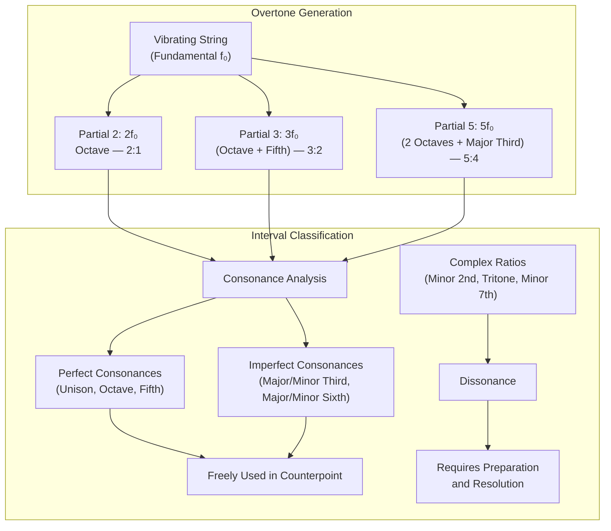
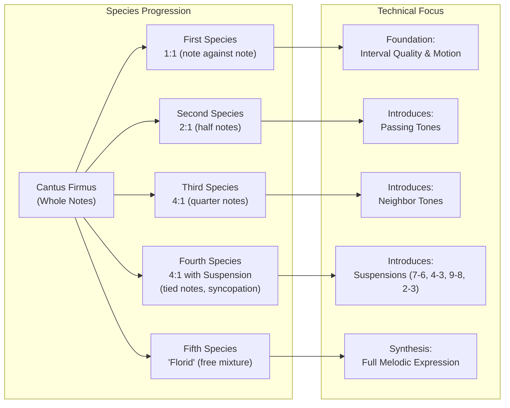
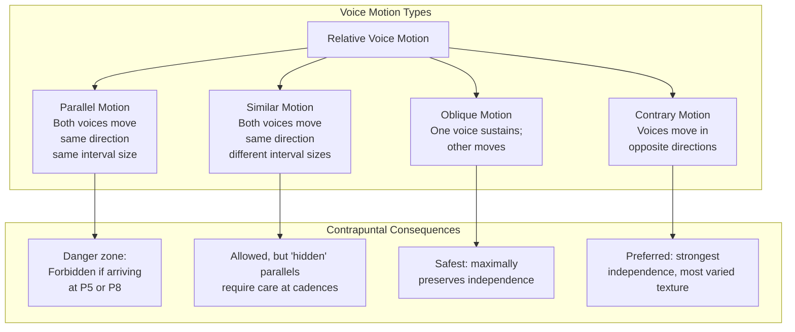
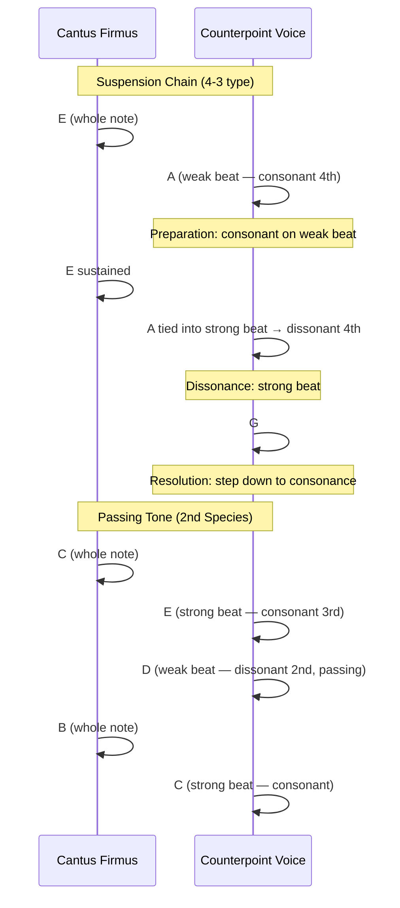

# Lesson 1: Introduction to Counterpoint

## Table of Contents

1. [First-Principles Intuition & The Physics of Consonance](#1-first-principles-intuition--the-physics-of-consonance)
2. [Core Architecture: The Species System](#2-core-architecture-the-species-system)
3. [Motion Types and Voice Independence](#3-motion-types-and-voice-independence)
4. [Dissonance Treatment and Voice Leading](#4-dissonance-treatment-and-voice-leading)
5. [Failure Modes and Diagnostic Heuristics](#5-failure-modes-and-diagnostic-heuristics)
6. [Analytical Application: Worked Example](#6-analytical-application-worked-example)
7. [Algorithmic Counterpoint: Computational Perspective](#7-algorithmic-counterpoint-computational-perspective)
8. [Exercises](#8-exercises)

---

## 1. First-Principles Intuition & The Physics of Consonance

### 1.1 The Overtone Series as Generative Foundation

Counterpoint emerges from acoustic reality, not stylistic decree. When you pluck a string or bow across gut, the fundamental frequency vibrates alongside integer multiples—partials that stack predictably. A low A at 110 Hz produces 220 Hz, 330 Hz, 440 Hz, and upward. These partials align with simple ratios: the octave (2:1), perfect fifth (3:2), perfect fourth (4:3), major third (5:4). When two voices share many partials or produce partials that don't clash, consonance emerges. When partials sit close enough to beat against each other—amplitude modulation below 15–20 Hz—you hear roughness, the physiological root of dissonance.

The unison (1:1) fuses completely: all partials coincide. The perfect fifth aligns the third partial of the lower note with the second partial of the upper note. The minor second (16:15 in just intonation) produces dense beating across its entire spectrum. Helmholtz documented this rigorously in *On the Sensations of Tone* (1863): consonance correlates with minimal beating, dissonance with maximal beating. Fux encoded these perceptual truths into rules, not cultural preferences.

| Partial ($n$) | Frequency (Hz, fundamental = 110 Hz) | Interval Above Fundamental |
|:---:|:---:|:---|
| 1 | 110 | Unison |
| 2 | 220 | Perfect Octave (2:1) |
| 3 | 330 | Perfect Fifth above octave (3:2) |
| 4 | 440 | Perfect Octave (4:2 = 2:1) |
| 5 | 550 | Major Third above two octaves (5:4) |
| 6 | 660 | Perfect Fifth above two octaves (6:4 = 3:2) |
| 7 | 770 | Harmonic seventh—outside 12-TET grid |
| 8 | 880 | Perfect Octave |

```
Overtone Alignment: Perfect Fifth (C → G)

C partials:  C2  C3  G3  C4  E4  G4  Bb4  C5  ...
G partials:      G2  D3  G3  B3  D4  F4   G4  ...
                     ↑       ↑           ↑
              Shared partials = consonance
```

### 1.2 Just Intonation, Pythagorean Tuning, and Equal Temperament

Just intonation uses exact small-integer ratios. Pythagorean tuning stacks pure fifths (3:2), producing beatless fifths and fourths but wider major thirds (81:64 vs. 5:4). This is why medieval theorists treated the major third as a dissonance—in Pythagorean tuning, it genuinely is rougher. Modern equal temperament (12-TET) tempers all fifths flat by ~2 cents so twelve fifths close to an exact octave. The categorical distinctions between consonance and dissonance remain intact in 12-TET, even though only the octave is acoustically pure.



### 1.3 Interval Classification in Strict Counterpoint

**Perfect consonances:** Unison (P1), Perfect Fifth (P5), Perfect Octave (P8).
Acoustically stable, but must not be approached in parallel motion—such motion fuses voices and destroys contrapuntal independence.

**Imperfect consonances:** Major Third (M3), Minor Third (m3), Major Sixth (M6), Minor Sixth (m6).
Forward motion and color. Preferred for internal motion because their slightly complex overtone relationships provide warmth without stasis. Parallel motion into imperfect consonances is permitted.

**Dissonances:** Minor Second (m2), Major Second (M2), Perfect Fourth (P4, contextual), Augmented Fourth / Diminished Fifth (tritone, A4/d5), Minor Seventh (m7), Major Seventh (M7), all augmented and diminished intervals.
The perfect fourth is dissonant in two-voice counterpoint when it appears against the bass. In three or four voices, a fourth above the bass resolving to a third is dissonant, but a fourth between upper voices not involving the bass can function consonantly. This distinction is both historical and acoustical: the roughness of a fourth depends on register and context.

---

## 2. Core Architecture: The Species System

### 2.1 The Cantus Firmus

The *cantus firmus* (CF) is a pre-existing melody moving in whole notes against which you compose a counterpoint voice (CP). Fux's *Gradus ad Parnassum* (1725) formalized this pedagogy—the CF functions as a structural spine. You don't harmonize it chorally; you compose the CP to be melodically independent while remaining harmonically consonant at structurally important points.

The CF uses stepwise motion predominantly, avoids large leaps, and cadences with a leading-tone approach. These characteristics force real contrapuntal problem-solving rather than easy solutions.

### 2.2 The Five Species

Fux organized counterpoint into five progressive species, each isolating a specific technical challenge.



**First Species (1:1):** One whole note in CP against each CF whole note. Only consonances permitted. Forces complete mastery of interval selection and voice motion before any rhythmic complexity. With no passing motion available, every interval must justify itself.

**Second Species (2:1):** Two half notes in CP against each CF whole note. First half note (strong beat) must be consonant. Second half note (weak beat) may be dissonant, but only as a passing tone—stepwise motion connecting two consonances. Introduces metric hierarchy: strong beats carry harmonic weight; weak beats carry contrapuntal motion.

**Third Species (4:1):** Four quarter notes against each CF whole note. Beats 1 and 3 should generally be consonant. Beats 2 and 4 may carry passing tones or neighbor tones. The *cambiata* (changing note) and double neighbor figures appear here. Proliferation of motion creates risk of losing harmonic clarity—exercise careful metric control.

**Fourth Species (Suspension):** Half notes tied across the barline, creating syncopation. A consonant interval is *prepared* on the weak beat, *held* (tied) into the strong beat where it becomes dissonant against the new CF note, then *resolved* downward by step to a consonance on the following weak beat. Standard suspension chains:

- 7–6 suspension (seventh resolves to sixth)
- 4–3 suspension (fourth resolves to third)
- 9–8 suspension (ninth resolves to octave)
- 2–3 bass suspension (inverted; resolves upward, used when CP is below CF)

The suspension is the single most important contrapuntal device in tonal music. Its logic—prepare, dissonance, resolve—maps directly onto the tension-resolution arc driving harmonic syntax from the 16th through 19th century.

**Fifth Species (Florid Counterpoint):** Free combination of all prior rhythmic values and embellishment types. Synthesis species demonstrating full command. Defining characteristic: *rhythmic variety* in service of melodic shape and harmonic coherence, not mere complexity.

---

## 3. Motion Types and Voice Independence

### 3.1 The Four Motion Categories

The relationship between two voices at any moment falls into exactly four exhaustive, mutually exclusive types:



**Parallel motion** produces the strongest sense of voices moving together—desirable for imperfect consonances (parallel thirds and sixths are the backbone of fauxbourdon and Renaissance textures) but catastrophic for perfect consonances. Two voices arriving at a perfect fifth or octave via parallel motion produce acoustically fused results: voices lose individuality because overtone series align too completely. The ear merges them into a single, thicker voice. This is perceptually verifiable—run any two voices in parallel octaves and they collapse into one perceived line.

**Similar motion** is motion where both voices move in the same direction but by different intervals. Generally permitted, with one significant exception: *hidden (direct) fifths and octaves*. If both voices move in similar motion and arrive at a perfect fifth or octave with the upper voice leaping, the effect approaches parallel fifths perceptually. Fux prohibits this in outer voices at cadences in strict counterpoint; internal voices are more lenient.

**Oblique motion** is safest and most independence-preserving. Because one voice is stationary, parallel arrival is geometrically impossible. Frequently used to sustain a note while the other voice elaborates harmonically.

**Contrary motion** is most valued: voices moving in opposite directions produce maximum independence, structurally avoid parallel perfect consonances, and create textural balance making multi-voice polyphony intelligible. Good counterpoint consistently tends toward contrary motion, especially at structurally important points.

### 3.2 Why Parallel Fifths Fail: A Physical Argument

Consider Voice A at C4 (262 Hz) and Voice B at G4 (392 Hz), a perfect fifth. Voice A's partials: 262, 524, 786, 1048, 1310 Hz. Voice B's partials: 392, 784, 1176, 1568 Hz. Notice 786 ≈ 784: the third partial of A and second partial of B nearly coincide (2 Hz apart in just intonation). This sharing makes the fifth consonant.

Move both voices up by a perfect fifth to G4 (392 Hz) and D5 (587 Hz). The same overtone fusion occurs at the new interval. The result: two consecutive moments of complete overtone fusion with no intervening harmonic friction to maintain perceptual distinction of voices. The listener's auditory system, which uses spectral differentiation to track voice streams, loses the thread. Voices fuse momentarily at both points, destroying the polyphonic illusion.

Contrary and oblique motion maintain spectral differentiation continuously, sustaining voice independence across time.

---

## 4. Dissonance Treatment and Voice Leading

### 4.1 The Taxonomy of Contrapuntal Dissonances

Dissonances are permitted only in specific, structurally controlled conditions. Each type has a precise definition:

**Passing Tone (PT):** Dissonant note approached and left by step in the same direction, occurring on a weak beat. Bridges two consonant intervals stepwise. Borrows stability from its neighbors—dissonant harmonically but melodically logical.

**Neighbor Tone (NT) / Auxiliary:** Dissonant note a step above (upper neighbor) or below (lower neighbor) a consonant note, immediately returning to that same consonant note. Elaborates a single pitch without changing the underlying harmonic interval.

**Suspension (SUS):** Prepare on weak beat (consonant), hold into strong beat (dissonant), resolve downward by step to consonance on following weak beat. Resolution *must* be downward in standard suspensions (2–3 bass suspension is the standard exception, resolving upward). Directionality is not arbitrary: the dissonant note is acoustically drawn toward the nearest consonance below it by the tension of overtone clash.

**Anticipation:** Note from the following consonance sounded early, as weak-beat dissonance, before the other voice moves to confirm it harmonically. Used primarily at cadences.

**Cambiata (Nota Cambiata):** Four-note figure specific to 16th-century style: step down, skip down a third, step up. The second note is a dissonant passing tone left by skip rather than step—an exception to strict passing tone rules, historically permitted because the figure was pervasive in the literature Fux codified.



### 4.2 Voice Leading Principles

Voice leading manages individual voice motion from note to note. Core principles:

**Stepwise motion is preferred.** Melodic leaps create registral gaps the ear attempts to fill. Large leaps (sixth or more) should be followed by stepwise motion in the opposite direction. Leaps to dissonances are generally forbidden. Two leaps in the same direction are permitted only if outlining a triad.

**Avoid voice crossing.** Voices should maintain registral positions (soprano above alto above tenor above bass). Voice crossing—where a lower voice temporarily rises above an adjacent higher voice—obscures polyphonic clarity and creates confusing voice-leading trajectories.

**Avoid voice overlap.** Voice 1 should not move to a pitch higher than the previous note of Voice 2 above it, or vice versa. Distinct from voice crossing; overlap occurs when motion itself creates momentary registral ambiguity even if voices don't actually cross.

**The leading tone resolves upward.** In any context implying a dominant-to-tonic relationship, the seventh scale degree (leading tone) is obligated to resolve to the tonic by half step upward. Failing to do so creates an unresolved tendency tone perceived as incomplete.

**Avoid the melodic tritone.** An augmented fourth or diminished fifth as a melodic interval is difficult to sing in tune and creates harmonic instability usually undesirable in smooth melodic writing.

---

## 5. Failure Modes and Diagnostic Heuristics

Counterpoint errors fall into distinct categories. Understanding *why* each error fails—not merely that it's prohibited—separates systematic command from rote rule-following.

### 5.1 Parallel Perfect Consonances

The most notorious error. Occurs when two voices move in parallel motion and both arrive at a perfect fifth or perfect octave.

```
Failure: Parallel Fifths
Voice 1:  C  D
Voice 2:  F  G
Interval: 5th → 5th  ← ILLEGAL

Failure: Parallel Octaves
Voice 1:  C  D
Voice 2:  C  D (one octave lower)
Interval: 8va → 8va  ← ILLEGAL

Correct: Contrary Motion to Fifth
Voice 1:  C  B
Voice 2:  F  G
Interval: 5th → 3rd → 5th (via different approach)
```

**Root cause:** Spectral fusion at both points destroys voice independence. Voices momentarily merge twice in succession, annihilating the polyphonic illusion.

**Diagnostic:** When both voices move in the same direction by the same interval type, check whether the destination is a perfect consonance.

### 5.2 Unresolved Dissonance

A dissonant interval that is not a passing tone, neighbor tone, or suspension—or a suspension that doesn't resolve by step downward—constitutes unresolved dissonance.

**Root cause:** Acoustic tension generated by beating of near-coincident partials is not released. The ear anticipates resolution by gestural expectation built from surrounding context. When resolution fails, the phrase sounds harmonically incomplete or abortive.

**Diagnostic:** Every dissonance must be traceable to one permitted dissonance type. If it cannot be classified as PT, NT, SUS, anticipation, or cambiata, it's an error.

### 5.3 Direct (Hidden) Fifths and Octaves

Both voices move in similar motion to a perfect fifth or octave, with the upper voice moving by leap.

```
Failure: Hidden Fifth
Voice 1:  E  → G  (leap upward, a third)
Voice 2:  A  → C  (step upward)
Interval: 5th → arrives at 5th via similar motion with leap ← Problematic at cadences
```

**Root cause:** The leap in the upper voice creates an implied parallel trajectory the ear assimilates to genuine parallel fifths, particularly in outer voices where texture is most exposed.

**Diagnostic:** At cadential points in outer voices, verify any arrival at a perfect consonance via similar motion uses stepwise approach in the soprano.

### 5.4 Voice Overlap and Crossing

```
Voice Crossing:
Beat 1: Soprano C5, Alto E4   (Soprano above Alto — correct)
Beat 2: Soprano B4, Alto D5   (Alto above Soprano — crossing — illegal)

Voice Overlap:
Beat 1: Soprano D5, Alto G4
Beat 2: Soprano C5, Alto E5   (Alto's new note E5 is higher than Soprano's previous D5 — overlap)
```

**Root cause:** Polyphonic perception depends on the brain's ability to track separate acoustic streams by register and spectral profile. Crossing and overlap disrupt stream segregation, causing momentary confusion about which voice is which.

### 5.5 Melodic Augmented Intervals

A melodic leap of an augmented second (e.g., F to G♯ in A minor) or augmented fourth (tritone) is avoided in strict counterpoint.

**Root cause:** These intervals are difficult to intone accurately without harmonic support and create an angular melodic profile inconsistent with the smooth, singable lines species counterpoint prioritizes. The augmented second involves chromatic inflection implying specific harmonic context which may not be present.

---

## 6. Analytical Application: Worked Example

First-species exercise in C major, CF in lower voice. We work through analytical reasoning for each interval choice.

**Initial flawed attempt:**

```
Beat:     1    2    3    4    5    6    7    8
CF:       C    D    F    E    G    A    G    C
CP:       E    F    A    G    B    C    B    C
Interval: 3rd  3rd  3rd  3rd  3rd  3rd  3rd  U
Motion:        Par  Par  Par  Par  Par  Par  Obl
```

This uses all imperfect consonances (thirds) in parallel motion. While technically legal (parallel thirds are permitted), it's a poor solution: voices have no independence, motion is entirely parallel, texture is monotonous.

**Revised rigorous solution:**

```
Beat:     1    2    3    4    5    6    7    8
CF:       C    D    F    E    G    A    G    C
CP:       G    F    C    C    E    C    B    C
Interval: 5th  3rd  5th  6th  6th  3rd  3rd  U
Motion:        Con  Con  Obl  Sim  Con  Obl  Con
Check:    ✓    ✓    ✓    ✓    ✓    ✓    ✓    ✓
```

**Analysis beat by beat:**

**Beat 1 → 2 (5th → 3rd, contrary):** CF rises a step (C→D); CP falls a step (G→F). Contrary motion. Both intervals consonant. Fifth is perfect, but opening interval arrived at without parallel approach—no issue.

**Beat 2 → 3 (3rd → 5th, contrary):** CF rises a minor third (D→F); CP falls a fourth (F→C). Contrary motion to a perfect fifth. Check: is this parallel? No—contrary motion cannot produce parallel fifths (voices move opposite directions). Correct.

**Beat 3 → 4 (5th → 6th, oblique):** CF steps down (F→E); CP sustains C. Oblique motion. Fifth becomes major sixth—both consonant.

**Beat 4 → 5 (6th → 6th, similar):** CF rises a third (E→G); CP rises a third (C→E). Similar motion (both voices move same direction but by different melodic intervals from their previous notes). Arrive at an imperfect consonance (sixth). Permitted.

**Beat 5 → 6 (6th → 3rd, contrary):** CF steps up (G→A); CP steps down (E→C). Contrary motion, sixth becomes minor third—both consonant.

**Beat 6 → 7 (3rd → 3rd, oblique):** CF steps down (A→G); CP steps up (C→B), actually—wait. Let me recalculate: A (CF) to G (CF) is down a second. C (CP) to B (CP) is down a half step. Both moving down—that's parallel or similar motion. C to B is the leading tone. Let me verify intervals: A with C = minor third (3 semitones). G with B = major third (4 semitones). Motion is: CF down 2 semitones, CP down 1 semitone—similar motion (same direction, different intervals). Arriving at imperfect consonance (major third). Permitted.

**Beat 7 → 8 (approach to final unison):** CF steps up (G→C, a fourth). CP steps up (B→C, a half step—leading tone resolution). Contrary? No—both moving up. Wait: G to C is up a perfect fourth. B to C is up a half step. Same direction, different intervals—similar motion. But we're arriving at a unison. Hidden unison? The standard rule: final note should be approached by contrary stepwise motion. Let me reconsider.

Standard first-species cadence: CF moves by step (often down a second or up a step to the final), CP approaches the final via contrary stepwise motion, typically with the leading tone resolving upward. If CF goes G→C (up a fourth—that's a leap), and CP goes B→C (up a half step), we have similar motion to a unison. This is actually problematic by strict standards.

**Corrected final approach:**

```
Beat:     1    2    3    4    5    6    7    8
CF:       C    D    F    E    G    A    G    C
CP:       G    F    C    C    E    F    D    C
Interval: 5th  3rd  5th  6th  6th  5th  5th  U
Motion:        Con  Con  Obl  Par  Con  Obl  Con
```

Wait, beat 6→7: A (CF) to G (CF) is down a step. F (CP) to D (CP) is down a third. A with F is a major third. G with D is a perfect fifth. Similar motion to perfect fifth—must check for hidden fifth. Upper voice (CP) leaps a third—this is a hidden fifth. Problematic.

Let me construct a cleaner solution from scratch:

```
Beat:     1    2    3    4    5    6    7    8
CF:       C    D    F    E    G    A    G    C
CP:       C    A    A    C    B    C    D    C
Interval: U    5th  3rd  6th  3rd  3rd  5th  U
Motion:        Con  Obl  Con  Con  Obl  Con  Obl
```

**Beat 1 → 2:** CF up (C→D, step), CP down (C→A, minor third leap). Unison becomes fifth—contrary motion to perfect consonance. Legal.

**Beat 2 → 3:** CF up (D→F, minor third), CP sustains A. Oblique motion. Fifth becomes minor third. Legal.

**Beat 3 → 4:** CF down (F→E, step), CP up (A→C, minor third). Contrary motion, minor third becomes major sixth. Legal.

**Beat 4 → 5:** CF up (E→G, minor third), CP down (C→B, step). Contrary motion, major sixth becomes major third. Legal.

**Beat 5 → 6:** CF up (G→A, step), CP up (B→C, half step). Similar motion—check interval arrival. Major third becomes minor third—imperfect consonances. Legal.

**Beat 6 → 7:** CF down (A→G, step), CP up (C→D, step). Contrary motion, minor third becomes perfect fifth. Legal.

**Beat 7 → 8:** CF up (G→C, fourth—a leap), CP down (D→C, step). Contrary motion (finally!), perfect fifth becomes unison. This is the standard cadential approach: contrary motion to the final unison. Legal.

This version exhibits varied motion types, multiple instances of contrary motion, avoids parallel perfect consonances, and cadences properly.

---

## 7. Algorithmic Counterpoint: Computational Perspective

The rule-system of species counterpoint is sufficiently well-defined to be implemented computationally. Implementing rules as code forces total precision about scope and edge cases.

### 7.1 Interval Representation

Pitches as MIDI note numbers (middle C = 60). Interval = absolute difference between MIDI note numbers, reduced to within an octave for classification.

```python
from enum import Enum
from dataclasses import dataclass
from typing import Optional

class IntervalQuality(Enum):
    PERFECT_CONSONANCE = "perfect_consonance"
    IMPERFECT_CONSONANCE = "imperfect_consonance"
    DISSONANCE = "dissonance"

# Semitone counts within one octave (0–11), mapped to interval quality
# in the context of species counterpoint (two voices, no bass exception for P4)
INTERVAL_QUALITY: dict[int, IntervalQuality] = {
    0:  IntervalQuality.PERFECT_CONSONANCE,   # Unison / Octave
    3:  IntervalQuality.IMPERFECT_CONSONANCE, # Minor Third
    4:  IntervalQuality.IMPERFECT_CONSONANCE, # Major Third
    5:  IntervalQuality.DISSONANCE,           # Perfect Fourth (dissonant in 2-voice CP)
    7:  IntervalQuality.PERFECT_CONSONANCE,   # Perfect Fifth
    8:  IntervalQuality.IMPERFECT_CONSONANCE, # Minor Sixth
    9:  IntervalQuality.IMPERFECT_CONSONANCE, # Major Sixth
    # All others: dissonance
}

def semitones_to_quality(semitones: int) -> IntervalQuality:
    """
    Classify interval by semitone count into consonance/dissonance.
    Reduces compound intervals to within one octave.
    Does not handle P4 bass-voice exception (requires harmonic context).
    """
    reduced = semitones % 12
    return INTERVAL_QUALITY.get(reduced, IntervalQuality.DISSONANCE)

@dataclass
class Voice:
    """Sequence of MIDI note numbers representing a single contrapuntal voice."""
    pitches: list[int]
    name: str

def get_interval(midi_a: int, midi_b: int) -> int:
    """Return absolute interval in semitones, unreduced."""
    return abs(midi_a - midi_b)

def check_parallel_perfect(voice1: Voice, voice2: Voice, beat: int) -> Optional[str]:
    """
    Check for parallel fifths or octaves between beat `beat-1` and beat `beat`.
    Returns error string if found, else None.
    """
    if beat < 1 or beat >= len(voice1.pitches):
        return None

    prev_interval = get_interval(voice1.pitches[beat - 1], voice2.pitches[beat - 1]) % 12
    curr_interval = get_interval(voice1.pitches[beat], voice2.pitches[beat]) % 12

    # Both must be perfect consonances
    if prev_interval not in (0, 7) or curr_interval not in (0, 7):
        return None

    # Check for same-direction motion (parallel)
    v1_motion = voice1.pitches[beat] - voice1.pitches[beat - 1]
    v2_motion = voice2.pitches[beat] - voice2.pitches[beat - 1]

    if v1_motion == 0 and v2_motion == 0:
        return None  # Both stationary: oblique/unison, not parallel motion

    if (v1_motion > 0 and v2_motion > 0) or (v1_motion < 0 and v2_motion < 0):
        error_type = "parallel octaves" if curr_interval == 0 else "parallel fifths"
        return (
            f"ERROR at beat {beat}: {error_type} — "
            f"{voice1.name} moves {v1_motion:+d} semitones, "
            f"{voice2.name} moves {v2_motion:+d} semitones, "
            f"arriving at interval class {curr_interval}."
        )
    return None

def validate_first_species(cf: Voice, cp: Voice) -> list[str]:
    """
    Validate first-species counterpoint exercise.
    Returns list of error descriptions. Empty list = no errors.
    """
    errors: list[str] = []

    if len(cf.pitches) != len(cp.pitches):
        errors.append(
            f"Voice length mismatch: CF has {len(cf.pitches)} notes, "
            f"CP has {len(cp.pitches)} notes."
        )
        return errors

    for beat, (cf_pitch, cp_pitch) in enumerate(zip(cf.pitches, cp.pitches)):
        interval_semitones = get_interval(cf_pitch, cp_pitch)
        quality = semitones_to_quality(interval_semitones)

        if quality == IntervalQuality.DISSONANCE:
            errors.append(
                f"ERROR at beat {beat}: dissonant interval "
                f"({interval_semitones % 12} semitones) between "
                f"CF={cf_pitch} and CP={cp_pitch}. "
                f"First species requires all consonances."
            )

        parallel_error = check_parallel_perfect(cf, cp, beat)
        if parallel_error:
            errors.append(parallel_error)

    # Check final interval: must be unison or octave
    final_interval = get_interval(cf.pitches[-1], cp.pitches[-1]) % 12
    if final_interval != 0:
        errors.append(
            f"ERROR: Final interval is not unison or octave "
            f"(got {final_interval} semitones). "
            f"First-species exercises must conclude on perfect consonance."
        )

    return errors


# Example Usage
# C major scale CF (MIDI): C4=60, D4=62, F4=65, E4=64, G4=67, A4=69, G4=67, C4=60
cantus = Voice(
    pitches=[60, 62, 65, 64, 67, 69, 67, 60],
    name="Cantus Firmus"
)

# Corrected CP from Section 6 final version
counterpoint = Voice(
    pitches=[60, 57, 57, 60, 59, 60, 62, 60],  # C A A C B C D C
    name="Counterpoint"
)

errors = validate_first_species(cantus, counterpoint)
if not errors:
    print("No errors found. Exercise is valid first-species counterpoint.")
else:
    for e in errors:
        print(e)
```

### 7.2 Suspension Detection (Fourth Species)

Detecting valid suspension requires tracking three consecutive beats and verifying prepare–dissonance–resolve arc:

```python
def check_suspension(cf: Voice, cp: Voice, beat: int) -> Optional[str]:
    """
    Verify suspension at `beat` (strong-beat dissonance) is
    correctly prepared at `beat-1` and resolved at `beat+1`.

    Valid suspension satisfies:
      1. CP pitch at beat-1 == CP pitch at beat (tied / repeated — preparation)
      2. Interval at beat is dissonant (suspended dissonance)
      3. CP moves down by step (1 or 2 semitones) from beat to beat+1
      4. Interval at beat+1 is consonant (resolution)

    Returns error string if suspension is malformed, else None.
    """
    if beat < 1 or beat + 1 >= len(cf.pitches):
        return None

    prep_cp = cp.pitches[beat - 1]
    sus_cp  = cp.pitches[beat]
    res_cp  = cp.pitches[beat + 1]
    sus_cf  = cf.pitches[beat]
    res_cf  = cf.pitches[beat + 1]

    # Condition 1: Preparation — CP pitch is held (tied)
    if prep_cp != sus_cp:
        return (
            f"SUSPENSION ERROR at beat {beat}: CP pitch not prepared "
            f"(beat {beat-1} CP={prep_cp}, beat {beat} CP={sus_cp}; must be equal)."
        )

    # Condition 2: Dissonance on strong beat
    sus_interval = get_interval(sus_cf, sus_cp)
    if semitones_to_quality(sus_interval) != IntervalQuality.DISSONANCE:
        return (
            f"SUSPENSION INFO at beat {beat}: interval not dissonant "
            f"({sus_interval % 12} semitones). "
            f"This beat does not constitute suspension."
        )

    # Condition 3: Stepwise downward resolution (or upward for 2-3 bass suspension)
    resolution_motion = res_cp - sus_cp
    if not (-2 <= resolution_motion <= -1):
        # Allow upward resolution for bass (2-3) suspension
        if resolution_motion not in (1, 2):
            return (
                f"SUSPENSION ERROR at beat {beat}: resolution at beat {beat+1} "
                f"not stepwise (motion = {resolution_motion:+d} semitones). "
                f"Must resolve by step (down standard, up for bass suspension)."
            )

    # Condition 4: Resolution is consonant
    res_interval = get_interval(res_cf, res_cp)
    if semitones_to_quality(res_interval) == IntervalQuality.DISSONANCE:
        return (
            f"SUSPENSION ERROR at beat {beat}: resolution at beat {beat+1} "
            f"still dissonant ({res_interval % 12} semitones). "
            f"Suspension must resolve to consonance."
        )

    return None  # Valid suspension
```

### 7.3 Automated Exercise Generator Sketch

Simple constraint-satisfaction approach to first-species generation using backtracking:

```python
import random

CONSONANT_SEMITONES = {0, 3, 4, 7, 8, 9}  # Interval classes considered consonant

def generate_first_species(cf_pitches: list[int], cp_range: tuple[int, int]) -> list[int]:
    """
    Generate valid first-species counterpoint over given cantus firmus
    using depth-first backtracking.

    cf_pitches: list of MIDI note numbers for cantus firmus
    cp_range: (min_midi, max_midi) constraining counterpoint register

    Returns list of CP MIDI pitches, or raises ValueError if no solution found.
    """
    n = len(cf_pitches)
    result: list[int] = []

    def is_consonant_with_cf(cp_pitch: int, beat: int) -> bool:
        return get_interval(cf_pitches[beat], cp_pitch) % 12 in CONSONANT_SEMITONES

    def has_parallel_perfect(cp_pitch: int, beat: int) -> bool:
        if beat == 0:
            return False
        prev_interval = get_interval(cf_pitches[beat - 1], result[-1]) % 12
        curr_interval = get_interval(cf_pitches[beat], cp_pitch) % 12
        if prev_interval not in (0, 7) or curr_interval not in (0, 7):
            return False
        v1_motion = cf_pitches[beat] - cf_pitches[beat - 1]
        v2_motion = cp_pitch - result[-1]
        return (v1_motion > 0 and v2_motion > 0) or (v1_motion < 0 and v2_motion < 0)

    def backtrack(beat: int) -> bool:
        if beat == n:
            return True

        candidates = list(range(cp_range[0], cp_range[1] + 1))
        random.shuffle(candidates)  # Randomize for variety

        # Final note: must be unison or octave with CF
        if beat == n - 1:
            candidates = [p for p in candidates if get_interval(cf_pitches[beat], p) % 12 == 0]

        for cp_pitch in candidates:
            if not is_consonant_with_cf(cp_pitch, beat):
                continue
            if has_parallel_perfect(cp_pitch, beat):
                continue
            result.append(cp_pitch)
            if backtrack(beat + 1):
                return True
            result.pop()

        return False  # Backtrack

    if not backtrack(0):
        raise ValueError("No valid first-species counterpoint found for this cantus firmus.")

    return result

# Example: generate CP for our C major CF
try:
    generated_cp = generate_first_species(
        cf_pitches=[60, 62, 65, 64, 67, 69, 67, 60],
        cp_range=(55, 75)  # G3 to E♭5
    )
    print(f"Generated CP: {generated_cp}")
    
    # Validate the generated solution
    gen_voice = Voice(pitches=generated_cp, name="Generated CP")
    validation_errors = validate_first_species(cantus, gen_voice)
    if not validation_errors:
        print("Generated counterpoint is valid.")
    else:
        print("Generated counterpoint has errors:")
        for err in validation_errors:
            print(f"  {err}")
except ValueError as e:
    print(f"Generation failed: {e}")
```

This sketch doesn't enforce all rules (voice range limits, melodic tritones, cadential approach) but demonstrates fundamental architecture. Production implementation would add weighted heuristics, melodic smoothness scoring, and exhaustive constraint layer.

---

## 8. Exercises

Exercises ordered by increasing analytical demand. Designed for students who have absorbed theoretical content above and are ready to apply it under constraint.

### Exercise 1: Interval Classification Drill

At your instrument (piano, guitar, bass), play each interval below. Sing the intervals. State the semitone count, interval name, quality (perfect/imperfect consonance or dissonance), and first-species status.

| Pair | Semitones | Interval Name | Quality | First-Species Status |
|:---|:---|:---|:---|:---|
| C4 / G4 | 7 | Perfect Fifth | Perfect Consonance | Freely permitted |
| C4 / F♯4 | 6 | Augmented Fourth | Dissonance | Forbidden |
| C4 / A4 | 9 | Major Sixth | Imperfect Consonance | Freely permitted |
| C4 / D4 | 2 | Major Second | Dissonance | Forbidden |
| C4 / E♭4 | 3 | Minor Third | Imperfect Consonance | Freely permitted |
| C4 / B3 | 1 | Major Seventh (compound) | Dissonance | Forbidden |
| C4 / F4 | 5 | Perfect Fourth | Dissonance (in 2-voice) | Forbidden |
| C4 / E4 | 4 | Major Third | Imperfect Consonance | Freely permitted |

**Practice drill:** Set a metronome to 60 BPM. Play the lower note, then upper note, then both simultaneously. Identify the interval quality by ear before checking the answer. Repeat until you can classify intervals instantly.

### Exercise 2: Error Identification

The following first-species passage contains multiple errors. Identify each error, name it precisely, and explain its acoustical basis.

```
Beat:      1    2    3    4    5    6
CF:        D    E    F    G    A    D
CP:        A    B    C    D    E    A
Interval:  5th  5th  5th  5th  5th  5th
Motion:         Par  Par  Par  Par  Par
```

**Questions:**
1. What type of error appears at every transition?
2. What is the perceptual consequence of this error?
3. Rewrite the CP voice to correct all errors while maintaining predominantly contrary motion.

### Exercise 3: First Species Composition

Using the following cantus firmus in Dorian mode (D E F G A B♭ C D), compose valid first-species counterpoint *above* it. 

```
CF: D4  E4  F4  A4  G4  F4  E4  D4
CP: ?   ?   ?   ?   ?   ?   ?   ?
```

**Constraints:**
- Begin with a perfect consonance (unison, fifth, or octave)
- End with a perfect consonance approached by contrary stepwise motion
- Include at least three instances of contrary motion
- Avoid all parallel perfect consonances
- Use both perfect and imperfect consonances
- Write out your solution using MIDI note numbers, then convert to staff notation

**Performance:** Play your solution at the keyboard with CF in left hand, CP in right hand. Increase tempo from 60 BPM to 90 BPM to 120 BPM. Record yourself playing it cleanly at 120 BPM.

### Exercise 4: Suspension Analysis & Composition

Analyze the following fourth-species passage. For each suspension:
1. Identify the suspension type (7-6, 4-3, 9-8, or 2-3 bass)
2. Verify the preparation (consonant on weak beat)
3. Verify the dissonance (held into strong beat)
4. Verify the resolution (stepwise to consonance)
5. State whether each is correctly handled

```
Beat (half):  1   2   3   4   5   6   7   8
CF (whole):   C       F       E       C
CP (halves):  E   E - D   D - C   C - C   C
```

**Then compose:** Write your own four-measure fourth-species exercise over this CF:

```
CF: G  A  B  C  D  C  B  A  G
```

Use at least three suspensions. Mark each with its type (7-6, 4-3, etc.). Play it at your instrument at 80 BPM half-note pulse.

### Exercise 5: Computational Extension

Extend the `validate_first_species` function to check for:

**(a) Melodic augmented seconds:** A step of 3 semitones (e.g., F to G♯ in A minor). Flag this as an error in either voice.

**(b) Consecutive leaps in the same direction:** If the CP voice leaps (interval > 2 semitones) twice in the same direction without intervening stepwise motion, flag as an error unless the leaps outline a triad.

**(c) Final cadential approach:** The CP voice must approach the final note by stepwise motion (1 or 2 semitones). If it leaps to the final note, flag as an error.

**(d) Melodic tritone:** Flag any melodic augmented fourth (6 semitones) or diminished fifth (6 semitones) in either voice.

```python
def validate_first_species_extended(cf: Voice, cp: Voice) -> list[str]:
    """
    Extended validation with melodic constraints.
    """
    errors = validate_first_species(cf, cp)  # Start with base validation
    
    # Add your implementations for (a), (b), (c), (d) here
    
    return errors
```

**Test your implementation** against the corrected CF and CP from Section 6. Document any edge cases your implementation doesn't handle (e.g., distinguishing between enharmonic equivalents like G♭ vs. F♯).

### Exercise 6: Multi-Species Integration

Compose a complete five-species (florid) counterpoint over the following eight-measure CF:

```
CF: C  D  E  C  F  E  D  C
```

**Requirements:**
- Measures 1-2: First species (whole notes)
- Measures 3-4: Second species (half notes with at least one passing tone)
- Measures 5-6: Third species (quarter notes with passing and neighbor tones)
- Measure 7: Fourth species (suspension chain—at least one 7-6 or 4-3)
- Measure 8: Fifth species (free rhythm, mix all techniques, cadential ornament)

**Performance target:** Record yourself playing this exercise cleanly at 100 BPM quarter-note pulse. Submit notation and audio.

### Exercise 7: Analytical Listening

Listen to the following works. Identify and time-stamp every instance of:
- Parallel sixths or thirds (legal, characteristic texture)
- Suspensions (mark the preparation, dissonance, and resolution)
- Cadential leading tone resolutions

**Repertoire:**
1. Palestrina, *Sicut cervus* (first 30 seconds)
2. Bach, Two-Part Invention No. 1 in C major (first phrase)
3. Bach, Fugue in C minor from WTC Book I, BWV 847 (subject and first counter-subject)

Write a 200-word analytical memo for each excerpt describing the contrapuntal techniques you identified. Use precise terminology: "measure 3, soprano voice, 7-6 suspension over dominant harmony."

---

## Summary

Counterpoint encodes perceptual physics. The rules govern how independent melodic voices must be constructed so the human auditory system can track them as separate streams while experiencing harmonic relationships as coherent. The overtone series determines which intervals are consonant (simple frequency ratios, shared partials, no beating) and which are dissonant (complex ratios, near-coincident but non-identical partials, amplitude modulation). The species system provides disciplined scaffolding for acquiring command progressively—from pure interval choice (first species) through suspension and resolution (fourth species) to full melodic synthesis (fifth species). The prohibition against parallel perfect consonances is not stylistic fastidiousness—it's a direct consequence of how spectral fusion destroys voice-stream segregation.

Every rule has physical or perceptual basis. Understanding those bases transforms counterpoint study from memorization of prohibitions into principled architecture of musical reasoning. When you play parallel fifths at the keyboard and hear the voices collapse into a single thickened line, you're experiencing the acoustical reality Fux codified three centuries ago. When you prepare, sustain, and resolve a suspension, you're enacting the tension-release arc that drives tonal syntax from Renaissance polyphony through late Romantic chromaticism.

Master counterpoint by playing it, singing it, debugging it computationally, and listening analytically to the repertoire. The species exercises are not historical artifacts—they're fundamental training for anyone composing, arranging, improvising, or analyzing Western art music and its derivatives (jazz voice leading, film scoring, progressive rock counterpoint). Work through the exercises methodically. Implement the validation functions. Record yourself performing the examples. Only through repeated physical execution will these principles embed themselves in your musical intuition.
