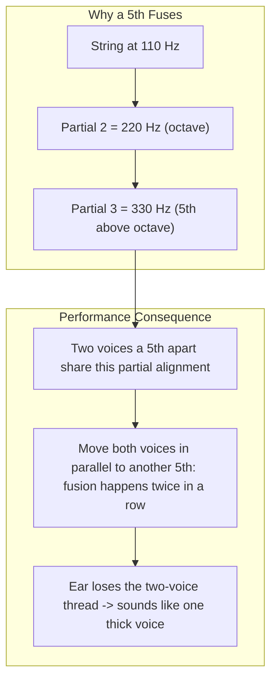
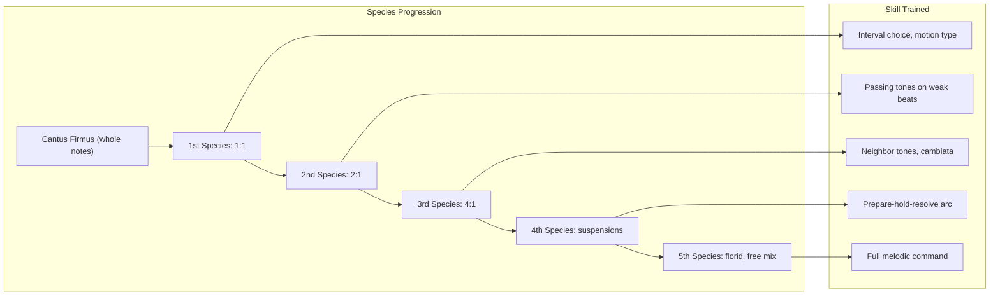
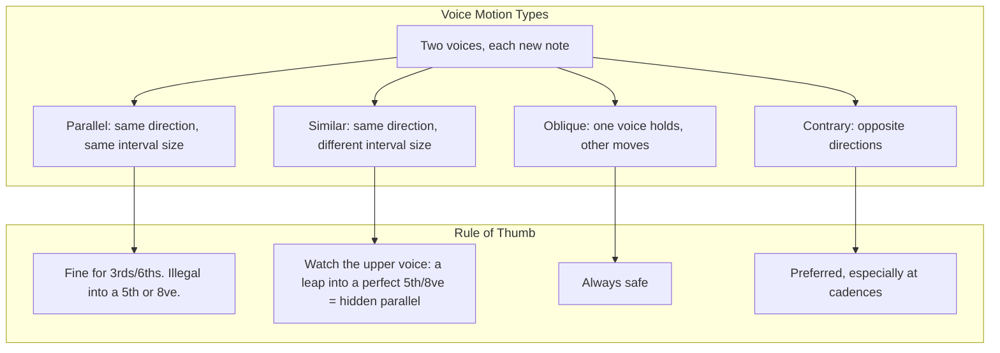

# Lesson 1: Species Counterpoint at the Keyboard

## Table of Contents

1. [Why These Rules Exist: A 15% Primer on Consonance](#1-why-these-rules-exist-a-15-primer-on-consonance)
2. [Setting Up to Practice: Hand Position and Two-Voice Reading](#2-setting-up-to-practice-hand-position-and-two-voice-reading)
3. [The Five Species: What Each One Trains](#3-the-five-species-what-each-one-trains)
4. [Motion Types: Playing and Hearing the Difference](#4-motion-types-playing-and-hearing-the-difference)
5. [Dissonance Treatment: Suspensions You Can Feel Under Your Fingers](#5-dissonance-treatment-suspensions-you-can-feel-under-your-fingers)
6. [Troubleshooting: Diagnosing Your Own Counterpoint](#6-troubleshooting-diagnosing-your-own-counterpoint)
7. [Full Worked Example, Built Correctly the First Time](#7-full-worked-example-built-correctly-the-first-time)
8. [Automated Checking: A Validator You Can Actually Use](#8-automated-checking-a-validator-you-can-actually-use)
9. [Practice Plan and Exercises](#9-practice-plan-and-exercises)

---

## 1. Why These Rules Exist: A 15% Primer on Consonance

Pluck an open low A on a bass or bowed string: the string doesn't just vibrate at one frequency, it vibrates simultaneously at whole-number multiples of that frequency (110 Hz, 220 Hz, 330 Hz, 440 Hz...). These are partials. When two notes share many partials or their partials don't sit close enough to beat against each other, you get consonance. When partials land close together — beating in the 15-20 Hz range — you get the rough, buzzing quality we call dissonance. A perfect fifth (3:2 ratio) lines up the 3rd partial of the lower note with the 2nd partial of the upper note almost exactly, which is why it sounds stable and *fused*. That same fusion is exactly what makes parallel fifths a problem for two independent voices: fuse twice in a row and the ear stops tracking two lines and hears one thickened line instead.

| Interval | Ratio | Feel | Status in strict counterpoint |
|:---|:---:|:---|:---|
| Unison | 1:1 | Total fusion | Perfect consonance |
| Octave | 2:1 | Near-total fusion | Perfect consonance |
| Perfect 5th | 3:2 | Stable, hollow | Perfect consonance |
| Major/minor 3rd, 6th | 5:4, 6:5, 5:3, 8:5 | Warm, has motion | Imperfect consonance |
| 2nds, 7ths, tritone | complex ratios | Beating, tense | Dissonance — controlled use only |

That's the entire physics lesson you need. Everything from here is ear training and hand training: you will *play* these intervals until "perfect fifth" and "major third" are muscle memory, not math.



---

## 2. Setting Up to Practice: Hand Position and Two-Voice Reading

You will play the cantus firmus (CF) and counterpoint (CP) voices yourself, hands together, at the piano. This is not optional reading practice — contrapuntal errors are far easier to *hear* than to spot on paper, and your hands need to internalize voice-leading shapes.

**Hand assignment convention for this lesson:**
- Left hand plays the CF (whole notes, slow and steady).
- Right hand plays the CP (the voice you're composing/analyzing).
- Both hands use fingers 2 or 3 primarily for single melodic lines — keep fingers curved, wrist level, no gripping. You are not playing chords, you're playing two independent singing lines, so treat each hand like a vocalist: smooth transitions, no accents on note changes unless the rhythm calls for it.

**Reading drill before any composition work:** play the two memorized voices from Section 7 hands-together at 60 BPM, one beat per quarter note, until you can do it without looking at your hands. This builds the physical sense of "voices moving apart" (contrary motion) versus "voices moving together" (parallel/similar) before you ever analyze it on paper.

**Singing check:** sing the CP line while playing only the CF with your left hand. If you can't sing your own counterpoint voice in tune, it has a melodic problem (usually an awkward leap or hidden tritone) regardless of whether it passes the harmonic rules.

---

## 3. The Five Species: What Each One Trains



**First Species (1:1).** One note in CP per CF note. Every single interval must be a consonance (perfect or imperfect) — there is no passing motion to hide behind. This is where you build instant interval recognition. **Keyboard drill:** play CF in the left hand, then before playing the CP note, say the interval name out loud ("sixth... down to a third..."). Do this at 50 BPM until naming is instant, then remove the verbal step.

**Second Species (2:1).** Two CP notes per CF note. The first (strong beat, downbeat) must be consonant. The second (weak beat, the "and") can be a dissonant **passing tone** — a stepwise note connecting two consonances in the same direction. Practically: if your CP skips a note on the weak beat, it can't be a passing tone; passing tones *must* move by a single step in one direction, filling a melodic gap (e.g., C up to E becomes C-D-E across the two beats, D is the passing tone).

**Third Species (4:1).** Four CP notes per CF note. Beats 1 and 3 generally consonant; beats 2 and 4 carry passing tones, neighbor tones, or the *cambiata* figure (step down, skip down a third, step up — a four-note shape where the second note is a skipped-away dissonance, an old exception baked into the style). At the keyboard this species moves fast enough that finger independence matters: practice the quarter-note CP alone, hands separately, at 70 BPM before combining with the CF.

**Fourth Species (suspension/syncopation).** Half notes tied across the barline. This is the single most important pattern in this entire lesson — see Section 5, it gets its own full treatment because the physical feel of "hold through the dissonance, then release downward" is the core gesture of tonal tension-and-release.

**Fifth Species (florid).** Free mixture of everything above, in service of melodic shape rather than rhythmic display. Treat it as a performance piece: once the rules are internalized, this species is about phrasing, dynamics, and musicality, not rule-checking.

**Metronome progression for all species:** learn each hand alone at 60 BPM, combine hands at 50 BPM, then move 60 → 80 → 100 → 120 BPM only once you can play three consecutive error-free repetitions at the current tempo.

---

## 4. Motion Types: Playing and Hearing the Difference



**Hands-on test for parallel fifths.** Play this at the keyboard slowly, listening specifically for the moment the two voices seem to "collapse":

```text
Right hand (CP):  C4  D4
Left hand (CF):   F3  G3
Interval:         5th  5th   <- ILLEGAL, play it and listen for the fusion
```

Now play the fix, contrary motion into the same destination fifth:

```text
Right hand (CP):  B3  C4
Left hand (CF):   F3  G3
Interval:         ... voices converge from a sixth into a fifth, from opposite directions
```

You should be able to hear the difference: the first example sounds like one note doubled, thickening. The second sounds like two lines meeting. This ear-training distinction matters more than memorizing the rule — once you can hear it, you'll catch parallel fifths in your own playing before you even check the page.

**Practice routine:** take any five-note scale fragment in the left hand. Improvise a right-hand line against it using only contrary motion for four full minutes. Then switch to oblique motion only (hold one note while the other moves) for four minutes. This isolates each motion type in your hands before you need to mix them.

---

## 5. Dissonance Treatment: Suspensions You Can Feel Under Your Fingers

The suspension is a three-step physical gesture: **prepare (consonant) → hold into dissonance → resolve down by step (consonant)**. Learn this as a hand motion, not a rule.

**4-3 suspension drill at the keyboard**, slow tempo (quarter note = 50 BPM):

```text
Beat:        1 (weak)         2 (strong)         3 (weak, resolution)
CF (LH):     C                F                   F
CP (RH):     F  <- prepared   F  <- held/tied,     E  <- step down
             (consonant 4th    now a dissonant      (consonant 3rd)
              against C? No    4th against F
              — check against
              upcoming F: it's
              a perfect 4th,
              consonant as
              preparation)
```

Walk through the physical motion: your right-hand finger does **not move** between beat 1 and beat 2 — it's the same key held or re-struck identically (a tie). The *bass* moves underneath you, turning a formerly-consonant interval into a dissonant one without your hand doing anything. Then on the resolution, your right-hand finger drops one key to the left (down a step). That downward drop is the resolution gesture — practice it as a physical reflex: hold, then release down.

**Standard suspension types, with the finger-feel:**

| Type | Dissonant interval (held) | Resolves to | Feel |
|:---|:---|:---|:---|
| 7–6 | Major/minor 7th | 6th | Hold, drop a step, interval widens from 7th to 6th |
| 4–3 | Perfect 4th | 3rd | Hold, drop a step, interval narrows from 4th to 3rd |
| 9–8 | Major/minor 9th (compound 2nd) | Octave | Hold, drop a step, interval narrows to octave |
| 2–3 (bass suspension) | 2nd | 3rd | The *lower* voice holds and resolves **up** a step — the only standard upward resolution |

**Why downward resolution dominates:** the dissonant note is the "leftover" from the previous chord clashing against new harmony underneath it. The nearest consonance is almost always a step below, and resolving there releases the beating with minimal melodic disruption. The 2-3 bass suspension flips this only because the suspended voice is in the bass and the chord above it needs the resolution note to complete a third above the new bass note, which sits a step higher.

**Drill sequence for suspensions (practice daily for one week):**
1. Play the 4-3 pattern above in C major, then transpose to G major, D major, F major — same shape, moved.
2. Chain two suspensions back to back: 7-6 followed immediately by 4-3 over a stepwise-descending bass. This is the "suspension chain" you'll meet in real repertoire (Corelli, Bach slow movements).
3. Once comfortable at 50 BPM, raise to 70 BPM, then 90 BPM. Suspensions played too fast lose their expressive weight — the "hold" needs to register with the ear, so don't rush past 90 BPM until the slower tempo is unshakeable.

---

## 6. Troubleshooting: Diagnosing Your Own Counterpoint

When your own exercise sounds wrong at the keyboard, run this checklist in order — it's ordered from most common/most audible errors to subtler ones.

### 6.1 "It sounds like the voices merged into one line"
**Cause:** parallel perfect consonances (5ths or 8ves). **Check:** find the two beats where it happened, confirm both voices moved the *same direction* by the *same interval class*, landing on a 5th or 8ve both times.
**Fix:** change one voice's approach note so the motion becomes contrary or oblique into that same destination interval.

### 6.2 "There's a harsh note that never gets resolved"
**Cause:** unresolved dissonance — a note that isn't a passing tone, neighbor tone, suspension, anticipation, or cambiata.
**Check:** can you name which of those five categories it belongs to? If not, it's an error, full stop.
**Fix:** either reclassify its context (move it to a weak beat so it qualifies as a passing/neighbor tone) or replace it with a consonance.

### 6.3 "It's legal on paper but sounds like parallel fifths anyway"
**Cause:** hidden (direct) fifths/octaves — similar motion where the upper voice *leaps* into a perfect consonance.
**Check:** at your cadence, does the top voice jump (not step) into the final 5th or 8ve while the other voice moves the same direction?
**Fix:** approach the final perfect consonance by step in the upper voice, ideally via contrary motion.

### 6.4 "The alto/lower voice crosses above the soprano/upper voice"
**Cause:** voice crossing. Less common at the keyboard with only two hands, but check it anyway when voicing three or four parts.
**Fix:** redistribute the offending note to stay within each voice's assigned register band.

### 6.5 "A melodic leap feels impossible to sing in tune"
**Cause:** melodic tritone or augmented second. Play the suspect interval melodically (not harmonically) and try to sing it back.
**Fix:** insert an intervening step-wise note, or reverse the leap direction so it resolves by step immediately after.

```text
Failure: Parallel Fifths               Correct: Contrary Motion to Fifth
RH:  C4  D4                            RH:  C4  B3
LH:  F3  G3                            LH:  F3  G3
Int: 5th  5th  <- ILLEGAL              Int: 4th  5th  <- opposite-direction approach
```

---

## 7. Full Worked Example, Built Correctly the First Time

First species, C major, CF in the left hand (lower voice). Rather than show failed attempts and patch them, here is a solution built with motion type decided *before* pitch — which is the practical compositional order: decide what kind of motion you want against each CF note, then pick the pitch that satisfies it.

```text
Beat:       1    2    3    4    5    6    7    8
CF (LH):    C4   D4   F4   E4   G4   A4   G4   C4
CP (RH):    C5   A4   A4   C5   B4   C5   D5   C5
Interval:   U(8) m6   m3   M6   M3   m3   P5   U(8)
Motion:          Con  Obl  Con  Con  Obl  Con  Obl
```

**Beat 1→2:** CF rises a step (C→D); CP falls a minor third (C5→A4). Opposite directions = contrary motion. Octave becomes a sixth, both consonant.

**Beat 2→3:** CF rises a third (D→F); CP sustains A4. Oblique motion. Sixth becomes a third, both consonant. Oblique motion is geometrically incapable of producing parallel perfect intervals, so this transition needs no further check.

**Beat 3→4:** CF falls a step (F→E); CP rises a third (A4→C5). Opposite directions = contrary. Third becomes a sixth, consonant.

**Beat 4→5:** CF rises a third (E→G); CP falls a step (C5→B4). Contrary motion. Sixth becomes a third, consonant.

**Beat 5→6:** CF rises a step (G→A); CP rises a step (B4→C5). Same direction = similar or parallel — check interval sizes: CF moves 2 semitones, CP moves 1 semitone, so this is *similar* motion (same direction, different size), not parallel. Landing interval is a minor third (imperfect consonance) — similar motion into an imperfect consonance carries no restriction.

**Beat 6→7:** CF falls a step (A→G); CP rises a step (C5→D5). Opposite directions = contrary. Third becomes a perfect fifth — contrary motion can never produce parallel fifths since the voices are moving apart, so this is fully legal despite landing on a perfect consonance.

**Beat 7→8 (cadence):** CF rises a fourth (G→C, a leap); CP falls a step (D5→C5). Opposite directions = contrary, and critically the *upper* voice (CP) moves by step into the final unison/octave — this is the textbook cadential approach, avoiding any hidden-octave problem because the leap is in the lower voice, not the upper one.

**Why this solution is good, not just legal:** it contains four instances of contrary motion (the most valued type), uses both perfect and imperfect consonances, never repeats the same interval type twice in a row except where oblique motion makes repetition safe, and the CP melodic line itself is smooth — no leap larger than a third, and the one leap at beat 1→2 is immediately followed by stepwise motion in the opposite direction at beat 2→3 (C5 down to A4, then A4 held, then up to C5 — the leap is "filled in" shortly after, a standard good-voice-leading pattern).

**Play this now.** Left hand CF, right hand CP, at 60 BPM, four repetitions. Then sing the CP line while your left hand alone plays the CF. Then swap: sing the CF while your right hand plays the CP. This cross-training is what makes voice independence physical rather than theoretical.

---

## 8. Automated Checking: A Validator You Can Actually Use

Use this to check your own written exercises before you spend practice time learning something with an embedded parallel-fifths error. Pitches are MIDI numbers (middle C = 60); run it with Python 3.10+.

```python
from enum import Enum
from dataclasses import dataclass
from typing import Optional

class IntervalQuality(Enum):
    PERFECT_CONSONANCE = "perfect_consonance"
    IMPERFECT_CONSONANCE = "imperfect_consonance"
    DISSONANCE = "dissonance"

# Semitone classes (0-11) mapped to quality for two-voice species counterpoint.
# P4 (5 semitones) is treated as dissonant, the standard two-voice convention.
INTERVAL_QUALITY: dict[int, IntervalQuality] = {
    0: IntervalQuality.PERFECT_CONSONANCE,     # Unison / Octave
    3: IntervalQuality.IMPERFECT_CONSONANCE,   # Minor Third
    4: IntervalQuality.IMPERFECT_CONSONANCE,   # Major Third
    5: IntervalQuality.DISSONANCE,             # Perfect Fourth (2-voice context)
    7: IntervalQuality.PERFECT_CONSONANCE,     # Perfect Fifth
    8: IntervalQuality.IMPERFECT_CONSONANCE,   # Minor Sixth
    9: IntervalQuality.IMPERFECT_CONSONANCE,   # Major Sixth
}

def semitones_to_quality(semitones: int) -> IntervalQuality:
    return INTERVAL_QUALITY.get(semitones % 12, IntervalQuality.DISSONANCE)

@dataclass
class Voice:
    pitches: list[int]
    name: str

def get_interval(a: int, b: int) -> int:
    return abs(a - b)

def check_parallel_perfect(v1: Voice, v2: Voice, beat: int) -> Optional[str]:
    """Flag parallel fifths/octaves between beat-1 and beat."""
    if beat < 1:
        return None
    prev = get_interval(v1.pitches[beat - 1], v2.pitches[beat - 1]) % 12
    curr = get_interval(v1.pitches[beat], v2.pitches[beat]) % 12
    if prev not in (0, 7) or curr not in (0, 7):
        return None
    m1 = v1.pitches[beat] - v1.pitches[beat - 1]
    m2 = v2.pitches[beat] - v2.pitches[beat - 1]
    if m1 == 0 or m2 == 0:
        return None  # oblique motion, cannot be parallel
    if (m1 > 0 and m2 > 0) or (m1 < 0 and m2 < 0):
        kind = "parallel octaves" if curr == 0 else "parallel fifths"
        return (f"Beat {beat}: {kind} — {v1.name} moves {m1:+d} st, "
                f"{v2.name} moves {m2:+d} st, landing interval class {curr}.")
    return None

def check_hidden_perfect(v1: Voice, v2: Voice, beat: int, upper_is_v1: bool = True) -> Optional[str]:
    """Flag hidden (direct) 5ths/8ves: similar motion, upper voice leaps, lands on perfect."""
    if beat < 1:
        return None
    curr = get_interval(v1.pitches[beat], v2.pitches[beat]) % 12
    if curr not in (0, 7):
        return None
    m1 = v1.pitches[beat] - v1.pitches[beat - 1]
    m2 = v2.pitches[beat] - v2.pitches[beat - 1]
    same_direction = (m1 > 0 and m2 > 0) or (m1 < 0 and m2 < 0)
    if not same_direction or m1 == 0 or m2 == 0:
        return None
    upper_motion = m1 if upper_is_v1 else m2
    if abs(upper_motion) > 2:  # leap in the upper voice
        return (f"Beat {beat}: hidden perfect consonance — upper voice leaps "
                f"{upper_motion:+d} st into interval class {curr}.")
    return None

def validate_first_species(cf: Voice, cp: Voice) -> list[str]:
    errors: list[str] = []
    if len(cf.pitches) != len(cp.pitches):
        return [f"Length mismatch: CF={len(cf.pitches)}, CP={len(cp.pitches)}."]

    for beat, (cf_p, cp_p) in enumerate(zip(cf.pitches, cp.pitches)):
        interval = get_interval(cf_p, cp_p)
        if semitones_to_quality(interval) == IntervalQuality.DISSONANCE:
            errors.append(f"Beat {beat}: dissonant interval ({interval % 12} st) "
                          f"between CF={cf_p} and CP={cp_p}.")
        err = check_parallel_perfect(cf, cp, beat)
        if err:
            errors.append(err)
        err = check_hidden_perfect(cf, cp, beat, upper_is_v1=False)  # CP (v2) is upper here
        if err:
            errors.append(err)

    final = get_interval(cf.pitches[-1], cp.pitches[-1]) % 12
    if final != 0:
        errors.append(f"Final interval is not a unison/octave (got {final} st).")
    return errors


# Section 7 solution, checked:
cantus = Voice(pitches=[60, 62, 65, 64, 67, 69, 67, 60], name="CF")
counterpoint = Voice(pitches=[72, 69, 69, 72, 71, 72, 74, 72], name="CP")  # C5 A4 A4 C5 B4 C5 D5 C5

errors = validate_first_species(cantus, counterpoint)
print("No errors — valid first species." if not errors else "\n".join(errors))
```

Run this on your own exercises before practicing them at the keyboard. It catches the two most common written errors — unresolved dissonance and parallel/hidden perfect consonances — in seconds, leaving your practice time for the ear and the hands rather than for proofreading.

**Suspension checker** for fourth-species work, verifying the prepare-hold-resolve arc:

```python
def check_suspension(cf: Voice, cp: Voice, beat: int) -> Optional[str]:
    """
    Verify a suspension at `beat`: CP note tied from beat-1 (preparation),
    dissonant against cf at `beat`, resolves by step at beat+1.
    """
    if beat < 1 or beat + 1 >= len(cf.pitches):
        return None

    prep, sus, res = cp.pitches[beat - 1], cp.pitches[beat], cp.pitches[beat + 1]
    sus_cf, res_cf = cf.pitches[beat], cf.pitches[beat + 1]

    if prep != sus:
        return f"Beat {beat}: suspension not prepared (CP changes from {prep} to {sus})."

    sus_interval = get_interval(sus_cf, sus)
    if semitones_to_quality(sus_interval) != IntervalQuality.DISSONANCE:
        return None  # not a suspension beat, nothing to flag

    motion = res - sus
    if motion not in (-2, -1, 1, 2):
        return f"Beat {beat}: resolution not stepwise (motion {motion:+d} st)."

    res_interval = get_interval(res_cf, res)
    if semitones_to_quality(res_interval) == IntervalQuality.DISSONANCE:
        return f"Beat {beat}: resolution still dissonant ({res_interval % 12} st)."

    return None  # valid suspension
```

---

## 9. Practice Plan and Exercises

Work through these in order. Each one asks you to play, not just write.

### Exercise 1 — Interval Recognition at the Keyboard (daily, 10 minutes)

Metronome at 60 BPM. For each pair below: play the lower note, then upper note, then both together. Name the interval and its quality *before* checking the table.

| Pair | Semitones | Name | Quality | 1st-species status |
|:---|:---:|:---|:---|:---|
| C4–G4 | 7 | Perfect 5th | Perfect consonance | Free |
| C4–F♯4 | 6 | Augmented 4th | Dissonance | Forbidden |
| C4–A4 | 9 | Major 6th | Imperfect consonance | Free |
| C4–D4 | 2 | Major 2nd | Dissonance | Forbidden |
| C4–E♭4 | 3 | Minor 3rd | Imperfect consonance | Free |
| C4–F4 | 5 | Perfect 4th | Dissonance (2-voice) | Forbidden |
| C4–E4 | 4 | Major 3rd | Imperfect consonance | Free |

Goal: instant recognition by beat 20 of the week. Track your error rate daily.

### Exercise 2 — Fix This by Ear First, Then on Paper

```text
Beat:      1    2    3    4    5    6
CF:        D    E    F    G    A    D
CP:        A    B    C    D    E    A
Interval:  5th  5th  5th  5th  5th  5th
```

Play it exactly as written at the keyboard. You should hear the voices fuse. Then rewrite the CP voice using predominantly contrary motion, keeping at least three perfect consonances but approaching them from different directions each time. Play your fix immediately after the broken version so you can hear the contrast.

### Exercise 3 — First-Species Composition, Dorian Cantus Firmus

```text
CF: D4  E4  F4  A4  G4  F4  E4  D4
```

Compose CP above it. Constraints: begin and end on a perfect consonance, approach the final note by contrary stepwise motion, include at least three instances of contrary motion, zero parallel perfect consonances, use both perfect and imperfect consonances. Run it through the Section 8 validator before practicing. Then play hands-together at 60 → 90 → 120 BPM, three clean repetitions at each tempo before moving up.

### Exercise 4 — Suspension Chain, Composition and Performance

```text
CF: G  A  B  C  D  C  B  A  G
```

Write a fourth-species line with at least three suspensions, labeling each (7-6, 4-3, 9-8, or 2-3 bass). Verify each one by hand using the prepare-hold-resolve checklist in Section 5, then run `check_suspension` on each candidate beat. Play the result at the keyboard at a half-note pulse of 80 BPM, emphasizing the physical "hold, then drop" gesture in your resolving voice.

### Exercise 5 — Extend the Validator

Add to `validate_first_species`:
- **(a)** Flag melodic augmented seconds (a 3-semitone melodic step) in either voice.
- **(b)** Flag two same-direction leaps in a row in the CP unless they outline a triad.
- **(c)** Flag a non-stepwise approach to the final note.
- **(d)** Flag melodic tritones (6 semitones) in either voice.

Test against your Exercise 3 solution. Note any false positives caused by enharmonic spelling (the validator works in semitones, so it cannot distinguish G♭ from F♯ — document this limitation rather than trying to fix it at this stage).

### Exercise 6 — Five-Species Composition Over One Cantus Firmus

```text
CF: C  D  E  C  F  E  D  C
```

- Measures 1–2: first species
- Measures 3–4: second species, at least one passing tone
- Measures 5–6: third species, passing and neighbor tones
- Measure 7: fourth species, at least one suspension
- Measure 8: fifth species, free mixture, cadential ornament

Record yourself performing the full piece cleanly at 100 BPM quarter-note pulse, hands together, CF in the left hand throughout.

### Exercise 7 — Analytical Listening with Timestamps

Listen and timestamp every instance of: parallel sixths/thirds, suspensions (mark preparation, dissonance, resolution), and leading-tone resolutions.

1. Palestrina, *Sicut cervus*, first 30 seconds
2. Bach, Two-Part Invention No. 1 in C major, first phrase
3. Bach, Fugue in C minor, WTC Book I (BWV 847), subject and first countersubject

Write a short analytical note for each, using precise language: "measure 3, soprano, 7-6 suspension over dominant harmony" rather than vague description.

---

## Summary

Counterpoint is acoustic physics turned into a hand skill. Perfect fifths and octaves fuse because their partials nearly coincide; move two voices in parallel between two such intervals and the fusion happens twice in a row, erasing the sense of two independent lines. Imperfect consonances (thirds, sixths) carry enough overtone complexity to sound warm without fusing, so they tolerate parallel motion. Dissonances are permitted only inside five controlled shapes — passing tone, neighbor tone, suspension, anticipation, cambiata — because each one borrows stability from the consonances around it.

None of this matters until it's in your hands. Play the fifths that fuse and hear them collapse. Hold a suspension through its dissonance and feel the drop into resolution. Sing your own counterpoint line while your other hand plays the cantus firmus. The exercises in Section 9 are built to put the rules under your fingers and in your ear simultaneously — work through them in order, validate your written work before you spend practice time on it, and raise tempo only after three clean repetitions at the current one.
