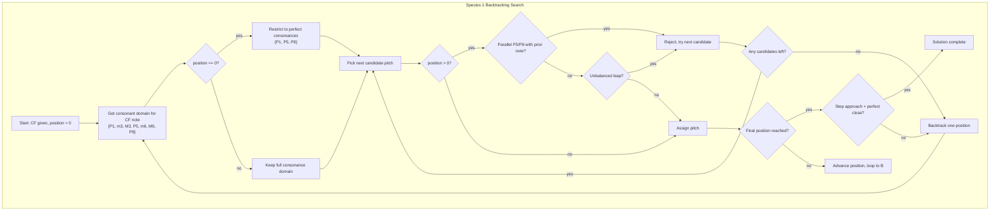

# Lesson 2: Species Counterpoint – The Complete Practitioner's Workshop

## 1. First-Principles Intuition: Why These Rules Exist

Species counterpoint, codified by Johann Joseph Fux in *Gradus ad Parnassum* (1725), is ear-training disguised as composition homework. You are not writing music to be admired on paper — you are drilling the specific skill of **hearing two independent lines as both separate and coherent at the same time**. Every rule below exists because it either protects melodic independence or controls tension/release. Learn the acoustic reason once, then spend 95% of your time writing and singing exercises.

**The one-paragraph physics**: a perfect fifth and perfect octave share so much of their overtone content that two voices a fifth or octave apart start to fuse into a single, thicker-sounding line — your ear stops tracking "two melodies" and hears "one loud melody." Thirds and sixths overlap less, so they sound rich *and* keep the lines separate. Seconds, sevenths, and tritones clash enough to demand resolution. That's the entire acoustic basis for every consonance/dissonance rule in this lesson — no further math needed. Everything else below is ear-training and craft.

### The Cantus Firmus: Your Fixed Line

Every exercise starts from a cantus firmus (CF) — a slow, stepwise melody, 8–10 whole notes, that you will not alter. Build or choose one using these checks:

1. Mostly steps (2nds), occasional 3rds, nothing bigger than a 5th leap.
2. One clear high (or low) point, placed about two-thirds through the line — this is your melodic "destination."
3. No two leaps in the same direction back to back; a leap should be answered by stepwise motion the other way.
4. Starts and ends on the modal final (D for Dorian, E for Phrygian, G for Mixolydian, etc).
5. The note before the final approaches it by step — this is what makes a cadence feel landed.

**Working CF** (D Dorian) — memorize this, you'll reuse it all lesson:
```text
D – E – F – E – D – C – D – E – F – G – F – E – D
```
Sing it right now on solfège or note names at a slow, steady pulse before reading further. If you can't sing your CF cleanly, don't start counterpoint against it — fix the CF first.

### Consonance and Dissonance: What You're Allowed to Write

| Category | Intervals | Behavior |
|---|---|---|
| Perfect consonances | P1, P5, P8 | Rock stable. Used to open/close. Never move in parallel. |
| Imperfect consonances | m3, M3, m6, M6 | Stable but keep voices distinct. Parallel motion is fine and sounds good. |
| Dissonances | M2, m2, P4 (2-voice texture), M7, m7, any augmented/diminished interval | Tension — only allowed on weak beats, or prepared/resolved as suspensions depending on species. |

**How much dissonance each species allows** — this is the entire backbone of the five species, memorize it as a ladder:

| Species | Rhythm | Dissonance rule |
|---|---|---|
| 1 | 1:1 | None. Every note is consonant. |
| 2 | 2:1 | Weak beat may be a passing tone. |
| 3 | 4:1 | Weak beats may be passing *or* neighbor tones. |
| 4 | syncopated 2:1 (offset) | Strong beat may be dissonant **if it's a prepared, resolved suspension**. |
| 5 | free mixture | All of the above, combined with judgment. |

### Motion Types — What Actually Keeps Two Lines Independent

- **Parallel**: both voices move the same direction by the same interval. Parallel 3rds/6ths = good. Parallel 5ths/8ths = forbidden, because that's the overtone-fusion problem above.
- **Contrary**: voices move opposite directions. This is your best friend, especially into cadences — it's the single strongest way to make two lines sound independent.
- **Oblique**: one voice holds, the other moves. Moderate independence; this is the texture suspensions live in.
- **Similar**: same direction, different intervals. Usable, but two similar-motion leaps in a row sound clumsy — prefer steps when moving similarly.

### Five Rules You Apply in Every Single Species

1. Open on a perfect consonance (P1, P5, or P8).
2. Close on a perfect consonance (P1 or P8) — not P5, the fifth doesn't feel "finished."
3. At least one voice approaches the final by step.
4. Never outline a tritone in a single melodic line (e.g. F up to B) — it's hard to sing in tune and has no modal home.
5. No voice crossing in strict two-voice writing — keep upper voice above, lower voice below, at all times.

---

## 2. Species 1: Note-Against-Note — Full Build Procedure

**Rhythm**: one whole note of counterpoint (CP) per whole note of CF.

### Compose in this exact order — cadence first, then opening, then the middle

**Step 1 — Design the cadence (work backward from the end).**
- Final interval: P8 or P1.
- Second-to-last interval: M6 or m6, set up so the CP voice steps into the final while the CF also steps — ideally in contrary motion.

```text
CF:   C  – D
CP:   E  – D
Ivl:  M6 – P8     (contrary motion: CF up, CP down)
```

**Step 2 — Choose the opening.** P5 or P8 above the CF (or P1 if voices start on the same note — avoid this in two real voices, it's weak).

**Step 3 — Fill the middle,** one CF note at a time, checking after each note:
- Is the interval consonant? (P1, m3, M3, P5, m6, M6, P8 only)
- Did I just create parallel P5s or P8s with the previous interval? If yes, change this note.
- Did I leap (4th or bigger)? If yes, the next move must be a step, preferably in the opposite direction.
- Have I already placed my one melodic apex? If this note would create a *second* peak, lower it.

### Drill 1A — Full Worked Solution

CF (D Dorian): `D – E – F – E – D – C – D`

```text
CF:         D  –  E  –  F  –  E  –  D  –  C  –  D
CP:         D  –  C  –  D  –  C  –  F  –  E  –  D
Interval:   P8    m6    m6    m6    M3    M3    P8
Motion:    (open) Ctr   Ctr   Obl   Par   Obl   Ctr
```
Check it against the five invariants: opens/closes P8 ✓, no parallel perfects anywhere ✓, single apex at F (bar 5 CP / bar 3 CF — mirrored) ✓, final approach is a step with contrary motion ✓. This is a passing exercise.

### Drill 1B — Interval Grid Method (use this table format for every new CF you write)

CF (G Dorian): `G – A – Bb – A – G – F – G`

| CF | Legal consonances above | Chosen CP | Interval | Motion from prior |
|---|---|---|---|---|
| G | Bb, D, Eb, G | G | P8 | — (opening) |
| A | C, D, F, A | F | m6 | Contrary |
| Bb | D, Eb, G, Bb | G | M6 | Contrary |
| A | C, D, F, A | F | m6 | Oblique |
| G | Bb, D, Eb, G | Bb | M3 | Contrary |
| F | A, Bb, D, F | A | M3 | Oblique |
| G | Bb, D, Eb, G | G | P8 | Contrary |

**Metronome ladder**: sing/play at ♩=60 until error-free three times in a row, then 80, then 110. Then transpose the *same* exercise to E Phrygian and A Aeolian, rebuilding the legal-consonance column from scratch each time — the point is that Phrygian's E–F half-step changes which notes are available, forcing your ear to adapt rather than pattern-match.

---

## 3. Species 2: Two-Against-One — Adding the Passing Tone

**Rhythm**: two half notes of CP per CF whole note. Beat 1 (strong) must be consonant with the CF. Beat 2 (weak) may be dissonant **only if** it is approached by step and left by step in the same direction — that's the definition of a passing tone.

```text
Beat:      1    2
CF:        D  — (held)
CP:        F    E
Interval:  M3   M2 (dissonant, legal passing tone)
```

### Drill 2A — Expand a Species-1 skeleton into Species 2

Start from a known-good 1:1 skeleton and insert a stepwise passing note on every weak beat:

```text
Skeleton:  CF: D – E – F     CP: F – G – A   (all M3, all consonant)

Expanded:  CF:    D        E        F
           CP:    F   E    G   F    A
           Ivl:   M3  M2   M3  m2   M3
                  C   d    C   d    C
```
Every weak beat dissonance resolves by continuing in the same stepwise direction into the next strong beat. If you ever want to leave a weak beat by leap, it can't be dissonant — leaps must land on consonances.

### Drill 2B — Compose from scratch, including the Species-2 cadence formula

The standard Species 2 cadence drops the final CP note down an octave register shift or simply uses a passing 7th-to-step-down into the close:

```text
CF:         D       E       F       E       D
CP:         F   E   G   F   A   G   G   F   D
Interval:   M3  M2  M3  m2  M3  M2  M3  M2  P8
            C   d   C   d   C   d   C   d   C
```

**Metronome ladder**: ♩=60 (half note = the beat you count), then 80, then 100. At 100 BPM the weak-beat passing tones should feel like they're gently "falling through" to the next strong beat, not accented.

**Keyboard independence drill**: left hand plays CF whole notes, right hand plays CP half notes. Deliberately make the right hand's second half-note (the weak beat) physically *lighter* in touch — less arm weight, finger-only — while the left hand stays even. This is the first real test of rhythmic hand independence in this lesson.

---

## 4. Species 3: Four-Against-One — Figuration and Neighbor Tones

**Rhythm**: four quarter notes of CP per CF whole note. Beat 1 should be consonant. Beats 2–4 may be dissonant if they function as passing tones (stepping through) or **neighbor tones** (step away and immediately back).

```text
Beat:      1    2    3    4
CF:        D  — (held) — — 
CP:        F    E    F    G
Interval:  M3   M2   M3   P4
           C    d    C    C
```
Beat 2 (E) is a lower neighbor to F — it leaves and returns to the same note. This is new in Species 3: Species 2 only had passing tones that kept moving in one direction; Species 3 adds the "there and back" neighbor shape.

### Drill 3A — Four-note figure vocabulary (memorize these shapes, they're your building blocks)

Over a CF note of D, with D/F/A as your home triad:
1. **Arpeggio**: D–F–A–F (all consonant, outlines the triad)
2. **Passing figure**: F–E–D–C (stepwise descent, E is the only passing dissonance)
3. **Neighbor figure**: F–G–F–E (G is upper neighbor, then stepping toward next CF note)
4. **Scalar descent**: A–G–F–E

### Drill 3B — Full worked example

CF (D Dorian): `D – E – F`

```text
CF:        D               E               F
CP:        A  G  F  E      E  D  C  D      F  E  D  C
Interval:  P5 P4 m3 M2     P8 m7 m6 m7     P8 m7 m6 P5
           C  C  C  d      C  d  C  d      C  d  C  C
```
Notice beats 1 and 3 land on strong consonances while beats 2 and 4 carry the dissonant motion — this alternation is what makes Species 3 sound like flowing melody rather than a scale exercise.

**Metronome ladder**: ♩=60 quarter-note pulse, focus entirely on **evenness** — all four notes exactly equal duration, no rushing into the strong beat. Move to 80 only once a metronome app's "even sixteenths" click (subdividing your quarters) shows no drift.

---

## 5. Species 4: Syncopation and Suspension

This is the species where counterpoint starts sounding emotionally loaded, because you're deliberately placing dissonance on the strong beat and making the ear wait for its resolution.

### The three-phase suspension, physically

1. **Preparation**: a consonant note, placed on a *weak* beat.
2. **Suspension**: that same pitch is held (tied) into the next *strong* beat, where it now clashes with a new CF note — this is where the dissonance lives.
3. **Resolution**: the suspended note steps *down* to a consonance, landing on the following weak beat.

```text
Beat:      weak   strong   weak   strong
CF:        D      E        E      F
CP:        A ——————————    A      G
Interval:  P5     P4       P4     M2
Phase:     Prep   SUSP    (held)  Res
```

**Naming convention** — name suspensions by the dissonant interval, then the interval it resolves to:

| Name | What happens |
|---|---|
| 7–6 | A 7th over the bass resolves down to a 6th |
| 4–3 | A 4th resolves down to a 3rd (the most common type you'll write) |
| 9–8 | A 9th (compound 2nd) resolves down to an octave |
| 2–3 | CP is *below* the CF; a 2nd resolves up... actually down in the lower voice, outward to a 3rd |

### Drill 4A — Label an existing suspension chain

```text
CF:         D   –   E   –   F   –   E   –   D
CP:             A   –   G   –   F   –   E   –   D
Interval:       P5  –   M3  –   P8  –   P8  –   P8
```
- Bar 1→2: A prepared as P5 (consonant), held against E → P4 (dissonant) → resolves down to G = M3. **This is a 5–4–3 suspension pattern.**
- Bar 2→3: G held against F → M2 (dissonant) → resolves down to F = P8. **This is a 2–1 suspension** (an inverted form, common when CP sits close above CF).

### Drill 4B — Compose your own chain

CF (D Dorian): `D – E – F – E – D`

```text
CF:         D       E       F       E       D
CP:     –   A   –   G   –   F   –   E   –   D
Interval:   P5   (4) M3   (2) P8   (7) P8   (–) P8
```
Read this as: prepare A on the upbeat before D, carry it into E to create the (4), resolve down to G... continue the chain through each suspension.

**Metronome and feel**: ♩=60, half-note pulse. The suspension should physically feel like a "lean" — slightly delay your mental emphasis onto the tied note, then let the resolution release the tension by stepping down. If you're at the piano, this is a good place to practice a slight dynamic swell into the suspended note and a release on the resolution — not notated, but how performers actually voice these.

---

## 6. Species 5: Florid Counterpoint — Free Mixture

**Rhythm**: whole, half, quarter, and occasional eighth notes mixed freely. This is not "anything goes" — it's "any technique from Species 1–4, deployed where it best serves the phrase."

**Working strategy, in order**:
1. Sketch the skeleton in Species 1 first — correct harmonic skeleton, every beat consonant.
2. Decide where you want rhythmic energy (usually mid-phrase) vs. repose (cadences, after a busy passage).
3. Embellish the skeleton: turn held notes into passing-tone pairs (Species 2 move), four-note scale or neighbor runs (Species 3 move), or suspensions at phrase arrivals (Species 4 move).
4. Never let more than one bar in a row be "all eighth notes" — the ear needs contrast, and the CF needs room to be heard.

### Drill 5A — Analyze a florid passage

CF (D Dorian): `D (whole) – E (whole) – F (whole)`

```text
CP:        F   F |  E F G F E  |  D  |  E - (tie) F |  E  D  C
Rhythm:    ♩   ♩ |   six ♪'s   |  𝅗𝅥  |   𝅗𝅥 (tied)  |  ♩  ♩  ♩
```
Bar 1 is Species-2-style motion, the eighth-note run is Species-3-style acceleration, the whole note is a deliberate Species-1 rest point, and the tie into bar 3 sets up a Species-4 suspension. That's florid counterpoint: a tour through the vocabulary, chosen for musical effect rather than mechanically rotated.

### Drill 5B — Compose your own

CF (G Dorian): `G – A – Bb – A – G`. Requirement: at least one suspension, one four-note figure, one sustained note.

```text
CF:      G              A            Bb           A            G
CP:      G  A  Bb C  |  D — (tie) D  |  D  C   |  D  C  Bb A  |  G
Rhythm:  ♩  ♪ ♪  ♪  |  𝅗𝅥         |  𝅗𝅥 (tied) ♩ |  ♪  ♪  ♪  ♪  |  𝅗𝅥
```

---

## 7. Voice Leading at the Keyboard: Physical Practice

Species counterpoint was written for singers, but you will internalize it fastest at a keyboard, where you can hold both lines under your own ten fingers and *hear* the vertical interval instantly.

**Hand posture for two-voice reading**: sit so your forearms are level with the keys, curved relaxed fingers, no wrist collapse. Left hand plays the CF, assign finger 5 (or 3, if the range sits mid-staff) per whole note — don't worry about scale fingering patterns here, you're sustaining single notes, not running passages.

**Independence drill (Species 2 specifically)**: left hand depresses the CF whole note and holds it down physically for the full bar — don't re-strike. Right hand plays the two half notes. The common beginner error is accenting the weak half-note as hard as the strong one; deliberately practice with the right hand's second note using *finger weight only*, no arm drop, so it's audibly lighter. This single drill, repeated across all four species exercises you write, trains the metrical hierarchy into your hands permanently.

**Vocal practice routine** (do this even if you're a keyboardist — it's non-negotiable for internalizing intervals):
1. Sing the CF alone, ♩=60, note names or solfège.
2. Sing your counterpoint alone.
3. Play CF on piano, sing your counterpoint against it.
4. Reverse: sing the CF, play the counterpoint.
5. On each downbeat, stop and name the interval out loud before continuing — "fifth... third... sixth..." This forces real-time interval recognition, which is the actual transferable skill.

---

## 8. Modal Framework — Why This Isn't Just "Minor Key"

Fux's system predates functional tonal harmony. There's no V–I pull here — the cadential energy comes entirely from contrary stepwise motion into a perfect consonance, not from a dominant chord resolving.

| Mode | Final | White-key scale | Character |
|---|---|---|---|
| Dorian | D | D E F G A B C | Balanced, minor-flavored |
| Phrygian | E | E F G A B C D | Dark, half-step above the final |
| Lydian | F | F G A B C D E | Bright, raised 4th |
| Mixolydian | G | G A B C D E F | Major-flavored, lowered 7th |
| Aeolian | A | A B C D E F G | Natural minor |
| Ionian | C | C D E F G A B | Major scale |

**Standard modal cadence** — lower voice steps up by a half or whole step into the final while the upper voice steps down into it, producing a major sixth expanding out to an octave:

```text
CF (lower): C  – D
CP (upper): E  – D
Interval:   M6 – P8
```

### Transposition drill — do this for every exercise you write, not just once

Take: `CF: D–E–F–E–D` / `CP: D–C–D–C–D` (D Dorian) and rebuild it, from the interval logic up, in:
1. **E Phrygian**: `E–F–G–F–E` — notice E to F is a half-step, which changes which notes above E count as thirds and sixths compared to Dorian's whole-step D to E. Re-derive your consonance table, don't just shift letter names.
2. **F Lydian**: `F–G–A–G–F`
3. **G Mixolydian**: `G–A–B–A–G``

This matters because real modal repertoire (and a lot of modern film/game modal writing) depends on exactly these half-step placements for its color — if you only ever practice in Dorian, your ear won't generalize.

---

## 9. Constraint-Satisfaction Logic: Thinking Like a Solver

Composing species counterpoint by hand is a backtracking search: at each CF note you have a small legal domain of pitches, constraints prune that domain based on what came before, and when you hit a dead end you backtrack and try a different earlier choice. Making this explicit speeds up your manual composing enormously, because instead of guessing you can systematically eliminate options.



**Practical takeaway for hand-composing**: whenever you get stuck 5 notes into an exercise, don't erase everything — identify the *earliest* note whose choice is forcing the dead end (usually a leap that was too big, or a note that locked you into a parallel fifth two bars later) and change only that one.

### Reference implementation (for checking your handwritten work, not for generating your homework)

```python
def check_first_species(cf, cp):
    """
    Validate a hand-written first-species exercise.
    cf, cp: lists of MIDI note numbers, same length.
    Returns a list of violation strings (empty list = passes).
    """
    CONSONANCES = {0, 3, 4, 7, 8, 9}       # P1, m3, M3, P5, m6, M6
    PERFECT = {0, 7}                        # P1, P5 (mod 12; P8 reduces to 0)
    violations = []
    n = len(cf)

    def interval(a, b):
        return abs(a - b) % 12

    # Rule: every interval must be consonant
    for i in range(n):
        iv = interval(cp[i], cf[i])
        if iv not in CONSONANCES:
            violations.append(f"Bar {i+1}: dissonant interval ({iv} semitones)")

    # Rule: opening must be a perfect consonance
    if interval(cp[0], cf[0]) not in PERFECT:
        violations.append("Opening interval must be P1, P5, or P8")

    # Rule: closing must be P1/P8, approached by step in CP
    if interval(cp[-1], cf[-1]) != 0:
        violations.append("Final interval must be P1/P8")
    if abs(cp[-1] - cp[-2]) > 2:
        violations.append("Final approach in counterpoint must be by step")

    # Rule: no parallel perfect consonances between consecutive bars
    for i in range(n - 1):
        iv1, iv2 = interval(cp[i], cf[i]), interval(cp[i+1], cf[i+1])
        if iv1 in PERFECT and iv2 in PERFECT and iv1 == iv2:
            same_dir = (cp[i+1] - cp[i]) * (cf[i+1] - cf[i]) > 0
            if same_dir:
                violations.append(f"Bars {i+1}-{i+2}: parallel perfect consonances")

    # Rule: no voice crossing
    for i in range(n):
        if cp[i] < cf[i]:
            violations.append(f"Bar {i+1}: voice crossing (CP below CF)")

    return violations


# Example: check Drill 1A's solution
cf = [62, 64, 65, 64, 62, 60, 62]   # D-E-F-E-D-C-D
cp = [74, 72, 74, 72, 77, 76, 74]   # D-C-D-C-F-E-D (octave above)
result = check_first_species(cf, cp)
print("Violations:" , result if result else "None — exercise is valid")
```

Run this against every exercise you write by hand before moving to the next species. Treat a clean pass as your gate, not a suggestion.

---

## 10. Annotated Repertoire Analysis

**Palestrina, *Missa Papae Marcelli*, "Kyrie"** — simplified two-voice reduction, tenor and soprano:

```text
Measure:     1       2       3       4       5
Tenor (CF):  D   –   E   –   F   –   E   –   D
Soprano:         A   –   G   –   F   –   E   –   D
Interval:        P5  –   m3  –   P8  –   P8  –   P8
```

Walk through this exactly as you'd analyze your own homework:
- Bar 1→2: soprano's A is prepared consonant (P5), held into bar 2 where tenor moves to E, creating a dissonant P4, resolving down by step to m3 against F. That's a textbook 4–3 suspension.
- Bar 2→3: same shape, G held against F creates M2, resolves to P8.
- Bars 4–5: no further suspensions — Palestrina lets the texture breathe into the cadence with plain stepwise descent, contrary to the tenor's rise to D.

**Why it sounds like Palestrina and not like an exercise**: the soprano line is one unbroken stepwise descent (A-G-F-E-D) — there's no wasted motion, every note serves both the melodic line and the suspension chain simultaneously. That economy is the actual compositional skill being modeled; chase it in your own writing, not just rule-compliance.

**Listening assignment**: cue up Palestrina's *Missa Papae Marcelli* "Kyrie" in full SATB. Follow just the soprano and tenor lines on a printed score if you can, and listen specifically for the suspensions cascading between voice pairs — you'll hear the same 4–3 shape recur in different voice combinations throughout the movement.

---

## 11. Advanced Labs

### Lab A: Three-Voice First Species (the harmonic-completeness problem)

CF (middle voice, D Dorian): `D – E – F – E – D`

Add a voice above and below, checking **three** voice pairs independently (upper/CF, CF/lower, upper/lower) at every single bar — this is the real difficulty jump from two voices to three.

```text
Upper:    A – C – A – C – A
CF:       D – E – F – E – D
Lower:    D – A – D – A – D
```

Check every pair:
- Upper/CF: P5, m6, m3, m6, P5 — no parallel perfects. ✓
- CF/Lower: P8, P5, M3, P5, P8 — no parallel perfects. ✓
- Upper/Lower: P5, M3, P5, M3, P5 — **bars 1–2 are parallel fifths. Violation.**

This is the single most common failure mode in three-voice writing: you check each voice against the CF and both pass, but you forget to check the outer two voices against *each other*. **Fix**: move the lower voice's second note from A to F, changing Upper/Lower bar 2 to a sixth:

```text
Upper:    A – C – A – C – A
CF:       D – E – F – E – D
Lower:    D – F – D – A – D
```
Re-check Upper/Lower: P5, m6, P5, M3, P5 — still parallel fifths between bars 1-2-3 alternating with sixths, actually fine since they're not *consecutive* identical perfects. Verify by rechecking every adjacent pair by hand before trusting it.

### Lab B: Suspension Chain in Minor

CF (A Aeolian): `A – B – C – B – A`. Write fourth species above the CF to target a 7–6 suspension, or change the target to a 2–3 suspension if writing below the CF. and a 4–3 at bar 4. Check your chain against the validator logic in §9 by hand-tracing each prepare/suspend/resolve triplet.

### Lab C: Florid Counterpoint with Imitation

CF (G Dorian): `G – A – Bb – A – G – F – G`. Write fifth-species counterpoint whose opening three notes (`G–A–Bb`) echo the CF's own opening, entering one beat later — a miniature canon. This is your bridge exercise into actual imitative counterpoint and fugue writing.

---

## 12. Self-Assessment Rubric

| Criterion | Weight | What to check |
|---|---|---|
| Rule compliance | 40% | No parallel P5/P8, correct dissonance treatment per species, valid cadence |
| Melodic quality | 30% | Smooth contour, one apex, leaps answered by contrary steps |
| Voice independence | 20% | Contrary motion used at cadences, rhythmic differentiation present (species 2+) |
| Stylistic idiom | 10% | Singable, sounds like Renaissance polyphony rather than a math puzzle |

Score bands: 90–100% publication-ready, 75–89% technically correct but needs polish, 60–74% minor violations requiring revision, below 60% re-study the species rules before continuing.

---

## 13. 30-Day Practice Regimen

**Week 1 — Species 1**: Days 1–2, five exercises on given CFs. Days 3–4, write your own CF and counterpoint it. Days 5–7, transpose one exercise into all six modes (§8 drill).

**Week 2 — Species 2**: Days 8–10, convert Week 1 exercises into Species 2. Days 11–12, compose Species 2 from scratch. Days 13–14, keyboard independence drills at ♩=60/80/100.

**Week 3 — Species 3 and 4**: Days 15–17, figuration drills (§4). Days 18–20, suspension chains (§5). Day 21, combine both in a single exercise.

**Week 4 — Species 5 and integration**: Days 22–25, florid counterpoint. Days 26–27, three-voice Species 1 (Lab A). Days 28–29, score analysis of a Palestrina excerpt of your choosing. Day 30, compose and record an original florid exercise.

**Daily structure** (35 minutes total): 5 min sung interval warm-up (P1, m3, M3, P5, m6, M6, P8 against a drone), 15 min composing one exercise, 10 min performing it (sung or played), 5 min checking it against the rubric or validator script.

---

## 14. Historical Through-Line

**Palestrina** (*Missa Papae Marcelli*, 1567) is strict species counterpoint in its native habitat — four to six voices, minimal dissonance, text clarity mandated by the Council of Trent.

**Bach** adapted the same voice-leading discipline to tonal harmony: *Invention No. 1 in C Major* is essentially two-voice species counterpoint with functional chord progressions and modulation layered on top — listen for how the stepwise, mostly-consonant backbone is still there under the harmonic sequences.

**Hindemith** (*The Craft of Musical Composition*, 1937) redefined the consonance hierarchy for 20th-century chromatic writing but kept the same structural idea: controlled dissonance against a stable framework.

**Jazz and film**: Bill Evans' bass and piano lines in "Waltz for Debby" maintain independence through the same contrary-motion principle you're drilling here. John Williams' brass fanfares and Howard Shore's leitmotif combinations are contrapuntal layering in a tonal, orchestral idiom — the species discipline is why the lines don't collide.

---

## 15. Final Project: Five-Species Suite on One Cantus Firmus

CF (D Dorian): `D – E – F – G – F – E – D – C – D – E – D`

Compose, against this single CF:
1. Species 1 above the CF.
2. Species 2 below the CF.
3. Species 3 above the CF.
4. Species 4 below the CF, containing at least 4 suspensions.
5. Species 5 above the CF, integrating techniques from all four prior species.

**Deliverables**: a notated score (MuseScore or manuscript), a recording (performed or synthesized), and a self-assessment against the §12 rubric. Target ≥85% on all five movements — that's the journeyman benchmark that means you're ready for fugue and canon.

---

## 16. Resources

**Treatises**: Fux, *Gradus ad Parnassum* (1725, trans. Alfred Mann); Jeppesen, *Counterpoint* (1939); Schenker, *Counterpoint* (1910).

**Modern textbooks**: Peter Schubert, *Modal Counterpoint, Renaissance Style* (2008); Kent Kennan, *Counterpoint* (4th ed., 1999); Robert Gauldin, *A Practical Approach to 16th-Century Counterpoint* (1995).

**Listening**: Palestrina, *Missa Papae Marcelli* and motets; Josquin des Prez, *Ave Maria... Virgo serena*; Bach, *The Art of Fugue* and *Musical Offering*; Hindemith, *Ludus Tonalis*.

**Software**: MuseScore (free notation/playback), music21 (Python library for analysis and checking, as in §9), Counterpointer (iOS app with instant feedback).

Begin now: pick a cantus firmus, sing it clean, and write your first Species 1 exercise before you close this document.
