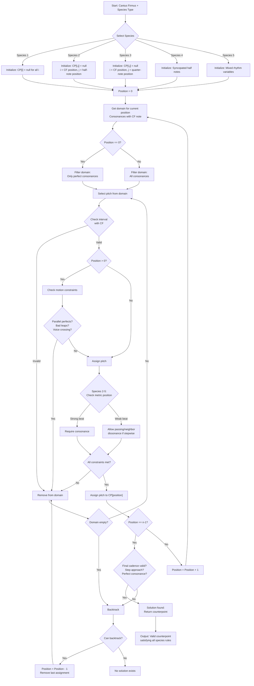

# Lesson 2: Species Counterpoint

## 1. First-Principles Intuition & Invariants

Species counterpoint represents a foundational pedagogical system for understanding polyphonic voice leading through systematic constraints. Codified by Johann Joseph Fux in *Gradus ad Parnassum* (1725), this method abstracts the principles of Renaissance polyphony—particularly the style of Palestrina—into five progressive exercises, each isolating specific aspects of melodic independence and harmonic interaction.

The system rests on a deceptively simple premise: two or more melodic lines can sound simultaneously while maintaining both individual integrity and collective coherence. This dual requirement—horizontal (melodic) and vertical (harmonic) logic—creates a constraint satisfaction problem that species counterpoint solves through layered rule sets. The pedagogical genius lies in the gradual relaxation of rhythmic constraints across the five species, allowing students to master interval control before confronting rhythmic complexity.

### The Cantus Firmus Foundation

Every species exercise begins with a *cantus firmus* (CF), a simple whole-note melody typically spanning an octave, moving predominantly by step, and exhibiting a single clear arc. The CF serves as both constraint and scaffold: its stepwise motion limits the harmonic palette available to the added voice (the *counterpoint*), while its slow harmonic rhythm provides ample time to think about each vertical interval choice.

The CF is not arbitrary. Its design embodies principles derived from vocal writing:

- **Limited range** (typically 8-10 notes): mirrors comfortable vocal tessituras and prevents melodic disjunction
- **Single climax point**: creates directed energy and prevents wandering
- **Stepwise motion predominates**: allows smooth voice leading and predictable harmonic progressions
- **Diatonic framework**: establishes a tonal center without relying on functional harmony (which postdates modal counterpoint)

These characteristics ensure that the CF acts as a stable reference, allowing the student to focus on the counterpoint's construction rather than wrestling with an unpredictable foundation.

### Consonance and Dissonance: The Core Binary

Species counterpoint operates within a strict consonance/dissonance hierarchy inherited from medieval and Renaissance practice. This is not a subjective aesthetic judgment but a classification system based on acoustical properties and historical stylistic norms:

**Perfect Consonances** (acoustically pure ratios):
- Unison (1:1) 
- Perfect fifth (3:2)
- Perfect octave (2:1)

**Imperfect Consonances** (more complex but stable ratios):
- Major and minor thirds (5:4, 6:5)
- Major and minor sixths (5:3, 8:5)

**Dissonances** (all other intervals):
- Major and minor seconds
- All fourths (contextually dissonant in two-voice textures)
- All sevenths
- All augmented and diminished intervals

This hierarchy determines voice-leading constraints. Perfect consonances, being acoustically pure, tend to fuse the two voices into a single percept; excessive use undermines melodic independence. Imperfect consonances provide stability while maintaining timbral separation. Dissonances create tension requiring resolution.

The species system controls dissonance treatment with increasing sophistication. First species prohibits dissonance entirely, isolating the challenge of consonant interval succession. Later species introduce dissonance under strict conditions: second species allows weak-beat dissonance as passing motion, fourth species leverages suspension to create metric tension, and fifth species permits combinations of all prior techniques.

### Voice Independence: Parallel Motion and Contrary Motion

Counterpoint exists to create *independent yet coordinated* melodic lines. This independence is threatened by parallel motion in perfect consonances—when both voices move by the same interval in the same direction, particularly in parallel octaves or fifths, they momentarily fuse into a single, thickened line. Renaissance theorists prohibited this because it negates the point of writing two separate voices.

The prohibition has acoustic justification: parallel perfect consonances create a stream of intervals with identical overtone structures, effectively reducing two voices to one. By contrast, imperfect consonances have unique overtone profiles at each position, maintaining perceptual independence even when moving in parallel.

Contrary motion—voices moving in opposite directions—maximizes independence and is therefore prized. Oblique motion (one voice stationary) offers moderate independence, while similar motion (same direction, different intervals) must be used judiciously. The five species progressively reveal how rhythmic differentiation can compensate for same-direction motion, but the foundational principle remains: independent lines move independently.

### Modal Framework and Tonal Implications

Fux's original exercises operate within the Renaissance modal system: Dorian, Phrygian, Lydian, Mixolydian, and their plagal variants. This is critical context often omitted in modern pedagogy. Modal counterpoint does not have functional dominant-tonic relationships; instead, cadences are organized around modal finals and reciting tones, with contrapuntal motion creating harmonic logic.

The lack of a dominant-tonic axis means that harmonic progression is governed by voice leading rather than chord function. This pedagogical purity—learning melodic logic before harmonic syntax—makes species counterpoint applicable across historical styles. Students who master species counterpoint can later apply those principles to tonal harmony (where chord function adds an additional constraint layer) or to atonal contexts (where interval control remains paramount even without a tonal center).

### Invariants Across All Species

Regardless of rhythmic complexity, certain principles remain constant:

1. **Begin and end on perfect consonances**: The opening establishes stability; the final cadence confirms resolution
2. **Approach the final by step in at least one voice**: Ensures smooth, directed motion into the cadence
3. **Avoid tritone outlines in either voice**: The tritone's instability undermines melodic coherence
4. **Maintain singable ranges**: Each voice should span approximately an octave to a tenth, respecting vocal ergonomics
5. **Control leaps**: Large intervals must be balanced by stepwise motion in the opposite direction to maintain melodic cohesion
6. **No voice crossing** (in strict practice): Preserves registral clarity and avoids perceptual fusion

These invariants encode centuries of pragmatic wisdom about how melodic lines interact in polyphonic textures. They are not arbitrary rules but emergent principles derived from vocal practice and acoustic reality.

## 2. The Five Species: Progressive Constraint Relaxation

The five species form a curriculum, not a taxonomy of real music. Each species isolates one aspect of rhythmic-harmonic interaction, building from maximum constraint to near-free composition.

### First Species: Note-Against-Note

**Constraint**: One whole note in the counterpoint per whole note in the cantus firmus.

**Focus**: Interval succession and voice leading without rhythmic complication.

First species is purely spatial problem-solving. With rhythm neutralized, the student confronts the basic question: which consonances can follow one another while maintaining melodic contour and avoiding forbidden parallels?

**Algorithmic structure**:
1. Select a starting consonance (typically unison, octave, or fifth)
2. For each subsequent CF note, choose a consonance that:
   - Allows stepwise or small-leap motion in the counterpoint
   - Avoids parallel perfect consonances
   - Moves toward an eventual contrary-motion approach to the final
3. Ensure the counterpoint has a single melodic apex
4. End on an octave or unison approached by step in the counterpoint

**Example** (Dorian mode, CF in lower voice):

```
CF:        D  E  F  E  D  C  D  E  F  G  F  E  D
Species 1: D  C  D  C  F  E  D  C  D  E  D  C  D
Intervals: 8  6  6  6  3  3  8  6  6  6  6  6  8
```

This example demonstrates:
- Opening and closing octaves
- Predominantly contrary or oblique motion
- Avoidance of parallel perfect intervals
- Smooth stepwise motion in the counterpoint
- A melodic apex (F) roughly mirroring the CF's climax (G)

The constraints of first species are deliberately severe. Students quickly discover that choices made early in the exercise constrain later options—a simple introduction to the concept of *search space* in constraint satisfaction. This species builds intuition for how voice leading creates harmonic progression, a principle that underlies all subsequent species.

### Second Species: Two-Against-One

**Constraint**: Two half notes in the counterpoint per whole note in the cantus firmus.

**Focus**: Introduction of rhythmic differentiation and weak-beat dissonance treatment.

Second species introduces metric hierarchy: strong beats (coinciding with CF notes) and weak beats (occurring mid-CF-note). This metrical distinction allows the first appearance of dissonance—but only on weak beats, and only as passing tones connecting consonances by step.

**Dissonance rules**:
- Strong beats must be consonant
- Weak beats may be dissonant if approached and left by step in the same direction
- Dissonances must be metrically weak and brief
- No leaps to or from dissonances

**Strategic implications**:
Second species teaches that dissonance is acceptable when it has clear directionality and metric subordination. The passing tone on a weak beat functions as voice-leading connective tissue rather than a harmonic event demanding attention. This principle—dissonance as motion rather than stasis—permeates all advanced counterpoint.

**Example** (CF in lower voice):

```
CF:        D       E       F       E       D
Species 2: F   E   G   F   A   G   G   F   D
Intervals: 3   2   3   2   3   2   4   2   8
           C   d   C   d   C   d   C   d   C
```

(C = consonance, d = dissonance)

Here, all dissonances occur on weak beats and function as passing tones between consonances. The metric regularity of second species creates a predictable alternation that trains the ear to accept weak-beat tension as normative.

### Third Species: Four-Against-One

**Constraint**: Four quarter notes in the counterpoint per whole note in the cantus firmus.

**Focus**: Rapid melodic figuration and expanded dissonance treatment.

Third species accelerates the counterpoint, allowing more elaborate melodic patterns. The first and third quarter notes (metrically stronger) should typically be consonant, while the second and fourth (weaker) may include passing tones, neighbor tones, or other stepwise dissonances.

**New dissonance type: neighbor tone**: A weak-beat dissonance that steps away from and returns to the same consonance (e.g., C → D → C). This introduces the concept of dissonance as embellishment rather than forward motion.

**Example** (CF in lower voice):

```
CF:        D               E
Species 3: A   G   F   E   E   D   C   D
Intervals: 5   4   3   2   8   7   6   7
           C   d   C   d   C   d   C   d
```

Third species reveals how rhythmic density can sustain a single harmony across multiple attacks, prefiguring the Baroque concept of harmonic rhythm (rate of chord change). The rapid figuration also demands that the student think in terms of *gesture*—four-note patterns that span a single CF note—rather than note-by-note construction.

### Fourth Species: Syncopation and Suspension

**Constraint**: Half notes in the counterpoint, syncopated to begin on the weak beat.

**Focus**: Suspension figures and metric displacement.

Fourth species introduces *suspensions*: dissonances occurring on strong beats, prepared by the same note on the preceding weak beat, and resolved downward by step. This is the most dramatic innovation in the species system, inverting the second-species principle by placing dissonance on the metrically strong position.

**Suspension chain structure**:
1. **Preparation**: Consonance on weak beat
2. **Suspension**: Same note held over, creating dissonance on strong beat
3. **Resolution**: Stepwise descent to consonance on weak beat

**Example** (CF in lower voice):

```
CF:        D       E       F       E       D
Species 4:     A       G       F       E       D
Intervals:     5   4   3   3   2   3   2   8
               C   d   C   C   d   C   d   C
```

The 5-4 and 3-2 suspensions create powerful dissonances that demand resolution. This species teaches that dissonance can be a primary expressive event rather than subordinate connective tissue—a principle central to tonal music's dominant-seventh and other active harmonies.

Syncopation also disrupts metric predictability, creating forward momentum. The tie across the barline generates tension independent of harmonic content, demonstrating how rhythm and harmony interact to shape musical expectation.

### Fifth Species: Florid Counterpoint (Diminution)

**Constraint**: Free mixture of note values from all previous species, including shorter rhythmic subdivisions.

**Focus**: Integration of all prior techniques into flexible, expressive counterpoint.

Fifth species is the capstone, allowing combinations of:
- Whole notes (first species stability)
- Half notes (second species passing motion)
- Quarter notes (third species figuration)
- Syncopations (fourth species suspensions)
- Eighth notes (brief embellishments)

**Compositional strategies**:
- Vary rhythmic density to create phrase contour
- Use suspensions at phrase boundaries for cadential emphasis
- Alternate consonant stability with dissonant figuration
- Balance stepwise motion with strategic leaps
- Maintain clarity of metric position to ensure dissonances remain contextually consonant or properly resolved

**Example** (CF in lower voice, excerpt):

```
CF:        D                       E
Species 5: F   F   E   F   G   F   E   D   E
Intervals: 3   3   2   3   4   2   8   7   8
           C   C   d   C   d   d   C   d   C
```

This species demands compositional judgment: when to simplify, when to elaborate, how to balance independence with harmonic coherence. It approximates real Renaissance counterpoint, where composers freely mixed rhythmic values to suit expressive needs.

## 3. Algorithmic Architecture: Constraint Satisfaction as Compositional Model

Species counterpoint can be formalized as a constraint satisfaction problem (CSP), providing insight into its pedagogical structure and enabling computational implementation.

### Constraint Satisfaction Problem Structure

A CSP consists of:
- **Variables**: Each position in the counterpoint (e.g., note 1, note 2, ..., note n)
- **Domains**: Possible pitch values for each variable (consonances above or below the CF note)
- **Constraints**: Rules governing valid variable assignments (interval succession, motion types, dissonance treatment)

**First species CSP formulation**:

```
Variables: CP₁, CP₂, ..., CPₙ (counterpoint notes)
Domains: For each CPᵢ, the set of pitches forming consonances with CFᵢ
Constraints:
  - CP₁ ∈ {unison, octave, fifth}
  - CPₙ ∈ {unison, octave} ∧ (|CPₙ - CPₙ₋₁| ≤ 2 semitones)
  - ∀i: interval(CPᵢ, CFᵢ) ∈ {consonances}
  - ∀i: ¬(parallel_perfect(CPᵢ, CFᵢ, CPᵢ₊₁, CFᵢ₊₁))
  - ∀i: leap_direction(CPᵢ₋₁, CPᵢ, CPᵢ₊₁) satisfies balance rules
  - Counterpoint has single melodic apex
```

### Backtracking Search Algorithm

A depth-first search with backtracking can generate valid first-species counterpoints:

```python
def generate_first_species(cantus_firmus):
    """
    Generate a first-species counterpoint using constraint satisfaction.
    
    Args:
        cantus_firmus: List of MIDI pitch integers
    
    Returns:
        List of counterpoint pitches, or None if no solution exists
    """
    n = len(cantus_firmus)
    counterpoint = [None] * n
    
    def is_consonant(interval):
        """Check if interval is consonant."""
        interval_mod = abs(interval) % 12
        return interval_mod in {0, 3, 4, 7, 8, 9}  # P1, m3, M3, P5, m6, M6, P8
    
    def is_perfect_consonance(interval):
        """Check if interval is perfect consonance."""
        interval_mod = abs(interval) % 12
        return interval_mod in {0, 7}  # P1, P5, P8
    
    def parallel_perfects(cp1, cf1, cp2, cf2):
        """Check for parallel perfect consonances."""
        int1 = cp1 - cf1
        int2 = cp2 - cf2
        return (is_perfect_consonance(int1) and 
                is_perfect_consonance(int2) and 
                int1 == int2)
    
    def contrary_approach(cp_prev, cp_final, cf_prev, cf_final):
        """Check for contrary motion into final."""
        cp_direction = cp_final - cp_prev
        cf_direction = cf_final - cf_prev
        return (cp_direction * cf_direction) < 0  # Opposite signs
    
    def get_domain(cf_note, position):
        """Get consonant pitches for a CF note."""
        base_intervals = [0, 3, 4, 7, 8, 9, 12, 15, 16]  # Within two octaves
        domain = []
        for interval in base_intervals:
            for direction in [1, -1]:
                pitch = cf_note + (direction * interval)
                if 48 <= pitch <= 84:  # Reasonable vocal range
                    domain.append(pitch)
        return sorted(set(domain))
    
    def backtrack(position):
        """Recursive backtracking search."""
        if position == n:
            return True  # Solution found
        
        domain = get_domain(cantus_firmus[position], position)
        
        for pitch in domain:
            counterpoint[position] = pitch
            interval = pitch - cantus_firmus[position]
            
            # Check constraints
            if position == 0:
                # First note must be perfect consonance
                if not is_perfect_consonance(interval):
                    continue
            
            if position == n - 1:
                # Last note must be octave/unison, approached by step
                if abs(interval) % 12 != 0:
                    continue
                if abs(pitch - counterpoint[position - 1]) > 2:
                    continue
                if not contrary_approach(counterpoint[position - 1], pitch,
                                       cantus_firmus[position - 1], 
                                       cantus_firmus[position]):
                    continue
            
            if position > 0:
                # Check for parallel perfects
                if parallel_perfects(counterpoint[position - 1], 
                                   cantus_firmus[position - 1],
                                   pitch, cantus_firmus[position]):
                    continue
                
                # Check leap balance
                if abs(pitch - counterpoint[position - 1]) > 4:  # Leap > M3
                    # Should eventually balance with contrary motion
                    pass  # Simplified for this example
            
            # Recursively try to fill remaining positions
            if backtrack(position + 1):
                return True
            
            # Backtrack
            counterpoint[position] = None
        
        return False
    
    if backtrack(0):
        return counterpoint
    else:
        return None


# Example usage
cantus_firmus = [62, 64, 65, 64, 62, 60, 62, 64, 65, 67, 65, 64, 62]  # D Dorian
result = generate_first_species(cantus_firmus)
if result:
    print("Counterpoint:", result)
else:
    print("No solution found")
```

This algorithm demonstrates how species counterpoint rules translate into computable constraints. The backtracking approach mirrors a composer's trial-and-error process: try a note, check if it satisfies all rules, proceed or backtrack if it creates a dead end.

### Search Space and Heuristics

The search space for even first-species counterpoint is large. For a 10-note CF with an average of 6 consonances per note, the brute-force space is 6¹⁰ ≈ 60 million possibilities. Most of these violate constraints early, allowing aggressive pruning.

**Heuristics for efficient search**:

1. **Most-constrained-variable ordering**: Assign notes near the cadence first, as they have stricter constraints
2. **Least-constraining-value ordering**: Choose pitches that preserve maximum options for future positions
3. **Constraint propagation**: When assigning a pitch, immediately eliminate now-invalid options from future domains
4. **Arc consistency**: Ensure that for every valid value in a variable's domain, there exists at least one valid value in each neighboring variable's domain

Advanced implementations can incorporate statistical models trained on historical examples to guide search toward stylistically idiomatic solutions rather than merely rule-compliant ones.

## 4. Mermaid Diagram: Species Counterpoint Decision Flow



## 5. Pedagogical Trajectory and Transfer Learning

The five species represent not just a curriculum but a *transfer learning* architecture. Each species isolates a subset of real-world compositional challenges, allowing mastery in a simplified context before combining skills.

**Transfer learning stages**:

1. **Species 1**: Learn interval succession logic in isolation
2. **Species 2**: Transfer interval knowledge; acquire metric hierarchy and weak-beat dissonance treatment
3. **Species 3**: Transfer prior skills; acquire rapid figuration and neighbor-tone embellishment
4. **Species 4**: Transfer consonance handling; acquire suspension technique and metric displacement
5. **Species 5**: Integrate all prior learning in flexible compositional context

This staged acquisition mirrors modern machine learning curricula, where models learn simple tasks before tackling complex ones. The difference: species counterpoint pre-dates formalized transfer learning by three centuries, demonstrating an intuitive understanding of human skill acquisition.

**Critique and limitations**:

Species counterpoint has known pedagogical gaps:

- **Modal vs. tonal disconnect**: Students trained in modal species often struggle when transitioning to functional harmony, as the latter's dominant-tonic axis introduces new constraints not addressed in species training
- **Rhythmic artificiality**: Real Renaissance music does not segregate rhythms by species; it freely mixes values from the start
- **Texture limitation**: Two-voice counterpoint oversimplifies the challenges of three- or four-voice writing, where harmonic completeness and voice independence interact differently
- **Stylistic narrowness**: Species rules encode Palestrina-era norms; they do not generalize to Baroque (which permits more dissonance), Classical (which emphasizes harmonic function), or modern styles

Despite these limitations, species counterpoint remains pedagogically valuable because it provides a *reductive framework*. By stripping away rhythmic complexity, functional harmony, and textural density, it allows students to focus on voice leading in its purest form. This reductive approach is not unique to music education; it appears in programming (learning syntax before algorithms), mathematics (arithmetic before calculus), and linguistics (phonemes before discourse).

## 6. Historical Context and Theoretical Evolution

Fux's *Gradus ad Parnassum* (1725) did not invent counterpoint—it systematized existing pedagogical practices into a coherent method. Renaissance composers learned counterpoint through imitation and improvisation; Fux's contribution was creating a *grammar* for an established language.

**Pre-Fuxian pedagogy**:
- Improvised counterpoint over a plainchant (*contrapunto alla mente*)
- Cantus firmus as sacred melody (Gregorian chant fragments)
- Rules transmitted orally or in scattered treatises (e.g., Zarlino's *Le istitutioni harmoniche*, 1558)

**Fux's innovations**:
- Five-species hierarchy (earlier sources lacked this clear progression)
- Secular, pedagogical cantus firmi (not liturgical melodies)
- Systematic rule codification with Latin terminology
- Integration with figured bass and tonal harmony (in later sections of *Gradus*)

**Post-Fuxian developments**:

- **Heinrich Schenker** (early 20th century) reinterpreted species counterpoint as a *background structure* underlying tonal music. In Schenkerian analysis, elaborate tonal compositions are understood as elaborate prolongations of simple contrapuntal frameworks—essentially, species counterpoint expanded through diminution and harmonic elaboration.
  
- **Paul Hindemith** (*The Craft of Musical Composition*, 1937) adapted species principles to modern harmonic language, replacing modal intervals with a chromatic interval hierarchy based on overtone series proximity.

- **20th-century pedagogy**: Species counterpoint became standard in conservatory curricula worldwide, taught as prerequisite to harmony and orchestration. Some educators (e.g., Peter Schubert, Knud Jeppesen) emphasize historical context and modal purity; others (e.g., Kent Kennan) integrate tonal chord progressions from the start.

**Contemporary relevance**:

Species counterpoint remains useful not because modern composers write in Renaissance style, but because it trains foundational skills:

- **Interval control**: Relevant in atonal and serial composition, where pitch relationships lack tonal function
- **Voice leading**: Essential in orchestration and arrangement across all genres
- **Constraint-based thinking**: Applicable to algorithmic composition and generative music systems
- **Stepwise vs. leaping motion balance**: Relevant in melody design for any style

Film composers like John Williams and Howard Shore routinely employ counterpoint in action cues and thematic development. Jazz contrapuntalists (e.g., Brad Mehldau, Vijay Iyer) use species-derived voice leading in harmonic improvisation. Electronic music producers apply counterpoint principles to synthesizer layers and rhythmic polymeters.

## 7. Computational Extensions and Generative Applications

Modern computational approaches extend species counterpoint beyond its pedagogical origins into generative music systems.

### Constraint Logic Programming

Species rules map naturally onto constraint logic programming (CLP) systems. Using a language like Prolog or a constraint solver library, we can declaratively specify species rules and let the solver find valid solutions:

```prolog
% First-species counterpoint in Prolog (simplified)

% Consonant intervals (in semitones mod 12)
consonant(0).   % unison
consonant(3).   % minor third
consonant(4).   % major third
consonant(7).   % perfect fifth
consonant(8).   % minor sixth
consonant(9).   % major sixth

perfect_consonance(0).  % unison
perfect_consonance(7).  % perfect fifth

% Rule: no parallel perfect consonances
no_parallel_perfects(CP1, CF1, CP2, CF2) :-
    Interval1 is (CP1 - CF1) mod 12,
    Interval2 is (CP2 - CF2) mod 12,
    \+ (perfect_consonance(Interval1), 
        perfect_consonance(Interval2), 
        Interval1 = Interval2).

% Rule: first note is perfect consonance
valid_opening(CP, CF) :-
    Interval is (CP - CF) mod 12,
    perfect_consonance(Interval).

% Rule: final note is unison or octave, approached by step
valid_cadence(CP_prev, CP_final, CF_final) :-
    Interval is (CP_final - CF_final) mod 12,
    Interval = 0,  % unison or octave
    Step is abs(CP_final - CP_prev),
    (Step = 1 ; Step = 2).  % step approach

% Generate first-species counterpoint (skeleton)
first_species([CF|CFs], [CP|CPs]) :-
    valid_opening(CP, CF),
    first_species_rest(CFs, CPs, CP, CF).

first_species_rest([], [], CP_prev, CF_prev).
first_species_rest([CF], [CP], CP_prev, CF_prev) :-
    valid_cadence(CP_prev, CP, CF),
    Interval is (CP - CF) mod 12,
    consonant(Interval).
first_species_rest([CF|CFs], [CP|CPs], CP_prev, CF_prev) :-
    Interval is (CP - CF) mod 12,
    consonant(Interval),
    no_parallel_perfects(CP_prev, CF_prev, CP, CF),
    first_species_rest(CFs, CPs, CP, CF).
```

This declarative approach allows rapid experimentation with rule variations. Want to permit more dissonance? Modify the consonance predicate. Want to encourage contrary motion? Add a scoring function.

### Markov Chain and N-Gram Models

Statistical models trained on historical counterpoint can generate stylistically plausible examples. An n-gram model captures interval succession probabilities:

```python
import random
from collections import defaultdict, Counter

class CounterpointNGram:
    """N-gram model for species counterpoint generation."""
    
    def __init__(self, n=2):
        self.n = n
        self.model = defaultdict(Counter)
    
    def train(self, corpus):
        """
        Train on a corpus of (CF, CP) pairs.
        
        Args:
            corpus: List of tuples (cantus_firmus, counterpoint),
                    each as lists of MIDI pitches
        """
        for cf, cp in corpus:
            # Convert to interval sequences
            intervals = [cp[i] - cf[i] for i in range(len(cf))]
            
            # Build n-grams
            for i in range(len(intervals) - self.n):
                context = tuple(intervals[i:i+self.n])
                next_interval = intervals[i+self.n]
                self.model[context][next_interval] += 1
    
    def generate(self, cantus_firmus):
        """
        Generate counterpoint for a new CF using the trained model.
        
        Args:
            cantus_firmus: List of MIDI pitches
        
        Returns:
            List of counterpoint pitches
        """
        intervals = []
        
        # Start with most common opening interval
        if self.model:
            # Use most frequent starting interval from training data
            first_interval = 7  # Perfect fifth as default
            intervals.append(first_interval)
        
        # Generate remaining intervals
        while len(intervals) < len(cantus_firmus):
            if len(intervals) < self.n:
                context = tuple(intervals)
            else:
                context = tuple(intervals[-self.n:])
            
            if context in self.model and self.model[context]:
                # Sample from probability distribution
                candidates = self.model[context]
                total = sum(candidates.values())
                rand = random.uniform(0, total)
                cumulative = 0
                for interval, count in candidates.items():
                    cumulative += count
                    if cumulative >= rand:
                        intervals.append(interval)
                        break
            else:
                # No training data for this context; use default consonance
                intervals.append(random.choice([0, 3, 4, 7, 8, 9]))
        
        # Convert intervals to pitches
        counterpoint = [cantus_firmus[i] + intervals[i] 
                       for i in range(len(cantus_firmus))]
        
        return counterpoint

# Example: Train on historical examples
corpus = [
    ([62, 64, 65, 64, 62], [69, 67, 69, 67, 69]),  # Example 1
    ([60, 62, 64, 62, 60], [67, 69, 71, 69, 67]),  # Example 2
    # ... more examples
]

model = CounterpointNGram(n=2)
model.train(corpus)

new_cf = [64, 66, 67, 66, 64, 62, 64]
generated_cp = model.generate(new_cf)
print("Generated counterpoint:", generated_cp)
```

N-gram models capture local patterns (e.g., sixths often resolve to octaves) but lack long-range structural awareness. They work well for generating short examples but struggle with maintaining global melodic shape.

### Neural Network Approaches

Recent research applies recurrent neural networks (RNNs) and transformers to counterpoint generation. These models can learn longer-range dependencies and stylistic nuances:

**LSTM architecture for counterpoint** (conceptual):

```
Input: 
  - CF note (pitch)
  - Current position in sequence
  - Previous counterpoint note
  
LSTM layers: 
  - Capture sequential dependencies
  - Maintain hidden state encoding melodic trajectory
  
Output layer:
  - Softmax over possible counterpoint pitches
  - Filtered by hard constraints (consonance rules)
  
Training objective:
  - Cross-entropy loss on historical counterpoint corpus
  - Regularization to enforce species rules
```

Hybrid systems combine neural networks with rule-based filtering: the network proposes candidates, and a constraint checker validates them. This approach balances statistical plausibility with formal correctness.

### Evolutionary Algorithms

Genetic algorithms offer another generative paradigm:

1. **Initialize population**: Random counterpoints
2. **Fitness function**: Score based on rule compliance, melodic quality, variety
3. **Selection**: Keep best-scoring individuals
4. **Crossover**: Combine sections of two counterpoints
5. **Mutation**: Randomly alter pitches while maintaining constraints
6. **Repeat**: Iterate until acceptable solution emerges

Evolutionary approaches excel at exploring large search spaces and can optimize for multiple objectives (rule compliance, stylistic similarity, novelty).

## 8. Analysis: Palestrina *Kyrie* from *Missa Papae Marcelli*

To illustrate how species principles manifest in real Renaissance polyphony, consider the opening of Palestrina's *Kyrie*:

```
Soprano:  [D5] -  -  -  E5 F5 E5 D5 C5 D5
Alto:     [A4] -  -  -  C5 D5 C5 A4 A4 A4
Tenor:    [D4] E4 F4 E4 D4 C4 D4 F4 E4 D4
Bass:     [D3] -  -  -  -  -  A3 D4 A3 D3
```

(Simplified rhythm; - indicates continuation)

**Species counterpoint principles in action**:

1. **Opening sonority**: All voices converge on D major (D-A-D-A), a perfect consonance
2. **Tenor line**: Moves primarily by step (E-F-E-D-C-D-F-E-D), resembling a cantus firmus
3. **Soprano entry**: Begins on the fifth (A relative to D), a perfect consonance, and descends by step
4. **Dissonance treatment**: The passing F in the soprano (bar 2) creates a brief second with the bass E, resolved immediately by stepwise motion—textbook second-species passing tone
5. **Contrary motion**: When tenor descends (D-C-D), alto ascends (C-D), maintaining independence
6. **Avoid parallel perfects**: No parallel octaves or fifths occur between any voice pair

This excerpt demonstrates that species rules are not theoretical abstractions but audible principles governing real compositions. Palestrina's counterpoint is more elaborate than strict species exercises—he uses imitative entries, varied rhythm, and four voices instead of two—but the underlying logic remains identical.

## 9. Extended Exercises and Self-Assessment

To deepen understanding, work through these progressively challenging exercises:

### Exercise 1: First Species Analysis

Given the following first-species counterpoint, identify all rule violations:

```
CF (lower): D  E  F  E  D  C  D  E  F  G  F  E  D
CP (upper): A  A  A  C  F  E  F  G  A  B  A  G  D
```

**Analysis checklist**:
- Mark all intervals (vertical)
- Identify motion types (parallel, contrary, oblique, similar)
- Flag any parallel perfect consonances
- Check opening and closing intervals
- Assess melodic contour (leaps, direction changes, apex)

### Exercise 2: Second Species Composition

Compose a second-species counterpoint above this CF (Phrygian mode):

```
CF: E  F  G  F  E  D  E
```

**Constraints**:
- Two half notes per CF note
- Strong beats consonant
- Weak beats may use passing tones
- Approach final by step in contrary motion

### Exercise 3: Fourth Species Suspension Chain

Create a fourth-species counterpoint below this CF, featuring at least three suspensions:

```
CF: D  E  F  E  D  C  D
```

**Requirements**:
- Syncopated half notes throughout
- Prepare-suspend-resolve pattern for each dissonance
- End with a perfect consonance

### Exercise 4: Fifth Species Integration

Compose a florid (fifth-species) counterpoint above this CF, demonstrating:
- At least one suspension (from fourth species)
- At least one four-note figure (from third species)
- At least one passage of half notes (from second species)
- Varied rhythmic density across the phrase

```
CF: G  A  B  A  G  F  G  A  B  C  B  A  G
```

### Self-Assessment Criteria

Evaluate your work against these dimensions:

1. **Rule compliance** (40%): No parallel perfects, proper dissonance treatment, correct cadence
2. **Melodic quality** (30%): Smooth contour, single apex, balanced leaps and steps
3. **Independence** (20%): Contrary motion, rhythmic differentiation (in later species)
4. **Stylistic idiom** (10%): Resembles Renaissance polyphony in phrasing and gesture

If your solution fails dimension 1, revise until compliant. Dimensions 2-4 involve aesthetic judgment and improve with practice and historical listening.

## 10. Further Study and Resources

To master species counterpoint and situate it within broader compositional practice:

**Primary sources**:
- Johann Joseph Fux, *Gradus ad Parnassum* (1725), trans. Alfred Mann
- Knud Jeppesen, *Counterpoint: The Polyphonic Vocal Style of the Sixteenth Century* (1939)

**Modern pedagogy**:
- Peter Schubert, *Modal Counterpoint, Renaissance Style* (2008)—emphasizes historical context and modal purity
- Kent Kennan & Donald Grantham, *Counterpoint* (4th ed., 1999)—integrates tonal harmony from the start

**Analysis and theory**:
- Heinrich Schenker, *Counterpoint* (1910), trans. John Rothgeb—relates species to Schenkerian structural levels
- David Temperley, *The Cognition of Basic Musical Structures* (2001)—cognitive science perspective on voice-leading perception

**Historical recordings**:
- Palestrina, *Missa Papae Marcelli*—quintessential Renaissance counterpoint
- Josquin des Prez, *Missa Pange Lingua*—earlier, more contrapuntally dense style
- J.S. Bach, *The Art of Fugue*—Baroque extension of Renaissance principles

**Computational resources**:
- *music21* (Python library): tools for analyzing and generating counterpoint
- *OpenMusic* (visual programming): constraint-based composition environment
- David Cope, *Experiments in Musical Intelligence*—algorithmic composition research including counterpoint

**Practice tools**:
- *MuseScore* or *Dorico*: notation software for writing and hearing your solutions
- *Counterpointer* (iOS app): interactive species counterpoint exercises
- *musictheory.net*: basic drills and reference materials

Mastery of species counterpoint requires sustained practice: compose dozens of exercises across all five species, analyze Renaissance scores to see principles in action, and gradually internalize the logic underlying the rules. The goal is not to memorize a checklist but to develop an intuitive sense for voice leading—a sense applicable across centuries and genres.
