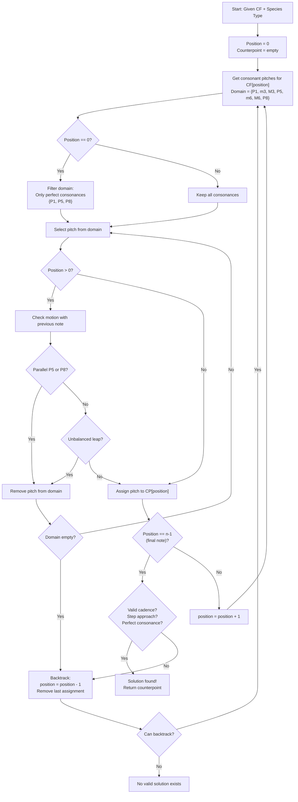

# Lesson 2: Species Counterpoint – The Complete Practitioner's Workshop

## 1. First-Principles Intuition & Invariants

Species counterpoint is a systematic training method for **polyphonic voice leading**—the art of writing multiple independent melodic lines that sound coherent when performed simultaneously. Codified by Johann Joseph Fux in *Gradus ad Parnassum* (1725), it distills Renaissance polyphony (especially Palestrina's style) into five progressive exercises, each isolating a specific rhythmic-harmonic challenge.

### The Core Challenge: Horizontal + Vertical Coherence

Counterpoint solves a dual problem:
- **Horizontal (melodic)**: Each line must be singable, contoured, and internally logical
- **Vertical (harmonic)**: Lines must produce acceptable intervals at each moment without losing independence

This is a **constraint satisfaction problem**: rules governing interval choice, motion types, and dissonance treatment create a decision tree where early choices constrain later options.

### The Cantus Firmus: Your Foundation

Every species exercise begins with a *cantus firmus* (CF)—a simple whole-note melody spanning roughly an octave. The CF serves as both anchor and scaffold:

**Design characteristics** (practical construction rules):
1. **8–10 notes**, predominantly **stepwise** motion (major/minor seconds)
2. **One climax point** (highest or lowest note), typically ⅔ through the line
3. **Mostly steps, occasional thirds**; avoid leaps larger than a fifth
4. **No consecutive leaps** in the same direction; balance leaps with contrary stepwise motion
5. **Start and end on the modal final** (e.g., D for Dorian, E for Phrygian)
6. **Approach the final by step** (2nd scale degree up or 7th scale degree down)

**Example CF** (D Dorian):
```
D – E – F – E – D – C – D – E – F – G – F – E – D
```

Why these rules? They ensure the CF moves **predictably** and remains within a **comfortable vocal range** (Renaissance counterpoint evolved from liturgical singing). Stepwise motion creates smooth harmonic progressions, while a single climax provides directional energy.

### Consonance vs. Dissonance: The Core Binary

Species counterpoint operates within a strict **interval hierarchy**:

**Perfect Consonances** (pristine acoustic ratios):
- Unison (P1)
- Perfect fifth (P5)
- Perfect octave (P8)

**Imperfect Consonances** (stable but richer):
- Minor third (m3), major third (M3)
- Minor sixth (m6), major sixth (M6)

**Dissonances** (all others):
- Major/minor seconds (M2, m2)
- Perfect fourth (P4) in two-voice textures
- Major/minor sevenths (M7, m7)
- All augmented/diminished intervals

**Why this matters acoustically**: Perfect consonances share identical overtone structures, causing voices to **fuse perceptually**. Overusing them obliterates independence. Imperfect consonances maintain separation while providing stability. Dissonances create tension demanding resolution.

**Species progression controls dissonance treatment**:
- **Species 1**: No dissonance (consonance-only intervals)
- **Species 2**: Weak-beat passing tones
- **Species 3**: Weak-beat neighbor tones and faster passing figures
- **Species 4**: Strong-beat suspensions (prepared dissonance)
- **Species 5**: Free mixture of all prior techniques

### Voice Independence: The Motion Types

**Parallel motion**: Both voices move same direction, same interval
- **Forbidden**: Parallel perfect consonances (P5, P8)—they fuse the voices into one
- **Allowed**: Parallel imperfect consonances (thirds, sixths)—maintain separation

**Contrary motion**: Voices move in opposite directions
- **Ideal**: Maximizes independence, especially at cadences

**Oblique motion**: One voice holds, the other moves
- **Moderate independence**: Common around suspensions

**Similar motion**: Same direction, different intervals
- **Use judiciously**: Can sound clumsy unless the voices move by step

**Why parallel fifths/octaves are forbidden**: Acoustically, parallel perfect intervals create a stream of **identical harmonic spectra**, reducing two voices to a single thickened line. This defeats the purpose of polyphony.

### The Five Invariants (Apply to All Species)

1. **Begin on perfect consonance** (P1, P5, P8)—establishes stability
2. **End on perfect consonance** (P1 or P8)—confirms resolution
3. **Approach final by step** in at least one voice—creates smooth cadence
4. **Avoid tritone melodic outlines** in either voice—unstable, hard to sing
5. **No voice crossing** (in strict two-voice writing)—maintains registral clarity

## 2. The Five Species: Hands-On Practice Architecture

Each species isolates **one rhythmic-harmonic challenge**. Master them sequentially—each builds on the previous.

---

### Species 1: Note-Against-Note (1:1)

**Setup**: One whole note in counterpoint per whole note in CF.

**Focus**: Pure interval succession without rhythmic complication.

#### Step-by-Step Composition Process

**Phase 1: Cadence Design (Work Backward)**

Start with the ending—it's the most constrained.

1. **Final interval**: Perfect unison or octave
2. **Penultimate interval**: Major or minor sixth (sets up contrary motion)
3. **Approach**: Counterpoint moves by step into final

**Example cadence** (CF in lower voice, D Dorian):
```
CF:         E  –  D
CP:         C  –  D
Intervals:  m6 – P8
Motion:     Contrary
```

**Phase 2: Opening Interval**

4. **First interval**: Unison, fifth, or octave (perfect consonance)
5. **Direction**: Choose whether CP starts above or below CF

**Phase 3: Fill the Middle**

6. For each CF note, choose a consonance (P1, m3, M3, P5, m6, M6, P8)
7. **Check motion type**: Avoid parallel P5 or P8
8. **Balance leaps**: After a leap (≥ P4), move by step in opposite direction
9. **Create one apex**: Counterpoint should peak once, roughly mirroring CF's climax

#### Practice Drill 1A: Complete This First-Species Exercise

**CF** (D Dorian, lower voice):
```
D – E – F – E – D – C – D
```

**Your task**: Write a counterpoint above, following these steps:

**Step 1**: Design cadence
- Final: D (CF) + D (CP) = P8 ✓
- Penultimate: C (CF) + E (CP) = M6 ✓

**Step 2**: Choose opening
- D (CF) + D (CP) = P8 or D (CF) + A (CP) = P5

**Step 3**: Fill middle, checking:
- All consonances?
- No parallel P5/P8?
- One apex?
- Leaps balanced?

**Solution Example**:
```
CF:         D  –  E  –  F  –  E  –  D  –  C  –  D
CP:         D  –  C  –  D  –  C  –  F  –  E  –  D
Intervals:  P8 –  m6 –  m6 –  m6 –  M3 –  M3 –  P8
Motion:     Obl   Ctr   Ctr   Obl   Par   Obl   Ctr
```

**Analysis**:
- Opens/closes P8 ✓
- No parallel perfects ✓
- Apex: F (counterpoint) vs. F (CF)—mirrored ✓
- Contrary motion into cadence ✓

#### Practice Drill 1B: Interval Grid Method

**Cantus Firmus** (G Dorian):
```
G – A – Bb – A – G – F – G
```

**Step-by-step grid construction**:

| CF Note | Consonances Available | Chosen CP | Interval | Motion Check |
|---------|----------------------|-----------|----------|--------------|
| G       | G, Bb, C, D, Eb, G   | G         | P8       | (opening)    |
| A       | A, C, D, E, F, A     | F         | m6       | Contrary ✓   |
| Bb      | Bb, D, Eb, F, G, Bb  | G         | M6       | Contrary ✓   |
| A       | A, C, D, E, F, A     | F         | m6       | Oblique ✓    |
| G       | G, Bb, C, D, Eb, G   | Bb        | M3       | Contrary ✓   |
| F       | F, A, Bb, C, D, F    | A         | M3       | Oblique ✓    |
| G       | G, Bb, C, D, Eb, G   | G         | P8       | Contrary ✓   |

**Metronome Practice**:
- Sing/play this exercise at ♩ = 60 BPM
- Increase to ♩ = 80 BPM once accurate
- Transpose to E Phrygian, then A Aeolian

---

### Species 2: Two-Against-One (2:1)

**Setup**: Two half notes in counterpoint per CF whole note.

**Focus**: Metric hierarchy and weak-beat dissonance.

#### New Rule: Weak-Beat Passing Tones

**Strong beats** (coincide with CF attacks): Must be consonant
**Weak beats** (mid-CF-note): May be dissonant **if**:
1. Approached by step
2. Left by step
3. In the **same direction** (passing tone connects two consonances)

**Passing Tone Anatomy**:
```
Beat:       1   &   2
CF:         D   –   E
CP:         F   E   G
Intervals:  M3  M2  M3
            C   d   C
```
The E on beat & is a **passing tone** (dissonant M2) connecting two consonances.

#### Practice Drill 2A: Add Passing Tones

**Given first-species skeleton**:
```
CF:         D   –   E   –   F
CP:         F   –   G   –   A
Intervals:  M3      M3      M3
```

**Convert to second species** by adding weak-beat notes:
```
CF:         D       E       F
CP:         F   E   G   F   A   G
Intervals:  M3  M2  M3  m2  M3  M2
            C   d   C   d   C   d
```

All weak-beat dissonances are **passing tones** (stepwise approach and departure).

#### Practice Drill 2B: Compose from Scratch

**CF** (D Dorian):
```
D – E – F – E – D
```

**Your task**: Write second-species counterpoint above.

**Step 1**: Design cadence
```
CF:         E       D
CP:         G   F   D
Intervals:  M3  M2  P8
            C   d   C
```

**Step 2**: Fill earlier bars, ensuring:
- Strong beats consonant
- Weak beats passing if dissonant
- Smooth melodic contour

**Solution Example**:
```
CF:         D       E       F       E       D
CP:         F   E   G   F   A   G   G   F   D
Intervals:  M3  M2  M3  m2  M3  M2  M3  M2  P8
            C   d   C   d   C   d   C   d   C
```

**Metronome Practice**:
- ♩ = 60 BPM (half note = beat)
- ♩ = 80 BPM
- ♩ = 100 BPM

---

### Species 3: Four-Against-One (4:1)

**Setup**: Four quarter notes per CF whole note.

**Focus**: Rapid figuration, neighbor tones, and more flexible dissonance.

#### New Rule: Neighbor Tones

**Neighbor tone**: Weak-beat dissonance that **steps away from and returns to** the same consonance.
```
Beat:       1   2   3   4
CF:         D   –   –   –
CP:         F   E   F   G
Intervals:  M3  M2  M3  P4
            C   d   C   C
```
Beat 2 (E) is a **lower neighbor** to F.

#### Practice Drill 3A: Four-Note Patterns

**CF note**: D

**Consonances**: D, F, A (D major triad members)

**Four-note figures** (beat 1 = consonant; beats 2/4 may pass):
1. **Arpeggio**: D – F – A – F
2. **Passing figure**: F – E – D – C (E = passing tone)
3. **Neighbor figure**: F – G – F – E
4. **Scalar descent**: A – G – F – E

#### Practice Drill 3B: Compose Third Species

**CF** (D Dorian):
```
D – E – F
```

**Your task**: Create four quarter notes per CF note.

**Solution Example**:
```
CF:         D               E               F
CP:         A   G   F   E   E   D   C   D   F   E   D   C
Intervals:  P5  P4  m3  M2  P8  m7  m6  m7  P8  m7  m6  P5
            C   C   C   d   C   d   C   d   C   d   C   C
```

**Analysis**:
- Beats 1 and 3 predominantly consonant
- Beats 2 and 4 allow passing/neighbor dissonances
- Smooth scalar motion creates gesture across each CF note

**Metronome Practice**:
- ♩ = 60 BPM (quarter note = beat)
- ♩ = 80 BPM
- Focus on evenness and articulation

---

### Species 4: Syncopation and Suspension (Offbeat Half Notes)

**Setup**: Half notes beginning on weak beats (syncopated).

**Focus**: Suspensions—strong-beat dissonances that resolve downward by step.

#### Suspension Anatomy (3-Phase Structure)

1. **Preparation**: Consonance on weak beat
2. **Suspension**: Same note held over barline → dissonance on strong beat
3. **Resolution**: Stepwise descent to consonance on weak beat

**Example**:
```
Beat:       weak strong weak strong
CF:         D    E     E    F
CP:         A ———————— A    G
Intervals:  P5   P4    P4   M2
Phase:      Prep  Susp  (hold) Res
```

The P4 (A over E) is **dissonant** in two-voice counterpoint. It resolves down by step to G (M2 interval becomes dissonant, but the **motion** resolves the tension).

**Common suspension types** (interval names):
- **7–6**: Seventh resolves to sixth
- **4–3**: Fourth resolves to third
- **9–8**: Ninth resolves to octave (CP below CF)
- **2–3**: Second resolves to third (CP below CF)

#### Practice Drill 4A: Identify Suspensions

**Given**:
```
CF:         D   –   E   –   F   –   E   –   D
CP:             A   –   G   –   F   –   E   –   D
Intervals:      P5  –   M3  –   P8  –   P8  –   P8
```

**Task**: Label each tie as Preparation-Suspension-Resolution.

**Analysis**:
- Measure 1–2: A (P5, consonant) held over → A vs. E (P4, dissonant) → G (M3, consonant) = **5–4–3 suspension**
- Measure 2–3: G held → G vs. F (M2, dissonant) → F (P8, consonant) = **2–1 suspension** (inverted)

#### Practice Drill 4B: Compose Fourth Species

**CF** (D Dorian):
```
D – E – F – E – D
```

**Your task**: Write syncopated half notes featuring suspensions.

**Solution Template**:
```
CF:         D       E       F       E       D
CP:     –   A   –   G   –   F   –   E   –   D
Intervals:  P5  (4) M3  (2) P8  (7) P8  (–) P8
```

**Metronome Practice**:
- ♩ = 60 BPM (half note = beat)
- Feel the "push" of the syncopation
- Let suspensions "lean" into resolution

---

### Species 5: Florid (Mixed Rhythms)

**Setup**: Free mixture of whole, half, quarter notes, and brief eighth notes.

**Focus**: Integration of all prior techniques into flexible counterpoint.

#### Compositional Strategy

1. **Vary rhythmic density**: Alternate fast passages with sustained notes
2. **Use suspensions at cadences**: Heightens arrival
3. **Balance activity**: Don't overcrowd—let the CF breathe
4. **Maintain metric clarity**: Strong beats anchor; weak beats embellish

#### Practice Drill 5A: Analyze Mixed-Rhythm Passage

**CF** (D Dorian):
```
D       E       F
```

**Florid counterpoint**:
```
F   F   E F G F E   D   E   (F) E   D C
```

**Rhythmic values**:
```
♩   ♩   ♪♪♪♪♪♪ 𝅗𝅥  𝅗𝅥   (tie)𝅗𝅥 ♩ ♩
```

**Analysis**:
- Bar 1: Two quarter notes (second species)
- Bar 1 beat 3: Six eighth notes (rapid embellishment, third species acceleration)
- Bar 2: Whole note (first species stability)
- Bar 3: Suspension (fourth species)

#### Practice Drill 5B: Compose Florid Counterpoint

**CF** (G Dorian):
```
G – A – Bb – A – G
```

**Your task**: Mix rhythms freely, demonstrating:
- At least one suspension
- At least one four-note figure
- At least one sustained note (whole or half)

**Solution Framework**:
```
CF:         G           A           Bb          A           G
CP:         G   A BbC   D   –   D   D   C   D   C   BbA G   G
Rhythm:     ♩   ♪♪♪♪    𝅗𝅥      (tie)𝅗𝅥  ♩   (tie)𝅗𝅥  ♪♪♪♪    𝅗𝅥
```

---

## 3. Algorithmic Thinking: Constraint Satisfaction Logic

Species counterpoint is a **search problem**. Each note choice constrains future options—like chess, where early moves shape the endgame.

### Constraint Satisfaction Problem (CSP) Structure

**Variables**: Counterpoint note positions (CP₁, CP₂, ..., CPₙ)
**Domains**: For each CPᵢ, the set of pitches forming consonances with CFᵢ
**Constraints**: Rules forbidding parallel perfects, requiring stepwise cadence approach, etc.

### Backtracking Search Flowchart



### Practical Python Implementation (First Species)

```python
def generate_first_species(cantus_firmus):
    """
    Generate valid first-species counterpoint using backtracking.
    
    Args:
        cantus_firmus: List of MIDI note numbers (e.g., [62, 64, 65, ...])
    
    Returns:
        List of counterpoint pitches, or None if no solution exists
    """
    n = len(cantus_firmus)
    counterpoint = [None] * n
    
    # Consonant intervals (semitones mod 12)
    CONSONANCES = {0, 3, 4, 7, 8, 9}  # P1, m3, M3, P5, m6, M6
    PERFECT_CONSONANCES = {0, 7}  # P1, P5
    
    def get_interval(cp_pitch, cf_pitch):
        """Calculate interval mod 12."""
        return abs(cp_pitch - cf_pitch) % 12
    
    def is_consonant(cp_pitch, cf_pitch):
        """Check if interval is consonant."""
        return get_interval(cp_pitch, cf_pitch) in CONSONANCES
    
    def is_perfect(cp_pitch, cf_pitch):
        """Check if interval is perfect consonance."""
        return get_interval(cp_pitch, cf_pitch) in PERFECT_CONSONANCES
    
    def parallel_perfects(cp1, cf1, cp2, cf2):
        """Detect parallel perfect fifths or octaves."""
        if not (is_perfect(cp1, cf1) and is_perfect(cp2, cf2)):
            return False
        return get_interval(cp1, cf1) == get_interval(cp2, cf2)
    
    def get_domain(cf_pitch):
        """Generate consonant pitches within singable range."""
        domain = []
        for octave_offset in [-12, 0, 12]:
            for interval in CONSONANCES:
                for direction in [1, -1]:
                    pitch = cf_pitch + (direction * interval) + octave_offset
                    if 48 <= pitch <= 84:  # C3 to C6 (vocal range)
                        domain.append(pitch)
        return sorted(set(domain))
    
    def backtrack(pos):
        """Recursive backtracking search."""
        if pos == n:
            return True  # All positions filled successfully
        
        domain = get_domain(cantus_firmus[pos])
        
        for pitch in domain:
            # Constraint: first note must be perfect consonance
            if pos == 0:
                if not is_perfect(pitch, cantus_firmus[0]):
                    continue
            
            # Constraint: last note must be P8/P1, approached by step
            if pos == n - 1:
                if get_interval(pitch, cantus_firmus[pos]) != 0:
                    continue
                if abs(pitch - counterpoint[pos - 1]) > 2:
                    continue
                # Check contrary motion into cadence
                cp_direction = pitch - counterpoint[pos - 1]
                cf_direction = cantus_firmus[pos] - cantus_firmus[pos - 1]
                if cp_direction * cf_direction >= 0:  # Not contrary
                    continue
            
            # Constraint: no parallel perfect consonances
            if pos > 0:
                if parallel_perfects(counterpoint[pos - 1], cantus_firmus[pos - 1],
                                    pitch, cantus_firmus[pos]):
                    continue
                
                # Constraint: balance large leaps
                leap_size = abs(pitch - counterpoint[pos - 1])
                if leap_size > 4 and pos > 1:  # Leap > M3
                    prev_leap = abs(counterpoint[pos - 1] - counterpoint[pos - 2])
                    if prev_leap > 4:  # Two consecutive leaps
                        continue
            
            # Assign and recurse
            counterpoint[pos] = pitch
            if backtrack(pos + 1):
                return True
            counterpoint[pos] = None  # Backtrack
        
        return False  # No valid pitch found for this position
    
    if backtrack(0):
        return counterpoint
    return None


# Example usage
cf = [62, 64, 65, 64, 62, 60, 62]  # D Dorian cantus firmus
result = generate_first_species(cf)

if result:
    print("Cantus Firmus:", cf)
    print("Counterpoint: ", result)
    print("\nIntervals:")
    for i in range(len(cf)):
        interval = abs(result[i] - cf[i]) % 12
        interval_names = {0: "P1", 3: "m3", 4: "M3", 7: "P5", 8: "m6", 9: "M6"}
        print(f"  {i+1}: {interval_names.get(interval, '?')}")
else:
    print("No valid counterpoint found.")
```

**Run this code** to generate solutions automatically. Then **analyze** the output:
- Are all intervals consonant?
- Are there any parallel perfects?
- Is the cadence correct?

---

## 4. Performance Practice: Singing and Playing

Species counterpoint was designed for **singers**. To internalize the logic, you must **physically perform** these exercises.

### Vocal Practice Routine

**Phase 1: Individual Lines** (5 min)
1. Sing the CF alone at ♩ = 60 BPM
2. Sing your counterpoint alone
3. Check: Is each line singable without awkward leaps?

**Phase 2: Two-Voice Execution** (10 min)
4. Play CF on piano/keyboard, sing counterpoint
5. Reverse: sing CF, play counterpoint
6. With a partner: one person per voice

**Phase 3: Intervallic Awareness** (5 min)
7. While singing, **hear** the vertical intervals
8. Stop on each downbeat, identify the interval (P5? m6?)

### Keyboard Practice Routine

**Both Hands Simultaneously**:
- Left hand: CF (whole notes)
- Right hand: Counterpoint (species-appropriate rhythm)

**Practice sequence**:
1. ♩ = 40 BPM (very slow, focus on accuracy)
2. ♩ = 60 BPM (singing tempo)
3. ♩ = 80 BPM (comfortable flow)

**Hand independence drill** (Species 2):
- Set metronome to half-note pulse
- Left hand plays on beat 1 only
- Right hand plays on beats 1 and 2
- Focus: right hand's weak beat should feel **lighter**

---

## 5. Modal Framework: Beyond Major/Minor

Fux's exercises use **Renaissance modes**, not modern major/minor keys. This is critical—modal counterpoint lacks **functional harmony** (no dominant → tonic pull). Instead, harmonic logic arises purely from voice leading.

### The Six Primary Modes (with finals)

| Mode       | Final | Scale (white notes) | Character               |
|------------|-------|---------------------|-------------------------|
| Dorian     | D     | D–E–F–G–A–B–C–D     | Balanced, minor-ish     |
| Phrygian   | E     | E–F–G–A–B–C–D–E     | Dark, semitone start    |
| Lydian     | F     | F–G–A–B–C–D–E–F     | Bright, raised 4th      |
| Mixolydian | G     | G–A–B–C–D–E–F–G     | Major-ish, lowered 7th  |
| Aeolian    | A     | A–B–C–D–E–F–G–A     | Natural minor           |
| Ionian     | C     | C–D–E–F–G–A–B–C     | Major scale             |

### Modal Cadence Formulas

**Authentic cadence** (approaching the final):
- Lower voice: **step up** to final (e.g., C → D in Dorian)
- Upper voice: **step down** to final (e.g., E → D in Dorian)
- Creates **contrary motion** and **major sixth → octave** resolution

**Example** (D Dorian):
```
CF (lower):  C  –  D
CP (upper):  E  –  D
Interval:    M6 –  P8
```

### Practice Drill: Transpose to All Modes

**Take this first-species exercise**:
```
CF (D Dorian):  D – E – F – E – D
CP (above):     D – C – D – C – D
```

**Transpose to**:
1. **E Phrygian**: E – F – G – F – E (use E as final)
2. **F Lydian**: F – G – A – G – F
3. **G Mixolydian**: G – A – Bb – A – G

**Why this matters**: Each mode has unique half-step placements, forcing you to adjust interval choices. Phrygian's E–F semitone creates different consonance options than Dorian's D–E whole tone.

---

## 6. Historical Context: From Palestrina to Bach to Now

### Renaissance Origins (1500–1600)

**Palestrina's *Missa Papae Marcelli* (1567)**: Exemplar of strict counterpoint
- Smooth voice leading, minimal dissonance
- Text clarity (Council of Trent requirement)
- Four to six voices, imitative entries

**Listen**: Palestrina, "Kyrie" from *Missa Papae Marcelli*
- Notice: predominant stepwise motion, no harsh dissonances, overlapping phrases

### Baroque Expansion (1600–1750)

**J.S. Bach** adapted Renaissance principles to **tonal harmony**:
- Retained stepwise voice leading
- Added functional chord progressions (V → I)
- Increased dissonance tolerance (seventh chords, diminished harmonies)

**Example**: Bach, *Invention No. 1 in C Major*
- Two-voice counterpoint throughout
- Follows species principles (mostly consonant, stepwise motion)
- But: uses harmonic sequences, modulations (Renaissance modes don't modulate)

**Listen**: Bach, *The Art of Fugue, Contrapunctus I*
- Hear species counterpoint expanded into fugal architecture

### Modern Applications (1900–Present)

**Hindemith** (*Craft of Musical Composition*, 1937): Updated species for 20th-century chromaticism
- Retained interval hierarchy (but redefined based on overtone series)
- Applied to atonal contexts

**Jazz counterpoint**: 
- Bill Evans, "Waltz for Debby"—bass and piano lines maintain independence via contrary motion
- Brad Mehldau, "Resignation"—left-hand bass counterpoint to right-hand melody

**Film scoring**:
- John Williams, *Star Wars* main title—brass fanfare uses contrapuntal layering
- Howard Shore, *Lord of the Rings*—leitmotifs combined contrapuntally

**Why species counterpoint still matters**: It trains **interval awareness** and **voice independence**, skills applicable to any style—tonal, modal, atonal, jazz, electronic.

---

## 7. Advanced Exercises: Mastery Challenges

### Exercise 7A: Three-Voice First Species

**CF** (middle voice, D Dorian):
```
D – E – F – E – D
```

**Your task**: Add counterpoint above and below, maintaining all species 1 rules **between every voice pair**.

**New constraint**: **Harmonic completeness**
- Aim for complete triads where possible (root, third, fifth)
- Avoid doubling the third

**Solution framework**:
```
Upper:    A – C – A – C – A
CF:       D – E – F – E – D
Lower:    D – A – D – A – D
```

**Check**:
- Upper vs. CF: P5, m6, m3, m6, P5 (no parallel perfects ✓)
- CF vs. Lower: P8, P5, M3, P5, P8 (no parallel perfects ✓)
- Upper vs. Lower: P5, M3, P5, M3, P5 (parallel P5 bars 1–3—**violation!**)

**Revision needed**: Adjust upper or lower voice to avoid parallel fifths.

### Exercise 7B: Suspensions in Minor

**CF** (A Aeolian):
```
A – B – C – B – A
```

**Your task**: Fourth-species counterpoint with chain of suspensions.

**Target**: Create 7–6, 4–3, or 9–8 suspensions at each measure.

### Exercise 7C: Florid Counterpoint with Imitation

**CF** (G Dorian):
```
G – A – Bb – A – G – F – G
```

**Your task**: Fifth-species counterpoint that **imitates** the CF's opening gesture.

**Technique**: Start counterpoint with G – A – Bb (same pitches as CF), but shifted by one beat.

**Result**: Creates **canonic imitation**, a more advanced texture.

---

## 8. Self-Assessment Rubric

Use this to evaluate your exercises:

| Criterion                     | Weight | Checkpoints                                                                 |
|-------------------------------|--------|-----------------------------------------------------------------------------|
| **Rule Compliance**           | 40%    | No parallel P5/P8? Proper dissonance treatment? Correct cadence?           |
| **Melodic Quality**           | 30%    | Smooth contour? Single apex? Balanced leaps?                                |
| **Voice Independence**        | 20%    | Contrary motion? Rhythmic differentiation (species 2+)?                     |
| **Stylistic Idiom**           | 10%    | Sounds like Renaissance polyphony? Singable?                                |

**Scoring**:
- **90–100%**: Publication-ready; sounds like Palestrina
- **75–89%**: Technically correct; needs stylistic polish
- **60–74%**: Minor rule violations; revise
- **<60%**: Major violations; review species rules

---

## 9. Computational Extensions: Algorithmic Composition

### Constraint Logic Programming (Prolog)

Species rules map naturally onto **declarative logic**:

```prolog
% Define consonant intervals (semitones mod 12)
consonant(0).   % Unison
consonant(3).   % Minor third
consonant(4).   % Major third
consonant(7).   % Perfect fifth
consonant(8).   % Minor sixth
consonant(9).   % Major sixth

% Define perfect consonances
perfect(0).
perfect(7).

% Rule: No parallel perfect fifths or octaves
no_parallel_perfects(CP1, CF1, CP2, CF2) :-
    Int1 is (CP1 - CF1) mod 12,
    Int2 is (CP2 - CF2) mod 12,
    \+ (perfect(Int1), perfect(Int2), Int1 = Int2).

% Rule: Opening must be perfect consonance
valid_opening(CP, CF) :-
    Interval is (CP - CF) mod 12,
    perfect(Interval).

% Rule: Cadence must be octave/unison, approached by step
valid_cadence(CP_prev, CP_final, CF_final) :-
    Interval is (CP_final - CF_final) mod 12,
    Interval = 0,
    Step is abs(CP_final - CP_prev),
    Step =< 2.

% Generate first-species counterpoint
first_species([CF|CFs], [CP|CPs]) :-
    valid_opening(CP, CF),
    between(48, 84, CP),  % Vocal range
    Interval is (CP - CF) mod 12,
    consonant(Interval),
    first_species_body(CFs, CPs, CP, CF).

first_species_body([], [], _, _).
first_species_body([CF], [CP], CP_prev, CF_prev) :-
    valid_cadence(CP_prev, CP, CF),
    between(48, 84, CP),
    Interval is (CP - CF) mod 12,
    consonant(Interval).
first_species_body([CF|CFs], [CP|CPs], CP_prev, CF_prev) :-
    between(48, 84, CP),
    Interval is (CP - CF) mod 12,
    consonant(Interval),
    no_parallel_perfects(CP_prev, CF_prev, CP, CF),
    first_species_body(CFs, CPs, CP, CF).
```

**Usage** (SWI-Prolog):
```prolog
?- first_species([62, 64, 65, 64, 62], CP).
CP = [69, 67, 69, 67, 69] ;
CP = [69, 67, 65, 67, 69] ;
...
```

### Neural Network Approach (Conceptual)

**Architecture**: Sequence-to-sequence LSTM

**Input**: CF note (one-hot encoded) + position in sequence
**Output**: Counterpoint note (softmax over MIDI pitches)
**Training data**: 500+ historical counterpoint examples (Palestrina, Lassus, Victoria)

**Loss function**: 
- Cross-entropy (match historical choices)
- Rule penalty (add loss for parallel perfects, dissonance violations)

**Hybrid system**: Neural net proposes candidates → rule checker validates → backtrack if invalid

---

## 10. Complete Annotated Example: Fourth-Species Analysis

**Palestrina, *Kyrie* from *Missa Papae Marcelli* (simplified two-voice reduction)**:

```
Measure:     1       2       3       4       5
Tenor (CF):  D   –   E   –   F   –   E   –   D
Soprano:         A   –   G   –   F   –   E   –   D

Intervals:       P5  –   m3  –   P8  –   P8  –   P8

Analysis:
- Measure 1: A enters on weak beat (suspension setup)
- Measure 2: A held against E = P4 (dissonant suspension) → resolves down to G (m3)
- Measure 3: G held against F = M2 (dissonant suspension) → resolves down to F (P8)
- Measure 4–5: No suspensions, consonant descent to final
```

**What makes this Palestrina-esque?**
1. **Smooth voice leading**: Soprano descends entirely by step (A–G–F–E–D)
2. **Suspensions create tension**: P4 and M2 dissonances heighten expression
3. **Contrary motion into cadence**: Soprano descends while tenor ascends (C→D in full score)
4. **Modal cadence**: Ends on D (Dorian final)

**Listen**: Palestrina, *Missa Papae Marcelli*, "Kyrie" (full SATB version)
- Hear how suspensions cascade across multiple voices

---

## 11. Practice Regimen: 30-Day Mastery Plan

**Week 1: First Species**
- Day 1–2: Complete 5 first-species exercises (given CF)
- Day 3–4: Write your own CF, compose counterpoint above
- Day 5–7: Transpose exercises to all six modes

**Week 2: Second Species**
- Day 8–10: Convert first-species exercises to second species
- Day 11–12: Compose second species from scratch
- Day 13–14: Keyboard practice at ♩ = 60, 80, 100 BPM

**Week 3: Third and Fourth Species**
- Day 15–17: Third-species figuration exercises
- Day 18–20: Fourth-species suspension chains
- Day 21: Combine third and fourth techniques

**Week 4: Fifth Species and Integration**
- Day 22–25: Florid counterpoint, mixing all rhythms
- Day 26–27: Three-voice first species
- Day 28–29: Analyze Palestrina scores
- Day 30: Compose original florid counterpoint, perform/record it

**Daily practice structure**:
1. **Warm-up** (5 min): Sing intervals (P1, m3, M3, P5, m6, M6, P8)
2. **Exercise** (15 min): Compose one species exercise
3. **Performance** (10 min): Play/sing completed exercises
4. **Analysis** (5 min): Check rules, identify violations

---

## 12. Resources for Continued Study

### Primary Treatises
- **Fux, *Gradus ad Parnassum*** (1725), trans. Alfred Mann—the original source
- **Jeppesen, *Counterpoint*** (1939)—historically informed, modal emphasis
- **Schenker, *Counterpoint*** (1910)—connects species to tonal analysis

### Modern Pedagogy
- **Peter Schubert, *Modal Counterpoint, Renaissance Style*** (2008)—best modern textbook
- **Kent Kennan, *Counterpoint*** (4th ed., 1999)—integrates tonal harmony
- **Robert Gauldin, *A Practical Approach to 16th-Century Counterpoint*** (1995)

### Listening (Spotify/YouTube)
- **Palestrina**: *Missa Papae Marcelli*, motets
- **Josquin des Prez**: *Ave Maria... Virgo serena*
- **Bach**: *The Art of Fugue*, *Musical Offering*
- **Hindemith**: *Ludus Tonalis*

### Software Tools
- **MuseScore** (free): Notation and playback
- **music21** (Python library): Algorithmic analysis and generation
- **Counterpointer** (iOS app): Interactive exercises with instant feedback
- **OpenMusic** (visual programming): Constraint-based composition

### Online Courses
- **Coursera**: "Introduction to Classical Music" (Yale)—includes counterpoint module
- **Berklee Online**: "Counterpoint"—tonal focus, jazz applications
- **Open Yale Courses**: "Listening to Music" (Craig Wright)—historical context

---

## 13. Final Challenge: Compose a Complete Five-Species Suite

**Assignment**: Compose a complete set of exercises over **one cantus firmus**, demonstrating all five species.

**Cantus Firmus** (D Dorian):
```
D – E – F – G – F – E – D – C – D – E – D
```

**Requirements**:
1. **Species 1**: Note-against-note, above CF
2. **Species 2**: Two-against-one, below CF
3. **Species 3**: Four-against-one, above CF
4. **Species 4**: Syncopated, below CF, with at least 4 suspensions
5. **Species 5**: Florid, above CF, integrating all prior techniques

**Deliverable**:
- Notated score (hand-written or engraved in MuseScore)
- Audio recording (performed or synthesized)
- Self-assessment using the rubric (§8)

**Deadline**: 30 days from starting this lesson

**Masterclass criterion**: If all five species score ≥85% on the rubric, you have achieved **journeyman-level counterpoint mastery**—the foundation for fugue, canon, and advanced polyphonic composition.

---

**Now begin**: Select a cantus firmus, open your notation software or manuscript paper, and compose your first species exercise. The only way to master counterpoint is through **sustained, deliberate practice**—one interval, one voice, one species at a time.
