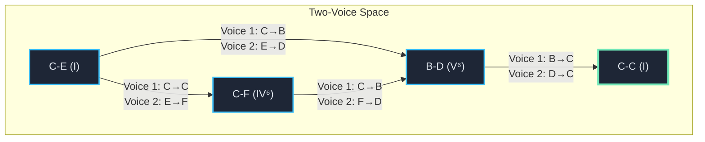
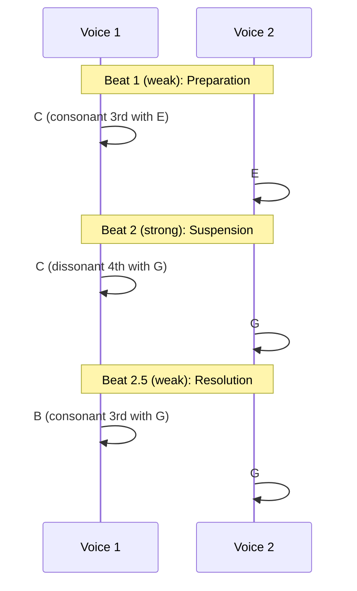
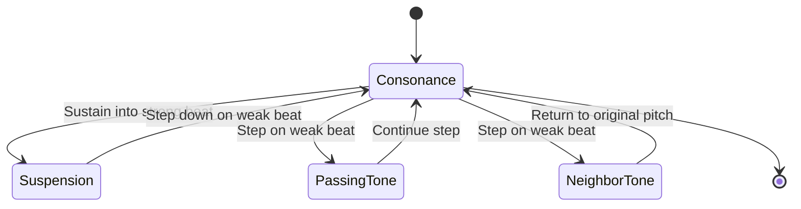
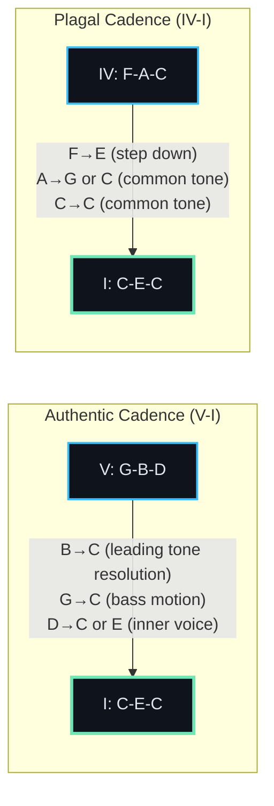

# Lesson 3: Free Counterpoint

## 1. First-Principles Intuition & Invariants

Counterpoint is the disciplined art of combining independent melodic lines such that each retains its structural autonomy while contributing to a coherent harmonic whole. The term derives from the Latin *punctus contra punctum*—"note against note"—and embodies a fundamental tension in polyphonic music: the simultaneous pursuit of linear independence and vertical consonance.

The species counterpoint system, formalized by Johann Joseph Fux in *Gradus ad Parnassum* (1725), provides a graduated pedagogical framework. Each species introduces constraints incrementally: first species pairs whole notes against whole notes in strict consonance; second species introduces two notes against one; third species adds rhythmic elaboration; fourth species introduces syncopation and suspensions; fifth species (florid counterpoint) combines all previous techniques. This scaffolding trains the ear and hand to navigate the dual constraints of horizontal melody and vertical harmony.

Free counterpoint represents not the abandonment of contrapuntal logic but its maturation. Where species counterpoint operates within a narrow constraint space to isolate specific technical challenges, free counterpoint synthesizes these constraints into a unified compositional practice. The composer working in free counterpoint internalizes the underlying principles—voice independence, smooth voice leading, dissonance treatment, rhythmic differentiation—and applies them fluidly, without rigid adherence to species taxonomy.

### Voice Independence

Voice independence is the architectural principle that each melodic line must possess its own musical identity. This independence manifests in three dimensions: **melodic contour**, **rhythmic profile**, and **harmonic function**.

Melodic contour refers to the shape traced by a voice over time. Independent voices should exhibit distinct contours: when one voice ascends, another may descend or remain static; when one voice leaps, another may move stepwise. This differentiation prevents voices from merging into parallel motion, which erodes the perception of polyphony. The exception is parallel motion in thirds or sixths, which preserves independence through harmonic interval while maintaining linear direction.

Rhythmic profile concerns the temporal distribution of attacks and durations. Independent voices should not mirror each other's rhythmic patterns. When one voice sustains a long note, another may articulate shorter subdivisions; when one voice rests, another continues. This rhythmic staggering ensures that the ear can trace each voice as a distinct temporal thread. The principle extends to metric placement: syncopation in one voice against on-beat articulation in another creates cross-rhythmic independence.

Harmonic function describes the role each voice plays in defining the underlying harmonic progression. In free counterpoint, voices may alternate between melodic and harmonic functions: a voice may carry the melodic apex while others provide harmonic support, then recede into an inner voice as another takes melodic prominence. This functional fluidity is what distinguishes free counterpoint from fixed-hierarchy textures like melody-with-accompaniment.

### Tonal Coherence

Tonal coherence is the principle that melodic independence must unfold within a shared harmonic framework. The voices do not exist in acoustic isolation; they generate vertical sonorities at each moment, and these sonorities must articulate a coherent tonal trajectory.

The harmonic series provides the acoustic foundation for consonance and dissonance. Intervals whose frequency ratios correspond to low-integer ratios (2:1 octave, 3:2 perfect fifth, 4:3 perfect fourth, 5:4 major third) produce coincident overtones and are perceived as stable. Higher-ratio intervals (45:32 tritone, 16:15 minor second) produce beating and roughness, perceived as unstable and requiring resolution.

Free counterpoint exploits this stability hierarchy through **dissonance treatment**. Dissonances are approached and resolved according to voice-leading norms: suspensions prepare on a consonance, create dissonance on the beat, and resolve downward by step; passing tones fill stepwise gaps on weak beats; neighbor tones embellish a sustained pitch. These treatments ensure that dissonance serves an expressive purpose—creating tension, directed motion, and harmonic color—rather than producing aimless instability.

The concept of **voice-leading parsimony** governs how voices move between chords. Each voice should move by the smallest possible interval to the next chord tone, minimizing total voice motion. This principle, formalized in neo-Riemannian theory as "efficient voice leading," reduces cognitive load and creates smooth harmonic transitions. When large leaps are necessary—often for melodic shaping or register distribution—they should be followed by stepwise contrary motion to restore equilibrium.

### Rhythmic Interplay

Rhythmic interplay emerges from the differential pacing of voices. When voices move at different rhythmic densities—one in whole notes, another in eighth notes—the faster voice creates melodic elaboration against the slower voice's harmonic foundation. This relationship is not hierarchical but symbiotic: the slower voice provides tonal anchor; the faster voice provides momentum and ornament.

The principle of **rhythmic differentiation** dictates that voices should not attack simultaneously except at cadential goals or structural downbeats. Staggered attacks create a perceptual streaming effect, allowing the ear to track each voice independently. This is the temporal analog of melodic contour differentiation: just as distinct pitch trajectories prevent melodic fusion, distinct rhythmic onsets prevent temporal fusion.

Syncopation introduces rhythmic tension by displacing accents from strong beats to weak beats. In free counterpoint, syncopation in one voice creates metric dissonance against the underlying pulse maintained by other voices. The fourth species suspension is the prototypical syncopated figure: a note tied across the barline creates dissonance on the downbeat, which resolves downward by step on the weak beat. This creates a push-pull effect, simultaneously asserting and resisting the metric frame.

### Expressive Coherence

Expressive coherence is the aesthetic principle that technical decisions must serve a unified musical narrative. Counterpoint is not an exercise in combinatorial possibility but a communicative act. Each voice must contribute to the emotional arc, the structural unfolding, and the rhetorical trajectory of the piece.

This coherence operates at multiple timescales. At the phrase level, voices should coordinate their peaks and nadirs to create climactic moments and points of repose. At the sectional level, voices should maintain tonal and motivic consistency within sections and provide contrast between sections. At the work level, voices should contribute to the large-scale tonal plan—modulations, returns, and final cadence.

The concept of **textural density** is crucial here. Dense counterpoint, with many voices in close proximity and high rhythmic activity, creates intensity and complexity. Sparse counterpoint, with few voices, wide spacing, and slower rhythm, creates openness and simplicity. The expressive composer modulates textural density to shape the listener's experience, building toward climaxes and releasing into resolutions.

## 2. Core Architecture & Mechanics

The compositional process of free counterpoint can be modeled as a constraint satisfaction problem operating in a multi-dimensional space. Each voice is a time-indexed sequence of pitches, and the space of valid sequences is constrained by melodic, harmonic, and rhythmic rules. The composer's task is to search this space for sequences that satisfy the constraints while maximizing aesthetic criteria.

### The Voice-Leading Space

Voice-leading space is the geometric abstraction of all possible configurations of voices. For two voices, this space is a two-dimensional lattice where each axis represents the pitch of one voice. A chord is a point in this lattice; a progression between two chords is a vector connecting two points. The length and direction of this vector represent the total voice motion and the individual voice motions.

In three or more voices, the space becomes higher-dimensional. A three-voice chord is a point in three-dimensional pitch space; a four-voice chord is a point in four-dimensional space. While impossible to visualize directly, the mathematical structure remains: chords are points, progressions are vectors, and voice-leading parsimony corresponds to minimizing vector length.



Efficient voice leading occupies the low-motion regions of this space. Chord progressions that require large voice motions—such as parallel motion by large intervals—occupy high-motion regions and are avoided. The prototypical efficient progressions are those where one or more voices sustain a common tone while the remaining voices move by step. The progression I–V in C major (C-E-G to G-B-D) can be voiced with G sustained in the bass, E moving to D, and C moving to B: total motion is three semitones distributed across three voices.

### Interval Vector Analysis

Each vertical sonority can be characterized by its **interval vector**, a compact representation of the intervals present between all pairs of voices. For a two-voice texture, the interval vector is simply the single interval. For three voices, the vector contains three intervals (the interval between each pair of voices). For four voices, six intervals.

The interval vector provides a fingerprint of the harmonic quality of a sonority. Consonant triads contain predominantly perfect fifths, perfect fourths, and major or minor thirds. Dissonant sonorities contain tritones, minor seconds, or major sevenths. The contrapuntal composer monitors the interval vector at each time point, ensuring that dissonances are properly prepared and resolved.

Consider a three-voice texture moving from a C major triad (C-E-G) to a G major triad (G-B-D):

| Time | Voice 1 | Voice 2 | Voice 3 | Intervals | Vector |
|------|---------|---------|---------|-----------|--------|
| t₀   | C       | E       | G       | C-E: M3, C-G: P5, E-G: m3 | [M3, m3, P5] |
| t₁   | B       | D       | G       | B-D: m3, B-G: m6, D-G: P4 | [m3, P4, m6] |

The interval vector changes from major-third-dominated to minor-third-dominated, reflecting the change in triad quality. Voice-leading analysis tracks not only the pitch motion but the transformation of the interval vector, ensuring smooth harmonic transitions.

### Dissonance Resolution Patterns

Dissonance in counterpoint is not an error but a structural resource. Properly prepared and resolved dissonances create directed motion, harmonic tension, and expressive intensity. The standard dissonance types—suspension, passing tone, neighbor tone, anticipation, escape tone—each have characteristic preparation, attack, and resolution patterns.

**Suspension**: A consonant note is sustained (or re-attacked) while other voices move, creating a dissonance on a strong beat. The suspended note then resolves downward by step to a consonance on a weak beat. The pattern is: preparation (consonance on weak beat) → suspension (dissonance on strong beat) → resolution (consonance on weak beat).



**Passing tone**: A dissonant note fills the stepwise gap between two consonances, occurring on a weak beat. No preparation is required. The pattern is: consonance → passing dissonance (weak beat) → consonance, with stepwise motion throughout.

**Neighbor tone**: A dissonant note embellishes a consonance by stepping away and returning. The pattern is: consonance → neighbor dissonance (weak beat) → consonance (original pitch).

These patterns can be formalized as state machines, where each state represents a harmonic condition (consonant, dissonant) and each transition represents a voice motion (step, leap) or metric position (strong beat, weak beat).



### Cadential Formulas

Cadences are structural articulation points where harmonic motion comes to rest. In tonal counterpoint, cadences involve specific voice-leading patterns that signal closure. The two primary cadence types are the **authentic cadence** (dominant to tonic) and the **plagal cadence** (subdominant to tonic).

The authentic cadence in two voices requires specific voice-leading: the lower voice moves from scale degree 5 to scale degree 1 (or 2 to 1 in an inverted cadence), while the upper voice moves from scale degree 7 to 1 or 2 to 1. The leading tone (scale degree 7) must resolve upward to the tonic, as its inherent instability demands resolution.

In three or more voices, the cadential formula becomes more elaborate. The dominant chord typically appears in root position, with the leading tone in an upper voice. The tonic chord may double the root for stability. The outer-voice framework—the bass and soprano—carries the primary voice-leading motion, while inner voices fill out the harmony and may move more freely.



The **half cadence** (ending on V) creates expectation rather than resolution, useful for phrase linkage. The **deceptive cadence** (V-VI) subverts the expected resolution to I, creating surprise and requiring continuation. These cadential variants allow the composer to control the sense of closure and forward motion.

### Common-Tone Retention and Oblique Motion

Voice-leading efficiency is maximized when voices retain common tones between chords. In the progression I-IV in C major (C-E-G to F-A-C), the common tone C can be sustained in one voice while the other voices move: E→F and G→A. This creates oblique motion—one voice stationary, others moving—which is inherently smooth and preserves harmonic continuity.

When no common tone exists between chords, voices should move by step whenever possible. The progression V-VI in C major (G-B-D to A-C-E) has no common tones, but efficient voice leading can be achieved through stepwise motion: G→A, B→C, D→E. This stepwise motion in all voices, though lacking a stationary anchor, still minimizes total displacement and maintains melodic integrity.

## 3. Practical Composition Techniques

The transition from species counterpoint exercises to free counterpoint composition requires integrating isolated techniques into a unified compositional workflow. The following techniques represent core strategies for generating and refining contrapuntal textures.

### Cantus Firmus Elaboration

The *cantus firmus* method begins with a single pre-existing melodic line, often slow-moving and diatonic, and adds one or more counterpoints above or below it. This method isolates the challenge of writing a single convincing counterpoint, allowing the composer to focus on voice-leading and intervallic relationships without simultaneously managing multiple independent voices.

The counterpoint should exhibit rhythmic contrast with the cantus firmus. If the cantus firmus moves in whole notes, the counterpoint may move in half notes or quarter notes. This rhythmic differentiation creates momentum and prevents the texture from becoming static.

Melodically, the counterpoint should achieve independence through distinct contour. When the cantus firmus ascends, the counterpoint may descend or move obliquely; when the cantus firmus leaps, the counterpoint may move stepwise. This contrary or oblique motion prevents parallel octaves and fifths while creating visual and auditory interest.

Harmonically, the counterpoint should create a mixture of consonances and dissonances, with dissonances properly treated. Consonances should predominate, especially on strong beats, to establish tonal stability. Dissonances should occur as suspensions, passing tones, or neighbor tones, always resolving according to their characteristic patterns.

**Practical Exercise**: Write a counterpoint above the following cantus firmus in C major:

```
Cantus Firmus (whole notes): C - D - E - F - E - D - C
```

Compositional strategy:
1. Begin and end on consonances (unison, third, fifth, sixth, or octave).
2. Use contrary motion on strong beats: when the cantus ascends C→D, the counterpoint may descend.
3. Employ passing tones on weak beats to create melodic flow.
4. Avoid leaping to or from dissonances; approach and leave them by step.
5. Create a melodic peak in the middle of the phrase, balancing the overall contour.

Example solution:

```
Counterpoint (half notes):  E - F - E - D - C - D - E - F - G - F - E - D - C - C
Cantus Firmus (whole notes): C -   D   -   E   -   F   -   E   -   D   -   C
```

Analysis: The counterpoint begins on a consonant third (E above C), uses passing motion and neighbor tones, reaches a peak on G above F, and resolves through stepwise descent to the final unison. Dissonances occur on weak beats and resolve by step.

### Imitative Counterpoint

Imitative counterpoint introduces motivic coherence by restating a melodic idea in different voices at staggered time points. The opening voice presents a melodic motive (the **subject**); a subsequent voice enters with the same motive (the **answer**), either at the unison, octave, or fifth. While the second voice presents the answer, the first voice continues with new material (the **countersubject**), creating a two-voice texture where both voices derive from a shared motivic source.

The interval and timing of the imitative entry are crucial compositional choices. An entry at the fifth (the dominant) creates a tonal answer, reinforcing the key by outlining the tonic-dominant axis. An entry at the unison or octave creates a real answer, preserving the exact intervallic structure of the subject. The time interval between entries—typically one measure or one phrase—determines the density of the imitative texture.

```mermaid
gantt
    title Imitative Entry Structure
    dateFormat X
    axisFormat %L
    
    section Voice 1
    Subject (C-D-E-F)     :a1, 0, 4
    Countersubject        :a2, 4, 8
    
    section Voice 2
    (rest)                :b1, 0, 4
    Answer (G-A-B-C)      :b2, 4, 8
```



The countersubject must be designed to work contrapuntally with the subject. When the second voice enters with the answer, the first voice's countersubject must form consonant intervals and avoid prohibited parallels. This dual constraint—the countersubject must work both as a melodic continuation and as a counterpoint to the answer—makes imitative counterpoint a challenging but rewarding technique.

**Practical Exercise**: Write a two-voice imitative passage in C major with the following subject:

```
Subject (Voice 1, measures 1-2): C (quarter) - D (quarter) - E (half) | F (quarter) - E (quarter) - D (half)
```

Compositional strategy:
1. The answer enters in Voice 2 at measure 3, transposed to the dominant (G major).
2. While Voice 2 states the answer, Voice 1 continues with a countersubject that forms consonant intervals with the answer.
3. The countersubject should have a distinct rhythmic profile—use eighth notes or syncopation to contrast with the subject's quarter-note motion.
4. Check all vertical intervals: predominantly thirds, sixths, and perfect consonances; dissonances only as passing tones on weak beats.

Example solution:

```
Voice 1:
  Measures 1-2 (Subject):    C - D - E - | F - E - D -
  Measures 3-4 (Countersubj): (eighth notes) G-A-G-F-E-D-C-D | E-F-E-D-C-D-E-F

Voice 2:
  Measures 1-2 (rest):       - - - - | - - - -
  Measures 3-4 (Answer):     G - A - B - | C - B - A -
```

Analysis: The answer at the fifth creates a tonal imitation. The countersubject uses faster rhythmic values (eighth notes) to contrast with the answer's quarter notes, and moves primarily by step to ensure smooth voice leading. Vertical intervals are predominantly thirds and sixths, with brief passing motion creating legal dissonances.

### Invertible Counterpoint

Invertible counterpoint is the technique of writing two voices such that their vertical positions can be exchanged without violating contrapuntal rules. A passage originally written with voice A above voice B can be inverted so that voice B appears above voice A. This technique, also called **double counterpoint**, multiplies the usable material: a single pair of voices yields two distinct textures.

The constraint of invertibility restricts the intervallic content. Intervals that are consonant in the original position must remain consonant (or become acceptable dissonances) in the inverted position. Invertible counterpoint at the octave—the most common type—transforms intervals according to the rule: inverted interval = 9 − original interval.

| Original Interval | Inverted Interval (at octave) | Original Quality | Inverted Quality |
|-------------------|-------------------------------|------------------|------------------|
| Unison (1)        | Octave (8)                    | Consonant        | Consonant        |
| Second (2)        | Seventh (7)                   | Dissonant        | Dissonant        |
| Third (3)         | Sixth (6)                     | Consonant        | Consonant        |
| Fourth (4)        | Fifth (5)                     | Dissonant*       | Consonant        |
| Fifth (5)         | Fourth (4)                    | Consonant        | Dissonant*       |
| Sixth (6)         | Third (3)                     | Consonant        | Consonant        |
| Seventh (7)       | Second (2)                    | Dissonant        | Dissonant        |
| Octave (8)        | Unison (1)                    | Consonant        | Consonant        |

*The perfect fourth is treated as dissonant in two-voice counterpoint; the perfect fifth is consonant. When inverted, a fifth becomes a fourth, which may be problematic. To ensure invertibility, avoid perfect fourths and fifths as sustained harmonic intervals; use them only as brief passing sonorities.

The **safe intervals** for invertible counterpoint at the octave are: thirds, sixths, and octaves. These intervals remain consonant in both positions. Seconds and sevenths should be used sparingly, only as properly prepared and resolved dissonances.

**Practical Exercise**: Write a two-voice passage in C major that can be inverted at the octave.

Compositional strategy:
1. Use predominantly thirds and sixths as harmonic intervals.
2. Avoid sustained perfect fourths and fifths.
3. Ensure both voices have melodic integrity—each should be singable and shapely on its own.
4. After writing the original version, transpose the lower voice up an octave and the upper voice down an octave to test the inversion.

Example solution (original position):

```
Voice 1 (upper): E (quarter) - F (quarter) - G (half) | A (quarter) - G (quarter) - F (half)
Voice 2 (lower): C (quarter) - D (quarter) - E (half) | F (quarter) - E (quarter) - D (half)
```

Intervals: Third - Third - Third | Third - Third - Third (all consonant)

Inverted position:

```
Voice 1 (upper): C (quarter) - D (quarter) - E (half) | F (quarter) - E (quarter) - D (half)
Voice 2 (lower): E (quarter) - F (quarter) - G (half) | A (quarter) - G (quarter) - F (half)
```

Intervals: Sixth - Sixth - Sixth | Sixth - Sixth - Sixth (all consonant)

Analysis: The original passage uses exclusively thirds, which invert to sixths. Both versions are contrapuntally valid, and both voices retain their melodic integrity in both positions. This passage can be used twice in a composition, once in each orientation, providing motivic unity through inversion.

### Canon Technique

Canon is the strictest form of imitative counterpoint, in which the follower voice(s) replicate the leader voice exactly (or with systematic transformation) throughout the passage. Unlike free imitative counterpoint, where the follower diverges after the initial entry, canon maintains strict imitation for the entire duration.

The canonical interval—unison, fifth, octave, or other—determines the harmonic relationship between voices. A canon at the unison or octave preserves the exact pitch sequence; a canon at the fifth transposes the follower to the dominant key. The temporal interval between entries determines the rhythmic density and the degree of harmonic complexity.

Writing a successful canon requires planning the melody such that it harmonizes with itself at the chosen interval and time delay. Each note of the leader must form a consonant (or legal dissonant) interval with the corresponding note of the follower. This constraint severely limits melodic possibilities, requiring careful control of contour and rhythm.

**Practical Exercise**: Write a canon at the octave with a two-beat delay.

Compositional strategy:
1. Write the first two beats of the melody freely, establishing the key and contour.
2. For each subsequent note, check what interval it will form with the note two beats earlier (which will be sounding in the follower voice).
3. Choose pitches that create consonant intervals (thirds, sixths, octaves) or legal dissonances (passing tones on weak beats).
4. Plan cadential closure: the follower should reach its final note after the leader, creating a staggered ending.

Example solution:

```
Leader voice: C (quarter) - E (quarter) - G (quarter) - A (quarter) - G (quarter) - F (quarter) - E (quarter) - D (quarter) - C (half)
Follower voice (enters after 2 beats, one octave lower):
              C (quarter) - E (quarter) - G (quarter) - A (quarter) - G (quarter) - F (quarter) - E (quarter) - D (quarter) - C (half)
```

Vertical analysis (leader vs. follower at each time point after follower entry):
- Beat 3: G (leader) vs. C (follower) = perfect fifth
- Beat 4: A (leader) vs. E (follower) = perfect fourth
- Beat 5: G (leader) vs. G (follower) = unison
- Beat 6: F (leader) vs. A (follower) = sixth
- Beat 7: E (leader) vs. G (follower) = sixth
- Beat 8: D (leader) vs. F (follower) = sixth
- Beat 9: C (leader) vs. E (follower) = third

Analysis: The melody is designed to harmonize with itself. The perfect fourth on beat 4 is brief and approached/left by step, functioning as a passing sonority. The predominance of thirds, sixths, and perfect intervals ensures smooth harmonic flow.

### Fugal Exposition Structure

The fugue represents the apex of contrapuntal technique, integrating imitation, invertible counterpoint, and free counterpoint into a large-scale form. While full fugue composition is beyond the scope of this lesson, understanding the **fugal exposition**—the opening section where all voices enter with the subject—provides a template for organizing imitative textures.

A fugal exposition follows a predictable pattern:
1. Voice 1 presents the **subject** in the tonic key.
2. Voice 2 enters with the **answer** (subject transposed to the dominant) while Voice 1 continues with the **countersubject**.
3. Voice 3 enters with the subject in the tonic while Voices 1 and 2 continue with free counterpoint or repetitions of the countersubject.
4. Voice 4 (if present) enters with the answer while the other voices continue.

The countersubject must be invertible with both the subject and the answer, since it will appear above and below them in different voice entries. This requires careful intervallic planning using the principles of invertible counterpoint.

```mermaid
gantt
    title Three-Voice Fugal Exposition
    dateFormat X
    axisFormat %L
    
    section Voice 1
    Subject (tonic)       :a1, 0, 4
    Countersubject        :a2, 4, 8
    Free counterpoint     :a3, 8, 12
    
    section Voice 2
    (rest)                :b1, 0, 4
    Answer (dominant)     :b2, 4, 8
    Countersubject        :b3, 8, 12
    
    section Voice 3
    (rest)                :c1, 0, 8
    Subject (tonic)       :c2, 8, 12
```



**Practical Exercise**: Sketch a three-voice fugal exposition in C major.

Compositional strategy:
1. Compose a subject (2-4 measures) that is melodically distinctive and rhythmically clear.
2. Transpose the subject to the dominant (G major) to create the answer.
3. Compose a countersubject that forms good counterpoint with both subject and answer, using predominantly thirds and sixths.
4. Voice 1 states the subject, then continues with the countersubject when Voice 2 enters with the answer.
5. When Voice 3 enters with the subject, Voices 1 and 2 provide free counterpoint or fragments of the countersubject.

Example sketch:

```
Voice 1 (measures 1-2, subject):       C - D - E - F | E - D - C - (rest)
Voice 1 (measures 3-4, countersubject): (eighth notes) A-G-F-E-D-E-F-G | A-G-F-E-D-C-B-C

Voice 2 (measures 3-4, answer):        G - A - B - C | B - A - G - (rest)

Voice 3 (measures 5-6, subject):       C - D - E - F | E - D - C - (rest)
```

Analysis: The subject establishes C major with stepwise motion and a clear rhythmic profile. The answer transposes the subject to G major (dominant). The countersubject uses faster rhythmic values and primarily stepwise motion to contrast with the subject while maintaining smooth voice leading. When Voice 3 enters, Voices 1 and 2 continue with free counterpoint, maintaining the three-voice texture.

### Stretto Technique

Stretto is a fugal device in which successive voice entries occur at shorter time intervals than in the exposition, creating overlapping subject statements and increased intensity. While the exposition typically allows each voice to complete its subject statement before the next voice enters, stretto brings entries closer together, sometimes overlapping by only one or two beats.

Stretto requires that the subject be self-harmonizing at close temporal proximity. The subject must form consonant intervals with itself when displaced by the stretto interval. This constraint is similar to canon but applied to a pre-existing fugue subject rather than a melody specifically designed for canon.

Not all subjects are suitable for stretto. Subjects with strong tonal definition, clear harmonic implications, and stepwise motion tend to work well. Subjects with wide leaps, chromatic motion, or ambiguous tonality are more difficult to use in stretto.

**Practical Exercise**: Test whether the following subject can be used in stretto at a one-measure interval:

```
Subject: C (quarter) - E (quarter) - G (half) | F (quarter) - E (quarter) - D (half)
```

Compositional strategy:
1. Write out the subject in Voice 1.
2. Write out the subject in Voice 2, starting one measure later.
3. Check the vertical intervals at each time point where both voices sound.
4. If the intervals are predominantly consonant (or legal dissonances), the stretto is viable.

Stretto test:

```
Voice 1: C - E - G - | F - E - D -
Voice 2:             C - E - G - | F - E - D -
```

Vertical intervals (starting at beat 1 of measure 2):
- Beat 1: G (V1) vs. C (V2) = fifth
- Beat 2: F (V1) vs. E (V2) = second (dissonant)
- Beat 3: E (V1) vs. G (V2) = sixth
- Beat 4: D (V1) vs. F (V2) = third

Analysis: The stretto produces one dissonant second on beat 2. This dissonance is approached and left by step in both voices, functioning as a brief clash that resolves immediately. The predominance of consonant intervals (fifth, sixth, third) makes this stretto viable, with the dissonance adding expressive tension rather than incoherence.

## 4. Voice-Leading Workflow & Analysis Protocol

Composing free counterpoint requires a systematic workflow that alternates between creative generation and critical analysis. The following protocol guides the composer from initial sketch to polished counterpoint.

### Step 1: Establish the Framework

Begin by defining the structural parameters:
- **Number of voices**: Two, three, or four voices. Beginners should start with two voices.
- **Harmonic plan**: Establish the key, modulation points (if any), and cadence locations.
- **Texture type**: Cantus firmus, imitative, invertible, or free.
- **Rhythmic character**: Predominantly note-against-note, or with one or more florid voices.

Write out the harmonic skeleton using Roman numerals or chord symbols, marking strong beats and cadence points. This skeleton guides the voice-leading choices and ensures tonal coherence.

### Step 2: Draft the Primary Voice

If using cantus firmus or imitative texture, draft the primary voice (cantus firmus or subject) first. This voice should be melodically strong, singable, and harmonically clear. For cantus firmus, use predominantly stepwise motion with occasional leaps to consonant intervals (thirds, fifths, sixths). For fugue subjects, use a distinctive rhythmic profile and clear tonal definition.

Test the primary voice by singing or playing it. Does it have a clear contour? Does it establish the key? Does it have a single melodic peak? If the primary voice is weak, the entire counterpoint will be weak.

### Step 3: Add the Counterpoint(s)

Add the second voice (and subsequent voices) using the following checklist:

- **Melodic independence**: Does the new voice have a distinct contour from the existing voice(s)?
- **Rhythmic differentiation**: Does the new voice have a different rhythmic profile?
- **Intervallic variety**: Are the vertical intervals varied (thirds, sixths, fifths, octaves)?
- **Dissonance treatment**: Are all dissonances properly prepared and resolved?
- **No parallels**: Are there any parallel fifths or octaves between any pair of voices?
- **Common tones**: Are common tones retained where possible?

Work through the counterpoint systematically, beat by beat or measure by measure. At each time point, check the vertical intervals against the checklist. If a problem arises (parallel fifth, unprepared dissonance), revise immediately rather than hoping to fix it later.

### Step 4: Analyze Vertical Intervals

Create an interval analysis table showing the interval between each pair of voices at each beat. For a two-voice texture, this is straightforward; for three or more voices, the table becomes more complex.

Example (two voices, four measures):

| Beat | Voice 1 | Voice 2 | Interval | Type |
|------|---------|---------|----------|------|
| 1.1  | C       | E       | M3       | Consonant |
| 1.2  | D       | F       | m3       | Consonant |
| 2.1  | E       | G       | m3       | Consonant |
| 2.2  | F       | A       | M3       | Consonant |
| 3.1  | E       | G       | m3       | Consonant |
| 3.2  | D       | F       | m3       | Consonant |
| 4.1  | C       | E       | M3       | Consonant |

Ensure that the predominant intervals are thirds and sixths, with perfect consonances (fifths, octaves) used sparingly to avoid a hollow sound. Dissonances should be rare and always treated correctly.

### Step 5: Check for Parallel Motion

Parallel fifths and octaves are the most common errors in counterpoint. These occur when two voices move in the same direction by the same interval, maintaining a fifth or octave relationship between them.

To check for parallels, examine each consecutive pair of beats. If the interval is a fifth or octave, check whether the previous or next interval is also a fifth or octave and whether both voices moved in the same direction. If so, a parallel exists and must be corrected.

Example of parallel fifths (forbidden):

```
Beat 1: C (V1) vs. G (V2) = fifth
Beat 2: D (V1) vs. A (V2) = fifth (both voices ascended by step)
```

Correction: Change one voice's motion to contrary or oblique. For example:

```
Beat 1: C (V1) vs. G (V2) = fifth
Beat 2: D (V1) vs. G (V2) = fourth (V1 ascends, V2 stationary; oblique motion)
```

### Step 6: Perform the Counterpoint

The ultimate test of counterpoint is performance. Play or sing the voices together (or use MIDI playback). Listen for:
- **Clarity of voices**: Can each voice be heard distinctly?
- **Harmonic sense**: Do the vertical sonorities sound coherent?
- **Melodic flow**: Does each voice have a natural, singable contour?
- **Expressive impact**: Does the counterpoint communicate an emotional or rhetorical arc?

If the counterpoint sounds muddy, voices may be too close in register. If it sounds empty, increase the rhythmic activity. If it sounds aimless, clarify the harmonic plan and cadential goals.

### Step 7: Iterate and Refine

Counterpoint is rarely successful on the first draft. Revise systematically:
1. Fix any rule violations (parallels, unprepared dissonances).
2. Improve weak melodic passages (awkward leaps, static contour).
3. Enhance rhythmic interest (add syncopation, vary note values).
4. Clarify cadences (strengthen voice-leading into final chords).

Each revision should address specific problems identified in the analysis and performance stages. Avoid making wholesale changes; incremental refinement preserves what is working while correcting what is not.

## 5. Advanced Applications & Stylistic Considerations

Free counterpoint is not a historical artifact but a living compositional technique applicable to contemporary styles. The following applications demonstrate how contrapuntal principles extend beyond the Baroque idiom.

### Jazz Voicing and Comping

Jazz harmony employs extended tertian chords (ninths, elevenths, thirteenths) and altered dominants, but the voice-leading principles of counterpoint remain applicable. Smooth voice leading between chord tones, common-tone retention, and stepwise motion in inner voices create coherent harmonic progressions.

Jazz pianists and guitarists often voice chords using **rootless voicings**, where the root is omitted and the chord tones are distributed across a narrow range. These voicings can be analyzed as contrapuntal structures, with each voice moving independently to the next chord.

Example: ii-V-I progression in C major using rootless voicings:

```
Dm7 (ii): F - A - C - E
G7 (V):   F - A - B - E (F and E are common tones; A→B is a step)
Cmaj7 (I): E - G - B - E (E is a common tone; A→G is a step)
```

Analysis: The voice leading is maximally efficient. Two voices sustain common tones (F and E from Dm7 to G7, E from G7 to Cmaj7); the remaining voices move by step. This creates smooth harmonic motion and clear voice independence.

### Counterpoint in Film Scoring

Film composers use counterpoint to create layered, emotionally complex textures. A primary melody may represent the protagonist's theme, while a countermelody represents an opposing force or internal conflict. The interaction between these melodies creates dramatic tension and resolution.

John Williams, for example, frequently employs contrapuntal textures in his scores. In the "Imperial March" from *Star Wars*, the bass line and brass melody function as independent contrapuntal voices, with the bass providing rhythmic drive and the melody providing harmonic definition.

Contemporary film composers working in minimalist or ambient styles use counterpoint to create gradual textural evolution. A simple melodic cell is introduced in one voice, then imitated at different time intervals in other voices, creating a phasing or canonic effect that builds intensity over time.

### Polyrhythmic Counterpoint

Polyrhythmic counterpoint combines voices that operate in different metric frameworks. For example, one voice may articulate a 3/4 meter while another articulates a 4/4 meter, creating a 12-beat hypermetric cycle before the two voices re-align.

This technique is common in African and Latin American music, where multiple percussion instruments play interlocking rhythmic patterns. The contrapuntal principle of independence applies: each rhythmic voice maintains its own metric identity while contributing to the composite groove.

In notated Western music, polyrhythmic counterpoint appears in the works of composers like Elliott Carter and György Ligeti. Carter's String Quartets feature voices moving at different tempos simultaneously, each with its own melodic and harmonic logic. Ligeti's "Musica Ricercata" uses imitative counterpoint with metrically displaced entries, creating dense polyrhythmic textures.

### Counterpoint in Electronic Music

Electronic music producers use counterpoint to create evolving, layered textures. A synthesizer patch may consist of multiple oscillators, each programmed with a different melodic sequence. These sequences interact contrapuntally, with each oscillator functioning as an independent voice.

In modular synthesis, counterpoint can be created by patching multiple sequencers or LFOs to different oscillators, creating rhythmic and melodic interplay. The principles of voice independence, rhythmic differentiation, and harmonic coherence apply, even in abstract timbral contexts.

Algorithmic composition systems—such as Max/MSP, Pure Data, or Supercollider—can implement contrapuntal rules as generative algorithms. A program might generate a cantus firmus according to Fuxian constraints, then algorithmically compose a counterpoint by checking each candidate note against the interval and voice-leading rules.

## 6. Common Errors and Diagnostic Techniques

Even experienced composers make contrapuntal errors. The following diagnostic techniques help identify and correct common problems.

### Parallel Fifths and Octaves

**Symptom**: Two voices move in parallel motion by the same interval, both landing on a perfect fifth or octave.

**Diagnostic**: Create a table of consecutive intervals. If two consecutive intervals are both fifths (or both octaves) and both voices moved in the same direction, a parallel exists.

**Correction**:
- Change one voice to move in contrary motion.
- Change one voice to sustain a common tone (creating oblique motion).
- Introduce an intervening note in one voice to disrupt the parallelism.

### Hidden (Direct) Fifths and Octaves

**Symptom**: Two voices move in similar motion to a perfect fifth or octave, with the upper voice leaping.

**Diagnostic**: Check cadences and large melodic leaps in the upper voice. If both voices approach a fifth or octave by similar motion and the upper voice leaps, a hidden parallel may exist.

**Correction**:
- Use contrary motion: if the bass ascends to the final note, the upper voice should descend.
- Use stepwise motion in the upper voice rather than a leap.
- Accept the hidden parallel if it occurs in an inner voice (not the outer voices) and does not weaken the cadence.

### Unprepared Dissonances

**Symptom**: A dissonance appears on a strong beat without preparation from a preceding consonance.

**Diagnostic**: Mark all dissonant intervals (seconds, sevenths, tritones, ninths). Check whether each dissonance is approached from a consonance in the same voice (for suspensions) or by step (for passing/neighbor tones).

**Correction**:
- Prepare suspensions by sustaining or re-attacking the dissonant note from the previous beat.
- Move passing tones to weak beats and ensure they are approached and left by step.
- Convert unprepared dissonances to consonances by changing one voice's pitch.

### Crossed Voices

**Symptom**: A voice designated as "upper" falls below a voice designated as "lower," or vice versa.

**Diagnostic**: Plot the pitch range of each voice over time. If the pitches overlap such that the ordering of voices is violated, a voice crossing has occurred.

**Correction**:
- Transpose one voice by an octave.
- Adjust the contour of one voice to avoid the crossing region.
- Accept the crossing if it is brief and musically justified (e.g., for imitative effect or registral contrast).

### Lack of Melodic Independence

**Symptom**: Voices move in parallel thirds or sixths for extended periods, creating a single compound melody rather than independent polyphony.

**Diagnostic**: Examine the melodic contour of each voice. If both voices consistently move in the same direction, independence is compromised.

**Correction**:
- Introduce contrary motion at phrase boundaries and climactic moments.
- Vary the rhythmic density so that one voice rests while another is active.
- Use oblique motion where one voice sustains while another moves.

### Weak Cadences

**Symptom**: The cadence does not sound conclusive; the phrase seems to trail off rather than resolve.

**Diagnostic**: Check the voice leading into the final chord. The bass should move by fifth (V→I) or fourth (IV→I); the leading tone should resolve upward to the tonic; the overall motion should be predominantly stepwise or by common tone.

**Correction**:
- Ensure the dominant chord contains the leading tone in an upper voice.
- Use root position for the final tonic chord to maximize stability.
- Approach the final chord with contrary motion between outer voices (bass ascends, soprano descends, or vice versa).

## 7. Historical Context and Stylistic Evolution

Free counterpoint evolved over centuries, with each era contributing distinct practices and aesthetic priorities. Understanding this evolution provides insight into why certain rules exist and how they can be adapted or relaxed in contemporary contexts.

### Renaissance Polyphony (1400-1600)

Renaissance counterpoint, exemplified by composers such as Palestrina and Lassus, emphasized smooth voice leading, modal harmony, and textural clarity. The primary constraints were:
- Avoid tritones (diminished fifths and augmented fourths) in melodic motion.
- Resolve dissonances according to strict rules (suspensions, passing tones).
- Maintain independence of voices through distinct rhythmic profiles and contours.
- Use full triadic sonorities, with preference for root position and first inversion.

Renaissance composers operated within a modal framework (Dorian, Phrygian, Mixolydian, etc.) rather than major/minor tonality. Cadences were modal cadences, often featuring the flattened seventh scale degree (subtonic) rather than the leading tone. This gave Renaissance music a distinct harmonic flavor—less directional than later tonal music, more focused on intervallic purity.

### Baroque Counterpoint (1600-1750)

The Baroque era saw the codification of tonal counterpoint, with the major/minor key system replacing modal harmony. Composers such as J.S. Bach, Handel, and Vivaldi exploited the full potential of tonal voice leading, including:
- Functional harmonic progressions (I-IV-V-I, circle of fifths sequences).
- Chromaticism and modulation to closely related keys.
- Elaborate ornamentation and rhythmic complexity (fugue, toccata, invention).
- Integration of counterpoint with basso continuo (figured bass) practice.

Bach's *Well-Tempered Clavier* and *Art of Fugue* represent the apex of tonal counterpoint. These works demonstrate how fugal subjects can be combined, inverted, augmented, diminished, and transformed while maintaining contrapuntal integrity. Bach's counterpoint is both mathematically rigorous and expressively profound, balancing structural discipline with emotional depth.

### Classical and Romantic Counterpoint (1750-1900)

The Classical era (Haydn, Mozart, Beethoven) integrated counterpoint into homophonic textures, using contrapuntal techniques selectively for contrast and development. Sonata form and thematic development became primary structural concerns, with counterpoint serving as one tool among many.

The Romantic era (Brahms, Wagner, Mahler) expanded harmonic language through chromaticism and extended tonality. Counterpoint became more chromatic, with voice leading guided by chromatic voice exchange and enharmonic reinterpretation. Wagner's "Tristan und Isolde" exemplifies this approach: contrapuntal voices move through chromatic chords, creating harmonic ambiguity and prolonged tension.

### 20th-Century and Contemporary Counterpoint

The 20th century saw counterpoint applied to atonal, serial, and minimalist idioms. Composers such as Schoenberg, Webern, and Berg used twelve-tone rows as contrapuntal subjects, applying traditional voice-leading principles to non-tonal pitch structures. The rules of dissonance treatment and parallel avoidance remained relevant, even in the absence of tonal centers.

Minimalist composers (Steve Reich, Philip Glass) revived counterpoint through phasing techniques, where identical melodic patterns are played at slightly different tempos, creating slowly evolving contrapuntal textures. These techniques are conceptually related to canon but operate in a radically different harmonic and rhythmic context.

Contemporary composers continue to explore counterpoint in diverse genres: jazz composers use contrapuntal improvisation; film composers layer leitmotifs in counterpoint; electronic music producers create algorithmic counterpoint through generative systems. The principles of voice independence, harmonic coherence, and rhythmic interplay remain central, even as the stylistic context evolves.

## 8. Practice Regimen and Progressive Exercises

Mastery of free counterpoint requires sustained, deliberate practice. The following regimen progresses from simple two-voice exercises to complex multi-voice compositions.

### Week 1-2: Two-Voice Cantus Firmus (Note-Against-Note)

- Compose 10 two-voice passages in note-against-note style (one note in each voice per beat).
- Use a pre-composed cantus firmus or write your own (5-8 whole notes, stepwise motion, single peak).
- Add a counterpoint above and below the cantus firmus.
- Focus on: consonant intervals on every beat, no parallel fifths/octaves, contrary or oblique motion.
- Goal: internalize the sound of consonant intervals and smooth voice leading.

### Week 3-4: Two-Voice Cantus Firmus (Florid Counterpoint)

- Compose 10 two-voice passages with rhythmic elaboration (half notes, quarter notes, or eighth notes in the counterpoint; whole notes in the cantus firmus).
- Use passing tones and neighbor tones on weak beats.
- Introduce suspensions on strong beats, ensuring proper preparation and resolution.
- Goal: internalize dissonance treatment patterns and rhythmic differentiation.

### Week 5-6: Imitative Counterpoint (Two Voices)

- Compose 5 imitative passages (subject + answer + countersubject).
- Write a subject (2-4 measures), transpose it to the dominant for the answer, and compose a countersubject that works with both.
- Use predominantly stepwise motion and consonant intervals.
- Goal: understand the dual constraints of imitative counterpoint (melodic continuation + contrapuntal compatibility).

### Week 7-8: Invertible Counterpoint (Two Voices)

- Compose 5 passages that can be inverted at the octave.
- Use predominantly thirds and sixths; avoid fourths and fifths.
- Test the inversion by transposing the upper voice down an octave and the lower voice up an octave.
- Goal: internalize the interval transformation rules and the constraint of invertibility.

### Week 9-10: Three-Voice Counterpoint

- Compose 5 three-voice passages (cantus firmus + two counterpoints, or free three-voice texture).
- Check intervals between all pairs of voices at each beat.
- Ensure no parallel fifths/octaves between any pair.
- Goal: manage the complexity of multiple simultaneous voice-leading constraints.

### Week 11-12: Fugal Exposition (Three Voices)

- Compose 3 three-voice fugal expositions (subject in V1, answer in V2, subject in V3).
- Write a subject, answer, and countersubject that work together.
- Plan the exposition structure: V1 subject → V2 answer (V1 countersubject) → V3 subject (V1 and V2 free counterpoint).
- Goal: integrate imitation, invertible counterpoint, and free counterpoint into a unified structure.

### Ongoing: Analytical Study

Alongside compositional exercises, analyze existing contrapuntal works:
- Bach: Inventions (two-voice), Sinfonias (three-voice), Well-Tempered Clavier fugues.
- Palestrina: Masses and motets (Renaissance polyphony).
- Beethoven: Late string quartets (fugal movements).
- Bartók: Mikrokosmos (20th-century counterpoint).

For each work:
1. Identify the primary contrapuntal technique (imitation, inversion, canon, fugue).
2. Analyze the voice leading: mark intervals, identify dissonances and their treatments.
3. Transcribe or play through the passage to internalize the sound.

## 9. Notation and Performance Considerations

Counterpoint is ultimately intended for performance, and notation must serve the performer's needs. The following considerations ensure that contrapuntal notation is clear, practical, and musically effective.

### Voice Individuation

Each voice should be notated on its own staff or with distinct stem direction when voices share a staff. In piano notation, the right hand typically notates the upper voice(s) with stems up, the left hand the lower voice(s) with stems down. When three or more voices appear on one staff, inner voices may require cross-staff notation or use of multiple layers (voice 1, voice 2, etc. in notation software).

Articulation and phrasing marks should be applied independently to each voice. A phrase marking in the upper voice does not imply the same phrasing in the lower voice. This independence allows performers to shape each voice's contour and dynamic trajectory individually.

### Dynamic Independence

In contrapuntal textures, each voice may require different dynamic shaping to bring out its melodic identity. The performer should emphasize the voice carrying the primary melodic interest while subordinating accompanying voices. This requires careful listening and control of touch (for keyboard) or bow pressure (for strings).

Dynamic markings should reflect this independence. For example, the score may indicate *mf* for the subject in the soprano while marking the countersubject *p* in the alto. This guides the performer's balance choices.

### Tempo and Rubato

Strict tempo is essential for maintaining contrapuntal clarity. Excessive rubato (tempo flexibility) can blur the rhythmic independence of voices, causing them to merge perceptually. Performers should generally maintain steady pulse, especially in imitative passages where rhythmic alignment is crucial.

When rubato is appropriate (e.g., in free, expressive counterpoint), it should be applied uniformly to all voices to preserve their synchronization. Differential rubato—where voices diverge in tempo—destroys contrapuntal structure except in specific contemporary techniques (e.g., Carter's metric modulation).

### Ornamentation

In Baroque counterpoint, ornamentation (trills, mordents, turns) is often added by the performer. These ornaments must be applied contrapuntally: an ornament in one voice must not create parallel fifths or unprepared dissonances with other voices. Performers should check ornaments against the counterpoint to ensure compatibility.

In contemporary performance of Renaissance or Baroque counterpoint, over-ornamentation can obscure voice independence. A restrained approach, where ornaments highlight structural points (cadences, melodic peaks) rather than embellishing every note, preserves clarity.

## 10. Synthesis and Long-Term Mastery Path

Free counterpoint is not a technique to be learned and set aside but a lifelong discipline that deepens with practice and study. The following synthesis integrates the concepts and techniques into a comprehensive mastery path.

### The Contrapuntal Mindset

Thinking contrapuntally means hearing music as the interaction of independent linear streams rather than as vertical chords. This shift in perception requires training the ear to track multiple simultaneous melodies. Active listening to contrapuntal works—Bach fugues, Palestrina masses, Bartók quartets—develops this skill.

When composing, think horizontally first, vertically second. Sketch each voice as a melodic line, then check the vertical intervals. This approach ensures that each voice has melodic integrity rather than being merely a filler between chord tones.

### Integration with Harmonic Thinking

Counterpoint and harmony are not opposed but complementary. Voice-leading principles govern how chords connect; harmonic progressions provide the tonal framework within which voices move. Fluency in both domains is essential.

Study harmonic analysis alongside contrapuntal analysis. Analyze the same passage from both perspectives: identify the Roman numerals and functional harmonic progression, then trace the voice leading between chords. Recognize how smooth voice leading reinforces harmonic logic, and how harmonic motion guides voice-leading choices.

### Expanding the Toolkit

Once the foundational techniques (cantus firmus, imitation, inversion, canon) are internalized, explore advanced techniques:
- **Augmentation and diminution**: Present the subject in longer or shorter note values.
- **Retrograde**: Present the subject backward in time (crab canon).
- **Inversion**: Present the subject with its intervals inverted (ascending becomes descending).
- **Stretto and diminution in combination**: Overlap entries at closer intervals and faster speeds.
- **Polytonality**: Superimpose voices in different keys simultaneously.

These techniques appear in late Baroque, 20th-century, and contemporary music. They expand the expressive palette without abandoning contrapuntal principles.

### Applying Counterpoint Beyond Academic Exercises

Counterpoint is not merely an academic discipline but a practical compositional tool. Apply contrapuntal thinking to:
- **Songwriting**: Create vocal harmonies that function as independent countermelodies rather than parallel doubling.
- **Orchestration**: Distribute melodic material across orchestral sections contrapuntally, with woodwinds, brass, and strings each carrying distinct lines.
- **Improvisation**: In jazz or classical improvisation, develop the ability to improvise a second voice against a given melody, following contrapuntal rules in real time.
- **Arrangement**: When arranging a melody for multiple instruments, create contrapuntal parts rather than chordal accompaniment.

### Long-Term Goals

- **Year 1**: Master two-voice counterpoint (cantus firmus, imitation, inversion).
- **Year 2**: Master three-voice counterpoint (fugal exposition, free counterpoint).
- **Year 3**: Master four-voice counterpoint and SATB writing (chorale style, fugue).
- **Year 4+**: Explore advanced techniques (stretto, augmentation, diminution, retrograde, polytonal counterpoint) and integrate counterpoint into large-scale compositions.

By Year 4, the goal is not merely technical proficiency but musical fluency: the ability to hear contrapuntally, think contrapuntally, and compose contrapuntally without conscious effort. Counterpoint becomes a natural mode of musical thought, informing every compositional and analytical decision.

---

Free counterpoint is the synthesis of melodic independence, harmonic coherence, and rhythmic interplay. It demands technical discipline, historical awareness, and expressive sensitivity. Through systematic practice, analytical study, and creative application, the composer internalizes contrapuntal principles and transforms them into a living compositional language—a language that has endured for centuries and continues to evolve in contemporary music.
