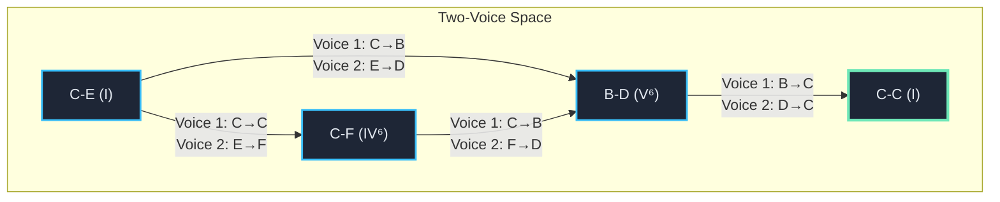
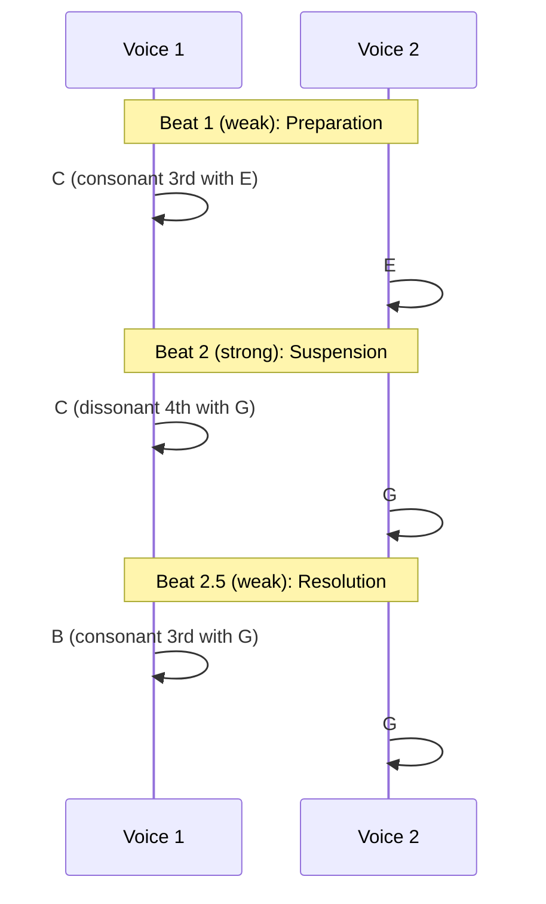
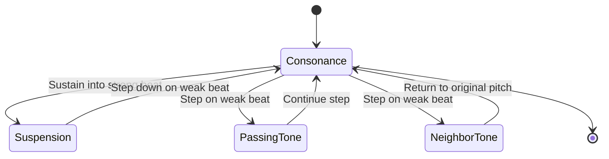
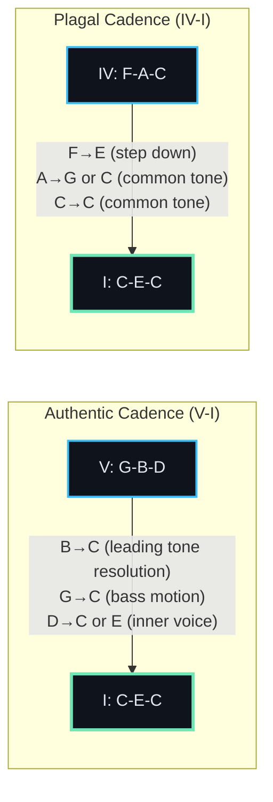

# Lesson 3: Free Counterpoint

## 1. First-Principles Intuition & Invariants

Counterpoint is the disciplined art of combining independent melodic lines such that each retains its structural autonomy while contributing to a coherent harmonic whole. The term derives from the Latin *punctus contra punctum*—"note against note"—and embodies a fundamental tension in polyphonic music: the simultaneous pursuit of linear independence and vertical consonance.

The species counterpoint system, formalized by Johann Joseph Fux in *Gradus ad Parnassum* (1725), provides a graduated pedagogical framework. Each species introduces constraints incrementally: first species pairs whole notes against whole notes in strict consonance; second species introduces two notes against one; third species adds rhythmic elaboration; fourth species introduces syncopation and suspensions; fifth species (florid counterpoint) combines all previous techniques. This scaffolding trains the ear and hand to navigate the dual constraints of horizontal melody and vertical harmony.

Free counterpoint represents not the abandonment of contrapuntal logic but its maturation. Where species counterpoint operates within a narrow constraint space to isolate specific technical challenges, free counterpoint synthesizes these constraints into a unified compositional practice. The composer working in free counterpoint internalizes the underlying principles—voice independence, smooth voice leading, dissonance treatment, rhythmic differentiation—and applies them fluidly, without rigid adherence to species taxonomy.

### Voice Independence

Voice independence is the architectural principle that each melodic line must possess its own musical identity. This independence manifests in three dimensions: **melodic contour**, **rhythmic profile**, and **harmonic function**.

Melodic contour refers to the shape traced by a voice over time. Independent voices should exhibit distinct contours: when one voice ascends, another may descend or remain static; when one voice leaps, another may move stepwise. This differentiation prevents voices from merging into parallel motion, which erodes the perception of polyphony. The exception is parallel motion in thirds or sixths, which preserves independence through harmonic interval while maintaining linear direction.

Rhythmic profile concerns the temporal distribution of attacks and durations. Independent voices should not mirror each other's rhythmic patterns. When one voice sustains a long note, another may articulate shorter subdivisions; when one voice rests, another continues. This rhythmic staggering ensures that the ear can trace each voice as a distinct temporal thread. The principle extends to metric placement: syncopation in one voice against on-beat articulation in another creates cross-rhythmic independence.

Harmonic function describes the role each voice plays in defining the underlying harmonic progression. In free counterpoint, voices may alternate between melodic and harmonic functions: a voice may carry the melodic apex while others provide harmonic support, then recede into an inner voice as another takes melodic prominence. This functional fluidity is what distinguishes free counterpoint from fixed-hierarchy textures like melody-with-accompaniment.

### Tonal Coherence

Tonal coherence is the principle that melodic independence must unfold within a shared harmonic framework. The voices do not exist in acoustic isolation; they generate vertical sonorities at each moment, and these sonorities must articulate a coherent tonal trajectory.

The harmonic series provides the acoustic foundation for consonance and dissonance. Intervals whose frequency ratios correspond to low-integer ratios (2:1 octave, 3:2 perfect fifth, 4:3 perfect fourth, 5:4 major third) produce coincident overtones and are perceived as stable. Higher-ratio intervals (45:32 tritone, 16:15 minor second) produce beating and roughness, perceived as unstable and requiring resolution.

Free counterpoint exploits this stability hierarchy through **dissonance treatment**. Dissonances are approached and resolved according to voice-leading norms: suspensions prepare on a consonance, create dissonance on the beat, and resolve downward by step; passing tones fill stepwise gaps on weak beats; neighbor tones embellish a sustained pitch. These treatments ensure that dissonance serves an expressive purpose—creating tension, directed motion, and harmonic color—rather than producing aimless instability.

The concept of **voice-leading parsimony** governs how voices move between chords. Each voice should move by the smallest possible interval to the next chord tone, minimizing total voice motion. This principle, formalized in neo-Riemannian theory as "efficient voice leading," reduces cognitive load and creates smooth harmonic transitions. When large leaps are necessary—often for melodic shaping or register distribution—they should be followed by stepwise contrary motion to restore equilibrium.

### Rhythmic Interplay

Rhythmic interplay emerges from the differential pacing of voices. When voices move at different rhythmic densities—one in whole notes, another in eighth notes—the faster voice creates melodic elaboration against the slower voice's harmonic foundation. This relationship is not hierarchical but symbiotic: the slower voice provides tonal anchor; the faster voice provides momentum and ornament.

The principle of **rhythmic differentiation** dictates that voices should not attack simultaneously except at cadential goals or structural downbeats. Staggered attacks create a perceptual streaming effect, allowing the ear to track each voice independently. This is the temporal analog of melodic contour differentiation: just as distinct pitch trajectories prevent melodic fusion, distinct rhythmic onsets prevent temporal fusion.

Syncopation introduces rhythmic tension by displacing accents from strong beats to weak beats. In free counterpoint, syncopation in one voice creates metric dissonance against the underlying pulse maintained by other voices. The fourth species suspension is the prototypical syncopated figure: a note tied across the barline creates dissonance on the downbeat, which resolves downward by step on the weak beat. This creates a push-pull effect, simultaneously asserting and resisting the metric frame.

### Expressive Coherence

Expressive coherence is the aesthetic principle that technical decisions must serve a unified musical narrative. Counterpoint is not an exercise in combinatorial possibility but a communicative act. Each voice must contribute to the emotional arc, the structural unfolding, and the rhetorical trajectory of the piece.

This coherence operates at multiple timescales. At the phrase level, voices should coordinate their peaks and nadirs to create climactic moments and points of repose. At the sectional level, voices should maintain tonal and motivic consistency within sections and provide contrast between sections. At the work level, voices should contribute to the large-scale tonal plan—modulations, returns, and final cadence.

The concept of **textural density** is crucial here. Dense counterpoint, with many voices in close proximity and high rhythmic activity, creates intensity and complexity. Sparse counterpoint, with few voices, wide spacing, and slower rhythm, creates openness and simplicity. The expressive composer modulates textural density to shape the listener's experience, building toward climaxes and releasing into resolutions.

## 2. Core Architecture & Mechanics

The compositional process of free counterpoint can be modeled as a constraint satisfaction problem operating in a multi-dimensional space. Each voice is a time-indexed sequence of pitches, and the space of valid sequences is constrained by melodic, harmonic, and rhythmic rules. The composer's task is to search this space for sequences that satisfy the constraints while maximizing aesthetic criteria.

### The Voice-Leading Space

Voice-leading space is the geometric abstraction of all possible configurations of voices. For two voices, this space is a two-dimensional lattice where each axis represents the pitch of one voice. A chord is a point in this lattice; a progression between two chords is a vector connecting two points. The length and direction of this vector represent the total voice motion and the individual voice motions.

In three or more voices, the space becomes higher-dimensional. A three-voice chord is a point in three-dimensional pitch space; a four-voice chord is a point in four-dimensional space. While impossible to visualize directly, the mathematical structure remains: chords are points, progressions are vectors, and voice-leading parsimony corresponds to minimizing vector length.

Efficient voice leading occupies the low-motion regions of this space. Chord progressions that require large voice motions—such as parallel motion by large intervals—occupy high-motion regions and are avoided. The prototypical efficient progressions are those where one or more voices sustain a common tone while the remaining voices move by step. The progression I–V in C major (C-E-G to G-B-D) can be voiced with G sustained in the bass, E moving to D, and C moving to B: total motion is three semitones distributed across three voices.

### Interval Vector Analysis

Each vertical sonority can be characterized by its **interval vector**, a compact representation of the intervals present between all pairs of voices. For a two-voice texture, the interval vector is simply the single interval. For three voices, the vector contains three intervals (the interval between each pair of voices). For four voices, six intervals.

The interval vector provides a fingerprint of the harmonic quality of a sonority. Consonant triads contain predominantly perfect fifths, perfect fourths, and major or minor thirds. Dissonant sonorities contain tritones, minor seconds, or major sevenths. The contrapuntal composer monitors the interval vector at each time point, ensuring that dissonances are properly prepared and resolved.

Consider a three-voice texture moving from a C major triad (C-E-G) to a G major triad (G-B-D):

| Time | Voice 1 | Voice 2 | Voice 3 | Intervals | Vector |
|------|---------|---------|---------|-----------|--------|
| t₀   | C       | E       | G       | C-E: M3, C-G: P5, E-G: m3 | [M3, m3, P5] |
| t₁   | B       | D       | G       | B-D: m3, B-G: m6, D-G: P4 | [m3, P4, m6] |

The interval vector changes from major-third-dominated to minor-third-dominated, reflecting the change in triad quality. Voice-leading analysis tracks not only the pitch motion but the transformation of the interval vector, ensuring smooth harmonic transitions.

### Dissonance Resolution Patterns

Dissonance in counterpoint is not an error but a structural resource. Properly prepared and resolved dissonances create directed motion, harmonic tension, and expressive intensity. The standard dissonance types—suspension, passing tone, neighbor tone, anticipation, escape tone—each have characteristic preparation, attack, and resolution patterns.

**Suspension**: A consonant note is sustained (or re-attacked) while other voices move, creating a dissonance on a strong beat. The suspended note then resolves downward by step to a consonance on a weak beat. The pattern is: preparation (consonance on weak beat) → suspension (dissonance on strong beat) → resolution (consonance on weak beat).

**Passing tone**: A dissonant note fills the stepwise gap between two consonances, occurring on a weak beat. No preparation is required. The pattern is: consonance → passing dissonance (weak beat) → consonance, with stepwise motion throughout.

**Neighbor tone**: A dissonant note embellishes a consonance by stepping away and returning. The pattern is: consonance → neighbor dissonance (weak beat) → consonance (original pitch).

These patterns can be formalized as state machines, where each state represents a harmonic condition (consonant, dissonant) and each transition represents a voice motion (step, leap) or metric position (strong beat, weak beat).

### Cadential Formulas

Cadences are structural articulation points where harmonic motion comes to rest. In tonal counterpoint, cadences involve specific voice-leading patterns that signal closure. The two primary cadence types are the **authentic cadence** (dominant to tonic) and the **plagal cadence** (subdominant to tonic).

The authentic cadence in two voices requires specific voice-leading: the lower voice moves from scale degree 5 to scale degree 1 (or 2 to 1 in an inverted cadence), while the upper voice moves from scale degree 7 to 1 or 2 to 1. The leading tone (scale degree 7) must resolve upward to the tonic, as its inherent instability demands resolution.

In three or more voices, the cadential formula becomes more elaborate. The dominant chord typically appears in root position, with the leading tone in an upper voice. The tonic chord may double the root for stability. The outer-voice framework—the bass and soprano—carries the primary voice-leading motion, while inner voices fill out the harmony and may move more freely.

## 3. Practical Composition Techniques

The transition from species counterpoint exercises to free counterpoint composition requires integrating isolated techniques into a unified compositional workflow. The following techniques represent core strategies for generating and refining contrapuntal textures.

### Cantus Firmus Elaboration

The *cantus firmus* method begins with a single pre-existing melodic line, often slow-moving and diatonic, and adds one or more counterpoints above or below it. This method isolates the challenge of writing a single convincing counterpoint, allowing the composer to focus on voice-leading and intervallic relationships without simultaneously managing multiple independent voices.

The counterpoint should exhibit rhythmic contrast with the cantus firmus. If the cantus firmus moves in whole notes, the counterpoint may move in half notes or quarter notes. This rhythmic differentiation creates momentum and prevents the texture from becoming static.

Melodically, the counterpoint should achieve independence through distinct contour. When the cantus firmus ascends, the counterpoint may descend or move obliquely; when the cantus firmus leaps, the counterpoint may move stepwise. This contrary or oblique motion prevents parallel octaves and fifths while creating visual and auditory interest.

Harmonically, the counterpoint should create a mixture of consonances and dissonances, with dissonances properly treated. Consonances should predominate, especially on strong beats, to establish tonal stability. Dissonances should occur as suspensions, passing tones, or neighbor tones, always resolving according to their characteristic patterns.

### Imitative Counterpoint

Imitative counterpoint introduces motivic coherence by restating a melodic idea in different voices at staggered time points. The opening voice presents a melodic motive (the **subject**); a subsequent voice enters with the same motive (the **answer**), either at the unison, octave, or fifth. While the second voice presents the answer, the first voice continues with new material (the **countersubject**), creating a two-voice texture where both voices derive from a shared motivic source.

The interval and timing of the imitative entry are crucial compositional choices. An entry at the fifth (the dominant) creates a tonal answer, reinforcing the key by outlining the tonic-dominant axis. An entry at the unison or octave creates a real answer, preserving the exact intervallic structure of the subject. The time interval between entries—typically one measure or one phrase—determines the density of the imitative texture.

```mermaid
gantt
    title Imitative Entry Structure
    dateFormat X
    axisFormat %L
    
    section Voice 1
    Subject (C-D-E-F)     :a1, 0, 4
    Countersubject        :a2, 4, 8
    
    section Voice 2
    (rest)                :b1, 0, 4
    Answer (G-A-B-C)      :b2, 4, 8
```

The countersubject must be designed to work contrapuntally with the subject. When the second voice enters with the answer, the first voice's countersubject must form consonant intervals and avoid prohibited parallels. This dual constraint—the countersubject must work both as a melodic continuation and as a counterpoint to the answer—makes imitative counterpoint a challenging but rewarding technique.

### Invertible Counterpoint

Invertible counterpoint is the technique of writing two voices such that their vertical positions can be exchanged without violating contrapuntal rules. A passage originally written with voice A above voice B can be inverted so that voice B appears above voice A. This technique, also called **double counterpoint**, multiplies the usable material: a single pair of voices yields two distinct textures.

The constraint of invertibility restricts the intervallic content. Intervals that are consonant in the original position must remain consonant (or become acceptable dissonances) in the inverted position. Invertible counterpoint at the octave—the most common type—transforms intervals according to the rule: inverted interval = 9 − original interval.

| Original Interval | Inverted Interval (at octave) | Original Quality | Inverted Quality |
|-------------------|-------------------------------|------------------|------------------|
| Unison (1)        | Octave (8)                    | Consonant        | Consonant        |
| Second (2)        | Seventh (7)                   | Dissonant        | Dissonant        |
| Third (3)         | Sixth (6)                     | Consonant        | Consonant        |
| Fourth (4)        | Fifth (5)                     | Dissonant*       | Consonant        |
| Fifth (5)         | Fourth (4)                    | Consonant        | Dissonant*       |
| Sixth (6)         | Third (3)                     | Consonant        | Consonant        |
| Seventh (7)       | Second (2)                    | Dissonant        | Dissonant        |
| Oct
