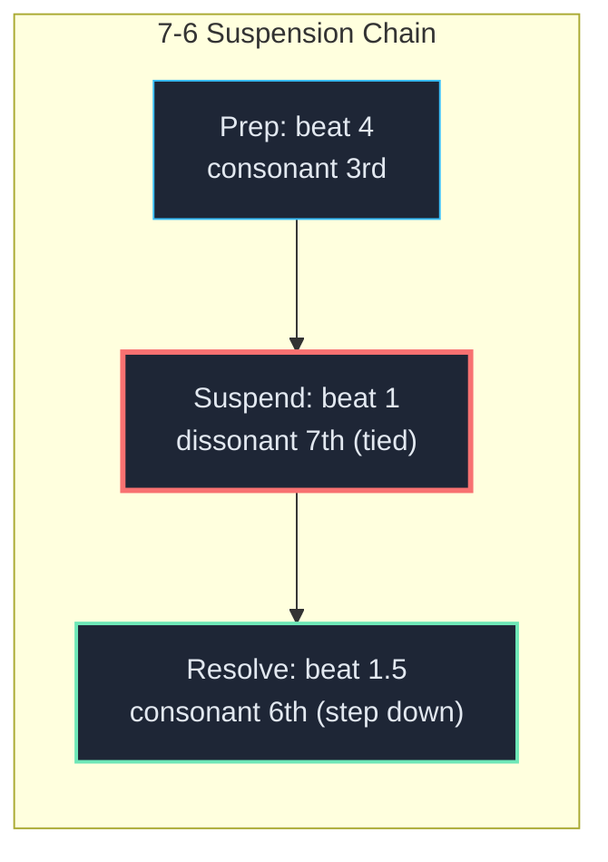
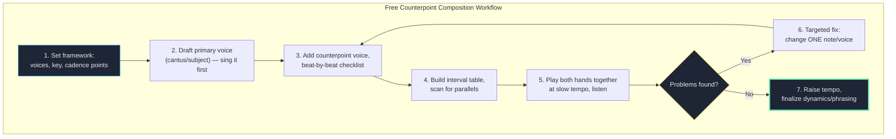

# Lesson 3: Free Counterpoint — From Species Rules to Living Polyphony

## 1. Core Intuition: Why These Rules Exist

Counterpoint means *punctus contra punctum*, note against note. Two or more melodies played together, each strong enough to stand alone, together strong enough to form coherent harmony. That's the whole discipline in one sentence. Everything else is technique for achieving it.

**The acoustic reason the rules work:** when two pitches sound together, your ear fuses them into a single timbre if their overtones line up too well, for too long. A perfect fifth (ratio 3:2) and especially the octave (2:1) share so many overtones that two voices moving in parallel fifths or octaves stop sounding like two voices — they sound like one voice reinforced. That's why parallel fifths/octaves are banned: not out of superstition, but because they *destroy the two-voice illusion you're trying to create*. Thirds and sixths (5:4, 8:5 — "impure" low-ratio intervals) blend pleasantly without fusing, which is why they dominate good counterpoint. Dissonances (minor 2nds, major 7ths, tritones) have overtones that collide and beat against each other — your ear hears that instability as tension demanding resolution. That's the entire acoustic budget for this lesson. Everything below is about what you *do* with that fact.

Fux's five species (1725, *Gradus ad Parnassum*) isolate one skill at a time:

| Species | Ratio | Skill isolated |
|---|---|---|
| 1st | 1:1 | Pure consonance, contrary motion |
| 2nd | 2:1 | Passing tones, metrical dissonance |
| 3rd | 4:1 | Neighbor/passing combinations, melodic shape under speed |
| 4th | 1:1 (syncopated) | Suspension mechanics |
| 5th (florid) | mixed | Everything combined, performer's choice of device |

**Free counterpoint is species counterpoint off the leash** — you no longer announce "this bar is 2nd species," you simply reach for passing tones, suspensions, or syncopation whenever the music needs them. The exercises below train you to do that by feel, at the keyboard, with a metronome, not on paper with a ruler.

---

## 2. Keyboard Lab: Hearing and Playing Two-Voice Counterpoint

Do this before any writing. Counterpoint is an ear-and-hand skill first.

### Hand setup
- Right hand (RH) plays the upper voice, Left hand (LH) plays the lower voice. Sit centered, each hand covers roughly one octave span, curved fingers, relaxed wrists — same posture as any two-hand repertoire.
- Keep each hand's fingering independent. Don't let LH fingering "borrow" RH's pattern; this is the first physical lesson in voice independence — your hands must not move identically.

### Drill 1 — Contrary motion scales (builds the physical feel of independence)
Play C major scale, both hands starting on middle C, **moving in opposite directions**:
```text
RH (ascending): C(1) D(2) E(3) F(1) G(2) A(3) B(4) C(5)
LH (descending): C(1) B(2) A(3) G(4) F(1) E(2) D(3) C(4)
```
Metronome: 60 BPM, quarter notes, hands strictly together rhythmically but opposite in contour. Repeat at 72, then 84 BPM. This is the physical root of "contrary motion avoids parallels" — once your hands can do it automatically, your ear starts expecting it.

### Drill 2 — Two-voice first species at the keyboard
Play this cantus firmus (LH, whole notes) against a counterpoint (RH, whole notes) — classic 1st species, note against note:

```text
LH (cantus, fingers 5-4-3-2-1 roughly, adjust to hand size):
C  D  E  F  E  D  C

RH (counterpoint):
E  F  G  A  C  F  E
```
Check every vertical interval out loud as you play: 3rd, 3rd, 3rd, 6th, 6th, 3rd, 8ve (unison-class). All consonant. No perfect fifth or octave repeats in a row with same-direction motion — verify by eye before you play, then confirm by ear.

Metronome 50 BPM (slow enough to listen to each interval), hold each whole note its full value, don't rush into the next. Progress 50 → 66 → 80 BPM only once every interval sounds clean and you aren't guessing.

### Drill 3 — Add rhythmic independence (2nd/3rd species feel)
Same cantus firmus, LH whole notes, RH now in quarter notes with a passing tone on the weak beat:

```text
LH: C -------- D -------- E -------- F
RH: E F G | F G A | G A B | A B C
     (beats: 1 2 3  1 2 3  1 2 3  1 2)
```
*(Think of each LH whole note spanning 3 RH quarter notes in a 3/4 feel, or adapt beat count to 4/4 — the point is RH moves 3x LH's rate.)*

Say the interval on every RH attack: beat 1 should be consonant (3rd, 6th, 5th, 8th); beats 2–3 may pass through a dissonant 2nd or 4th as long as it's approached and left by step. This drill is the physical rehearsal of "dissonance belongs on weak beats, approached and left by step" — you're not memorizing a rule, you're training your fingers to land consonances on downbeats automatically.

Metronome 55 → 70 → 90 BPM.

---

## 3. The Suspension: Mechanics You Can Feel

A suspension is a 3-note contrapuntal event: **Preparation (consonant, weak beat) → Suspension (dissonant, strong beat, same pitch held or re-struck) → Resolution (consonant, down one step, weak beat).**



**Keyboard drill — 7-6 suspension chain in C major.** LH plays a descending bass line in half notes; RH holds each note across the barline then resolves down a step before moving to the next suspension:

```text
LH (bass, half notes):  C   B   A   G   F   E   D   C
RH (upper, tied/resolved): 
   bar1: C (held)—B (resolve)   [C/C=8ve→C/B=7th... ]
```

To make this concrete, here is a fully worked 4-bar chain, both hands, counted in 4/4 at quarter-note pulse (half notes = 2 beats):

```text
Beat:     1    2    3    4    |  5    6    7    8   |  9   10   11  12
LH:       C ------- B ------- |  A ------- G ------- |  F ------ E -----
RH:       D ------- C ------- |  C ------- B ------- |  B ------ A -----
Interval: M2(dis) — resolves  |  m3(cons)— M2(dis)   |  resolves— m3(cons)
```
Say aloud: "prepare, suspend, resolve" on every two-beat unit as you play. Metronome 50 BPM quarter note. This chain is literally how Bach builds sequential passages — you are rehearsing his most common harmonic engine with your own hands.

**Physical cue for tendon safety:** suspensions in the LH at the piano often ask the 4th/5th finger to hold a note while other fingers in the same hand move — keep the wrist level, don't claw the holding finger; let forearm weight (not finger tension) support the sustained key.

---

## 4. Invertible Counterpoint at the Keyboard (Double Counterpoint at the Octave)

This is the single most useful "trick" in contrapuntal writing: write two voices so that flipping which one is on top still works.

**Rule of thumb, memorize this, not the math:** *thirds and sixths are always safe to invert; perfect fourths and fifths are dangerous because a 5th flips into a 4th (dissonant in 2-voice writing).* So when writing invertible counterpoint, treat perfect 4ths/5ths like you'd treat any dissonance — pass through them quickly, don't sit on them.

### Hands-on test
Play this original pairing:
```text
RH (upper): E  F  G  A  G  F
LH (lower): C  D  E  F  E  D
Intervals:  3  3  3  3  3  3   (all thirds)
```
Now physically swap: play the former LH line with RH an octave higher, and the former RH line with LH an octave lower:
```text
RH (was lower): C  D  E  F  E  D   (now up an octave)
LH (was upper): E  F  G  A  G  F   (now down an octave)
Intervals:      6  6  6  6  6  6   (all sixths — still consonant)
```
Play both versions back to back at 70 BPM. You now *own* the 9-minus-rule intuitively: 3rds become 6ths, and both are safe. This single drill is why Bach's two-part Inventions reuse the same material right-side-up and upside-down — it's not cleverness for its own sake, it's one composed idea yielding two usable textures.

---

## 5. Imitative Counterpoint: Writing a Real Two-Voice Entry

Composing a subject/answer pair is a practical skill, not an abstract one. Work through this complete, playable example.

**Subject (Voice 1, mm. 1–2, in C major):**
```text
C(q) D(q) E(h) | F(q) E(q) D(h)
```
**Answer (Voice 2 enters m.3, transposed to the dominant, G major, while Voice 1 continues with a countersubject):**
```text
Voice 1 — Countersubject (mm.3-4, eighth notes, contrary stepwise motion to contrast the subject's quarter notes):
G8 A8 G8 F8 E8 D8 C8 D8 | E8 F8 E8 D8 C8 D8 E8 F8

Voice 2 — Answer (mm.3-4, quarter notes, same rhythm as original subject):
G(q) A(q) B(h) | C(q) B(q) A(h)
```

**Vertical check (play both hands together at mm. 3–4, beat by beat):**

| Beat | V1 (countersubject) | V2 (answer) | Interval | Verdict |
|---|---|---|---|---|
| 3.1 | G | G | Unison | consonant |
| 3.1.5 | A | A | Unison | consonant (brief, passing) |
| 3.2 | G | B | m3 | consonant |
| 3.2.5 | F | B | P4 | passing dissonance, OK (weak subdivision) |
| 3.3 | E | B | m6 | consonant |
| 3.3.5 | D | B | m6→ | consonant |
| 3.4 | C | C | Octave | consonant |

Play this at 50 BPM with each hand voicing its own dynamic: RH (countersubject) *mp*, LH (answer) *mf* — practice bringing out whichever voice currently carries the thematic material. This is real two-hand independence training, not just a writing exercise.

---

## 6. Workflow: Composing a Free Counterpoint Passage Start to Finish

Use this exact sequence every time. Don't skip steps, especially step 5 (sing/play it).



### Step-by-step checklist (apply while writing, beat by beat)

1. **Melodic independence check**: does the new voice's contour differ from the existing one at this moment? (One ascends while the other descends or holds — that's the target, not the exception.)
2. **Rhythmic differentiation**: are both voices attacking on the same beat *only* at cadences or strong structural points? Elsewhere, stagger attacks.
3. **Interval scan**: is this beat's interval consonant (3rd, 6th, 5th, 8th/unison)? If dissonant, is it a passing tone/neighbor/suspension correctly placed on a weak beat (or correctly prepared if on a strong beat)?
4. **Parallel scan**: compare this interval to the previous one. Same interval class (5th→5th or 8ve→8ve) with both voices moving the same direction = forbidden. Fix by flipping one voice to contrary or oblique motion.
5. **Common tone check**: could a voice simply hold still into the next chord instead of leaping? Prefer that — it's free smoothness.

### Parallel-fifth fix drill (do this until it's reflex)
Play the error, hear it, then play the fix immediately after, back to back:
```text
ERROR (parallel 5ths):
RH: C  D      LH: G  A     → beat1: P5, beat2: P5 (both ascend) — BANNED

FIX (oblique motion):
RH: C  D      LH: G  G     → beat1: P5, beat2: P4 (LH holds, RH steps) — OK
```
Metronome 60 BPM, alternate error/fix four times. This builds the ear-reflex that catches parallels while you're composing, not after.

---

## 7. Full Worked Lab: Three-Voice Fugal Exposition Sketch

A complete, playable three-voice exposition in C major. Hands: pianists play V1+V2 together (both hands), then add V3 as a third layer once comfortable, or use two players.

**Subject** (2 bars):
```text
C(q) D(q) E(h) | F(q) E(q) D(h)
```
**Answer** (transposed to dominant, G major, enters m.3 in Voice 2):
```text
G(q) A(q) B(h) | C(q) B(q) A(h)
```
**Countersubject** (Voice 1 continues under the Answer, mm.3–4, faster values for rhythmic contrast):
```text
A8 G8 F8 E8 D8 E8 F8 G8 | A8 G8 F8 E8 D8 C8 B8 C8
```
**Voice 3 entry** (subject returns in tonic, m.5, while V1/V2 continue with free counterpoint or restated countersubject fragments):
```text
C(q) D(q) E(h) | F(q) E(q) D(h)
```



```mermaid
gantt
    title Three-Voice Exposition — Practice Map
    dateFormat X
    axisFormat %L
    section Voice 1
    Subject (tonic)        :a1, 0, 4
    Countersubject         :a2, 4, 8
    Free counterpoint      :a3, 8, 12
    section Voice 2
    Rest                   :b1, 0, 4
    Answer (dominant)      :b2, 4, 8
    Countersubject frag.   :b3, 8, 12
    section Voice 3
    Rest                   :c1, 0, 8
    Subject (tonic)        :c2, 8, 12
```

**Practice sequence for this exposition:**
1. Play V1 alone until the subject and countersubject are memorized and singable.
2. Play V1+V2 together, slow (50 BPM), checking the interval table at every eighth note where both sound.
3. Add V3 by itself alone, memorized.
4. Combine all three at 50 BPM, then 65, then 80 BPM. If it falls apart at tempo, you have a fingering problem, not a counterpoint problem — isolate which hand transition breaks and drill that one bar in isolation 10x before returning to full tempo.

---

## 8. Canon Construction Drill (Octave Canon, 2-Beat Delay)

Writing a canon forces you to compose a melody that harmonizes with *itself*. This is the sharpest possible training for contrapuntal hearing.

**Leader:**
```text
C(q) E(q) G(q) A(q) | G(q) F(q) E(q) D(q) | C(h)
```
**Follower** (identical line, enters 2 beats later, one octave lower):
```text
    (rest, rest)  C(q) E(q)  G(q) A(q) | G(q) F(q) E(q) D(q) | C(h)
```

**Vertical check once follower enters (play both hands, listen on each beat):**

| Beat | Leader | Follower | Interval | Note |
|---|---|---|---|---|
| 3 | G | C | P5 | consonant |
| 4 | A | E | P4 | passing, approached/left by step — fine |
| 5 | G | G | 8ve | consonant |
| 6 | F | A | 6th | consonant |
| 7 | E | G | 6th | consonant |
| 8 | D | F | 6th | consonant |
| 9 | C | E | 3rd | consonant |

Practice protocol: play leader alone until automatic, then follower alone, then both hands at 40 BPM with a 2-beat offset (count "1-2" silently before the second hand enters). This is genuinely difficult coordination — budget several short (10-minute) sessions rather than one long one. Progress to 55, then 70 BPM only after zero stumbles at the current tempo for three consecutive run-throughs.

---

## 9. Diagnostic Table: Catching Errors by Ear and by Eye

| Error | What you'll hear | Eye-check method | Fix |
|---|---|---|---|
| Parallel 5ths/8ves | Texture suddenly sounds like one fat voice instead of two | List consecutive intervals; flag repeated 5th/5th or 8ve/8ve with same-direction motion | Change one voice to contrary or oblique motion |
| Hidden (direct) 5ths/8ves | Subtle "thinning" at a cadence | Check cadence approach: does upper voice leap into a 5th/8ve while lower moves same direction? | Make upper voice approach by step, or use contrary motion |
| Unprepared dissonance | A jarring clash with no sense of "why" | Mark every 2nd/7th/tritone; confirm each is either on a weak beat (passing/neighbor) or tied from a consonance (suspension) | Add a preparation note, or move the dissonance off the strong beat |
| Voice crossing | Muddled register, can't tell which line is "on top" | Plot pitch range of each voice over time; look for overlap reversing the expected order | Transpose one voice an octave, or adjust contour before the crossing |
| Parallel 3rds/6ths for too long | Two voices sound like one melody with a shadow | Scan for 4+ consecutive beats of same-direction same-interval motion | Break with contrary motion or a rest in one voice |
| Weak cadence | Phrase trails off instead of landing | Check: does bass move by 4th/5th into the final chord? Does the leading tone resolve up by step? | Put leading tone in an upper voice resolving to tonic; use root-position final chord |

---

## 10. Progressive Practice Regimen (12 Weeks, Metronome-Targeted)

| Weeks | Focus | Keyboard target | Metronome arc |
|---|---|---|---|
| 1–2 | Two-voice note-against-note (1st species) | Contrary-motion drills + 10 short cantus firmus pairings | 50 → 66 → 80 BPM |
| 3–4 | Florid 2-voice (passing tones, neighbor tones) | RH plays 2–3 notes per LH whole note | 55 → 70 → 90 BPM |
| 5 | Suspension chains (4th species) | 7-6 and 4-3 chains, 4 bars minimum | 45 → 60 → 75 BPM |
| 6–7 | Imitative 2-voice (subject/answer/countersubject) | Full exposition like §5, both hands independent | 50 → 65 BPM |
| 8 | Invertible counterpoint at the octave | Write + physically invert 5 passages | 60 → 75 BPM |
| 9–10 | Canon (unison and octave, 1–2 beat delay) | §8 drill plus 3 original canons | 40 → 55 → 70 BPM |
| 11–12 | Three-voice fugal exposition | §7 full sketch, memorized and performed hands-together | 50 → 65 → 80 BPM |

**Ongoing ear training (daily, 10 minutes):** play a Bach two-part Invention one hand at a time until memorized, then together at half tempo. Stop and name the device every time you hear a suspension, passing tone, or parallel-avoidance move. This builds the pattern recognition that eventually lets you write counterpoint by ear instead of by checklist.

---

## 11. Beyond the Exercise: Where This Actually Gets Used

- **Jazz comping**: ii-V-I rootless voicings are counterpoint in disguise. Dm7 (F-A-C-E) → G7 (F-A-B-E) → Cmaj7 (E-G-B-E): two voices hold common tones, the rest move by step. Practice this exact voicing-leading chain at the piano, both hands, until the smoothness feels automatic — it's the same efficient voice-leading principle as a Bach chorale, just with 7th chords.
- **Arranging/orchestration**: when writing a countermelody for a horn section or backing vocals, apply the melodic-independence checklist from §6 directly — don't just harmonize in parallel thirds under the lead, give the counter-line its own contour and rhythm.
- **Improvisation**: practicing canon (§8) trains the specific skill of hearing how a line you're about to play will interact with a line already sounding — directly transferable to improvising a second voice live against a given melody.

---

Free counterpoint is species counterpoint internalized until the rules stop being rules and start being reflexes — your hands avoid the parallel fifth before your conscious mind flags it, your ear expects the suspension to resolve down by step before you've finished writing it. That reflex only comes from playing these drills at the keyboard, slowly, repeatedly, with the metronome running.
