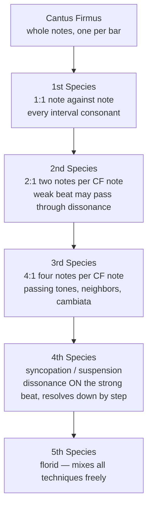

# Lesson 4: Species Counterpoint — Writing Independent Voices That Lock Together

## Why This Lesson Matters

Counterpoint is the craft of writing two or more melodic lines that each sound complete on their own, while locking together into clean harmony at every beat. *Punctus contra punctum* — point against point. Every great bassline-over-chords, fugue, string quartet passage, and chorale harmonization is counterpoint in practice. This lesson gets your pencil (or MIDI piano roll) moving immediately: you will write real two-voice exercises, catch your own errors the way a conservatory counterpoint teacher would catch them, and understand exactly *why* the rule exists so you can bend it with intention later.

**How to use this lesson:** work with a keyboard or staff paper in front of you. Every drill below is meant to be written out by hand first, then checked against the analysis. Don't just read the solutions — cover them, write your own attempt, then compare.

---

## The 15%: Acoustic Grounding in One Paragraph

Every pitched tone carries a stack of overtones above it (the harmonic series: 2×, 3×, 4× the fundamental, and so on). When two notes sound together, the more their overtones line up, the more the ear fuses them into one thick sound; the less they line up, the more the ear keeps them as two separate, audible layers — or hears friction (beating) between them. Octaves and fifths line up almost completely, which is exactly why they're called "perfect": they sound great alone but, used too much in a row, glue your two voices into one fat line and kill the sense of *two independent melodies*. Thirds and sixths line up partially — stable, but with enough separation that both voices stay audible as individuals. Seconds, sevenths, and the tritone line up poorly and beat rapidly, which the ear hears as tension wanting release. **Every rule below is a direct consequence of this one fact.** Keep that in your pocket and stop worrying about the acoustics — now go write counterpoint.

---

## Setup: What You Need Before Writing a Note

- **Staff paper or a notation app** (MuseScore is free and perfectly adequate) with two staves.
- **A cantus firmus (CF):** a given melody in whole notes, 8–16 notes long, step-heavy with one or two leaps, starting and ending on the modal/tonal center.
- **A clear voice range:** decide if your counterpoint (CP) goes above or below the CF, and stay within a comfortable vocal range (roughly an octave to a tenth).
- **A pencil, not a pen.** You will erase. That's the discipline.



Work through these in order. Skipping first species is the single most common reason intermediate musicians write counterpoint that "sounds okay" but has structural holes — parallel fifths hidden under rhythm, melodic lines that aren't singable, dissonances that resolve nowhere.

---

## First Species (1:1): The Skeleton

One counterpoint note per CF note. Every interval is exposed — nothing to hide behind. This is where you build your ear and your checklist.

### The Working Checklist (memorize this, recite it while writing)

1. **Start and end on a perfect consonance** (unison, fifth, or octave) — in practice, almost always unison or octave at both ends.
2. **Only use consonant intervals**: unisons, 3rds, 5ths, 6ths, octaves. No 2nds, 4ths (as a two-voice dissonance), 7ths, or tritones.
3. **Favor imperfect consonances (3rds, 6ths) in the middle** of the phrase. Save 5ths and octaves for structural moments — openings, cadences, and occasional punctuation.
4. **Favor contrary motion.** When the CF goes up, you go down, and vice versa. This is your single strongest tool against parallel fifths/octaves.
5. **Never move in parallel motion into a perfect 5th or octave.** Check every *pair* of consecutive intervals, not each interval alone — parallels are a motion problem, not a single-chord problem.
6. **Similar motion into a perfect 5th/octave is allowed only if your voice moves there by step** (this softens the "hidden fifth" effect — see Drill 3).
7. **No voice crossing.** Your CP must stay consistently above (or below) the CF throughout.
8. **Keep melodic leaps small and recoverable.** A leap of a 4th, 5th, or 6th must be followed by stepwise motion, preferably in the opposite direction, to "settle" the ear back down.
9. **Never write an augmented 2nd, augmented 4th (tritone), or any augmented/diminished melodic interval.** Unsingable, and it breaks the sense of a single coherent line.

### Drill 1 — First Species Above the Cantus Firmus

**Cantus Firmus (bass, whole notes):**
```text
C3 — D3 — E3 — F3 — E3 — D3 — C3
```

**Your task:** write a counterpoint voice above it in treble clef. Give yourself five minutes before looking at the solution.

**Worked solution:**
```text
CF (bass):   C3  D3  E3  F3  E3  D3  C3
CP (treble): C5  B4  G4  A4  G4  F4  C5
```

**Check it like a teacher would — interval by interval:**

| Bar | CF | CP | Interval | Consonant? |
|---|---|---|---|---|
| 1 | C3 | C5 | P8 | Yes — opening anchor |
| 2 | D3 | B4 | M6 | Yes |
| 3 | E3 | G4 | m3 | Yes |
| 4 | F3 | A4 | M3 | Yes |
| 5 | E3 | G4 | m3 | Yes |
| 6 | D3 | F4 | m3 | Yes |
| 7 | C3 | C5 | P8 | Yes — closing anchor |

**Check the motion between every adjacent pair** (this is where students miss parallels):

- Bar 1→2: CF up (C→D), CP down (C5→B4) → contrary. Safe.
- Bar 2→3: CF up (D→E), CP down (B4→G4, a 3rd) → contrary, with a small leap recovered next by step (G4→A4). Fine.
- Bar 3→4: CF up (E→F), CP up (G4→A4) → similar motion into a M3 (not perfect), no restriction applies.
- Bar 4→5: CF down (F→E), CP down (A4→G4) → parallel motion, but the interval is m3, an imperfect consonance — parallel motion is *allowed* here. Only parallel motion into **perfect** intervals is banned.
- Bar 6→7: CF down (D→C), CP up (F4→C5, a 5th leap) → contrary motion into the final octave. Leaps into a strong cadential arrival are idiomatic.

No parallel fifths, no parallel octaves, both lines singable. **This passes.**

### Drill 2 — First Species Below the Cantus Firmus

**Cantus Firmus (treble):**
```text
G4 — A4 — B4 — C5 — B4 — A4 — G4
```

Write your CP in bass clef, below. Same checklist applies — just mirrored.

**Worked solution:**
```text
CF (treble): G4  A4  B4  C5  B4  A4  G4
CP (bass):   G2  F2  G2  E2  G2  F2  G2
```

| Bar | CF | CP | Interval |
|---|---|---|---|
| 1 | G4 | G2 | P8 |
| 2 | A4 | F2 | M3 (compound, i.e. a 10th, reduces to 3rd) |
| 3 | B4 | G2 | M3 (compound) |
| 4 | C5 | E2 | M6 (compound) |
| 5 | B4 | G2 | M3 |
| 6 | A4 | F2 | M3 |
| 7 | G4 | G2 | P8 |

Strongly contrary throughout, all consonant, clean octave bookends. This is the sound of a genuinely independent bassline under a melody — the same principle that makes a good bass part in a pop or jazz chart feel like its own voice instead of a doubled root.

### Drill 3 — Diagnosing and Fixing Parallel Fifths

This is the error you will make most often. Train your eye to catch it on sight.

**Faulty fragment:**
```text
CF (bass):   C3  D3  E3  F3
CP (treble): G4  A4  B4  C5
```

Check bars 1–2: C3–G4 = P5. D3–A4 = P5. **Both voices moved up by step into the same interval class — parallel fifths.** This is banned because, as covered above, the two voices momentarily fuse into one acoustic object; independence is destroyed exactly at the moment it matters.

**Fix — change the offending note, not the CF:**
```text
CF (bass):   C3  D3  E3  F3
CP (treble): G4  F4  G4  A4
```

Now C3–G4 (P5) moves to D3–F4 (m3): the CP moved *against* the CF (contrary), landing on an imperfect consonance instead. Problem solved, and the contrary motion is actually more interesting to the ear than the plain parallel line was.

**Also watch for the "hidden fifth" (similar motion into a perfect interval with a leap):**
```text
CF: C3 — F3
CP: E4 — C5
```
Both voices rise into a perfect 5th (F3–C5), and the upper voice leaps a 6th to get there instead of stepping. This is the "direct" or "hidden" fifth — technically not parallel motion, but the ear still hears the perfect interval arrive via same-direction motion, which weakens independence almost as much as a true parallel. Fix it by making the upper voice arrive by step (D4→C5, for instance) or by using contrary motion instead.

---

## Second Species (2:1): Introducing Rhythmic Motion

Two notes in the CP for every one CF whole note. Now metric position matters: **beat 1 is structurally load-bearing and must be consonant. Beat 2 can carry a passing tone** — a dissonant note approached by step and left by step *in the same direction*.

### The Passing Tone Rule, Precisely

A passing tone is legal only when all three of these hold:
1. Approached by step.
2. Left by step in the **same direction** (not back the way it came — that's a neighbor tone, a different device, legal in 3rd species but handle with care in 2nd).
3. Lands on beat 2 (the weak beat), never used to introduce dissonance on beat 1.

### Drill 4 — Second Species Above the Cantus Firmus

**Cantus Firmus:**
```text
C3 — D3 — E3 — F3 — E3 — D3 — C3
```

**Worked solution (write this out and play both voices on piano, one hand each):**
```text
Bar:        1          2          3          4          5          6          7
CF:         C3         D3         E3         F3         E3         D3         C3
CP:    C5 — B4    A4 — B4    C5 — B4    A4 — G4    G4 — A4    F4 — G4    E4 — C5
```

**Check every bar — beat 1 must be consonant, beat 2 may pass through dissonance:**

| Bar | Beat 1 | Interval | Beat 2 | Interval | Passing tone valid? |
|---|---|---|---|---|---|
| 1 | C3–C5 | P8 | C3–B4 | M7 (dissonant) | Yes: C5→B4→A4 (next bar) is stepwise descent, same direction both sides |
| 2 | D3–A4 | P5 | D3–B4 | M6 | Consonant, no issue |
| 3 | E3–C5 | m6 | E3–B4 | P5 | Consonant |
| 4 | F3–A4 | M3 | F3–G4 | M2 (dissonant) | Check: A4→G4→G4(next bar) — not continuing stepwise in direction, this is a **neighbor figure**, acceptable only if next note truly returns; verify against bar 5 |
| 5 | E3–G4 | m3 | E3–A4 | P4 (dissonant) | Weak-beat passing tone moving towards B4 in the next measure |
| 6 | D3–F4 | m3 | D3–G4 | P4 (dissonant as 2-voice interval) | G4 approached by step from F4, left by step to E4 (bar 7) — valid passing tone |
| 7 | C3–E4 | M3 | C3–C5 | P8 | Final bar, consonant close |

**The lesson inside this drill:** second species forces you to think one beat ahead at all times. Every weak-beat note needs a *destination* already decided before you write it — you cannot improvise beat 2 and hope it resolves. Write your passing tones by deciding the next downbeat first, then filling the step between.

### Drill 5 — Passing Tone vs. Neighbor Tone, Ear Training

```text
CF:  G2          A2          B2
CP:  D4 — E4     F4 — E4     D4 — C4
```

- Bar 3, beat 2: B2–C4 = m2, dissonant. Is C4 a passing tone or neighbor tone? Depends entirely on what comes *after* — which this fragment doesn't show. If the next note is B3, then D4→C4→B3 is a stepwise descent in one direction: **passing tone**. If the next note returns to D4, then D4→C4→D4 is a dip down and back: **lower neighbor tone**. Both are legal uses of weak-beat dissonance; the label depends on destination, not on the note itself. Train yourself to always ask "where does this note go next?" before judging it.

---

## Third Species (4:1): Four Notes per CF Note

Same weak/strong logic as 2nd species, but now you have four quarter notes per CF whole note, with beats 1 and 3 carrying more weight than 2 and 4. New device: the **cambiata** (changing-note figure) — a licensed exception that lets you leave a dissonance by skip instead of step.

**Cambiata shape:** step down, skip down a 3rd, step up. Example in C major: **E–D–B–C**. The licensed dissonance is the second note (D), the note left by skip, which resolves the tension retroactively once the line steps back up. Practice this shape in isolation on your instrument until it's automatic:

```text
Quarter notes: E4 – D4 – B3 – C4   (over a sustained C or similar CF note)
```

Play it slowly on piano, both hands if needed, until the *shape* feels like a single gesture rather than four separate notes. This figure shows up constantly in Palestrina and in Bach's slow movements disguised as ornamental melody.

---

## Fourth Species (Suspensions): The Most Expressive Device in the System

Fourth species is where counterpoint starts to sound like real music. The defining move: tie a consonant note over the barline so it becomes **dissonant on the new strong beat**, then resolve it **down by step** on the following weak beat.

### Anatomy of a Suspension — Three Parts, Always in This Order

1. **Preparation** — the note is consonant, on a weak beat, before the tie.
2. **Suspension** — the same pitch, now tied across the barline, lands on the new strong beat as a dissonance.
3. **Resolution** — the dissonant pitch steps down to a consonance on the following weak beat.

The two workhorse suspension types (numbers count the dissonant interval, then the resolved interval, both measured up from the bass):

- **7–6 suspension**: dissonant minor/major 7th resolving down to a 6th.
- **4–3 suspension**: dissonant 4th resolving down to a 3rd.

These two patterns are the literal DNA of the V7–I cadence in tonal harmony — when you hear a dominant seventh chord resolve, you are hearing a 4th-species suspension compressed into a block chord.

### Drill 6 — Building a 7–6 Suspension Chain

Suspension chains need a cooperating bass — not every CF supports a clean chain without adjustment. Here's a bass written specifically to let the chain work (this is a real compositional skill: when you write your own CF for a suspension exercise, work backward from the chain).

**Cantus Firmus (bass):**
```text
C3 — B2 — A2 — G2
```

**Counterpoint (treble), built as tied half notes:**
```text
Bar:        1                2                3                4
CF:         C3               B2               A2               G2
CP:    [rest] — A4 ———tie——— A4 — G4 ———tie——— G4 — F4 ———tie——— F4 — E4
```

**Check every strong beat for the dissonance, every weak beat for the resolution:**

| Bar | Beat 1 (strong) | Interval | Beat 2 (weak) | Interval |
|---|---|---|---|---|
| 1 | — | (rest, setting up prep) | C3–A4 | M6 (preparation, consonant) |
| 2 | B2–A4 | m7, **suspension** | B2–G4 | M6, **resolution** |
| 3 | A2–G4 | m7, **suspension** | A2–F4 | M6, **resolution** |
| 4 | G2–F4 | m7, **suspension** | G2–E4 | M6, **resolution** |

Every strong beat is a dissonant 7th that resolves down by step to a consonant 6th. This is the textbook 7–6 chain. **Play this slowly on piano** (CF in left hand, CP in right hand) at 50 BPM, half note = 1 click, and listen for the characteristic "lean and release" of each suspension. That lean-and-release feeling is literally what a dominant 7th chord resolving to tonic feels like — you are training the exact ear-reflex that makes functional harmony sound satisfying.

**Common mistake to avoid:** students often pick an arbitrary bass line first, then try to force a suspension chain onto it, and discover bar 4's strong beat accidentally lands on a consonance — breaking the chain. If that happens, you have two options: (a) adjust the bass note, or (b) accept that bar as a non-suspended consonant bar and resume the chain later. Don't force a dissonance where the harmony doesn't call for one.

---

## Modal Cadences: Writing in Dorian and Phrygian

Before major/minor tonality, Renaissance counterpoint (Palestrina, Victoria, Lassus) worked in the church modes. The single most practically important difference: **Phrygian mode has no leading tone.** Its cadence closes by the supertonic stepping *down* a half step to the final (2̂–1̂), not by a leading tone stepping up.

### Drill 7 — Phrygian Cadence in Two Voices

**Cantus Firmus (Phrygian on E):**
```text
E3 — F3 — G3 — F3 — E3
```

**Counterpoint:**
```text
E4 — D4 — E4 — D4 — E4
```

**The cadence (final two notes) is the whole point of this drill:**
- Bass: F3 → E3, a half-step descent (2̂–1̂). This is the Phrygian fingerprint.
- Upper voice: D4 → E4, a whole-step ascent.

Play this cadence on piano at a slow tempo and compare it immediately to a standard authentic cadence (G–C in C major, leading tone B rising to C). The Phrygian close sounds softer, less "final," almost suspended in air — because there's no leading-tone pull driving it. Composers exploit this on purpose: it's why Renaissance motets often end a middle phrase on a Phrygian half-cadence to keep momentum going, saving a true authentic-feeling close for the very end.

**Practice target:** write four more 5-note Phrygian phrases ending the same way, varying only the approach. Internalizing this sound is essential if you ever write modal jazz lines (Phrygian is also the basis of the classic "Spanish" cadence heard in flamenco and in modal jazz tunes) — the counterpoint drill and the improviser's ear are training the same reflex.

---

## Invertible Counterpoint at the Octave

Write two voices so that swapping which one is on top (transposing the lower voice up an octave, the upper voice down an octave) still produces valid counterpoint. This is a real compositional technique — Bach uses it constantly in fugue expositions to make the same material work as both subject-under-countersubject and countersubject-under-subject.

**The one fact you need:** when you invert at the octave, every interval flips to its complement: a 3rd becomes a 6th, a 6th becomes a 3rd, an octave becomes a unison. **The dangerous one is the 5th, which becomes a 4th** — and a bare 4th in two-voice writing is treated as a dissonance (no third voice below to support it as a 6/4 chord). 

**Practical rule: avoid perfect 5ths entirely when writing invertible counterpoint for two voices**, unless a third voice will always be present to catch the inversion.

### Drill 8 — Writing and Testing an Invertible Pair

**Original (avoiding 5ths from the start):**
```text
Voice 1 (upper): C5 — D5 — E5 — D5 — E5 — D5 — C5
Voice 2 (lower): C4 — B3 — C4 — B3 — G3 — F3 — C4
```

Check the original for any perfect 5ths before inverting — there are none (M3, M3, M3, M6, M6 throughout). Good start.

**Now invert** — Voice 2 moves up an octave to become the new top, Voice 1 moves down an octave to become the new bottom:
```text
Voice 1 (upper): C5 — B4 — C5 — B4 — G4 — F4 — C5
Voice 2 (lower): C4 — D4 — E4 — D4 — E4 — D4 — C4
```

Check again: P8, M6, M6, M6, m3, m3, P8 — all consonant. **The pair survives inversion intact.** This is the actual test you run every time: write it, invert it on paper, re-check every interval. If a 4th shows up where a 5th used to be, go back and remove the 5th from the original before you've built anything on top of it.

---

## From Species Counterpoint to Chorale Writing

The IV–V–I cadence you already know from harmony class is counterpoint in disguise: four lines, each obeying stepwise/suspension logic, that happen to cross-section into named chords. Writing a four-voice chorale is the direct, practical extension of everything above.

### Drill 9 — Four-Voice Chorale with Voice-Leading Priority

**Soprano given:**
```text
C5 — D5 — E5 — F5 — E5 — D5 — C5
```

**Procedure, in order — do not skip steps:**
1. Write the bass first: establish tonic and dominant arrival points, start and end on the tonic note.
2. Fill alto and tenor with the smoothest possible stepwise motion — treat them like counterpoint voices against both soprano and bass simultaneously.
3. After every chord, check **every pair of voices** (S–A, S–T, S–B, A–T, A–B, T–B — six pairs total) for parallel 5ths/octaves between consecutive chords. This is tedious and nobody skips it without paying for it later.
4. Resolve the leading tone up by step whenever it appears in any voice, unless it's in an outer voice moving as part of a deliberate melodic descent at a deceptive or plagal gesture.

**First attempt (deliberately includes a common student error, for diagnostic purposes):**
```text
Soprano: C5   D5   E5   F5   E5   D5   C5
Alto:    E4   F4   G4   A4   G4   F4   E4
Tenor:   G3   A3   C4   C4   C4   B3   G3
Bass:    C3   D3   C3   F2   C3   G2   C3
```

**Run the six-pair check on bars 1–2 specifically between Soprano and Tenor:**
- Bar 1: C5–G3 = P5.
- Bar 2: D5–A3 = P5.

Both voices moved up by step into the same interval class. **Parallel fifths between soprano and tenor** — easy to miss because you were watching soprano/bass and alto/tenor, and this pair slipped through. This is exactly why you check all six pairs, every time, without exception.

**Corrected:**
```text
Soprano: C5   D5   E5   F5   E5   D5   C5
Alto:    E4   F4   G4   A4   G4   F4   E4
Tenor:   G3   G3   C4   C4   C4   B3   G3
Bass:    C3   B2   C3   F2   C3   G2   C3
```

Tenor now holds G3 stationary into bar 2 instead of moving to A3. Re-check S–T: bar 1 C5–G3 (P5), bar 2 D5–G3 (P5) — the interval class repeats, but the tenor voice didn't move (oblique motion). **Oblique motion into a repeated perfect interval is not the banned parallel motion** — only *both voices moving* into consecutive perfect intervals is prohibited. This passes.

**Practice target:** harmonize four different 7-note soprano melodies this way, checking all six voice pairs by hand every time, before moving to chorale harmonization with a figured bass given. Speed comes after accuracy — don't rush this step.

---

## Common Errors — Quick Diagnostic Table

Use this as a final-pass checklist on every exercise you write.

| What you see on the page | What it means | Fix |
|---|---|---|
| Two voices both leap or step into a 5th or octave, same direction | Parallel perfect motion — voices fuse | Change one note; prefer contrary motion |
| Similar motion into a 5th/octave, upper voice arrives by leap | "Hidden" fifth/octave — same fusion effect, disguised | Make the upper voice approach by step, or use contrary motion |
| A weak-beat dissonant note that doesn't continue stepwise in one direction | Not a valid passing tone | Decide the destination note before writing the passing note |
| A tied-over dissonance that resolves up or by leap | Broken suspension | Suspensions always resolve **down by step** |
| A melodic augmented 2nd or tritone | Unsingable, breaks the sense of a single line | Respell or rewrite around the interval |
| One voice crosses above/below the other | Auditory stream reassignment — the ear re-labels which line is "on top" | Keep each voice in its lane throughout the exercise |
| A 6th or octave leap with no stepwise recovery after | Line loses coherence, sounds like two disconnected fragments | Follow any leap of a 4th or larger with stepwise motion, ideally reversing direction |

---

## Practice Plan: Building This Into Real Fluency

This is not a one-read topic. Schedule it like technique practice on an instrument:

- **Week 1:** First species only. Write five CFs of your own (8 notes, mostly steps, one leap of a 3rd or 4th, start/end on tonic). Write CP above and below each. Check every pair of intervals by hand.
- **Week 2:** Second species. Take your Week 1 first-species solutions and "subdivide" them — turn some whole notes into passing-tone pairs. This teaches you to hear the skeleton underneath the ornamentation.
- **Week 3:** Fourth species. Deliberately write suspension chains (7–6 and 4–3) over new CFs. Play them on piano at 50–60 BPM and listen for the lean-and-release.
- **Week 4:** Four-voice chorale harmonization of a given soprano line, full six-pair parallel check on every chord change.

At the keyboard, play your CF in the left hand and your CP in the right hand at a slow, steady tempo — start at 50 BPM, quarter note = 1 click for species with subdivision, half note = 1 click for first species — and only increase tempo once you can play it with zero hesitation and correct fingering in both hands. The goal isn't speed; it's internalizing the sound of correct voice-leading so thoroughly that a parallel fifth sounds *wrong* to your ear before you've even finished writing it down.

---

## The Five Invariants — What Never Changes, Regardless of Species or Style

No matter how ornamented the rhythm gets — first species up through full Baroque fugue — these five properties hold:

1. **Voice independence.** Each line must remain audibly its own melody. Parallel perfect motion, voice crossing, and static repetition all work against this.
2. **Metric hierarchy.** Dissonance is only ever tolerated when a nearby strong-beat consonance anchors it. The stronger the beat, the stronger the anchor needed.
3. **Linear coherence.** Every voice must be singable and directional on its own. Leaps get recovered; they don't get abandoned.
4. **Directed resolution.** Every dissonance has a specific, required destination reached by step — down for suspensions, continuing direction for passing tones. There's no such thing as an unresolved dissonance that "just sounds fine."
5. **Acoustic grounding.** None of this is arbitrary convention. It follows directly from how overtones align (or don't) and how the ear groups simultaneous sounds into separate streams versus one fused sound.

Master these at the two-voice level and you have, in miniature, everything you need to read a Bach chorale, write a convincing bassline against a chord progression, or understand why a four-part vocal arrangement either breathes or collapses into mud.
