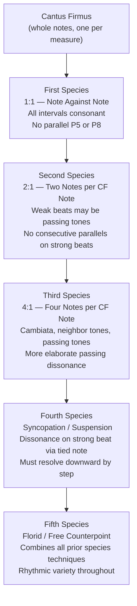
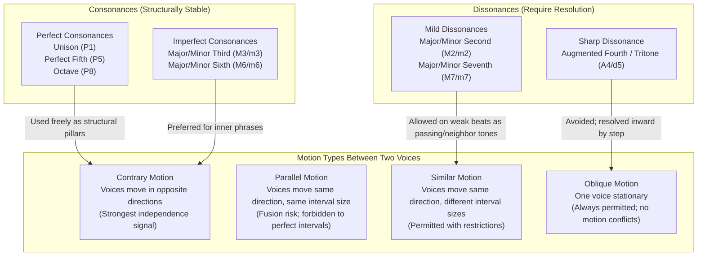
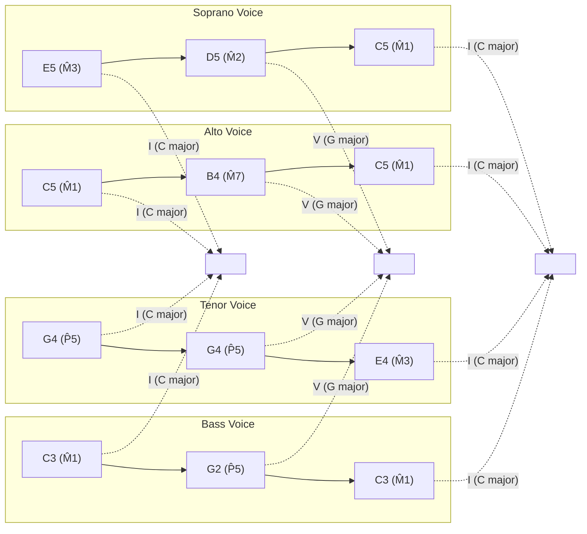

# Lesson 4: Counterpoint in Context

## First-Principles Intuition & Invariants

Counterpoint is the discipline of combining two or more melodic lines such that each retains its identity as an independent melody while simultaneously forming a coherent harmonic whole with every other voice. The word derives from the Latin *punctus contra punctum* — point against point, note against note — and the etymology is architecturally precise: counterpoint is fundamentally about the relationships *between* simultaneously sounding pitches, not the individual lines themselves.

Understanding counterpoint from first principles requires grounding in three interacting domains: the physics of vibrating media, the psychoacoustics of the human auditory system, and the combinatorial logic of interval-class relationships. These are not independent layers but deeply coupled constraints that together explain *why* the rules of counterpoint are what they are.

### The Physics of Consonance: Harmonic Series and Coincidence of Partials

Every acoustic instrument produces not a single frequency but a spectrum of frequencies called the *harmonic series*. For a fundamental frequency $f_0$, the partials occur at:

$$f_n = n \cdot f_0, \quad n \in \{1, 2, 3, 4, \ldots\}$$

For a pitch at 220 Hz (A3), the partials are 220, 440, 660, 880, 1100, 1320 Hz, and so on. When two pitches sound simultaneously, the degree of *coincidence* among their upper partials determines the perceived consonance of the interval. The more partial frequencies that coincide exactly (or beat at imperceptibly slow rates), the more stable and fused the sonority.

The intervals ranked by coincidence of partials are:

| Interval | Frequency Ratio (JI) | Partials that Coincide |
|---|---|---|
| Unison | 1:1 | All partials coincide |
| Octave | 2:1 | Every partial of the upper pitch coincides with an even partial of the lower |
| Perfect Fifth | 3:2 | 3rd partial of lower = 2nd partial of upper |
| Perfect Fourth | 4:3 | 4th partial of lower = 3rd partial of upper |
| Major Third | 5:4 | 5th partial of lower = 4th partial of upper |
| Minor Third | 6:5 | 6th partial of lower = 5th partial of upper |
| Major Second | 9:8 | Coincidence sparse; beats perceptible |
| Minor Second | 16:15 | Near-coincident partials generate rapid beating |
| Tritone | 45:32 | No simple coincidence |

This spectrum from most to least partial coincidence maps almost perfectly onto the traditional consonance-to-dissonance hierarchy used in species counterpoint. The ranking is not an aesthetic convention — it is a consequence of the physics of vibrating strings, air columns, and the neural encoding of periodicity in the auditory brainstem.

### Equal Temperament and Its Deviations from Just Intonation

Western common-practice counterpoint is typically analyzed in terms of *just intonation* ratios, but performed in *equal temperament*, where every semitone has an identical frequency ratio of $2^{1/12}$. The frequency of any pitch $n$ semitones above a reference $f_0$ is:

$$f_n = f_0 \cdot 2^{n/12}$$

This formula yields 12 equal divisions of the octave. The tradeoff is that no interval except the octave is acoustically pure. The equal-tempered perfect fifth is $2^{7/12} \approx 1.4983$, versus the just ratio of $3/2 = 1.5000$ — a deviation of approximately 1.96 cents. The equal-tempered major third is $2^{4/12} \approx 1.2599$, versus $5/4 = 1.25$ — a deviation of approximately 13.69 cents, the most audible tempering error in the system.

This distinction matters for counterpoint pedagogy because Fux's rules were formulated in a context where meantone temperament (which keeps thirds purer at the cost of wider fifths) was still common. The prohibition on the tritone, for instance, is acoustically more severe in just intonation ($45/32$) than in equal temperament ($2^{6/12} = \sqrt{2}$), where the tritone's symmetry gives it a certain structural neutrality.

### The Invariants: Rules That Are Not Arbitrary

The classical rules of counterpoint are often presented as a list of prohibitions. At the first-principles level, each has a physical or perceptual justification.

**Prohibition of parallel perfect fifths and octaves.** When two voices move in parallel motion to a perfect fifth or octave, the acoustic result is a *fusion* of the two voices into a single perceptual object. The human auditory system, encountering two lines whose partials are in constant 3:2 or 2:1 alignment, fails to segregate them as independent streams. This defeats the fundamental goal of counterpoint — the preservation of voice independence. The prohibition is therefore not a rule of beauty but an enforcement of the *definition* of counterpoint itself.

**Prohibition of the augmented second in melody.** The interval of an augmented second (three semitones) is dissonant by partial coincidence, and when it appears melodically it creates a *skip* that the voice cannot resolve smoothly. In vocal counterpoint — Fux's primary medium — this interval is unsingable in a connected melodic context because it violates the expectation of stepwise or small-interval motion that the auditory system uses for melodic stream segregation.

**Resolution of dissonance by step.** Dissonant intervals create neural tension through rapid amplitude modulation (beating between near-coincident partials). The auditory system resolves this tension most efficiently when the dissonant tone moves by a semitone or whole tone to a consonant pitch — the smallest motion required to escape the zone of partial interference. Resolution by skip or leap leaves the beating unresolved in the perceptual memory of the listener.

**Avoidance of the tritone (diabolus in musica).** The tritone's ratio $\sqrt{2}:1$ has no simple-integer approximation; its partials do not coincide at any low harmonic, and near-coincident partials at higher harmonics produce slow, disorienting beating. Its historical label "the devil in music" reflects not superstition but accurate perceptual description.

---

## The Five Species: A Formal Taxonomy

Johann Joseph Fux systematized species counterpoint in *Gradus ad Parnassum* (1725), presenting it as a progressive curriculum in which a student masters each species before advancing to the next. The *cantus firmus* (CF) — a pre-existing melody, typically in whole notes — serves as the fixed voice against which the student writes.



### First Species (1:1)

One note in the counterpoint voice for every note in the CF. All intervals between the two voices must be consonant: unisons (at phrase boundaries only), thirds, fifths, sixths, octaves. The motion types — parallel, contrary, oblique, similar — are strictly regulated:

- Contrary motion (voices move in opposite directions) is always permitted and strongly preferred.
- Parallel motion to imperfect consonances (thirds, sixths) is permitted.
- Parallel motion to perfect consonances (unisons, fifths, octaves) is prohibited.
- Similar motion to a perfect consonance is permitted only if the upper voice moves by step.

The first species establishes the harmonic skeleton; every interval is load-bearing. There is no rhythmic texture to obscure voice-leading problems, so errors are immediately visible.

### Second Species (2:1)

Two half-notes in the counterpoint per whole note in the CF. The strong beat (beat 1) must carry a consonant interval. The weak beat (beat 2) may carry a *passing tone* — a dissonance approached and left by step in the same direction. This species introduces the concept of *metric hierarchy*: not all beats have equal harmonic weight. The ear tolerates dissonance on a metrically weak position because the strong-beat consonance provides the structural anchor.

### Third Species (4:1)

Four quarter-notes per CF whole note. The vocabulary of non-harmonic tones expands to include neighbor tones (upper and lower), *cambiata* (a specific four-note figure that skips over a dissonance), and multiple consecutive passing tones. The rule governing the *cambiata* is specific: the figure descends by step, skips a third down, then returns a step up (e.g., E–D–B–C), and the third-beat note (B in this example) is a dissonance approached by step and left by skip — a licensed exception to the general prohibition on leaving a dissonance by skip.

### Fourth Species (Suspension)

The defining technique is the *suspension*: a note is tied over from the weak beat of one measure to the strong beat of the next, where it creates a dissonance. The dissonance then resolves downward by step on the following weak beat. The suspension has three structural components:

1. **Preparation**: The note is consonant on the weak beat before the bar line.
2. **Suspension**: The same note, tied across the bar line, is now dissonant on the strong beat.
3. **Resolution**: The dissonance moves one step downward to a consonance.

Permitted suspension intervals (measured from CF below) are the 7–6, 4–3, 9–8, and 2–3 (bass suspension). The 7–6 and 4–3 are the workhorses of common-practice harmony. The 9–8 is treated with care because its resolution to a doubled octave can produce parallel octaves with the CF. The 2–3 (or its inversion the 7–6 in the upper voice) is the fundamental bass suspension used in Baroque harmonic practice.

### Fifth Species (Florid)

Fifth species combines all prior techniques with rhythmic freedom. A single measure might contain a suspension, a passing tone, a neighbor figure, and a leap to a consonance — sequences that would be isolated examples in earlier species now coexist in fluid succession. The critical discipline fifth species teaches is *prioritization*: the student must decide at each moment which rhythmic and harmonic device best serves the melodic arch and harmonic direction of the phrase.

---

## Core Architecture & Voice-Leading Mechanics

The architectural logic of counterpoint can be decomposed into three interacting layers: the **interval layer** (what harmonic content is present at each metric position), the **motion layer** (how voices connect successive intervals), and the **linear layer** (whether each voice constitutes a coherent, singable melody in its own right).

```mermaid
flowchart LR
    subgraph Linear_Layer["Linear Layer (Melodic Integrity)"]
        L1["Stepwise predominance"]
        L2["Directed melodic arch"]
        L3["Recovery of large leaps"]
        L4["Avoid melodic tritone"]
    end

    subgraph Interval_Layer["Interval Layer (Harmonic Content)"]
        I1["Consonance on strong beats"]
        I2["Licensed dissonance\n(passing, neighbor, suspension)"]
        I3["Avoid P5/P8 parallels"]
        I4["Resolve dissonance by step"]
    end

    subgraph Motion_Layer["Motion Layer (Voice Connection)"]
        M1["Prefer contrary motion"]
        M2["Similar motion to P-interval\nonly by step in upper voice"]
        M3["Oblique motion (one voice stationary)"]
        M4["Avoid voice crossing"]
    end

    Linear_Layer --> Motion_Layer
    Motion_Layer --> Interval_Layer
    Interval_Layer --> Linear_Layer
```



These three layers form a *constraint satisfaction loop*: a choice at one layer propagates constraints to both others. Writing a large leap in the linear layer (e.g., an ascending sixth) constrains the motion layer (the voice must recover by stepwise descent) and the interval layer (the peak of the leap must land on a consonance if it falls on a strong beat).

### Harmonic Rhythm and the Strong/Weak Beat Hierarchy

The concept that not all metric positions are harmonically equivalent is architecturally central to counterpoint. In common time, the hierarchy is:

```
Beat 1 (strong) > Beat 3 (medium) > Beats 2, 4 (weak)
```

Dissonance is tolerated at weak positions precisely because the ear's short-term harmonic memory anchors to the most recent strong-beat consonance. A passing tone on beat 2 is heard *against* the consonant interval established on beat 1, not as an independent harmonic event. This is why the rule for second species specifies strong-beat consonance but permits weak-beat passing tones: the strong beat carries the structural weight of the interval analysis.

### Voice Crossing and Overlapping

Voice crossing (the lower voice ascending above the upper voice or vice versa) is prohibited in strict counterpoint because it destroys the perceptual identity of the voices. Auditory stream segregation — the brain's mechanism for separating simultaneous sound sources — relies heavily on pitch register. When voices cross, the brain reassigns the melodic streams, causing the listener to hear the voice that was formerly the upper part now as the lower part, and vice versa. The voice that was your "soprano" melody suddenly becomes the bass line without compositional intent — a failure of communication.

Voice *overlapping* (a less severe violation in which one voice moves to a pitch beyond the previous pitch of the adjacent voice, without crossing it in the current moment) is also avoided for the same perceptual reason, though it is treated with more flexibility in free counterpoint.

### The Tritone Substitute and Diminished Motion

The tritone creates a unique architectural problem in counterpoint because it demands resolution in both voices simultaneously. The standard resolution of the tritone $B–F$ in C major is: $B$ ascends by semitone to $C$, and $F$ descends by semitone to $E$. Both voices move inward (contrary motion) to a third. If the voices moved outward, $B$ descends to $A$ and $F$ ascends to $G$, the resolution is to a sixth — also valid but less conclusive.

This two-voice constraint is the acoustic foundation of the dominant seventh chord's resolution to the tonic triad in tonal harmony. The tritone in the dominant seventh ($B–F$ in G7) is resolved by the same voice-leading logic that governs fourth-species suspension resolution: the leading tone $B$ rises to $\hat{1}$ and the chordal seventh $F$ falls to $\hat{3}$.

---

## Formal Representation: Counterpoint as a Constraint Problem

Counterpoint is precisely specifiable as a *constraint satisfaction problem* (CSP). This formulation is not merely a theoretical convenience; it underpins the algorithmic approaches used in computational counterpoint generation systems from Schoenberg's theoretical formalism to Ebcioglu's CHORAL expert system (1988).

**Variables:** Each note position in the counterpoint voice is a variable $x_i$ with domain $D_i$ (the set of pitches permitted in the range of the voice).

**Constraints:**
- $\text{interval}(x_i, \text{CF}_i) \in \text{Consonances}$ for all strong-beat positions $i$
- $\neg\text{parallel\_perfect}(x_{i-1}, x_i, \text{CF}_{i-1}, \text{CF}_i)$ for all consecutive pairs
- $|\text{melodic\_interval}(x_{i-1}, x_i)| \leq 8$ semitones (avoid leaps larger than a sixth, with exceptions)
- $\text{recover}(x_{i-1}, x_i, x_{i+1})$ when $|\text{melodic\_interval}(x_{i-1}, x_i)| > 4$ semitones

The search space is exponential in the length of the CF, but the constraint density makes it tractable for typical CF lengths (8–16 notes) with backtracking search. The following Python implementation demonstrates a first-species CSP solver using backtracking with forward checking:

```python
"""
First-species counterpoint solver using backtracking with constraint propagation.
Operates over a diatonic scale (C major by default); intervals are computed
in semitone space for precision.
"""

from __future__ import annotations
from typing import Sequence

# Pitch representation: MIDI note numbers (C4 = 60)
# Interval quality lookup in semitones
CONSONANCES = {0, 3, 4, 7, 8, 9, 12}  # unison, m3, M3, P5, m6, M6, octave
PERFECT_CONSONANCES = {0, 7, 12}       # unison, P5, octave

C_MAJOR_SCALE = [60, 62, 64, 65, 67, 69, 71, 72]  # C4–C5


def interval_semitones(pitch_a: int, pitch_b: int) -> int:
    """Return the interval class (mod 12, non-negative) between two pitches."""
    return abs(pitch_a - pitch_b) % 12


def is_consonant(pitch_a: int, pitch_b: int) -> bool:
    return interval_semitones(pitch_a, pitch_b) in CONSONANCES


def is_perfect_consonance(pitch_a: int, pitch_b: int) -> bool:
    return interval_semitones(pitch_a, pitch_b) in PERFECT_CONSONANCES


def parallel_perfect(cf_prev: int, cf_curr: int,
                     cp_prev: int, cp_curr: int) -> bool:
    """
    Return True if the motion from (cf_prev, cp_prev) to (cf_curr, cp_curr)
    constitutes parallel motion to a perfect consonance.
    """
    if not is_perfect_consonance(cf_curr, cp_curr):
        return False
    # Both voices must move in the same direction (parallel motion)
    cf_motion = cf_curr - cf_prev
    cp_motion = cp_curr - cp_prev
    return (cf_motion > 0 and cp_motion > 0) or (cf_motion < 0 and cp_motion < 0)


def direct_fifth(cf_prev: int, cf_curr: int,
                 cp_prev: int, cp_curr: int) -> bool:
    """
    Return True if similar motion leads to a perfect fifth in the upper voice
    without the upper voice moving by step (the 'hidden fifth').
    """
    if interval_semitones(cf_curr, cp_curr) != 7:
        return False
    cf_motion = cf_curr - cf_prev
    cp_motion = cp_curr - cp_prev
    is_similar = (cf_motion > 0 and cp_motion > 0) or (cf_motion < 0 and cp_motion < 0)
    upper_voice_stepwise = abs(cp_curr - cp_prev) <= 2
    return is_similar and not upper_voice_stepwise


def melodic_ok(prev_pitch: int, curr_pitch: int) -> bool:
    """
    Validate a melodic interval:
    - Stepwise motion (semitones 1–2) always permitted.
    - Thirds (3–4 semitones) permitted.
    - Fourths (5 semitones) permitted.
    - Fifths (7 semitones) permitted with care; allowed here.
    - Sixths (8–9 semitones) permitted but disfavored.
    - Sevenths, tritones (6, 10, 11 semitones) prohibited.
    """
    diff = abs(curr_pitch - prev_pitch)
    return diff in {0, 1, 2, 3, 4, 5, 7, 8, 9}


def solve_first_species(
    cantus_firmus: Sequence[int],
    voice_range: Sequence[int],
    start_index: int = 0,
    partial: list[int] | None = None,
) -> list[int] | None:
    """
    Backtracking solver for first-species counterpoint.

    Args:
        cantus_firmus: Sequence of MIDI pitches for the CF voice.
        voice_range:   Allowable MIDI pitches for the counterpoint voice.
        start_index:   Current position in the CF (used in recursion).
        partial:       Partial solution built so far.

    Returns:
        A complete counterpoint solution, or None if no solution exists.
    """
    if partial is None:
        partial = []

    if start_index == len(cantus_firmus):
        return partial  # Complete solution found

    cf_pitch = cantus_firmus[start_index]
    is_first = start_index == 0
    is_last = start_index == len(cantus_firmus) - 1

    for cp_pitch in voice_range:
        # --- Harmonic constraints ---
        if not is_consonant(cf_pitch, cp_pitch):
            continue
        # Prefer contrary motion; enforce it toward final cadence
        if is_last and interval_semitones(cf_pitch, cp_pitch) not in {0, 12}:
            continue  # Final measure must be unison or octave
        # Avoid unison except at phrase boundaries in strict style
        if not is_first and not is_last:
            if interval_semitones(cf_pitch, cp_pitch) == 0:
                continue

        # --- Melodic constraints ---
        if partial and not melodic_ok(partial[-1], cp_pitch):
            continue

        # --- Motion constraints (requires at least one prior note) ---
        if partial:
            cf_prev = cantus_firmus[start_index - 1]
            cp_prev = partial[-1]

            if parallel_perfect(cf_prev, cf_pitch, cp_prev, cp_pitch):
                continue
            if direct_fifth(cf_prev, cf_pitch, cp_prev, cp_pitch):
                continue
            # Prohibit voice crossing
            if cp_pitch < cf_pitch:
                continue

        # Recurse
        result = solve_first_species(
            cantus_firmus, voice_range,
            start_index + 1, partial + [cp_pitch]
        )
        if result is not None:
            return result

    return None  # Backtrack


if __name__ == "__main__":
    # Cantus firmus: C D E F G A G F E D C (C major, Dorian mode example)
    cf = [60, 62, 64, 65, 67, 69, 67, 65, 64, 62, 60]

    # Counterpoint voice range: a tenth above the CF
    cp_range = list(range(64, 81))  # E4 to A5

    solution = solve_first_species(cf, cp_range)

    if solution:
        note_names = ['C', 'C#', 'D', 'D#', 'E', 'F',
                      'F#', 'G', 'G#', 'A', 'A#', 'B']
        def midi_to_name(m: int) -> str:
            return f"{note_names[m % 12]}{m // 12 - 1}"

        print("Cantus Firmus:   ", " ".join(midi_to_name(p) for p in cf))
        print("Counterpoint:    ", " ".join(midi_to_name(p) for p in solution))
        intervals = [interval_semitones(c, s) for c, s in zip(cf, solution)]
        print("Interval classes:", intervals)
    else:
        print("No solution found.")
```

The solver above enforces the invariants as hard constraints and uses backtracking to explore the domain of permissible counterpoint notes. For production use, this architecture would be extended with heuristic ordering (prefer contrary motion, prefer thirds and sixths over fifths and octaves) and arc-consistency propagation to prune the search space before backtracking.

---

## Interval Taxonomy and Motion Types: A Reference Architecture



### Why Imperfect Consonances Are Preferred in Inner Phrases

A common misconception is that perfect consonances — fifths and octaves — are the "best" intervals and therefore most desirable. In counterpoint, the opposite is pragmatically true for inner phrase positions. Perfect consonances are so acoustically fused that their overuse destroys voice independence. The two voices collapse into a single perceptual stream. Imperfect consonances (thirds and sixths) provide harmonic stability while maintaining enough spectral difference between the voices that the auditory system segregates them as distinct melodic streams. This is the same perceptual mechanism that makes parallel thirds and sixths in folk harmonization (gymel in medieval English practice, thirds in Iberian villancicos) so effective: consonant enough to be stable, independent enough to be interesting.

---

## Modal Counterpoint: Before Common-Practice Tonality

Fux's *Gradus ad Parnassum* was itself a systematization of *Renaissance polyphony* — the counterpoint of Palestrina, Victoria, and Lassus — not Baroque or Classical practice. The modal system underlying Renaissance counterpoint differs from tonal counterpoint in ways that are architecturally significant.

In modal counterpoint, the governing interval relationships derive from the *church modes* (Dorian, Phrygian, Lydian, Mixolydian, Aeolian, Ionian) rather than from the tonal major/minor key system. The critical difference is the treatment of the leading tone: in Phrygian mode, for example, the cadential motion is from the supertonic ($\hat{2}$) down by semitone to the final ($\hat{1}$), not from the leading tone ($\hat{7}$) up. This inverts the direction of the most structurally weighted melodic motion in the system.

The following table maps modal structure onto the interval-class constraints relevant to counterpoint:

| Mode | Final | Characteristic Interval | Cadence Type | Leading Tone Behavior |
|---|---|---|---|---|
| Dorian | D | Minor third above final | Phrygian or stepwise | Raised 7th common |
| Phrygian | E | Minor second above final | Semitone descent to final | No leading tone |
| Lydian | F | Augmented fourth above final | Whole-step descent | Raised 4th avoidance |
| Mixolydian | G | Minor seventh above final | Stepwise descent | Lowered 7th |
| Aeolian | A | Natural minor | Variable | Raised 6th, 7th common |
| Ionian | C | Major | Authentic | Standard leading tone |

The absence of a leading tone in Phrygian mode means that the goal-directed harmonic tension that underpins fourth-species suspension resolution (which relies on the leading tone's drive toward the tonic) is unavailable. Phrygian counterpoint instead uses the downward semitone motion from $\hat{2}$ as its primary closure gesture — a fundamentally different architectural logic for phrase endings.

---

## Extended Applications: Invertible Counterpoint

*Invertible counterpoint* (also called *double counterpoint*) is a technique in which two melodic lines are composed so that they remain valid counterpoint when their vertical positions are exchanged — the former upper voice becomes the lower, and vice versa. For this exchange to produce no new voice-leading violations, the interval structure must be symmetric under inversion at the designated interval of invertibility.

The most common form is double counterpoint at the octave (invertible at the 12th scale degree in MIDI terms). When a two-voice texture is inverted at the octave, each interval $n$ becomes its octave complement $12 - n$ (in scale-step terms). The transformation table for octave inversion is:

| Original Interval | Inverted Interval | Consonance Preserved? |
|---|---|---|
| Unison (1) | Octave (8) | Yes |
| Second (2) | Seventh (7) | Dissonance ↔ Dissonance |
| Third (3) | Sixth (6) | Yes |
| Fourth (4) | Fifth (5) | Conditional — P4 becomes P5 |
| Fifth (5) | Fourth (4) | Conditional — P5 becomes P4 |
| Sixth (6) | Third (3) | Yes |
| Seventh (7) | Second (2) | Dissonance ↔ Dissonance |
| Octave (8) | Unison (1) | Yes |

The critical problem is the fifth/fourth exchange: a perfect fifth in the original becomes a perfect fourth in the inversion, and in strict counterpoint a perfect fourth above the bass is a dissonance (because the bass note is not the root of the interval). To write double counterpoint at the octave, the composer must therefore either avoid perfect fifths entirely or ensure that any fifth occurs in a context where the resulting fourth in the inversion will be supported by a consonant interval in the other voice.

Bach's Two-Part Inventions are the canonical study scores for double counterpoint at the octave. The subject and countersubject of a fugue are the most architecturally ambitious example: they must function both simultaneously and in inversion, and both individually as coherent melodies. The opening subject-countersubject pair of *The Well-Tempered Clavier* Fugue No. 1 in C major is invertible, as is the famous subject-answer pair of the C minor Fugue (WTC II).

---

## Counterpoint in Tonal Harmony: The Bridge to Common Practice

The transition from species counterpoint to tonal harmonic practice is not a rupture but a compression. The chord progressions of common-practice tonality can be understood as the residue of voice-leading constraints operating across multiple simultaneous voices. The *IV–V–I* cadential formula is, at the voice-leading level, a species counterpoint exercise: soprano descends $\hat{3}–\hat{2}–\hat{1}$, the leading tone in the tenor ascends $\hat{7}–\hat{1}$, and the bass descends by fifth $\hat{4}–\hat{5}–\hat{1}$. Each voice is following the stepwise or semitone-motion preferences of linear counterpoint; the "chord progression" is the harmonic cross-section of several simultaneous melodic lines.



The I–V–I progression here is generated by the voice-leading requirements: each voice moves to the nearest available consonant pitch. The "harmonic" analysis (I, V, I) is a *labeling* of the vertical cross-sections; the causal logic is the horizontal motion of the voices, not the other way around. This is the fundamental insight that separates voice-leading–based analysis (Schenkerian analysis) from chord-symbol–based analysis (Roman numeral theory).

---

## Common Errors and Their Structural Causes

The following table maps the most frequent species counterpoint errors to their underlying perceptual or acoustic cause, providing a diagnostic framework rather than a checklist.

| Error | Surface Description | Underlying Cause |
|---|---|---|
| Parallel perfect fifths | Two voices move to a perfect fifth in parallel motion | Perceptual fusion: voices lose independence as a single acoustic stream |
| Parallel octaves | Two voices move to an octave in parallel motion | Complete fusion: upper voice doubles lower, destroying contrapuntal texture |
| Hidden (direct) fifths | Similar motion to a P5 with the upper voice leaping | Implicit parallel motion; the skip implies the intermediate parallel motion aurally |
| Consecutive unisons | Voices converge to a unison and remain there | Total stream merger; voices cease to exist independently |
| Augmented melodic interval | Melody skips an augmented second, fourth, or other augmented interval | Unsingable in vocal style; auditory stream discontinuity |
| Unresolved suspension | A dissonance on the strong beat is left by leap or not resolved | The partial-beating tension is not resolved; listener perceives incompletion |
| Voice crossing | Lower voice ascends above upper voice | Auditory stream reassignment; listener re-labels the voices |
| Leap to a dissonance | A melodic skip lands on a dissonant interval | The dissonance has no prepared context; sounds arbitrary and harsh |
| Failure to recover large leap | A sixth or octave leap is not followed by stepwise motion in the opposite direction | The melodic line loses its linear coherence; sounds fragmented |

---

## Summary: The System Invariants

Counterpoint is a formal system with the following core invariants — properties that must hold for any valid solution at any level of species complexity:

1. **Voice independence**: Every voice must be auditorily segregable as a distinct melodic stream at all times. Parallel perfect consonances, voice crossing, and monotone repetition all violate this invariant.

2. **Metric hierarchy**: Dissonance is permissible only in contexts where a proximate consonance (on a metrically stronger beat) provides the harmonic anchor. The strength of the anchor scales with its metric weight.

3. **Linear coherence**: Each voice, read in isolation, must constitute a singable, directionally coherent melody. Leaps must be followed by recovery; large skips must be earned by prior context.

4. **Directed resolution**: Every dissonance has a specific resolution target — a consonant pitch reachable by step in the direction dictated by the dissonance type (downward for suspensions, continuation of direction for passing tones). Deviation from this target is a structural failure, not merely an aesthetic one.

5. **Acoustic grounding**: The preference for consonance and the prohibition on specific dissonances are grounded in the physics of partial-tone coincidence. The rules are not arbitrary cultural conventions; they are specifications of the conditions under which the human auditory system perceives multiple simultaneous sound streams as a coherent, organized whole rather than an undifferentiated noise field.

These five invariants apply equally to two-voice first species and to the eight-voice choral polyphony of Palestrina or the six-voice ricercars of Bach. The species scaffold is a pedagogical reduction; the invariants are the architecture.
