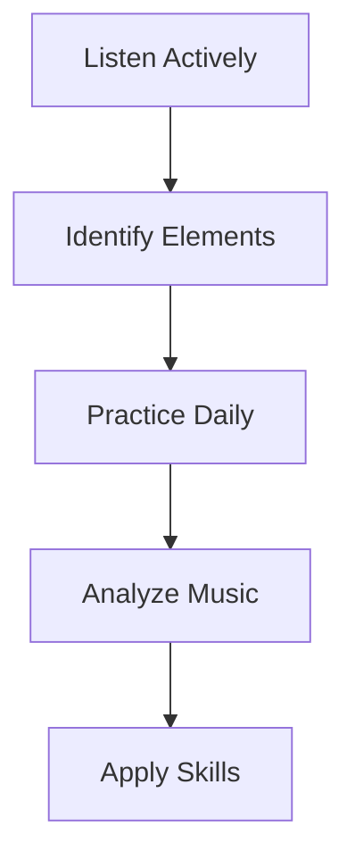

# Beginner Foundation: Ear Training

## 1. Everyday Intuition & First Principles

Ear training is the practice of developing your ability to perceive and understand musical sounds. Just as a painter learns to see colors and shapes, a musician learns to hear pitches, rhythms, and harmonies. Imagine you are a chef trying to taste the individual flavors in a complex dish. Ear training is like developing your palate to distinguish each ingredient in the musical "soup." This skill is fundamental because it allows you to hear what you want to play, compose, or perform, even before you produce it. It is the bridge between what you hear in your mind and what you create with your instrument.

## 2. Foundational Vocabulary & Glossary

### Pitch
The specific frequency of a sound. For example, the note "A" above middle C on a piano has a frequency of 440 Hz.

### Interval
The distance between two pitches. For instance, the interval between C and D is a second, while the interval between C and G is a fifth.

### Scale
A series of pitches in ascending or descending order. The most common scale is the major scale, which consists of seven notes.

### Chord
A group of three or more pitches played simultaneously. For example, a C major chord consists of the notes C, E, and G.

### Rhythm
The pattern of beats and silences in music. Rhythm is what gives music its sense of time and movement.

### Harmony
The combination of pitches played together to create chords and progressions. Harmony is what gives music its emotional depth and color.

### Timbre
The unique quality of a sound that distinguishes it from other sounds of the same pitch and volume. For example, a violin and a piano can play the same note, but they will sound different due to their unique timbres.

### Dynamics
The variation in loudness within a piece of music. Dynamics can range from very soft (piano) to very loud (forte).

## 3. Visual System Flow

### ASCII Diagram
```
+-------------------+
|   Listen Actively   |
+---------+---------+
          |
          v
+---------+---------+
| Identify Elements |
+---------+---------+
          |
          v
+---------+---------+
|   Practice Daily  |
+---------+---------+
          |
          v
+---------+---------+
|   Analyze Music   |
+---------+---------+
          |
          v
+---------+---------+
|   Apply Skills    |
+-------------------+
```

### Mermaid Flowchart


## 4. Common Beginner Misconceptions & Mental Traps

### Misconception: Ear Training is Only for Musicians
Ear training is beneficial for anyone who appreciates music, not just performers. It enhances your ability to appreciate and understand music on a deeper level.

### Misconception: You Need Perfect Pitch to Train Your Ear
Perfect pitch is the ability to identify a pitch without a reference tone. While it is helpful, it is not necessary for ear training. Relative pitch, the ability to identify intervals and chords, is more important and can be developed through practice.

### Misconception: Ear Training Takes a Long Time
While consistent practice is key, you can make significant progress in ear training relatively quickly. The key is to practice regularly and systematically.

### Misconception: You Can Only Train Your Ear Through Formal Exercises
While formal exercises are helpful, you can also train your ear through everyday activities. Listen to music actively, sing along, and try to identify the elements you are learning about.

## 5. Socratic Discussion Starters

### Basic Questions to Explore with Your AI Tutor

1. **What is the difference between pitch and interval, and why are they important in ear training?**
2. **Can you explain the concept of scale and how it relates to the intervals you have learned?**
3. **How do chords and harmony work together to create the emotional depth in a piece of music?**
4. **What are some practical ways to practice identifying rhythm and dynamics in your daily listening?**
5. **How can you apply your ear training skills to improve your playing or composition?**

By engaging with these questions, you will begin to build a strong foundation in ear training, which will serve you well in your musical journey.
