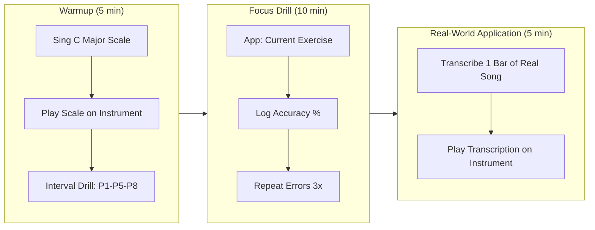

# Operational Verification Labs: Ear Training

## Objective & Lab Setup

This laboratory develops accurate, immediate interval, chord, rhythm, and melodic recognition through systematic, progressive drills. Ear training is the bridge between theoretical knowledge and physical execution—recognizing what you hear accelerates transcription, improvisation, intonation correction, and harmonic analysis.

**Required Tools:**
- **Audacity** (Free): Record and analyze your own playing, loop sections, slow down audio without pitch shift (Effect → Change Tempo)
- **Tenuto** or **Complete Ear Trainer** (iOS/Android): Interval, chord, scale, rhythm drills with instant feedback
- **Teoria.com** (Web): Free interval and chord drills, no installation required
- **Your instrument**: Piano, guitar, bass, or any polyphonic instrument for physical reinforcement
- **Metronome**: Physical or app (Soundbrenner, Pro Metronome)

**Practice Discipline:**
- **Daily consistency beats marathon sessions.** 10 focused minutes daily is superior to 2-hour weekend binges.
- **Track accuracy and speed.** Log results in a notebook or spreadsheet. Aim for 85%+ accuracy before increasing difficulty.
- **Sing everything.** Audiation (internal hearing) requires vocalization. Hum, solfège, or speak interval names aloud.

---

## Exercise 1: Interval Recognition—Ascending & Descending

### 1.1 Perfect and Major Intervals (Week 1–2)

**Physical Context:**
Intervals are muscle memory for your ear. Each interval has a characteristic tension or resolution quality derived from the harmonic series. P5 (3:2 ratio) sounds stable; M2 (9:8) sounds tense and ascending.

**Drill Setup:**
1. Open Tenuto or Teoria.com → Interval Training → **Select intervals:** P1 (unison), M2, M3, P4, P5, P8 (octave)
2. **Mode:** Ascending only, melodic (not harmonic)
3. **Start at:** 40–50 questions per session, target 90%+ accuracy before advancing

**Physical Anchors (Melodic References):**
- **P1 (unison):** Identical pitch (tune your instrument by matching unisons)
- **M2:** "Happy Birthday" first interval, tension upward
- **M3:** "Oh When the Saints" first interval, bright and consonant
- **P4:** "Here Comes the Bride" first interval, open and hollow
- **P5:** "Twinkle Twinkle" first interval, stable power chord feel
- **P8:** Same note name, one octave higher, doubling resonance

**Execution:**
1. **Listen:** Play interval in app
2. **Sing:** Vocalize both pitches—bottom note, then top note
3. **Name:** Speak interval quality aloud ("Major third")
4. **Verify:** Check answer, repeat incorrect intervals 3 times
5. **Instrument reinforcement (once daily):**
   - Piano: Play each interval physically, ascending from C4: C→D (M2), C→E (M3), C→F (P4), C→G (P5), C→C' (P8)
   - Guitar: Low E string: 0→2 (M2), 0→4 (M3), 0→5 (P4), 0→7 (P5), 0→12 (P8)

**Log:** Date, interval set, accuracy percentage, time elapsed

### 1.2 Minor and Augmented/Diminished Intervals (Week 3–4)

Add: m2, m3, m6, m7, A4 (tritone), d5

**Physical Anchors:**
- **m2:** "Jaws" theme, maximum tension, semitone crunch
- **m3:** "Greensleeves" opening, minor quality, melancholic
- **m6:** "The Entertainer" (Scott Joplin) descending m6
- **m7:** "Star Trek" theme, wide dissonant leap
- **A4/d5 (tritone):** "The Simpsons" opening, devil's interval, symmetrically splits octave

**Execution (same protocol as 1.1):**
1. Melodic intervals only, ascending first
2. Once 85%+ accuracy: switch to **descending**
3. Once 85%+ descending: **mixed direction mode**
4. Add **harmonic intervals** (both notes sounding simultaneously) only after melodic mastery

**Piano Physical Check (C Major Scale):**
- Play C major scale ascending: C D E F G A B C'
- Stop on each note, sing back to C (tonic), name interval
- Reverse: descending C' B A G F E D C, sing up to C', name descending interval

**Guitar Physical Check (All on Low E String):**
- Fret 0 (E) → Fret X, sing interval, name it:
  - Fret 1 = m2, Fret 2 = M2, Fret 3 = m3, Fret 4 = M3, Fret 5 = P4, Fret 6 = A4, Fret 7 = P5, etc.

---

## Exercise 2: Chord Quality Recognition

### 2.1 Triads—Major, Minor, Diminished, Augmented (Week 5–6)

**Acoustic Context:**
Triads are stacked thirds. Major (M3+m3) sounds bright/resolved. Minor (m3+M3) sounds dark/introspective. Diminished (m3+m3) sounds tense/unstable. Augmented (M3+M3) sounds surreal/unresolved.

**Drill Setup:**
1. App: Chord ID → **Triads only** → Root position, close voicing
2. Start with **Major vs. Minor only** (50 repetitions, 90%+ accuracy)
3. Add **Diminished and Augmented** after Major/Minor mastery

**Physical Execution:**

**Piano Close-Position Triads (Root C):**
- **C Major:** C–E–G (4 semitones + 3 semitones)
- **C Minor:** C–E♭–G (3 semitones + 4 semitones)
- **C Diminished:** C–E♭–G♭ (3 semitones + 3 semitones, tritone between root and fifth)
- **C Augmented:** C–E–G♯ (4 semitones + 4 semitones, symmetrical, divides octave evenly)

**Physical Practice (10 min/day):**
1. Play each triad type on piano
2. **Sing the root** → **play chord** → **sing root again** (establish tonal center)
3. Arpeggiate ascending: C → E → G → C'
4. Listen for the **third's quality** (major = wide/bright, minor = narrow/dark)
5. Move through all 12 keys using circle of fifths: C → G → D → A → E → B → F♯ → D♭ → A♭ → E♭ → B♭ → F → C

**Guitar Triads (Movable Root-Position Shapes):**
- **Major (Root on E string, 6th string):**
  - Fret 3 (G Major): Strings 6-3-2 = Fret 3-5-4 (G-B-D notes, but G-D-G-B-D-G voicing)
  - Simpler: Strings 4-3-2 only (D-G-B strings), Root on 4th string
    - Fret 5 (G Major): 5-4-5 = G-B-D
- **Minor:** Lower the 3rd by one fret
  - Fret 5 (G Minor): 5-3-5 = G-B♭-D

**Chord Identification Drill:**
1. **Listen:** App plays triad
2. **Sing root:** Find the lowest, most stable pitch (bass note)
3. **Assess third:** Is the middle note wide (major) or narrow (minor) above root?
4. **Assess fifth:** Is the top note perfect (consonant), flat (diminished), or sharp (augmented)?
5. **Name quality:** Major, Minor, Diminished, Augmented
6. **Play on instrument:** Verify by playing the identified chord

**Error Analysis:**
- Confusing Major/Minor → Focus on the **third alone** (M3 vs. m3)
- Confusing Diminished/Minor → Diminished has a **flat fifth** (tritone tension)
- Confusing Augmented/Major → Augmented fifth sounds **exotic/unresolved**

### 2.2 Seventh Chords (Week 7–8)

Add four-note chords: Major 7, Minor 7, Dominant 7, Half-Diminished 7, Diminished 7

**Acoustic Signatures:**
- **Major 7 (Cmaj7: C–E–G–B):** Bright, dreamy, jazz ballad sound (M3+m3+M3)
- **Minor 7 (Cm7: C–E♭–G–B♭):** Dark, smooth, Dorian vamp feel (m3+M3+m3)
- **Dominant 7 (C7: C–E–G–B♭):** Tense, wants to resolve down a fifth, blues/rock sound (M3+m3+m3)
- **Half-Diminished 7 (Cø7: C–E♭–G♭–B♭):** m7♭5, tense, minor ii chord quality (m3+m3+M3)
- **Diminished 7 (C°7: C–E♭–G♭–B𝄫/A):** Symmetrical, horror movie tension (m3+m3+m3)

**Piano Seventh Chord Shapes (Root C):**
| Chord Type       | Notes           | Interval Stack       | Function                     |
|------------------|-----------------|----------------------|------------------------------|
| Cmaj7            | C–E–G–B         | M3+m3+M3             | Tonic resolution, I△7        |
| Cm7              | C–E♭–G–B♭       | m3+M3+m3             | Subdominant/Modal, ii-7      |
| C7 (Dominant)    | C–E–G–B♭        | M3+m3+m3             | Tension → Resolution, V7     |
| Cø7 (Half-dim)   | C–E♭–G♭–B♭      | m3+m3+M3             | Pre-dominant, ii-7♭5         |
| C°7 (Fully-dim)  | C–E♭–G♭–A       | m3+m3+m3 (symmetry)  | Passing/Auxiliary, vii°7     |

**Execution:**
1. App drill: 20 repetitions per chord type, isolated
2. Once 85%+ each → **Mixed all five types**, 50 repetitions
3. **Play-along:** For each drill chord, immediately play it on your instrument before answering
4. **Functional context:** Play ii-V-I in C: Dm7 → G7 → Cmaj7 (feel each chord's pull)

**Bass Player Focus:**
You only need to recognize the root and quality (not voicing). But you must hear:
- **Major 7 vs. Dominant 7:** The difference between stable (maj7) and tense (dom7) changes your note choices. Over Cmaj7, you can use B natural. Over C7, B♭ is diatonic.
- **Minor 7 vs. Half-Diminished 7:** Cm7 = Dorian/Aeolian. Cø7 = Locrian (flat 5 tension).

---

## Exercise 3: Rhythmic Dictation & Syncopation Recognition

### 3.1 Simple Time Signatures (Week 9–10)

**Rhythmic Context:**
Rhythm is the time-domain organization of attack points. Western music subdivides time into hierarchical grids: measures → beats → subdivisions. Recognizing syncopation (off-beat accents) requires internalizing the grid.

**Drill Setup:**
1. App: Tenuto → Rhythm Training → **4/4 time, quarter and eighth notes only**
2. Metronome at 80 BPM, quarter note = pulse
3. Listen to 2-bar rhythm, notate on staff or speak rhythm syllables

**Physical Execution:**
1. **Establish pulse:** Tap quarter notes with your foot (1-2-3-4, 1-2-3-4)
2. **Listen:** App plays rhythm
3. **Clap back:** Reproduce rhythm while foot maintains pulse
4. **Speak rhythm:** Use "1 e & a 2 e & a 3 e & a 4 e & a" for sixteenth-note subdivisions
   - Example: Quarter-Eighth-Eighth-Quarter-Quarter = "1 _ _ _ 2 & 3 _ _ _ 4 _ _ _"
5. **Notate:** Write rhythmic notation (stems only, no pitch)
6. **Verify:** Check answer, clap correct rhythm 3 times

**Progression:**
- Week 9: Quarter and eighth notes (4/4)
- Week 10: Add sixteenth notes and rests
- Once 85%+: Add triplets (1-trip-let, 2-trip-let)
- Once 85%+: Add syncopation (accents on off-beats)

**Physical Anchors:**
- **Straight eighths:** "Pass the god-damn but-ter" (8 syllables = 8 eighth notes in 4/4)
- **Triplets:** "Chi-cken dum-pling" per beat
- **Sixteenths:** "1-e-&-a" per beat
- **Syncopation:** "ONE-and-TWO-and-THREE-and-FOUR-and" with random capital (accent) placement

### 3.2 Compound Time & Polyrhythms (Week 11–12)

**6/8 Time (Compound Duple):**
- Pulse = dotted quarter (2 pulses per bar, each divisible by 3)
- Counting: "1-2-3-4-5-6" with accent on 1 and 4
- Physical: Conduct in 2 (DOWN-UP) while subdividing triplets internally

**Polyrhythm Drill (3 against 2):**
1. **Setup:** Right hand taps 3 evenly spaced taps per measure (triplets). Left hand taps 2 evenly spaced taps (half notes).
2. **Physical execution:**
   - Speak: "PASS-the-GOD-damn-BUT-ter" while:
     - Right hand taps on: PASS / damn / ter (3 taps)
     - Left hand taps on: PASS / BUT (2 taps)
3. **Verify alignment:** Record yourself, play back in Audacity, zoom in to verify accurate subdivision

**Polyrhythm (4 against 3):**
- Right hand: 4 taps (sixteenths)
- Left hand: 3 taps (triplets)
- Spoken: "WHAT-is-the-PROB-lem-HERE-to-DAY" (12 syllables = lowest common multiple)
  - Right hand accents: WHAT / PROB / HERE / DAY (every 3 syllables)
  - Left hand accents: WHAT / lem / to (every 4 syllables)

---

## Exercise 4: Melodic Dictation & Transcription

### 4.1 Diatonic Melodies (Week 13–14)

**Objective:** Transcribe 4-bar monophonic melodies in major keys by ear.

**Setup:**
1. Source: Use nursery rhymes, folk tunes, or app-generated melodies (Teoria.com → Melody Dictation)
2. Key signature: C Major only (no accidentals)
3. Rhythm: Quarter and eighth notes only

**Physical Protocol:**
1. **Establish key:** Play C major scale ascending and descending on your instrument. Sing scale with solfège (Do-Re-Mi-Fa-Sol-La-Ti-Do).
2. **First listen (full playthrough):** Listen to entire 4-bar melody without pausing. **Sing back immediately** to test audiation.
3. **Second listen (phrase by phrase):** Loop each 1-bar phrase. Sing it back until accurate.
4. **Find starting pitch:** Play C major scale on instrument until you match the first note. Identify scale degree (Do, Re, Mi, etc.).
5. **Transcribe melody:** For each note:
   - Sing note with solfège
   - Find note on instrument
   - Verify interval from previous note (M2 up? m3 down?)
   - Write notation: pitch + rhythm
6. **Verification:** Play your transcription back on instrument. Does it match the recording?

**Troubleshooting:**
- **Lost in the middle?** Anchor on **strong beats** (beat 1 of each bar) first. Fill in weak beats after.
- **Can't find pitch?** Sing the tonic (Do) before each note to establish reference. Then sing the interval.
- **Rhythm unclear?** Isolate rhythm first. Clap rhythm while ignoring pitch. Then add pitch.

### 4.2 Chromatic Melodies & Modulation (Week 15–16)

Add: Accidentals, key changes, modal melodies

**Execution:**
1. Start in C Major
2. When you hear a note that doesn't fit the scale, **stop and test chromatically:**
   - Play scale-tone options on instrument (e.g., F natural vs. F♯)
   - One will sound wrong. The correct note will lock in with the harmonic context.
3. For key changes: Identify new tonic by finding the **resolution point** (where tension releases)

**Jazz Standard Transcription (Real-World Application):**
1. Pick a simple melody: "Autumn Leaves" (first 8 bars)
2. Loop 1-bar phrases in Audacity (Selection → Ctrl+L or Cmd+L to loop)
3. Slow down to 70% speed (Effect → Change Tempo → -30%) without pitch shift
4. Transcribe note-by-note, then speed back to 100% to verify

---

## Exercise 5: Stress Testing—Real-World Conditions

### 5.1 Recognition in Dense Mix (Instrument Separation)

**Objective:** Identify chord changes in a full band mix where bass, guitar, keys, and drums are all present.

**Setup:**
1. Source: Use a simple pop/rock song with clear chord changes (e.g., "Let It Be" by The Beatles)
2. Tools: Audacity to loop 8-bar sections
3. Instrument: Piano or guitar to test harmonic hypotheses

**Protocol:**
1. **First pass—Bass line:** Isolate lowest frequencies (Effect → Equalization → Low-pass filter at 300 Hz). Transcribe bass notes (root movement).
2. **Second pass—Chord quality:** Listen to full mix. For each bass note, test major/minor/7th quality by playing options on your instrument. Trust the one that locks in.
3. **Third pass—Rhythm:** When do chords change? Mark changes on a timeline (bar 1 beat 1, bar 2 beat 3, etc.).
4. **Verification:** Play your chord chart along with the recording. Does it sound correct?

**Common Errors:**
- **Confusing bass note with chord root:** A bass player may play the 5th of the chord on beat 1. Listen for where the **piano or guitar changes** to identify true chord root.
- **Missing passing chords:** Fast harmonic rhythm (chords changing every 2 beats) requires slower playback speed.

### 5.2 Transcription with Background Noise

**Objective:** Train in suboptimal listening conditions (simulating live venue, headphone bleed).

**Setup:**
1. Use Audacity to mix a melody with white noise at -12 dB below signal
2. Or play drill audio through phone speaker in a noisy room

**Protocol:**
1. Same melodic dictation protocol as Exercise 4.1
2. **Focus technique:** Loop 1-bar phrases **10 times each** to burn through noise floor
3. **Verification:** Remove noise, compare your transcription to clean audio

**Outcome:** Builds resilience for transcribing live performances, YouTube videos with compression artifacts, or field recordings.

---

## Exercise 6: Functional Ear Training—Harmonic Progressions

### 6.1 Diatonic Chord Progressions (Week 17–18)

**Objective:** Recognize chord movement by Roman numeral function (I-IV-V-I, ii-V-I, etc.) in major keys.

**Theory Foundation (15% Academic Context):**
In functional harmony, chords have gravitational pull based on scale degree:
- **I (Tonic):** Home, resolution, stability
- **ii (Supertonic):** Pre-dominant, moves to V
- **IV (Subdominant):** Pre-dominant, moves to I or V
- **V (Dominant):** Maximum tension, resolves to I
- **vi (Submediant):** Relative minor, deceptive resolution

Common progressions:
- **I-IV-V-I:** Basic cadence (rock, folk, blues)
- **I-vi-IV-V:** 50s progression ("Stand By Me")
- **ii-V-I:** Jazz turnaround
- **I-V-vi-IV:** Pop progression ("Let It Be," "Don't Stop Believin'")

**Drill Setup:**
1. App: Teoria.com → Chord Function ID
2. Key: C Major
3. Chords: I, ii, iii, IV, V, vi (all diatonic triads)

**Physical Execution:**
1. **Establish tonic:** Play I chord (C Major) on instrument. Sing root "Do."
2. **Listen:** App plays progression (e.g., I → IV → V → I)
3. **Sing roots:** For each chord, sing the bass note movement (Do → Fa → Sol → Do)
4. **Name function:** Speak Roman numerals (I → IV → V → I)
5. **Play progression:** Verify by playing the progression on your instrument
6. **Analyze direction:**
   - **To I (Tonic):** Sounds like arriving home
   - **To IV (Subdominant):** Sounds like lifting, preparing
   - **To V (Dominant):** Sounds like question, tension
   - **To vi (Submediant):** Sounds like deceptive resolution, minor flavor

**Metronome Drill (Bass Players & Keyboardists):**
1. Metronome at 80 BPM
2. Record yourself playing I-IV-V-I (whole notes, one chord per bar)
3. Listen back without looking at your hands
4. Can you hear the harmonic function? Do chord changes feel inevitable?

### 6.2 Modal and Chromatic Progressions (Week 19–20)

Add: Modal interchange (borrowing chords from parallel minor), secondary dominants, tritone substitutions

**Examples:**
- **Modal interchange:** I → ♭VII → ♭VI → I (borrowed from Mixolydian/Aeolian)
  - C → B♭ → A♭ → C (rock ballad sound)
- **Secondary dominant:** I → V7/ii → ii → V7 → I
  - C → E7 → Dm → G7 → C (E7 temporarily tonicizes Dm)
- **Tritone sub:** I → ♭II7 → I (substitute V7 with chord a tritone away)
  - C → D♭7 → C (jazz sound, replaces G7 → C)

**Execution:**
1. Play examples on piano/guitar while singing roots
2. Use app drills for random modal progressions
3. Transcribe real songs: Listen to a jazz standard (e.g., "Autumn Leaves") and chart the chord changes by ear

---

## Practical Cheat Sheet & Quick Reference

### Interval Recognition Physical Anchors

| Interval | Melodic Cue                | Harmonic Feel         | Piano (from C4) | Guitar (Low E) |
|----------|----------------------------|-----------------------|-----------------|----------------|
| P1       | Identical pitch            | Perfect unison        | C–C             | 0–0            |
| m2       | "Jaws" theme               | Maximum tension       | C–D♭            | 0–1            |
| M2       | "Happy Birthday" start     | Tension, upward       | C–D             | 0–2            |
| m3       | "Greensleeves" opening     | Minor, melancholic    | C–E♭            | 0–3            |
| M3       | "Oh When the Saints"       | Bright, consonant     | C–E             | 0–4            |
| P4       | "Here Comes the Bride"     | Open, hollow          | C–F             | 0–5            |
| A4 (TT)  | "The Simpsons"             | Devil's interval      | C–F♯            | 0–6            |
| P5       | "Twinkle Twinkle"          | Stable, power chord   | C–G             | 0–7            |
| m6       | "The Entertainer" descend. | Wide, tense           | C–A♭            | 0–8            |
| M6       | "My Bonnie" leap           | Wide, consonant       | C–A             | 0–9            |
| m7       | "Star Trek" theme          | Wide, dissonant       | C–B♭            | 0–10           |
| M7       | Dissonant leading tone     | Tense resolution      | C–B             | 0–11           |
| P8       | Same note, one octave      | Doubling resonance    | C–C'            | 0–12           |

### Chord Quality Quick ID

| Chord Type          | Interval Stack | Sound Signature                  | Piano (Root C)       |
|---------------------|----------------|----------------------------------|----------------------|
| Major Triad         | M3 + m3        | Bright, resolved                 | C–E–G                |
| Minor Triad         | m3 + M3        | Dark, introspective              | C–E♭–G               |
| Diminished Triad    | m3 + m3        | Tense, unstable (tritone)        | C–E♭–G♭              |
| Augmented Triad     | M3 + M3        | Surreal, unresolved (symmetry)   | C–E–G♯               |
| Major 7             | M3+m3+M3       | Dreamy, jazz ballad              | C–E–G–B              |
| Minor 7             | m3+M3+m3       | Smooth, Dorian vamp              | C–E♭–G–B♭            |
| Dominant 7          | M3+m3+m3       | Tense, wants resolution          | C–E–G–B♭             |
| Half-Diminished 7   | m3+m3+M3       | Tense, minor ii chord (m7♭5)     | C–E♭–G♭–B♭           |
| Diminished 7        | m3+m3+m3       | Symmetrical horror movie tension | C–E♭–G♭–A (B𝄫)       |

### Rhythm Counting Systems

| Subdivision        | Counting System         | Syllables Per Beat  | BPM Range   |
|--------------------|-------------------------|---------------------|-------------|
| Quarter notes      | 1-2-3-4                 | 1                   | 60–120      |
| Eighth notes       | 1-&-2-&-3-&-4-&         | 2                   | 80–160      |
| Sixteenth notes    | 1-e-&-a-2-e-&-a         | 4                   | 60–100      |
| Triplets           | 1-trip-let-2-trip-let   | 3                   | 60–120      |
| Quintuplets        | 1-ta-ti-ta-let          | 5                   | 40–80       |

### Practice Session Template (Daily 20-Minute Routine)



### Progression Milestones

| Week   | Focus                                | Target Accuracy | Next Step                          |
|--------|--------------------------------------|-----------------|-------------------------------------|
| 1–2    | P1, M2, M3, P4, P5, P8 (ascending)   | 90%+            | Add minor intervals                 |
| 3–4    | All intervals ascending + descending | 90%+            | Add harmonic intervals              |
| 5–6    | Major/Minor triads                   | 90%+            | Add diminished/augmented            |
| 7–8    | All seventh chords                   | 85%+            | Add inversions                      |
| 9–10   | 4/4 rhythm (quarters/eighths)        | 85%+            | Add sixteenths/triplets             |
| 11–12  | Compound time, polyrhythms           | 80%+            | Add syncopation                     |
| 13–14  | Diatonic melodies (C Major)          | 80%+            | Add accidentals                     |
| 15–16  | Chromatic melodies, modulation       | 75%+            | Add modal melodies                  |
| 17–18  | Diatonic chord progressions (I-IV-V) | 85%+            | Add modal interchange               |
| 19–20  | Modal/chromatic progressions         | 80%+            | Transcribe full jazz standard       |

### Troubleshooting Common Errors

| Problem                                      | Diagnosis                                    | Fix                                                                 |
|----------------------------------------------|----------------------------------------------|---------------------------------------------------------------------|
| Confusing M3 and P4                          | Not singing intervals before answering       | Sing both pitches aloud, feel the width difference                  |
| Can't identify chord quality in full mix     | Listening to melody instead of harmony       | Mute or EQ out vocals/lead instruments, isolate bass and piano      |
| Losing rhythmic pulse during dictation       | Not physically tapping pulse                 | Always tap quarter note pulse with foot; never stop the grid        |
| Missing chromatic passing tones              | Assuming diatonic scale                      | Test every "wrong" note by playing scale-tone vs. chromatic option  |
| Intervals sound correct but answers are wrong| Relative vs. absolute pitch confusion        | Always anchor to a reference pitch (tonic) before identifying       |
| Can't transcribe fast runs                   | Trying to catch every note at full speed     | Slow to 50% in Audacity, transcribe, speed back up to verify        |

### Tools & CLI Commands

**Audacity:**
- **Import audio:** File → Open (Cmd+O / Ctrl+O)
- **Loop selection:** Select region → Loop button in Transport toolbar
- **Change tempo (no pitch shift):** Effect → Change Tempo → Enter -30% to slow down
- **Low-pass filter (isolate bass):** Effect → Filter Curve EQ → Boost below 300 Hz, cut above 500 Hz
- **Export selection:** File → Export → Export Selected Audio

**MuseScore (for Notation Verification):**
- **New score:** File → New (Cmd+N / Ctrl+N)
- **Note input:** Press N, use QWERTY (A-G for pitches), numbers 1-7 for durations (5=quarter, 6=eighth)
- **Playback:** Spacebar to play, [ and ] to adjust tempo

**Teoria.com (No Installation):**
- Navigate to https://teoria.com/exercises
- Interval training: Exercises → Intervals → Melodic
- Chord ID: Exercises → Chords → Triads or Seventh Chords
- No registration required, runs in browser

**Metronome CLI (if using Sonic Pi or CLI tools):**
```ruby
# Sonic Pi metronome at 80 BPM with subdivisions
live_loop :metronome do
  sample :elec_tick, amp: 1
  sleep 0.75  # 80 BPM = 0.75 sec per beat
end
```

---

## Final Remarks: Integration & Long-Term Practice

Ear training is cumulative. Intervals learned in Week 1 must be maintained through Week 20. Use spaced repetition:
- **Daily:** Current focus exercise (10 min)
- **Every 3 days:** Review previous exercise (5 min)
- **Weekly:** Transcribe one real-world song (20 min)

**Instrument players:** Your ear is only as strong as your ability to physically reproduce what you hear. Always close the loop: hear → sing → play → verify.

**Composers and producers:** Ear training accelerates harmonic decision-making. When you hear a chord progression in your head, you can immediately notate or program it without trial-and-error.

**Live performers:** Strong ears enable real-time adaptation. If a guitarist modulates to an unexpected key, a trained ear catches it within one bar and adjusts.

Consistency and deliberate error-correction beat volume. Log your accuracy, identify systematic errors (e.g., always confusing m3 and M2), and drill those specific distinctions until they become automatic.
