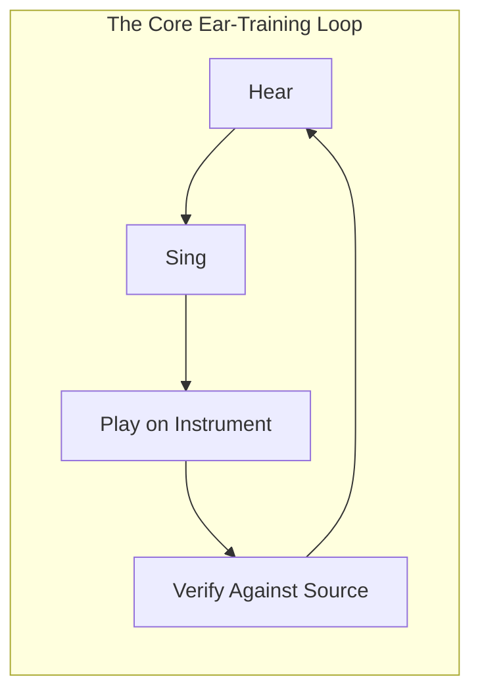
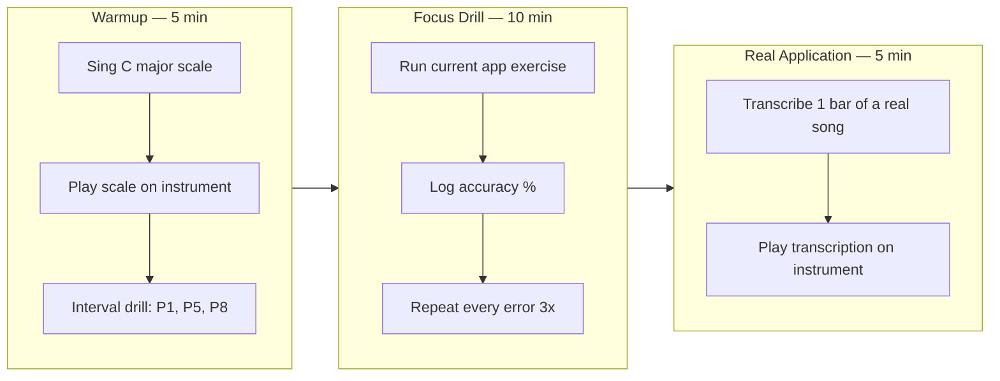

# Ear Training Masterclass: Interval, Chord, Rhythm & Harmonic Recognition

## Why Ear Training Is a Physical Skill, Not a Quiz

Ear training is not trivia about frequency ratios—it's building a direct nerve pathway from **sound → recognition → physical execution** on your instrument. A bassist who hears a dominant 7th chord and can instantly find the root by feel, without stopping to think, has trained that pathway. Everything in this lab is built around one loop, repeated thousands of times until it's unconscious:



Skip the "Sing" step and you're memorizing app answers, not training your ear. Skip "Play" and you're training a singer's ear, not a performer's. All four steps, every time.

**Required tools:**
- **Audacity** (free): loop sections, slow playback without pitch shift (`Effect → Change Tempo`), isolate bass with EQ
- **Tenuto** or **Complete Ear Trainer** (iOS/Android): instant-feedback interval/chord/rhythm drills
- **Teoria.com**: free browser-based interval, chord, and progression drills
- **Your instrument**: piano, guitar, or bass for physical reinforcement—polyphonic instruments are ideal but a single-line instrument works if you can play harmony as broken chords
- **Metronome**: Soundbrenner, Pro Metronome, or a physical unit

**Non-negotiable practice rules:**
1. **10 minutes daily beats 2 hours on Sunday.** Pitch recognition is encoded through spaced repetition, not cramming.
2. **85–90% accuracy gates progression.** Moving on at 60% accuracy builds confusion, not skill.
3. **You must vocalize.** Humming, solfège, or just speaking "major third" out loud forces your brain to commit to an answer instead of passively recognizing a vibe.
4. **Log everything.** Date, exercise, accuracy %, specific errors. Patterns in your mistakes (always confusing m3/M2, always missing the 5th of diminished chords) are your practice roadmap.

---

## Exercise 1: Interval Recognition

### 1.1 Perfect & Major Intervals (Days 1–14)

**The physics in one paragraph:** An interval's character comes from how closely its frequency ratio approximates a simple whole-number ratio. P5 (3:2) and P4 (4:3) are the simplest ratios after the octave (2:1), so they sound stable and "open." M3 (5:4) and m3 (6:5) are the next simplest, giving major/minor their characteristic warmth without perfect stability. M2 (9:8) is a rough ratio—your ear hears it as unresolved tension pulling toward something simpler. That's the entire acoustic foundation you need; everything else below is pattern training.

**Drill setup:**
1. Tenuto or Teoria.com → Interval Training → select P1, M2, M3, P4, P5, P8
2. Mode: **melodic ascending only**
3. Session: 40–50 questions, target 90%+ before adding anything

**Melodic song anchors (memorize these cold):**

| Interval | Song Cue | Feel |
|---|---|---|
| P1 | Same pitch repeated | Perfect fusion |
| M2 | "Happy Birthday" (Hap-*py*) | Rising tension |
| M3 | "Oh When the Saints" (Oh-*when*) | Bright, settled |
| P4 | "Here Comes the Bride" | Open, hollow |
| P5 | "Twinkle Twinkle" | Stable, powerful |
| P8 | Same note name, doubled | Fused resonance |

**Execution loop, every question:**
1. **Listen** to the interval in the app
2. **Sing** the bottom note, then the top note, out loud
3. **Name** it aloud: "Major third"
4. **Check** the answer; if wrong, replay and sing it correctly 3 times before moving on
5. **Instrument reinforcement (once per session, after the app drill):**
   - **Piano:** From C4, play each interval and sing along: C→D (M2), C→E (M3), C→F (P4), C→G (P5), C→C5 (P8). Use **right hand fingers 1 and 2** for seconds/thirds, 1 and 4 for fourths/fifths, 1 and 5 reaching the octave.
   - **Guitar/Bass (low E string):** fret 0→2 (M2), 0→4 (M3), 0→5 (P4), 0→7 (P5), 0→12 (P8). Pluck the open string, then the fretted note, and sing the gap between them before you even hear the second pitch—this is audiation, not just listening.

**Log:** date, interval set, accuracy %, time elapsed.

### 1.2 Minor, Augmented & Diminished Intervals (Days 15–28)

Add: m2, m3, m6, m7, A4/d5 (tritone).

**Song anchors:**

| Interval | Song Cue | Feel |
|---|---|---|
| m2 | *Jaws* theme | Maximum semitone crunch |
| m3 | "Greensleeves" opening | Melancholic |
| m6 | "The Entertainer" descending phrase | Wide and tense |
| m7 | *Star Trek* theme leap | Wide, unresolved |
| A4/d5 | *The Simpsons* theme opening | Splits the octave exactly in half |

**Progression inside this block:**
1. Melodic ascending first, same protocol as 1.1
2. At 85%+, flip to **descending**
3. At 85%+ descending, switch to **randomized direction**
4. Only after melodic mastery, add **harmonic intervals** (both notes struck together)—this is harder because you're parsing a single fused sound instead of a sequence

**Piano physical check, full C major scale:**
- Play C D E F G A B C ascending. After each note, stop and sing back down to the tonic C, naming the interval you just sang ("that's a major sixth below").
- Reverse: play the scale descending from the top C, sing *up* to each note from the starting C, naming the ascending interval.

This cross-training (ascending notes identified as descending intervals, and vice versa) is what actually breaks the "I can only hear intervals from the bottom up" plateau.

**Guitar physical check, all on the low E string, fretted against the open string:**

| Fret | Interval | Fret | Interval |
|---|---|---|---|
| 1 | m2 | 7 | P5 |
| 2 | M2 | 8 | m6 |
| 3 | m3 | 9 | M6 |
| 4 | M3 | 10 | m7 |
| 5 | P4 | 11 | M7 |
| 6 | A4/d5 | 12 | P8 |

Play open string, fretted note, sing the gap, name it, check against the table. Do all 12 frets daily in under 2 minutes once memorized—this becomes a 90-second warmup forever.

---

## Exercise 2: Chord Quality Recognition

### 2.1 Triads: Major, Minor, Diminished, Augmented (Days 29–42)

**Acoustic signature in one paragraph:** A triad is two stacked thirds, and the *order* of major (4 semitones) and minor (3 semitones) thirds determines everything. Major triad (M3 on bottom, m3 on top) sounds resolved because the interval from root to 5th is a perfect fifth—simple ratio, stable. Minor triad (m3 then M3) keeps that same stable perfect fifth but darkens the color because the 3rd is closer to the root. Diminished (m3+m3) replaces the stable 5th with a tritone, so it sounds inherently unstable and wants to move. Augmented (M3+M3) is perfectly symmetrical—there's no "resolved" note to land on, which is why it sounds suspended and strange.

**Drill setup:**
1. App: Chord ID → triads, root position, close voicing
2. Start Major vs. Minor only, 50 reps, 90%+ before adding anything
3. Add Diminished and Augmented once Major/Minor is automatic

**Piano close-position triads from C4:**

| Chord | Notes | Stack | Finger (RH, root position) |
|---|---|---|---|
| C Major | C–E–G | M3+m3 | 1-3-5 |
| C Minor | C–E♭–G | m3+M3 | 1-3-5 |
| C Diminished | C–E♭–G♭ | m3+m3 | 1-3-5 |
| C Augmented | C–E–G♯ | M3+M3 | 1-3-5 |

**Daily physical practice (10 min):**
1. Play each triad type, root position, RH fingers 1-3-5
2. **Sing root → play chord → sing root again.** This anchors the tonal center before you judge the chord's color against it.
3. Arpeggiate ascending: C → E → G → C5, singing each note
4. Listen specifically to the **third**: does it feel like a half-step reach (minor, closer together) or a wider, brighter stretch (major)?
5. Cycle through all 12 keys by circle of fifths: C → G → D → A → E → B → F♯ → D♭ → A♭ → E♭ → B♭ → F → C. This is the single highest-leverage drill in this entire lab—triads in all keys, by feel, with no sheet music.

**Guitar movable triad shapes (strings D-G-B, or top 3 strings G-B-E, root on the G string):**

This "top-3-strings" triad set is far more useful on guitar than low-string shapes—it's how real comping guitarists voice chords, and it isolates exactly the three notes you're trying to hear.

| Chord | G string | B string | high E string | Shape |
|---|---|---|---|---|
| G Major (root pos.) | 5 (G) | 5 (D... wait use B string 8 for D) | — | see below |

Simplified and verified movable shape, root on the **G string**:

- **Major triad** (strings G-B-E, frets x-x-x from root R on G string): R(G str) – M3 (B str, 4 frets higher) – P5 (E str, 3 frets higher than B string note)
  - Example in G: G string fret 5 (G) – B string fret 8 (D)... 

**Simpler and more reliable for drilling: use the classic open-position triad shapes you already know, isolate just the top 3 notes.**
- **G Major, open:** low E (3) – A (2) – D (0) – G (0) – B (0) – high E (3). Strum only strings G-B-E (open G, open B, fret 3 high E) = G–B–G. Sing each note before you strum.
- **G Minor (same shape area), fret B string down one semitone:** You'll need a barre or different fingering—for drilling purposes, play minor triads on piano and use guitar for major triad and power-chord (no 3rd) recognition, since full movable minor triads require CAGED shapes covered in a dedicated guitar harmony lesson.

**Chord ID execution, every question:**
1. **Listen** to the chord
2. **Sing the root**—find the lowest, most gravitationally stable pitch
3. **Assess the third**: sing root, then sing up to the middle note. Wide gap = major. Narrow gap = minor.
4. **Assess the fifth**: is the top note a comfortable, consonant fifth above the root (perfect), noticeably collapsed (diminished), or stretched/exotic (augmented)?
5. **Name the quality** out loud
6. **Play it back** on your instrument to verify before checking the app's answer

**Error-specific fixes:**
- Confusing Major/Minor → isolate the third. Play root + major 3rd, then root + minor 3rd, back to back, 10 times, singing the gap each time.
- Confusing Diminished/Minor → diminished has a **flat fifth**. Play a minor triad, then flatten just the top note by a half step, and listen for the tritone tension against the root appearing.
- Confusing Augmented/Major → play a major triad, then sharpen just the top note. Notice the chord stops feeling "resolved" and starts feeling like it's floating.

### 2.2 Seventh Chords (Days 43–56)

Add four-note chords: Maj7, Min7, Dominant 7, Half-Diminished 7 (m7♭5), Diminished 7.

**Piano seventh chord shapes, root C, RH fingers 1-2-3-5:**

| Chord | Notes | Stack | Function | Sound |
|---|---|---|---|---|
| Cmaj7 | C–E–G–B | M3+m3+M3 | I△7, tonic | Bright, dreamy |
| Cm7 | C–E♭–G–B♭ | m3+M3+m3 | ii–7, modal | Smooth, dark |
| C7 | C–E–G–B♭ | M3+m3+m3 | V7, dominant | Tense, wants to resolve down a 5th |
| Cø7 | C–E♭–G♭–B♭ | m3+m3+M3 | ii–7♭5, pre-dominant | Tense, Locrian flavor |
| C°7 | C–E♭–G♭–A | m3+m3+m3 | vii°7, symmetric | Horror-movie tension |

**Execution:**
1. 20 isolated reps per chord type until you can call each one instantly
2. At 85%+ each, mix all five types randomly, 50 reps
3. For every drill question, **play the chord on your instrument immediately after naming it**, before checking the app's answer—this closes the loop every single time instead of only once a session
4. **Functional context drill:** play ii–V–I in C (Dm7 → G7 → Cmaj7), whole notes at 60 BPM, and feel each chord's directional pull toward the next. This is more valuable than isolated chord ID because real music almost never presents chords in isolation.

**Bass player's critical distinctions** (you need root + quality, not full voicing, but these two confusions wreck note choice in real time):
- **Maj7 vs. Dom7:** over Cmaj7 you can safely land on B natural (the 7th, a beautiful color tone); over C7, B natural is a wrong note and B♭ is the correct diatonic choice. Mishearing this swap is the single most common bass transcription error on jazz and soul tunes.
- **Min7 vs. Half-dim7:** Cm7 implies Dorian or Aeolian color (natural or lowered 6th, your call); Cø7 implies Locrian, meaning the 5th itself is flat and your walking-bass approach notes need to respect that ♭5 as a chord tone, not an avoid note.

---

## Exercise 3: Rhythmic Dictation & Syncopation

### 3.1 Simple Time (Days 57–70)

**The grid in one paragraph:** Western rhythm is a nested grid—measure divides into beats, beats divide into subdivisions (2 for simple time, 3 for compound time). Syncopation is simply an attack that lands *between* grid points instead of on them. You cannot hear syncopation accurately until your body has internalized the underlying grid strongly enough that an off-grid attack feels like a a displacement against something solid. That's why every drill below starts with physically establishing pulse before you listen to anything.

**Drill setup:**
1. Tenuto → Rhythm Training → 4/4, quarter and eighth notes only
2. Metronome at 80 BPM, quarter note = click
3. Listen to a 2-bar rhythm, then notate (stems only) or speak back using rhythm syllables

**Execution, every rhythm:**
1. **Establish pulse**: tap quarter notes with your foot, 4 full bars, before the app plays anything
2. **Listen** to the 2-bar rhythm once
3. **Clap it back immediately** while your foot keeps tapping the quarter-note pulse underneath—never let the foot stop
4. **Speak it** using "1-e-&-a, 2-e-&-a, 3-e-&-a, 4-e-&-a" for sixteenth subdivisions. Example: quarter-eighth-eighth-quarter-quarter reads as "1___ 2&3___4___"
5. **Notate** on a staff (stems only) or in a rhythm-syllable row
6. **Verify**, then clap the correct version 3 times before the next question

**Progression inside this block:**
- Days 57–63: quarters and eighths only
- Days 64–70: add sixteenths and rests
- At 85%+: add triplets (say "1-trip-let, 2-trip-let")
- At 85%+: add syncopation—accents landing on the "&" or "a" subdivisions

**Spoken subdivision anchors:**

| Subdivision | Spoken phrase | Count |
|---|---|---|
| Eighth notes | "Pass the but-ter, pass the but-ter" | 8 syllables = 8 eighths in 4/4 |
| Triplets | "Chi-cken dum-pling" per beat | 3 per beat |
| Sixteenths | "1-e-&-a" per beat | 4 per beat |

### 3.2 Compound Time & Polyrhythms (Days 71–84)

**6/8 (compound duple):** pulse is the dotted quarter, 2 pulses per bar, each subdividing into 3. Count "1-2-3-4-5-6" with accents on 1 and 4. Physically conduct in 2 (down-up) while your internal subdivision stays triplet-based—this is the exact feel of a slow blues shuffle or a waltz-adjacent ballad.

**3-against-2 polyrhythm drill:**
1. Right hand taps 3 evenly spaced hits per measure. Left hand taps 2 evenly spaced hits in the same measure.
2. Speak the phrase "PASS-the-GOD-damn-BUT-ter" while:
   - Right hand strikes on: PASS / GOD / BUT
   - Left hand strikes on: PASS / damn
3. Record yourself, open the file in Audacity, zoom into the waveform, and visually check that your 3 taps are evenly spaced and your 2 taps land exactly at the start and the halfway point of the bar.

**4-against-3 polyrhythm drill:**
- Right hand: 4 evenly spaced hits. Left hand: 3 evenly spaced hits.
- Spoken 12-syllable phrase: "WHAT-is-the-PROB-lem-HERE-to-DAY"
  - Right hand (groups of 3 syllables): WHAT / PROB / HERE / DAY
  - Left hand (groups of 4 syllables): WHAT / lem / to

Start both polyrhythms at 50 BPM per measure and don't increase tempo until you can hold 16 consecutive bars without the hands drifting into sync by accident (a common failure mode where 3-against-2 collapses into straight eighths).

---

## Exercise 4: Melodic Dictation & Transcription

### 4.1 Diatonic Melodies (Days 85–98)

**Objective:** transcribe 4-bar monophonic melodies in major keys, by ear, to standard notation.

**Setup:**
1. Source: Teoria.com Melody Dictation, or any folk/nursery melody you don't already know by heart
2. Key: C major only, no accidentals yet
3. Rhythm: quarters and eighths only

**Protocol:**
1. **Establish the key center**: play C major ascending and descending on your instrument, singing solfège (Do-Re-Mi-Fa-Sol-La-Ti-Do) along with it
2. **First listen, full playthrough, no pausing.** Immediately sing it back from memory—this tests raw audiation before you've analyzed anything
3. **Second listen, phrase by phrase.** Loop each 1-bar phrase and sing it back until it's locked in
4. **Find the starting pitch**: play up the C major scale on your instrument until you match the melody's first note, and name its scale degree
5. **Transcribe note by note**:
   - Sing the note with solfège
   - Find it on your instrument
   - Verify the interval from the previous note (was that a step up, a third down?)
   - Write pitch + rhythm
6. **Verify**: play your transcription on the instrument and compare directly against the recording

**Troubleshooting:**
- **Lost in the middle of a phrase?** Anchor on beat 1 of each bar first—get the strong beats locked in, then fill in weak beats.
- **Can't find a pitch?** Sing the tonic (Do) immediately before attempting the note, then sing the interval from Do to the target note.
- **Rhythm is the confusing part, not pitch?** Isolate rhythm completely first: clap it while ignoring pitch entirely, lock the rhythm in, then layer pitch on top.

### 4.2 Chromatic Melodies & Modulation (Days 99–112)

Add accidentals, key changes, modal melodies.

**Protocol:**
1. Start diatonic in C major as in 4.1
2. When a note doesn't fit the scale, stop and test chromatically on your instrument: play both the diatonic option (F natural) and the chromatic alternative (F♯) against the implied harmony. One will clearly sound wrong against the context; the correct note locks in and stops sounding like a question.
3. For a key change, find the new tonic by locating the **resolution point**—the moment tension visibly releases and a new note feels like "home."

**Real-world application: transcribe 8 bars of a jazz standard melody (e.g. "Autumn Leaves")**
1. In Audacity, select the 8-bar region and loop it (`Ctrl+L` / `Cmd+L`)
2. Slow to 70% speed without pitch shift: `Effect → Change Tempo → -30%`
3. Transcribe note by note at reduced speed
4. Return to 100% speed and verify your transcription matches what you actually hear at tempo

---

## Exercise 5: Stress Testing Under Real-World Conditions

### 5.1 Chord Recognition Inside a Full Mix

**Objective:** identify chord changes in a dense arrangement (bass, guitar, keys, drums all present), not an isolated app tone.

**Setup:**
1. Pick a song with clear, slow harmonic rhythm—"Let It Be" by The Beatles is ideal
2. Loop 8-bar sections in Audacity
3. Keep your instrument within reach to test harmonic hypotheses live

**Protocol:**
1. **Pass 1, bass line:** low-pass filter at 300 Hz (`Effect → Filter Curve EQ`, boost below 300 Hz, cut above 500 Hz) to isolate the bass. Transcribe root movement only.
2. **Pass 2, chord quality:** listen to the full mix. For each bass note, test major/minor/7th options on your instrument and trust the one that "locks in" against the recording instead of clashing.
3. **Pass 3, rhythm of changes:** mark exactly when each chord change happens (bar 2, beat 3, for example) on a timeline.
4. **Verify:** play your chord chart along with the actual recording, muted on your end, and listen for any clash.

**Common failure modes:**
- **Mistaking the bass note for the chord root.** A bassist might play the 5th on beat 1 of a chord change. Confirm the true root by listening for where the piano/guitar's **harmony** actually shifts, not just where the bass note changes.
- **Missing fast passing chords.** If the harmonic rhythm speeds up to 2 beats per chord, slow the recording down before attempting transcription.

### 5.2 Transcription With Background Noise

**Objective:** build resilience for live venues, phone recordings, and compressed YouTube audio.

**Setup:**
1. In Audacity, mix a melody with white noise at −12 dB relative to the signal, or
2. Play drill audio through a phone speaker in a noisy room

**Protocol:**
1. Run the same melodic dictation protocol as 4.1
2. Loop each 1-bar phrase **10 times** to burn through the noise floor rather than straining for one perfect listen
3. Remove the noise afterward and compare your transcription against the clean source to measure how much accuracy the noise actually cost you

---

## Exercise 6: Functional Ear Training—Harmonic Progressions

### 6.1 Diatonic Progressions (Days 113–126)

**Theory foundation, kept to one paragraph:** every diatonic chord has a function based on its pull toward or away from the tonic. **I** is home, stable, zero tension. **IV** and **ii** are pre-dominant—they create gentle lift that wants to move toward V. **V** is maximum tension, demanding resolution back to I. **vi** behaves like a relative-minor substitute for I, giving a "deceptive," bittersweet resolution instead of a full landing. Four progressions you already know by ear even if you've never named them: **I–IV–V–I** (basic rock/blues cadence), **I–vi–IV–V** (the "50s progression," "Stand By Me"), **ii–V–I** (the jazz turnaround), **I–V–vi–IV** (the modern pop loop, "Let It Be," "Don't Stop Believin'").

**Drill setup:**
1. Teoria.com → Chord Function ID, key of C major, chords I–vi

**Protocol, every progression:**
1. **Establish tonic**: play C major on your instrument, sing "Do"
2. **Listen** to the progression (e.g. I–IV–V–I)
3. **Sing the bass note movement** as it happens: Do → Fa → Sol → Do
4. **Name** the Roman numerals out loud
5. **Play the progression back** on your instrument to verify
6. **Judge the direction by feel**, not just by name:
   - Movement **to I** feels like arriving home
   - Movement **to IV** feels like lifting, opening up
   - Movement **to V** feels like a question being asked
   - Movement **to vi** feels like a soft, minor-flavored landing that isn't quite "home"

**Metronome drill for bassists and keyboardists:**
1. Set 80 BPM, one chord per bar, whole notes
2. Record yourself playing I–IV–V–I
3. Play it back without watching your hands—can you hear the function of each chord and predict the next one before it arrives?

### 6.2 Modal & Chromatic Progressions (Days 127–140)

Add modal interchange, secondary dominants, tritone substitutions.

**Modal interchange** (borrowing from parallel minor): I–♭VII–♭VI–I
- C → B♭ → A♭ → C (classic rock-ballad color)

**Secondary dominant**: I–V7/ii–ii–V7–I
- C → E7 → Dm → G7 → C (the E7 is a dominant chord borrowed to temporarily "tonicize" Dm before the real resolution)

**Tritone substitution**: I–♭II7–I replacing a V7
- C → D♭7 → C (D♭7 shares the same tritone tension as G7 but resolves with smoother chromatic bass motion—classic jazz reharmonization)

**Protocol:**
1. Play each example on piano or guitar while singing the root motion
2. Use app drills for randomized modal progressions until you can call them without hesitation
3. Apply it for real: pick a jazz standard ("Autumn Leaves" works well here too) and chart its chord changes purely by ear, then check your chart against a published lead sheet

---

## Quick Reference

### Interval Anchors

| Interval | Melodic Cue | Feel | Piano (from C4) | Guitar (low E) |
|---|---|---|---|---|
| P1 | Identical pitch | Perfect fusion | C–C | 0–0 |
| m2 | *Jaws* theme | Max tension | C–D♭ | 0–1 |
| M2 | "Happy Birthday" start | Rising tension | C–D | 0–2 |
| m3 | "Greensleeves" opening | Melancholic | C–E♭ | 0–3 |
| M3 | "Oh When the Saints" | Bright | C–E | 0–4 |
| P4 | "Here Comes the Bride" | Open, hollow | C–F | 0–5 |
| A4/d5 | *The Simpsons* theme | Devil's interval | C–F♯ | 0–6 |
| P5 | "Twinkle Twinkle" | Stable, strong | C–G | 0–7 |
| m6 | "The Entertainer" descending | Wide, tense | C–A♭ | 0–8 |
| M6 | "My Bonnie Lies Over the Ocean" leap | Wide, consonant | C–A | 0–9 |
| m7 | *Star Trek* theme | Wide, dissonant | C–B♭ | 0–10 |
| M7 | Leading-tone tension | Tense | C–B | 0–11 |
| P8 | Same note, doubled | Fused resonance | C–C5 | 0–12 |

### Chord Quality Quick ID

| Chord | Stack | Sound | Piano (root C) |
|---|---|---|---|
| Major triad | M3+m3 | Bright, resolved | C–E–G |
| Minor triad | m3+M3 | Dark, introspective | C–E♭–G |
| Diminished triad | m3+m3 | Tense, unstable | C–E♭–G♭ |
| Augmented triad | M3+M3 | Suspended, symmetric | C–E–G♯ |
| Maj7 | M3+m3+M3 | Dreamy | C–E–G–B |
| Min7 | m3+M3+m3 | Smooth, modal | C–E♭–G–B♭ |
| Dom7 | M3+m3+m3 | Tense, resolving | C–E–G–B♭ |
| Half-dim7 (ø7) | m3+m3+M3 | Tense, Locrian | C–E♭–G♭–B♭ |
| Dim7 (°7) | m3+m3+m3 | Symmetric, horror | C–E♭–G♭–A |

### Rhythm Counting Systems

| Subdivision | Counting | Syllables/beat | BPM range |
|---|---|---|---|
| Quarter notes | 1-2-3-4 | 1 | 60–120 |
| Eighth notes | 1-&-2-&-3-&-4-& | 2 | 80–160 |
| Sixteenth notes | 1-e-&-a-2-e-&-a | 4 | 60–100 |
| Triplets | 1-trip-let-2-trip-let | 3 | 60–120 |
| Quintuplets | 1-ta-ki-mi-ta | 5 | 40–80 |

### Daily 20-Minute Practice Routine



### Progression Milestones

| Days | Focus | Target Accuracy | Next Step |
|---|---|---|---|
| 1–14 | P1, M2, M3, P4, P5, P8 ascending | 90%+ | Add minor intervals |
| 15–28 | All intervals, both directions | 90%+ | Add harmonic intervals |
| 29–42 | Major/minor triads | 90%+ | Add diminished/augmented |
| 43–56 | All seventh chord types | 85%+ | Add inversions |
| 57–70 | 4/4 rhythm, quarters/eighths | 85%+ | Add sixteenths/triplets |
| 71–84 | Compound time, polyrhythms | 80%+ | Add syncopation |
| 85–98 | Diatonic melodies (C major) | 80%+ | Add accidentals |
| 99–112 | Chromatic melodies, modulation | 75%+ | Add modal melodies |
| 113–126 | Diatonic progressions | 85%+ | Add modal interchange |
| 127–140 | Modal/chromatic progressions | 80%+ | Transcribe a full jazz standard |

### Troubleshooting

| Problem | Diagnosis | Fix |
|---|---|---|
| Confusing M3 and P4 | Not singing the interval before answering | Sing both pitches aloud and feel the width difference before naming it |
| Can't ID chord quality in a full mix | Listening to melody/lead instead of harmony | Low-pass filter out everything above 500 Hz; isolate bass and keys/guitar comping |
| Losing the pulse during rhythmic dictation | Not physically tapping the grid | Tap the quarter-note pulse with your foot continuously, never stop the grid mid-exercise |
| Missing chromatic passing tones | Assuming the melody stays diatonic | Test the "wrong" note against both the diatonic and chromatic option on your instrument |
| Intervals sound right but answers are wrong | Relative vs. absolute pitch confusion | Always sing the tonic as a reference before naming any interval |
| Can't transcribe fast runs | Trying to catch every note at full tempo | Slow to 50% in Audacity (no pitch shift), transcribe, then verify back at full speed |

### Tool Commands

**Audacity**
- Open file: `Cmd+O` / `Ctrl+O`
- Loop a selection: select region → Loop button in Transport toolbar
- Slow down without pitch shift: `Effect → Change Tempo → -30%`
- Isolate bass: `Effect → Filter Curve EQ` → boost below 300 Hz, cut above 500 Hz
- Export a clip: `File → Export → Export Selected Audio`

**MuseScore (verify your transcriptions against real notation)**
- New score: `Cmd+N` / `Ctrl+N`
- Note input: press `N`, letters A–G set pitch, numbers 1–7 set duration (4 = eighth, 5 = quarter, 6 = half)
- Playback: Spacebar; adjust tempo with `[` and `]`

**Teoria.com**
- `teoria.com/exercises` → Intervals → Melodic, or Chords → Triads/Seventh Chords, no account needed

**Sonic Pi metronome (80 BPM click for untethered drilling)**
```ruby
live_loop :metronome do
  sample :elec_tick, amp: 1
  sleep 0.75  # 60 / 80 BPM = 0.75 sec per beat
end
```

---

## Long-Term Integration

Ear training compounds only if old material stays active. Use this review cadence alongside whatever week you're currently on:

- **Daily:** current focus exercise, 10 minutes
- **Every 3 days:** revisit the previous exercise block, 5 minutes
- **Weekly:** transcribe one real song passage end to end, 20 minutes

**For instrument players:** your ear is only as useful as your ability to physically reproduce what it hears. Never break the loop—hear, sing, play, verify—even when you're confident you already know the answer.

**For composers and producers:** a trained ear turns harmonic decisions from trial-and-error into direct notation or programming. You hear the progression in your head and you can write it down immediately, no hunting at the keyboard.

**For live performers:** this is what lets you catch an unexpected key change or a last-second chord substitution within one bar and adjust on the fly instead of clashing.

Track your specific, recurring errors rather than your overall score. "I always mistake m3 for M2 in descending melodic context" is an actionable fact. "I got 70% today" is not. Drill the specific confusion until it disappears, then move to the next one.
