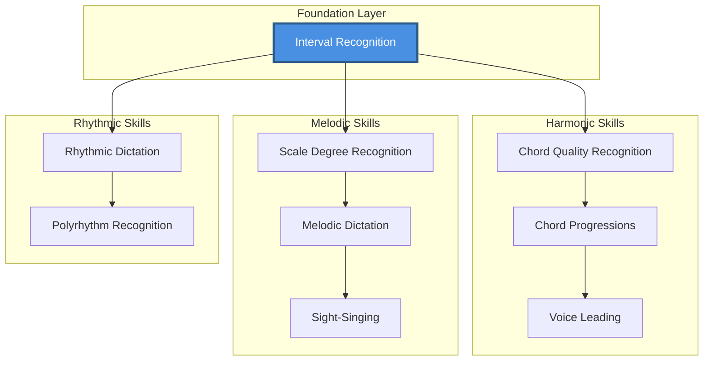

# Ear Training: Interval Recognition Masterclass

## 1. First-Principles: Why Intervals Matter to Your Musical Brain

**Interval recognition is the single most powerful skill for unlocking the fretboard, keyboard, and your inner musical ear.** It's the bridge between hearing music passively and understanding its internal architecture—the DNA of melody, harmony, and improvisation.

### The Physics (Keep This Simple)

When you play two notes, your ear detects the **frequency ratio** between them. An octave is always 2:1 (A440 Hz → A880 Hz), a perfect fifth is 3:2, and a major third is roughly 5:4. These simple ratios emerge from the **natural overtone series**—the stack of harmonics your brain instinctively recognizes as "in tune." The simpler the ratio, the more consonant (stable) the interval sounds. Complex ratios (like the tritone at roughly 45:32) create tension and dissonance.

**You don't need to memorize these numbers.** What matters is training your ear to recognize the *character* and *emotional color* of each interval through repetition and association.

### Why This Matters for Practice

- **Transcription:** Hear a bassline or melody once and map it directly to your instrument.
- **Improvisation:** Navigate chord changes by hearing target notes before you play them.
- **Sight-Singing & Intonation:** Sing or play in tune without a reference pitch.
- **Composition:** Hear chord progressions and melodies internally before writing them down.

**Bottom line:** Interval recognition turns your instrument into an extension of your musical thought, eliminating the guessing gap between "I hear it" and "I can play it."

---

## 2. The 12 Essential Intervals: Sound, Character & Reference Songs

Every interval has a unique **emotional fingerprint**. Associating each interval with a familiar song accelerates recognition dramatically.

### Ascending Intervals

| Interval | Semitones | Ratio (approx) | Character | Reference Song (Ascending) |
|----------|-----------|----------------|-----------|----------------------------|
| **Minor 2nd (m2)** | 1 | 16:15 | Tense, dark, ominous | *Jaws* theme |
| **Major 2nd (M2)** | 2 | 9:8 | Bright, open, stepwise | *Happy Birthday* (first two notes) |
| **Minor 3rd (m3)** | 3 | 6:5 | Sad, introspective, melancholy | *Greensleeves* opening |
| **Major 3rd (M3)** | 4 | 5:4 | Happy, optimistic, major key | *When the Saints Go Marching In* |
| **Perfect 4th (P4)** | 5 | 4:3 | Stable, anticipatory, pastoral | *Here Comes the Bride* |
| **Tritone (TT)** | 6 | 45:32 | Unsettling, diabolical, tension | *The Simpsons* theme (first two notes) |
| **Perfect 5th (P5)** | 7 | 3:2 | Powerful, empty, open | *Star Wars* main theme (first two notes) |
| **Minor 6th (m6)** | 8 | 8:5 | Longing, romantic, bittersweet | *The Entertainer* (first two notes) |
| **Major 6th (M6)** | 9 | 5:3 | Bright, yearning, uplifting | *NBC chimes* (first two notes) |
| **Minor 7th (m7)** | 10 | 16:9 | Bluesy, unresolved, jazzy | *Star Trek* original theme |
| **Major 7th (M7)** | 11 | 15:8 | Dissonant, leading, sophisticated | *Take On Me* (chorus leap) |
| **Octave (P8)** | 12 | 2:1 | Perfect consonance, same note | *Somewhere Over the Rainbow* |

### Descending Intervals

Many intervals have **different emotional characters** descending. Practice both directions.

| Interval | Reference Song (Descending) |
|----------|----------------------------|
| **Minor 2nd** | *Für Elise* opening |
| **Major 2nd** | *Mary Had a Little Lamb* (E-D-C) |
| **Minor 3rd** | *Hey Jude* ("Jude" to "don't") |
| **Major 3rd** | *Swing Low, Sweet Chariot* |
| **Perfect 4th** | *O Come, All Ye Faithful* ("O come") |
| **Perfect 5th** | *Flintstones* theme ("Flint-stones") |
| **Octave** | *Willow Weep for Me* opening |

---

## 3. Progressive Training Drills: From Beginner to Advanced

### Phase 1: Single Interval Drill (Weeks 1-2)

**Goal:** Recognize one interval at a time in isolation.

**Method:**
1. Choose one interval (start with P5, P4, or P8—they're easiest).
2. Use a piano, guitar, or app (Teoria.com, EarMaster, or Functional Ear Trainer).
3. Play the interval ascending and descending 20 times each.
4. Sing the interval back using "la" or scale degrees.
5. Close your eyes and visualize the interval on your instrument.

**Daily Practice:** 10 minutes per interval, rotating through 3 intervals per week.

**Progression:**
- Week 1: P8, P5, P4
- Week 2: M3, m3, M2
- Week 3: m2, M6, m6
- Week 4: M7, m7, TT

### Phase 2: Random Interval Recognition (Weeks 3-6)

**Goal:** Identify any interval instantly without context.

**Method:**
1. Use an ear training app with random interval generation.
2. Listen to the interval (melodic or harmonic).
3. Sing it back internally.
4. Recall your reference song.
5. Name the interval aloud before checking the answer.

**Daily Practice:**
- 30 repetitions, mixed intervals
- Start with 2-second response time, reduce to 1 second
- Track accuracy: aim for 85%+ before advancing

**Common Mistakes:**
- **M3 vs. P4 confusion:** M3 sounds "happy/finished," P4 sounds "anticipatory."
- **m6 vs. P5 confusion:** m6 has a yearning quality; P5 is stark and hollow.
- **m7 vs. M6 confusion:** m7 is darker and unresolved; M6 is brighter and optimistic.

### Phase 3: Interval Chains & Melodies (Weeks 7-10)

**Goal:** Recognize consecutive intervals in real melodies.

**Method:**
1. Transcribe simple nursery rhymes or folk songs by ear.
2. Map each melodic leap as an interval (e.g., "Twinkle Twinkle" = P5 up, P5 up, P4 up…).
3. Write the intervals on staff paper before confirming with your instrument.

**Suggested Melodies:**
- *Amazing Grace*
- *Happy Birthday*
- *Ode to Joy*
- *Summertime* (Gershwin)

**Daily Practice:** 2-3 melodies, 15 minutes

### Phase 4: Harmonic Intervals & Chord Recognition (Weeks 11-16)

**Goal:** Hear two notes played *simultaneously* and identify the interval.

**Method:**
1. Play two notes together on piano or guitar.
2. Focus on the **blended color** rather than isolating each pitch.
3. Consonant intervals (P8, P5, P4, M3, m3) sound stable; dissonant intervals (m2, M7, TT) sound tense.

**Daily Practice:**
- 20 harmonic intervals, randomized
- Progress to triads (major, minor, diminished, augmented)

---

## 4. Instrument-Specific Interval Mapping

### Piano & Keyboards

**Visual Advantage:** Intervals are spatial distances.

- **M2:** Adjacent white keys (C-D)
- **m3:** C-Eb (skip one white key)
- **M3:** C-E (skip one white key, land on white)
- **P4:** C-F (land on F, feels "under the hand")
- **P5:** C-G (open, hollow, power chord sound)
- **P8:** C-C (same key, higher)

**Drill:**
1. Play all intervals starting from C.
2. Transpose to all 12 keys (C, Db, D, Eb…).
3. Sing each interval as you play.

**Fingering:** Use 1-5 (thumb to pinky) for P8; 1-3 for M3; 1-4 for P5.

### Bass & Guitar (Fretboard Geometry)

**Each fret = 1 semitone.** Intervals are *fixed shapes* across string pairs.

**E String → A String (Perfect 4th Tuning):**

| Interval | Fret Shape (E string → A string) |
|----------|----------------------------------|
| P5 | Same fret, next string (E3 fret 5 → A3 fret 5) |
| P8 | E string fret 5 → A string fret 7 (two frets up) |
| M3 | E string fret 5 → A string fret 4 (one fret down) |

**Single-String Intervals (all same string):**

| Interval | Frets |
|----------|-------|
| m2 | 1 fret |
| M2 | 2 frets |
| m3 | 3 frets |
| M3 | 4 frets |
| P4 | 5 frets |
| P5 | 7 frets |
| P8 | 12 frets |

**Drill:**
1. Play all intervals on the E string from the open position up to the 12th fret.
2. Sing each interval as you play.
3. Move to A, D, G strings.

### Brass & Woodwinds (Fingering + Embouchure)

**Visual limitation:** No visual fretboard. **Kinesthetic memory is critical.**

**Drill:**
1. Play a reference pitch (e.g., concert Bb).
2. Play ascending M2, M3, P4, P5, P8 from that root.
3. Sing each interval before playing to engage audiation (hearing internally).

**Trumpet/Cornet:** Use valve combinations consistently (no alternate fingerings initially).

**Saxophone:** Focus on octave key clarity—P8 must sound perfectly in tune.

---

## 5. Advanced Applications: Real-World Contexts

### Transcription Workflow

1. **Isolate the melody:** Slow down audio (Transcribe!, Amazing Slow Downer).
2. **Identify the root note:** Match it on your instrument.
3. **Map each leap as an interval:** Don't guess pitches—hear the interval first.
4. **Confirm on instrument.**

**Example: Transcribing a bass line**
- Root: E
- Next note: sounds like a P5 → B
- Next: sounds like a M3 below B → G#
- Confirm: E-B-G# (E major triad, root position)

### Improvisation: Hearing Target Notes

When soloing over a Dm7 → G7 → Cmaj7 progression:

- **Dm7:** Hear the m3 (F) and m7 (C) as safe landing targets.
- **G7:** Hear the M3 (B, the leading tone to Cmaj7 root) and m7 (F) for tension.
- **Cmaj7:** Hear the M3 (E) and M7 (B) for resolution.

**Drill:** Arpeggiate each chord, singing intervals before playing them.

### Intonation for Fretless Instruments & Vocals

**Perfect pitch is not required—relative pitch is everything.**

- Sing the interval you want to play.
- Adjust embouchure, finger pressure, or slide position until the interval rings true.
- Use drones (Tonal Energy app, or sustain pedal on a synth) to practice tuning P5s, M3s, and P8s.

---

## 6. Tools, Apps & Resources

### Recommended Apps

| App | Platform | Focus | Price |
|-----|----------|-------|-------|
| **Functional Ear Trainer** | iOS/Android | Interval recognition with scale degree context | Free |
| **EarMaster** | Desktop/iOS/Android | Comprehensive ear training (intervals, chords, rhythm) | Paid (~$60) |
| **Teoria.com** | Web | Free interval drills, chord recognition | Free |
| **Perfect Ear** | Android | Interval, chord, scale recognition | Free / Paid |
| **Tenuto** | iOS | Interval, chord, scale ID | ~$4 |

### Practice Routine Template (30 min/day)

```
0:00-0:10  Single interval focus (one interval, 20 reps)
0:10-0:20  Random interval ID (30 reps, mixed intervals)
0:20-0:25  Harmonic intervals (10 reps)
0:25-0:30  Melody transcription (1 short phrase)
```

### Troubleshooting Common Blocks

**Problem:** "I can't tell M3 from P4."
- **Solution:** Sing reference songs obsessively. M3 = "When the Saints," P4 = "Here Comes the Bride." Sing them 10 times each before drilling.

**Problem:** "I'm 50% accurate and stuck."
- **Solution:** You're guessing, not hearing. Slow down. Sing the interval *before* naming it. If you can't sing it, you don't hear it yet.

**Problem:** "I'm great in apps but terrible with real music."
- **Solution:** Apps use pure sine tones. Real music has timbre, rhythm, and harmony. Transcribe real songs daily to bridge the gap.

---

## 7. Training Progressions & Benchmarks

| Skill Level | Accuracy Target | Timeframe | Validation Test |
|-------------|-----------------|-----------|-----------------|
| **Beginner** | 70% (P8, P5, P4, M3, m3) | 4 weeks | Identify 20/20 P5s ascending |
| **Intermediate** | 85% (all 12 intervals) | 12 weeks | Transcribe "Happy Birthday" by ear in any key |
| **Advanced** | 90%+ (melodic + harmonic) | 24 weeks | Transcribe a jazz standard head (e.g., "Autumn Leaves") in real time |
| **Mastery** | 95%+ in context (polyphonic music) | 1+ year | Transcribe a full piano voicing or horn section arrangement |

---

## 8. Integration with Other Ear Training Skills



**Intervals are the foundation.** Once you can hear intervals:

- **Chord Quality:** Stack intervals (m3 + m3 = diminished triad).
- **Scale Degrees:** Intervals from the tonic (do-re = M2, do-mi = M3).
- **Voice Leading:** Hear individual melodic intervals within chord progressions.

---

## 9. Final Practice Protocol: 90-Day Intensive

### Week 1-4: Consonant Intervals
- Focus: P8, P5, P4, M3, m3
- Daily: 20 minutes, 50+ reps
- Goal: 85% accuracy, 2-second response time

### Week 5-8: Dissonant & Chromatic Intervals
- Add: m2, M2, M6, m6
- Daily: 25 minutes, 60+ reps
- Goal: 80% accuracy across all 9 intervals

### Week 9-12: Complete Interval Set + Harmonic
- Add: M7, m7, TT
- Include harmonic intervals (simultaneous)
- Daily: 30 minutes
- Goal: 85% on all 12 intervals, melodic + harmonic

### Week 13+: Contextualized Practice
- Transcribe 1 melody per day
- Analyze chord progressions by ear
- Improvise over backing tracks, hearing target intervals before playing
- Goal: Real-world fluency

---

## 10. Why Most Ear Training Fails (And How to Avoid It)

### Common Pitfalls

1. **Passive Listening:** Playing an app while scrolling social media. **Solution:** Active engagement—sing every interval aloud.
2. **No Reference Songs:** Trying to memorize abstract sounds. **Solution:** Anchor every interval to a song you know cold.
3. **Skipping Singing:** Only using your instrument. **Solution:** Your voice is the ultimate ear training tool. If you can't sing it, you can't hear it.
4. **Inconsistent Practice:** Cramming once a week. **Solution:** 15 focused minutes daily beats 2 hours on Sunday.
5. **No Real-World Application:** Only drilling in apps. **Solution:** Transcribe real music weekly. Apps are training wheels, not the destination.

### The Audiation Principle

**Audiation** = hearing music internally with full clarity, independent of sound.

- Before playing an interval, *sing it internally*.
- Before transcribing, *audiate the melody*.
- Before improvising, *hear your target note*.

This is the difference between mechanical interval recognition and true musical hearing.

---

## Conclusion: The Unlocking Effect

**Interval recognition is not an academic exercise—it's the master key to musical fluency.** Every melody, chord, and bassline is made of intervals. Train your ear systematically, and you'll unlock:

- **Instant transcription** of songs you hear once.
- **Confident improvisation** over any chord progression.
- **Perfect intonation** on fretless instruments and voice.
- **Effortless sight-singing** and audiation.

**Start with one interval today. Sing it. Play it. Own it.** In 90 days of focused practice, your musical hearing will be unrecognizable—and your instrument will finally sound like what you hear in your head.
