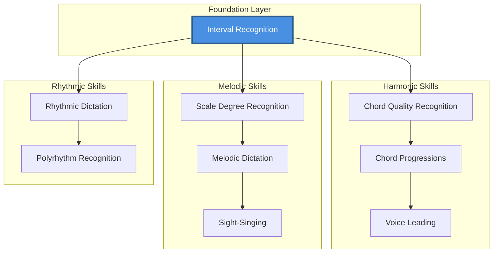

# Ear Training: Interval Recognition Masterclass

## 1. Why Intervals Are the Master Key

Interval recognition is the single skill that converts passive listening into active musicianship. Every melody is a string of intervals; every chord is a stack of them. Once your ear can label what it hears, you stop guessing on your instrument and start playing what's already in your head.

### The physics, in one paragraph

Two notes form an interval because your ear is comparing their frequency ratio. An octave is 2:1, a perfect fifth is 3:2, a major third is roughly 5:4 — simple ratios the ear reads as stable (consonant). The tritone, at roughly 45:32, is a messy ratio, which is why it sounds unresolved. You don't need to calculate these numbers in practice. What you're training is pattern recognition: the brain locks onto the *beating* and *fusion* character of a ratio long before you can name it, the same way you recognize a friend's voice without analyzing formant frequencies.

### What this unlocks, practically

- **Transcription** — hear a bassline once, place it on the fretboard without trial and error.
- **Improvisation** — hear the target note in your head before your fingers move.
- **Intonation** — sing or bend into pitch without a tuner.
- **Composition** — hear a progression internally before writing a note down.

---

## 2. The 12 Intervals: Sound, Song Anchors, and Fretboard/Keyboard Shape

Attach every interval to three things simultaneously: a **reference song**, a **physical shape** on your instrument, and a **felt emotion**. Redundant anchors are what make recognition fast under pressure.

### Ascending

| Interval | Semitones | Character | Ascending Anchor Song | Guitar Shape (same string) | Piano Shape (from C) |
|---|---|---|---|---|---|
| m2 | 1 | Tense, horror-movie | *Jaws* theme | 1 fret | C–Db (adjacent keys incl. black) |
| M2 | 2 | Bright, stepwise | *Happy Birthday* (first 2 notes) | 2 frets | C–D |
| m3 | 3 | Sad, melancholy | *Greensleeves* opening | 3 frets | C–Eb |
| M3 | 4 | Happy, resolved | *When the Saints Go Marching In* | 4 frets | C–E |
| P4 | 5 | Anticipatory, pastoral | *Here Comes the Bride* | 5 frets | C–F |
| TT | 6 | Unsettling, diabolical | *The Simpsons* theme (first 2 notes) | 6 frets | C–F#/Gb |
| P5 | 7 | Powerful, hollow | *Star Wars* main theme (first 2 notes) | 7 frets | C–G |
| m6 | 8 | Longing, bittersweet | *The Entertainer* (first 2 notes) | 8 frets | C–Ab |
| M6 | 9 | Bright, yearning | NBC chimes | 9 frets | C–A |
| m7 | 10 | Bluesy, unresolved | *Star Trek* (TOS) theme | 10 frets | C–Bb |
| M7 | 11 | Dissonant, leading | *Take On Me* (chorus leap) | 11 frets | C–B |
| P8 | 12 | Pure consonance | *Somewhere Over the Rainbow* | 12 frets | C–C |

### Descending (different emotional read — drill separately)

| Interval | Descending Anchor Song |
|---|---|
| m2 | *Für Elise* opening |
| M2 | *Mary Had a Little Lamb* (E-D-C) |
| m3 | *Hey Jude* ("Jude" → "don't") |
| M3 | *Swing Low, Sweet Chariot* |
| P4 | *O Come, All Ye Faithful* ("O come") |
| P5 | *Flintstones* theme ("Flint-stones") |
| P8 | *Willow Weep for Me* opening |

**Drill — Anchor Burn-In (do this before anything else):** Sing each ascending song anchor 5 times, out loud, right now, in this order: P8, P5, P4, M3, m3, M2, m2, M6, m6, m7, M7, TT. This order goes easiest-to-hardest. Do not skip singing — audiating silently is 3x slower to internalize than vocalizing.

---

## 3. Progressive Training Drills

### Phase 1 — Single Interval Isolation (Weeks 1–2)

**Goal:** Lock in the sound of one interval before mixing it with others.

**Procedure (10 min/interval):**
1. Play the interval ascending on your instrument, 20 times, root always on the same note (e.g., always from C or open E).
2. Sing it back on "la," matching pitch exactly — not approximately.
3. Play it descending, 20 times, sing back.
4. Close your eyes, play it, name the reference song before you open them.

**Weekly rotation:**
- Week 1: P8, P5, P4
- Week 2: M3, m3, M2
- Week 3: m2, M6, m6
- Week 4: M7, m7, TT

### Phase 2 — Random Recognition (Weeks 3–6)

**Goal:** ID any interval cold, no context, under time pressure.

**Procedure:**
1. Use an app (Functional Ear Trainer, EarMaster, Teoria.com) set to random interval mode, melodic and harmonic mixed.
2. On hearing it: sing it back internally first, then recall the anchor song, then say the interval name aloud.
3. 30 reps/day. Start with a 2-second response window, tighten to 1 second as accuracy climbs.
4. Log accuracy. Advance to Phase 3 only at 85%+ over 3 consecutive days.

**Confusion pairs and the fix:**

| Confusion | Diagnostic cue |
|---|---|
| M3 vs. P4 | M3 feels "landed" (Saints); P4 feels like it wants to keep moving (Bride) |
| m6 vs. P5 | P5 is hollow/open; m6 has an ache — sing "Entertainer" vs. "Star Wars" to separate them |
| m7 vs. M6 | m7 is darker, bluesy (Star Trek); M6 is brighter, lifts up (NBC chimes) |
| M7 vs. P8 | M7 feels like it's reaching for the octave and falling just short — sing the leading tone pull |

### Phase 3 — Interval Chains in Real Melodies (Weeks 7–10)

**Goal:** Track consecutive leaps inside actual tunes, not isolated drill tones.

**Procedure:**
1. Pick a known melody. Sing it. Before touching your instrument, write the interval between each pair of consecutive notes.
2. Confirm against the instrument.
3. Transpose the same melody to 2 other keys by ear only, using the interval map (not absolute pitch memory).

**Starter set with interval maps:**
- *Twinkle Twinkle Little Star*: P5 up, P5 up, P4 up, M2 up, M2 down, M2 down, P4 down...
- *Happy Birthday*: M2 up, m3 up (wait — check by ear, it varies by key), repeat phrase a step higher
- *Ode to Joy*: mostly M2 and m2 stepwise motion — good for testing small-interval precision
- *Amazing Grace*: wide P4/P5 leaps at phrase starts — good for arpeggio-style recognition

**Daily practice:** 15 minutes, 2–3 melodies.

### Phase 4 — Harmonic Intervals (Weeks 11–16)

**Goal:** Identify two simultaneous notes by their blended color, not by picking out each pitch separately.

**Procedure:**
1. Play both notes of the interval together (piano two-hand, guitar two-string, or app).
2. Listen for the *fused texture*, not two separate tones: P8/P5/P4 fuse into a single hollow color; M3/m3 fuse into a warm blend; m2/M7/TT create audible beating or roughness.
3. 20 reps/day randomized, harmonic only.
4. Once 85%+, move to triads: major (M3+m3 stacked), minor (m3+M3 stacked), diminished (m3+m3), augmented (M3+M3). Hearing the triad as two stacked intervals is the bridge into chord-quality training.

---

## 4. Instrument-Specific Mapping

### Piano & Keyboard

Intervals are fixed spatial distances — the key advantage of the keyboard over any other instrument for this skill.

**Fingering drill, right hand, from C:**
- M2 (C–D): fingers 1–2
- M3 (C–E): fingers 1–3
- P4 (C–F): fingers 1–4
- P5 (C–G): fingers 1–5
- P8 (C–C): fingers 1–5, thumb-to-pinky stretch, or 1–5 with a hand shift for smaller hands

**Drill:**
1. Play every interval type starting on C, both hands separately.
2. Transpose chromatically through all 12 keys, ascending by half step each repetition (C, Db, D, Eb…), singing the interval name before you play it each time.
3. Reverse: play a random interval, then sing the *note name* of the top pitch before checking the keys.

### Bass & Guitar — Fretboard Geometry

Each fret is one semitone, and interval shapes stay identical anywhere on the neck — this is the fretboard's real advantage once internalized.

**Single-string intervals (fastest way to drill — no string-crossing confusion):**

| Interval | Frets up |
|---|---|
| m2 | 1 |
| M2 | 2 |
| m3 | 3 |
| M3 | 4 |
| P4 | 5 |
| TT | 6 |
| P5 | 7 |
| m6 | 8 |
| M6 | 9 |
| m7 | 10 |
| M7 | 11 |
| P8 | 12 |

**Cross-string shapes (standard tuning, adjacent strings a P4 apart — E-A-D-G for bass, add B-E for guitar):**

| Interval | Shape |
|---|---|
| P4 | Same fret, next string up (e.g., low E fret 5 = A string fret 0... actually: open A = low E fret 5) |
| P5 | Next string up, 2 frets forward (E string fret 5 → A string fret 7) verify by ear, don't trust diagrams blindly) |
| P8 | Next string up, 2 frets forward from unison position |

**Drill:**
1. On the low E string only, play every interval from open string up to fret 12, singing each one before you fret it.
2. Repeat on A, D, G strings.
3. Then drill the same intervals as cross-string shapes — this builds the "two ways to play the same interval" fluency essential for improvisation and transcription speed.

**Ergonomics note:** When drilling frets 1–5 on bass, use Simandl 1-2-4 fingering (index on fret 1, ring on fret 2 — wait, standard assignment is: 1st finger = fret 1, 2nd finger = fret 2, 4th finger = fret 4, skipping the 3rd) to avoid overstretching the hand while you're focused on listening, not on finger strain.

### Brass & Woodwinds

No fretboard to lean on — kinesthetic and aural memory carry the whole load here.

**Drill:**
1. Play a reference pitch (concert Bb works well for most band instruments).
2. From that root, play ascending M2, M3, P4, P5, P8 — but *sing* each interval silently in your head one full beat before you finger and blow it. This trains audiation, not just muscle memory of fingerings.
3. Trumpet/cornet: stick to standard valve combinations while drilling — introducing alternate fingerings before the interval is aurally locked in adds a variable you don't need yet.
4. Saxophone: the octave key must produce a P8 that's dead in tune — use a drone and check by ear, since a sharp or flat octave will corrupt every other interval judgment built on top of it.

---

## 5. Advanced Applications

### Transcription Workflow

1. Slow the audio (Transcribe!, Amazing Slow Downer, or a DAW with time-stretch).
2. Find the root note and match it on your instrument.
3. For every melodic leap, identify the *interval* first — don't hunt for the absolute pitch by trial and error.
4. Confirm each note on the instrument only after you've named the interval.

**Worked example — bass line:**
- Root: E
- Next note sounds like a P5 up → B
- Next note sounds like a M3 below B → G#
- Result: E–B–G#, an E major triad in root position, confirmed by playing it back.

### Improvisation — Hearing Target Notes

Over Dm7 → G7 → Cmaj7:

- **Dm7:** target the m3 (F) and m7 (C) as stable landing tones.
- **G7:** target the M3 (B — the leading tone resolving to C) and m7 (F) for tension before the resolution.
- **Cmaj7:** target the M3 (E) and M7 (B) to land the resolution with color, not just the root.

**Drill:** Arpeggiate each chord slowly, singing each interval relative to the chord root *before* you play it. This is the direct bridge from ear training into real soloing.

### Intonation for Fretless Instruments & Voice

Relative pitch, not perfect pitch, is what makes intonation reliable.

1. Sing the target interval before playing or bending into it.
2. Adjust slide position, finger pressure, or embouchure until the interval locks — you'll feel the beating disappear on consonant intervals.
3. Practice against a sustained drone (Tonal Energy app, or a sustain-pedal synth note) for P5, M3, and P8 — these are the intervals where even small intonation errors are glaringly audible.

---

## 6. Tools & Practice Routine

| App | Platform | Focus | Price |
|---|---|---|---|
| Functional Ear Trainer | iOS/Android | Interval recognition in scale-degree context | Free |
| EarMaster | Desktop/iOS/Android | Intervals, chords, rhythm, comprehensive | ~$60 |
| Teoria.com | Web | Free interval/chord drills | Free |
| Perfect Ear | Android | Interval, chord, scale ID | Free/Paid |
| Tenuto | iOS | Interval, chord, scale ID | ~$4 |

**Daily 30-minute template:**

```text
0:00–0:10  Single interval focus, 20 reps ascending + descending
0:10–0:20  Random interval ID, 30 reps mixed melodic/harmonic
0:20–0:25  Harmonic intervals only, 10 reps
0:25–0:30  Transcribe one short phrase from a real recording
```

### Troubleshooting

**"I can't tell M3 from P4."**
Sing both anchor songs 10 times each back-to-back before the next drill set: "When the Saints" (M3) vs. "Here Comes the Bride" (P4). The confusion is almost always a weak anchor, not a hearing problem.

**"I'm stuck at 50% accuracy."**
You're pattern-matching randomly instead of hearing. Slow down: sing the interval *before* naming it, every single time, with no exceptions. If you can't sing it accurately, you haven't actually heard it yet — you've heard *that something changed*.

**"I'm good in the app but lost on real recordings."**
Apps use pure, clean tones. Real instruments add timbre, vibrato, rhythm, and other notes playing underneath. Add daily transcription of real recordings starting in Phase 3 — don't wait until the app says you've "mastered" intervals in isolation.

---

## 7. Benchmarks

| Level | Target | Timeframe | Validation Test |
|---|---|---|---|
| Beginner | 70% on P8, P5, P4, M3, m3 | 4 weeks | 20/20 ascending P5s identified correctly |
| Intermediate | 85% on all 12 | 12 weeks | Transcribe *Happy Birthday* by ear in an unfamiliar key |
| Advanced | 90%+ melodic + harmonic | 24 weeks | Transcribe a jazz standard head (e.g., *Autumn Leaves*) in real time |
| Mastery | 95%+ in polyphonic context | 1+ year | Transcribe a full piano voicing or horn-section arrangement |

---

## 8. Where Intervals Fit in the Larger Ear Training Skill Tree



Once intervals are solid: chord quality is just stacked intervals (m3 + m3 = diminished triad, m3 + M3 = minor triad, M3 + m3 = major triad), scale degrees are intervals measured from the tonic (do–re = M2, do–mi = M3), and voice leading is tracking the individual melodic interval each voice moves by within a progression.

---

## 9. 90-Day Intensive Protocol

**Weeks 1–4 — Consonant intervals**
Focus: P8, P5, P4, M3, m3. 20 min/day, 50+ reps. Target: 85% accuracy, 2-second response.

**Weeks 5–8 — Add dissonant/chromatic intervals**
Add: m2, M2, M6, m6. 25 min/day, 60+ reps. Target: 80% across all 9.

**Weeks 9–12 — Complete set + harmonic**
Add: M7, m7, TT. Introduce harmonic (simultaneous) intervals. 30 min/day. Target: 85% on all 12, melodic and harmonic.

**Weeks 13+ — Contextualized practice**
Transcribe one melody per day. Analyze a progression by ear before looking at a chart. Improvise over backing tracks, naming the target interval internally before each phrase. Target: fluency on real material, not just drills.

---

## 10. Why Most Ear Training Fails

| Pitfall | Fix |
|---|---|
| Passive listening (app running while scrolling a phone) | Sing every interval out loud — no passive reps count |
| No reference song anchors | Anchor every interval to a song you know cold before drilling it blind |
| Skipping singing, instrument-only drilling | Your voice is the test of whether you actually heard it — if you can't sing it, you don't hear it yet |
| Inconsistent practice (one long Sunday session) | 15 focused minutes daily beats 2 hours once a week — this is a motor-and-perceptual skill, not a knowledge dump |
| Apps only, no real music | Transcribe real recordings weekly; apps use clean tones real music never gives you |

### The Audiation Principle

Audiation is hearing music internally, with full clarity, independent of any sound actually playing. Before playing an interval, sing it internally first. Before transcribing a phrase, audiate it before touching the instrument. Before improvising a line, hear the target note arrive before your fingers move. This internal-first sequence is what separates mechanical interval drilling from musical hearing you can actually use.

---

## Conclusion

Every melody, chord, and bassline you'll ever play is built from intervals. Train the ear systematically and you get instant transcription, confident improvisation, accurate intonation on fretless instruments and voice, and effortless sight-singing. Start today: pick one interval, sing its anchor song, play it, sing it back. Run the 90-day protocol and the gap between what you hear and what you can play closes for good.
