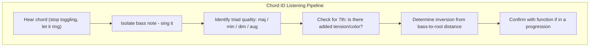

# Lesson 2: Chord Identification by Ear

## 1. Why This Works: The Acoustic Basis of Harmonic Hearing

Every pitched tone you've ever heard a piano, guitar, or voice produce is already a chord. When a string or air column vibrates at a fundamental frequency, it simultaneously radiates overtones at 2x, 3x, 4x, 5x the fundamental. Your ear has been decoding stacked harmonic content since the first lullaby you heard — chord identification trains a skill your auditory system already runs constantly, just below conscious awareness.

A vibrating C string radiates partials C–C–G–C–E–G–Bb–C as you go up the series. The major triad (C-E-G) is literally overtones 4, 5, and 6 compressed into one octave. This is why a major triad sounds "resolved" and "locked in" — it matches the resonance pattern already present inside a single note. The dominant seventh (C-E-G-Bb) adds the flat, slightly-out-of-tune-sounding 7th partial, which is exactly why dominant 7ths sound restless and want to move. You are not memorizing arbitrary labels; you're learning to name sensations your ear already registers.

**Construction reference (build these on your instrument before drilling by ear):**

| Chord | Formula | C example | Character |
|---|---|---|---|
| Major triad | R – M3 – P5 | C–E–G | bright, stable |
| Minor triad | R – m3 – P5 | C–Eb–G | dark, soft |
| Diminished triad | R – m3 – d5 | C–Eb–Gb | tense, claustrophobic |
| Augmented triad | R – M3 – A5 | C–E–G# | floating, directionless |
| Dominant 7 | Maj triad + m7 | C–E–G–Bb | pulls hard to I |
| Major 7 | Maj triad + M7 | C–E–G–B | dreamy, stable |
| Minor 7 | Min triad + m7 | C–Eb–G–Bb | mellow, bluesy |
| Half-diminished 7 | Dim triad + m7 | C–Eb–Gb–Bb | ii° in minor, unresolved |
| Fully diminished 7 | Dim triad + d7 | C–Eb–Gb–A | symmetrical, maximally tense |

Inversions keep the chord's *identity* but change its *bass* and its *gravitational pull*:

- **Root position** (C-E-G): grounded, final.
- **1st inversion** (E-G-C): lighter, passing — common mid-phrase.
- **2nd inversion** (G-C-E): unstable, wants to resolve down to root position (classic cadential 6/4 in classical music).



## 2. The Four-Step Listening Procedure

This is the exact sequence to run, in order, every single time you hear an unknown chord. Don't skip steps even when you think you already know the answer — the sequence itself is what builds automaticity.

### Step 1 — Isolate the Bass Note

The bass note is your anchor. Everything else is interpreted relative to it.

**Drill 1A — Bass Lock-In**
- Play any triad on piano or guitar, hold it.
- Sing the lowest note on "la," matching pitch exactly.
- Play just that note alone on the instrument to verify you matched it.
- Repeat with 20 random triads (root position only, to start).
- **Target:** 95% pitch-match accuracy, response within 4 seconds, before moving on.

If you keep grabbing the loudest or most melodic note instead of the lowest, mute the top two notes on your keyboard controller (or play the bass note isolated first, then add the chord) until your ear reflexively drops to the bottom.

### Step 2 — Identify Triad Quality (Major / Minor / Diminished / Augmented)

With the bass anchored, shift attention to the *interval between bass and the next note up* — in root position, that's the third, and it's the single most informative interval in the chord.

**Drill 2A — Toggle Drill (the fastest way to burn in major vs minor)**
1. On piano: play C-E-G, hold 2 seconds, then C-Eb-G, hold 2 seconds. Alternate 10 times without stopping.
2. Say "major" or "minor" out loud *before* you play each one, then confirm after.
3. Repeat starting on a different root (F, then Bb, then D) so you're not just pattern-matching finger shapes.

**Drill 2B — Isolated Third (fixes the #1 beginner confusion)**
- Play root + third only, omit the fifth entirely: C-E (major 3rd) vs C-Eb (minor 3rd).
- The fifth is harmonic "glue" that doesn't change quality — stripping it out forces your ear onto the interval that actually matters.
- Drill 50 isolated thirds, mixed major/minor, before reintroducing the fifth.

**Drill 2C — Diminished vs Augmented**
- Play C-Eb-Gb (diminished): both thirds stacked are minor, the whole chord feels like it's collapsing inward.
- Play C-E-G# (augmented): both thirds are major, the chord feels like it's stretching outward with no gravity.
- Toggle 10 times, naming the quality before you check.

**Metronome-paced quality drill:**
| Week | Tempo (one chord per 4 beats) | Chord set | Target accuracy |
|---|---|---|---|
| 1 | 60 BPM | Major / minor only | 70% |
| 2 | 75 BPM | + diminished / augmented | 85% |
| 3 | 90 BPM | All four, random inversions | 90% |

### Step 3 — Determine Inversion

Once quality is locked, ask: *is the bass note the root, or something else?*

**Fast heuristic — the "gap and squeeze" test:**
- Root position: the two intervals above the bass are a 3rd then a 4th (stacked as 3rd+5th from the root) — sounds "stacked evenly."
- 1st inversion: bass-to-next is a 3rd, then a 4th up to the octave of the bass — has a "leaning forward" quality, common in walking bass lines and pop ballad verses.
- 2nd inversion: bass-to-next is a 4th (the widest, most open-sounding gap at the bottom) — sounds suspended, like it's hovering and needs to drop.

**Drill 3A — Inversion Ladder**
1. Play C-E-G (root), E-G-C (1st inv), G-C-E (2nd inv) in sequence, slowly, on piano.
2. For each, sing the bass note, then sing "root... third... fifth" ascending from it to locate where the root actually sits.
3. Randomize order. Identify inversion by ear before replaying to check.
4. Repeat the entire drill in a minor key (Cm, Eb-G-C, G-C-Eb).

**Guitarist-specific version:** practice this on a single string set using CAGED-derived triad shapes. A "C-shape" triad on strings 2-3-4 gives you root position; sliding to the adjacent "A-shape" triad on the same strings gives you an inversion with a different note on top. Play through all three inversions of a C major triad across the top three strings before testing by ear.

### Step 4 — Seventh Chord Extensions

Add the 7th only after quality and inversion are solid. The 7th is color and function, not a separate skill — think of it as "triad quality, plus one more decision."

**Drill 4A — Isolated 7th Interval (critical fix for "everything sounds jazzy")**
- Play root + 7th only, no triad: C-B (major 7th, very close, almost clashing), C-Bb (minor 7th, slightly looser), C-A (major 6th, for contrast — NOT a 7th, trains against false positives).
- Do 30 reps mixing these three, naming the interval before checking.

**Drill 4B — Seventh Chord Toggle**
1. Cmaj7 (C-E-G-B) vs C7 (C-E-G-Bb): toggle 10x. Maj7 = dreamy/settled; dom7 = urgent, wants to resolve down a 5th.
2. Cm7 (C-Eb-G-Bb) vs Cø7/half-dim (C-Eb-Gb-Bb): toggle 10x. The half-diminished adds a flat 5th, making it sound "unstable minor" rather than "bluesy minor."
3. C°7 (C-Eb-Gb-A, fully diminished): note it's built entirely of stacked minor 3rds — maximally symmetrical, maximally tense, and (ear-training shortcut) any note in it can function as the "root" depending on context.

**Target:** 80% accuracy identifying maj7/dom7/min7/half-dim7/fully-dim7 at 80 BPM (one chord per 2 beats), randomized root.

## 3. Six-Week Systematic Training Protocol

### Weeks 1–2: Triad Quality Mastery (15 min/day)

1. **Warm-up (3 min):** Play major and minor triads on your instrument, sing the root of each before playing.
2. **Quality drill (7 min):** Use EarMaster, Teoria.com, or a simple MIDI-triggered random chord generator. 40 trials/session.
3. **Inversion drill (5 min):** Root vs. 1st vs. 2nd inversion, major only in Week 1, add minor in Week 2.

Progress gate: don't move to Week 3 content until you hit 85% accuracy at 3-second response time on major/minor/diminished/augmented triads, all inversions mixed.

### Weeks 3–4: Seventh Chords & Functional Context (20 min/day)

1. **Warm-up (3 min):** Review triad inversions cold, no repeats.
2. **Seventh quality drill (10 min):** Randomize maj7, dom7, min7, half-dim7, fully-dim7. Target 80%.
3. **Functional context (7 min):** Play and identify ii-V-I and I-vi-IV-V progressions by function, not just by chord name.

**Progression drill, key of C:**
```
Dm7 - G7 - Cmaj7           (ii - V - I)
Cmaj7 - Am7 - Fmaj7 - G7   (I - vi - IV - V)
```
Transpose to a random key each session (use a cycle-of-fifths rotation: C, G, D, A, E...). Target 85% accuracy identifying root + quality of every chord by Week 4.

### Weeks 5–6: Real Music Transcription

1. **Days 1–3 — Simple diatonic songs:** Transcribe the chord changes to "Let It Be" or "Stand By Me" by ear only, then check against a lead sheet. Focus on catching inversions in the bass line (these songs use plenty of 1st-inversion passing chords).
2. **Days 4–6 — Jazz standards:** Transcribe 8 bars of "Autumn Leaves" or "Blue Bossa." These are built almost entirely from ii-V-I cells — once you hear the cell, you can predict the next two chords before they play.
3. **Day 7 — Bach chorales:** Pick any four-part chorale (freely available as public domain scores/recordings). Identify every cadence (authentic, half, deceptive) and flag every 2nd-inversion chord — Bach uses them almost exclusively as passing or cadential devices, never as a resting point.

### Beyond Week 6: Chromatic & Extended Harmony

**Secondary dominants:** A dominant 7th that resolves to something other than the tonic. G7 resolving to Cmaj7 inside the key of F is "V7 of IV." Drill recognition by playing a cycle-of-fifths dominant chain — C7→F7→Bb7→Eb7→Ab7 — and noticing each chord briefly feels like "the V" before the next one steals that role.

**Altered dominants:** G7(b9) resolving to Cmaj7 — listen for the extra half-step dissonance sitting just above the root. Common in bebop and Latin jazz cadences.

**Quartal/cluster voicings:** Stacked 4ths (C-F-Bb) instead of stacked 3rds. Common in modal jazz (McCoy Tyner, late-60s Herbie Hancock) and film scoring. These resist major/minor labeling entirely — train yourself to recognize "this is built in 4ths" as its own category rather than forcing a tertian label onto it.

## 4. Common Failure Modes & Corrective Drills

**Problem: Flip-flopping between major and minor.**
Fix: You're listening to the whole chord instead of the third. Strip the chord to root+third only (Drill 2B) and run 50 reps before reintroducing the fifth or any extension.

**Problem: Always hearing root position, even when it's inverted.**
Fix: Sing the bass note, then sing up through the chord tones (root, third, fifth) starting from wherever the root actually is. If the bass note isn't the first note you sing, it's inverted. Practice singing "bass pitch → root pitch" as a two-note pair until the gap between them becomes audible as its own shape.

**Problem: All seventh chords sound generically "jazzy."**
Fix: Isolate the 7th as a dyad against the root (Drill 4A) before judging the full chord. The 7th interval alone (half-step vs. whole-step below the root's octave) carries most of the chord's character.

**Problem: Accurate slow, falls apart at performance tempo.**
Fix: You're still parsing the chord note-by-note instead of hearing it as one gestalt sound. Drill with a shrinking response window — 4s → 3s → 2s → 1s — forcing your brain to commit to pattern recognition instead of sequential analysis.

**Problem: Nails chords inside a progression, fails on isolated chords.**
Fix: You're using context (voice leading, expectation) as a crutch instead of hearing the chord itself. Split practice time 60% isolated chords / 40% progressions until isolated accuracy catches up.

## 5. Reference Anchors for Self-Testing

Use these as instant quality checks when you're unsure what you just heard:

| Sound | Reference |
|---|---|
| Major 3rd (bright) | "Happy Birthday," first two notes |
| Perfect 5th | "Star Wars" main theme opening leap |
| Minor tonality | "Greensleeves" opening phrase |
| Diminished 5th tension | "Maria" from *West Side Story* (the leap IS the tritone) |
| Dominant 7th pull | any 12-bar blues turnaround, bar 10 to bar 11 |
| ii-V-I cell | "Autumn Leaves," first four bars |

## 6. Technology & Practice Logging

**Software:**
- **EarMaster 7** — structured curriculum with MIDI input and progress tracking.
- **Teoria.com** — free browser-based interval/chord drills, no install needed.
- **Functional Ear Trainer** (mobile app) — drills scale-degree function rather than absolute chord names, useful for Step 4 onward.
- **Max/MSP or Pure Data** — if you want a custom random-chord MIDI generator, a patch as simple as `random 12 -> makenote -> noteout` with a metro-driven trigger gives you an infinite, non-repeating drill partner.

**Hardware setup:** MIDI keyboard into your DAW or ear-training app for instant visual feedback on misses. Guitarists: loop pedal to record a progression, then solo over your own loop and call out each chord as it comes back around.

**Practice log (copy this block daily):**
```
Date: _______
Duration: ____ min
Drill type: [ ] Triads  [ ] Sevenths  [ ] Progressions  [ ] Transcription
Accuracy: _____%
Avg response time: ____ sec
Misses (what confused you): ______________________________
```

Expect 5–10% accuracy gains per week with consistent daily practice. Plateaus after week 3 are normal — push through by shortening response time rather than adding new chord types.

## 7. Functional Hearing: The Real Goal

Naming a chord "G7" is a parlor trick. Hearing that G7 *wants* to resolve to C, and feeling that pull in your gut before the resolution arrives, is the actual skill that makes you musical. Three functional categories cover almost all tonal harmony:

- **Tonic function (I, vi):** home, stable, resolved.
- **Dominant function (V, vii°):** tension, forward motion, demands resolution.
- **Subdominant function (IV, ii):** departure from home, sets up the dominant.

**Final integration drill:**
1. Play I-IV-V-I in C major slowly, several times, until the *motion* feels as familiar as the chord names.
2. Randomize the order (e.g., IV-I-V-IV). Identify both the chord quality/root AND its function.
3. Sing the scale degree of each root as you hear it (1, 4, 5, 1) rather than the letter name — this locks function, not just pitch, into your ear.

When you can sing "that's scale degree 5, it's dominant, it's about to resolve to 1" before the resolution actually happens, chord identification has stopped being analysis and become musical intuition — which is the only reason to train it.
