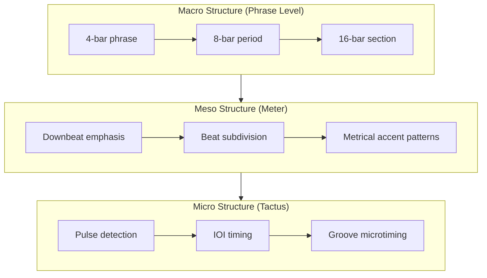

# Lesson 3: Rhythm Perception & Active Listening

## 1. First-Principles Intuition (15%)

Rhythm is the perception and organization of time into structured patterns. Your brain doesn't passively receive rhythmic information—it actively predicts when the next beat will arrive, adjusting its internal model in real time. This predictive mechanism is why a drummer can lock into a groove, a conductor can cue an orchestra with split-second precision, and you can tap your foot to music without thinking.

At its core, rhythm perception works like this: your auditory system detects repeating events (beats), forms an internal template (the pulse), and uses that template to anticipate future events. When reality matches prediction, you feel the groove. When it doesn't—through syncopation, polyrhythm, or rubato—you experience tension and release, the emotional foundation of rhythmic expression.

The human auditory system perceives rhythm hierarchically. A 4/4 measure isn't just four equal beats—it's a nested structure: the quarter-note pulse sits inside the bar-long cycle, while eighth-notes and sixteenth-notes subdivide beneath. Your brain processes all these layers simultaneously, which is why you can hear the kick drum on 1 and 3, the snare on 2 and 4, and the hi-hat's sixteenth-note subdivisions as a unified rhythmic texture.

**Critical invariant:** Rhythm exists in a specific tempo range for human perception. The optimal pulse rate for steady beat perception is 80–140 BPM (inter-onset intervals of 430–750 ms). Below 40 BPM, beats feel disconnected; above 200 BPM, the pulse blurs into a single texture. This is why fast passages are felt "in 2" rather than "in 4," and slow movements require stronger subdivision awareness.

## 2. Core Mechanics: The Internal Clock System

Your internal clock is a distributed neural network, not a single metronome. It operates through phase-locked oscillators that synchronize to external rhythms. When you hear a steady beat, these oscillators entrain to the pulse, creating a predictive model that anticipates the next event.

**Three-layer rhythmic hierarchy:**



**Inter-Onset Interval (IOI):** The time between consecutive rhythmic events. Your brain tracks IOI patterns and uses them to build the pulse. A steady IOI creates a strong pulse; variable IOIs create syncopation or rubato.

**Entrainment:** The process by which your internal oscillators lock onto an external rhythm. This happens automatically when you tap your foot or nod your head to music. Entrainment is strongest when the tempo matches your preferred motor tempo (around 120 BPM for most people).

**Metrical accent:** Not all beats are equal. In 4/4, beat 1 is strongest, beat 3 is moderately strong, and beats 2 and 4 are weak—though popular music often inverts this with snare backbeats. Your brain predicts these accent patterns, which is why a displaced accent (syncopation) feels surprising.

## 3. Hands-On Training Protocol: Progressive Rhythm Recognition

### Stage 1: Pulse Detection & Subdivision (Week 1–2)

**Drill 3.1: Tactus Tapping (5 min daily)**

1. Play a metronome at 100 BPM.
2. Tap your foot on every click (the pulse).
3. Clap on beats 1 and 3 only (metrical accent).
4. Repeat at 80, 120, and 140 BPM.

**Goal:** Separate the pulse (foot) from the accent (hands). This trains hierarchical perception.

**Drill 3.2: Subdivision Layering (10 min daily)**

1. Metronome at 80 BPM (quarter notes).
2. Tap foot on every click.
3. Clap eighth-notes (twice per click): "1-and-2-and-3-and-4-and."
4. Graduate to sixteenth-notes: "1-e-and-a-2-e-and-a."
5. Progress: 80 → 100 → 120 BPM.

**Common error:** Rushing subdivisions. Use a DAW click track with explicit subdivision markers (Logic Pro's "Click Options" → "Division: 1/16").

**Drill 3.3: Syncopation Detection (15 min, 3× weekly)**

Listen to these reference tracks and tap the pulse (NOT the rhythm):

- **Simple syncopation:** "Superstition" (Stevie Wonder) — Tap quarter notes while the drums play around the beat.
- **Heavy syncopation:** "Cissy Strut" (The Meters) — The guitar and bass avoid beat 1; keep tapping the implied downbeat.
- **Polyrhythm:** "Take Five" (Dave Brubeck) — 5/4 meter; tap the 5-beat cycle while the piano subdivides differently.

**Analysis task:** Using a DAW, import the track and enable the metronome. Does your tapped pulse align with the DAW grid? If not, the track may use swing quantization or rubato.

### Stage 2: Meter Recognition & Time Signatures (Week 3–4)

**Drill 3.4: Meter Identification (10 min daily)**

Play each track and count the beats until the phrase repeats (usually 4 or 8 bars):

| Track | Meter | Count Pattern | Accent |
|-------|-------|---------------|--------|
| "Billie Jean" (Michael Jackson) | 4/4 | 1-2-3-4 | Backbeat on 2, 4 |
| "Money" (Pink Floyd) | 7/4 (3+4 grouping) | 1-2-3-1-2-3-4 | Downbeat on 1 of each group |
| "All You Need Is Love" (Beatles) | 7/4 (verses) | 1-2-3-4-5-6-7 | Downbeat on 1 |
| "Solfegietto" (C.P.E. Bach) | 3/8 | 1-2-3 (fast) | Downbeat on 1 |

**Practice method:**
1. Tap your foot on beat 1 only.
2. Clap the full pattern.
3. Sing "ONE-two-three-four" with dynamic accent on the downbeat.

**Drill 3.5: Conducting Patterns (5 min daily)**

Physically conduct these meters using standard baton patterns:

- **4/4:** Down (1) – In (2) – Out (3) – Up (4)
- **3/4:** Down (1) – Out (2) – Up (3)
- **6/8:** Down (1-2-3) – Up (4-5-6) [two large beats]
- **5/4:** Down (1) – Left (2) – Right (3) – Out (4) – Up (5)

**Why this works:** Physical motor memory reinforces metrical hierarchy. Conductors don't count—they embody the meter through muscle memory.

### Stage 3: Interval Timing & Groove Microtiming (Week 5–6)

**Drill 3.6: Grid vs. Swing Quantization**

1. Open a DAW (Ableton Live, Logic Pro, or Reaper).
2. Program a hi-hat pattern: straight sixteenth-notes at 90 BPM.
3. Set quantize to **Straight (50%)** — perfectly on-grid.
4. Play it back. Notice the mechanical feel.
5. Set quantize to **Swing (62%)** — every other sixteenth is delayed slightly.
6. Play it back. Notice the triplet-derived shuffle feel.
7. Set quantize to **Swing (54%)** — subtle "micro-swing" used in neo-soul and hip-hop.

**Listening test:** Can you hear the difference between 50%, 54%, and 62% swing? Train by toggling between settings.

**Real-world application:** J Dilla's beats often use 54–58% swing with manual timing adjustments (not quantized). Listen to "Donuts" and notice the drums "sit behind the beat."

**Drill 3.7: Onset Detection Training (15 min, 2× weekly)**

1. Load a drum loop into your DAW.
2. Enable "Flex Time" (Logic) or "Elastic Audio" (Pro Tools).
3. Zoom into the waveform. Identify the exact sample where the kick drum transient begins.
4. Compare the detected onset to the grid. Is it early, late, or on-time?
5. Practice with 10 different loops, documenting the timing variance in milliseconds.

**Goal:** Train your ear to detect 10–20 ms timing differences. Professional rhythm sections often play 10–15 ms ahead (pushy) or behind (laid-back) the click.

### Stage 4: Polyrhythm & Cross-Rhythm (Week 7–8)

**Drill 3.8: 3-Against-2 Polyrhythm**

1. Metronome at 60 BPM (quarter notes).
2. Tap your left hand three times per beat (triplets): "tri-po-let."
3. Tap your right hand two times per beat (eighth-notes): "1-and."
4. Practice until both hands are independent.
5. Progress: 60 → 80 → 100 BPM.

**Visualization:**
```text
Left:   |--1--|--2--|--3--|
Right:  |-1-|-2-|
```

**Drill 3.9: 4-Against-3 Polyrhythm (Advanced)**

1. Metronome at 60 BPM.
2. Tap left hand in groups of 4 sixteenth-notes.
3. Tap right hand in groups of 3 triplets.
4. Common landing point: Every 12th subdivision (3 beats).

**Musical example:** "The Black Page" (Frank Zappa) — extreme polyrhythmic independence.

**Drill 3.10: Clave Pattern Recognition (10 min, 2× weekly)**

Learn these foundational rhythms by tapping and singing:

**Son Clave (3-2):**
```text
Measure 1: |X . . X . . X . . . . . . . . .|
Measure 2: |. . X . . . X . . . . . . . . .|
```

**Rumba Clave (3-2):**
```text
Measure 1: |X . . X . . . X . . . . . . . .|
Measure 2: |. . X . . . X . . . . . . . . .|
```

**Practice with:** Metronome at 100 BPM, tap the clave with your right hand, quarter-note pulse with your left.

**Real-world application:** Clave is the rhythmic foundation of salsa, Afro-Cuban jazz, and Latin funk. It creates a 2-bar asymmetric cycle that drives the groove.

## 4. Real-World Integration: Transcription & Analysis

### Exercise 3.1: Drum Transcription (30 min weekly)

**Target:** Transcribe 8 bars of a drum groove.

**Method:**
1. Choose a track with an exposed drum groove (e.g., "Rosanna" by Toto).
2. Load into DAW and set the tempo via tap-tempo.
3. Slow down to 50% speed (maintain pitch with time-stretch).
4. Identify the kick, snare, and hi-hat patterns first.
5. Notate in your DAW's piano roll or drum editor.
6. Speed back to 100% and check accuracy.

**Notation example (4 bars of basic rock):**
```text
HH: |x-x-x-x-x-x-x-x-|x-x-x-x-x-x-x-x-|
SD: |----X-------X---|----X-------X---|
KD: |X-------X-------|X-------X-X-----|
    |1 e + a 2 e + a |3 e + a 4 e + a |
```

### Exercise 3.2: Rhythmic Dictation Challenges

Use **musictheory.net's rhythm trainer** or **Auralia** software:

1. Start with 4-beat patterns in 4/4, quarter and eighth notes only.
2. Progress to sixteenth notes, dotted rhythms, and ties.
3. Goal: 90% accuracy at 100 BPM within 4 weeks.

**Advanced:** Transcribe syncopated bass lines (Jaco Pastorius, Victor Wooten) to develop subdivision precision.

## 5. Technical Integration: Rhythm in DAW Production

### Programming Humanized Drums

**Ableton Live:**
1. Create a MIDI drum clip.
2. Open "Groove Pool" and drag "MPC 16 Swing" onto the clip.
3. Adjust "Timing" slider (0–130%) to control swing intensity.
4. Adjust "Velocity" slider to humanize dynamics.

**Logic Pro:**
1. Select MIDI region.
2. Open "Region Inspector" → "Advanced Quantize" → "Swing: 1/16 - 62%."
3. Set "Strength" to 75% (partial quantize for human feel).

**Manual humanization checklist:**
- Velocity: Vary by ±10–15 MIDI units per hit.
- Timing: Shift individual notes by ±5–15 ms.
- Accent patterns: Emphasize beat 1 and 3 in kick, 2 and 4 in snare.

### Tempo Mapping & Rubato

**Scenario:** Recording a live performance with fluctuating tempo.

**Pro Tools method:**
1. Enable "Conductor Track."
2. Place tempo markers at each downbeat.
3. Use "Beat Detective" → "Bar|Beat Marker Generation" to extract tempo curve.
4. Overdub MIDI/audio that follows the extracted tempo map.

**Why this matters:** Classical recordings, live jazz, and rock performances rarely use a fixed click. Mapping the tempo allows you to add overdubs that breathe with the original performance.

## 6. Diagnostic Protocol: Identifying Rhythmic Weaknesses

### Self-Assessment Checklist (Monthly)

Record yourself performing these tasks. Score 1 (struggling) to 5 (fluent):

| Task | Score | Notes |
|------|-------|-------|
| Tap steady quarter notes for 2 min without click | /5 | Check recording against DAW grid |
| Clap back a 4-bar rhythm after one listen | /5 | Start with simple patterns |
| Identify meter of unfamiliar song in 8 bars | /5 | Test with jazz and prog rock |
| Play 3-against-2 polyrhythm at 90 BPM | /5 | Both hands independent |
| Detect swing percentage (straight vs. 58% vs. 66%) | /5 | Blind A/B test |

**Target:** All scores ≥4 within 8 weeks of daily training.

### Common Failure Modes & Fixes

**Problem:** Rushing sixteenth-notes.
**Diagnosis:** Poor subdivision internalization.
**Fix:** Practice with click set to sixteenth-notes (sounds like a buzz). Match your playing exactly.

**Problem:** Losing the pulse during rests or syncopation.
**Diagnosis:** Dependence on sounding events to track time.
**Fix:** Practice "silent counting" drills—tap foot continuously while clapping only on specific beats.

**Problem:** Cannot detect meter changes in prog rock/jazz.
**Diagnosis:** Over-reliance on 4/4 expectation.
**Fix:** Transcribe 10 tracks in odd meters (Tool, Meshuggah, Dave Brubeck) until the patterns feel natural.

## 7. Performance Integration: From Ear to Execution

### Live Playing Scenarios

**Scenario 1: Playing to a click track**
- **Challenge:** Maintaining locked timing without sounding robotic.
- **Solution:** Use the click as a reference, not a strict guide. Professional session players "ride the click," staying within ±5 ms while adding micro-variations for feel.

**Scenario 2: Playing with a drummer who drags**
- **Challenge:** Tempo drift during long sets.
- **Solution:** Lock into the drummer's snare backbeat (2 and 4), not the kick. The snare is the anchor in most popular music.

**Scenario 3: Odd meter sight-reading**
- **Challenge:** First-time performance of 7/8 or 5/4 material.
- **Solution:** Conduct the pattern physically (arm motions) during the first read-through. Muscle memory solidifies meter perception faster than counting.

### Rhythm Section Synchronization

When playing in a band, rhythm perception is collaborative:

- **Drummer + Bass:** Lock kick drum to bass root notes. The bass player should **feel** the kick drum transient, not just hear it.
- **Rhythm Guitar + Drums:** Hi-hat and rhythm guitar chops must align. Listen to The Meters or Nile Rodgers for reference-grade synchronization.
- **Keys + Drums:** Left hand (bass notes) follows kick; right hand (chords) follows snare. This creates a stereo-locked rhythmic image.

**Practice method:** Record yourself with a drum loop. Import both into a DAW. Zoom to sample level. Are your onsets within 10 ms of the drum transients? If not, you're not locked in.

## 8. Advanced Topics: Rhythm in Composition

### Rhythmic Motifs & Development

**Beethoven's 5th Symphony:** The opening "short-short-short-LONG" motif is a rhythmic cell that permeates the entire first movement. Rhythm, not melody, drives the structure.

**Compositional exercise:**
1. Create a 4-note rhythmic cell (e.g., eighth-eighth-quarter-half).
2. Compose a 16-bar passage using only that cell, varied through:
   - Augmentation (double all durations)
   - Diminution (halve all durations)
   - Displacement (shift by one eighth-note)
   - Inversion (swap long/short)

### Metric Modulation

**Definition:** A tempo change achieved by redefining the subdivision. The listener perceives a new tempo, but the subdivision from the old tempo becomes the new pulse.

**Example:**
- Bar 1–8: 120 BPM, quarter-note pulse.
- Bar 9: The *triplet eighth-notes* from Bar 8 become the new *quarter-note pulse*.
- New tempo: 180 BPM (120 × 1.5).

**Notation:**
```text
Old tempo: ♩ = 120
Transition: ♪₃ = ♩ (triplet eighth becomes new quarter)
New tempo: ♩ = 180
```

**Famous use:** Elliott Carter, "String Quartet No. 2." The ensemble navigates multiple metric modulations without a conductor.

**Practice:** Program this in a DAW using tempo automation. Experience the smooth transition from the performer's perspective.

## 9. Summary & Next Steps

You've built a practical, deployable system for rhythm perception:

1. **Pulse detection:** You can lock into any tempo and maintain steady time.
2. **Subdivision:** You can feel and execute eighth-, sixteenth-, and triplet-based rhythms.
3. **Meter recognition:** You can identify and perform in simple, compound, and odd meters.
4. **Polyrhythm:** You can navigate conflicting rhythmic layers independently.
5. **Microtiming:** You can hear and manipulate groove through swing and timing variance.

**Next lesson:** Melody dictation and intervallic recognition, building on your rhythmic foundation to transcribe complete musical phrases.

**Long-term goal:** Develop "deep listening"—the ability to hear every rhythmic, harmonic, and melodic layer of a recording simultaneously, then reproduce it on your instrument or in a DAW without reference.

**Daily maintenance drill (10 min):**
- 2 min: Tap quarter notes at 100 BPM without a click. Check accuracy.
- 3 min: Clap back random 4-bar rhythms (use Auralia or a practice partner).
- 5 min: Transcribe 2 bars of a drum groove from a new track.

Consistent, focused practice on these drills will transform rhythm from an abstract concept into a physical, embodied skill you can deploy in any musical context.
