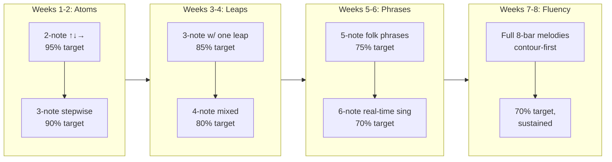
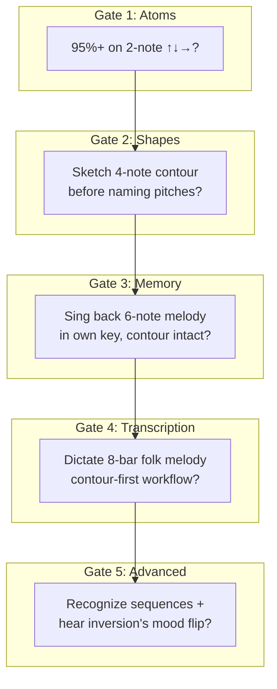
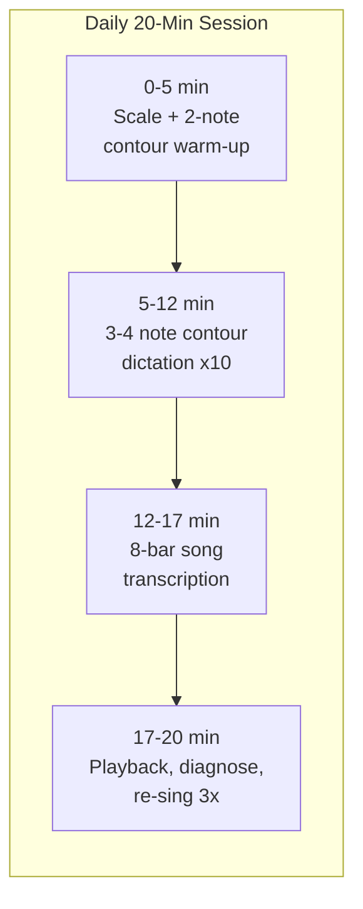

# Lesson 4: Melodic Contour Recognition & Reproduction

## 1. Why Contour First — The Acoustic and Perceptual Reality

Before you can name a major sixth or a minor third, your ear already knows whether a melody went up, down, or stayed put. Contour — the shape a line traces as pitch rises, falls, or repeats — is the first thing the auditory system extracts, and it's the fastest path into functional transcription and improvisation. Infants track contour months before they track exact intervals, and adult listeners misremember exact pitches constantly while almost never misremembering shape.

**The one paragraph of physics you need:** pitch is perceived frequency. Rising melody = increasing fundamental frequency reaching the cochlea's basilar membrane closer to its base (high-frequency end); falling melody = frequency decreasing, activating hair cells further toward the apex. Your brain's pitch-direction detectors respond to *relative* change in firing-rate location, not absolute frequency — which is exactly why contour survives transposition. Sing "Happy Birthday" in C, then in F: every interval's starting pitch changed, but the up-down-up-down shape is bit-for-bit identical. That invariance is the whole training opportunity. Stop there — you don't need cent values or Hz tables to use this; you need your voice and a keyboard.

**Three primitives, no more:**
1. **↑ Ascending** — next pitch higher.
2. **↓ Descending** — next pitch lower.
3. **→ Static** — next pitch repeated.

Every melody on earth is a sentence written in these three letters. Fluent contour readers parse the sentence in real time, the way fluent readers don't sound out each letter of a word.

**Contour vs. interval — keep them separate in training, combine them in performance:**

| | Contour | Interval |
|---|---|---|
| Answers | "Which way?" | "How far, what quality?" |
| Invariant under | Transposition | Nothing (changes with every transposition of starting pitch, stays constant for quality) |
| Learned first | Yes — by ear and by infants | No — requires reference-interval comparison |
| Training tool | Hand gesture, solfège direction | Piano reference intervals, drone comparison |

---

## 2. Contour Vocabulary & Pattern Library

### 2.1 Two-Note Contours — The Atomic Unit

| Contour | Symbol | Example (C ref) | What you're listening for |
|---|---|---|---|
| Ascending | ↑ | C → E | Second note brighter, "lifted" |
| Descending | ↓ | E → C | Second note "settles," heavier |
| Repeated | → | C → C | No change in brightness at all |

**Drill 1 — Two-Note Contour Sprint**
- Partner or app plays random two-note pairs on piano or guitar, isolated, let ring 1 second each.
- You call out ↑ / ↓ / → **within 1 second** of the second note sounding — speed matters as much as accuracy here, because real transcription doesn't wait for you.
- **Progression:** octaves and fifths (Day 1–2) → fourths and thirds (Day 3–5) → seconds (Day 6–10).
- **Metronome-anchored variant:** set 60 BPM, one pair every 2 beats, forcing an answer before the next pair starts.
- **Target:** 95% accuracy over 120 pairs/session by end of week 2. Log your daily score — a simple tally sheet, not an app dashboard, keeps you honest.

**Common trap:** narrow descending seconds (e.g., C→B) get misheard as repeated notes because the brightness change is subtle. Fix: sing the two notes yourself immediately after hearing them — your own vocal effort to drop a half step makes the direction undeniable.

---

### 2.2 Three-Note Contour Archetypes

| Contour Name | Symbol | Example (C) | Phrase Function |
|---|---|---|---|
| Ascending Scale | ↑↑ | C–D–E | Builds energy, open-ended |
| Descending Scale | ↓↓ | E–D–C | Resolves, relaxes |
| Arch (Up-Down) | ↑↓ | C–E–D | Question→answer, local peak |
| Valley (Down-Up) | ↓↑ | E–C–D | Bounce, pickup feel |
| Ascending Leap-then-Hold | ↑→ | C–G–G | Arrival after a jump |
| Descending Leap-then-Hold | ↓→ | G–C–C | Grounded, conclusive |
| Plateau-then-Rise | →↑ | E–E–G | Delayed ascent, suspense |
| Plateau-then-Fall | →↓ | E–E–C | Settling after a hold |

**Drill 2 — Three-Note Dictation-to-Sing**
1. Listen once, eyes closed, no pencil — just feel the shape.
2. Sketch the contour as a simple line graph (peaks up, valleys down) — not staff notation yet.
3. Sing the shape back in **your own comfortable range**, any key.
4. Compare: did your sung direction-pattern match your sketch, and did your sketch match what you heard?

**Progressive routine (daily, 10–15 min):**
- **Week 1:** 20 patterns/day, stepwise only (seconds).
- **Week 2:** introduce exactly one leap (third or larger) per pattern.
- **Week 3:** random mix of stepwise and leaping.
- **Gate to move on:** 90% contour accuracy before touching four-note patterns. Don't advance early — contour fluency compounds, and shaky three-note recognition will sabotage four-note work.

---

### 2.3 Four-Note & Longer Shapes

| Contour Name | Symbol | Example (C) | Character |
|---|---|---|---|
| Ascending Sequence | ↑↑↑ | C–D–E–G | Climactic, driving |
| Descending Sequence | ↓↓↓ | G–E–D–C | Conclusive, cadential |
| Arch Phrase | ↑↑↓ | C–E–G–E | Classical period shape (think Mozart) |
| Inverted Arch | ↓↓↑ | G–E–C–E | Rebound, recovery |
| Wave Up-Down-Up | ↑↓↑ | C–E–D–F | Oscillating, playful |
| Wave Down-Up-Down | ↓↑↓ | E–C–D–A | Syncopated, jazzy |

**Landmark melodies as contour fingerprints** — memorize these as reference shapes you can recall instantly:
- **"Somewhere Over the Rainbow":** → ↑(octave) ↓ ↓ → — huge leap, then settle down stepwise.
- **"Twinkle Twinkle Little Star":** → ↑ → ↑ → ↑ ↓ — repeated-note pairs climbing by step.
- **"My Bonnie Lies Over the Ocean":** ↑(major 6th) ↓ ↓ → — wide leap, gentle stepwise descent.
- **Beethoven's 5th motif:** → → ↓ — plateau then a single decisive drop.

Use these as **anchor shapes**: when a new melody's opening contour resembles one of these, you can borrow the interval feel (e.g., "this leap feels like the Rainbow octave, not the Bonnie sixth — it's bigger").

**Drill 3 — Contour-to-Pitch Dictation**
1. Listen to a 4–6 note melody.
2. Sketch contour only (peaks/valleys, no pitches).
3. Sing contour back in your range.
4. *Now* find the starting pitch on a keyboard.
5. Map scale degrees onto your contour sketch (1-3-5, 1-2-3, etc.).
6. Check against source.

**Metronome-anchored practice ladder:**
- **60 BPM** — one note per beat, pure stepwise, 4 notes.
- **80 BPM** — one leap per phrase allowed, 4–5 notes.
- **100 BPM** — mixed stepwise/leaping, up to 8 notes.
- **120 BPM** — real-time dictation from actual folk melodies, no pausing the recording.

---

## 3. Hands-On Singing & Dictation Technique

### 3.1 Contour Solfège (Movable Do)

Solfège gives contour a voice. In movable-do, **Do is always the tonic**, so the syllable itself encodes scale-degree function while the direction you sing it encodes contour — two layers of information in one vocal gesture.

**Ascending major scale:** Do Re Mi Fa Sol La Ti Do
**Descending major scale:** Do Ti La Sol Fa Mi Re Do

**Keyboard reference, C major = Do:**

| Do | Re | Mi | Fa | Sol | La | Ti | Do |
|---|---|---|---|---|---|---|---|
| C | D | E | F | G | A | B | C |

**Drill — Contour Solfège Cycle** (no keyboard required — hum any pitch as Do):
1. Sing Do-Re-Mi (↑↑).
2. Sing Mi-Re-Do (↓↓).
3. Sing Do-Mi-Re (↑↓, the arch).
4. Sing Mi-Do-Re (↓↑, the valley).
5. Pick a new random "Do" pitch in your range, repeat all four. Ten full cycles per session.

The goal is **relative** motion. If your "Do" drifts a quarter-tone over ten cycles, that's fine — you're training shape recognition, not absolute pitch memory.

---

### 3.2 Physical Gesture Anchoring

**The rule: hand height tracks pitch height, in real time, no exceptions.**

- Rising melody → hand rises smoothly, not in steps.
- Falling melody → hand falls smoothly.
- Repeated note → hand holds dead still.

This isn't a gimmick — conductors use exactly this gesture vocabulary, and it works because it recruits motor cortex and proprioception to reinforce an auditory judgment, giving you two independent channels agreeing on the same answer. When the two channels disagree (your hand says up, your ear says down), that mismatch is diagnostic: it tells you your ear anticipated wrong and you should re-listen.

**Drill 4 — Gesture-Then-Sing Memory Chain**
1. Play a known simple tune ("Mary Had a Little Lamb").
2. Trace contour with your hand *while singing along* — calibration pass.
3. Play again, **no singing**, hand-trace only.
4. Sing the tune back *from memory*, letting your hand gesture lead your voice.
5. Play the original once more and check your reproduction against it.

This builds the gesture into a retrievable memory cue independent of audio playback — exactly what you need in a live dictation exam or when transcribing from a recording you can't pause mid-phrase.

---

### 3.3 Eight-Week Progressive Routine



| Week | Min/day | Focus | Accuracy Gate |
|---|---|---|---|
| 1 | 10 | Two-note ↑↓→ | 95% |
| 2 | 15 | Three-note stepwise | 90% |
| 3 | 15 | Three-note + one leap | 85% |
| 4 | 20 | Four-note, mixed intervals | 80% |
| 5 | 20 | Five-note folk phrases | 75% |
| 6 | 25 | Six-note, real-time singing | 70% |
| 7–8 | 30 | Full 8-bar melodies | 70% sustained |

**Tools:** EarMaster and Teoria.com both have randomized contour-only drill modes — use them for Drill 1 and 2 so you're not depending on a human partner for repeatable, graded reps. For Weeks 5+, switch to real recordings (folk melodies, pop choruses) because algorithmic drill content doesn't carry the phrasing irregularities of real music.

---

## 4. Real-World Transcription Workflow

This is the sequence to run on *any* melody you're trying to learn by ear — a solo, a bassline, a vocal hook.

1. **Listen once, no pencil.** Only question: rising, falling, arching, or wave-like overall?
2. **Sketch contour on second listen.** Peaks and valleys as a line graph. Ignore exact pitch entirely.
3. **Sing it back on third listen.** Match shape in your own range. Does your sung shape match your sketch?
4. **Find the starting pitch on fourth listen.** Keyboard or tuner, just note 1.
5. **Map scale degrees on fifth listen.** Now that you have a key, sing numbers (1-2-3-4-5...) or solfège against your contour sketch.
6. **Notate exact pitches and rhythm on sixth listen.** Staff paper, real durations.
7. **Play back and verify** against the source — loop the original and your transcription back to back.

### Failure Modes & Fixes

| Symptom | Likely Cause | Fix |
|---|---|---|
| Direction right, interval size wrong | Confusing adjacent interval sizes (3rd vs 5th) | Sing the leap slowly, bridge through the passing scale degree, compare to a known reference song interval |
| Hear ↑ when it's actually →↑ | Missed a repeated-note onset | Tap your finger on every note onset you hear, count taps on the same pitch before judging direction |
| Lose the thread after note 4 | Working memory overload | Chunk into overlapping pairs: judge (1→2), then (2→3), then (3→4), chain results instead of holding the whole phrase |
| Hear syncopation as a pitch change | Rhythm and pitch judgments conflated | Clap the rhythm alone first, then sing pitches on a neutral "la," never judge both at once |

---

## 5. Applied Analysis: Four Real Melodies

### 5.1 "Happy Birthday" — Contour Stays Fixed Across Keys

```
Key of C:           C   C   D   C   F   E
Solfège:             Do  Do  Re  Do  Fa  Mi
Contour:               →   ↑   ↓   ↑   ↓
```

**Transposition check — sing all three, same contour every time:**
- **C:** C C D C F E
- **G:** G G A G C B
- **F:** F F G F Bb A

Sing all three back to back. The *letter names* change completely; the →↑↓↑↓ shape never does. This is the single clearest proof you can give yourself that contour is a real, separate perceptual object from interval.

### 5.2 "Somewhere Over the Rainbow" — The Octave Leap Signature

```
"Some - where      o    -   ver the rain - bow"
C        C       C(+8ve)    Bb   A    G    F
Do       Do       Do          Ti   La   Sol  Fa
  →          ↑(leap)            ↓    ↓    ↓    ↓
```

Contour: repeated note, massive leap up, then unbroken stepwise descent — an arch with an exaggerated front edge. **Practice:** sing the octave leap in C, then D, then Eb, focusing entirely on the physical sensation of the jump (breath support increase, laryngeal adjustment) rather than landing on "correct" letter names. Sketch the contour before you ever sing a pitch name.

### 5.3 Beethoven's 5th — Plateau-Then-Drop

```
G    G    G    Eb
Sol  Sol  Sol  Mi♭
  →    →    ↓
```

Three repeated notes build rhythmic tension (accented, short-short-short-LONG rhythmically), then a descending major third releases it. This is the most economical tension-release gesture in the classical repertoire — one plateau, one drop. Listen for this exact shape; it recurs constantly in riff-based rock and film scoring.

### 5.4 "My Bonnie Lies Over the Ocean" — Wide Leap, Gentle Resolve

```
F         F         D          C      Bb     A
Fa        Fa(+6th)   Re          Do     Ti     La
  →         ↑(leap)    ↓           ↓      ↓      ↓
```

Contrast this leap against the Rainbow octave: both open with a repeated note then a big upward leap, but the Bonnie leap (major 6th) feels noticeably smaller and less dramatic than the octave. **Drill:** sing Rainbow's opening leap immediately followed by Bonnie's opening leap, back to back, several times — training your ear to discriminate leap *size* within the same contour shape (↑ after →) is the bridge exercise into full interval training.

---

## 6. Advanced Contour Techniques

### 6.1 Melodic Sequence — Repeated Contour at Shifting Pitch Levels

A sequence repeats the *same internal contour* starting from a new pitch each time. The internal shape is constant; the overall trajectory across repetitions can itself be ascending, descending, or static.

**Vivaldi "Spring," opening violin figure:**
```
Unit A: C  D  E   (↑↑)
Unit B: D  E  F♯  (↑↑)  — same shape, whole step higher
Unit C: E  F♯ G♯  (↑↑)  — same shape, another whole step higher
```

**Drill 5 — Sequence Recognition**
1. Listen to a sequence passage.
2. Identify the internal (unit) contour — here, ↑↑.
3. Identify the sequence-level trajectory — is each repetition landing higher, lower, or at the same pitch level as the last?
4. Sing the sequence back, transposing the unit yourself by ear — this is functionally improvisation practice disguised as dictation.

### 6.2 Contour Inversion

Inverting a contour flips every ascending motion to descending (and vice versa), typically preserving interval *size* while reversing direction.

| | Pitches | Contour |
|---|---|---|
| Original | C → E → D | ↑↓ |
| Inverted | C → A♭ → B♭ | ↓↑ |

**Drill:** sing C–D–E (↑↑, bright, major). Sing its inversion C–Bb–Ab (↓↓, immediately darker). The pitch *material* is nearly unrelated, but the gesture inversion alone flips the emotional read from ascending/bright to descending/dark. This is the ear-training counterpart to writing invertible counterpoint — useful the moment you start composing countermelodies or bass lines that answer a melodic phrase.

### 6.3 Augmentation & Diminution — Contour Survives Tempo Change

| Version | Rhythm | Pitches |
|---|---|---|
| Original | quarter-quarter-quarter | C–E–D |
| Augmented (2x slower) | half-half-half | C–E–D |
| Diminished (2x faster) | eighth-eighth-eighth | C–E–D |

The contour symbol (↑↓) never changes across all three. This is why you recognize a theme instantly whether a composer states it in long notes (augmentation, common in fugal expositions) or doubles its speed (diminution, common in development sections). **Drill:** have a partner play a 4-note contour at three different tempos (60, 120, 240 BPM) in random order — your job is only to confirm it's the *same* shape each time, ignoring tempo entirely.

---

## 7. Diagnostic Self-Assessment



**Checklist:**
- [ ] 95%+ on two-note ↑↓→ pairs.
- [ ] Can sketch a 4-note contour before identifying exact pitches.
- [ ] Can sing back a 6-note melody in my own key, contour intact.
- [ ] Can dictate an 8-bar folk melody using the contour-first workflow.
- [ ] Can spot a melodic sequence and sing its repeating unit.
- [ ] Can invert a simple contour and hear the mood flip from bright to dark.
- [ ] Use hand gestures while listening, and it measurably improves my accuracy.

**Troubleshooting:**
- **Can't hear direction at all:** restart Drill 1 at octaves/fifths only, don't touch seconds until two straight sessions at 95%.
- **Can't hold 4+ notes in memory:** use the overlapping-pair chunking method from Section 4's failure-mode table — stop trying to hold the whole phrase at once.
- **Confusing rhythm and pitch:** split every drill into two passes — clap rhythm only, then sing pitch only on a neutral syllable.

---

## 8. Integration With Interval & Harmony Training

**Contour tells you *where*; interval tells you *how far*.** They're trained separately but used together instantly in real transcription.

**Eight-week integration arc:**
1. **Weeks 1–2:** Pure contour, direction only (this lesson).
2. **Weeks 3–4:** Contour + interval *quality* — is the leap major or minor sounding?
3. **Weeks 5–6:** Contour + exact interval *size* — major third vs. perfect fifth, confirmed against reference melodies.
4. **Weeks 7–8:** Contour + harmonic context — does the melody outline a chord (1-3-5 arpeggiation) or move by scale step (neighbor/passing tones)?

**Harmonic payoff:** melodies built from leaps usually trace chord tones; melodies built from steps usually fill in between them. Recognizing "this is a leaping contour" during dictation is your cue to test chord-tone hypotheses (1-3-5, 1-3-5-3) before falling back to interval-by-interval guessing. Recognizing "this is a stepwise contour" cues you to think scale degrees and passing/neighbor motion instead. Ascending contours frequently build toward dominant harmony; descending contours frequently resolve toward tonic — not a rule, but a strong enough tendency to use as a working hypothesis while you transcribe.

---

## 9. Daily 20-Minute Practice Block



**0–5 min — Warm-up:** Sing full major scale ascending then descending in solfège. Then 10 random two-note contours (↑↓→), called out instantly.

**5–12 min — Contour dictation:** App or partner plays 10 three-to-four-note fragments. Sketch, sing back, score accuracy, log the number.

**12–17 min — Song transcription:** One 8-bar folk melody or pop chorus, full contour-first workflow from Section 4.

**17–20 min — Review:** Play back your transcription against source. Identify the specific failure mode using the Section 4 table (interval size? missed repeat? rhythm bleed?). Re-sing the corrected phrase three times before closing the session.

---

## 10. Recommended Tools & Resources

**Software:**
- **EarMaster** — dedicated contour-recognition modules, graded difficulty.
- **Teoria.com** — free browser-based contour and interval drills.
- **musictheory.net** — staff-based melodic dictation.
- **Functional Ear Trainer** (Android/iOS) — scale-degree and contour drills in tonal context.

**Method books:**
- *Ear Training for the Contemporary Musician* — Keith Wyatt & Carl Schroeder (Berklee Press)
- *The Musician's Guide to Aural Skills* — Phillips, Clendinning, Marvin

**Partner practice protocol:** one person improvises or plays short phrases on keyboard/guitar, the other sketches contour and sings back — swap roles every 10 minutes. This forces you to both produce and recognize contour in the same session, which trains the gesture-to-sound mapping in both directions.

---

## 11. Next Steps

Once you hold 80%+ accuracy on four-note contours across a full week, move to **Lesson 5: Interval Recognition & Singing**, where you attach exact distances to the directions you've already mastered.

Build contour sketching into your regular instrument practice independent of ear-training sessions: before learning a new piece from notation or recording, sketch its contour, sing it, *then* play it. That ear-to-hand loop — hear shape, voice shape, execute shape on the instrument — is the fastest route from passive listening to fluent, confident transcription.
