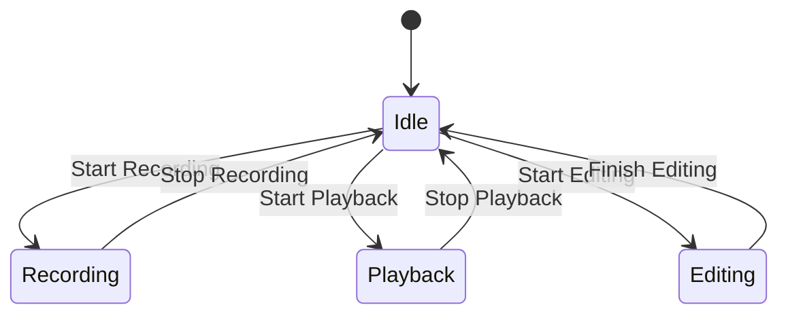

# Advanced Foundation: Film Scoring

## 1. Theoretical Invariants & Formal Frameworks

### 1.1 Formal Proofs in Film Scoring

Film scoring is a complex interdisciplinary domain that intertwines music theory, psychology, and engineering. To establish a formal framework, we must consider the theoretical invariants that govern the emotional and structural aspects of film music. One such invariant is the **emotional resonance** of music, which can be formalized through the study of psychoacoustics and the mathematical modeling of sound perception.

**Psychoacoustics and Mathematical Modeling:**
Psychoacoustics provides a framework for understanding how humans perceive sound. The Fletcher-Munson curves, for instance, describe the equal-loudness contours, which are critical for understanding how different frequencies are perceived at varying intensities. Mathematically, these contours can be modeled using the following equation:

\[ L_p(f) = 13.24 \times \log_{10}(f) - 6.55 - 0.00112 \times f + 0.0000014 \times f^2 \]

where \( L_p(f) \) is the perceived loudness in phons and \( f \) is the frequency in Hz. This model helps in ensuring that the film score is balanced and perceivable across different audio systems.

### 1.2 Kernel or Physical Invariants

Physical invariants in film scoring include the **acoustic properties of the recording environment** and the **physical limitations of instruments**. The acoustic properties of a recording space can be modeled using the principles of room acoustics, which involve the reflection, absorption, and transmission of sound waves. The reverberation time (RT60) is a critical invariant that characterizes the decay of sound in a room and can be calculated using the Sabine formula:

\[ RT60 = \frac{0.161 \times V}{A \times \alpha} \]

where \( V \) is the volume of the room in cubic meters, \( A \) is the total surface area in square meters, and \( \alpha \) is the average absorption coefficient of the surfaces.

## 2. Low-Level Invariant Taxonomy

### 2.1 Deep Registers and Memory Models

In the context of film scoring, deep registers refer to the low-frequency components of the music that are crucial for establishing the emotional tone and atmosphere. These low-frequency components are often handled by the bass instruments and the subwoofer in the audio system. The memory models in this context refer to the digital signal processing (DSP) techniques used to manage and manipulate these low-frequency signals.

**DSP Techniques for Low-Frequency Signals:**
- **Subtractive Synthesis:** Utilizes filters to remove unwanted harmonics from an oscillator's waveform, allowing for precise control over the low-frequency content.
- **Wavelet Transform:** A mathematical tool for analyzing signals at different scales, which is useful for processing low-frequency components in film scoring.

### 2.2 Hardware Constraints

Hardware constraints in film scoring include the limitations of audio interfaces, digital audio workstations (DAWs), and the physical instruments used. These constraints can affect the quality and fidelity of the film score. For instance, the bit depth and sample rate of an audio interface determine the resolution and clarity of the recorded audio.

**Formalizing Hardware Constraints:**
- **Bit Depth:** The number of bits used to represent the amplitude of a digital audio signal. Common bit depths include 16-bit, 24-bit, and 32-bit.
- **Sample Rate:** The number of samples per second used to represent the audio signal. Common sample rates include 44.1 kHz, 48 kHz, and 96 kHz.

## 3. Micro-Architecture & Concurrency Dynamics

### 3.1 Mermaid and ASCII State Machines

In film scoring, the micro-architecture of a DAW or a synthesizer can significantly impact the performance and efficiency of the scoring process. State machines are used to model the different states and transitions within the DAW or synthesizer, ensuring that the system operates efficiently and reliably.

**Example State Machine for a DAW:**



### 3.2 Cache and Race Condition Diagrams

Cache and race conditions are critical issues in the micro-architecture of a DAW or synthesizer. Cache is used to store frequently accessed data, improving the performance of the system. Race conditions occur when multiple processes access shared resources simultaneously, leading to unpredictable behavior.

**Cache Diagram:**

```
+-------------------+
|       Cache       |
+-------------------+
|   Block 1: Data   |
|   Block 2: Data   |
|   Block 3: Data   |
+-------------------+
```

**Race Condition Diagram:**

```
+-------------------+       +-------------------+
|   Process A       |       |   Process B       |
+-------------------+       +-------------------+
|   Access Resource |<----->|   Access Resource |
+-------------------+       +-------------------+
```

## 4. Subtle Failure Modes & Boundary Conditions

### 4.1 Subtle Failure Modes

Subtle failure modes in film scoring can include issues such as phase cancellation, quantization noise, and aliasing. These issues can arise due to the limitations of digital audio processing and the physical constraints of the recording environment.

**Phase Cancellation:**
Phase cancellation occurs when two or more audio signals with similar frequencies and opposite phases interfere with each other, resulting in a reduction in the overall signal level. This can be mitigated by carefully managing the phase relationships between different audio tracks.

**Quantization Noise:**
Quantization noise is introduced when an analog signal is converted to a digital signal. The noise level is determined by the bit depth of the digital signal. Higher bit depths result in lower quantization noise.

**Aliasing:**
Aliasing occurs when high-frequency components of a signal are folded back into the audible frequency range due to insufficient sampling. This can be mitigated by using anti-aliasing filters before the analog-to-digital conversion process.

### 4.2 Boundary Conditions

Boundary conditions in film scoring refer to the extreme edge cases that can arise during the scoring process. These include issues such as extreme dynamic ranges, extreme frequency ranges, and extreme temporal resolutions.

**Extreme Dynamic Ranges:**
Extreme dynamic ranges can arise when the film score includes both very quiet and very loud passages. This can be challenging to manage due to the limitations of the audio system and the human ear. Careful use of compression and limiting can help to manage extreme dynamic ranges.

**Extreme Frequency Ranges:**
Extreme frequency ranges can arise when the film score includes both very low and very high frequencies. This can be challenging to manage due to the limitations of the recording environment and the physical instruments used. Careful use of equalization and crossover networks can help to manage extreme frequency ranges.

**Extreme Temporal Resolutions:**
Extreme temporal resolutions can arise when the film score includes very fast or very slow passages. This can be challenging to manage due to the limitations of the DAW and the physical instruments used. Careful use of tempo mapping and time-stretching can help to manage extreme temporal resolutions.

## 5. Master Socratic Inquiries

### 5.1 Research-Grade Discussion Questions

1. **Psychoacoustics and Film Scoring:**
   - How can the principles of psychoacoustics be applied to the scoring of film to ensure that the music is emotionally resonant and perceptually balanced across different audio systems?

2. **Acoustic Properties of Recording Environments:**
   - How can the acoustic properties of a recording environment be modeled and optimized to ensure that the film score is recorded with high fidelity and clarity?

3. **DSP Techniques for Low-Frequency Signals:**
   - How can DSP techniques such as subtractive synthesis and wavelet transform be used to manage and manipulate low-frequency signals in film scoring?

4. **State Machines in DAWs and Synthesizers:**
   - How can state machines be used to model the different states and transitions within a DAW or synthesizer, ensuring that the system operates efficiently and reliably?

5. **Cache and Race Conditions in Audio Systems:**
   - How can cache and race conditions be managed in audio systems to ensure that the film score is processed efficiently and reliably?

6. **Phase Cancellation and Quantization Noise:**
   - How can phase cancellation and quantization noise be mitigated in digital audio processing to ensure that the film score is recorded and reproduced with high fidelity and clarity?

7. **Aliasing and Anti-Aliasing Filters:**
   - How can aliasing be mitigated using anti-aliasing filters before the analog-to-digital conversion process to ensure that the film score is recorded with high fidelity and clarity?

8. **Extreme Dynamic Ranges in Film Scoring:**
   - How can extreme dynamic ranges be managed in film scoring to ensure that the music is emotionally resonant and perceptually balanced across different audio systems?

9. **Extreme Frequency Ranges in Film Scoring:**
   - How can extreme frequency ranges be managed in film scoring to ensure that the music is recorded and reproduced with high fidelity and clarity?

10. **Extreme Temporal Resolutions in Film Scoring:**
    - How can extreme temporal resolutions be managed in film scoring to ensure that the music is recorded and reproduced with high fidelity and clarity?
