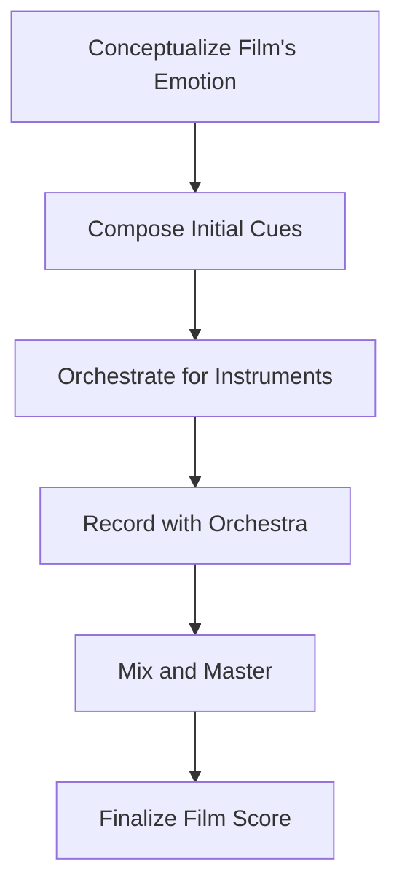

# Beginner Foundation: Film Scoring

## 1. Everyday Intuition & First Principles

Film scoring is the art of composing music that enhances the emotional and narrative impact of a film. Imagine you are watching a thrilling chase scene, and suddenly a powerful, suspenseful piece of music starts playing. This music doesn't just fill the silence; it amplifies the tension, making the scene more engaging and memorable. Similarly, in a romantic scene, a soft, melodic piece can evoke feelings of love and longing. Film scoring is the bridge between the visual and auditory worlds, where the music guides the audience's emotions and deepens their connection to the story.

## 2. Foundational Vocabulary & Glossary

### 1. **Score:** The complete musical composition written for a film, including all the individual parts for each instrument.
### 2. **Cue:** A specific piece of music in a film score, often associated with a particular scene or moment.
### 3. **Leitmotif:** A recurring musical theme associated with a character, place, or idea in a film.
### 4. **Sting:** A short, dramatic musical phrase used to signal a significant moment or transition in a film.
### 5. **Mood Music:** Music that sets the emotional tone or atmosphere of a scene without being directly tied to specific actions.
### 6. **Diegetic Music:** Music that is part of the film's world, such as characters listening to music on a radio or playing an instrument.
### 7. **Non-Diegetic Music:** Music that is not part of the film's world, added by the composer to enhance the emotional impact.
### 8. **Orchestration:** The art of arranging music for an orchestra, including the choice of instruments and their parts.

## 3. Visual System Flow

### ASCII Diagram

```
+-------------------+
|  Conceptualize    |
|  Film's Emotion   |
+---------+---------+
          |
          v
+---------+---------+
|  Compose          |
|  Initial Cues     |
+---------+---------+
          |
          v
+---------+---------+
|  Orchestrate      |
|  for Instruments  |
+---------+---------+
          |
          v
+---------+---------+
|  Record             |
|  with Orchestra   |
+---------+---------+
          |
          v
+---------+---------+
|  Mix and            |
|  Master             |
+---------+---------+
          |
          v
+---------+---------+
|  Finalize           |
|  Film Score         |
+---------------------+
```

### Mermaid Flowchart



## 4. Common Beginner Misconceptions & Mental Traps

### Misconception 1: Film Scoring is Only for Big Budget Films
**Trap:** Thinking that film scoring is only feasible for large productions with large budgets.
**Reality:** Film scoring can be done for any film, regardless of budget. Even independent films can benefit from a well-crafted score.

### Misconception 2: You Need to be a Master Composer to Score a Film
**Trap:** Believing that only highly skilled composers can create effective film scores.
**Reality:** While skill is important, creativity and an understanding of how music interacts with film are equally crucial. Many composers start with simpler pieces and build their skills over time.

### Misconception 3: Film Scoring is All About Writing Melodies
**Trap:** Focusing solely on writing catchy melodies without considering the overall emotional impact.
**Reality:** Film scoring involves a wide range of elements, including harmony, rhythm, orchestration, and mood. Effective film scoring is about creating a cohesive musical experience that enhances the film's narrative.

### Misconception 4: You Need to Write the Entire Score Before Recording
**Trap:** Thinking that you must have the entire score written out before recording.
**Reality:** Many composers write and refine their music as they go, especially when working with orchestras. Flexibility and adaptability are key.

## 5. Socratic Discussion Starters

### Questions to Explore with Your AI Tutor

1. **How does the music in a film influence your emotional response to the scene?**
2. **Can you identify any leitmotifs in your favorite films? How do they contribute to the storytelling?**
3. **What is the difference between diegetic and non-diegetic music, and can you provide examples from films you have seen?**
4. **How does the choice of instruments in a film score affect the overall mood and atmosphere?**
5. **What role does orchestration play in film scoring, and how does it differ from composing for other mediums?**
6. **How do you think about the pacing and timing of your music to match the rhythm of a film's scenes?**
7. **Can you discuss the process of mixing and mastering a film score, and why it is important?**
8. **What are some common challenges you face when scoring a film, and how do you overcome them?**

By engaging with these questions, you can develop a deeper understanding of the art and science of film scoring, and build a solid foundation for your future work in this exciting field.
