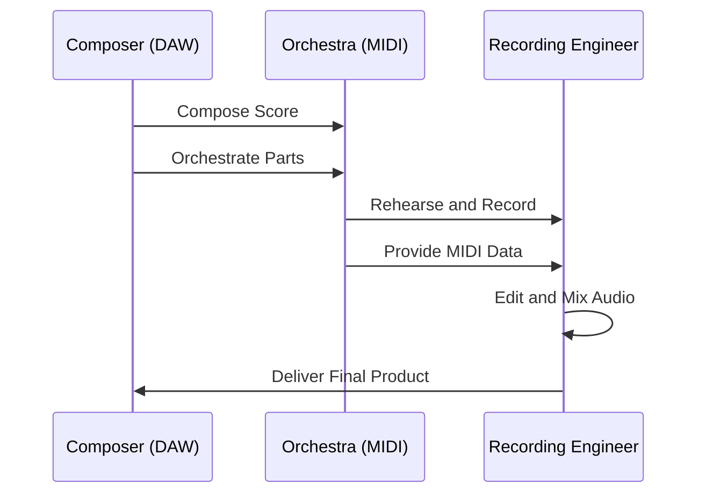

# Intermediate Foundation: Film Scoring

## 1. Architectural Mental Model

Film scoring is a complex and multifaceted discipline that requires a robust architectural mental model to manage the myriad components involved in the production process. At the intermediate level, it is essential to understand how various systems interact to create a cohesive and efficient workflow. This model encompasses the integration of composition, orchestration, recording, and post-production, each with its own set of tools and methodologies.

### Composition and Orchestration
The foundation of film scoring lies in the composition and orchestration processes. Composers must craft themes and motifs that resonate with the emotional and narrative elements of the film. Orchestration involves the detailed assignment of these musical ideas to specific instruments, taking into account their timbral characteristics and the overall balance of the ensemble. This requires a deep understanding of instrument families, their ranges, and their roles in the orchestra.

### Recording and Production
Once the music is composed and orchestrated, it must be recorded. This involves setting up sessions with musicians, conducting, and capturing high-quality audio. The recording process is further enhanced by the use of digital audio workstations (DAWs) and various plugins for processing and mixing. The production phase includes editing, layering, and mastering to ensure the final product meets the desired aesthetic and technical standards.

### Post-Production Integration
The final step in the film scoring process is the integration of the music into the film. This involves synchronizing the music with the visual elements and ensuring that it enhances the overall narrative and emotional impact. Post-production software is used to manage the timing and volume of the music, as well as to apply effects and transitions.

## 2. Systems Taxonomy & Component Protocols

In the realm of film scoring, several standard interfaces, protocols, and data models are employed to ensure interoperability and efficiency. Understanding these systems is crucial for effective collaboration and production.

### Standard Interfaces
- **DAW Integration:** Digital Audio Workstations (DAWs) such as Pro Tools, Logic Pro, and Ableton Live serve as the primary interfaces for recording, editing, and mixing. They provide a comprehensive set of tools for managing audio tracks, MIDI data, and plugins.
- **MIDI Protocols:** MIDI (Musical Instrument Digital Interface) is a protocol that allows electronic musical instruments, computers, and other related devices to communicate. It is used for controlling synthesizers, drum machines, and other MIDI-enabled devices.
- **Audio File Formats:** Common audio file formats include WAV, AIFF, and MP3. These formats are used for storing and transferring audio data. WAV and AIFF are lossless formats, preserving the highest quality, while MP3 is a lossy format that offers compression.

### Component Protocols
- **Session Management:** Protocols for managing recording sessions, including scheduling, communication, and logistics. This ensures that all musicians and producers are on the same page and that the recording process runs smoothly.
- **Version Control:** Protocols for managing different versions of the music, including backups, revisions, and collaboration. This is crucial for maintaining the integrity of the project and for tracking changes over time.
- **Metadata Standards:** Standards for tagging and organizing audio files, including metadata such as track names, artist credits, and copyright information. This ensures that all audio files are properly labeled and easily accessible.

### Data Models
- **Score Data Models:** Data models for representing musical scores, including notation, orchestration, and performance data. These models are used for generating sheet music, orchestrating parts, and conducting rehearsals.
- **Audio Data Models:** Data models for representing audio files, including sample data, metadata, and processing parameters. These models are used for managing audio tracks, applying effects, and mixing the final product.
- **Project Data Models:** Data models for representing the overall project, including timelines, budgets, and deliverables. These models are used for planning, tracking, and managing the production process.

## 3. Multi-Component Interaction Flow

To understand how the various components of film scoring interact, it is helpful to visualize the interaction flow using ASCII and Mermaid sequence diagrams.

### ASCII Sequence Diagram

```
+-------------------+          +-------------------+          +-------------------+
|   Composer        |          |   Orchestra       |          |   Recording       |
|   (DAW)           |          |   (MIDI)          |          |   Engineer        |
+-------------------+          +-------------------+          +-------------------+
          |                              |                              |
          |  Compose Score                |                              |
          |  --------------------------> |                              |
          |                              |                              |
          |  Orchestrate Parts            |                              |
          |  --------------------------> |                              |
          |                              |                              |
          |                              |  Rehearse and Record          |
          |                              |  --------------------------> |
          |                              |                              |
          |                              |  Provide MIDI Data            |
          |                              |  --------------------------> |
          |                              |                              |
          |                              |                              |  Edit and Mix Audio
          |                              |                              |  --------------------------> |
          |                              |                              |                              |
          |                              |                              |  Deliver Final Product
          |                              |                              |  --------------------------> |
          |                              |                              |
```

### Mermaid Sequence Diagram



## 4. Architectural Trade-offs & Production Pitfalls

When designing the architecture for film scoring, several trade-offs and pitfalls must be considered to ensure a successful production.

### Trade-offs
- **Quality vs. Time:** High-quality recordings often require more time and resources. Balancing the need for quality with the constraints of time is a critical trade-off in film scoring.
- **Cost vs. Resources:** Using high-end equipment and professional musicians can significantly increase the cost of production. Balancing the budget with the available resources is another important trade-off.
- **Flexibility vs. Control:** A flexible production process allows for adaptability and creativity, but it can also lead to delays and inconsistencies. On the other hand, a tightly controlled process ensures consistency but can stifle creativity.

### Production Pitfalls
- **Poor Communication:** Ineffective communication between composers, orchestrators, recording engineers, and other stakeholders can lead to misunderstandings and delays.
- **Technical Issues:** Technical problems such as equipment malfunctions, software glitches, and data corruption can disrupt the production process and compromise the quality of the final product.
- **Scope Creep:** Allowing the project scope to expand beyond the original plan can lead to budget overruns, schedule delays, and decreased quality.

## 5. Socratic Discussion Starters

To deepen the understanding of film scoring architecture, the following questions can be used to bridge the gap between high-level architecture and low-level implementation.

- **How can the use of MIDI protocols enhance the collaboration between composers and orchestras?**
- **What are the advantages and disadvantages of using different audio file formats in the film scoring process?**
- **How can version control protocols be implemented to ensure the integrity of the project and facilitate collaboration?**
- **What are the key considerations when designing score data models for film scoring?**
- **How can the interaction between the recording engineer and the orchestra be optimized to ensure high-quality recordings?**
- **What are the potential trade-offs between using high-end equipment and professional musicians in film scoring?**
- **How can the production process be designed to balance flexibility and control?**
- **What strategies can be employed to mitigate the risks of poor communication and technical issues in film scoring?**
- **How can the scope of a film scoring project be managed to prevent scope creep and ensure successful completion?**

By addressing these questions, practitioners can gain a deeper understanding of the architectural principles and practical considerations involved in film scoring. This knowledge will enable them to design more effective and efficient production processes, ultimately leading to higher-quality music for films.
