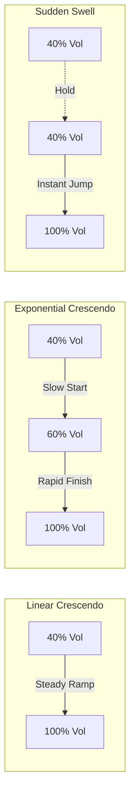
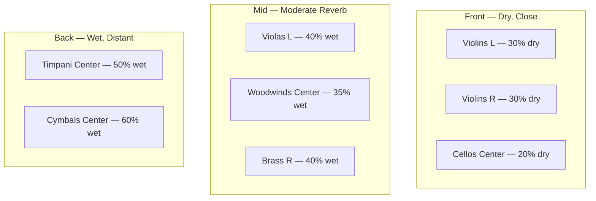

# Film Scoring Masterclass: Spotting, Orchestration & Dub-Stage Delivery

## Lab Overview & Setup

This lab builds one complete 60-second cue, scored to picture, from blank timeline to delivered stems. You will spot a video, write a leitmotif, orchestrate it for strings/woodwinds/brass/percussion, mix it against dialogue, and export broadcast-spec stems. Every step produces a file or a decision you can audit — no abstract theory without a corresponding action.

**Required Tools:**
- **DAW:** Reaper, Logic Pro, or Cubase (examples use Reaper; menu paths translate directly)
- **Orchestral Library:** Spitfire BBC Symphony Orchestra Discover (free) or equivalent — needs separate patches for 1st violins, cellos, horns, flute/oboe, timpani
- **Video Reference:** Any 60-second silent clip, Creative Commons, at 23.976 or 24 fps
- **MIDI Controller:** 25+ keys, mod wheel, pitch bend
- **Monitoring:** Headphones or monitors flat enough to hear 80 Hz–3 kHz accurately — this is the band where every dialogue-clearance decision lives

**Pre-Lab Checklist:**
1. Project sample rate: **48 kHz**. Never 44.1 — it is a music-industry rate, not a film-delivery rate, and mixing at 44.1 then handing off to a dub stage running 48 is the single most common sync-corrupting mistake new composers make.
2. Video frame rate confirmed at 24 fps (or whatever the picture lock is) — check in `Item Properties`, don't assume.
3. Load a template with 4 pre-routed buses: Strings, Woodwinds, Brass, Percussion, each feeding a Reverb Send bus and the Master.
4. Confirm MIDI controller mod wheel sends CC1 — play a note, watch the DAW's MIDI monitor, wiggle the wheel, confirm CC1 values move 0–127.
5. Do not build a tempo map yet — that's Step 1 below, and doing it blind wastes a session.

---

## Exercise 1: Spotting, Tempo, and the Leitmotif

### Step 1 — Spotting Session

Spotting means watching the picture with a stopwatch mentality and deciding, shot by shot, where music starts, stops, swells, and hits. Composers do this with a director in a spotting session; here you do it alone against your reference clip.

1. Import video: `Insert > Media File`, check **"Video item on new track"**.
2. Scrub frame-by-frame (use `Left/Right` arrow for single-frame nudge) and drop markers (`M` key) at:
   - **0:00.000** — opening frame, establishes key/mood
   - **0:22.000** — first dramatic turn (the beat where the scene's intention changes)
   - **0:50.000** — climax or release
3. These three points are **hit points** — moments where a musical event (chord change, dynamic swell, percussion stab) should land within one frame (±42ms at 24fps) of the visual event. Hit points are what separate "music over a video" from "a score."

### Step 2 — Tempo Map

Tempo in film scoring exists to serve hit points, not the reverse. Work backward from the markers.

1. Set initial tempo to **120 BPM**.
2. Open the tempo envelope (`Track > Tempo envelope` or the dedicated tempo lane) and insert points:
   - 0:00 → 120 BPM (establishing)
   - 0:22 → **90 BPM** if the beat is a slow-down/reflective turn, or **140 BPM** if it's an acceleration into action
   - 0:50 → adjust again to land the climax exactly on a downbeat
3. Nudge tempo values in 1 BPM increments while watching whether a strong beat (beat 1 of a bar) falls within a frame of the visual cut. This is iterative — expect 5–10 small adjustments before the grid locks to picture.

**Verification:** Play with a click. A downbeat should land audibly "on" each cut or gesture. If it's consistently late by a fixed amount, you have a project latency/buffering issue, not a tempo issue — check audio device buffer size first.

---

### Step 3 — Writing the Leitmotif (Strings)

A leitmotif is a 4-bar idea compact enough to be recognized when it returns fragmented, inverted, or in a different key later in a larger score. Write it vocally or at the piano before touching MIDI — if you can't hum it, it's not a theme, it's a line of notes.

**Theme, D minor, 4/4, quarter note = 72 (adjust per tempo map above):**

```
Bar 1: D4 (dotted half) — F4 (quarter)
Bar 2: A4 (half) — G4 (quarter) — F4 (quarter)
Bar 3: E4 (whole, held)
Bar 4: E4 (half) — D4 (half, resolution to tonic)
```

The shape matters: rise from D to A (a 5th — the "reach" of the phrase), a stepwise descent back down, and a suspension on E over the barline into Bar 4 that resolves down to D. That suspension is the emotional engine of the phrase — it's a non-chord tone against the implied harmony, and ears want it to resolve. Don't resolve it early.

**MIDI Entry — Hands-On Procedure:**
1. New MIDI track → load **Violin 1** (solo or section, your call — section reads more "cinematic," solo reads more "intimate")
2. Open the piano roll, set grid to 1/4 note with snap on
3. Draw notes at **velocity 85–100** (forte — this is your lead voice, it must sit above the texture)
4. Add CC1 (mod wheel) expression as a separate automation lane:
   - Bar 1 start: CC1 = 60 (mezzo, letting the phrase breathe in)
   - Bar 3 (the suspension): ramp CC1 to 100 — this is where vibrato/intensity should peak, underlining the suspended tone
   - Bar 4: taper CC1 down to 45 as the phrase resolves

**Hand Technique at the Controller:**
Rest your left-hand thumb on the mod wheel at all times while your right hand plays. Record the phrase live in one pass, shaping dynamics with the wheel as you play rather than drawing CC1 after the fact — hand-drawn curves tend to be mechanically smooth (and therefore lifeless); a human gesture recorded in real time has the small irregularities that read as "played," not "programmed." If your first take is stiff, don't quantize the velocity — re-record it instead.

**Why strings carry film melodies:** continuous bow pressure gives infinite sustain and a built-in crescendo/decrescendo the performer controls mid-note — something a piano or plucked string physically cannot do. Violins also sit in a formant range (roughly 200 Hz–3 kHz fundamentals plus bright overtones to 8 kHz+) that cuts through a dense mix without fighting dialogue, provided you manage the overlap deliberately (see Exercise 4).

---

### Step 4 — Harmonic Pad (Woodwinds & Brass)

**Progression under the theme, D minor:**

```
Bar 1: Dm   (D–F–A)
Bar 2: B♭   (B♭–D–F)
Bar 3: C    (C–E–G)
Bar 4: Am   (A–C–E)
```

This is a i – VI – VII – v motion: it never resolves fully to the tonic in root position until the theme itself lands, which is exactly why it feels unsettled and forward-leaning under a melody that keeps rising. Save the full Dm cadence for a later return of the theme (a payoff you're saving for the hour mark of a real score, or for the next 4 bars of this exercise if you extend it).

**Implementation:**
1. New MIDI track, load **Flute + Oboe** (layer both for a rounder blend, or alternate per bar)
2. Voice in **closed position** — all three chord tones within one octave, sitting C4–C5
3. Whole-note durations, sustained through the bar
4. Velocity **60–70** — this is support, it must sit under the violin without competing
5. Second MIDI track, **Horn section**, double the same chords an octave lower (C3–C4), velocity 50–60

**Voice leading — the only rule that matters at this stage:** each voice moves to its *nearest* available chord tone on the next chord. Dm → B♭: D stays D (common tone), F stays F (common tone), A moves up a half-step to B♭. Only one voice moves. This is why the progression sounds smooth rather than lurching — minimize motion, maximize common tones.

**Register logic:** woodwinds in the 250 Hz–1 kHz zone add warmth without crowding the violin's top line; horns below that add low-mid body. If the mix starts to feel muddy, it's almost always because woodwind pad and horn pad are doubling in the *same* octave rather than stacked — check your voicing spread before reaching for EQ.

---

### Step 5 — Percussion at the Hit Points

Timpani exists here to physically mark the three spotting points you identified in Step 1 — it's punctuation, not pattern.

1. New MIDI track, **Timpani** patch
2. Place single hits:
   - 0:00 — **C2**, velocity 100 (tonic pedal, grounds the opening)
   - 0:22 — **B♭1**, velocity 110 (tension note, under the harmonic shift)
   - 0:50 — **C2**, velocity 120 (resolution, loudest moment of the cue)
3. Note length: quarter note with the tail allowed to ring into the next beat
4. Send to reverb: 2.0s decay, ~20% wet — enough to feel the hall, not enough to blur the attack

**Timing offset — this is the detail that separates amateur from professional timpani programming:** physical timpani have audible mallet-strike transient before the pitched tone blooms, and a real timpanist anticipates the beat slightly so the *tone* (not the strike) lands on the downbeat. In MIDI, nudge the note start **20–50ms earlier** than the grid position. Without this offset, programmed timpani consistently read as "late" even though they're quantized correctly — your ear is responding to the mallet attack, not the note-on.

---

## Exercise 2: Controlled Variation — What Changes When You Change One Thing

Treat these as A/B listening tests against picture. Don't just read the expected results — actually swap the patch, play it against video, and write down your own rating before checking the table.

### Experiment 1 — Melody Instrument Swap

| Instrument | Timbre | Emotional Read | Dynamic Range | Fit for This Cue (1–5) |
|---|---|---|---|---|
| Violin section | Warm, sustained, vibrato | Melancholic, romantic | Wide (pp–fff) | 5 |
| Solo cello | Dark, intimate | Introspective, lonely | Wide | 4 |
| Oboe | Reedy, plaintive | Pastoral, longing | Moderate | 3 |
| French horn | Round, noble | Heroic, epic | Moderate–wide | 4 |
| Synth pad | No attack, ethereal | Ambient, detached | Narrow | 2 |

**Procedure:** duplicate the melody track, mute the original, load the alternative patch, play the full cue against the video. The question that actually matters isn't "which sounds better" in isolation — it's "which one argues with what's on screen." A synth pad under a handheld 16mm clip of two people talking in a kitchen will feel like a genre mismatch regardless of how good the pad sounds solo.

### Experiment 2 — Modulation at the 0:22 Hit Point

| Key Change | Relationship | Tension | Use Case |
|---|---|---|---|
| Dm → Dm (none) | Tonic | Low | Stasis, continuation of mood |
| Dm → F major | Relative major | Low–moderate | Brightening, hope, relief |
| Dm → E♭ major | Chromatic (half-step up) | High | Unease, plot twist, villain reveal |
| Dm → Am | Dominant minor | Moderate | Darkening, descent, foreboding |

The half-step modulation (Dm → E♭) works because it shares *no* common tones and no functional relationship to the home key — your ear has nothing to hold onto, which is precisely the sensation of "something just went wrong" you want for a reveal. The relative major (Dm → F) shares two tones (D and F) with the original chord, so it reads as a lighting change, not a rug-pull.

**Procedure:** duplicate bars 3–4, transpose the MIDI (select notes, use `Ctrl/Cmd + Up/Down` in Reaper's piano roll for semitone transpose), update the pad harmony to match, play against picture, rate tension 1–10.

### Experiment 3 — Crescendo Shape



Draw all three on the master volume envelope across bars 1–4, one at a time, and play each against the climax at 0:50.

**Why the exponential curve wins almost every time:** human loudness perception is non-linear (the underlying Fletcher-Munson/equal-loudness behavior means equal *perceived* loudness steps require progressively larger level increases as you go up). A linear fader ramp consistently *sounds* like it's losing momentum in the back half because your ear needs more boost per dB to register the same increment of "louder." An exponential curve — slow rise, steep finish — matches what the ear expects a real crescendo to feel like. Reserve the sudden swell (flat, then an instant jump) for jump-scares or comedic stingers, not for emotional builds — it reads as a glitch if the scene isn't asking for a shock.

---

## Exercise 3: Fault Injection — Diagnose by Breaking It on Purpose

The fastest way to learn to recognize a mix problem by ear is to deliberately create it, listen to the symptom, then fix it. Do all three.

### Fault 1 — Phase Cancellation from Doubled Strings

**Break it:** load two identical violin patches on separate tracks, pan both dead center, then nudge one MIDI item 2–5ms later than the other (drag with snap off, or use the item's "offset" field directly).

**Symptom:** the combined sound goes thin and hollow — the "missing fundamental" sensation. This is comb filtering: the delayed copy cancels specific frequencies in the direct copy wherever the two are exactly out of phase, carving regular notches across the spectrum.

**Confirm it:** solo both tracks together, export, drop the file into a spectrum analyzer (or REAPER's built-in ReaEQ in analyzer mode). You'll see evenly spaced notches — their spacing is inversely proportional to the delay time; shorter delays produce wider-spaced (fewer, deeper-sounding) notches, longer delays produce tighter-spaced ones.

**Fix it (pick one):**
1. Quantize both MIDI items back to the identical grid position — removes the offset entirely.
2. Pan hard left/right instead of both center — two sources panned apart don't sum destructively at the listening position the way two centered sources do.
3. Swap one of the doubled violins for a different timbre (viola, or a second articulation) — different spectral content doesn't cancel the same way.

**Verify:** re-export, re-analyze — frequency response should be flat (no regular notch pattern) and the ensemble should sound full again on playback.

### Fault 2 — Limiter Pumping

**Break it:** master bus limiter, threshold **-12 dB**, ratio **10:1**, attack **10ms**, release **50ms**.

**Symptom:** audible "breathing" — the timpani hits slam into the limiter, gain reduction kicks in, then releases fast enough that the tail of the orchestra visibly (audibly) jumps back up in volume. This destroys the dynamic contrast you spent Exercise 1 building.

**Confirm it:** watch the limiter's gain reduction meter during playback — it should be swinging 6+ dB on every timpani hit, which is far more reduction than film mixing calls for (film masters typically want the limiter doing almost nothing, acting only as a safety ceiling).

**Fix it:**
1. Raise threshold to **-6 dB** so only true peaks are caught
2. Attack to **30ms** — lets the transient punch through before gain reduction engages, preserving the "hit" character of the timpani
3. Release to **200ms** — gain recovers slowly enough that it's inaudible
4. Or better: remove the limiter from the creative mix entirely and control dynamics by riding individual track/bus faders; use the limiter only as a final-stage safety net at -1 dB ceiling before delivery

**Verify:** timpani hits should have a sharp, clean attack with no audible level jump in the following half-second.

### Fault 3 — Flattened Velocity / Dead Mod Wheel

**Break it:** select all notes in the melody track, set velocity to a flat 80 across the board; delete the CC1 automation and replace with a flat line at 50%.

**Symptom:** the phrase becomes mechanical — every note the same weight, no swell into the Bar 3 suspension, no taper at the resolution. This is the single most common tell of an unconvincing mockup, and it's audible even to non-musicians as "that sounds like a computer."

**Confirm it:** A/B against your original Step 3 take. Realism should drop noticeably — if you're rating on a 1–10 scale, expect it to fall to roughly 3–4.

**Fix it (pick one, in order of quality):**
1. Best: re-record the MIDI live with the mod-wheel-under-thumb technique from Step 3 — captures natural, non-uniform phrasing in one pass
2. Good: hand-draw velocity per note — start a phrase around 70, climb to 95–100 at the emotional peak, taper to 55–60 at the resolution; vary each note by a few points rather than stepping in even increments
3. Acceptable in a pinch: apply a "humanize" function that randomizes velocity ±8–10 and nudges note timing ±5–10ms — better than nothing, but it adds noise rather than *intention*, so use it on inner voices/pads, not on your lead melody

**Verify:** re-rate realism — should return to 7–8. The single highest-leverage move in realistic orchestral mockups is continuous, intentional expression control, not sample library quality.

---

## Exercise 4: Mixing Against Picture & Dialogue

### Clearing Space for Dialogue

Spoken dialogue's intelligibility depends heavily on energy in roughly **300 Hz–3 kHz** (vowel formants and consonant detail live here). Any music competing hard in that exact band will fight dialogue for clarity even at a lower overall level.

**On the music master bus (not on the dialogue — never EQ the dialogue to fit the music):**
1. Gentle bell cut: **-3 dB at 1 kHz, Q = 2.0** — subtle, carves just enough pocket without making the orchestra sound hollow
2. High-pass filter at **80 Hz** — removes sub-bass rumble that adds nothing but masks the dialogue track's own low-mid warmth and chest resonance

**Verify:** import an actual spoken-word sample, place it under the music at **-6 dB relative to the music's peak level**, and play back. If you can't understand every word without straining, you're not done — the cut may need to go to -4 dB, or the offending instrument (often cellos/horns sitting right in vocal range) needs its own notch rather than a blanket master cut.

### Depth: Front-to-Back Placement

Orchestral depth in a mix comes from the *combination* of reverb send level and pre-delay/early-reflection timing, not reverb alone — more wet signal reads as "further away," but only if the early reflections are also timed to suggest distance.



**Procedure:**
1. Build one reverb send bus loaded with a convolution reverb using a concert hall impulse response (not an algorithmic hall — convolution gives you the room's actual early-reflection pattern, which sells distance far more convincingly)
2. Send levels, post-fader, to that bus:
   - Violins: **-18 dB** send (mostly dry — they're your close, upfront voice)
   - Woodwinds: **-12 dB** send (moderate — sit them a few rows back)
   - Timpani/percussion: **-6 dB** send (wettest — percussion sitting at the back of a real orchestra picks up more room sound by physical distance from the hall's back wall)

**Verify:** with eyes closed, you should be able to point to where each section "is" in the room — front-row strings, mid-hall winds, back-of-stage percussion. If everything sounds like it's hitting you in the same spot, your sends aren't differentiated enough — widen the gap between the driest and wettest send by at least 10 dB.

### Timecode Lock & Delivery

1. Right-click the video item → **Item Properties** → check **"Lock to time (not beats)"** — this is critical: without it, any tempo automation you built in Exercise 1 will physically drag the video's playback position relative to the audio, and you will not notice until late in the mix when sync has drifted by seconds.
2. `File > Render`:
   - Sample rate: **48000 Hz**
   - Bit depth: **24-bit**
   - Format: **WAV** — never MP3 for delivery; variable bitrate encoding introduces encoder padding/latency that is not guaranteed to be frame-accurate on re-import
3. Re-import the rendered file at exactly 0:00:00.000 and scrub the full 60 seconds against picture one more time before calling it final.

**Sync drift — root causes, in order of likelihood:**
- Project running at 44.1 kHz while the delivery spec (and video) is 48 kHz
- Exported through a VBR MP3 codec rather than WAV
- Video item left on "lock to beats" instead of "lock to time," so a tempo map edit shifted it

---

## Quick Reference Table

| Task | Command / Parameter | Value |
|---|---|---|
| Set film sample rate | Project Settings → Sample Rate | 48000 Hz |
| Import video | `Insert > Media File`, check "video on new track" | 24 fps |
| Drop spotting marker | `M` at playhead | 0:00.000, 0:22.000, 0:50.000 |
| Insert tempo change | Tempo envelope, insert point | 120 → 90 or 140 BPM at hit point |
| Mod wheel expression | CC1 automation | 50–60% neutral, 90–100% climax |
| Melody velocity | MIDI note velocity | 85–100 (forte, lead voice) |
| Pad velocity | MIDI note velocity | 60–70 (support) |
| Timpani attack offset | MIDI note start position | -20 to -50ms before grid downbeat |
| Dialogue-clearing EQ | Master bus bell cut | -3 dB at 1 kHz, Q = 2.0 |
| Low-end cleanup | High-pass filter | 80 Hz |
| String reverb send | Send level, post-fader | -18 dB |
| Percussion reverb send | Send level, post-fader | -6 dB |
| Delivery limiter | Threshold | -1 dB ceiling, safety only |
| Export spec | Render settings | 48 kHz, 24-bit, WAV |

---

## Orchestration & Voice-Leading Checklist

**Register discipline:**
- Lead strings: keep the tune in the violin's "speaking range," roughly D4–A5 — above A5 it starts to thin and strain; below D4 it loses projection
- Woodwind pads: closed voicing, all chord tones within one octave
- Brass: root position or first inversion; avoid second inversion (bass on the 5th) — it reads as unstable, useful only if you *want* that instability
- Low strings/bass: double the chord root an octave below the harmony, anchoring the texture

**Dynamic hierarchy (so nothing masks the melody):**
- Melody: f–ff → velocity 80–110
- Harmony/pads: mp–mf → velocity 60–80
- Bass: mf → velocity 70–85
- Percussion hits: f–fff → velocity 100–127

**Voice-leading guardrails:**
- No parallel 5ths or octaves between the outer voices (top line vs. bass) — they fuse together and flatten the sense of independent harmony
- Resolve leading tones upward by half-step (B → C in C major) — breaking this reads as "unresolved" even to untrained ears
- Keep inner voices (the pad instruments) moving by step or small leap; large jumps belong to the melody, not the supporting harmony

---

## Troubleshooting Guide

| Symptom | Likely Cause | Fix |
|---|---|---|
| Audio drifts from video over time | Sample rate mismatch, or video not locked to absolute time | Confirm 48 kHz project, enable "Lock to time (not beats)" |
| Strings sound thin/hollow when doubled | Phase cancellation between identical patches | Pan hard L/R, or quantize to matching timing, or swap timbre |
| Dialogue gets buried under music | Music energy concentrated in 300 Hz–3 kHz | -3 dB bell at 1 kHz on music bus, verify at -6 dB relative level |
| Mix sounds flat, no front-to-back depth | Uniform reverb send across all sections | Vary send level by section: strings driest, percussion wettest |
| Mockup sounds robotic | Flat velocity, no mod wheel automation | Re-record with live CC1 shaping, or hand-draw velocity curves |
| Limiter audibly pumps on hits | Attack too fast, release too short, threshold too low | Attack 30ms, release 200ms, threshold -6 dB or remove and ride faders |
| Modulation feels jarring/wrong | Distant key relationship not matched to the visual beat | Use relative major/minor for mild shifts, reserve chromatic modulation for genuine plot turns |

---

## Delivering Stems for the Re-Recording Mixer

A finished cue for picture isn't delivered as one stereo file — the dub stage needs the ability to rebalance your score against dialogue and effects without calling you back in. That means stems: grouped submixes, each a clean stereo pair, that sum to the final mix.

**Standard configuration:**
- **M1 — Strings**
- **M2 — Brass + Woodwinds**
- **M3 — Percussion**
- **MX — Full music mix** (reference, should equal M1+M2+M3 summed)

**Export procedure (Reaper):**
1. Route string tracks to Bus 1, brass/woodwind tracks to Bus 2, percussion to Bus 3 — all buses also feed the Master for the MX reference
2. `File > Render`, enable **"Stems (selected tracks)"**, select Buses 1–3 plus Master
3. Confirm four files output: `M1.wav`, `M2.wav`, `M3.wav`, `MX.wav`, all at 48 kHz/24-bit, all starting at 0:00:00.000 so they stay sample-aligned to each other and to picture

**Why this matters:** if a re-recording mixer finds the string melody is masking a crucial line of dialogue at 0:35, they can pull down M1 alone — leaving your brass fanfare at the 0:50 climax completely untouched. Deliver a single mixed-down MX file with no stems and you force a trip back to your studio for a re-render instead of a two-minute fader move on the stage.

---

## Final Cue Evaluation Checklist

Score your finished 60-second cue 1–10 on each:

- **Sync accuracy** — do musical hit points land within one frame (~±42ms at 24fps) of their visual counterparts?
- **Orchestral balance** — is the hierarchy audible (melody > harmony > bass) with no section masking another?
- **Dynamic range** — is there at least 12 dB of measured difference between the quietest and loudest moment?
- **Emotional alignment** — does the music support the visual narrative rather than contradict or ignore it?
- **Technical cleanliness** — no clicks, pops, phase cancellation, or limiter pumping on playback?
- **Dialogue clearance** — if dialogue is present, is it 100% intelligible with music sitting at -6 dB relative?

**Passing threshold:** average 7/10 or higher across all six criteria before calling the cue delivery-ready.
