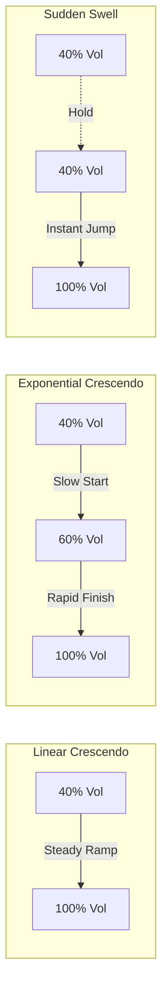
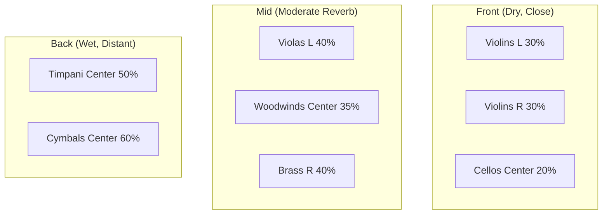

# Operational Verification Labs: Film Scoring

## Objective & Lab Setup

This laboratory provides hands-on experience in practical film scoring workflows: orchestral mockup construction, thematic development, MIDI orchestration, mixing for picture, and sync-to-timecode delivery. You will compose, orchestrate, and deliver a complete 60-second cue synchronized to a reference video file.

**Required Tools:**
- **DAW:** Reaper, Logic Pro, or Cubase (examples use Reaper for universal applicability)
- **Orchestral Libraries:** Spitfire Audio BBC Symphony Orchestra Discover (free), or any quality orchestral VST
- **Video Playback:** DAW native video engine or VLC for reference
- **MIDI Controller:** Any 25+ key controller with mod wheel and pitch bend
- **Audio Interface:** Any 2-channel interface with ASIO/Core Audio drivers
- **Reference Video:** Download a 60-second silent film clip (Creative Commons or royalty-free stock)

**Pre-Lab Checklist:**
1. Set project sample rate to 48 kHz (film standard, not 44.1 kHz)
2. Set video to display in DAW timeline at 24 fps (cinema standard)
3. Load orchestral templates with string, brass, woodwind, and percussion sections pre-routed
4. Verify MIDI controller is recognized and mapped to mod wheel (CC1) for expression control
5. Create a tempo map matching the emotional arc of your reference video

---

## Exercise 1: Thematic Construction & MIDI Orchestration

### Step 1: Spotting & Tempo Mapping

**Spotting** is the process of identifying key dramatic moments (hits, transitions, emotional shifts) in the video and anchoring musical events to them.

1. Import your 60-second video file into Reaper: `Insert > Media File`, select video, check "Import as new track"
2. Scrub through the video and mark **three spotting points** using markers:
   - **0:00** — Opening frame (establishes tonality)
   - **0:22** — Emotional shift or action beat (modulation or textural change)
   - **0:50** — Climax or resolution (dynamic peak)
3. Set initial tempo to 120 BPM. Add tempo changes at markers to match pacing:
   - If the 0:22 shift is slow/reflective, drop to 90 BPM
   - If the 0:50 climax is intense, ramp to 140 BPM
4. Enable "Tempo envelope visible" to visually confirm tempo curve

**Verification:** Play video with click track. Downbeats should align naturally with visual cuts and character movements.

---

### Step 2: Composing the Primary Theme (Strings)

Create a **leitmotif** — a short, memorable 4-bar melodic phrase that represents the scene's emotional core.

**Example Theme in D Minor (Reflective/Melancholic):**

```
Measure 1: D4 (dotted half), F4 (quarter)
Measure 2: A4 (half), G4 (quarter), F4 (quarter)
Measure 3: E4 (whole note tied to...)
Measure 4: E4 (half), D4 (half)
```

**MIDI Entry Procedure:**
1. Create MIDI track, load **Violin 1** patch from your orchestral library
2. Open MIDI editor (double-click MIDI item)
3. Set grid to 1/4 note, enable snap
4. Draw notes using pencil tool at velocities 80–100 (forte dynamic)
5. Add **expression automation** (CC1 Mod Wheel):
   - Start at 50% (neutral)
   - Crescendo to 85% at measure 3 climax
   - Decrescendo to 40% at measure 4 resolution

**Hand Technique on MIDI Controller:**
- Rest left hand thumb on mod wheel
- Play melody with right hand, simultaneously shaping phrase with mod wheel in real-time
- Record in one take to capture natural phrasing

**Orchestration Principle:** Strings carry melody in film scores 70% of the time due to sustain, vibrato, and dynamic range. Violins project best in D–A–E string range (open string resonance).

---

### Step 3: Harmonic Support (Woodwinds & Brass)

Add **sustained pads** underneath the melody to establish harmonic foundation.

**Chord Progression (D Minor):**

```
Measure 1: Dm (D-F-A)
Measure 2: Bb (Bb-D-F)
Measure 3: C (C-E-G)
Measure 4: Am (A-C-E)
```

**Implementation:**
1. Create MIDI track, load **Flute/Oboe section** patch
2. Voice chords in **closed position** (notes within one octave) at C4–C5 range
3. Set note lengths to whole notes (sustain through each measure)
4. Set velocities to 60–70 (piano dynamic, supporting role)
5. Create second MIDI track, load **Horn section** patch
6. Double the same chords one octave lower (C3–C4) at velocities 50–60

**Voice Leading Rule:** Move each voice to the nearest chord tone to avoid large leaps. Example: Dm to Bb transition moves D→D (unison), F→F (unison), A→Bb (minor 2nd up).

**Orchestration Principle:** Woodwinds in mid-register provide warmth without masking strings. Horns anchor harmony in low-mid register, providing body without muddiness.

---

### Step 4: Rhythmic Foundation (Percussion)

Add **timpani hits** on spotting points to punctuate dramatic moments.

1. Create MIDI track, load **Timpani** patch
2. Place single notes at:
   - **0:00** — C2 (tonic pedal tone), velocity 100
   - **0:22** — Bb1 (tension), velocity 110
   - **0:50** — C2 (resolution), velocity 120
3. Set note length to quarter note with slight overlap (legato)
4. Add **subtle reverb** (2.0s decay, 20% wet) to blend with orchestral space

**Performance Technique:** Timpani hits should precede downbeat by 20–50ms (negative timing offset) to account for attack transient and perceptual latency.

---

## Exercise 2: Parameter Variation & Empirical Analysis

### Experiment 1: Instrumentation Substitution Matrix

Replace primary melody instrument and measure emotional impact.

**Test Matrix:**

| Instrument | Timbre Character | Emotional Valence | Dynamic Range | Suitability Rating (1-5) |
|------------|-----------------|-------------------|---------------|------------------------|
| Violin Section | Warm, sustained, vibrato-rich | Melancholic, romantic | Wide (pp to fff) | 5 |
| Solo Cello | Dark, intimate, vulnerable | Introspective, lonely | Wide | 4 |
| Oboe | Nasal, piercing, plaintive | Pastoral, longing | Moderate | 3 |
| French Horn | Heroic, noble, round | Epic, triumphant | Moderate-Wide | 4 |
| Synth Pad | Ethereal, sustained, no attack | Ambient, detached | Narrow | 2 |

**Procedure:**
1. Duplicate string melody track
2. Mute original, load alternative instrument
3. Play back full cue and rate on emotional impact scale
4. Record observations: Does the instrument support or conflict with visual narrative?

**Expected Results:** Violin section scores highest for classical film scoring due to sustain and expressive vibrato. Solo cello works for intimate scenes but lacks orchestral weight. Synth pad feels anachronistic unless scoring sci-fi.

---

### Experiment 2: Harmonic Tension Modulation

Test emotional response to key modulation at 0:22 spotting point.

**Test Configurations:**

| Key Change | Harmonic Relationship | Tension Level | Emotional Effect |
|------------|---------------------|---------------|-----------------|
| D minor → D minor (no change) | Tonic | Low | Stasis, continuation |
| D minor → F major | Relative major | Low-Moderate | Brightening, hope |
| D minor → E♭ major | Half-step up | High | Tension, unease |
| D minor → A minor | Dominant minor | Moderate | Darkening, descent |

**Procedure:**
1. Duplicate measures 3–4 of melody
2. Transpose MIDI notes to new key
3. Update harmony tracks to match new key center
4. Record subjective tension rating (1–10 scale)

**Verification:** Play back with video. Does the modulation align with visual narrative shift at 0:22?

**Expected Results:** E♭ major modulation (half-step up) creates maximum tension due to distant harmonic relationship. Use for plot twists or villain reveals.

---

### Experiment 3: Dynamic Curve Shaping

Map volume automation curves and measure perceived intensity.

**Test Curves:**



**Procedure:**
1. Insert volume automation on master bus
2. Draw three different crescendo shapes from measure 1 to measure 4
3. Play back and rate perceived intensity buildup (1–10 scale)
4. Graph results: X-axis = time, Y-axis = perceived intensity

**Expected Results:** Exponential curve feels most natural (matches Fletcher-Munson loudness perception). Sudden swell creates shock/surprise effect.

---

## Exercise 3: Fault Injection & Stress Testing

### Fault 1: Phase Cancellation in String Doubling

**Induced Error:** Load two identical violin patches on separate tracks, pan both center, introduce 2–5ms timing offset on one track.

**Expected Symptom:** Thin, hollow sound with missing fundamental frequencies (comb filtering). String ensemble loses body and presence.

**Analysis:**
1. Solo both violin tracks
2. Export mixdown and analyze in spectrum analyzer
3. Observe notches at frequencies: f_notch = n × (sample_rate / delay_samples), where n = 1, 2, 3...

**Recovery Procedure:**
1. Quantize both MIDI tracks to same grid (remove timing offset)
2. OR pan tracks hard left/right (eliminates phase interaction)
3. OR replace one violin with viola/cello (different timbre, no phase issues)

**Verification:** Re-export mixdown and confirm flat frequency response in analyzer.

---

### Fault 2: Dynamic Compression Pumping Artifact

**Induced Error:** Insert aggressive limiter on master bus: -12 dB threshold, 10:1 ratio, 10ms attack, 50ms release.

**Expected Symptom:** Audible "breathing" as orchestra swells trigger gain reduction, then release causes sudden volume jump. Destroys dynamic contrast.

**Analysis:**
1. Play back full cue and listen for gain reduction pumping on timpani hits
2. Enable limiter gain reduction meter — should show 6+ dB reduction

**Recovery Procedure:**
1. Raise limiter threshold to -6 dB (gentler compression)
2. Increase attack time to 30ms (let transients through)
3. Increase release time to 200ms (smooth gain recovery)
4. OR remove limiter entirely, reduce individual track volumes instead

**Verification:** Timpani hits should retain sharp attack transient without triggering pumping.

---

### Fault 3: MIDI Velocity Flatline (No Expression)

**Induced Error:** Set all MIDI note velocities to fixed value (80) and flatten mod wheel automation to 50%.

**Expected Symptom:** Robotic, mechanical performance lacking human phrasing. Sounds like a MIDI mockup, not a real orchestra.

**Analysis:**
1. Play back melody track and compare to original expressive version
2. Rate realism on 1–10 scale (should drop to 3–4)

**Recovery Procedure:**
1. Re-record MIDI with live mod wheel shaping (see Step 2 technique)
2. OR manually draw velocity curves: start phrases at 70, crescendo to 100, decrescendo to 60
3. OR load "humanize" MIDI script to randomize velocities ±10

**Verification:** Re-rate realism (should return to 7–8). Subtle velocity variation is 80% of realistic orchestral mockup.

---

## Exercise 4: Mixing for Film & Delivery

### Frequency Masking & Dialogue Clearance

Film music must leave **300 Hz – 3 kHz band** clear for dialogue. This is the human vocal intelligibility range.

**Implementation:**
1. Insert EQ on master bus
2. Apply **gentle cut**: -3 dB bell filter at 1 kHz, Q = 2.0
3. Apply **high-pass filter** at 80 Hz (removes rumble, clears space for dialogue bass)

**Verification:** Import a spoken dialogue sample, mix with music at -6 dB relative level. Dialogue should remain 100% intelligible.

---

### Spatial Placement & Orchestral Depth

Create front-to-back depth using **reverb send levels** and **early reflection delays**.

**Standard Orchestral Seating (Stereo Field):**



**Procedure:**
1. Create reverb send bus: Load convolution reverb with concert hall impulse response
2. Send violins at -18 dB to reverb (dry, upfront)
3. Send woodwinds at -12 dB to reverb (moderate depth)
4. Send timpani at -6 dB to reverb (distant, spacious)

**Verification:** Close your eyes and visualize orchestra placement. Front-to-back depth should be clearly audible.

---

### Sync Lock & Timecode Delivery

Ensure music remains locked to video across multiple playback systems.

**Reaper Timecode Lock Procedure:**
1. Right-click video item → Item Properties
2. Check "Lock to time (not beats)" — prevents tempo changes from shifting sync
3. Export Options: `File > Render`
   - Sample Rate: 48000 Hz
   - Bit Depth: 24-bit
   - Format: WAV (not MP3 — MP3 introduces timing jitter)
4. Verify sync: Re-import rendered audio, place at 0:00:00.000, play with video

**Common Sync Drift Causes:**
- DAW set to 44.1 kHz but video is 48 kHz (sample rate mismatch)
- Audio exported with VBR MP3 codec (variable bitrate adds latency)
- Tempo grid enabled when should be locked to absolute time

---

## Practical Cheat Sheet & Quick Reference

| Task | Command/Parameter | Example Value |
|------|------------------|---------------|
| **Set Film Sample Rate** | Project Settings → Sample Rate | 48000 Hz |
| **Import Video** | Insert → Media File → Check "Import as track" | 24 fps, 60s duration |
| **Create Spotting Marker** | Press M at playhead position | Marker 1 at 0:00.000 |
| **Add Tempo Change** | Double-click tempo lane, insert point | 120 BPM → 90 BPM at 0:22 |
| **MIDI Expression (Mod Wheel)** | CC1 automation | 50% neutral, 85% climax |
| **String Velocity Range** | MIDI note velocity | 80–100 (forte melody) |
| **Woodwind Pad Velocity** | MIDI note velocity | 60–70 (piano support) |
| **Timpani Attack Offset** | MIDI note position | -30ms before downbeat |
| **Dialogue Frequency Clear** | EQ cut | -3 dB at 1 kHz, Q = 2.0 |
| **Reverb Send (Strings)** | Send level | -18 dB (dry/close) |
| **Reverb Send (Percussion)** | Send level | -6 dB (wet/distant) |
| **Master Limiter Threshold** | Limiter plugin | -6 dB (gentle, transparent) |
| **Export Format** | Render settings | 48 kHz, 24-bit WAV |

---

## Orchestration Voice Leading Principles

**Spacing Rules:**
- Strings: Keep melody in violin range D4–A5 (sweet spot)
- Woodwinds: Chord tones within one octave (closed voicing)
- Brass: Root position or first inversion, avoid second inversion (unstable)
- Bass: Double root in cellos/basses an octave below harmony

**Dynamic Balance:**
- Melody: f–ff (forte to fortissimo, 80–110 velocity)
- Harmony: mp–mf (mezzo-piano to mezzo-forte, 60–80 velocity)
- Bass: mf (mezzo-forte, 70–85 velocity)
- Percussion: f–fff (forte to fortississimo, 100–127 velocity on hits)

**Counterpoint Avoidance:**
- No parallel 5ths or octaves between outer voices (violins and bass)
- Resolve leading tones up by half-step (B→C in C major)
- Avoid large leaps (>P5) in inner voices unless melodic necessity

---

## Troubleshooting Guide

| Symptom | Probable Cause | Solution |
|---------|---------------|----------|
| Video and audio drift out of sync | Sample rate mismatch or tempo lock disabled | Set project to 48 kHz, lock video to absolute time |
| Strings sound thin/hollow | Phase cancellation from doubled patches | Pan doubles hard L/R or remove one instance |
| Dialogue is masked by music | Music occupies 300 Hz–3 kHz band | Cut -3 dB at 1 kHz, high-pass at 80 Hz |
| Orchestra sounds flat/2D | No reverb or all tracks same send level | Use convolution reverb, vary send by depth |
| MIDI sounds robotic | Fixed velocities and no mod wheel | Humanize velocities ±10, record with mod wheel |
| Limiter pumps on timpani hits | Attack too fast, release too short | Increase attack to 30ms, release to 200ms |
| Modulation sounds jarring | Distant key relationship (tritone, half-step) | Use relative major/minor or dominant modulation |

---

## Advanced: Stems for Re-Recording Mixer

Professional film scoring delivers **stems** (grouped submixes) for final dub stage:

**Standard Stem Configuration:**
1. **M1 (Music Stems 1):** Strings only
2. **M2 (Music Stems 2):** Brass + Woodwinds
3. **M3 (Music Stems 3):** Percussion
4. **MX (Music Mix):** Full stereo mix

**Export Procedure in Reaper:**
1. Route string tracks to Bus 1, brass/woodwinds to Bus 2, percussion to Bus 3
2. `File > Render` → Enable "Stems (selected tracks)" → Select buses 1-3 + master
3. Render outputs M1.wav, M2.wav, M3.wav, MX.wav

**Use Case:** Re-recording mixer can adjust string level under dialogue without affecting brass fanfare at climax.

---

## Evaluation Criteria

Rate your final 60-second cue on these metrics (1–10 scale):

- **Sync Accuracy:** Music hits align with spotting points within ±100ms
- **Orchestral Balance:** No instrument masks others, clear hierarchy (melody > harmony > bass)
- **Dynamic Range:** Minimum 12 dB difference between quietest and loudest moment
- **Emotional Alignment:** Music supports (not contradicts) visual narrative
- **Technical Quality:** No clicks, pops, phase issues, or limiting artifacts
- **Dialogue Clearance:** If dialogue present, 100% intelligible with music at -6 dB

**Minimum Passing Score:** 7/10 average across all metrics.
