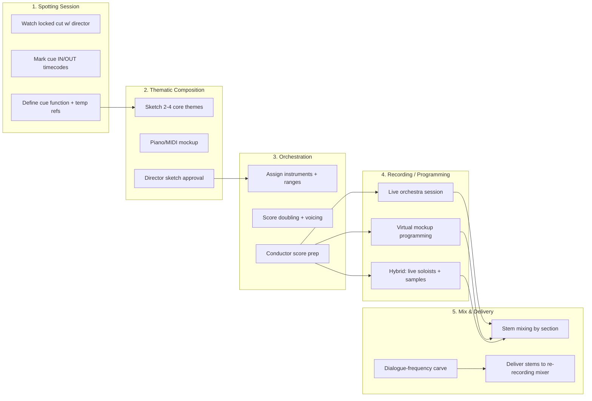

# Lesson 1: Film Scoring — Spotting, Composing, and Scoring to Picture

## 1. First-Principles Intuition (Read Once, Then Go Practice)

Film scoring is writing music that locks to a moving picture in time and serves a story that already has dialogue and sound effects competing for the listener's attention. Three things make it fundamentally different from writing concert music, and every technique in this lesson exists because of them.

**The mix is a hierarchy, not a blend.** In the final dub, dialogue wins, critical sound effects win next, and music gets what's left — usually the low end below 200 Hz and the air above 4-5 kHz, with a canyon carved out of 1-3 kHz where vowel formants live. If you compose a cue that depends on a melody sitting at 1.5 kHz in the strings, it will vanish under dialogue in the final mix no matter how well you wrote it. You have to know this on day one, not discover it at the dub.

**Picture timecode is the only clock that matters.** Concert music breathes with rubato; film music must land specific hits — a door slam, a gasp, a cut to black — within about one frame (41.7 ms at 24fps). Your DAW session is built around timecode (hours:minutes:seconds:frames), not just bars and beats. A tempo map is a tool for hitting timecode targets, not an expressive end in itself.

**Harmony is a trigger, not just a structure.** Hollywood scoring leans on Romantic-era harmonic associations because audiences have been trained on them for a century of film: major = resolution, minor = melancholy, diminished/augmented = threat, suspensions = unresolved tension, the tritone = danger. These are learned associations, not acoustic law, but you can rely on them working on a mainstream audience, and you can subvert them deliberately for effect (a major triad under a horror reveal reads as "uncanny," not "happy").

**A leitmotif is a password, not a melody.** Three or four notes, reharmonized and rescored, can carry a character's entire arc once the audience has heard the theme attached to them two or three times. This is the single highest-leverage compositional tool in the discipline — master it before you worry about orchestration color.

The rest of this lesson is the hands-on pipeline: how to run a spotting session, build a theme that survives reharmonization, orchestrate it so it doesn't get buried, record or program it, and deliver it in a form the dub stage can actually use.

---

## 2. The Production Pipeline



---

## 3. Phase 1 — Spotting Session (Run This Like a Director Meeting, Not a Jam Session)

**Goal:** leave the room with exact timecodes and a one-sentence emotional brief for every cue.

### Procedure
1. Watch the locked (or near-locked) cut with the director and picture editor on a system displaying burned-in timecode.
2. For every cue, write the IN point, OUT point, and duration to the frame.
3. Write a one-line emotional brief per cue — not "sad music," but "she realizes he's lying, but doesn't confront him yet."
4. Capture temp track references and, critically, *what specifically* the director likes about them (the ostinato rhythm? the instrumentation? the chord progression?) so you can honor the function without plagiarizing the piece.
5. Flag any cue that underscores dialogue — those need a composing strategy from day one (sparse low end, avoid competing midrange).

### Spotting Notes Template (copy this verbatim into your notes doc)

```text
CUE: 1M1 (Reel 1, Music cue 1)
TIMECODE IN:  00:02:34:12
TIMECODE OUT: 00:03:48:00
DURATION:     1:13:12  (73.5 sec @ 24fps)

SCENE: Sarah finds the letter in the attic.
FUNCTION: Mysterious curiosity, build to a scare-hit at the gasp.
HIT POINT: 00:03:22:18 — she gasps. Needs a clear musical accent within ±1 frame.

TEMP REF: "Discombobulate" (Zimmer) — director likes the driving ostinato,
          NOT the instrumentation. Avoid direct harmonic/melodic quotation.

DIALOGUE IN CUE: Yes, VO narration from 00:02:50 to 00:03:10 — keep orchestration
                 thin and high/low (avoid 1-3 kHz density) under this section.

INSTRUMENTATION NOTES: Solo strings, no brass until the hit.
```

Keep this as a living spreadsheet (one row per cue) with columns for cue number, timecode in/out, duration, status (sketch/approved/orchestrated/recorded/mixed), and theme(s) used. This single document is what keeps a 40-cue feature score from becoming chaos.

---

## 4. Phase 2 — Thematic Composition

**Goal:** write a theme that still works after it's been slowed down, minor-ized, fragmented, and buried under dialogue three reels later.

### Constraints that actually matter in practice

- **Keep the core statement within an octave.** Anything wider is hard to transpose across instrument ranges and hard for an audience to sing back mentally.
- **State the identity in the first 2 bars with a distinctive leap**, not stepwise motion. A perfect 5th, minor 6th, or tritone leap is what the ear grabs onto and remembers. Stepwise material is for connective tissue, not the hook.
- **Write it so it's harmonically ambiguous enough to survive a mode change.** If your theme only works over a I-IV-V major progression, it can't become the "defeat" variant later without a full rewrite. Test it immediately in both major and minor.
- **Don't over-syncopate the primary statement.** Save rhythmic complexity for later variations — the first time the audience hears a theme, the rhythm needs to be simple enough that the *pitch contour* is what imprints.

### Worked example: a Hero Theme in C major, built for reharmonization

```text
PRIMARY STATEMENT (strings, mf, moderate tempo):
Bar 1: C4 - E4 - G4 - A4      (stepwise rise toward dominant color)
Bar 2: G4 - F4 - E4 - D4      (descending resolution)
Bar 3: C4 - G4 - C5           (octave leap — the "triumph" gesture, the hook)
Bar 4: C5 - B4 - A4 - G4      (stepwise descent, half cadence, breathes before repeat)

VARIATION A — "Defeat" (same pitches, new harmonic context):
- Transpose to C minor, same contour
- Half tempo (quarter = 56 instead of 92)
- Score for solo cello + muted horns instead of full strings
- Remove the octave leap in bar 3 — replace with a minor 6th (feels like
  reaching and falling short, rather than arriving)

VARIATION B — "Action" (rhythmic augmentation/diminution):
- Same 4-bar contour compressed into 2 bars
- Approach notes become 16th-note runs
- Add ostinato bass (quarter notes, root-fifth alternation) underneath
- Brass doubles the melody an octave down for weight
```

**Practice drill:** take any 4-bar folk melody you know by ear and run it through this exact process — major statement, minor "defeat" variant, rhythmically augmented "action" variant. Do this daily for two weeks before you ever touch a real cue. Thematic transformation is a craft skill, not an inspiration event, and it only gets fast through repetition.

---

## 5. Phase 3 — Orchestration

**Goal:** translate the piano sketch into instrumental parts that read as the emotional color you intended, and that will still cut through dialogue and FX in the final mix.

### Orchestral Range Reference (Standard Hollywood Orchestra)

| Section | Instrument | Practical Range | Character |
|---|---|---|---|
| Strings | Violin I/II | G3–A7 | Lyrical, soaring, can sit in dialogue-clear 3-6 kHz band in upper register |
| | Viola | C3–E6 | Warm alto voice, good for tension pads |
| | Cello | C2–C6 | Melodic bass, emotional depth, doubles well with horn |
| | Double Bass | E1–G4 | Foundation — keep mono/centered below 200 Hz |
| Woodwinds | Flute | C4–C7 | Ethereal, innocent; upper register sits *above* dialogue |
| | Oboe | Bb3–A6 | Pastoral, plaintive, exposed solo voice |
| | Clarinet | D3–G6 | Agile, comedic to sinister depending on register |
| | Bassoon | Bb1–Eb5 | Grounded, comic relief or bass support |
| Brass | Horn | F2–F5 | Noble, heroic, blends — the "glue" of the brass section |
| | Trumpet | E3–C6 | Fanfare, bright, cuts through density easily |
| | Trombone | E2–Bb4 | Weight and power, low brass support |
| | Tuba | D1–F4 | Pedal tones, foundation |
| Percussion | Timpani | D2–A3 (4 drums) | Punctuation, thunder, march accents |

### Orchestration moves that actually change the emotional result

**Doubling for timbre (the fastest lever you have):**
- Violin I + Flute, octave apart → bright, fairy-tale color
- Cello + Bassoon, unison → dark, ominous weight
- Horn + Cello, unison → warm, romantic blend
- Trumpet + Violin, unison → piercing urgency, used for alarm/danger stingers

**Voicing spread controls tension directly:**
- **Close position** (all chord tones within an octave) reads as dense and claustrophobic — use for anxiety, confined spaces, standoffs.
- **Open position** (chord tones spread 2+ octaves) reads as spacious and calm — use for vistas, resolution, relief.
- **Drop-2** (second-from-top voice dropped an octave) gives a clear, balanced sound good for a stated theme that needs to read clearly without feeling thin or crowded.

**Dynamic layering for mix survival:** write the string pad at *pp* and the solo woodwind statement at *mf* — a 2-3 dynamic-marking gap between bed and melody gives you headroom in the mix without EQ surgery later. This is cheaper to fix at the writing stage than at the mix stage.

**Register discipline for dialogue scenes:** if a cue underscores VO or dialogue, deliberately avoid stacking instruments in the 1-3 kHz zone (midrange strings and midrange brass unison). Push melodic material into cello/horn low register or flute/violin high register, leaving the vocal formant band clear. Write this directly into your orchestration — don't rely on the mixer to dig you out later.

---

## 6. Phase 4 — Recording & Programming

### Live Orchestra Session

**Stage setup:**
- Scoring stage, minimum ~5,000 sq ft for a 60-piece orchestra
- Isolation booths for percussion and piano
- Conductor faces the orchestra with a video monitor showing picture and a timecode counter
- Click track routed to conductor (and rhythm section if used) only — the orchestra follows the conductor's baton, not headphone clicks, for natural ensemble feel

**Mic array (Decca Tree + spot mics):**
- 3 large-diaphragm condensers in a triangle ~2m above and behind the conductor (L-C-R stereo image — this is your main orchestral picture)
- Spot/close mics per section: strings by desk pair, individual woodwind and brass stands
- Room mics at the rear of the hall for natural decay/ambience
- Typical channel count: 40-60 inputs for a full session

**Session procedure:**
1. Tune to A440 (or A442 for a brighter, more "cinematic" edge some rooms prefer)
2. Run the cue against picture once, unrecorded, so the conductor internalizes the hit points
3. Confirm picture/timecode lock with the engineer before rolling
4. Record 2-3 full takes
5. Punch in corrections on difficult passages (don't re-record a clean 90 seconds to fix 4 bars)
6. Pull up the recording against picture immediately and verify every marked hit point lands within a frame — do this before the orchestra leaves the building

### Virtual Orchestra Programming

**When live isn't in the budget**, the mockup quality is the deliverable — directors reject scores based on demo quality constantly, independent of the composition itself. Treat humanization as mandatory, not optional polish.

**Library choices that matter:** Spitfire Symphonic Orchestra, Vienna Symphonic Library, Cinematic Studio Series, EastWest Hollywood Orchestra — all provide true legato scripting (real recorded interval transitions, not just crossfaded sustains). Don't build a mockup on short/sustain patches alone; the legato engine is what sells the illusion of a live player.

**Humanization checklist — apply every item, every cue:**
- Randomize note-on timing ±10-20ms across a section so instruments don't trigger in inhuman lockstep
- Vary velocity across a real musical range (60-100), never locked at a single value
- Add pitch drift of a few cents on long sustains — real strings are never perfectly static
- Crossfade between dynamic layers (pp/mf/ff samples) using an expression CC, don't just scale volume
- Layer in subtle breath/bow noise from foley or library "extras" patches for winds and strings

**MIDI programming workflow (Cubase/Logic/Pro Tools, applies to any DAW):**

```text
1. Set project frame rate to match delivery spec exactly (24fps vs 23.976 —
   confirm with post before you start, not after).
2. Import picture reference synced to timecode 00:00:00:00.
3. Build a tempo map that hits your marked sync points — use tempo changes
   freely; the goal is timecode accuracy, not a "musical" tempo map.
4. Sketch the cue in a piano sound first, purely for timing — don't commit
   to orchestral patches until the shape is right.
5. Assign real orchestral patches, respecting the range chart above —
   don't write a bassoon line above Eb5 or a flute line below C4.
6. Program articulation keyswitches (library-dependent, e.g. C0 = legato,
   C#0 = staccato, D0 = pizzicato).
7. Draw CC11 (expression) curves by hand for every phrase — don't leave
   dynamics flat. This is the single biggest "live vs. mockup" tell.
8. Render stems per section (strings/woods/brass/perc) even for a mockup —
   you'll need this structure for Phase 5 regardless.
```

---

## 7. Phase 5 — Mixing & Stem Delivery

Film scores are never delivered as a stereo master. You deliver **stems** — separated submixes — so the re-recording mixer can balance music against dialogue and effects at the dub stage, where the final creative call actually happens.

### Standard stem breakdown
- Stem 1: Strings (violins, violas, cellos, basses → stereo bus)
- Stem 2: Woodwinds (flutes, oboes, clarinets, bassoons → stereo bus)
- Stem 3: Brass (horns, trumpets, trombones, tuba → stereo bus)
- Stem 4: Percussion (timpani, drums, cymbals, auxiliary → stereo bus)
- Stem 5: Synths/electronics (if used)
- Stem 6: Piano/featured soloist (if applicable)

### Mixing priorities, in order
1. **Dialogue clearance first.** Surgical EQ cut of -3 to -6 dB in the 1-3 kHz band on any stem that competes with VO sections of the cue — do this before you touch anything else.
2. **Preserve dynamic range.** Film score mixes run far wider than pop masters. Target roughly -20 LUFS integrated for quiet passages and -10 LUFS at climaxes. Do not slap a limiter on a film score stem — crushing the dynamics removes exactly the emotional contrast the cue was composed to deliver.
3. **Control stereo width by frequency.** Keep everything below 200 Hz centered/mono (bass, low cello/bass, kick-equivalent percussion) — wide low end causes phase problems on mono theatrical playback systems. Spread mid/high strings and pads wide for air and scale.
4. **Keep reverb short and controlled.** 0.8-1.2 second decay places the orchestra in a believable space without smearing transients or fighting dialogue intelligibility. Long concert-hall reverb tails are a common amateur mistake in film mixing — they sound great solo and terrible under a scene.

### Delivery spec checklist
- Format: WAV, 24-bit, 48kHz (standard film post sample rate — confirm, some episodic work still runs 48k/24 exclusively, features occasionally differ)
- Loudness: -20 LUFS integrated pre-dub reference level (the dub stage will ride it from here)
- Timecode: every stem starts at the same reference timecode as picture (usually 00:00:00:00 or the designated picture start)
- Handles: 2 seconds of pre-roll and tail per cue, so the mixer has crossfade material and isn't stuck with a hard cut

---

## 8. Workflow Optimization

**Build a standing orchestral template.** Load instruments, assign articulations, and route mix buses once, in a template session you reuse for every project. Professional composers run templates with 200-400 pre-configured tracks. This removes 2-3 hours of setup from every single cue you write.

**Never orchestrate before sketch approval.** A piano/string mockup takes an hour to revise; a full orchestration takes a day. Get the director's sign-off on the sketch first — orchestrating unapproved material is the single most common source of wasted hours on a score.

**Run cues in parallel pipeline stages.** While Cue 1 is with the director for feedback, start sketching Cue 2. Keep 3-4 cues moving through different phases simultaneously so you're never blocked waiting on a single approval.

**Compose in modular 8-16 bar blocks.** Picture gets re-edited constantly, especially after test screenings. A cue built from swappable blocks can be reordered to fit a new edit; a continuously-through-composed cue usually has to be rewritten from scratch.

---

## 9. Common Failure Modes & Fixes

**Mickey-Mousing (over-synchronization).** Every footstep gets a musical stab; the cue feels like a cartoon. *Fix:* limit yourself to 2-3 true sync hits per cue and let the music breathe independently between them — score the emotional undercurrent of the scene, not its literal physical action.

**Temp track lock.** The director has edited to a temp score for months and rejects your original material because "it doesn't feel like the temp." *Fix:* during spotting, name specifically what's working in the temp (a rhythmic pattern, an instrumentation choice, an energy level) versus what's just familiarity. Propose explicitly: "I'll keep that driving ostinato but build a new melody over it" — give the director a concrete hybrid instead of an abstract promise.

**Frequency masking at the dub.** You deliver a lush, full-spectrum mix; the dialogue mixer carves so much midrange out for VO clarity that your score collapses to bass rumble and shimmer. *Fix:* pre-carve 1-3 kHz in dialogue-underscore sections during composition (not after), request a temp dub early, and consider delivering an alternate low-density stem specifically for heavy-dialogue scenes.

**Sync drift on frame rate mismatch.** You score to 24fps; delivery picture is 23.976fps (NTSC). Over a 2-minute cue, the drift accumulates to several frames. *Fix:* confirm exact delivery frame rate with the post supervisor *before* you start composing, lock your DAW session to timecode rather than musical bars, and re-conform with a high-quality time-stretch algorithm (e.g., Élastique Pro) if the rate changes late.

**Unrealistic virtual mockup kills a good composition.** The director judges the piece by demo fidelity, not the writing. *Fix:* invest in libraries with true legato scripting, study phrasing from real recordings, program tempo rubato by hand rather than a flat grid, and layer in real breath/bow noise. If the cue is pivotal, budget for a live soloist overdub (violin, cello, flute) on top of the programmed bed — this single move often fixes 80% of the "it sounds fake" problem.

**Weak thematic development.** Every cue sounds good in isolation but the score has no identity across the film. *Fix:* lock 2-3 core themes in the first 15 minutes of screen time, maintain a tracking spreadsheet of which theme appears in which cue/key/mode, and reserve fully new material for only 1-2 cues (usually the climax and the denouement).

**Overlength cues break the edit.** You write a 3-minute cue for a 2-minute scene; the editor can't trim it without destroying the musical form, and mutes it instead. *Fix:* compose to the exact timecode duration from your spotting notes, keep introductions short (film pacing moves faster than concert pacing), and build in modular blocks if the scene is likely to be re-cut.

---

## 10. Realistic Benchmarks

- **Feature film (≈90 min of score):** 8-12 weeks from spotting to final delivery, typically
- **Composition throughput:** roughly 2-3 minutes of finished, fully orchestrated music per working day for an experienced composer
- **Live recording:** a 60-piece orchestra can record about 30-40 minutes of finished score per 3-hour session
- **Mix time:** approximately 1 day of stem mixing per 10 minutes of finished score

**Checkpoints to hold yourself to:**
1. Sketch approval signed off within 1 week of spotting
2. Orchestration reviewed by the conductor for playability at least 1 week before the recording date
3. Tech scout: fully test your DAW/sample-library signal chain on one representative cue before committing the whole score to that pipeline
4.

4. **Final mix stems delivered** at least 3 days before the dub stage so the re-recording mixer can pre-balance dialogue, music, and effects without the composer present.

These benchmarks assume you are working on a modestly budgeted independent feature with a single composer and a small team. Studio tentpoles compress the schedule (sometimes 6 weeks total) but add personnel — additional orchestrators, a music editor, and dedicated scoring mixers — to maintain throughput. The critical invariant across all budget levels is *never let the recording session be the first time anyone hears the fully realized cue*: internally review mockups with the director, walk through scores with the orchestrator, and pre-mix your template balance before printing stems. Every downstream collaborator (conductor, mixer, music editor) must receive materials early enough to flag problems while you still have time to fix them. Treat each handoff as a one-way gate: once you deliver to the next stage, the cost and political capital required to backtrack rises exponentially, so front-load your quality control and reserve the final week for small adjustments, not structural rewrites.

---

## Summary & Verification Matrix

| **Invariant / Principle** | **Governing Mechanism** | **Diagnostic / Verification Criterion** | **Common Failure Mode** |
|----------------------------|-------------------------|----------------------------------------|-------------------------|
| **Spotting precision defines scope** | Spotting session locks cue placement, duration, and emotional intent before composition begins | Every cue has written start/end timecode, agreed emotional target, and editor/director sign-off | Composing without locked timecodes → cues don't fit final cut; vague spotting notes → endless revision cycles |
| **Thematic coherence over cue-by-cue novelty** | 2-3 core themes recycled in varied keys/modes/instrumentations across 80%+ of the score | Thematic tracking spreadsheet shows each leitmotif appears ≥5 times; new themes reserved for 1-2 pivotal scenes | Every cue introduces new material → no musical identity; audience can't follow emotional through-line |
| **Sync to picture is non-negotiable** | SMPTE timecode, hit points, and tempo maps lock music to visual action within ±1 frame | Playback in DAW with video overlay confirms downbeats align to cut points, crescendos peak at visual climaxes | Composing to rough cut or ignoring timecode → music-picture drift forces expensive re-recording or rejection |
| **Orchestration for playability and budget** | Write within the technical range and articulation limits of your ensemble; live players cannot execute impossible passages | Conductor/orchestrator pre-flight review flags unplayable passages ≥1 week before session | Unplayable scores discovered in session → wasted studio time, emergency simplifications, or mockup replacement |
| **Iterative mockup approval before recording** | Director approves fully produced DAW mockups that preview final emotional impact and timing | Written or email approval on final mockups before orchestration/recording budget is spent | Recording unapproved material → expensive re-records or unused cues; director hears "real" version for first time on dub stage |
| **Stems and mix handoff preserve flexibility** | Deliver separated stem groups (strings, brass, winds, percussion, synths, etc.) so re-recording mixer can rebalance against dialogue/FX | Stem exports pass null test (sum to original mix); stems delivered ≥3 days before dub stage | Stereo-only delivery forces mixer to mute entire cues when dialogue conflicts arise; no time for stem re-export |
