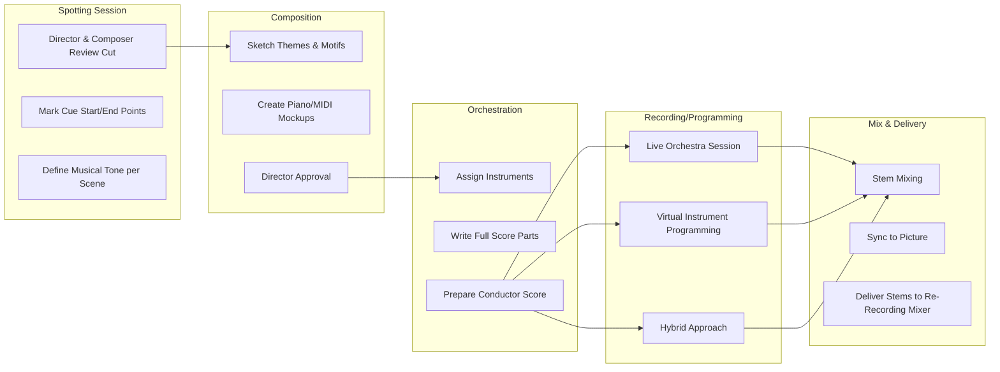

# Lesson 1: Introduction to Film Scoring

## 1. First-Principles Intuition & Invariants

Film scoring is the compositional discipline of writing music that synchronizes with moving picture to enhance narrative, guide emotional response, and establish dramatic pacing. The invariants of effective film scoring are:

**Narrative Service:** Music must support the story without overpowering dialogue or sound design. The score operates in a three-way balance with dialogue (intelligibility), sound effects (spatial realism), and music (emotional subtext). When these compete, dialogue takes priority, followed by critical sound effects, then score.

**Temporal Synchronization:** Film music exists in locked relationship to picture timecode. Unlike concert music where tempo is fluid, film cues must hit specific picture events (called "sync points" or "hit points") within frame-accurate precision (±1 frame at 24fps = ±42ms tolerance).

**Psychoacoustic Anchoring:** The brain processes visual and auditory information in parallel with approximately 20-40ms lag between modalities. When musical events align with visual cuts or dramatic moments, the brain perceives heightened coherence, a phenomenon called the "audiovisual binding window." Dissonance between the two creates cognitive dissonance—useful for horror, disorienting for drama.

**Harmonic Emotional Grammar:** Western film scoring inherited Romantic-era harmonic vocabulary where specific intervallic relationships trigger predictable emotional responses:
- Major triads: stability, resolution, joy
- Minor triads: melancholy, introspection
- Diminished/augmented chords: tension, instability, threat
- Suspended harmonies: anticipation, unresolved energy
- Tritone intervals (augmented 4th): dissonance, danger, the "devil's interval"

This grammar is culturally learned, not universal, but dominates Hollywood practice.

**Leitmotif Architecture:** Recurring musical themes (leitmotifs) associated with characters, places, or concepts create semantic meaning through repetition and variation. The technique, pioneered by Wagner and codified in film by composers like John Williams, allows musical shorthand—three notes can instantly recall an entire character arc.

## 2. Core Architecture & Mechanics

### Film Scoring Workflow Pipeline

The production pipeline moves through five discrete phases, each with specific deliverables and stakeholder sign-offs:



### Phase 1: Spotting Session

**Objective:** Identify where music begins and ends, and define its emotional function.

**Procedure:**
1. Watch locked or near-locked picture cut with director and picture editor
2. Use timecode notation (e.g., 01:23:15:08 = 1 hour, 23 minutes, 15 seconds, 8 frames)
3. Mark "in" and "out" points for each cue in a spotting notes document
4. Define cue function: underscore dialogue, build tension, provide emotional release, montage pacing, etc.
5. Note reference tracks (temp music) that director has edited to, identifying what works and what to avoid mimicking

**Spotting Notes Template:**

```
CUE: 1M1 (Reel 1, Music cue 1)
TIMECODE IN: 00:02:34:12
TIMECODE OUT: 00:03:48:00
DURATION: 1:13:12 (73.5 seconds at 24fps)
SCENE DESCRIPTION: Sarah discovers the letter in the attic
MUSICAL DIRECTION: Start subtle, mysterious. Build as she reads. Hit when she gasps at 00:03:22:18.
TEMP TRACK REFERENCE: Similar to "Discombobulate" (Hans Zimmer, Sherlock Holmes) - but avoid direct imitation
INSTRUMENTATION NOTES: Consider solo strings, no brass
```

### Phase 2: Thematic Composition

**Objective:** Create melodic/harmonic material that will recur throughout the film.

**Thematic Development Process:**
1. Identify 2-4 primary themes (protagonist, antagonist, love theme, place/world theme)
2. Compose themes as simple, memorable melodies (4-8 bar phrases)
3. Test themes in multiple harmonic contexts (major, minor, modal variations)
4. Create rhythmic diminution/augmentation variants for pacing flexibility

**Practical Thematic Writing Constraints:**
- **Melodic Range:** Keep themes within an octave for maximum instrumental flexibility
- **Rhythmic Clarity:** Avoid overly syncopated rhythms in primary statements—variations can be complex
- **Intervallic Memorability:** Distinctive interval leaps (perfect 5th, minor 6th, tritone) create stronger recall than stepwise motion
- **Harmonic Ambiguity:** Themes that work over both major and minor harmonies provide maximum adaptability

**Example: Hero Theme Construction**

```
Heroic Theme - Key of C Major
Measure 1: C - E - G - A (stepwise approach to dominant)
Measure 2: G - F - E - D (descending resolution)
Measure 3: E - G - C' (octave leap - triumph gesture)
Measure 4: C' - B - A - G (stepwise descent, half cadence)

Variation 1 (Minor Mode Defeat): 
Same intervals in C minor, slower tempo, lower orchestration

Variation 2 (Action Variant):
Rhythmic augmentation, 16th note runs on approach notes
```

### Phase 3: Orchestration & Instrumentation

**Objective:** Translate piano sketches into full instrumental arrangements.

**Orchestral Range Chart (Standard Hollywood Orchestra):**

| Section | Instruments | Practical Range | Emotional Character |
|---------|------------|-----------------|---------------------|
| Strings | Violin I | G3 - A7 | Lyrical, soaring |
| | Violin II | G3 - A7 | Harmonic support, counter-melody |
| | Viola | C3 - E6 | Warm, alto voice, tension-building |
| | Cello | C2 - C6 | Melodic bass, emotional depth |
| | Double Bass | E1 - G4 | Foundation, rhythmic drive |
| Woodwinds | Flute | C4 - C7 | Ethereal, innocent, birdsong |
| | Oboe | Bb3 - A6 | Pastoral, plaintive, solos |
| | Clarinet | D3 - G6 | Versatile, agile, comedic to sinister |
| | Bassoon | Bb1 - Eb5 | Grounded, comedic, bass support |
| Brass | Horn | F2 - F5 | Noble, heroic, warm ensemble |
| | Trumpet | E3 - C6 | Fanfares, military, bright |
| | Trombone | E2 - Bb4 | Power, weight, low brass |
| | Tuba | D1 - F4 | Foundation, pedal tones |
| Percussion | Timpani | D2 - A3 (4 drums) | Punctuation, thunder, march |
| | Snare/Bass Drum | — | Rhythmic drive, military |
| | Cymbals/Gong | — | Climax, crash points |

**Orchestration Techniques:**

**Doubling for Timbre:**
- Violin I + Flute (octave apart): bright, fairy-tale quality
- Cello + Bassoon (unison): dark, ominous
- Horn + Cello (unison): warm, romantic
- Trumpet + Violin (unison): piercing, urgent

**Voicing Spread:**
- Close position (all notes within an octave): dense, opaque, tense
- Open position (notes spread across 2+ octaves): airy, spacious, calm
- Drop-2 voicing (second note from top dropped an octave): balanced, clear

**Dynamic Layering:**
String section playing *pianissimo* (pp) provides bed for solo woodwind *mezzo-forte* (mf), creating depth without masking.

### Phase 4: Recording & Programming

**Live Orchestra Recording Setup:**

**Studio Configuration:**
- Large scoring stage (minimum 5000 sq ft for 60-piece orchestra)
- Isolation booths for percussion/piano
- Conductor positioned facing orchestra with video monitor showing picture
- Click track (metronome) fed to conductor and rhythm section only (strings play to conductor's beat)

**Microphone Array (Decca Tree + Close Mics):**
- 3 large-diaphragm condenser mics in triangle 2m above conductor (L-C-R stereo image)
- Close mics on each section (strings by section, individual woodwinds/brass)
- Room mics at rear of hall for ambience
- Total mic count: 40-60 channels

**Recording Procedure:**
1. Orchestra tunes to A440 (or A442 for brighter sound)
2. Conductor rehearses cue with picture (no recording)
3. Engineer confirms click sync and picture lock
4. Record 2-3 takes per cue
5. Punch-in corrections on difficult passages
6. Verify sync points hit within frame accuracy

**Virtual Orchestra Programming (When Budget Prohibits Live Recording):**

**Sample Library Hierarchy (Realistic Mockup):**
- **Primary:** Spitfire Symphonic Orchestra, Vienna Symphonic Library, EastWest Hollywood Orchestra
- **Articulation Coverage:** Long notes, short notes, staccato, pizzicato, tremolo, trills, runs
- **Humanization Techniques:**
  - Randomize note start times (±10-20ms)
  - Vary velocity (MIDI velocity 60-100, not locked at 100)
  - Use legato patches with real interval transitions
  - Add subtle pitch drift (±5 cents) to long sustains
  - Layer multiple dynamic layers (pp, mf, ff) crossfaded by expression CC

**MIDI Programming Workflow (Cubase/Logic/Pro Tools):**

```
1. Set project to 24fps, import picture reference
2. Create tempo map matching picture rhythm (variable tempo for rubato)
3. Sketch melody in piano sound for timing
4. Assign orchestral patches to MIDI tracks
5. Write parts respecting real instrumental ranges and technical limits
6. Program articulation keyswitches (e.g., C0 = legato, C#0 = staccato)
7. Draw expression CC11 curves for dynamic swells
8. Render audio stems per section (strings, woods, brass, perc)
```

### Phase 5: Mixing & Stem Delivery

**Stem Architecture:**

Film scores are delivered as separate submixes (stems), not a stereo master. This allows the re-recording mixer to balance music against dialogue and sound effects in the final dub.

**Standard Stem Breakdown:**
- **Stem 1:** Strings (Violins, Violas, Cellos, Basses mixed to stereo)
- **Stem 2:** Woodwinds (Flutes, Oboes, Clarinets, Bassoons mixed to stereo)
- **Stem 3:** Brass (Horns, Trumpets, Trombones, Tuba mixed to stereo)
- **Stem 4:** Percussion (Timpani, drums, cymbals, auxiliary mixed to stereo)
- **Stem 5:** Synths/Electronics (if applicable)
- **Stem 6:** Piano/Keyboards (if featured soloist)

**Mixing Priorities:**
1. **Dialogue Clearance:** Carve 1-3 kHz frequencies where dialogue sits. Use surgical EQ cut of -3 to -6 dB.
2. **Dynamic Range Preservation:** Film scores are mixed with wider dynamic range than pop music. Target -20 LUFS for soft passages, -10 LUFS for climaxes. Do NOT heavy compress or limit.
3. **Stereo Width:** Keep bass frequencies (below 200 Hz) centered in mono. Spread strings and pads wide in stereo field.
4. **Reverb Depth:** Use short reverb (0.8-1.2s decay) to place orchestra in realistic space without washing out dialogue intelligibility.

**Technical Specifications for Delivery:**
- **File Format:** WAV, 24-bit, 48kHz sample rate (matches film post-production standard)
- **Loudness Target:** -20 LUFS integrated (pre-dub level, will be adjusted in final mix)
- **Timecode Lock:** All stems start at same timecode as picture reference (00:00:00:00 or picture start)
- **Handles:** Provide 2 seconds of pre-roll and tail on each cue for crossfades

## 3. High-Performance Optimization & Failure Modes

### Workflow Optimization Strategies

**Template Building:**
Pre-build orchestral templates in your DAW with instruments loaded, articulations assigned, and mixing buses routed. Professional composers maintain templates with 200-400 tracks pre-configured. This eliminates 2-3 hours of setup per cue.

**Sketch-Approval-Orchestrate Cycle:**
Never orchestrate a cue before director approval. Create piano/string sketch mockups for approval first. Orchestration is time-intensive—avoid wasting effort on rejected material.

**Parallel Processing:**
While waiting for director feedback on Cue 1, begin sketching Cue 2. Maintain 3-4 cues in different pipeline stages simultaneously.

**Modular Cue Construction:**
Compose cues in self-contained 8-16 bar sections. If picture is re-edited (common in test screening phases), you can rearrange sections rather than recomposing from scratch.

### Common Failure Modes & Mitigation

**Failure Mode 1: Mickey-Mousing (Over-Synchronization)**

**Symptom:** Every visual action has a musical accent (character walks, music goes "step-step-step"). Feels cartoonish and pulls audience out of drama.

**Mitigation:** Reserve sync points for 2-3 major dramatic beats per cue. Allow music to flow independently between hits. Underscore the emotional subtext, not the literal action.

**Failure Mode 2: Temp Track Lock**

**Symptom:** Director becomes emotionally attached to temporary score during editing. Rejects original music because it "doesn't sound like the temp."

**Mitigation:** During spotting, discuss what musical elements of the temp work (rhythm, instrumentation, energy) versus what should be original. Propose hybrid approach: "I'll capture that driving ostinato pattern but with a new melody."

**Failure Mode 3: Frequency Masking in Dub**

**Symptom:** Composer delivers lush, full-range orchestral mix. In final dub, dialogue mixer cuts 90% of midrange, leaving only bass rumble and high shimmer. Score loses emotional impact.

**Mitigation:** 
1. Attend dub session or request temp dub early in process
2. Pre-carve dialogue frequencies (1-3 kHz) during composition phase
3. Provide alternate "dialogue-friendly" stems with reduced midrange density
4. Use string harmonics and winds in higher registers (3-6 kHz) that sit above dialogue

**Failure Mode 4: Sync Drift on Variable Frame Rate Footage**

**Symptom:** Composer scores to 24fps reference. Final delivery is 23.976fps (NTSC standard). Music drifts out of sync by several frames over a 2-minute cue.

**Mitigation:** 
1. Confirm exact frame rate with post-production supervisor before composing
2. Lock DAW project to timecode, not musical bars/beats
3. Re-conform to final frame rate using time-stretch algorithms (Élastique Pro in most DAWs)
4. Always verify sync on final picture before delivery

**Failure Mode 5: Unrealistic Virtual Orchestra**

**Symptom:** MIDI mockup sounds stiff, mechanical, lacks emotional nuance. Director rejects score based on demo quality, not compositional content.

**Mitigation:**
1. Invest in professional sample libraries with legato scripting (Spitfire, VSL, Cinematic Studio Series)
2. Study live orchestral recordings to understand natural phrase shaping
3. Program tempo fluctuations (rubato) matching human conductor timing
4. Layer breaths, bow noise, key clicks from foley libraries for organic realism
5. If possible, hire live soloists (violin, cello, flute) to perform over programmed orchestra for hybrid realism

**Failure Mode 6: Inadequate Thematic Development**

**Symptom:** Composer writes beautiful cues but each sounds unrelated. Film lacks musical cohesion.

**Mitigation:**
1. Establish 2-3 core themes in first 15 minutes of film
2. Create theme transformation chart showing how each theme appears in different cues
3. Maintain thematic database: spreadsheet tracking which themes appear in which cues, in which keys/modes
4. Reserve 100% new material for only 1-2 cues (climax, denouement)

**Failure Mode 7: Overlength Cues Causing Edit Conflicts**

**Symptom:** Composer writes 3-minute cue for 2-minute scene. Picture editor cannot trim music without destroying musical form. Editor mutes score entirely.

**Mitigation:**
1. Compose to exact timecode duration from spotting notes
2. Build musical form fitting the picture shape (short intro → main body → short tail)
3. Avoid long musical introductions—film pacing is faster than concert music
4. If scene may be re-edited, compose in modular 8-bar blocks that can be rearranged

### Performance Benchmarks

**Professional Timeline Expectations:**
- **Feature Film (90 minutes of score):** 8-12 weeks from spotting to final delivery
- **Composition Rate:** 2-3 minutes of finished, orchestrated music per day (experienced composer)
- **Recording Session:** 60-piece orchestra records 30-40 minutes of score per 3-hour session
- **Mix Time:** 1 day per 10 minutes of score for stem mixing

**Quality Checkpoints:**
1. **Sketch Approval:** Director signs off on piano/mockup within 1 week of spotting
2. **Orchestration Review:** Conductor reviews scores for playability 1 week before recording
3. **Tech Scout:** Test DAW/sample library setup with 1 cue before committing to full workflow
4. **Dub Attendance:** Composer present for at least 1 day of final dub to address balance issues in real-time
