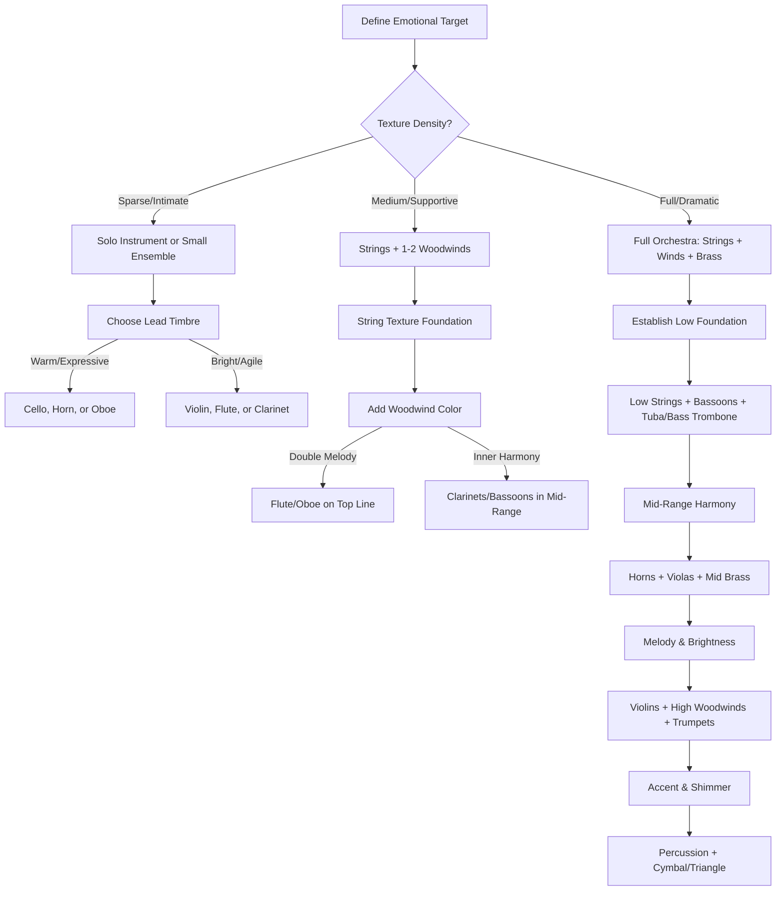

# Lesson 2: Orchestration Techniques for Film Scoring

## 1. First-Principles Intuition (15%)

Film orchestration is the strategic deployment of instrumental colors and textures to support narrative, emotion, and pacing. Unlike concert music, film scoring demands moment-to-moment flexibility—you're painting with sound to match visual rhythm, emotional arc, and often split-second dramatic shifts.

**Core Acoustic Reality:** Every instrument produces a fundamental frequency plus a unique harmonic series (overtones). A violin's bright, penetrating timbre comes from prominent 3rd–7th harmonics, while a tuba's warmth comes from a strong fundamental with subdued upper partials. This harmonic fingerprint determines how instruments blend or cut through the mix. When you layer strings, woodwinds, and brass, you're stacking overlapping harmonic spectra—too many similar frequencies create mud; complementary spectra create clarity and depth.

**Transposition Quick Reference:** B♭ trumpet sounds a major 2nd lower than written; F horn sounds a perfect 5th lower; E♭ alto sax sounds a major 6th lower; A clarinet sounds a minor 3rd lower. Write comfortably in their home keys (trumpet in D, horn in F/C) to access the strongest registers.

**Dynamic Headroom:** Strings can whisper (*ppp*) and scream (*fff*), spanning ~60 dB. Brass have explosive *fff* but limited *pp*. Woodwinds sit in between. For film underscore, you need constant dynamic shaping—strings carry soft bed textures, brass punctuate climaxes, woodwinds add expressive solo lines.

## 2. Practical Orchestration Mechanics (85%)

### Frequency Range Architecture

Map your orchestral palette across the frequency spectrum:

| Section | Low Register | Mid Register | High Register |
|---------|--------------|--------------|---------------|
| **Strings** | Cello/Bass: 40–250 Hz (foundation, bass lines) | Viola/Cello: 250–1 kHz (harmony, inner voices) | Violin: 1–4 kHz (melody, brilliance) |
| **Woodwinds** | Bassoon/Bass Clar: 60–400 Hz (dark colors, counter-bass) | Clarinet/Oboe: 250–2 kHz (lyrical solos, doubling) | Flute/Piccolo: 500–4 kHz (airiness, sparkle) |
| **Brass** | Tuba/Trombone: 50–400 Hz (power bass, pedal tones) | Horn/Trombone: 150–800 Hz (nobility, warmth) | Trumpet: 250–2 kHz (fanfares, aggression) |
| **Percussion** | Timp/Bass Drum: 40–200 Hz (rhythmic foundation) | Snare/Toms: 100–500 Hz (attacks, color) | Cymbals/Triangle: 2–12 kHz (shimmer, accent) |

**Practical Application:** For a dark, tense underscore, cluster activity in 60–400 Hz (low strings, bassoons, trombones). For a bright, heroic cue, push energy into 500 Hz–2 kHz (violins, trumpets, high woodwinds). Avoid frequency pile-ups—if cellos play a bass line, don't double with bassoons *and* trombones *and* tuba simultaneously unless you want intentional weight.

### String Section Divisi Voicing

**Standard String Layout (40-piece section):**
- Violin I: 12 players
- Violin II: 10 players
- Violas: 8 players
- Cellos: 6 players
- Basses: 4 players

**Divisi Technique:** Split sections into 2, 3, or 4 independent voices to thicken harmony or create lush pads.

**Example: Four-Part Harmony in Strings**

Chord: C Major (C–E–G–C)

```
Violin I (a2): High C + E (divisi, 6 players each)
Violin II (a2): G + High C (divisi, 5 players each)
Violas (unison): Middle C
Cellos (unison): Low G
Basses (unison): Low C
```

**Notation:** Mark *div. a2* (divide in two), *div. a3* (three), or *non div.* (unison). The conductor and players automatically redistribute.

**Voicing Rules:**
1. **Wide Low, Tight High:** Space bass notes an octave apart; cluster treble within an octave for warmth without mud.
2. **Double at Octaves:** If Violin I plays high C, double with Cellos an octave (or two) lower for reinforcement.
3. **Avoid Mid-Range Pile-Up:** Don't stack Violin II, Violas, and Cellos all in the 250–500 Hz range unless you want intentional thickness.

**Texture Drill:**
- **Soft Pad (pp):** All strings *div. a2* or *a3*, slow bow changes, no vibrato → glassy, ethereal.
- **Power Unison (fff):** All strings *non div.*, same melody, aggressive down-bows → massive, aggressive.
- **Transparent Counterpoint:** Violin I melody, Violin II counter-melody, Violas sustained harmony, Cellos pizzicato bass → clear, detailed.

### Brass and Woodwind Balance

**Brass Dominance Problem:** A single trumpet *ff* can overpower an entire string section *mf*. Balance demands strategic doubling and dynamic shaping.

**Doubling Strategies:**

| Brass Alone | +Woodwinds (Reinforce Color) | +Strings (Blend & Warmth) |
|-------------|------------------------------|----------------------------|
| 2 Horns (F) *mf*, unison melody | +2 Clarinets *mf* doubling at unison or octave | +Violin I & II *mf* doubling melody |
| 3 Trumpets *ff* fanfare | +2 Oboes *ff* (adds edge, cuts through) | +Full strings *f* (smooths brass aggression) |
| 4 Trombones *f* chorale | +2 Bassoons *f* (darkens, adds depth) | +Low strings *mf* (foundation, warmth) |

**Dynamic Balancing Drill:**
1. Write a 4-bar phrase for 4 horns *ff*.
2. Add 2 clarinets *mf* doubling the top horn line.
3. Add full strings *f* doubling the entire horn chord.
4. Playback and adjust: If brass still dominates, pull brass to *f* or boost strings to *ff*.

**Woodwind Choir Spacing (Dark → Bright):**
```
2 Bassoons: Low harmony, bass doubling
2 Clarinets: Middle harmony, lyrical doublings
2 Oboes: Top melody, expressive leads
2 Flutes: High shimmer, color accents
```

**Avoid:** All four woodwind pairs in unison—this creates a blended, indistinct sound. Instead, stagger by octaves or assign distinct harmonic roles.

### Transposing Instruments: Practical Workflow

**Write Comfortably, Transpose Later:**

1. **Compose in Concert Pitch (C):** All instruments sound at written pitch during composition.
2. **Transpose Before Engraving:** Convert parts to transposed notation for players.

**Quick Transpose Chart (from Concert Pitch):**

| Instrument | Written Pitch | Sounds | Transpose Up/Down |
|------------|---------------|--------|-------------------|
| B♭ Trumpet | D | C | Up major 2nd |
| F Horn | G | C | Up perfect 5th |
| E♭ Alto Sax | A | C | Up major 6th |
| A Clarinet | D | C | Up minor 3rd |
| B♭ Bass Clarinet | D | C (octave lower) | Up major 9th |

**Example: Concert C Major Triad (C–E–G)**

```
Horn in F (concert C–E–G): Write G–B–D
Trumpet in B♭ (concert C–E–G): Write D–F♯–A
Alto Sax in E♭ (concert C–E–G): Write A–C♯–E
```

**Best Sounding Registers (Write in These Zones):**
- **Trumpet in B♭:** Written F#4–C6 (sounds E4–B♭5) → brilliant, powerful.
- **Horn in F:** Written G3–C5 (sounds C3–F4) → noble, full-bodied.
- **Clarinet in B♭:** Written F#3–C6 (sounds E3–B♭5) → rich low register (chalumeau), brilliant high register (clarion).

**Scoring Drill:** Write a 16-bar melody for trumpet, horn, and clarinet in unison at concert pitch. Transpose each part. Check that all instruments stay within their comfortable written ranges.

### Orchestration Architecture: Layering Flowchart



### Real-World Film Scoring Scenarios

**Scenario 1: Tense Underscore (Low String Cluster)**

```
Target: 90-second scene, slow-building dread, no melody.

Orchestration:
- Cellos (div. a4): Sustained C–D♭–D–E♭ (minor 2nd clusters), no vibrato, pp → mp
- Basses (div. a2): Low C pedal tone + slow glissando C → B♭, ppp → p
- Bassoons (a2): Doubling cellos' top two notes (D–E♭), mp
- Contrabassoon: Low C pedal, ppp
- Timpani: Soft roll on C, ppp, barely audible
```

**Execution:** Strings enter at 0:00, bassoons at 0:30, timpani at 1:00. Dynamic swell from *ppp* to *mp* over 90 seconds. No melody, pure texture.

**Scenario 2: Heroic Fanfare (Brass-Led)**

```
Target: 8-bar triumphant theme, 120 BPM, 4/4.

Orchestration:
- 4 Horns: Unison melody, ff, sustained notes with marcato attacks
- 3 Trumpets: Melody doubled octave higher, ff, short articulations
- 3 Trombones: Harmony (3rd & 5th below melody), f
- Tuba: Bass line, f
- Strings: Full section doubling entire brass chord, ff, long bows
- Timpani: Downbeats, ff, reinforcing tonic/dominant
```

**Voicing Example (Concert Pitch, C Major Theme):**
```
Bar 1, Beat 1 (C Major Triad):
Trumpets: High C (fff)
Horns: Middle C (ff)
Trombones: E + G (f)
Tuba: Low C (f)
Violin I: High C (ff)
Violin II: G (ff)
Violas: E (ff)
Cellos: Middle C (ff)
Basses: Low C (ff)
Timpani: C (ff)
```

**Scenario 3: Intimate Love Theme (Solo + Strings)**

```
Target: 32-bar lyrical melody, 60 BPM, 3/4 waltz.

Orchestration:
- Solo Cello: Melody, espressivo, mp → mf, rich vibrato
- Violin I (div. a2): Sustained harmony (roots and 5ths), pp, no vibrato
- Violin II: Gentle arpeggiated accompaniment, p
- Violas: Inner harmony (3rds and 6ths), pp
- Harp: Arpeggiated chords on beats 1 & 2, p
```

**Texture:** Solo cello sits 10–20 dB above string bed. Strings provide harmonic pillow without competing. Harp adds shimmer without rhythmic intrusion.

### Orchestration Template: Modular Blocks

Use these pre-built blocks to assemble cues quickly:

**Block A: String Pad Foundation**
```
Violin I + II (div. a2 each): 4-note chord, pp-mp, sustained
Violas (div. a2): 2-note harmony, pp
Cellos + Basses (unison): Bass note, pp
```

**Block B: Woodwind Color Layer**
```
2 Flutes: Top melody or shimmer, p-mf
2 Clarinets: Mid-range doubling or counter-melody, p
2 Bassoons: Low harmony or bass doubling, p
```

**Block C: Brass Power Accent**
```
4 Horns: Sustained chord, mf-ff
3 Trumpets: Short fanfare or punctuation, f-ff
3 Trombones: Low harmony, f
Tuba: Bass reinforcement, f
```

**Block D: Percussion Rhythm & Color**
```
Timpani: Downbeats or rolls, p-ff
Snare/Bass Drum: Rhythmic hits, mf-f
Cymbals/Triangle: Accents or shimmer, p-mf
```

**Assembly Example (32-bar Dramatic Cue):**
- Bars 1–8: Block A only (soft build)
- Bars 9–16: Block A + Block B (add color)
- Bars 17–24: Block A + Block B + Block C (full power)
- Bars 25–32: Block A + Block C + Block D (climax with rhythm)

### Practice Drills

**Drill 1: Frequency Separation Exercise**
1. Write a 4-bar phrase using only instruments in the 60–250 Hz range (low strings, bassoons, low brass).
2. Write the same phrase using only 1–4 kHz range (violins, flutes, trumpets).
3. Combine both, ensuring no overlap. Listen for clarity.

**Drill 2: Divisi Voicing Workout**
1. Take a 4-note chord (e.g., C Major 7: C–E–G–B).
2. Voice it three ways:
   - Wide spacing (low strings octave apart, high strings clustered)
   - Tight spacing (all notes within one octave)
   - Mixed spacing (low notes wide, high notes tight)
3. Render all three and compare warmth, clarity, and power.

**Drill 3: Brass/String Balance Test**
1. Write an 8-bar brass chorale (4 horns + 3 trombones, *f*).
2. Add full strings doubling at *mf*, then *f*, then *ff*.
3. Find the string dynamic where brass and strings balance evenly.

**Drill 4: Transposition Speed Test**
1. Write a 16-bar melody in concert pitch.
2. Transpose it for B♭ trumpet, F horn, E♭ alto sax, and A clarinet.
3. Time yourself. Target: under 5 minutes for all four parts.

### Notation Software Workflow (Dorico/Sibelius/Finale)

**Step 1: Enable Concert Pitch Mode**
- Compose with all parts sounding at written pitch.
- Menu: View → Concert Pitch (ON).

**Step 2: Input Notes in Concert Pitch**
- Write all parts as they should sound.

**Step 3: Disable Concert Pitch for Engraving**
- Menu: View → Concert Pitch (OFF).
- Software auto-transposes all parts to transposed notation.

**Step 4: Export Parts**
- File → Export → Individual Parts.
- Each player receives correctly transposed music.

### Advanced Techniques: Orchestral Blending

**Unison Doubling (Reinforce Power):**
```
Melody: Violins I + Flutes + Oboes (all same pitch, ff)
Result: Brilliant, cutting, unified timbre
```

**Octave Doubling (Expand Range):**
```
Melody: Violins I (high) + Cellos (low, octave down)
Result: Warmth + brilliance, full-spectrum presence
```

**Harmonic Doubling (Thicken Texture):**
```
Violins I: Melody
Violins II: 3rd below
Violas: 5th below
Cellos: Octave below
Result: Lush, full-bodied chord built around melody
```

**Timbral Fusion (Create New Colors):**
```
Horns + Clarinets (same pitch, same dynamic)
Result: Blended color (darker than clarinet alone, brighter than horn alone)

Cellos + Bassoons (unison, low register)
Result: Dark, resonant, mysterious
```

**Key Principle:** Instruments in the same frequency range at the same dynamic fuse into a new blended timbre. Instruments separated by register or dynamic remain distinct.

### Orchestration Checklist for Every Cue

- [ ] **Frequency map clear:** No pile-ups in 200–500 Hz unless intentional.
- [ ] **Transpositions verified:** All parts in comfortable written ranges for players.
- [ ] **Dynamic balance tested:** Brass not overpowering strings/winds unless desired.
- [ ] **Divisi marked:** *div. a2/a3* or *non div.* explicitly notated.
- [ ] **Articulations specified:** Legato, staccato, marcato, tenuto marked consistently.
- [ ] **Tempo & time signature locked:** Matches picture edit (if syncing to video).
- [ ] **Dynamics shaped:** Not static—music breathes with scene pacing.

This is the practical orchestration toolkit for film scoring. Master these techniques, internalize the frequency ranges, practice divisi voicing and transposition daily, and you'll orchestrate efficiently and expressively for any narrative context.
